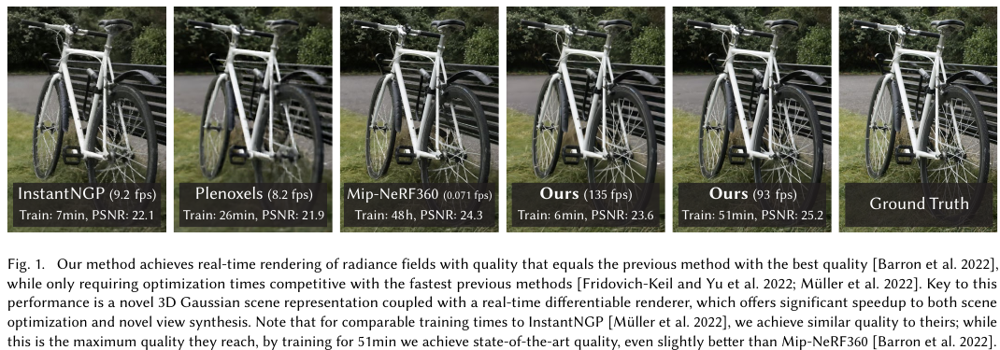
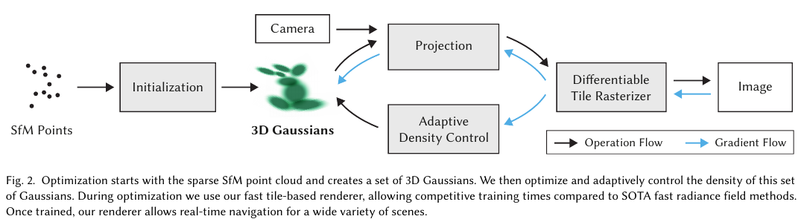
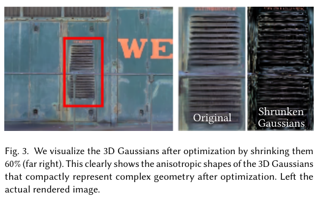
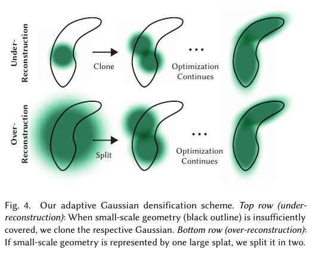
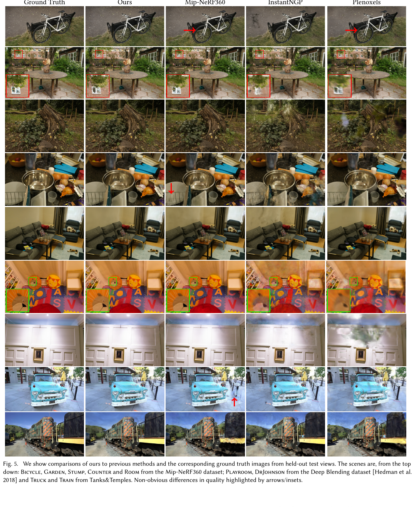
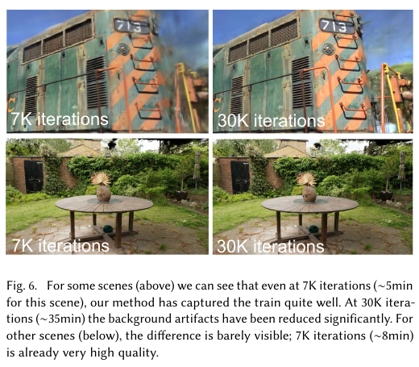

# 3D Gaussian Splatting 论文解读

> Bernhard Kerbl、Georgios Kopanas、Thomas Leimkühler、George Drettakis，*3D Gaussian Splatting for Real-Time Radiance Field Rendering*，ACM Transactions on Graphics 42(4)，2023。本文依据 arXiv v1（2023-08-08，14 页）全文与附录。 [论文页面](https://arxiv.org/abs/2308.04079v1) · [PDF](https://arxiv.org/pdf/2308.04079v1) · [项目页](https://repo-sam.inria.fr/fungraph/3d-gaussian-splatting/) · [DOI](https://doi.org/10.1145/3592433)

## 1. 引言

从一组照片合成新视角时，方法需要同时回答两个问题：场景用什么表示，以及怎样把这个表示快速渲染成图像。NeRF 一类方法以连续辐射场描述空间，在相机射线上采样并累积颜色；这种体渲染形式适合梯度优化，却需要大量采样。显式点或网格容易交给 GPU 光栅化，但普通点云会留下空洞，许多点渲染方法还依赖多视图立体（MVS）生成的稠密几何。

Kerbl 等人希望把两种路线的长处放进同一个流程：用可以优化的连续体积基元表达场景，用类似传统光栅化的方式渲染它们。论文的关键由三部分组成：从相机标定时得到的稀疏 SfM 点云初始化各向异性 3D 高斯；在图像损失优化过程中按需克隆、分裂或删除高斯；用可微、按可见性排序的 tile 光栅器完成训练渲染和新视角渲染。因此，3D Gaussian Splatting（3DGS）并不只是“把场景存成很多高斯”，表示、密度控制和光栅器必须配合工作。

*原论文图 1。自行车场景的示例展示了速度与画质的组合：论文在这一场景报告 3DGS 约 135 FPS、6 分钟训练和 23.6 PSNR 的配置，也展示了训练 51 分钟后约 93 FPS、25.2 PSNR 的配置。这里的数字对应图中单个场景和具体配置，不是跨数据集平均值。*

论文聚焦静态场景的新视角合成。目标是在 1080p 下达到至少 30 FPS，同时保持接近当时高质量辐射场方法的视觉效果，并让训练时间接近快速方法。它用 SfM 得到的相机和稀疏点作为输入，不要求先有 MVS 稠密模型。

## 2. 相关工作

NeRF 将场景看作连续的密度与颜色函数，沿每条像素射线采样并进行体渲染。点基元也可以使用 alpha 合成得到相近的成像公式，但显式点能直接投影到图像上，省掉沿空空间反复采样的开销。早期点渲染通常受限于固定大小点的孔洞、几何质量或每像素排序成本；一些神经点方法还需要 MVS 输入，难以避开稠密重建误差。

3DGS 延续了点基元与体渲染共享的前向合成关系，同时选用带空间范围的三维高斯，而非零尺寸点。它既能把高斯的投影当作椭圆 splat 做光栅化，也能像体表示一样通过可微的颜色与透明度合成优化。这使得它不用在渲染时沿整条射线采样，也不必把场景固定在规则体素网格中。

## 3. 方法概览

输入是一组静态场景图像、由 SfM 标定的相机，以及 SfM 附带生成的稀疏点云。每个 SfM 点先变成一个高斯，初始协方差设为各向同性，尺度取其附近三个点距离的均值。训练时随机选取一张相机图像，把当前高斯投影并渲染，再将预测图像与真实图像比较。图像损失的梯度更新高斯的位置、形状、不透明度和颜色；周期性的密度控制则会增删基元。

训练和最终浏览使用同一个可微 tile 光栅器。训练阶段需要它返回图像并把梯度传回高斯；优化结束后，相机变化只需重新投影、排序和合成高斯，就能实时产生新视角。

*原论文图 2。黑色箭头表示前向的投影与渲染流程，蓝色箭头表示图像损失回传形成的梯度流；密度控制插在参数优化过程中。*

## 4. 可微 3D 高斯 Splatting

### 4.1 高斯怎样表示场景

一个三维高斯以均值 \(\boldsymbol{\mu}\)、协方差矩阵 \(\boldsymbol{\Sigma}\)、不透明度和颜色属性描述。它在位置 \(\mathbf{x}\) 的空间权重为

\[
G(\mathbf{x}) = \exp\!\left(-\frac{1}{2}(\mathbf{x}-\boldsymbol{\mu})^T
\boldsymbol{\Sigma}^{-1}(\mathbf{x}-\boldsymbol{\mu})\right).
\]

可以把它理解为一个带柔和边缘的椭球体：均值决定中心，协方差决定三个主轴方向上的伸展程度。若一个高斯覆盖细长结构，它可以沿结构方向拉长；面对平坦区域，则可以压扁成薄片。因此，多个形状各异的体积基元能用较少数量近似场景中的表面与外观。论文图 3 将优化后的高斯缩小后展示了这一点：墙板上的窄缝由细长、扁平的高斯共同描出。

直接把协方差的九个元素作为参数并不稳妥，因为有效协方差必须是半正定矩阵，普通梯度更新可能让它失去这个性质。作者改用旋转与尺度来构造协方差：

\[
\boldsymbol{\Sigma}=\mathbf{R}\mathbf{S}\mathbf{S}^T\mathbf{R}^T,
\]

其中 \(\mathbf{S}\) 是由三个轴向尺度组成的对角矩阵，\(\mathbf{R}\) 由单位四元数表示的旋转生成。尺度经过指数映射保持为正，四元数归一化后对应有效旋转。这个参数化使训练能够独立调整高斯的伸缩和朝向。

论文附录进一步把投影协方差对尺度和旋转的导数沿着这条参数化链式展开。这样，屏幕空间椭圆的误差可以传回三维高斯的尺度与四元数；作者显式推导这些梯度，以减少训练中自动微分的额外开销。

颜色允许随观察方向变化。每个高斯保存球谐系数，渲染时按相机方向求出颜色；这比给每个高斯只存一个固定 RGB 值更能表达视角相关外观。论文采用最高三阶的球谐表示。为避免视角覆盖不足时高频外观过早干扰拟合，优化从零阶颜色开始，每隔 1000 次迭代引入一个球谐频带，直到四个频带都参与优化。

### 4.2 从三维协方差到屏幕椭圆

渲染时要把三维高斯变换到相机和图像坐标系。论文用投影变换在高斯中心附近的一阶雅可比近似，将世界坐标协方差 \(\boldsymbol{\Sigma}\) 投影为屏幕空间的二维协方差：

\[
\boldsymbol{\Sigma}' = \mathbf{J}\mathbf{W}\boldsymbol{\Sigma}
\mathbf{W}^T\mathbf{J}^T.
\]

这里 \(\mathbf{W}\) 是视图变换，\(\mathbf{J}\) 是透视投影在该位置的雅可比。取投影协方差的二维部分，就能得到图像平面上椭圆 splat 的大小和方向。这个局部线性化让渲染器无需把每个高斯采样成大量三维点，而能直接计算它影响哪些像素。

对于覆盖像素的高斯，二维高斯权重乘以其不透明度，形成该像素处的 \(\alpha_i\)。按从前到后的顺序合成时，像素颜色写作

\[
\mathbf{C}=\sum_{i=1}^{N} \mathbf{c}_i\alpha_i
\prod_{j=1}^{i-1}(1-\alpha_j),
\]

其中 \(\mathbf{c}_i\) 是第 \(i\) 个高斯在当前观察方向的颜色，乘积表示前面的高斯透射后仍留给它的份额。于是，前景高斯越不透明，后续高斯对像素的贡献越小。这保留了体渲染中透射率加权累积的形式，但候选基元来自显式投影与排序，而不是沿射线随机采样。

*原论文图 3。左侧是实际渲染图，右侧将高斯缩小 60% 后显示；这种形状来自优化后的协方差，而非作者手工给每个点指定法线。*

## 5. 高斯优化与自适应密度控制

每轮训练从某个输入视角渲染图像，再与真实图像计算损失。作者组合像素级 L1 与 D-SSIM（结构相似度的差异项）：

\[
\mathcal{L}=(1-\lambda)\mathcal{L}_1+\lambda\mathcal{L}_{D-SSIM},
\qquad \lambda=0.2.
\]

梯度通过可微投影和合成过程传回参数。位置、尺度、旋转、透明度和球谐颜色都会被优化。训练分辨率从目标尺寸的四分之一开始，并在 250、500 次迭代后逐步升高；这让早期较粗的拟合先稳定下来，再处理更细的图像差异。

仅靠移动已有高斯不足以恢复所有结构：有些区域缺少基元，有些区域则由过大的高斯糊成一片。作者观察到，这两种情况都会在图像损失中产生较大的屏幕空间位置梯度，于是以该梯度作为需要增加密度的信号。优化预热后，每 100 次迭代检查一次高斯，并在训练早期持续执行致密化。

具体来说，较小高斯若位于重建不足的区域，就复制一个同尺度高斯，并沿位置梯度方向移动副本，让两者后续分工拟合邻近结构；较大高斯若跨越了需要细节的区域，就用两个较小高斯替代，尺度除以论文实验设定的 1.6，中心从原高斯分布中采样。前一种操作增加高斯覆盖的总体积，后一种主要把已有覆盖拆细。透明度接近零的高斯会被删除，过大或屏幕覆盖范围异常的基元也会被裁剪。作者每 3000 次迭代把透明度重置到接近零，让后续优化重新决定哪些区域需要保留不透明度。

*原论文图 4。上排复制小高斯以扩展缺失几何附近的覆盖；下排把单个过大的高斯拆成两个小高斯，逐步提高表示的局部细节。*

这套机制让高斯数量与优化一起变化：初始几何由稀疏 SfM 点提供，之后依据图像拟合误差分配容量。它也会受输入覆盖影响。如果相机视角很少，高斯可能在未观测区域形成漂浮伪影，或用外观参数补偿缺失的几何约束；密度控制本身不能从没有图像证据的方向恢复唯一真实形状。

## 6. 面向高斯的快速可微光栅器

如果对每个像素分别找出并排序所有相交高斯，排序开销会随像素重复。论文将屏幕划成 16×16 像素的 tile，把每个投影后覆盖到某个 tile 的高斯复制为一个 tile 实例，再为实例建立同时包含 tile 编号和视空间深度的键。一次 GPU 基数排序即可把同一 tile 的实例放在一起，并按深度排列。论文用 99% 置信区间与视锥、tile 边界做剔除，避免处理对当前画面没有贡献的高斯。

每个 tile 由一个线程块处理。线程块协作把高斯数据载入共享内存，各像素沿已排序列表由前向后累积颜色和透明度；当像素透明度接近饱和时，就不再处理更远的高斯。如果一个 tile 内所有像素都饱和，该 tile 也可以提前结束。这个流程把大量小 splat 的工作组织成规则的 GPU 并行任务。

全局按深度排序没有做到严格的逐像素可见性排序：同一 tile 内不同像素的高斯覆盖范围不同，局部顺序可能不完全一致。作者接受了这种近似，以避免为每个像素单独排序，并指出 splat 接近像素大小时，近似影响会变小。这是速度与严格排序之间的工程取舍。

反向传播还要把图像损失传给所有对像素有贡献的高斯。若前向阶段只保留固定数量的最近高斯，场景深度复杂时会漏掉梯度。论文因此不设接收梯度的高斯数量上限：反向时复用前向排序后的 tile 列表，反向遍历高斯，并利用前向存下的最终累积透明度逐步恢复中间透射率。这样不用为每个像素在显存中保存任意长度的高斯列表，也能计算完整合成序列的梯度。

## 7. 实现、实验与消融

作者以 PyTorch 编写优化流程，以自定义 CUDA 内核完成光栅化，并使用 NVIDIA CUB 的基数排序。评估包括 Mip-NeRF360、Tanks&Temples、Deep Blending 的真实场景，以及 Blender 合成场景；真实场景按照 Mip-NeRF360 的协议每隔八张图留一张测试。主要实验运行在 NVIDIA A6000 上，表中 Mip-NeRF360 的比较数字取自原论文报告。

在 Mip-NeRF360 数据集平均结果中，30K 迭代的 3DGS 得到 27.21 PSNR、0.815 SSIM、0.214 LPIPS，训练约 41 分 33 秒，渲染约 134 FPS；Mip-NeRF360 原论文报告的对应指标为 27.69、0.792、0.237，训练约 48 小时。不同指标并非同向变化：3DGS 的 SSIM 和 LPIPS 更好，PSNR 略低。这里的 48 小时是作者按单张 GPU 计算的等效时间，原实验在四张 A100 上训练 12 小时。表中训练、渲染和显存数据来自论文所述的具体实现及分辨率，不能直接当作所有 3DGS 实现的硬件保证。

*原论文图 5。比较覆盖 Mip-NeRF360、Deep Blending 和 Tanks&Temples 的场景。图中放大框和箭头标出纹理、细枝与背景等局部差异；图像说明与数值表需结合阅读，单张视觉样例不能替代跨场景指标。*

论文还比较 7K 与 30K 迭代。7K 配置通常用几分钟训练，许多场景已有较好的细节；继续训练到 30K 能减少背景伪影，但提升因场景而异。消融实验显示，去掉高斯分裂后，平均 PSNR 从完整方法的 23.90/26.05 降到 21.50/23.90（分别对应 5K/30K 迭代）；限制每个像素只有 10 个高斯获得梯度，则平均值降至 19.16/19.19。去掉各向异性后也有下降。该消融使用三类场景和专门下采样后的输入，结果用于说明这些设计在该设置中的作用，不应与主表的跨数据集结果混为一谈。

*原论文图 6。火车背景在继续训练后更干净；花园场景的两种训练时长已较为接近，说明训练收益依赖场景内容。*

## 8. 讨论与结论

3DGS 的速度来自几个环节的共同设计：高斯是显式且可投影的基元，避免对空空间密集采样；各向异性协方差能用少量基元贴合细长或扁平结构；训练时动态增删高斯，把表示容量集中到图像误差较大的区域；tile 光栅器把 splat 列表整理成便于 GPU 并行处理的任务。消融实验表明，SfM 初始化、克隆与分裂、各向异性、球谐颜色和不截断梯度，都参与了论文报告的结果。

论文也清楚呈现了代价。真实大场景的训练峰值显存可能超过 20 GB，优化后模型可占数百 MB，渲染器还需要额外显存；高斯显式存储并不自动意味着模型轻量。作者指出原型约 80% 的训练时间花在 Python 代码中，说明 CUDA 光栅器解决了主要渲染瓶颈，但当时的优化流程仍留有工程开销。相机覆盖不足时，未观测区域可能产生伪影；简化的可见性排序会带来 popping，论文没有加入抑制这些问题的正则化。高斯也是为辐射场拟合与渲染设计的体积基元，论文把从它们稳定恢复网格留作后续问题。

因此，3DGS 的核心贡献不是单独提出一种新基元，而是把可微的体渲染合成、动态表示容量和传统 GPU 光栅化组织成完整训练系统。它在论文所测场景中展示了很高的新视角渲染速度和有竞争力的画质；训练内存、输入视角覆盖、几何解释性及排序近似仍界定了它的适用边界。
