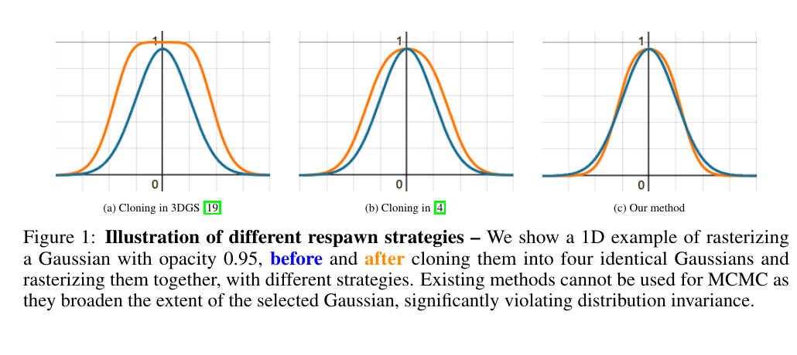
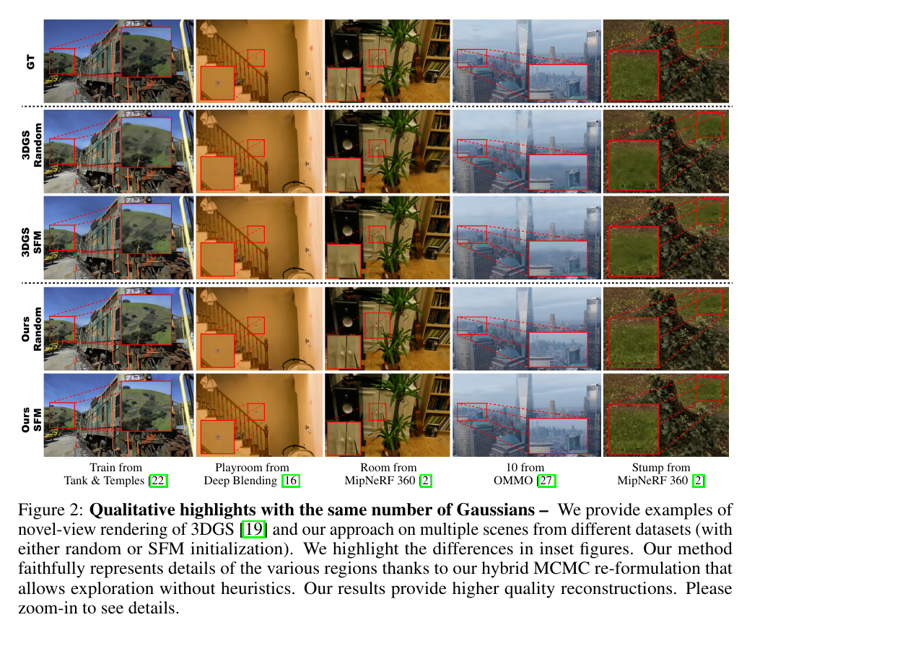
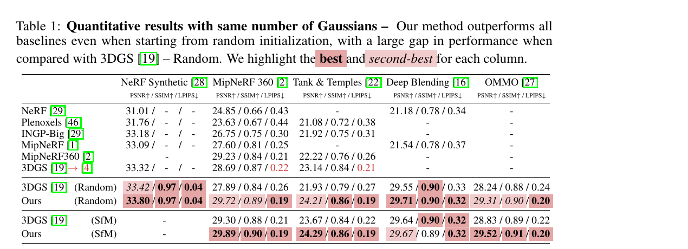
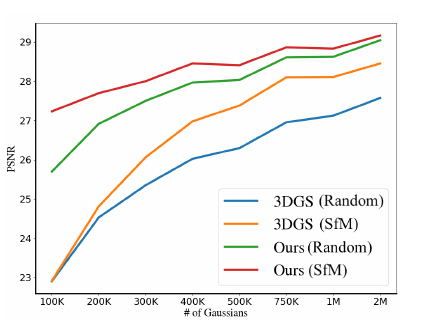
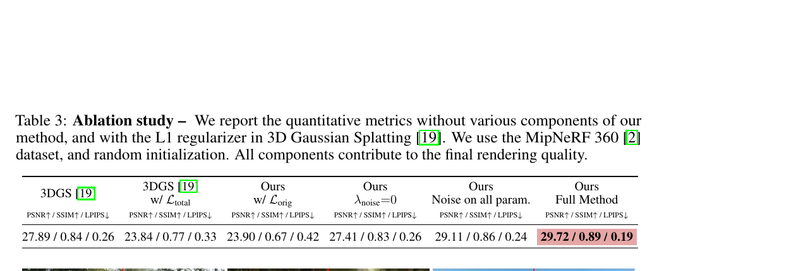
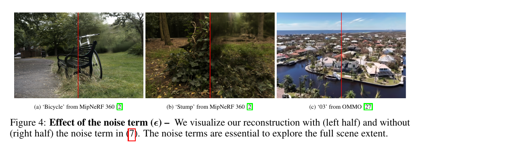

# 3D Gaussian Splatting as Markov Chain Monte Carlo 论文解读

> Shakiba Kheradmand、Daniel Rebain、Gopal Sharma、Weiwei Sun、Yang-Che Tseng、Hossam Isack、Abhishek Kar、Andrea Tagliasacchi、Kwang Moo Yi，*3D Gaussian Splatting as Markov Chain Monte Carlo*，NeurIPS 2024。本文依据 NeurIPS 正式版全文及其中的附录 A–E。[NeurIPS 论文页](https://proceedings.neurips.cc/paper_files/paper/2024/hash/93be245fce00a9bb2333c17ceae4b732-Abstract-Conference.html) · [正式版 PDF](https://proceedings.neurips.cc/paper_files/paper/2024/file/93be245fce00a9bb2333c17ceae4b732-Paper-Conference.pdf) · [项目页与代码](https://ubc-vision.github.io/3dgs-mcmc/)

原始 3D Gaussian Splatting（3DGS）依靠图像损失优化高斯，再周期性地克隆、分裂、删除和重置不透明度。这样的密度控制很有效，但结果容易受初始 SfM 点云和一组阈值影响：没有初始化点的位置，可能长期得不到高斯；高斯数量也难以仅从训练参数预估。Kheradmand 等人提出换一个角度看待这些基元：把当前高斯集合当作从“能够解释训练图像的场景分布”中抽取的样本。对高斯位置加入受梯度引导的随机扰动，让样本能探索初始化未覆盖的空间；再把增删基元改写为近似保持渲染贡献的重定位。

这套方法的关键不是简单地给每个高斯加随机抖动。噪声只加到位置，并按高斯的协方差和不透明度调节；死高斯重生时，也要调整克隆后的不透明度与协方差，使整个高斯的影响尽量不变。论文实验显示，这种探索方式让训练对随机初始化更稳，并在固定高斯预算下取得较好的新视角指标。它改进的是训练和密度控制流程，场景表示与渲染仍沿用 3DGS。

*原论文 Figure 1。示例把不透明度为 0.95 的一维高斯复制为四个。蓝线表示变换前响应，橙线表示变换后合成响应；经典克隆和中心修正克隆都扩大了高斯的有效范围，论文提出的重定位则让两条曲线更接近。*

## 从梯度下降到随机探索

3DGS 将场景表示为高斯集合。对某个相机视角，先把高斯投影到图像，按深度排序，再用 alpha 混合合成颜色。训练时抽取一张图像，计算渲染损失，并用梯度更新高斯参数。若暂时忽略高斯的增删，单个高斯 $g$ 的更新可以概括为：

$$
g \leftarrow g-\lambda_{lr}\nabla_g\mathbb{E}_{I\sim\mathcal{I}}[L_{total}(g;I)].
\tag{4}
$$

这里 $\mathcal{I}$ 是训练图像集合，$I$ 是随机抽取的视图，$L_{total}$ 是当前重建目标。这个更新把高斯朝降低期望损失的方向移动，但不会主动探索没有梯度信号的位置。

随机梯度朗之万动力学（Stochastic Gradient Langevin Dynamics，SGLD）则用梯度引导采样，同时加入随机项：

$$
g\leftarrow g+a\nabla_g\log P(g)+b\epsilon.
\tag{5}
$$

$P(g)$ 表示希望采样的概率密度，$\epsilon$ 是随机噪声，$a$ 与 $b$ 控制梯度更新和探索的强度。论文令高斯集合的概率与重建质量相关，取

$$
G=P\propto\exp(-L_{total}).
\tag{6}
$$

此时 $\nabla_g\log P(g)=-\nabla_g L_{total}$，梯度项就与常规 3DGS 的下降方向一致。论文据此把标准 3DGS 看成一种没有显式探索噪声的采样过程，再在更新中加入噪声：

$$
g\leftarrow g-\lambda_{lr}\nabla_g\mathbb{E}_{I\sim\mathcal{I}}[L_{total}(g;I)]+\lambda_{noise}\epsilon.
\tag{7}
$$

实现中作者仍使用 Adam 处理梯度，而不是把所有参数直接交给标准 SGLD 更新。可以把这一视角理解为：当前渲染损失提供“哪些位置更能解释图像”的方向信号，随机项则让基元有机会离开仅凭已有梯度形成的局部活动范围。它尤其针对 SfM 稀疏点云漏掉的区域，以及随机初始化时尚未探索到的场景部分。

若把同样强度的独立噪声加到每个高斯上，细线和边缘处的小高斯可能被一步推离支持区域，导致之后的图像梯度很难将它们拉回来。作者因此只扰动位置，并让噪声具有高斯本身的空间形状。对中心位置 $\mu$，噪声写成：

$$
\epsilon_\mu=\lambda_{lr}\,\sigma\!\left(-k(o-t)\right)\,\Sigma\eta,
\qquad \epsilon=[\epsilon_\mu,0],\qquad\eta\sim\mathcal{N}(0,I).
\tag{8}
$$

$\Sigma$ 是高斯协方差，$o$ 是不透明度，$\sigma$ 是 sigmoid 函数，$\eta$ 为标准正态随机向量。乘以 $\Sigma$ 后，主轴较长的方向会有更大的位置扰动，短轴方向扰动更小；这与高斯的各向异性形状相协调。sigmoid 因子则让不透明度很低的高斯获得较强探索，已经较不透明、能被图像损失稳定约束的高斯获得较弱噪声。论文取 $k=100$、$t=1-0.005$，使过渡集中在原始 3DGS 常用的不透明度剪枝阈值附近。

不透明度、尺度和颜色不加这类噪声。作者的消融实验显示，对所有参数都加入噪声会降低结果；探索主要需要发生在空间位置上。反过来，位置噪声若缺少约束，会把无用高斯送入视锥外或其他几乎没有图像监督的区域。论文因此还对不透明度与协方差尺度加正则项，使不再贡献有效渲染的高斯能够收缩、变得透明，之后再被重定位。

## 让死高斯重生时尽量不改变图像

加入噪声提供了位置探索，但模型仍需要调整高斯数量。传统 3DGS 会克隆或分裂高梯度基元，也会周期性重置不透明度；MCMC 视角下，这些变化可以改写成从一个高斯集合状态跳转到另一个状态。为了不让这种离散变化突然改变当前渲染，论文把低不透明度的“死高斯”搬到仍然活跃的高斯处，让它们共同承担原先基元的贡献。

设一个活跃高斯被扩展为 $N$ 个同中心、相同颜色的副本，其原始不透明度为 $o^{old}$，新不透明度为 $o^{new}$。在高斯中心处，$N$ 个副本的合成不透明度应等于原值：

$$
1-(1-o^{new})^N=o^{old},
\qquad o^{new}=1-(1-o^{old})^{1/N}.
$$

这保证了中心像素的合成结果，但只匹配中心仍不够。高斯不是点光源，在中心以外，多个具有相同尺度的副本会叠加出更宽的响应。图 1 展示了这一差别：原始克隆和只修正中心不透明度的克隆都拓宽了曲线，因此训练状态发生明显变化。

作者进一步要求：在任意穿过高斯中心的一维切片上，新旧高斯响应的积分尽量相同。对不同方向的切片，协方差决定该方向上的投影方差；使所有方向都满足同一比例关系，可将单一切片方差的缩放推广到完整协方差矩阵。论文得到的重定位更新为：

$$
\Sigma^{new}=o_{old}^{2}
\left[
\sum_{i=1}^{N}\sum_{k=0}^{i-1}
\binom{i-1}{k}
\frac{(-1)^k(o^{new})^{k+1}}{\sqrt{k+1}}
\right]^{-2}\Sigma^{old}.
\tag{9}
$$

式中方括号内的量由副本数和新不透明度决定，是对单方向响应积分的缩放因子；平方后取倒数并乘回原协方差，使新旧切片积分匹配。$N$ 个副本同中心、方向和颜色相同，主要变化由不透明度与协方差共同控制。这样，死高斯可以搬到活跃区域附近复用原有基元预算，同时尽量保持渲染分布。论文附录 A 从一维切片积分推导了该式。

这种匹配是近似的，并不意味着重定位前后的每个像素都严格相同。实际训练中，作者每 100 次迭代执行一次重定位以减小扰动；对每个死高斯，按照活高斯的不透明度分布进行多项式采样，选定目标位置后再应用式（9）。同时会调整 Adam 的矩统计：目标基元的矩统计重置，使其短期内不易继续漂移；搬来的死基元保留矩统计，继续探索。

*原论文 Figure 2。比较列覆盖 Tanks and Temples、Deep Blending、Mip-NeRF 360 和 OMMO 场景；行分别为 GT、随机初始化的 3DGS、SfM 初始化的 3DGS、随机初始化的本文方法、SfM 初始化的本文方法。放大框中的细节展示了方法在相同高斯数量下对结构和纹理的重建差别。*

## 用不透明度和尺度正则鼓励精简

仅凭重建损失不能保证随机探索得到的每个高斯都在有效区域。为抑制这些无用基元，作者把高斯是否“存在”与它的不透明度、空间尺度联系起来，在原有 L1 与 D-SSIM 损失上增加两项正则：

$$
L_{total}=(1-\lambda_{D-SSIM})L_1+\lambda_{D-SSIM}L_{D-SSIM}
+\lambda_o\sum_i|o_i|_1
+\lambda_\Sigma\sum_{i,j}\sqrt{\mathrm{eig}_j(\Sigma_i)}.
\tag{10}
$$

$\mathrm{eig}_j(\Sigma_i)$ 是第 $i$ 个高斯协方差的第 $j$ 个特征值，也就是沿主轴的方差。平方根对应主轴标准差，所以第二个正则会收缩高斯尺度；第一项会压低不透明度。两项配合能够使无用基元变得透明且小，降低它们对光栅化的负担，也为后续重定位提供更多可复用的“死”高斯。

训练开始时，方法先经过 500 次 warmup，不执行重定位和活跃高斯数量增长。之后活跃高斯数每次增加 5%，直到预设上限。其余实验默认设置包括 $\lambda_{noise}=5\times10^5$、$\lambda_\Sigma=0.01$、$\lambda_o=0.01$；Deep Blending 使用 $\lambda_o=0.001$。随机初始化时，作者在相机包围范围三倍大小的区域均匀采样 100k 个高斯。这里可见，MCMC 并没有取消所有训练超参数：它将密度增删规则换成了噪声、重定位与正则项控制的过程。

## 质量收益与高斯预算

论文在 NeRF Synthetic、Mip-NeRF 360、Tanks and Temples、Deep Blending 和 OMMO 上评测 PSNR、SSIM、LPIPS；每组实验运行三次并报告平均结果。表 1 对齐 3DGS 与本文方法的高斯数量，并区分随机初始化与 SfM 初始化。以随机初始化为例，Mip-NeRF 360 的平均 PSNR/SSIM/LPIPS 从 3DGS 的 27.89/0.84/0.26 变为 29.72/0.89/0.19；Tanks and Temples 从 21.93/0.79/0.27 变为 24.21/0.86/0.19；OMMO 从 28.24/0.88/0.24 变为 29.31/0.90/0.20。PSNR 与 SSIM 越高越好，LPIPS 越低越好。

*原论文 Table 1。每列分别报告五个数据集的 PSNR、SSIM 与 LPIPS。作者的方法在随机初始化时各数据集的整体指标均优于随机初始化的 3DGS；与 SfM 初始化的 3DGS 比较时，Deep Blending 上指标相近，其他数据集有所提升。*

结果需要结合场景和指标看。随机初始化对照中，Mip-NeRF 360、Tanks and Temples 与 OMMO 的收益较明显；Deep Blending 的平均 PSNR 只从 29.55 提升到 29.71，SSIM 持平于 0.90，LPIPS 从 0.33 到 0.32。NeRF Synthetic 本身较容易达到较高画质，随机初始化的 3DGS 与本文方法分别为 33.42 和 33.80 PSNR，LPIPS 都为 0.04。方法因此没有在所有数据集上带来同样幅度的提升。

初始化消融体现了探索的另一种作用。Mip-NeRF 360 中，把随机高斯从相机范围三倍缩到一倍，3DGS 的 PSNR 从 27.89 降到 22.72，本文方法则从 29.72 变为 29.64；对应 SSIM/LPIPS 也基本保持。噪声让训练有机会离开初始化分布的局部范围，但结果仍来自特定数据、预算和损失设定，不表示任意初始化都能恢复任意缺失几何。

*原论文 Figure 3。横轴为高斯数量上限，纵轴为除 NeRF Synthetic 外各数据集的平均 PSNR；随机初始化与 SfM 初始化分别比较。图中在较紧预算下，本文方法相对 3DGS 的优势更明显。*

消融结果支持噪声和正则项各自的作用：没有噪声时结果为 27.41 PSNR，完整方法为 29.72；噪声扩展到尺度、旋转和不透明度等其他参数后为 29.11。图 4 以自行车、树桩和 OMMO 场景说明，加入位置噪声后可以探索到原来未覆盖的场景区域。

*原论文 Table 3。消融基于随机初始化的 Mip-NeRF 360；完整方法达到 29.72/0.89/0.19。没有噪声、对其他参数也加噪声、或将正则项用于传统 3DGS 时，指标均低于完整方法。*

*原论文 Figure 4。每个场景左半边是启用噪声后的结果，右半边是不加噪声的结果；作者以此展示噪声帮助高斯探索场景范围。*

效率结果也需要分清“单步开销”和“达到目标质量的总耗时”。在 1M 高斯的优化迭代计时中，论文实现的单步耗时为 80 ms，3DGS 为 76 ms，采样与加噪只带来小幅单步增量。论文同时报告，采用 gsplat 的独立实现可减少约 20% 训练时间和 65% 显存占用；这些数字来自不同实现，不能与 PyTorch 主实现的单步耗时混为一个设置。由于正则项会改变高斯数量、尺度和不透明度，进而影响光栅化工作量，实际总训练耗时仍会随质量目标和预算变化。

## 方法带来的变化与边界

MCMC 的核心改动发生在优化和基元管理阶段：将位置更新中的随机探索与密度控制的状态转换放在同一框架下。对画质而言，噪声帮助填补初始化欠缺的区域；重定位在不大量增加基元数的前提下，让失去作用的基元迁往已有有效贡献的位置；不透明度和尺度正则则推动高斯收缩或消失。论文的质量提升来自这些因素的配合，而不是单独把梯度更新改成随机更新。

不过，论文中的概率解释需要结合实现理解。式（6）定义的是与重建损失指数相关的目标分布，并未显式构造可计算的完整场景后验；训练使用 Adam 和经验设定的噪声强度，重定位也只是近似保持状态概率，且每隔固定步数才执行。因此，文中 MCMC/SGLD 是指导训练设计的框架，不应读作已经证明在任意设置下都从严格目标分布收敛采样。作者实验给出了多数据集和三次运行的指标，但仍未覆盖所有相机、损失和数据分布。

论文附录还指出，方法继承了 3DGS 表达能力方面的局限。它本身没有解决混叠，也没有专门建模反射；作者认为它可以与相关表示扩展结合。系列中已有的 [Mip-Splatting 论文解读](../mip-splatting/index.md)关注采样尺度变化下的抗走样，两者分别改进渲染采样与训练密度控制，针对的问题不同。MCMC 的价值更具体地体现在：在高斯预算受限或初始化不完整时，探索和重新分配基元可能改善结果；若场景主要受反射表达、颜色建模或几何真实性限制，还需要其他方法提供相应能力。
