# ABot-Recon 论文解读

> Jiarong Han、Jincheng Xiong、Yuzhou Liu 等，*Revisiting Local Context for Long-Horizon Streaming 3D Reconstruction*，arXiv:2608.27529 v1，2026 年 8 月 27 日提交。 [论文页面](https://arxiv.org/abs/2608.27529v1) · [PDF](https://arxiv.org/pdf/2608.27529v1) · [项目页](https://amap-cvlab.github.io/ABot-Recon-html) · [代码](https://github.com/amap-cvlab/ABot-Recon)

## 长视频中的局部预测与全局累积

从长视频中在线恢复相机轨迹和稠密几何，要求输入按时间到达时，模型不能等到整段视频结束后再联合处理。它还需要控制每帧的计算量与内部状态大小。现有流式重建方法通常保存历史特征、递归状态或空间记忆；序列越长，如何压缩、检索和融合历史状态就越重要。LingBot-Map 和 HorizonStream 等方法进一步组合了近期上下文与长期信息。

这篇论文从另一个角度处理长时域问题：让模型每次只预测固定时间范围内的几何量，并使预测目标不依赖视频已经运行了多久。ABot-Recon 的学习状态只保留当前帧之前最近 11 帧的键值（KV）特征；当前帧加上这 11 帧构成 12 帧上下文。它为当前图像预测当前相机坐标系下的点图和置信图，并估计当前帧相对于上一帧的位姿。随后，系统把相邻位姿逐步连乘得到全局轨迹，再把每帧点图变换到全局坐标系。

这里的“固定内存”说的是网络的时间上下文：被淘汰的旧 KV 不再参与网络注意力。相机轨迹和输出点云仍需随着重建结果增长；论文没有声称这些输出所占存储也与序列长度无关。这个区分很重要，因为方法把长期信息从网络的学习状态转移到一串局部几何测量及其组合过程，并没有让长距离误差自动消失。

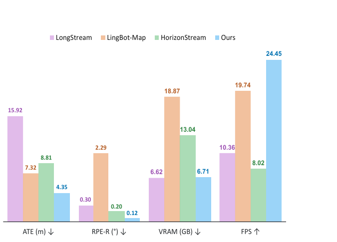

*原论文图 1。左两项是 Oxford Spires 的 ATE 与旋转相对位姿误差，右两项是 KITTI-02 上的显存与帧率；数据支持方法的精度和效率主张，但它们来自不同数据集，不能相互拼成同一组实验条件。*

论文图 2 展示了启用可选回环后的户外驾驶、手持室内移动和四足机器人轨迹及重建示例。这些图像说明方法可以接入回环后端并处理不同载体；其中附录的四足机器人与实地长视频结果没有准确真值，属于定性观察，不是定量基准。

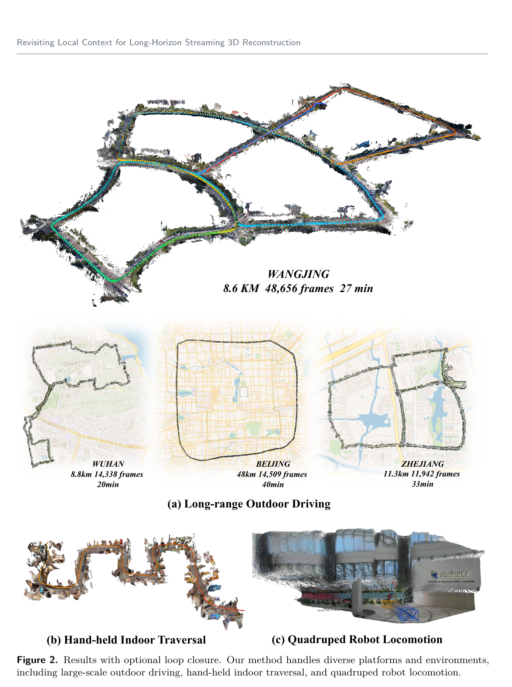

*原论文图 2。示例包括望京 8.6 km、48,656 帧的路线，以及武汉、北京、浙江等路线和手持、四足机器人场景；作者将其作为可视化结果呈现。*

## 相关工作与方法定位

论文把已有工作概括为三类。第一类是前馈式视觉几何重建：DUSt3R、MASt3R 等回归点图或匹配信息，VGGT、$\pi^3$ 等扩展到多视图推理；它们通常面向固定视图集合或需要跨视图全局交互。第二类是流式重建，通过外部空间记忆、递归状态、KV 缓存或显式地图把过去信息带到当前时刻。为处理更长序列，LONG3R、LongStream、LingBot-Map 和 HorizonStream 等方法继续引入门控记忆、周期性缓存更新、局部与长期上下文协作等机制。

第三类工作关注从局部估计恢复全局轨迹：传统 VO/SLAM 使用关键帧、位姿图、束调整和回环，学习式系统也常通过子图对齐或全局优化修正漂移。ABot-Recon 将预测目标保持在相邻帧尺度，再把局部结果组合成全局输出；需要重访约束时，仍可以接入标准 SLAM 式回环后端。它提出的差异主要在预测表示和状态管理方式，而非取消全局几何或回环优化。

## 局部位姿如何组成全局轨迹

### 当前帧坐标系下的预测

方法建立在因果注意力 Transformer 上。对第 $i$ 帧图像 $I_i$，图像编码器产生特征 $F_i$，解码器读取可学习相机 token $C$ 与缓存状态 $M_{i-1}$，输出稠密帧 token $G_i$、相机 token $C_i$ 和更新后的记忆状态 $M_i$。两个几何头从 $G_i$ 预测当前相机坐标系下的点图 $P_i$ 和置信图 $S_i$：

$$
\begin{aligned}
F_i &= \operatorname{Encoder}(I_i),\\
(G_i,C_i,M_i) &= \operatorname{Decoder}([F_i,C],M_{i-1}),\\
P_i &= \operatorname{Head}_{\mathrm{point}}(G_i),\\
S_i &= \operatorname{Head}_{\mathrm{conf}}(G_i).
\end{aligned}
\tag{1}
$$

$P_i$ 中的三维点直接以第 $i$ 帧相机为参考；$S_i$ 给出对应预测的可靠性。因而几何头不必把一个新视角的点图立即放到整段视频共用的全局坐标系中。全局坐标要等到相邻相机运动估计出来后才逐步建立。

相邻位姿来自相机 token。若每帧有 $L$ 个相机 token $c_i^\ell$，论文先用 MLP $\phi_{\mathrm{desc}}$ 编码并求平均，得到帧级描述子

$$
z_i=\frac{1}{L}\sum_{\ell=1}^{L}\phi_{\mathrm{desc}}(c_i^\ell).
\tag{2}
$$

再把相邻两帧描述子组成关系向量

$$
q_i=\mathcal R(z_{i-1},z_i),\qquad
\mathcal R(x,y)=[x,y,y-x,x\odot y],
\tag{3}
$$

其中 $y-x$ 保留描述子的变化方向，逐元素乘积 $x\odot y$ 则提供两帧的交互项。位姿头由此预测从第 $i$ 帧坐标系变换到第 $i-1$ 帧坐标系的相对变换：

$$
T_{i-1\leftarrow i}=\operatorname{Head}_{\mathrm{pose}}(q_i).
\tag{4}
$$

按下标约定，$T_{a\leftarrow b}$ 把坐标系 $b$ 中表示的点变换到坐标系 $a$。若连续收到多帧，相隔 $j-i$ 帧的相对变换由相邻变换按顺序相乘得到：

$$
T_{i\leftarrow j}
=T_{i\leftarrow i+1}T_{i+1\leftarrow i+2}\cdots T_{j-1\leftarrow j}
=\prod_{k=i+1}^{j}T_{k-1\leftarrow k}.
\tag{5}
$$

从第一帧的全局位姿出发，每来一帧就用上一帧全局位姿乘以新估计的相邻变换，得到新相机的全局位姿。该位姿再把局部点图 $P_i$ 变换到全局坐标。论文将输出设计成随参考坐标系变化而一致变换的局部量，因此模型不必依赖一个固定的全局锚点。关键是，网络始终回归相邻帧变换；时间越长，网络的单步目标不会变成“从当前帧直接回到很久以前的第一帧”。

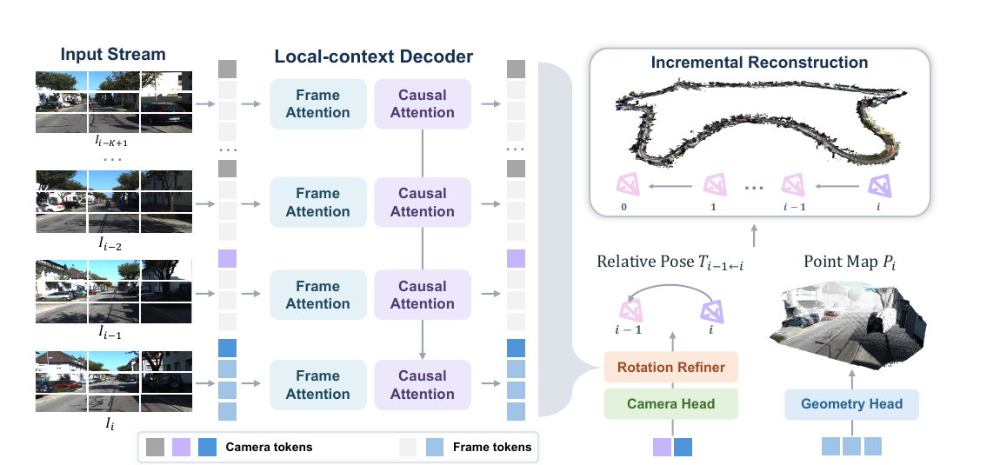

*原论文图 3。输入帧经过帧内注意力与窗口因果注意力，分别供几何头和相机头使用；旋转修正后的相邻变换被逐帧组合，局部点图也由相机位姿放入逐渐扩展的全局重建。*

### 12 帧窗口的计算边界

模型把完整历史因果注意力限制为长度 $K$ 的窗口。处理第 $j$ 帧时，可读取的缓存为

$$
M_{j-1}^{(K)}=\{KV_i\}_{i=\max(0,j-K+1)}^{j-1}.
\tag{6}
$$

当 $K=12$ 时，最多保留前 11 帧的 KV；窗口外状态被丢弃。对长度为 $N$ 的序列，论文将时间缓存复杂度记为 $O(K)$，注意力总计算量为 $O(NK)$。因此在固定 $K$ 下，每帧上下文和内部时间缓存有界，而整段视频累计计算仍随帧数线性增长。这个约束只涉及时间注意力状态，不代表所有中间张量、相机轨迹或最终点云都占常量空间。

## 旋转修正针对位姿链误差

相邻帧位姿预测把目标限制在较短基线内，却仍可能受到快速运动或困难视觉条件影响。逐帧误差经位姿链乘积传播时，旋转偏差尤其容易改变后续平移方向。ABot-Recon 增加一个运动与视觉上下文旋转修正器，在相邻位姿进入全局组合前预测旋转残差。论文认为相邻帧平移通常更受约束，因此修正器保留位姿头预测的平移，只更新旋转。

对于第 $i-1$ 与第 $i$ 帧，运动证据由前述关系向量经 MLP 编码：

$$
f_m=\phi_m(q_i).
\tag{7}
$$

视觉证据则从两帧的稠密帧 token 中取得。论文先对每帧 token 做平均池化，构造粗粒度描述子，再用它作为查询，通过交叉注意力读取对应的细粒度帧 token：

$$
f_v=\operatorname{CrossAttn}\!\left(
\phi_v(\mathcal R(\bar G_{i-1},\bar G_i)),[G_{i-1};G_i]
\right).
\tag{8}
$$

粗描述子概括两帧整体视觉变化，交叉注意力再从稠密特征中提取与这对帧相关的空间细节。运动编码与视觉证据融合为

$$
f_i=\phi_{\mathrm{fuse}}([f_m;f_v]).
\tag{9}
$$

然后将当前特征与此前 $K-1$ 个相邻帧对的特征组成窗口。两条因果 TCN 分支分别生成时序特征和门控，输出轴角残差 $\delta\omega_i\in\mathbb R^3$：

$$
W_i=[f_{i-K+1},\ldots,f_i],\qquad
\delta\omega_i=\phi_o\!\left(T_h(W_i)\odot\sigma(T_g(W_i))\right).
\tag{10}
$$

指数映射把轴角向量变成 $SO(3)$ 旋转，再与初始旋转相乘：

$$
\widehat R_{i-1\leftarrow i}
=\widetilde R_{i-1\leftarrow i}\operatorname{Exp}([\delta\omega_i]_\times).
\tag{11}
$$

这里 $[\cdot]_\times$ 表示反对称矩阵形式。先预测局部位姿、再只修正旋转的设计，使修正器仍在有限时间窗内工作；它没有新增远程特征库，也不重估平移。原论文图 4(a) 展开了运动和视觉证据的融合，图 4(b) 展示了训练时对多步组合位姿的监督。

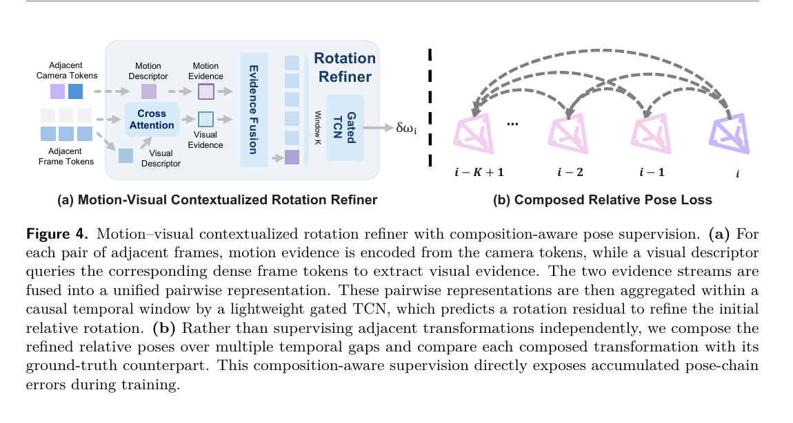

*原论文图 4。左侧以相邻相机 token 表示的运动线索和帧 token 中的视觉线索预测旋转残差；右侧把若干相邻相对位姿连乘，并监督组合结果。*

## 组合感知监督约束多步结果

如果训练时只要求每一对相邻帧的位姿分别准确，网络未必会关注多个预测连乘后的偏差。论文因此在训练窗口内监督多个跨度。监督集合定义为

$$
\mathcal P=\{(i,j)\mid 0\le i<j<N,\ j-i\le K-1\}.
\tag{12}
$$

每个 $(i,j)$ 的预测是式（5）中的相邻变换组合。为加大较长跨度的权重，论文设

$$
\alpha_{ij}=
\frac{(j-i)^\gamma}
{\frac{1}{|\mathcal P|}\sum_{(m,n)\in\mathcal P}(n-m)^\gamma},
\qquad 0<\gamma<1.
\tag{13}
$$

分母是训练窗口内跨度权重的平均值，因此 $\alpha_{ij}$ 的平均尺度为 1；$0<\gamma<1$ 让较长跨度得到更高权重，同时避免权重按跨度线性放大。论文沿用 $\pi^3$ 中的相对位姿平移与旋转损失，并用上述权重调节旋转项：

$$
\mathcal L_{\mathrm{pose}}
=\frac{1}{|\mathcal P|}\sum_{(i,j)\in\mathcal P}
\left(\lambda_{\mathrm{trans}}\ell_{\mathrm{trans}}^{(i,j)}
+\alpha_{ij}\lambda_{\mathrm{rot}}\ell_{\mathrm{rot}}^{(i,j)}\right).
\tag{14}
$$

此外，$\mathcal L_{\mathrm{smooth}}$ 惩罚旋转残差的幅度及其时间变化；$\mathcal L_{\mathrm{pts}}$、$\mathcal L_{\mathrm{normal}}$ 和 $\mathcal L_{\mathrm{conf}}$ 分别监督点图、表面法线和像素置信度。完整目标是

$$
\mathcal L=\lambda_{\mathrm{pose}}\mathcal L_{\mathrm{pose}}
+\lambda_{\mathrm{smooth}}\mathcal L_{\mathrm{smooth}}
+\lambda_{\mathrm{pts}}\mathcal L_{\mathrm{pts}}
+\lambda_{\mathrm{normal}}\mathcal L_{\mathrm{normal}}
+\lambda_{\mathrm{conf}}\mathcal L_{\mathrm{conf}}.
\tag{15}
$$

这套监督的核心是把训练目标和推理时的组合过程对齐：一个样本内既学习单步预测，也直接观察最多 $K-1$ 帧跨度上的连乘结果。长视频推理的链条可能远长于训练窗口，因此这种损失并不能给出全局漂移的理论上界；它是在局部训练窗口内让长一点的组合误差也进入优化。

## 可选的回环后端

ABot-Recon 的基本预测器不维护学习到的长期地图状态，也不做在线全局优化。论文另外提供训练无关的 SLAM 式回环后端：用 FAISS 在历史观测中检索 DINOv2-SALAD 描述子相近的帧对，再把两处中心附近的局部窗口一并送入模型估计相对位姿。连续相邻帧预测形成里程计约束，检索帧对形成回环约束，两者一起进入稀疏位姿图优化。

这条路径补上了局部连乘的另一类信息：当相机重新看到旧地点时，系统能建立跨越长时间的约束，减少全局轨迹漂移。它与固定窗口预测器分工不同。局部预测保证每帧成本有界，回环使用显式历史检索和图优化来修正长程一致性。因此，启用回环的完整系统仍然需要保留检索所需的历史信息；“没有持久学习记忆”只描述预测器，不应误读成整个 SLAM 系统完全不存历史。

## 训练与评测设置

训练集由 30 组真实与合成数据组成，采样权重中合成数据占 62.05%，真实数据占 37.95%。论文统一相机位姿约定和深度、平移单位，对无序多视图数据通过相机位姿图构造局部连续序列；视频数据则按时间顺序采样。附录进一步描述了固定步长、根据剩余轨迹调整步长、在短序列边界折返等采样方式，以及针对异常位姿、错误深度和损坏图像的过滤。图像训练分辨率为 $504\times280$，并进行焦距、裁剪和光度扰动。

训练分阶段扩大样本长度，但不增加推理窗口：第一阶段从公开的 $\pi^3$ 权重初始化，使用 32 帧片段训练相邻位姿和局部几何，训练 32K 次迭代；第二阶段把训练片段延长到 128 帧，窗口仍固定为 12 帧，并加入旋转修正器，继续训练 38K 次；最后再用 4K 次迭代只训练置信度分支。第一阶段使用 48 张 NVIDIA H20，第二阶段使用 32 张 AMD MI308。长片段为组合损失提供更多连续位姿链，也让相邻运动预测接触到更多局部运动变化。作者并没有因此让线上模型读取 128 帧历史；置信度校准阶段也冻结了几何与位姿网络。

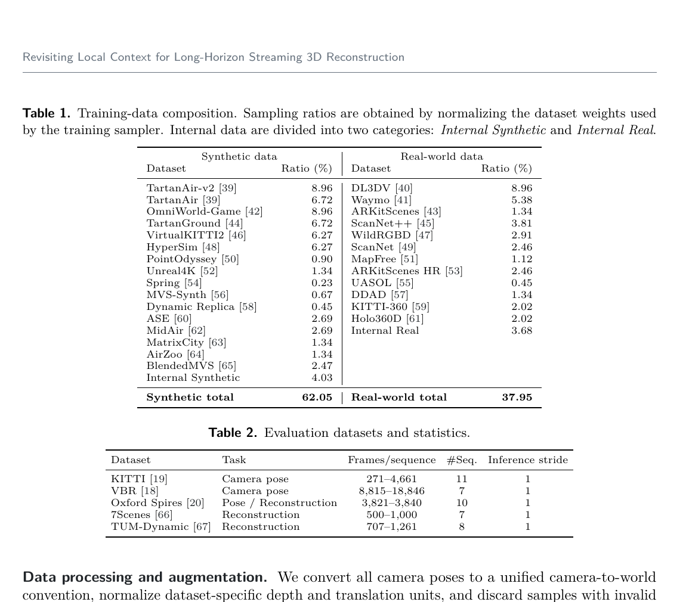

*原论文表 1、表 2。位姿评测包括 KITTI、VBR 和 Oxford Spires；稠密重建评测包括 7Scenes、TUM-Dynamic 和 Oxford Spires，所有基准以时间步长 1 顺序处理。*

位姿评测使用 ATE 均方根误差、相对旋转误差 $RPE_r$ 和相对平移误差 $RPE_t$；预测轨迹先用 Umeyama $Sim(3)$ 与真值对齐。KITTI 有 11 条序列，VBR 有 7 条、最长 18,846 帧，Oxford Spires 有 10 条约 3,800 帧的路线。稠密重建包括 7Scenes 的 7 条序列、TUM-Dynamic 的 8 条序列和 Oxford Spires；7Scenes 选用每个场景的 seq-01。点图先重采样到真值网格，再进行 Umeyama 对齐、体素化和点到点 ICP，报告 Chamfer Distance（CD）及阈值内 F1。论文使用的体素尺度为 7Scenes 与 TUM-Dynamic 的 $4/512$ m、Oxford Spires 的 0.05 m；F1 阈值分别为 0.25 m 和 4 m。Oxford Spires 每帧运行推理，但为控制评测开销，每 10 帧取一帧做点云评估。这个协议允许尺度对齐，ATE 反映对齐后轨迹形状的误差，不等同于未经对齐的全局尺度准确度。

比较时，除未公开的 SLAMFormer-$\infty$ 在 KITTI 上引用原论文数值外，其余基线使用官方实现和检查点，按统一协议评测。CUT3R 与 TTT3R 还分别报告完整序列状态重置和不重置结果；Stream3R-w 使用窗口为 5 的窗口模式。这些差异会影响它们的长序列表现，不能把不同运行模式当作完全相同的条件。

## 长序列位姿结果及其边界

在 KITTI 上，ABot-Recon 不启用回环时的平均 ATE 为 18.25 m，启用回环后为 13.49 m；VBR 上分别为 30.14 m 和 9.99 m。作者报告，加入回环后 VBR 的平均 ATE 在所比较方法中最低。Oxford Spires 上，无回环平均 ATE 为 4.35 m，启用回环为 4.02 m，平均 $RPE_r$ 为 $0.12^\circ$。在流式方法中，论文将 Oxford Spires 上的 ATE 和旋转误差相较此前最好结果描述为约 40% 的降低。

这个比较范围不能扩成“所有方法里位姿精度最好”。Oxford 表中若干需要测试相机内参的优化式系统取得更低 ATE，例如 DPVO 平均 ATE 为 1.56 m；ABot-Recon 的特点是直接用 RGB 输入，不需要测试时相机内参。KITTI、Oxford 和 VBR 的序列长度、空间尺度与运动模式也不同，表中数值应在各自协议内比较。

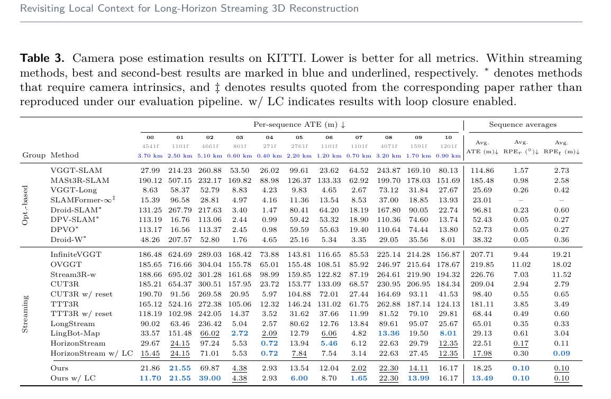

*原论文表 3。KITTI 各序列及其平均 ATE、$RPE_r$ 和 $RPE_t$；星号标记使用相机内参的方法，LC 表示启用回环。*

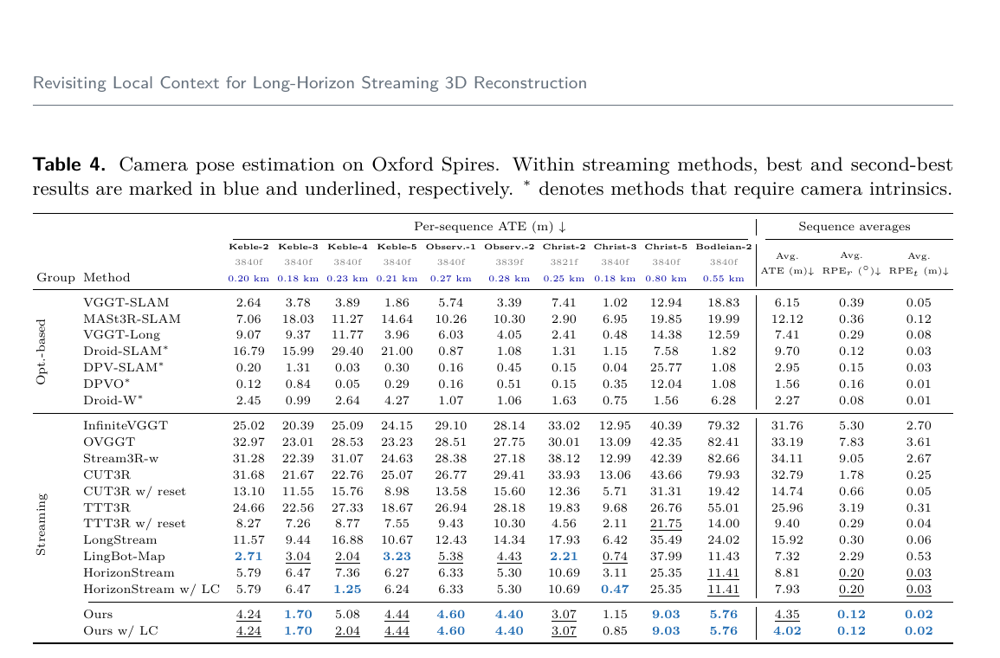

*原论文表 4。Oxford Spires 的 10 条路线结果。流式组中 ABot-Recon 的无回环平均 ATE 为 4.35 m，回环后为 4.02 m；优化式组部分使用内参的方法 ATE 更低。*

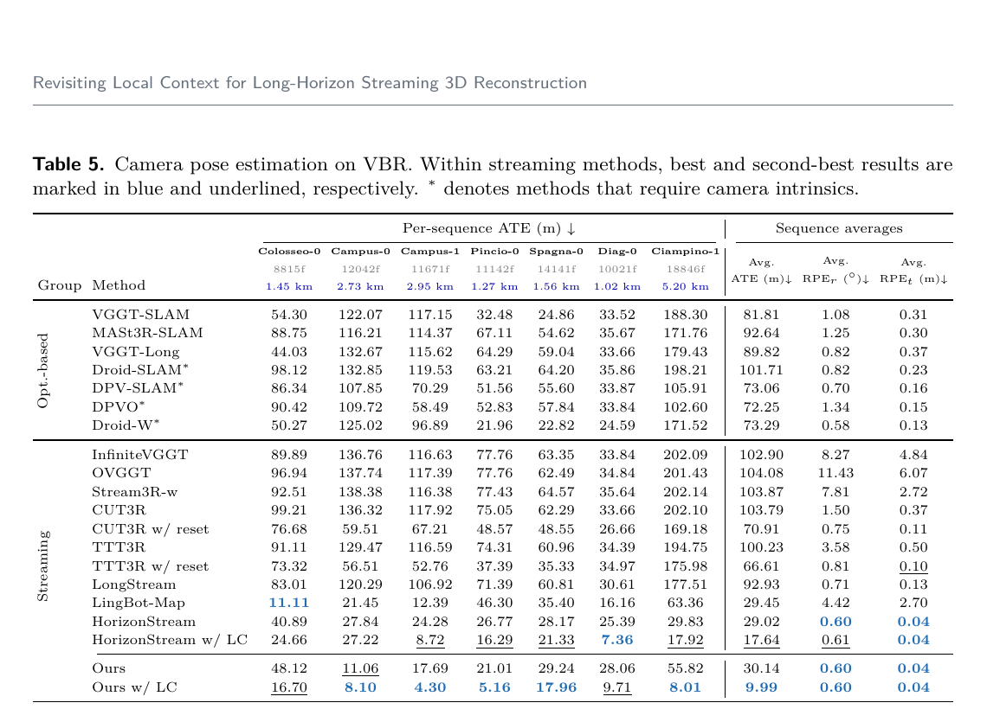

*原论文表 5。VBR 长序列上的平均误差；启用回环时 ABot-Recon 的平均 ATE 从 30.14 m 降到 9.99 m。*

图 5 用 KITTI、Oxford Spires 和 VBR 的代表性轨迹展示预测与真值的对齐结果。图 6 则把稳定性拆成两个问题：随着 KITTI-02 已处理帧数增加，相邻帧误差是否持续上升；以及不同时间跨度下，多步组合的相对位姿误差如何变化。作者报告，ABot-Recon 在图中评测范围内维持较低的运行误差与多跨度误差。前者支持“单步预测没有随已处理帧数逐渐恶化”的观察，后者更直接检验组合误差。它们是特定测试集上的经验结果，不是任意视频上的保证。

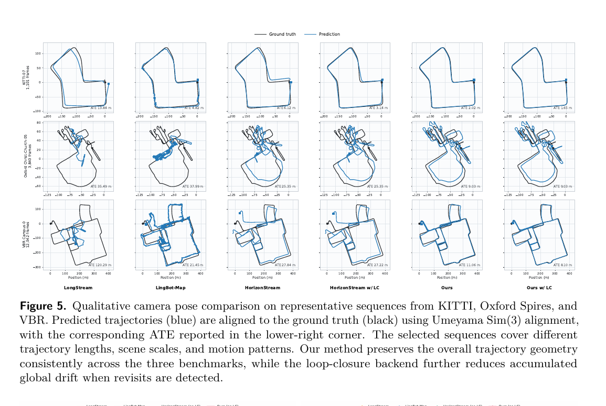

*原论文图 5。黑线为真值，蓝线为经 $Sim(3)$ 对齐的预测；图中 ATE 标注有助于比较不同路线上的整体轨迹偏差。*

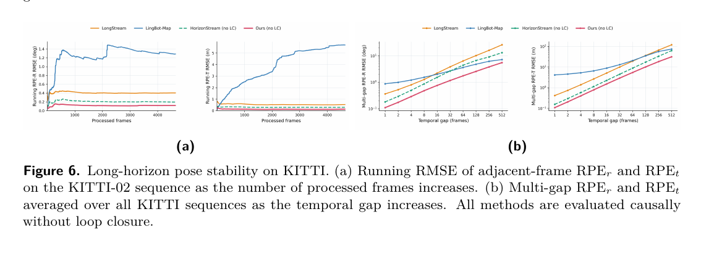

*原论文图 6。左侧显示 KITTI-02 相邻帧 $RPE_r$、$RPE_t$ 的运行 RMSE，右侧显示所有 KITTI 序列的多跨度相对误差；均为不使用回环的因果评测。*

### 运行效率

速度和显存测试使用单张 NVIDIA H100，处理完整 KITTI-02 序列，显存统计不含预载输入图像。ABot-Recon 的逐帧模式为 24.45 FPS、6.71 GB；在同样逐帧的模式下，它快于 LongStream、LingBot-Map 和 HorizonStream，但 CUT3R、TTT3R 的帧率更高且显存更低。表中 LongStream* 和 HorizonStream* 是分块推理设置，论文注明这些数字不能与逐帧流式结果直接比较。因此，结果展示的是相对一部分长序列流式系统的效率优势，并非速度或显存全面占优。

### 稠密重建

ABot-Recon 在 Oxford Spires 上取得表中最低 CD（1.37 m）和最高 F1（91.81%）。在较紧凑的室内数据上，结果没有全面领先：7Scenes 的 F1 为 94.88%，TUM-Dynamic 为 92.19%，而 LingBot-Map 等方法在这两项中更高。论文讨论认为，室内视角经常重访、空间范围较小，持续几何上下文可能更有用；这是作者对结果差异的解释，不是通过单独实验验证的因果结论。

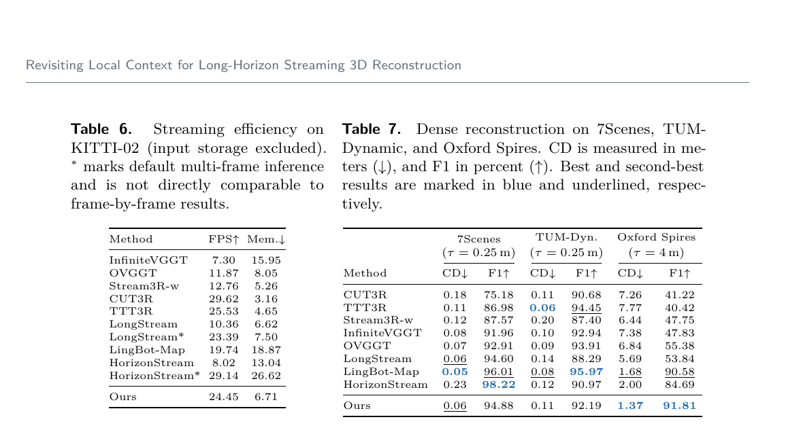

*原论文表 6、表 7。左侧是 KITTI-02 的帧率和显存，右侧是三个数据集上的 CD 与 F1；CD 越低越好，F1 越高越好。*

图 7 展示 KITTI-02、Oxford Obs.-Q1 和 7Scenes Stairs-01 的重建对比。它补充了表格指标无法呈现的空间结构连续性，但仍是代表序列的定性对比。

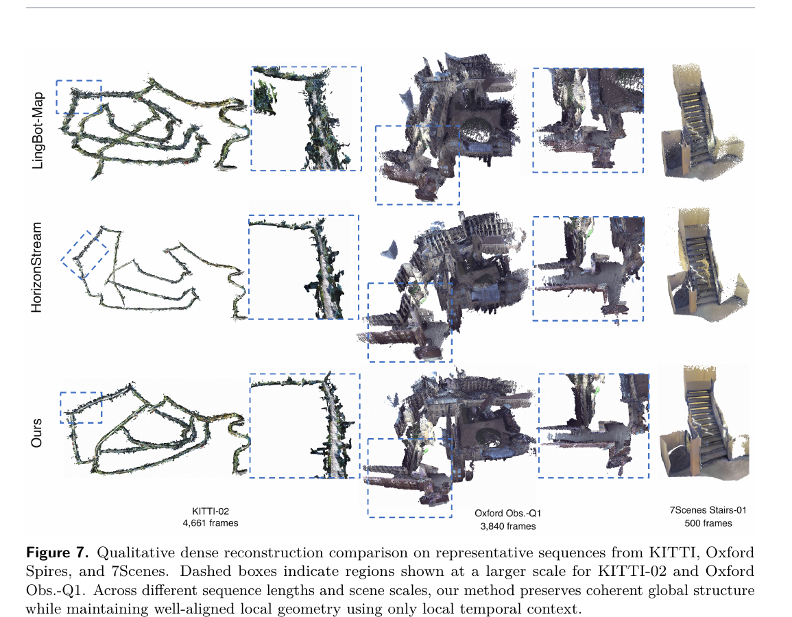

*原论文图 7。对比 LingBot-Map、HorizonStream 与 ABot-Recon 在长距离道路、地标建筑和室内楼梯上的整体几何及局部放大区域。*

### 消融实验

消融实验逐步加入组合损失、长片段训练和旋转修正器。把组合位姿损失加到 32 帧基线上，KITTI 平均 ATE 从 56.60 m 降到 27.66 m；Oxford 从 10.16 m 降到 9.40 m；VBR 从 52.90 m 降到 44.72 m。再把训练片段延长到 128 帧、仍保持 12 帧推理上下文，误差继续下降。最后加入修正器，表中三项 ATE 为 18.25 m、4.35 m、30.14 m。作者据此报告修正器相较前一阶段分别降低约 18.2%、26.9% 和 18.0%。由于配置是逐步叠加的，这组表格不能把不同训练片段长度、损失与模块的全部影响彼此独立地分离；论文给出的修正器降幅是按其消融顺序进行的比较。

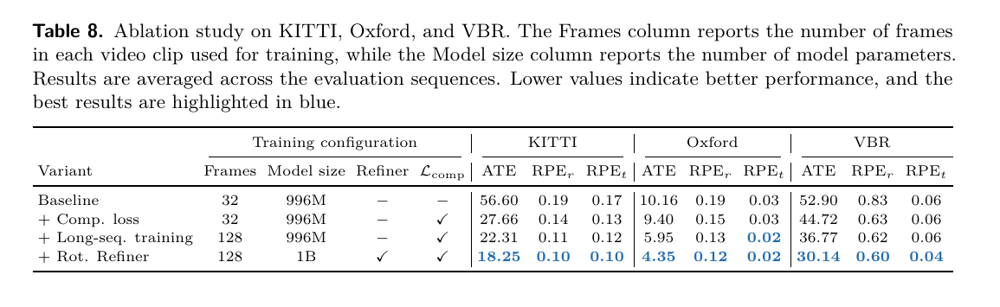

*原论文表 8。32 帧基线、组合损失、128 帧训练和旋转修正器依次加入，列出了 KITTI、Oxford 和 VBR 的位姿指标。*

## 论文讨论与附录中的边界

作者认为局部预测特别适合长且连续的轨迹；在空间紧凑、反复经过相同区域的室内环境中，长期几何上下文可能持续有价值，ABot-Recon 的重建结果也并非每项最优。未来工作仍需处理局部运动连续性不足的情况，并可探索选择性长程约束、外部记忆和动态场景处理。

补充材料补充了数据构造与清洗细节。无序多视图数据按相机位姿图寻找运动连续的路径，视频数据则按顺序采样或在短片段边界折返；训练集中还剔除了错误方向图像、天空或水面异常深度、异常相机内参及不连续位姿等样本。系统训练从 32 帧扩展到 128 帧，并维持 12 帧局部窗口。附录也展示四足机器人低机位视频和四条大范围真实视频的无回环轨迹；这些序列缺少准确相机轨迹真值，作者明确将结果作为定性泛化证据。图 11、12 对应这些示例。

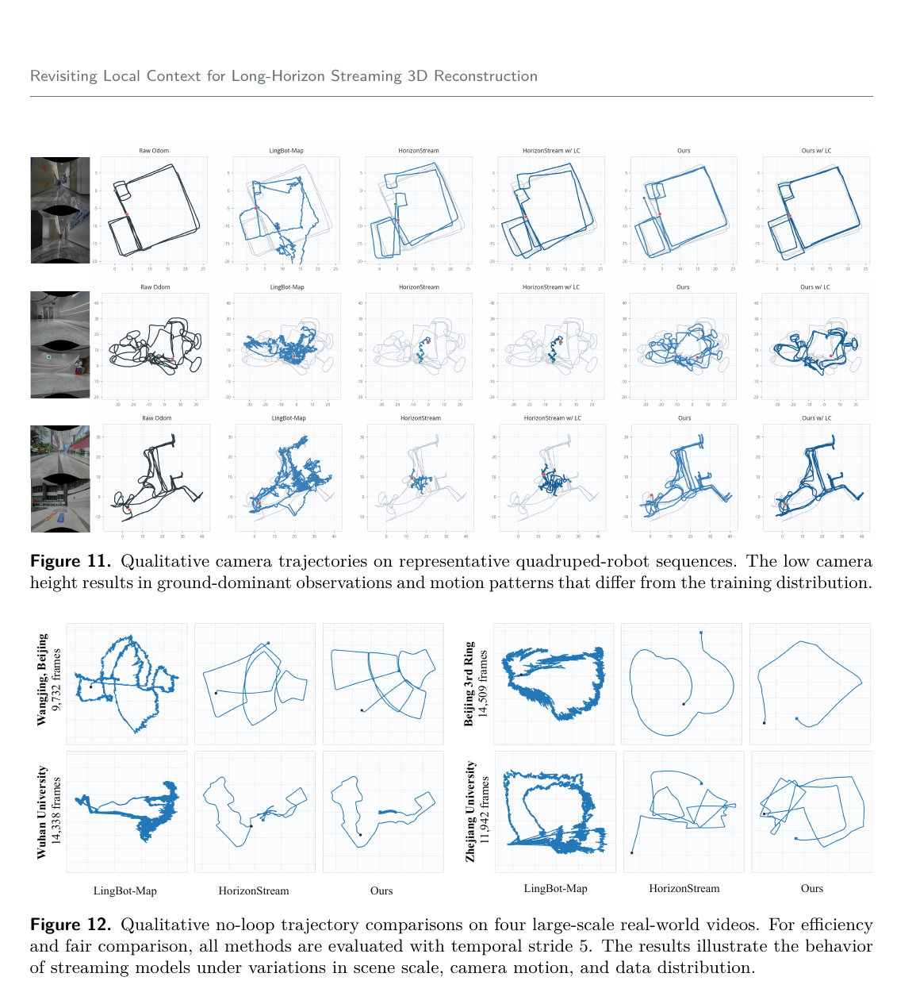

*原论文图 11、图 12。前者展示低机位机器人路线，后者比较四条实地视频上的无回环结果；图 12 使用步长 5，且这些结果没有真值轨迹可供定量评测。*

## 方法关系

ABot-Recon 将超长视频重建拆成两个尺度：模型以固定窗口读取视觉上下文，并预测当前帧局部几何与相邻运动；轨迹和点云则通过位姿组合逐渐延伸到全局。组合损失让有限训练窗口中的多步误差直接参与监督，视觉与运动修正器进一步抑制容易累积的旋转误差。需要更强全局一致性时，回环后端再提供额外的历史约束。

论文支持的结论是：在所测的长序列基准中，局部目标配合可靠的组合监督可以取得有竞争力的位姿和重建结果，且不必把学习注意力扩展到整段视频。结果也显示，局部预测不保证所有场景都优于使用长期几何上下文的方法；运行时效率、位姿精度和重建完整性仍取决于任务、数据集与回环条件。
