# AMB3R 论文解读

> Hengyi Wang、Lourdes Agapito，*AMB3R: Accurate Feed-forward Metric-scale 3D Reconstruction with Backend*，CVPR 2026 正式版，论文页码 14612–14625。本文依据 CVF Open Access 14 页论文和 18 页补充材料。[论文页面](https://openaccess.thecvf.com/content/CVPR2026/html/Wang_AMB3R_Accurate_Feed-forward_Metric-scale_3D_Reconstruction_with_Backend_CVPR_2026_paper.html) · [论文 PDF](https://openaccess.thecvf.com/content/CVPR2026/papers/Wang_AMB3R_Accurate_Feed-forward_Metric-scale_3D_Reconstruction_with_Backend_CVPR_2026_paper.pdf) · [补充材料 PDF](https://openaccess.thecvf.com/content/CVPR2026/supplemental/Wang_AMB3R_Accurate_Feed-forward_CVPR_2026_supplemental.pdf) · [项目页](https://hengyiwang.github.io/projects/amber)

AMB3R 从一个表示问题出发：前馈模型逐像素预测 pointmap 时，同一空间表面会在不同图像中被重复表示，模型虽能从多视图学习一致性，却缺少显式的三维空间融合机制。作者在 VGGT 前端后加入稀疏体素后端，把相同空间位置的特征汇集到紧凑的三维结构中，再将更新后的体素特征插值回原解码器。冻结前端并通过零卷积注入特征，使后端能够复用预训练几何先验。

论文还从同一个多视图先验构建两个无需任务微调或测试时优化的流程：AMB3R-VO 用有限关键帧记忆逐窗处理视频，AMB3R-SfM 则先把无序图像聚类，再逐步注册和细化。它们分别面向在线视觉里程计和大规模图像集重建。理解这项工作的关键，是把经过学习的多视图点图看作几何先验，而把体素后端、尺度头和关键帧记忆看作将先验变成可用三维地图的不同层次。

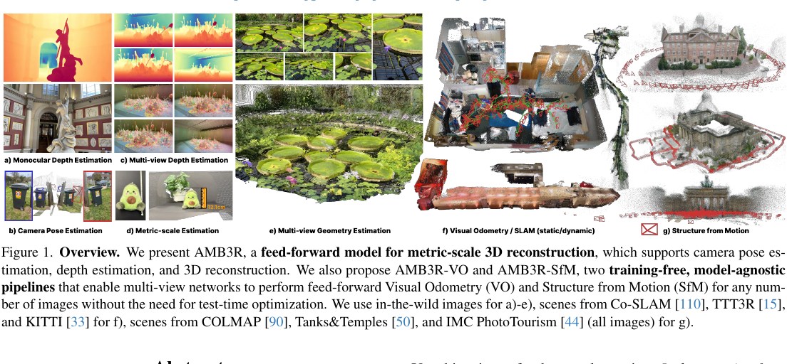

## 1. 引言

点图模型为每个像素预测三维坐标，是近年来多视图几何基础模型的重要表示方式。它把像素与空间点直接对应起来，因此一个网络可以同时预测几何和相机信息。但这种输出仍按二维图像网格组织：同一三维表面在多个视角里会出现多次，网络需要从训练中隐式学会把这些观测对齐。点图本身没有像体素或显式点云那样的空间紧凑性，不能保证落在同一三维坐标的观测在内部被融合成唯一几何属性。

这与传统多视图几何的对应关系相连。稀疏 SfM 用特征点对应恢复相机与结构；MVS 在代价体中比较像素对应；TSDF、特征网格或坐标网络等三维表示则把属性存入空间位置，让同一空间点可以合并来自多帧的信息。作者据此提出：如果保留点图模型的强大图像先验，同时增加稀疏而紧凑的三维后端，就能在前馈网络中加入显式空间推理。

AMB3R 以 VGGT 为前端，预测点图和几何特征；后端把这些特征融合到稀疏体素中，由 Point Transformer V3 在序列化的空间邻域上更新，再通过 KNN 插值回到像素位置。特征经零卷积加入冻结的 VGGT 解码器。单独的尺度头则从冻结编码器和深度解码分支预测公制深度。为把这一模型用于视频或无序图像集，论文另外设计 AMB3R-VO 与 AMB3R-SfM。

作者将贡献归为紧凑体素后端、公制尺度预测、免优化的未标定 VO、面向任意数量图像的前馈 SfM，以及 7 项任务、13 个数据集上的评估。作者报告，训练后端与尺度头约需 80 小时 H100 GPU 计算；前端 VGGT 权重保持冻结。图 1 汇总了这些任务输出。

## 2. 相关工作

### 2.1. 三维场景表示

三维场景属性可以存储在体素网格、点云、网格或多层感知机中。体素便于卷积和几何推理，但稠密网格会随场景边长按立方增长。体素哈希、八叉树和哈希网格等表示试图在空间占用或计算上变稀疏。点云则直接采样可见表面，适用于不规则空间；HilbertNet 一类方法通过空间填充曲线把点序列化，在保留局部性的同时使用 Transformer 处理。

AMB3R 延续了空间填充曲线与稀疏点处理的思路，但体素存储的是由图像前端抽取的几何特征。点图提供观测与三维位置，体素化负责把落到同一空间单元的特征做平均，Transformer 再在紧凑体素序列上推理。也就是说，后端的作用不是取代点图，而是为点图输出增加一个有明确空间索引的融合层。

### 2.2. 基于点图的重建

SCoRF 将场景坐标用于相机定位；DUSt3R 与 MASt3R 把点图回归扩展到可泛化的双视图重建。多视图方法常见三种信息组织方式：Spann3R 以因果方式让新帧查询累积记忆；VGGT 通过相机 token 和交替注意力联合处理所有输入帧；其他方法也有采用逐帧增量处理的路线。因果记忆适合流式输入，全局注意力则能在离线场景中充分交换视图信息，但计算会随图像数量平方增长。

AMB3R 保留 VGGT 这种全局多视图前端，用它生成跨视图一致的特征与点图，再把后端作为空间融合模块。论文的 VO 与 SfM 流程将这个离线前端封装进关键帧或图像簇的窗口中，从而限制每次送入全局注意力的图像数量。它并没有把全局 Transformer 改成线性复杂度结构；有限记忆控制的是每个在线映射窗口的规模。

## 3. Pointmap 前端基础

输入图像集合记为 $\{I_t\}_{t=1}^{T}$。图像编码器逐帧提取特征：

$$
F_t=\mathrm{Encoder}(I_t). \tag{1}
$$

点图的坐标系有刚体变换自由度，因此模型选择一张锚帧并把它的相机位姿设为单位变换。其他图像中的点图都在这一锚帧坐标系中表达。为了对齐多帧，已有网络可以采用三类时间编码。

第一类是网络结构定义参考帧。DUSt3R 使用两个相互关联的解码器，使两张图像的点图共同落在第一张图像的坐标系中：

$$
P_1^{(1)}=\mathrm{Decoder}^{1}(I_1),\qquad P_2^{(1)}=\mathrm{Decoder}^{2}(I_2). \tag{2}
$$

这种设计明确了坐标锚点，但解码结构天然针对两张图像。第二类是因果时间编码。以 Spann3R 为例，当前图像查询此前累积的记忆特征：

$$
P_t^{(1)}=\mathrm{Decoder}(M_{1:t-1},F_t). \tag{3}
$$

模型逐帧更新记忆，满足流式处理所需的因果关系。第三类是 token 化的全局时间编码。VGGT 为锚帧和其他帧加入不同相机 token，再让所有图像特征通过全局注意力交互：

$$
\{P_t^{(1)}\}_{t=1}^{T}=\mathrm{Decoder}\big(F_1+e_1,\{F_t+e_2\}_{t=2}^{T}\big). \tag{4}
$$

这种方式允许离线多视图信息密集交流，通常能获得较好的重建质量，但处理大量帧的代价随输入规模快速上升。

尺度归一化也会影响后端训练。DUSt3R 与 Spann3R 会分别归一化预测和真值；VGGT 则只归一化真值，在统一尺度下训练。点图模型通常还预测置信度，并使用真值几何监督：

$$
\mathcal L_{\mathrm{conf}}=\sum_t\sum_{i\in\mathcal I}\left(C_t^i\mathcal L_{\mathrm{reg}}(i)-\alpha\log C_t^i\right). \tag{5}
$$

其中 $\mathcal I$ 是有效像素集合，$C_t^i$ 是模型置信度。置信度不是直接标注的，而是在监督目标和训练方案下自监督学习得到。后端若从随机权重直接接入并改变原有置信度函数，可能造成置信度分布突变，继而破坏重建结果；这正是 AMB3R 使用冻结前端和零卷积注入的背景。

## 4. 方法

### 4.1. 公制尺度重建

VGGT 输出的点图按全序列中位深度归一化，因此每个序列的绝对尺度会丢失。不过，作者观察到冻结特征仍携带与公制尺度有关的信息。一个直接做法是用 ROE 求解器回归整段视频的单一尺度差，但它需要汇总所有帧的中间解码特征，而且尺度会随帧的组合和顺序变化，实际训练容易过拟合。

AMB3R 改为逐帧预测一个更稳定的量：该帧中“预测深度中位数对应像素”的公制对数深度。中位深度是单帧属性，因此无需先聚合整段视频的特征。实现中，尺度头先把编码器特征压成向量，再与 VGGT 深度 DPT 分支的解码特征相加，经两层卷积输出尺度因子，并用 $L_1$ 监督。推理时，每帧的预测中位深度与公制中位深度给出一个帧尺度，最后取各帧尺度的中位数，鲁棒地把整段重建对齐到公制空间。补充材料指出，Waymo 等数据可能在选中像素处缺少深度，这时用 ROE 估计相对尺度，构造公制对数深度监督。

### 4.2. 体素后端

给定 VGGT 输出点图 $P_t^{(1)}$ 和几何特征 $G_t$，后端先把特征对齐到点图分辨率。$G_t$ 由编码器和解码器特征拼接后经过两层 MLP 得到。模型把每个三维点分配到稀疏体素 $V_i$，并将其中所有可见观测的几何特征取平均：

$$
H_i=\frac{1}{|\mathcal P_i|}\sum_{(t,u)\in\mathcal P_i}G_t[u],\qquad
\mathcal P_i=\{(t,u)\mid P_t^{(1)}[u]\in V_i\}. \tag{6}
$$

这里 $u$ 是图像像素坐标，$\mathcal P_i$ 收集所有落入体素 $V_i$ 的帧像素。体素边长固定为归一化空间中的 0.01；由于点图按尺度归一化，实际空间中的体素大小也随场景尺度变化。平均操作使不同视角对同一体素的特征形成共同输入，给 Transformer 一个紧凑的空间位置索引。

稀疏体素接着通过空间填充曲线序列化为一维序列，交给 Point Transformer V3 更新，再反序列化回三维体素排列：

$$
\{\hat H_i\}_{i=1}^{N}=\big(S^{-1}\circ f_\theta\circ S\big)\left(\{H_i\}_{i=1}^{N}\right). \tag{7}
$$

$S$ 表示空间序列化，$f_\theta$ 是体素 Transformer。空间填充曲线把相邻三维体素尽可能放在相邻序列位置，让常规序列模型能处理局部三维邻域。更新后的体素特征通过 KNN 插值回各点图像素：

$$
\tilde G_t[u]=\mathrm{KNN}\left(P_t^{(1)}[u],\{\hat H_i\}_{i=1}^{N}\right). \tag{8}
$$

KNN 根据该像素预测的三维点位置，寻找邻近体素并插值得到逐像素特征。随后，这些特征通过零卷积注入冻结 VGGT 的各个解码层。零卷积初始输出为零，刚开始训练时不会扰动原有前端预测；训练再逐步学习有用的后端修正。这个初始化方式既保留 VGGT 已学到的几何和置信度行为，也降低了训练后端所需资源。

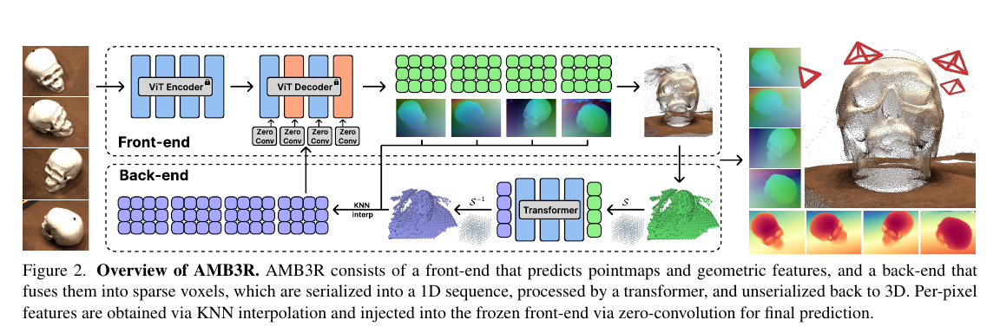

### 4.3. 训练

训练时冻结 VGGT 前端，仅更新后端，监督沿用 VGGT 的深度、点图和相机损失，不使用跟踪损失：

$$
\mathcal L=\mathcal L_{\mathrm{depth}}+\mathcal L_{\mathrm{pointmap}}+\mathcal L_{\mathrm{camera}}. \tag{9}
$$

作者的数据预处理和损失设置与 VGGT 原训练不同，直接用归一化数据会迫使后端补偿前端规范尺度的差异。因此，训练点图时先用 ROE 求解器把预测几何与归一化真值对齐：点图按序列估计一个尺度，深度则允许每张图像各自一个尺度。这样冻结前端的全局几何关系保持不变，后端主要学习细节修正。

后端在 11 个数据集的混合上训练 40 个 epoch，每 epoch 采样 2,000 个样本，共约 80,000 个训练样本；每个样本含 5–16 帧，训练约需 50 小时 H100 GPU。补充材料列出的数据集为 ScanNet、ScanNet++、WildRGBD、Mapfree、Aria、Waymo、Virtual KITTI 2、GTASfM、MVS-Synth、OmniObject3D 和 Hypersim。由于存储限制，部分数据集只保留子集；作者强调点图基础模型训练中数据多样性的重要性，并因观察到 VGGT 可能在 Co3D 的某些模式上过拟合而排除 Co3D。尺度头与后端合计训练资源约 80 小时 H100。

### 4.4. 未标定视觉里程计

全局注意力多视图 Transformer 的输入帧数增加时，注意力成本呈二次增长，不适合直接在线处理。已有方法把连续输入切成重叠子图，并用 Kabsch–Umeyama 估计子图之间的相对位姿和尺度，再依赖全局优化降低对齐漂移。AMB3R 利用点图基础模型的另一项性质：各帧点图已经表达在参考帧坐标系中，只差一个未知尺度。若映射窗口共享关键帧，就可把局部几何与已有地图对齐，而不必每次都对整个局部点云重新估计刚体变换。

作者把 VGGT 的全局解码改写成“当前窗口查询一组关键帧记忆”的形式。活动关键帧记忆用于前端上下文；另一个全局记忆保存显式几何，用于坐标对齐和地图融合。映射窗口固定为 8 帧，活动记忆最多 10 帧，因此窗口大小不会随视频总长度增加。

将 VGGT 的全局解码改写成流式形式时，历史关键帧组成记忆，当前窗口的最后一帧查询这些记忆并预测自己的点图：

$$
\{P_t^{(1)}\}_{t=1}^{T-1},\ P_T^{(1)}=\mathrm{Decoder}\left(\mathcal M_{1:T-1},F_T+e_2\right). \tag{10}
$$

其中 $\mathcal M_{1:T-1}=\{F_1+e_1,\{F_t+e_2\}_{t=2}^{T-1}\}$ 是历史帧特征和相机 token 组成的记忆。这个改写把离线全局解码转成当前窗口查询有界记忆；底层模型仍可以用双向注意力共同更新已映射帧的预测。

新关键帧由位姿距离和预测置信度共同选择。关键帧之间的位姿距离将旋转角距离与归一化平移差相加：

$$
D_{i,j}=\arccos\left(\frac{\operatorname{Tr}(R_jR_i^T)-1}{2}\right)+\lambda\|\tau'_i-\tau'_j\|_2. \tag{11}
$$

$R$ 和 $\tau'$ 分别是旋转与归一化平移。新映射窗口中与已有关键帧距离超过 $\eta_d=0.15$ 的候选帧才考虑加入，并选其中置信度最高的帧。共享关键帧的局部点图和全局点图通过 ROE 求相对尺度：

$$
s^w=\mathrm{ROE}\left(P_k^{(1)},P_k^{(1),w}\right). \tag{12}
$$

其中 $w$ 为新窗口，$k$ 是窗口与全局记忆共有的关键帧。得到尺度后，系统把窗口预测变换到全局坐标系，并按预测置信度做加权融合。对共享关键帧 $k$，点图、度量尺度、平移、旋转和置信度分别更新为：

$$
\begin{align}
P_k&\leftarrow\frac{C_kP_k+C_k^w s^wP_k^w}{C_k+C_k^w}, \tag{13}\\
m&\leftarrow\frac{C_km+C_k^wm^w/s^w}{C_k+C_k^w}, \tag{14}\\
\tau_k&\leftarrow\frac{C_k\tau_k+C_k^ws^w\tau_k^w}{C_k+C_k^w}, \tag{15}\\
q_k&\leftarrow\operatorname{slerp}\left(q_k,q_k^w,\frac{C_k^w}{C_k+C_k^w}\right), \tag{16}\\
C_k&\leftarrow C_k+C_k^w. \tag{17}
\end{align}
$$

$C_k$ 是置信度，$m$ 是公制尺度因子，$q_k$ 是相机旋转四元数。尺度 $s^w$ 乘在点图和平移上，却除在度量尺度更新中，因为局部归一化坐标系放大时，对应的“每个归一化单位包含多少公制长度”会缩小。加权平均让多个窗口对相同关键帧的估计共同影响地图。

活动记忆达到 10 帧时，系统从历史关键帧中重采样 7 帧，同时保留最新帧，并加入与最新帧位姿距离较近的关键帧。为重新访问旧区域，作者设置反向搜索窗口 $\eta_b=0.4$，迭代加入该范围内最早的关键帧；当活动关键帧间最大位姿距离超过 $\eta_{\max}=1.2$ 时，再次重采样，避免活动记忆覆盖超出训练分布的过大场景范围。

重采样后，活动记忆的首帧可能不再是全局首帧，导致局部预测和全局地图的坐标系不同。AMB3R 先用该关键帧位姿把全局地图变换到局部坐标系：

$$
P_k^{(k_0)}=T_{k_0}^{-1}P_k^{(1)},\qquad T_{k_0}=[R_{k_0},\tau_{k_0}]. \tag{18}
$$

再从对应关键帧几何估计尺度，用加权平均的关键帧相对位姿把局部地图变回全局坐标系并融合。推理时，只有当前端置信度低于阈值时才运行体素后端；系统根据置信度和预测一致性选择前端结果或二者融合，以省计算并保持序列稳定。

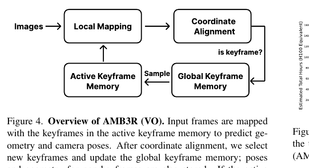

### 4.5. 运动恢复结构

AMB3R-SfM 面向无序图像集合，沿用同一几何先验与记忆设计，以分治方式执行增量式重建。第一步为每张图像提取描述子并做特征白化，建立图像间特征距离矩阵，再用带迭代拆分和合并的最远点采样形成大小受限的图像簇。

粗注册从置信度最高的图像簇初始化全局地图。之后反复找与现有关键帧特征距离较小的未注册簇，利用已注册关键帧映射并更新地图。若全局关键帧数超过上限，就依据位姿距离把关键帧列表拆成更小子簇，再用已经注册的子簇辅助后续簇注册。每张图像只保留置信度最高的映射；低置信度图像先标记为未注册，待注册完成后再尝试映射。

全局精化分两阶段进行。先从第一个关键帧出发，在 $\eta_r=1.5$ 的位姿距离内找最近的若干关键帧并进行映射；随后按置信度优先级做广度优先遍历，逐步遍历关键帧图并用各自最近的关键帧细化。最后，每个非关键帧都使用最近的关键帧进行重映射。整个流程不在测试时执行全局 BA。

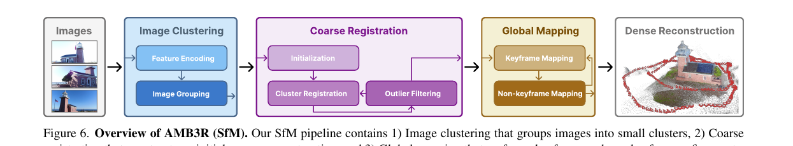

## 5. 实验

### 5.1. 设置

论文评估 7 项任务、13 个数据集：RealEstate10K 相机姿态；NYUv2、KITTI、ETH3D、ScanNet、DIODE 单目深度；RMVDB 上 KITTI、ETH3D、ScanNet、DTU、Tanks & Temples 的多视图公制深度；ETH3D、DTU、7-Scenes 三维重建；Sintel、Bonn、KITTI 视频深度；TUM、ETH3D SLAM 和 7-Scenes 伪真值上的 VO/SLAM；ETH3D、Tanks & Temples 的 SfM。

深度指标报告相对误差 rel 和 3%/25% 内点率；三维重建还报告预测与真值之间的准确度 Acc 和完整度 Cp。除单目深度及公制深度外，深度与重建任务采用中位数尺度对齐；点图重建由于每个像素与真值有对应关系，不使用 ICP 对齐。所有 VO/SLAM 轨迹以 EVO 的 ATE RMSE 评估，表中距离单位为厘米。由于不同任务的对齐协议不同，不能把表中误差直接跨任务比较。

### 5.2. 单目深度估计

表 1 评估无需微调的零样本单目深度。AMB3R 在 NYUv2 和 ETH3D 上报告优于 VGGT，并在这两个数据集上超过专门训练的单目深度模型。各数据集的真值和训练数据重叠情况不同，表中括号标记相关训练数据，因此结论应限定在论文采用的零样本评估协议内。

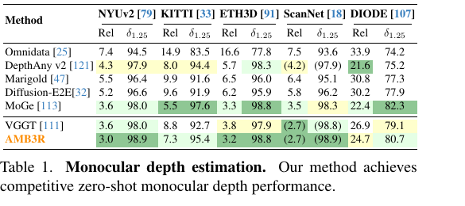

### 5.3. 相机位姿估计

在 RealEstate10K 上，论文按 DUSt3R 与 VGGT 的协议从每段序列随机抽取 10 帧，报告 AUC@30。表 2 将 VGGT 的官方结果和作者在可用数据集上的重跑结果分开：官方数字包含部分无法获得的数据。AMB3R 的 AUC@30 为 86.3，高于官方 VGGT 的 85.3 和重跑的 81.8；在解释差距时必须保留这一来源区别。

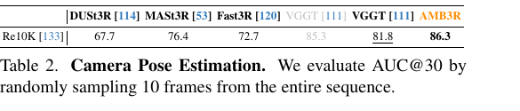

### 5.4. 多视图公制深度估计

表 3 在 RMVDB 上比较多类方法：传统 COLMAP、单目深度方法、已知位姿和图像范围的 MVS、无需逐图范围的 MVS，以及直接从图像预测几何的方法。AMB3R 的平均相对误差为 1.7、3% 内点率为 87.3，在表中取得最佳平均结果；同期的 $\pi^3$ 为 1.8/85.6。表中括号指出部分方法的训练集重叠，双匕首标记同期工作。

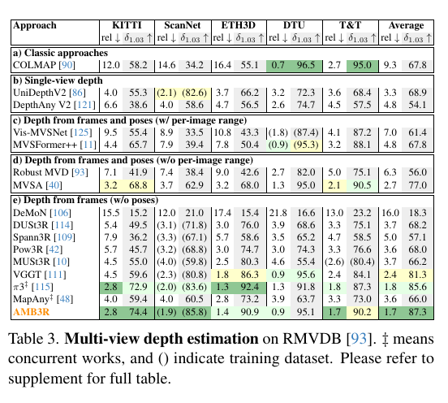

公制尺度深度还在 3% 与 25% 两种内点阈值下评估。作者指出，3% 阈值对公制深度方法偏严格，因此同时报告两种标准。表 4 中 AMB3R 在总体指标上领先；对比直接回归解码特征的尺度差，逐帧预测对数中位深度的方案整体更好。DTU 中摆放在白桌上的玩具建筑缺少背景尺度线索，模型有时会把它们当作真实建筑，因此绝对相对误差较高；此时内点率补充了尺度是否大体正确的信息。

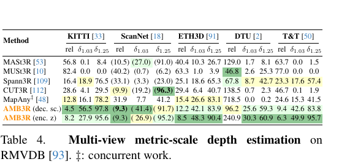

### 5.5. 三维重建

表 5 在 ETH3D 与 DTU 使用 RMVDB 图像组，在 7-Scenes 使用 Spann3R 划分和改进后的真值位姿。点图输出和真值有逐像素对应，因此作者移除了以往评估中的 ICP 对齐。表中 AMB3R 在 ETH3D 的相对误差、准确度、完整度分别为 4.64、9.98、9.69 cm；DTU 为 0.81、0.22、0.08 cm。对物体级 DTU 重建，AMB3R 与 VGGT 都达到毫米级精度且误差低于 1%；ETH3D 户外场景与 7-Scenes 室内场景上，作者报告相对同期 $\pi^3$ 的有竞争力结果。

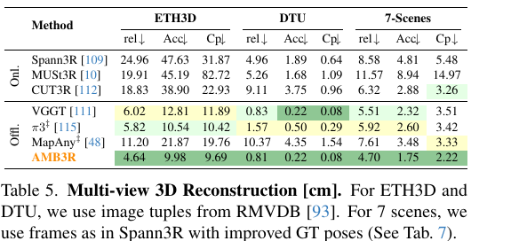

图 3 展示龙门石窟等真实图像的泛化结果。它提供定性例子，说明该模型的点图和重建输出能覆盖未见场景；表 5 才是对应的量化比较。

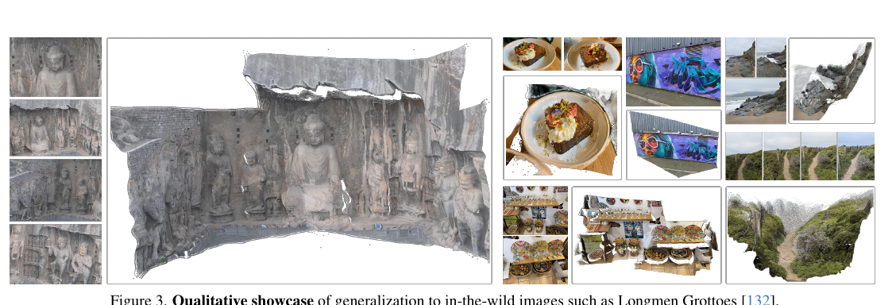

### 5.6. 动态重建

尽管训练不包含专门的动态重建目标，AMB3R 仍能从动态视频预测深度。表 6 在 Sintel、Bonn 的全部场景上评估，而非沿用先前工作只挑选 14 段和 4 段场景的做法；作者也没有针对动态数据微调。Sintel 上 AMB3R 的相对误差为 23.6，优于 VGGT 的 28.0；但 Bonn 上 $\pi^3$ 的误差 3.0 低于 AMB3R 的 3.3，KITTI 上 $\pi^3$ 的 3.6 也低于 AMB3R 的 4.1。结果体现了 AMB3R 相对 VGGT 的改善，也不能概括成所有动态数据集上都最好。

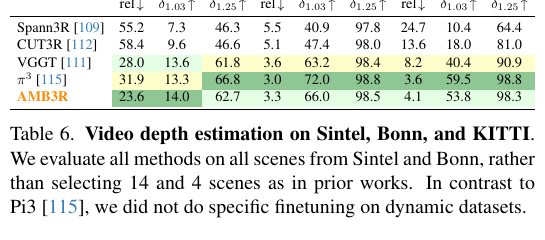

7-Scenes 的原伪真值位姿来自 ICP-KinectFusion，在近似球形几何处容易旋转漂移，在大平面处容易平移漂移。作者发现 Pumpkin/seq01 后段存在明显漂移，因此改用对每个场景所有序列做全局优化得到的 COLMAP 位姿作为真值，并以新视角渲染 PSNR 检查其可靠性。表 7 显示，AMB3R 的平均 ATE 为 2.1 cm，低于旧伪真值的 5.7 cm；新真值渲染的 PSNR 为 21.8，与旧真值的 21.8 相当。这里的评估真值修订影响了 7-Scenes 的 VO 和三维重建结果。

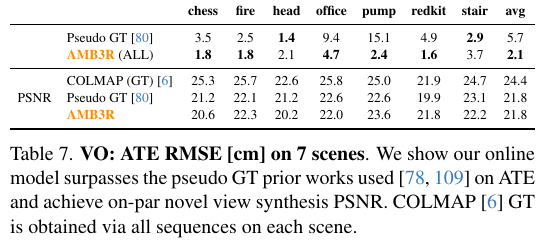

### 5.7. 未标定视觉里程计与 SLAM

AMB3R、Spann3R 和 MUSt3R 形成一类无需相机内参的视觉里程计。TUM RGB 表 8 中，AMB3R 全帧预测的平均 ATE 为 3.2 cm，关键帧模式为 2.7 cm；对照 MUSt3R 的 7.1 cm。作者将基线重新运行且不使用闭环或全局 BA，并另外与在所有帧上预测的 MUSt3R 比较，同时以关键帧预测作为参考。

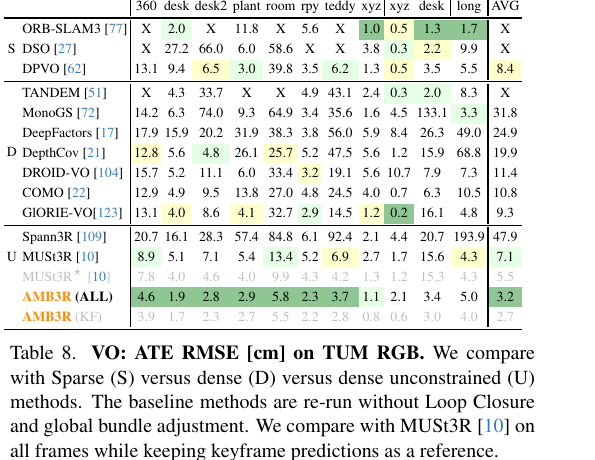

表 9 进一步比较完整 SLAM 系统。对于基线，作者允许跟踪结束后执行闭环和全局 BA；AMB3R 本身不对轨迹做后处理。按照与 MASt3R-SLAM 接近的关键帧评估方式，未标定方法中 AMB3R 全帧平均 ATE 为 3.1 cm、关键帧模式为 2.7 cm，VGGT-SLAM 为 5.3 cm。不同系统使用的传感器标定和后处理能力不同，表中同时分列已标定与未标定方法。

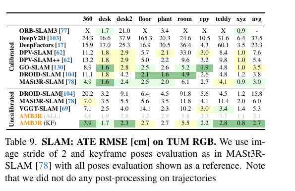

表 10 在 ETH3D SLAM 上报告轨迹误差，AMB3R 全帧预测平均为 2.6 cm，关键帧模式为 2.0 cm；MUSt3R 为 4.5 cm。表 11 在 TUM Dynamic 上评估动态环境，AMB3R 平均为 1.9 cm，优于未标定 MUSt3R 的 4.5 cm。两种模型都未专门训练动态重建；与为动态场景设计的 MegaSaM 相比，AMB3R 的原始预测仍具竞争力，但 MegaSaM 使用全局 BA 和轨迹平滑后处理，比较时不能忽略这一点。

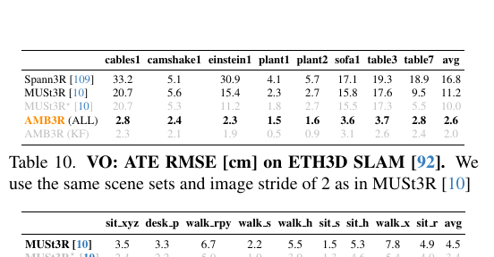

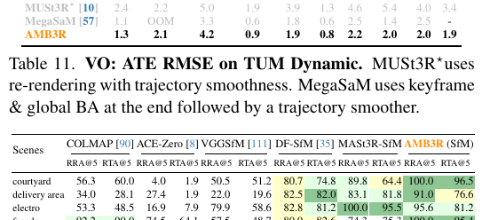

### 5.8. 运动恢复结构

ETH3D 是无序图像集，Tanks & Temples 则提供视频图像。表 12 显示，AMB3R-SfM 在 ETH3D 的平均旋转召回 RRA@5 为 98.2，平移召回 RTA@5 为 81.9；同期比较中，高于 MASt3R-SfM 的 81.2/79.7。作者指出该流程没有优化式 BA。表 13 在 Tanks & Temples 的三个难度划分中，AMB3R-SfM 的 RRA/RTA 分别为训练场景 95.0/94.5、中等场景 98.7/96.9、高级场景 68.0/72.4；高级场景表现明显较弱，显示复杂场景仍有难度。

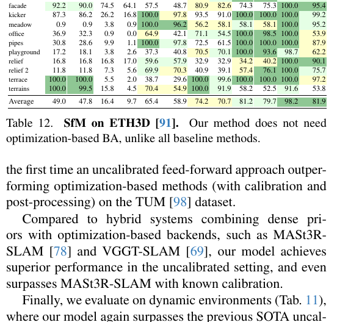

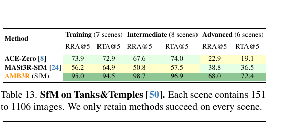

## 6. 讨论

### 6.1. 分析

表 14 比较三维体素后端、通过交替注意力实现的二维后端，以及移除序列化 Transformer 的变体。完整三维后端在 ETH3D、DTU 和 7-Scenes 上相对二维后端都改善了误差和完整度指标，支持显式空间融合的价值。不同消融数值并非每一列都单调改善，因此更稳妥的结论是三维体素方案整体更有利，而不是所有指标都由单一组件决定。

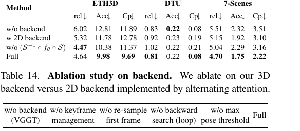

表 15 逐项移除 AMB3R-VO 的后端、关键帧管理、重采样、反向搜索和最大位姿距离阈值。无关键帧管理时会发生 OOM；其余策略移除后误差均高于完整模型的 3.1 cm。表 16 对 SfM 去除后端、子簇和全局地图进行消融，完整模型 RRA/RTA 为 98.2/81.9。子簇消融指标接近完整模型，但移除全局地图会降至 94.9/74.1，说明粗注册后还需要跨簇地图融合。

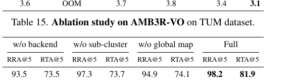

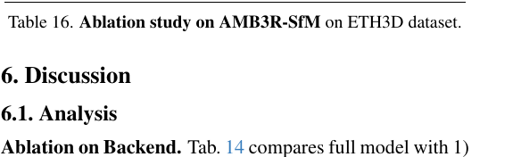

### 6.2. 结论

AMB3R 的核心是把点图模型的图像先验与稀疏三维空间融合结合起来。体素后端将不同视角投到相同空间单元的几何特征聚合，Transformer 在紧凑的体素序列上更新，再把特征送回冻结前端。尺度头利用逐帧中位深度恢复公制尺度；VO 与 SfM 则使用有界关键帧记忆和分治式图像簇扩展点图模型的任务范围。

结果显示，这种结构在深度、点云重建、未标定 VO 和 SfM 上有较强表现，训练额外计算也比重新训练大型前端少。它仍受限于前端全局注意力的二次复杂度，后端只对局部场景进行联合推理；VO 不执行显式闭环优化或重定位，SfM 的加权平均姿态也不保证严格满足全部几何约束。AMB3R 是有紧凑几何后端的前馈重建框架，不能与具有全局 BA 和闭环优化的传统 SLAM 系统完全等同。

## 补充材料

### 7. 局限性

#### 7.1. 场景表示

后端地图是局部表示，不会把前端多个分块预测统一成可跨所有窗口联合优化的全局体素场。论文将它视作空间紧凑性的概念验证；降低点图主干对全局注意力的依赖、让后端成为更长序列的全局表示，是未来方向。模型也没有针对动态场景训练，动态环境中依赖静态区域作为尺度和对应线索；若场景主要由运动物体构成，预测可能失败。

#### 7.2. 视觉里程计

VO 假设模型输出以参考帧坐标系表示的几何，且只存在一个未知尺度差。遇到深度范围差异大、细长结构复杂或远景占主导的场景，尺度对齐可能不可靠。系统没有显式闭环检测或重定位，长时间运行会累积漂移；反向搜索可在误差仍处于搜索范围内时重新利用旧关键帧，但不能保证解决长期绑架场景。

#### 7.3. 运动恢复结构

SfM 共享 VO 对稠密重建先验的依赖。初始化只使用特征聚类和局部置信度，可能偏好室内图像，不能确保与后续室外图像有几何重叠。对于外观相似但位置不同、或本来没有重叠的图像，聚类可能把它们放在一起，网络甚至可能给虚构几何较高置信度。按位姿距离选映射窗口适合局部平滑 VO，但大规模 SfM 中可能漏掉宽基线重复观测。最终相机位姿是前馈估计的加权平均，不像 BA 解那样严格满足所有几何约束；对要求严格姿态一致的新视角合成，后处理 BA 仍可能有用。

### 8. 补充实现与评估细节

尺度头先用三层 MLP 把编码器特征压成向量，与 VGGT 深度分支特征相加，再通过两层卷积预测尺度，并用 $L_1$ 损失训练。补充材料列出的 11 个训练集已在方法部分给出。训练成本图还比较了基础模型和额外训练资源；作者估计每小时 H100/H200 约等于 2 小时 A100。$\pi^3$ 未公布完整训练时长，图中的成本由 epoch 数与 GPU 数估算，不能视为精确测量。

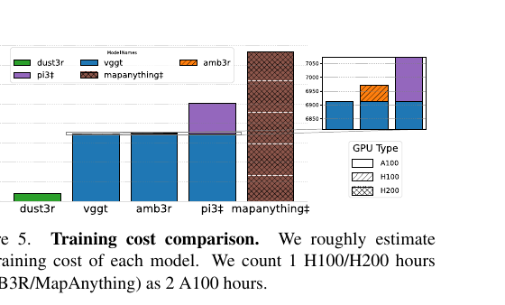

在 RTX 4090、输入 $392\times518$、排除数据读取开销时，AMB3R-VO 平均 4.2 FPS，最好 6.0 FPS，最慢 3.4 FPS。速度受活动关键帧数量与场景难度影响；当前端置信度足够高时可以跳过后端。补充图 7 显示降低输入分辨率能超过 10 FPS，但速度提升伴随精度变化。固定活动记忆最多 10 帧，意味着在线复杂度不再随着总视频帧数增加。

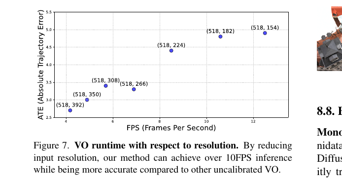

补充材料还报告 7-Scenes 原伪真值的漂移问题及新真值检查；DTU 定性图展示白桌上的建筑模型，这些无背景尺度线索的场景也是公制尺度估计容易出错的案例。

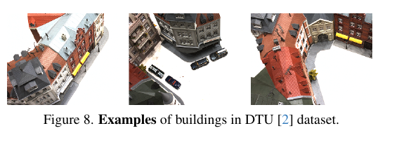

### 9. 更多定量结果

补充表 17 扩展体素后端消融，表 18 扩展公制尺度预测方式比较。移除零卷积时模型无法在当前计算预算和数据规模内收敛；随机初始化后端会改变预训练置信度函数，造成学习目标不稳定。表 19、21 分别列出 IMC PhotoTourism 和 Tanks & Temples 的逐场景 SfM 召回，表 20 列出 RMVDB 全量多视图深度比较。逐场景数字显示结果会随图像数、场景重叠和难度变化，平均指标不能代表每个地点都同样成功。

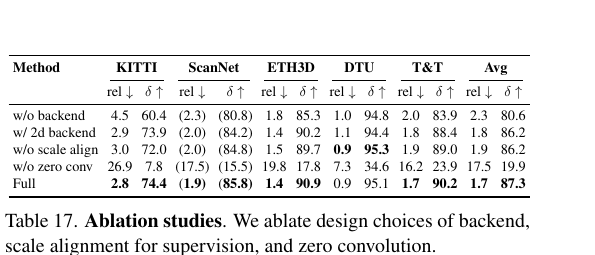

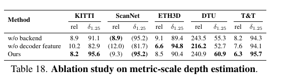

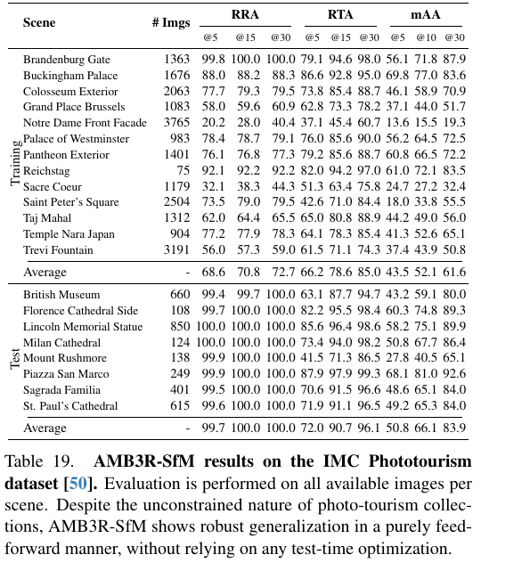

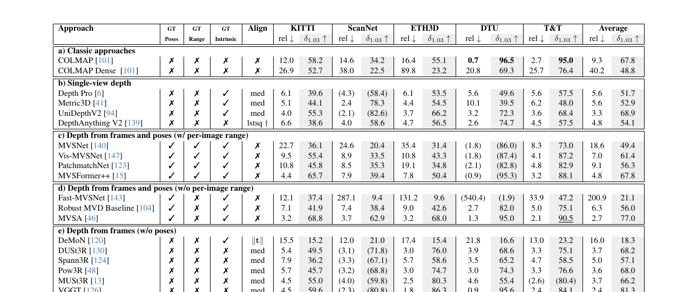

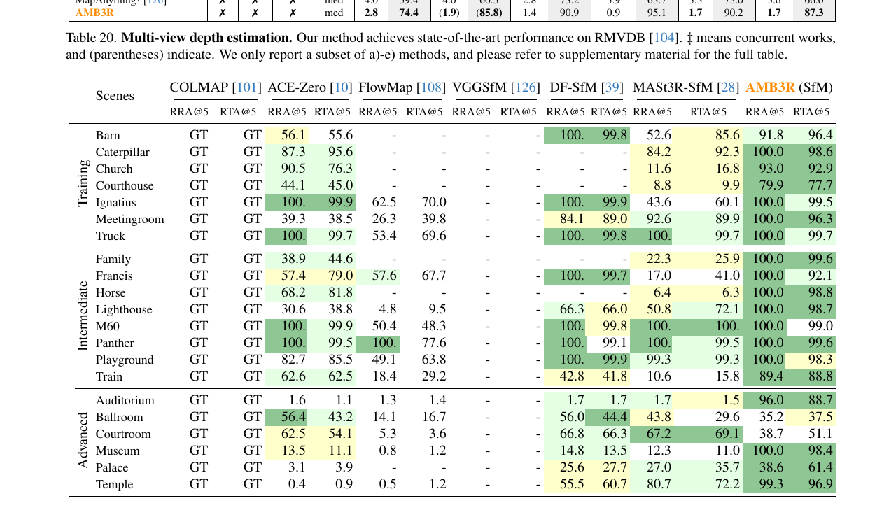

### 10. 定性结果

补充图 9、10 展示 7-Scenes、TUM 与 ETH-SLAM 的关键帧轨迹；图 11、12 展示 ETH3D 和 Tanks & Temples 的 SfM 点云；图 13 展示 IMC PhotoTourism、Cambridge Landmarks 等无序图像集合的重建。它们补充了主文基准上的示例，也呈现出场景规模与可见重叠差异。

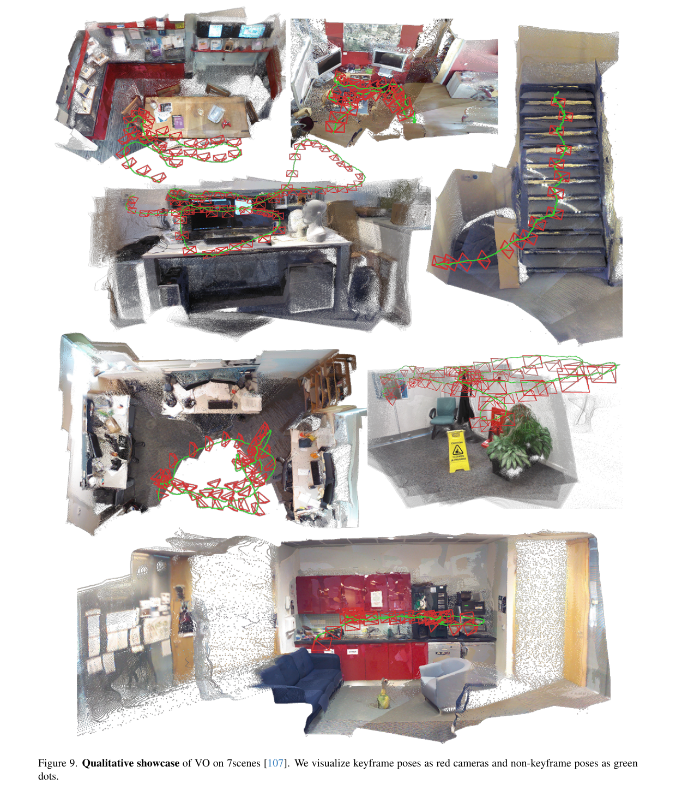

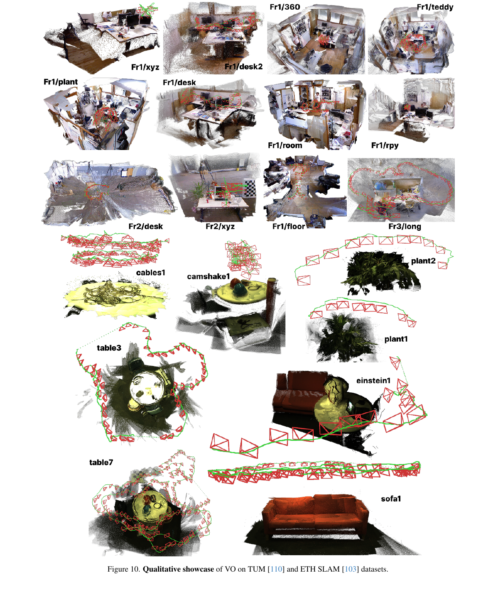

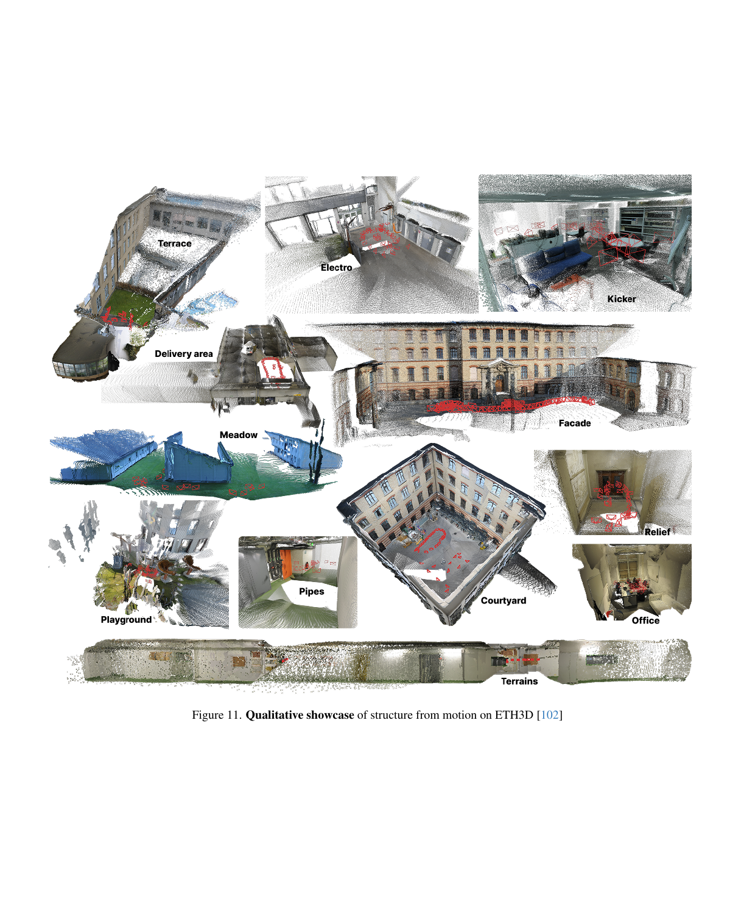

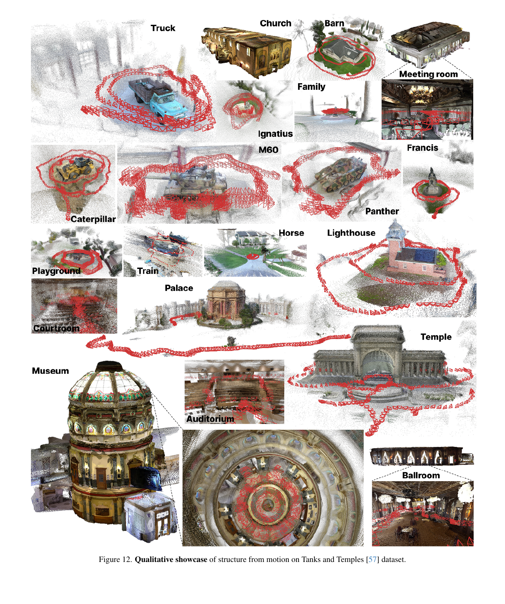

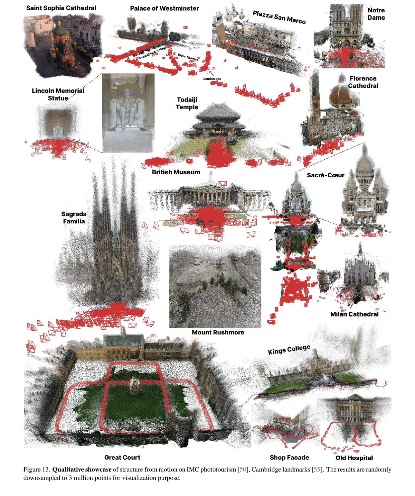
