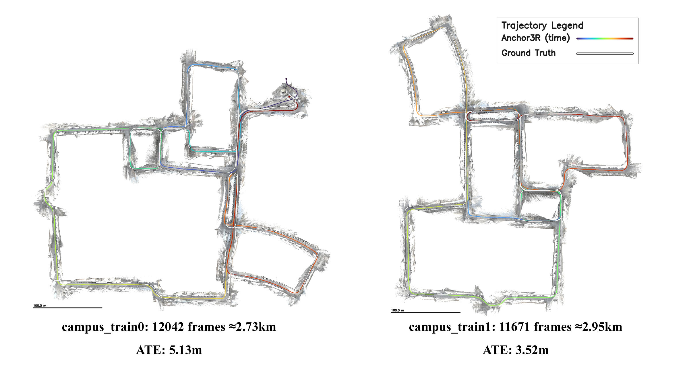
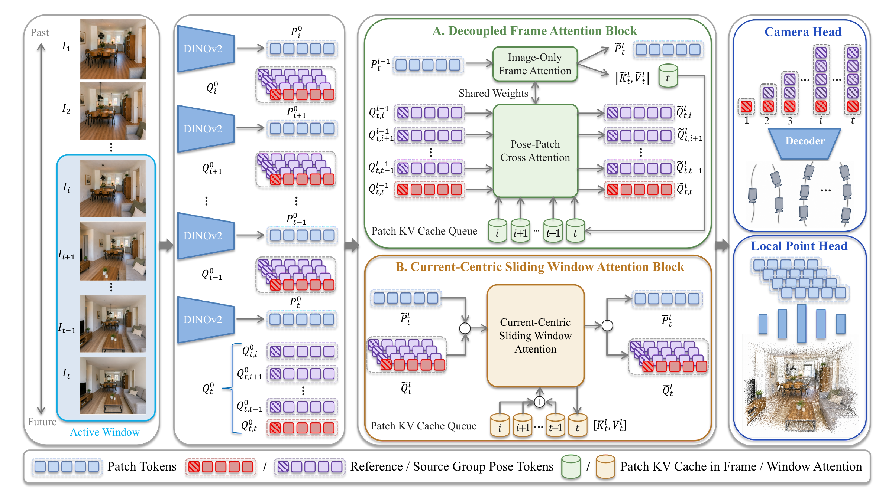
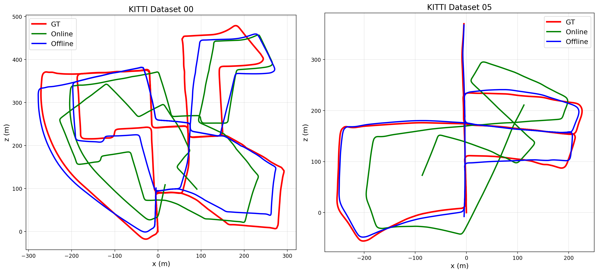
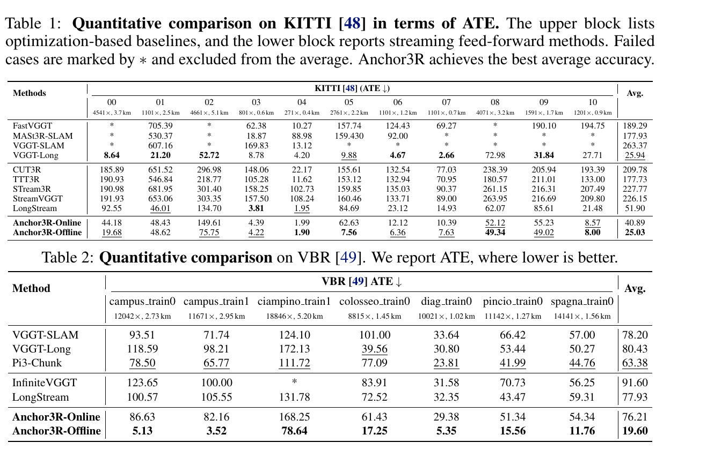
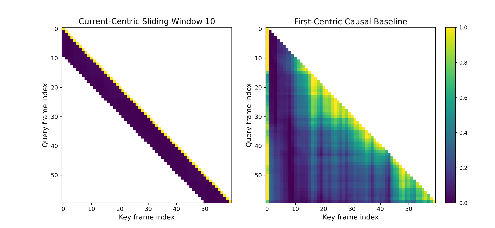
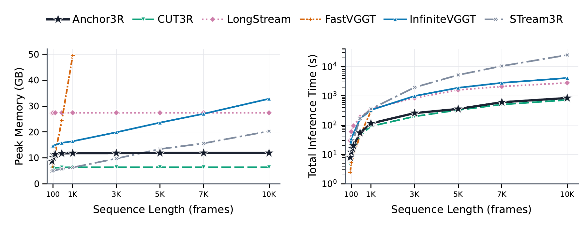
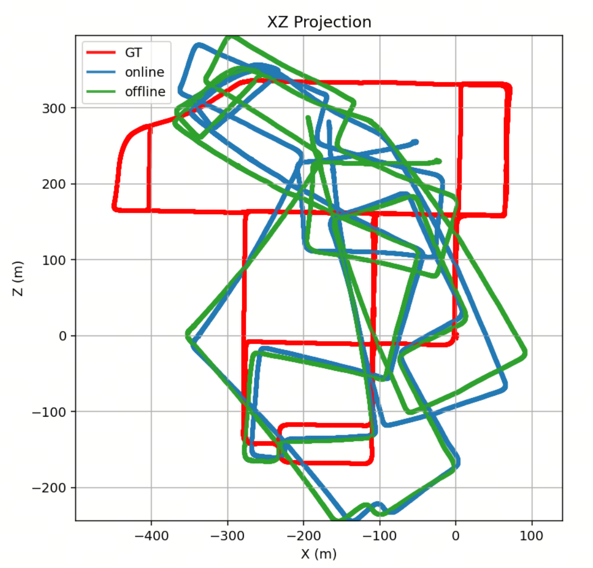

# Anchor3R 论文解读

> Peilin Tao、Chong Cheng、Yuansen Du 等，*Anchor3R: Streaming 3D Reconstruction with Transient Anchors for Long-Horizon Visual Mapping*，arXiv v2（2026-09-14），已被 CoRL 2026 接收。本文依据 arXiv v2 正文与补充材料。[论文页面](https://arxiv.org/abs/2606.05035v2) · [PDF](https://arxiv.org/pdf/2606.05035v2) · [官方代码](https://github.com/polar-explorer/Anchor3R)

流式三维重建要不断接收新图像，持续更新相机运动和场景几何。多数前馈模型从短片段学得局部几何先验；部署到长视频时，还要让内部状态沿着序列维护一个坐标系。序列一长，网络便同时承担局部几何判断和历史坐标传播，误差会随着时间累积。Anchor3R 的出发点是把这两项工作拆开：神经网络每次只预测一个短窗口里的相对位姿和局部点图，显式运动图再负责把这些局部测量对齐到全局轨迹。

*原论文图 1。两个校园序列分别包含 12,042 帧和 11,671 帧。白线为真值轨迹，彩色线为预测结果。图中轨迹误差分别为 5.13 m 和 3.52 m ATE。*

## 把全局轨迹预测改成当前帧坐标系下的局部测量

在时刻 $t$，Anchor3R 取最近 $W$ 帧组成活动窗口 $\mathcal W_t=\{k,\ldots,t\}$，其中 $k=\max(1,t-W+1)$。当前帧 $I_t$ 作为临时参考帧，网络对窗口内每一帧 $i$ 预测从当前坐标系到第 $i$ 帧坐标系的相对变换：

$$
\mathbf T_{i\leftarrow t}=\mathbf T_i\mathbf T_t^{-1},\qquad
\mathbf T_{t\leftarrow t}=\mathbf I.
\tag{1}
$$

这里 $\mathbf T_i$ 是论文使用的绝对相机位姿。式 (1) 的关键是相邻时刻的监督目标始终描述窗口内的相对几何关系，而不要求网络直接回归相对于遥远首帧的坐标。窗口向前滑动后，同一帧会出现在多个后续窗口中，也就会收到来自不同当前锚点的多次相对位姿测量。这些重叠测量成为图中的多条边，后端可以联合利用，而不必把每一步的位姿误差永久写入单条递推链。

网络还为当前帧预测局部点图 $\hat{\mathbf X}^{\mathrm{local}}_t$ 和置信度图。每张点图先留在当前帧局部坐标系中；恢复全局相机位姿后，再将点图变换到共同坐标系。这使局部几何预测和全局对齐共享相对测量，却不要求网络在产生点图时已经维护一套稳定的长时全局坐标。

*原论文图 2。模型交替执行图像帧注意力和当前中心的窗口注意力。每帧的图像 patch 特征可以复用；当前窗口的位姿查询则按新的参考帧重新创建。相机头联合解码窗口相对位姿，点图头输出当前帧局部几何。*

## 图像特征可复用，位姿查询随锚点重建

对每一帧，DINOv2 将图像编码为 patch token。窗口内每帧另有一组 pose-query token，包含一个位姿 token 和 31 个 register token。当前帧使用可学习的 reference 模板，其他窗口帧使用 source 模板。二者不同的初始化明确指定了谁是局部参考、哪些帧需要相对它提供运动证据。

Transformer 的一部分只处理图像侧特征：它更新当前图像 token，并把图像侧的 key/value 状态写入缓存。pose-query 随后读取对应帧的图像状态，窗口注意力再联合处理当前帧 patch 和窗口内各组查询。窗口结束时，图像侧状态继续留在缓存中；pose-query 则丢弃，下一个时刻根据新的当前参考帧重新实例化。

这一区分来自两种状态所表达内容的不同。图像 patch 主要保存外观、局部几何和匹配线索，可以供后续窗口重复读取。pose-query 的表示则包含在某个特定临时坐标系下形成的推理结果；如果将它原样传到下一窗口，新窗口就会接收到与当前锚点不一致的坐标假设。Anchor3R 因而把“历史视觉证据”放进缓存，把“当前窗口的位姿推理”限制在窗口内。论文的消融也显示，只缓存图像侧状态的版本在 vKITTI 五个场景上的平均 ATE、RTE、RRE 分别为 2.642、0.097、0.090；同时缓存位姿查询的版本对应为 3.517、0.146、0.092。

## 重叠相对位姿组成运动图

将每个图像帧视作图顶点，窗口预测的相对位姿视作边，就得到运动图 $\mathcal G=(\mathcal V,\mathcal E)$。设帧 $i$ 的全局旋转为 $\mathbf R_i$、相机中心为 $\mathbf c_i$。对于边 $(i,t)$，网络预测的相对旋转和相对平移满足

$$
\hat{\mathbf R}_{i\leftarrow t}\approx \mathbf R_i\mathbf R_t^\top,
\qquad
\hat{\mathbf v}_{i,t}=\hat{\mathbf R}_{i\leftarrow t}^{\top}\hat{\mathbf t}_{i\leftarrow t}
\approx \mathbf c_t-\mathbf c_i.
\tag{2}
$$

第二个关系把预测的相机坐标系平移旋回到用于相机中心约束的方向。换言之，一条边不仅提供两个视角的相对朝向，还提供二者中心之间的相对位移。整个图仍有任意全局刚体坐标系自由度，因此求解时需要固定一个参考位姿；论文将首帧设为在线轨迹的参考。

在线更新只需当前窗口内新产生的边。每条边结合已恢复的历史位姿，给出一个当前位姿候选。旋转候选不在矩阵元素上直接求均值，而是先选取多个候选作为初值，将候选间的相对旋转通过 $\operatorname{Log}$ 映射到李代数，再逐坐标取残差中值并用 $\operatorname{Exp}$ 更新。迭代收敛后，选中位角残差最小的候选；若没有候选收敛，则退回第一个候选旋转。相机中心则直接从各条边计算候选位置，再逐坐标取中值。这样，单条弱重叠或模糊窗口产生的异常测量不容易完全支配当前帧的在线更新。

离线运动平均使用整段序列累积的窗口边，并可以加入额外的远距离回环边。旋转部分在李代数中计算残差，通过带 Geman–McClure 型权重的 IRLS 迭代求解稀疏线性系统；补充材料给出的鲁棒尺度为 $5^\circ$。平移部分先按优化后的旋转把相对平移转到全局方向，再联合求所有相机中心，使每条边上的相对位移残差尽量小。作者用 $L_1$ 目标降低异常平移边的影响，并通过 ADMM 与稀疏 Cholesky 分解求解。式 (2) 汇总主文的图优化目标；补充材料式 (9)–(17) 展开了旋转 IRLS 与平移 LAD 求解步骤。

离线回环分支每隔 5 帧选关键帧，以 NetVLAD 检索相似图像，取 top-3 匹配，再将时间上分离的候选重新插入模型窗口，生成长距离相对位姿边。这里回环检索不是 Anchor3R 学到的组件；检索到的帧只是重新成为当前窗口的临时锚点，为图优化补充长程测量。

*原论文图 4。作者展示序列 00 与 05 上在线轨迹和加入回环约束后的离线轨迹。离线解由局部窗口预测、NetVLAD 关键帧检索和图优化共同产生。*

## 训练与实验设置

Anchor3R 从 VGGT 初始化，保留 24 层主干，约有 1.2B 参数。训练样本以 48 帧为一次展开，每次局部预测使用固定 10 帧窗口；每组查询含一个位姿 token 和 31 个 register token。损失由窗口相对相机参数和当前局部点图组成。点图损失含置信度加权重建项与梯度正则项，且同一尺度因子同时用于相对平移和局部点图，以鼓励二者在窗口内及重叠窗口间保持尺度一致。训练混合 WildRGB、ScanNet、HyperSim、Mapillary、Waymo Open、DL3DV 等真实与合成数据集；论文报告以 32 张 NVIDIA A800 训练 80k 次迭代，约 12 天。

主实验在 KITTI、VBR、TUM RGB-D、Oxford Spires 和 Waymo 上评估相机轨迹，在 7Scenes 与 TUM RGB-D 上评估稠密重建。补充材料说明评测使用完整序列，不做帧抽样：KITTI 使用 00–10 共 11 条序列，VBR 使用 7 条路线，Oxford Spires 覆盖 12 个子集，7Scenes 每个场景使用 sequence 01，TUM 遵循标准全序列协议；Waymo 使用 9 段未参与训练的保留片段。ATE 对齐使用相似变换；论文将 Anchor3R-Online 与 Anchor3R-Offline 分开报告。Online 按时序单遍处理，不做回环检测或关键帧重插入；Offline 则添加检索回环边并执行运动平均。KITTI 与 VBR 的完整数值见下图，数值单位均为米，越低越好。

*原论文表 1、表 2。KITTI 中失败项以星号标出，并从平均值排除；VBR 使用七条完整轨迹，最长为 18,846 帧、5.20 km。*

KITTI 上，Anchor3R-Online 的平均 ATE 为 40.89 m，低于 LongStream 的 51.90 m；Anchor3R-Offline 为 25.03 m。VBR 上 Online 平均为 76.21 m，Offline 为 19.60 m，并在表列出的七条路线中取得最低 ATE。两组结果说明：窗口测量本身对在线位姿有帮助；当路线有重访并能加入长程约束时，离线运动平均可进一步重新分配轨迹误差。两种模式的数值不能混为同一在线能力。论文报告的 ATE 经 Sim(3) 对齐，也不应解读为严格的无尺度校准误差。

点云重建表中，Anchor3R-Online 在 7Scenes 的 Chamfer Distance 为 1.848、F1@0.25 为 0.707；在 TUM 上分别为 0.108 和 0.933。它在 7Scenes 的 CD 最低，在 TUM 的 F1 排第二。密集重建是用预测轨迹和深度或点图建立点云，再与真值做相似变换对齐，故反映的是该评估协议下的重建结果。

## 长序列能力和消融结果

注意力可视化比较了固定首帧参考的 STream3R 式基线与 Anchor3R。固定首帧基线在 60 帧 vKITTI 片段中持续对第一帧保持较强注意力；Anchor3R 的注意力随当前窗口前移。缓存消融则表明，继续复用 pose-query 会降低多数场景上的轨迹精度。窗口大小实验中，窗口从 5 帧增至 10 帧后，ATE/RRE/RTE 从 3.23/0.12/0.15 降至 2.64/0.09/0.10；扩大到 15 帧只带来轻微改善至 2.55/0.08/0.10，但单次迭代时间从 2.7 秒增至 3.2 秒，故作者取 10 帧作为折中。

*原论文图 3。固定首帧基线将注意力持续集中于最初视角；Anchor3R 的注意力支撑随滑动窗口向前移动。*

在论文的运行时实验中，Anchor3R 以 48 帧序列训练，却在最长 10,000 帧的测试流上保持近似恒定的 GPU 显存，运行时间随序列长度近似线性增长。完整模型报告 12.7 FPS 和 11.9 GB 峰值显存。作者指出，运动图和点图保存在 CPU 或磁盘中，会随序列增长；因此显存有界不等于整套系统所有存储都固定。运动平均耗时在 12,000 帧上为 11.88 秒，在 18,800 帧上为 17.24 秒。

*原论文图 5。图示比较了不同流式重建方法在统一分辨率与硬件上的显存峰值和总推理时间。*

补充材料还将相同的离线关键帧检索和运动平均用于 LongStream 与 VGGT。VBR 上 LongStream-Off-5 在 7 条路线中的 6 条优于 LongStream，VGGT-Off-5 在 7 条都优于 VGGT-Long；Anchor3R-Off-5 则在 7 条都优于 LongStream-Off-5，在 6 条优于 VGGT-Off-5。这项控制实验说明提升并非只来自后端优化器；但 Anchor3R 的预测边与另一模型的预测边质量不同，仍不能把比较理解成完全相同前端上的独立后端对照。KITTI 上不加回环的离线消融也有改善：平均 RRE 从 0.177° 降至 0.166°，RTE 从 0.147 m 降至 0.136 m，表明重叠窗口本身提供了可用于全局平均的冗余边。

*原论文补充图 6。ciampino train1 在频繁转弯处仍会出现明显漂移；不带回环的离线平均可以重新分配局部误差，却无法完全消除缺少远程约束时累积的朝向误差。*

## 能力边界

Anchor3R 将学习式局部几何测量与显式全局对齐结合起来，因此适合作为“流式前馈重建加运动图”的系统来理解。它具备单遍在线位姿更新，也提供回环关键帧重新测量和全局运动平均；但论文的回环检索和位姿图对齐仍是学习模型之外的组件。从“流式端到端 SLAM”的角度看，真正端到端地学习长程约束发现与全局对齐，仍是后续问题。

作者还列出几项限制：历史点图产生后不会随新观测继续修正，因而全局几何可能不一致；运动平均依赖相对尺度足够一致；虽然 VBR、KITTI 与 Waymo 含动态物体，但论文没有在强动态专门基准上评估；实验是在回放序列上完成，没有实体机器人部署。补充材料中的频繁转弯失败案例进一步说明，只靠局部重叠边并不能替代长程回环约束。

Anchor3R 的主要启发是将神经模型负责的量限定为短程、当前中心的相对测量，并让传统图优化承担全局误差分配。这为 [StreamVGGT](../streamvggt/index.md)、[STream3R](../stream3r/index.md)、[CUT3R](../cut3r/index.md)、[LongStream](../longstream/index.md) 等流式几何方法提供了不同的系统组织方式：历史特征仍可缓存，坐标系却不必作为持久隐状态一路传递。与 [VGGT-SLAM](../vggt-slam/index.md) 这类将学习式重建与显式 SLAM 后端结合的系统对照，Anchor3R 的前端仍以每窗的局部测量为核心。对于希望把这类前馈几何模型接入 SLAM 的工作，评估时应分别报告严格在线轨迹、回环检索带来的长程收益和稠密地图质量，才能看清改进来自哪一部分。
