# B 样条的局部平滑曲线构造与应用

先看一个很具体的场景。激光雷达一秒钟扫一圈，每个点都有自己的时间；相机在曝光，IMU 也在同时读数。我们想知道任意时刻的传感器位姿。只拿每隔几十毫秒的几个关键帧硬凑并不理想，因为点可能落在关键帧之间，运动也可能很快。更自然的做法是画出一条随时间连续变化的曲线，再在曲线上取值。

但这条曲线不能随便画。它最好满足三件事。

- 任意一点只由附近几个系数决定（否则雅可比会变得稠密，计算复杂度过高）；
- 光滑程度可控（要加速度连续就不能只靠折线）；
- 基本身有明确构造，而不是手调形状。

全局高次多项式虽然光滑，却会牵一发而动全身。改动一个系数，整条曲线都变。分段直线只影响局部，却在拐点处突然改变速度。B 样条提供了一个折中。曲线由附近少数控制点共同决定，次数决定它能平滑到几阶，而且每个基函数都能从最简单的矩形窗口一步步构造出来。

同一个对象会在不同语境中扮演三种角色。它先是滑动窗口产生的平滑核，随后被平移到参数轴上的一系列位置，形成一排局部基函数，最后用于表示可以求导和优化的轨迹。Poisson 表面重建使用空间中的核，连续时间 SLAM 使用时间轴上的基函数；两者共享同一套构造。

---

## 先看三次“变形”，再解释它为什么发生

先把公式放一边。想象一个高度为 1、宽度为 1 的矩形，中心在原点，左右端点分别是 $-1/2$ 和 $1/2$。让另一个相同的矩形从左向右滑动，每一刻都计算二者重叠的面积。得到的曲线再作为新的固定形状，让同一个矩形继续扫过；这个过程重复两次。

下面三段动画依次展示这三次“滑过并累计面积”。每一段的蓝色固定曲线都是上一段刚生成的结果；橙色矩形始终是同一个宽度为 1 的窗口；绿点的高度记录当前窗口下的重叠面积。

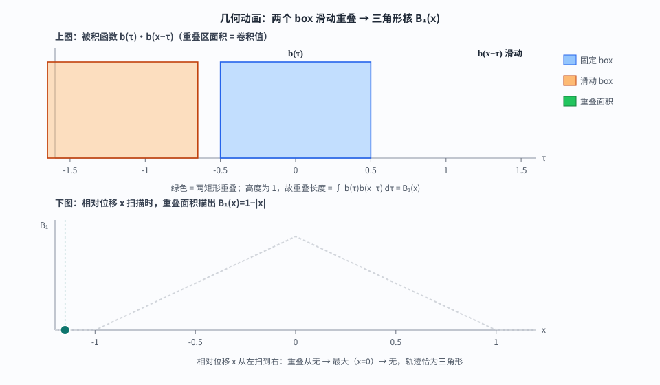

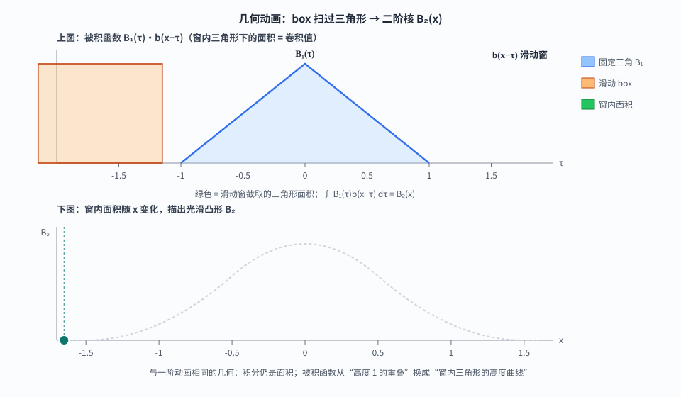

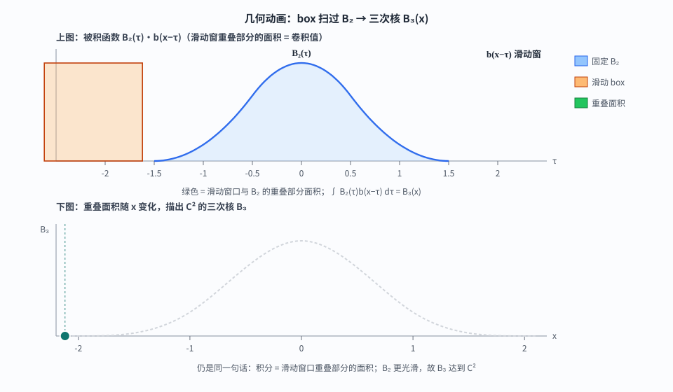

第一段里，两个矩形刚碰到时面积为 0，完全重合时面积为 1，于是重叠长度画出一顶三角形。第二段里，矩形扫过三角形，累计的是三角形下面一块不断变化的面积，尖角被磨圆，得到分段二次曲线。第三段继续同一件事，得到更光滑的分段三次曲线。一个简单的 box，经过几次“滑动并求面积”，就长成了平滑的曲线。

每次求面积都是积分；滑动的 box 是卷积核；把上一步的结果再与这个 box 卷积，就是自卷积。于是三段动画依次得到 $B_1=b*b$、$B_2=b*b*b$、$B_3=b*b*b*b$。从 box 开始反复自卷积得到的这一族分段多项式，就是基数 B 样条核；把它们平移到不同节点，就成为曲线和轨迹所用的 B 样条基函数。

这个画面概括了 B 样条的构造。**反复用一个局部 box 对函数做滑动积分，曲线逐渐变平滑，同时保留有限支撑。**下面把动画里的形状和面积写成公式。

下面两个词会反复出现。

- **支撑** $\operatorname{supp} f$，指使 $f$ 可能非零的自变量集合。集合之外有 $f\equiv 0$；支撑有界时称为**紧支撑**。
- **$C^{m}$**，表示各阶导数直到 $m$ 阶都连续。比如 $B_3\in C^2$ 表示它的函数值、一阶导数和二阶导数都连续。对标准三次 B 样条，三阶导数会在节点处跳变，所以它恰好是 $C^2$，而不是 $C^3$。

---

## 把动画翻译成数学

把刚才固定不动的矩形写成函数

$$
b(x)=B_0(x)=\mathbf{1}_{[-1/2,\,1/2]}(x)
=
\begin{cases}
1,& |x|<1/2,\\
0,& \text{otherwise.}
\end{cases}
$$

两个函数的卷积定义为

$$
(f*g)(x)=\int_{-\infty}^{\infty}f(\tau)g(x-\tau)\,\mathrm d\tau.
$$

当 $g=b$ 是那个会滑动的矩形时，$b(x-\tau)$ 只在 $\tau\in[x-1/2,x+1/2]$ 内等于 1。因此积分只累加滑动窗口与固定曲线重叠的部分。换句话说，刚才动画画出的“面积随位置变化”，就是一次卷积。

次数为 $d$ 的基数 B 样条核，是把这个窗口重复卷积 $d+1$ 次得到的结果。

$$
B_d
=
\underbrace{b*b*\cdots*b}_{d+1\text{ 次}},
\qquad
B_0=b,\quad B_d=B_{d-1}*b.
\tag{C1}
$$

$\int b=1$ 会传给每一级，故 $\int B_d=1$。经验上每多卷一次 box，支撑宽度加 1，连续性大约升一阶，形状更接近高斯——许多实现因此用 $B_3$ 代替「方差约为采样尺度的高斯」。

单位 box 只在 $(-1/2,1/2)$ 内为 1，支撑宽度为 1；两个 box 卷积后，支撑宽度变成 2。每多卷一次，支撑宽度加 1，连续性升一阶，形状也更圆滑。

在这个记号下，动画里的蓝色曲线代表固定的 $f$，橙色矩形代表 $b(x-\tau)$，绿色重叠区域的面积就是积分值。下面直接根据重叠区间写出各段表达式。

### 两个窗口叠在一起，得到三角形

$$
B_1(x)=(b*b)(x)=\int b(\tau)\,b(x-\tau)\,\mathrm{d}\tau.
$$

此时 $f$ 也是高度 1 的矩形，重叠区内高度恒为 1，面积退化成**重叠长度**。动画中的蓝色、橙色和绿色区域，分别对应固定 box、滑动 box 和它们的重叠；绿点的高度就是当前面积。

$x=0$ 完全重合时面积最大为 1；$|x|\to 1$ 时面积降为 0，轨迹是 tent。令 $I(x)=[-1/2,1/2]\cap[x-1/2,x+1/2]$，则 $B_1(x)=\operatorname{length}(I(x))$。它的分段结果如下。

| 范围 | 结果 |
|------|------|
| $\|x\|\ge 1$ | $B_1=0$ |
| $-1<x<0$ | $B_1=x+1=1-\|x\|$ |
| $0\le x<1$ | $B_1=1-x=1-\|x\|$ |

于是

$$
B_1(x)=
\begin{cases}
1-|x|,& |x|<1,\\
0,& |x|\ge 1.
\end{cases}
\tag{C2}
$$

支撑 $[-1,1]$，$C^{0}$（在 $0$ 处导数跳跃）。下一阶把固定曲线换成这个三角形。

### 再扫一次，三角形变成圆润的曲线

$$
B_2(x)=(B_1*b)(x)=\int B_1(\tau)\,b(x-\tau)\,\mathrm{d}\tau.
$$

绿色现在是窗与三角形的重叠面积。两支撑的交集给出积分上下限，其中 $L=\max(-1,x-1/2)$，$U=\min(1,x+1/2)$。

$$
B_2(x)=\int_{L}^{U}(1-|\tau|)\,\mathrm{d}\tau.
$$

$|x|\ge 3/2$ 时面积为 0。下面把 $0\le x\le 1/2$ 这一段算完，其余用偶对称与同类分段得到。

此时 $L=x-1/2\in[-1/2,0]$，$U=x+1/2\in[1/2,1]$，积分跨过 $0$，拆成

$$
B_2(x)=\int_{x-1/2}^{0}(1+\tau)\,\mathrm{d}\tau+\int_{0}^{x+1/2}(1-\tau)\,\mathrm{d}\tau.
$$

第一段积分给出 $\bigl[\tau+\tau^{2}/2\bigr]_{x-1/2}^{0}=0-\bigl((x-1/2)+(x-1/2)^{2}/2\bigr)=1/2-x-(x-1/2)^{2}/2$。  
第二段积分给出 $\bigl[\tau-\tau^{2}/2\bigr]_{0}^{x+1/2}=(x+1/2)-(x+1/2)^{2}/2$。  
相加并化简得

$$
B_2(x)=\tfrac34-x^{2},\qquad 0\le x\le\tfrac12.
$$

对 $\tfrac12\le x\le\tfrac32$，窗完全落在 $B_1$ 的右半支上，直接积分得 $B_2(x)=(3/2-x)^{2}/2$。再由偶函数补全左边，得到

$$
B_2(x)=
\begin{cases}
\dfrac{(x+3/2)^{2}}{2},& -3/2\le x<-1/2,\\[6pt]
\dfrac{3}{4}-x^{2},& |x|\le 1/2,\\[6pt]
\dfrac{(3/2-x)^{2}}{2},& 1/2<x\le 3/2,\\
0,& |x|>3/2.
\end{cases}
\tag{C3}
$$

支撑 $[-3/2,3/2]$，$C^{1}$。

### 第三次卷积得到常用的三次 B 样条

$$
B_3(x)=(B_2*b)(x)=\int B_2(\tau)\,b(x-\tau)\,\mathrm{d}\tau.
$$

几何规则不变。$B_2$ 已是 $C^{1}$，再卷一次 box 就升到 $C^{2}$。分段积分与上一节相同，需要根据 $x$ 判断窗口落在 $B_2$ 的哪些多项式片上。

在 $0\le x\le 1$ 时，积分窗跨过 $B_2$ 的中心分段，直接把 (C3) 代入
$(B_2*b)(x)=\int_{x-1/2}^{x+1/2}B_2(\tau)\,\mathrm d\tau$，按 $x=1/2$ 拆分积分，化简后得到
$B_3(x)=\bigl(4-6x^2+3x^3\bigr)/6$。在 $1\le x\le 2$ 时，窗只扫过 $B_2$ 的外侧分段，得到
$B_3(x)=(2-x)^3/6$；再利用偶对称和 $B_3(2)=0$ 补齐其余区间，整理成常用的中心化闭式

$$
B_3(x)=
\begin{cases}
\dfrac{1}{6}(2-|x|)^{3},& 1<|x|<2,\\[8pt]
\dfrac{1}{6}\bigl(4-6x^{2}+3|x|^{3}\bigr),& |x|\le 1,\\
0,& |x|\ge 2.
\end{cases}
\tag{C4}
$$

这段计算展示了卷积的作用。每次卷积都只在新的支撑交集上积分，次数增加一阶，端点处的函数值和导数由两侧接上。直接检查可得 $B_3(1)=1/6$、$B_3(2)=0$，并且在 $x=1$ 处左右一阶、二阶导数相同。

$B_3$ 求梯度 / Laplace 时数值稳定，是重建与轨迹最常用的次数。各阶核的差异可以这样对照。

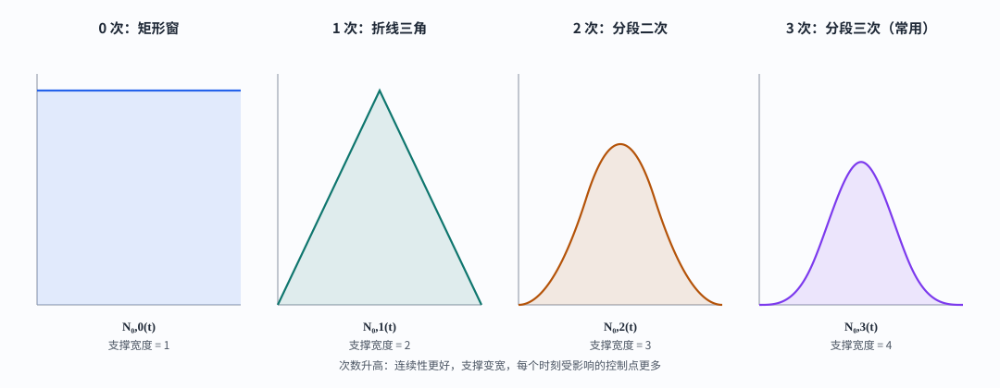

| 核 | 支撑宽度 | 连续性 | 固定曲线 $f$ | 绿色重叠面积在算 |
|----|----------|--------|--------------|------------------|
| $B_0$ | 1 | 不连续 | — | 矩形窗本身 |
| $B_1$ | 2 | $C^{0}$ | box | 两矩形重叠长度 |
| $B_2$ | 3 | $C^{1}$ | 三角形 $B_1$ | 窗∩三角的面积 |
| $B_3$ | 4 | $C^{2}$ | $B_2$ | 窗∩$B_2$ 的面积 |

规律很清楚。支撑宽度为 $d+1$，连续性为 $C^{d-1}$，分段次数为 $d$。每一阶都遵循同一个几何解释，积分就是滑动窗口重叠部分的面积。

这个平滑小山包有三项性质。有限支撑让它只影响附近位置，连续阶数控制曲线的平滑程度，分段多项式形式便于求值和求导。计算机里的离散实现，以及把它复制到时间轴上的方法，都建立在这三项性质上。

---

## 计算机怎样把积分换成求和

前面的动画和公式在连续的 $x$ 轴上成立，但计算机拿到的通常是一串采样值。这些值可能来自图像网格上的灰度、体素里的法向，或者每隔 $h$ 秒记录一次的传感器读数。计算机不能把每个区间切成无限小，只能在这些格点上近似积分。

最直接的做法是用求和近似连续积分。若 $f[n]$ 表示第 $n$ 个格点的数值，离散卷积

$$
(f*g)[n]=\sum_{m\in\mathbb{Z}} f[m]\,g[n-m].
\tag{D1}
$$

在网格上，每个采样值代表一个小区间，连续积分便由这些小区间面积的总和近似。归一化 box 的高度和宽度都为 1，积分为 1；常数函数经过它的卷积后仍保持原值。离散窗口覆盖 $L$ 个格点时，若每个格点的权重都是 1，权重总和会变成 $L$，常数值也随之放大 $L$ 倍。为了保持相同的归一化尺度，窗口中的每个格点取权重 $1/L$，于是离散 box 表现为局部平均。

举个具体例子。假设一维数据依次是

$$
2,\;4,\;8,\;10,\;6.
$$

取一个覆盖 3 个样本的窗口。窗口先盖住 $2,4,8$，输出它们的加权和 $(2+4+8)/3$；向右移动一格后盖住 $4,8,10$，输出变成 $(4+8+10)/3$；再移动一格，得到 $(8+10+6)/3$。窗口每移动一次，就输出一个新的局部平均值，这就是离散的滑动 box。若输入整段数据都等于常数 $c$，每个窗口的输出仍是 $(c+c+c)/3=c$，这正好对应连续归一化 box 的行为。

一般地，若窗口覆盖 $L$ 个样本，第 $n$ 个输出为

$$
y[n]=\frac1L\sum_{r=0}^{L-1}f[n-r].
$$

这里的 $L$ 只是“窗口一次看多少个样本”，不是 B 样条的次数。把这件事写成卷积，只需把窗口记成一个权重数组

$$
\beta_L[r]=
\begin{cases}
1/L,&0\le r<L,\\
0,&\text{otherwise,}
\end{cases}
\qquad y=f*\beta_L.
$$

所以，卷积在这个例子里就是“窗口覆盖的数据乘以 $1/L$ 后相加”。把同一个归一化窗口再扫一遍，就是离散版的“再卷一个 box”。

为了单独观察卷积后系数的形状，下面暂时去掉归一化因子，取长度为 2 的盒

$$
\beta[n]=
\begin{cases}
1,& n\in\{0,1\},\\
0,& \text{otherwise.}
\end{cases}
$$

手算几步就能看见“变宽、变平滑”。

| 卷积次数 | 非零值（从左到右） | 支撑长度 |
|----------|--------------------|----------|
| $\beta$ | $1,1$ | 2 |
| $\beta*\beta$ | $1,2,1$ | 3 |
| $\beta*\beta*\beta$ | $1,3,3,1$ | 4 |

除以系数总和后，这就是连续动画在格点上的对应物。窗口反复求和，序列逐渐变宽、变平滑。记 $\beta$ 为一次离散 box 的权重序列，记 $B_d^{\mathrm d}$ 为离散的第 $d$ 阶 B 样条核。每做一次离散卷积，就把当前核再用同一个 box 平滑一次，因此有

$$
B_0^{\mathrm{d}}=\beta,\qquad B_d^{\mathrm{d}}=B_{d-1}^{\mathrm{d}}*\beta
\tag{D2}
$$

这里的上标 $\mathrm d$ 表示“离散”，下标 $d$ 表示卷积次数，也就是 B 样条的次数；右侧的 $*$ 是序列卷积。当前为了观察整数系数，$\beta$ 没有除以系数和，实际做归一化滤波时再统一除以总和即可。

就是离散侧的同一定义。

实现时，长度为 $L$ 的滑动和不必每次重新加 $L$ 个数。令前缀和 $s[n]=\sum_{k<n}f[k]$，窗口和就是

$$
s[n+1]-s[n+1-L].
$$

所以一次 box 平滑可以用两次查表和一次减法完成；这个前缀和数组就是图像处理中常说的**积分图**（一维时也叫前缀和）。二维图像里的 summed-area table 做的是同一件事：任意矩形区域的像素和，都能由四个角点的前缀和通过加减得到。重复几次 box，就得到 B 样条尺度的快速离散平滑；这也是积分图在许多局部滤波算法中反复出现的原因。

这里先沿一维坐标理解卷积和离散化。推广到二维或三维时，常用各坐标方向的一维核做张量积。对这里的标量函数来说，张量积就是把各维的函数值相乘；例如三维网格上的权重由 $x$、$y$、$z$ 三个方向的一维权重相乘得到。离散数组中，这种组合对应外积或 Kronecker 积，而不是两个同形数组的逐元素相乘。在三维空间中，可分离的核写成

$$
B_d(\mathbf x)=B_d(x)B_d(y)B_d(z),
$$

于是三维滤波可以拆成沿 $x,y,z$ 三个方向的 1D 操作，避免直接处理一个三维卷积核。三维体素场上的一个具体应用是 Poisson 表面重建，后文会简要说明，也可以参见 [Poisson 表面重建专文](../poisson_recon_box_filter/index.html)。网格步长 $h\to 0$ 且适当归一化时，离散多次 box 一致逼近前面的连续卷积。

| | 连续 $B_d$ | 离散 $B_d^{\mathrm{d}}$ |
|--|------------|-------------------------|
| 定义 | 函数卷积 (C1) | 序列卷积 (D2) |
| 典型角色 | 解析性质、理论核 | 格点快速平滑 |
| 求值 | 分段多项式 / 递推 | 积分图多次 box |

连续核负责闭式与性质；离散卷积负责格点实现。另一个自然问题随之出现。**只有有限个系数时，怎样用这些局部曲线拼出整条连续曲线？**

---

## 已有一个三次基，怎样拼出整条曲线

我们已经有了可以平移的三次小山包 $B_3$。现在假设有一条未知的真实曲线 $y(t)$，我们只能在若干采样时刻 $t_k$ 看到带噪观测 $y_k$。我们希望用有限个参数构造一条平滑曲线 $f(t)$，让它在这些时刻尽量接近观测，同时能够在采样时刻之间给出连续的数值。

先在参数轴上选出一串位置 $t_0,t_1,t_2,\ldots$，这些位置叫作**节点**。节点本身不是一个区间，相邻两个节点之间的部分才是一个节点区间，例如 $t_i$ 和 $t_{i+1}$ 之间的 $(t_i,t_{i+1})$。节点决定了基函数放置的位置，也决定了分段多项式在哪些位置发生切换。

在每个节点旁边放置一个局部基函数，并为它配一个待估的系数。这里的 $i$ 只是无量纲的整数编号，真正的物理位置是 $t_i$；节点的位置不必等于观测时刻，它们只是表示曲线所用的参数网格。所有基函数叠加后得到

$$
f(t)=\sum_i c_iN_{i,d}(t).
$$

拟合过程就是调整 $c_i$，使 $f(t_k)$ 与观测 $y_k$ 尽量接近。对每个索引 $i$，公式 $N_{i,d}(t)$ 先定义出一整条属于第 $i$ 个基函数的曲线。在固定的均匀节点间隔 $\Delta t$ 下，它们是同一个模板沿全局时间轴的平移，标准轨迹表示中不改变基函数自身的幅值。查询某个时刻 $t=t^*$ 时，再把这个时刻代入这条曲线，得到数值 $N_{i,d}(t^*)$；这个数值才是当前时刻对控制系数 $c_i$ 的权重。于是，基函数决定每个控制系数在当前位置参与多少，$c_i$ 决定这份局部贡献的幅值和控制值。

在某个具体时刻 $t$，通常只有附近的 $d+1$ 个基函数非零。因此，$f(t)$ 实际上只是这 $d+1$ 个控制系数的局部加权和，而不是所有控制系数一起参与。$t$ 是正在求曲线值的物理时刻，$t_i$ 是第 $i$ 个节点的物理位置，$\Delta t$ 是相邻节点之间的时间间隔。均匀节点写成 $t_i=i\Delta t$，例如 $\Delta t=0.1\,\mathrm s$ 时，节点就在 $0,0.1,0.2,\ldots$ 秒处。全局图中的查询时刻取为 $t^*=t_3+0.35\Delta t$，局部图中的横坐标就是同一个区间内的 $u=0.35$。

把视野拉回整条时间轴，可以看到 7 个基函数如何首尾覆盖。每个三次基函数的支撑跨过 4 个节点区间，所以在任意时刻最多只有 4 个基函数非零；远处的控制系数对当前位置没有贡献。中层显示这些局部贡献，底层把它们相加得到 $f(t)$，黑点表示观测值。拟合时，已知的是黑点，未知的是 $c_i$，优化器通过改变 $c_i$ 让黑色曲线靠近黑点。

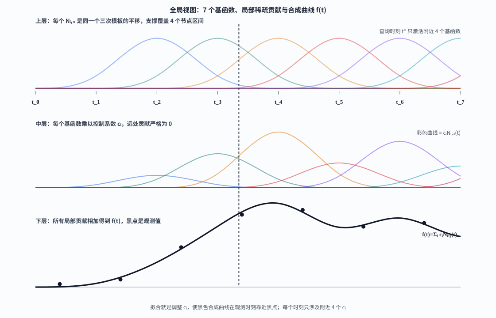

上图给出整体结构。局部放大后，上层显示一个节点区间内四个三次基函数的局部片段；把这些局部片段沿时间轴平移，就得到整条基函数族。下层把它们分别乘上控制系数 $c_i$，再把四条彩色曲线相加，得到黑色的 $f(t)$。均匀节点时，基函数族来自同一个模板，幅值差异来自控制系数。改变 $\Delta t$ 时，时间轴上的支撑宽度会随节点间隔改变；在一次固定的均匀网格表示中，$\Delta t$ 是不变的。

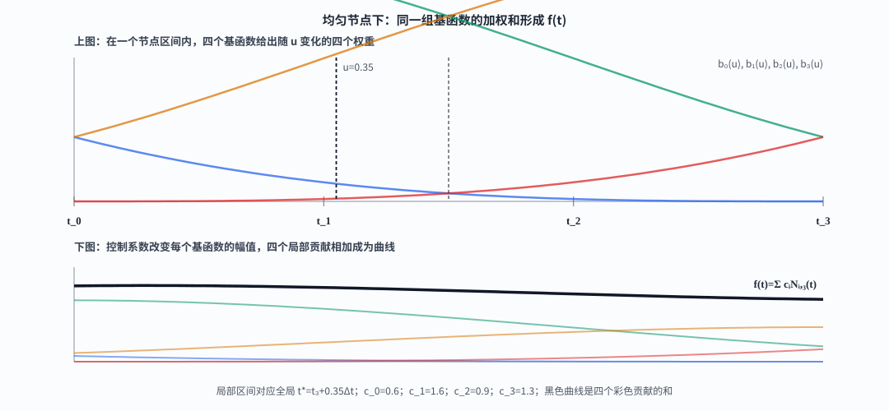

最后可以打开[三次 B 样条控制系数交互实验](figures/bspline-interactive.html)，直接拖动滑块改变 $c_i$。黑色曲线会随之变化，这个交互过程就是 B 样条拟合的核心。给定观测值时，优化器做的事情与手动拖动滑块相同，只是它用残差和雅可比自动寻找更合适的控制系数。

$B_d$ 的横坐标是无量纲的，而时间 $t$ 带有秒这个单位，所以先用 $t/\Delta t$ 把时间换成“经过了多少个节点间隔”。这里 $d$ 表示次数，$d+1$ 表示阶数，也等于一个位置上可能参与加权的基函数数量。前面定义的中心化核 $B_d(x)$ 支撑宽度为 $d+1$；把它写成节点形式时，需要把这个中心化坐标换成以节点区间为参考的坐标。于是

$$
N_{i,d}(t)=B_d\Bigl(\frac{t}{\Delta t}-i-\frac{d+1}{2}\Bigr)
$$

这里的 $(d+1)/2$ 是一个固定偏移量，表示支撑宽度的一半，不是随 $t$ 变化的局部坐标。以无量纲坐标 $q=t/\Delta t$ 表示，中心化核真正接收的自变量是

$$
\xi=q-i-\frac{d+1}{2}.
$$

它可能非零的范围对应 $q\in[i,i+d+1)$，也就是从第 $i$ 个节点开始的 $d+1$ 个节点区间；右端点不包含在内。实际求值时还常在当前小区间内使用

$$
u=\frac{t-t_j}{\Delta t}\in[0,1),
$$

这里 $j$ 表示 $t$ 所在的节点区间。$u$ 是区间内的局部坐标，$(d+1)/2$ 则是固定的中心化偏移，两者不是同一个量。不同文献有时直接使用非中心化的基函数，或把下标整体平移，因此公式外观会不同；关键是支撑区间、基函数编号和控制点编号必须采用同一套约定。

均匀节点时，同一个“**小山包**”等间距复制即可。节点**非均匀**时，山包的宽度和相邻区间都不同，需要一条规则计算第 $i$ 个基函数在任意位置的值。Cox–de Boor 递推提供了这条规则；均匀节点时它退化为前面看到的卷积核，非均匀节点时仍保留局部支撑和可控光滑性。

现在这条公式描述的是一维标量曲线。每个 $c_i$ 都是一个待估的数字，它只改变第 $i$ 个基函数对曲线的纵向贡献，不会移动节点的位置。观测时刻 $t_k$ 是我们拿到数据的位置，节点 $t_i$ 则组成了放置基函数的参数网格；拟合时在每个 $t_k$ 处计算 $f(t_k)$，再与观测值比较，这两套位置不必重合。

---

## 节点不等距时，递推公式接手

递推回答的是一个具体的计算问题。已知低次基之后，需要稳定地造出高次基。零次基是区间指示器；一次基由两个相邻零次基按当前位置线性混合；二次基再混合相邻的一次基。每升一次次数，就增加一层相邻基函数的加权拼接。

对任意节点序列 $\{t_i\}$ 与次数 $d$，先规定零次基

$$
N_{i,0}(t)=
\begin{cases}
1,& t_i\le t<t_{i+1},\\
0,& \text{otherwise,}
\end{cases}
$$

$$
N_{i,d}(t)
=
\frac{t-t_i}{t_{i+d}-t_i}\,N_{i,d-1}(t)
+
\frac{t_{i+d+1}-t}{t_{i+d+1}-t_{i+1}}\,N_{i+1,d-1}(t).
\tag{R1}
$$

式子里的第一项只在左侧那段基函数有值，第二项只在右侧那段有值；两个系数随 $t$ 线性变化，并且在重叠区间相加为 1。这样得到的新基仍保持局部支撑，同时把低次的“台阶”逐层变成高次分段多项式。分母为零时，对应项按 0 处理，这是重复节点下的计算约定。

把递推得到的基函数代回前面的曲线表示，仍然得到一维标量曲线

$$
f(t)=\sum_i c_iN_{i,d}(t)
\tag{R2}
$$

这里 $N_{i,d}(t)$ 是第 $i$ 个基函数在位置 $t$ 处的数值，它才是随位置变化的权重；$c_i$ 是待估的标量系数，决定这一项的大小。所有基函数值与系数相乘后再相加，得到当前位置的曲线值 $f(t)$。分母为零时，对应递推项取 0。

(R1) 把 $d$ 次基写成两个相邻 $(d-1)$ 次基的时变凸组合，精神上与“再卷一次 box”一致。均匀整数节点下，基数核满足

$$
B_d(x)=\frac{x}{d}B_{d-1}(x)+\frac{d+1-x}{d}B_{d-1}(x-1),
$$

正是 (R1) 的特例。卷积给出单个平移不变的核，递推则把这种局部形状组织成节点上的基族，并适用于非均匀节点。

固定节点与 $d\ge 0$ 时，可以由 (R1) 归纳得到下面几个性质。

**非负。** 系数非负，故 $N_{i,d}\ge 0$。

**局部支撑。**

$$
\operatorname{supp}N_{i,d}\subseteq[t_i,\,t_{i+d+1}),
\tag{R3}
$$

这里固定的是基函数编号 $i$。第 $i$ 个基函数从自己的起点 $t_i$ 出发，向右覆盖 $d+1$ 个节点区间，直到 $t_{i+d+1}$ 为止。因此，支撑始终按“左端点到右端点”的顺序写成

$$
[t_i,t_{i+d+1}).
$$

实际查询时，只需检查当前时刻 $t$ 是否落在这个区间内。落在区间外时，第 $i$ 个基函数的值为零；落在区间内时，它才可能对曲线有贡献。$d=0$ 时这就是零次基的定义；由 (R1) 归纳时，右侧两个低次基的非零范围并起来仍落在这个区间内。

**单位分解。** 在节点覆盖内部 $\sum_i N_{i,d}(t)=1$。对 (R1) 求和并改下标后，每个 $N_{\ell,d-1}$ 前两系数之和为

$$
\frac{t-t_\ell}{t_{\ell+d}-t_\ell}+\frac{t_{\ell+d}-t}{t_{\ell+d}-t_\ell}=1.
$$

**分段多项式。** 在每个开区间 $(t_j,t_{j+1})$ 上，$N_{i,d}$ 是次数 $\le d$ 的多项式。

有了这些，应用里最常问的两个推论可以单独说清。

---

## 局部性和光滑性从哪里来

刚才固定的是基函数编号 $i$，问的是第 $i$ 个基函数在哪些时刻 $t$ 上可能有值。现在换一个角度，固定待计算的节点区间 $[t_j,t_{j+1})$，反过来查找哪些基函数会覆盖这段区间。这里改变的只是“固定的对象”，并没有改变支撑的方向。对每个基函数，支撑仍然从它自己的 $t_i$ 向右延伸到 $t_{i+d+1}$。

$$
\operatorname{supp}N_{i,d}\subseteq[t_i,t_{i+d+1}).
$$

现在 $j$ 已经固定，未知的是基函数编号 $i$。在节点不重复、节点从左到右排列的情况下，第 $i$ 个基函数要覆盖区间 $[t_j,t_{j+1})$，就必须同时满足两件事。它的左端点不能晚于这个区间的左端点，它的右端点必须越过这个区间的左端点。因此

$$
t_i\le t_j,
\qquad
t_{i+d+1}>t_j.
$$

把节点的单调性换成下标关系，得到

$$
i\le j,
\qquad
i+d\ge j,
$$

也就是

$$
j-d\le i\le j.
$$

这里出现的“小于”和“大于”比较的是基函数编号 $i$ 与区间编号 $j$，不是在重新描述支撑的左右方向。支撑仍然统一写成从 $t_i$ 到 $t_{i+d+1}$。于是，区间 $[t_j,t_{j+1})$ 内参与计算的基函数正好是

$$
N_{j-d,d},\ N_{j-d+1,d},\ \ldots,\ N_{j,d}.
$$

三次情形最直观。若当前区间是 $[t_5,t_6)$，四个活跃基函数的支撑分别为

$$
\begin{aligned}
\operatorname{supp}N_{2,3}&=[t_2,t_6),\\
\operatorname{supp}N_{3,3}&=[t_3,t_7),\\
\operatorname{supp}N_{4,3}&=[t_4,t_8),\\
\operatorname{supp}N_{5,3}&=[t_5,t_9).
\end{aligned}
$$

它们都从自己的起点向右覆盖当前区间。左边的 $N_{1,3}$ 到 $t_5$ 就结束了，右边的 $N_{6,3}$ 要从 $t_6$ 才开始，所以这两个基函数都不参与 $[t_5,t_6)$ 内的计算。一般次数为 $d$ 时，同样的查找给出连续的 $d+1$ 个编号

$$
i=j-d,j-d+1,\ldots,j.
$$

这就是“一个节点区间只需要 $d+1$ 个基函数”的来源。这里的编号关系只是固定区间后的反向查找结果，并不是把支撑改成从右向左描述。重复节点可能让其中某些基函数在该区间上恒为零；均匀、无重复节点时，正好有 $d+1$ 个基函数参与。改动一个控制点只影响长度约 $(d+1)\Delta t$ 的窗口，残差雅可比因此是局部且稀疏的。

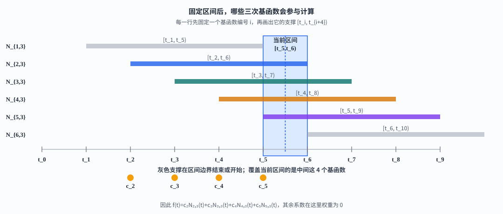

开区间内曲线是多项式，所以在单个区间内部可以无限次求导。每个节点区间都有一段自己的多项式表达式，两个相邻区间会在共同的节点处连接。我们关心的是，这两段表达式在节点处的函数值和各阶导数能不能接得平滑。

例如，节点 $t_{\ell+1}$ 两侧分别是区间 $(t_\ell,t_{\ell+1})$ 和 $(t_{\ell+1},t_{\ell+2})$。讨论节点 $t_{\ell+1}$ 处的连续性，就是比较这两个区间对应的分段多项式在这个节点处的函数值和各阶导数。这里的 $\ell+1$ 只是用来标记正在检查的边界节点，和后面用来标记当前区间的下标没有特殊关系。

“单重节点”表示这个分界位置在节点向量中只出现一次。对于这种节点，$d$ 次基函数左右两侧的分段多项式会在节点处接上，函数值、一阶导数直到 $(d-1)$ 阶导数都相同，因此

$$
N_{i,d}\in C^{d-1}.
$$

这个结论也可以从递推看出来。零次基函数是区间指示器，在节点处有跳变；一次递推把两个相邻的零次基线性拼起来，函数值在节点处接上，得到 $C^0$；再升一次，拼接后连一阶导数也接上，得到 $C^1$。这样每提高一次次数，就多获得一阶连续导数。一般地，$d$ 次基函数达到 $C^{d-1}$，但最高阶的第 $d$ 阶导数通常仍会跳变。$B_3$ 为 $C^{2}$，所以均匀三次轨迹的加速度在节点处连续，可接加速度计残差。

如果希望把这件事写成计算规则，可以对递推式求导。在分母非零时有

$$
\frac{\mathrm d}{\mathrm dt}N_{i,d}(t)
=
\frac{d}{t_{i+d}-t_i}N_{i,d-1}(t)
-
\frac{d}{t_{i+d+1}-t_{i+1}}N_{i+1,d-1}(t).
$$

右侧只含 $(d-1)$ 次基函数。一次基函数本身是连续的，作为归纳起点；如果 $(d-1)$ 次基函数已经是 $C^{d-2}$，那么上式说明 $d$ 次基函数的一阶导数具有 $C^{d-2}$ 连续性，于是 $d$ 次基函数本身就是 $C^{d-1}$。这就是“每升一次次数，连续阶数增加一阶”的具体来源。

若只要位姿连续，低次也可；要角速度至少 $C^{1}$，要线加速度通常取 $d=3$。节点等距时，每个区间的形状完全一样，正好可以把求值写成一个固定矩阵。

如果节点值在节点向量中重复 $r$ 次，在该节点处通常只剩 $C^{d-r}$ 连续性。端点常用重复 $d+1$ 次的 open knot vector，让曲线从第一个控制点开始并在最后一个控制点结束。重复节点不会破坏递推，分母为零的项按约定取 0，但会降低局部光滑度。这正是 CAD 里可以在某个位置制造尖角、SLAM 里可以把不同轨迹段拼接起来的数学开关。

还要区分“逼近”和“插值”。一般均匀 B 样条满足单位分解与凸包性质，曲线落在活跃控制点的凸包内，却不必经过任何控制点；只有在端点重复或额外施加插值约束时才会经过指定点。优化里控制点是待估系数，观测残差约束的是曲线值，因此这种局部逼近通常比强制插值更稳健。

---

## 均匀节点下，一个节点区间只需要四个控制点

整条曲线通常由很多控制点共同描述，并不是四个控制点就能覆盖任意长的时间范围。这里的“四个”说的是局部计算。三次 B 样条的次数是 $d=3$，所以在一个节点区间内，最多有 $d+1=4$ 个基函数非零，曲线值只需要这四个基函数对应的控制点。

前面的一维讨论一直写成标量曲线 $f(t)$。从这里开始，我们才把问题具体化为空间位置。标量系数 $c_i$ 换成二维或三维向量控制点 $\mathbf p_i$，曲线值也相应变成空间位置 $\mathbf p(t)$。需要始终分清两者的职责。基函数在当前位置的数值是权重，控制点提供的是空间坐标。

可以把它想成一个长度为 4 的滑动窗口。为了不把“当前区间的编号”和“刚才正在检查的边界节点”混在一起，下面用 $\ell$ 表示当前区间的左端节点编号。设当前时刻落在节点区间 $[t_\ell,t_{\ell+1})$ 内，参与计算的是

$$
\mathbf p_{\ell-3},\ \mathbf p_{\ell-2},\ \mathbf p_{\ell-1},\ \mathbf p_\ell.
$$

当时刻进入下一个节点区间 $[t_{\ell+1},t_{\ell+2})$，窗口向右移动一格，变成 $\mathbf p_{\ell-2},\ldots,\mathbf p_{\ell+1}$。前面三个控制点继续参与，最左边的一个退出，右边补进一个新的控制点。这个过程类似滑动窗口，但不是每到一个位置就重新拟合一次；控制点在拟合阶段确定后保持不变，窗口内各控制点的权重只由当前位置的基函数值决定。

均匀节点下，每个节点区间的形状完全一样。于是可以把活跃基在局部坐标 $u$ 下展成单项式，预存常值矩阵 $\mathbf M$，运行时只计算 $u$ 的幂次。矩阵形式与递推描述的是**同一条曲线**，只是记账方式不同。

按 (R3) 的支撑约定，区间 $[t_\ell,t_{\ell+1})$ 对应的四个控制点是 $\mathbf p_{\ell-3},\ldots,\mathbf p_\ell$。有些实现会把第一个活跃控制点重新记为 $\mathbf p_i$，于是写成 $\mathbf p_i,\ldots,\mathbf p_{i+3}$；这只是把下标整体平移了 $3$，并没有改变曲线。下面沿用递推中的区间编号 $\ell$，这样它和前面的支撑关系保持一致。

设 $t\in[t_\ell,t_{\ell+1})$，$u=(t-t_\ell)/\Delta t$。三次时每个区间恰有 4 个活跃控制点。

$$
\mathbf p(t)=\sum_{r=0}^{3}b_r(u)\,\mathbf p_{\ell-3+r}.
\tag{M1}
$$

这四个权重可以从 $B_3$ 的四片平移在单位区间上读出来，也可以由 (R1) 在均匀节点上展开。与 (C4) 对齐并限制到 $u\in[0,1)$ 后，标准结果是

$$
\begin{aligned}
b_0(u)&=\tfrac16(1-u)^{3},\\
b_1(u)&=\tfrac16(3u^{3}-6u^{2}+4),\\
b_2(u)&=\tfrac16(-3u^{3}+3u^{2}+3u+1),\\
b_3(u)&=\tfrac16 u^{3}.
\end{aligned}
\tag{M2}
$$

例如最简单的一列是 $b_3(u)$。它对应最右侧控制点，只由 $B_3$ 落在 $[0,1)$ 的最右多项式片给出，展开即 $\tfrac16 u^{3}$。其余三列由相邻平移片在 $[0,1)$ 上的限制得到，化成单项式后装配成矩阵。

令 $\mathbf u^{\top}=[1,u,u^{2},u^{3}]$，把 (M2) 写成

$$
\begin{aligned}
b_0&=\tfrac16(1-3u+3u^{2}-u^{3}),\\
b_1&=\tfrac16(4-6u^{2}+3u^{3}),\\
b_2&=\tfrac16(1+3u+3u^{2}-3u^{3}),\\
b_3&=\tfrac16 u^{3},
\end{aligned}
$$

第 $r$ 列存 $b_r$ 的系数，得

$$
\mathbf M^{(4)}
=
\frac16
\begin{bmatrix}
1&4&1&0\\
-3&0&3&0\\
3&-6&3&0\\
-1&3&-3&1
\end{bmatrix},
\qquad
[b_0\ b_1\ b_2\ b_3]=\mathbf u^{\top}\mathbf M^{(4)}.
\tag{M3}
$$

令 $\mathbf P=[\mathbf p_{\ell-3}\ \mathbf p_{\ell-2}\ \mathbf p_{\ell-1}\ \mathbf p_\ell]$，则

$$
\mathbf p(t)=\mathbf P\,\mathbf M^{(4)\top}\mathbf u.
\tag{M4}
$$

$\mathbf M$ 的元素是基的固有系数，不是估计量。易验 $b_0+b_1+b_2+b_3=1$。

$\mathrm{d}u/\mathrm{d}t=1/\Delta t$，$\mathbf u'=[0,1,2u,3u^{2}]^{\top}$，$\mathbf u''=[0,0,2,6u]^{\top}$，于是

$$
\dot{\mathbf p}=\frac{1}{\Delta t}\mathbf P\mathbf M^{(4)\top}\mathbf u',
\qquad
\ddot{\mathbf p}=\frac{1}{(\Delta t)^{2}}\mathbf P\mathbf M^{(4)\top}\mathbf u''.
\tag{M5}
$$

可以用一个小数值例子检查矩阵的方向和归一化。取 $u=1/2$、$\Delta t=1$，由 (M2) 得
$[b_0,b_1,b_2,b_3]=[1,23,23,1]/48$，四个权重相加为 1。若一维控制点为 $[0,1,2,3]$，则曲线值为
$0/48+23/48+46/48+3/48=72/48=3/2$；它落在 $[0,3]$ 内，却没有经过中间控制点 1 或 2。把同一组权重换成 (M5) 的 $\mathbf u'$，就得到该区间内的瞬时速度；再除以 $\Delta t^2$ 得加速度。这个例子也说明了为什么矩阵转置必须和控制点列向量的排列一起看，不能脱离 (M1) 单独背诵。

### 累积形式把“曲线值”改写成“起点加上几段差分”

矩阵形式适合批量求值，累积形式更适合解释控制点究竟怎样改变曲线。把相邻控制点的差记成

$$
\Delta\mathbf p_1=\mathbf p_{\ell-2}-\mathbf p_{\ell-3},\qquad
\Delta\mathbf p_2=\mathbf p_{\ell-1}-\mathbf p_{\ell-2},\qquad
\Delta\mathbf p_3=\mathbf p_{\ell}-\mathbf p_{\ell-1}.
$$

利用单位分解 $b_0+b_1+b_2+b_3=1$，可以把 (M1) 逐项重新整理。第一步先把所有项都写成相对于最左控制点的形式

$$
\begin{aligned}
\mathbf p(t)
&=(b_0+b_1+b_2+b_3)\mathbf p_{\ell-3}\\
&\quad +(b_1+b_2+b_3)(\mathbf p_{\ell-2}-\mathbf p_{\ell-3})\\
&\quad +(b_2+b_3)(\mathbf p_{\ell-1}-\mathbf p_{\ell-2})\\
&\quad +b_3(\mathbf p_{\ell}-\mathbf p_{\ell-1}).
\end{aligned}
$$

于是定义累积权重

$$
\tilde\lambda_1=b_1+b_2+b_3,
\qquad
\tilde\lambda_2=b_2+b_3,
\qquad
\tilde\lambda_3=b_3,
$$

就得到

$$
\mathbf p(t)=\mathbf p_{\ell-3}
 +\tilde\lambda_1\Delta\mathbf p_1
 +\tilde\lambda_2\Delta\mathbf p_2
 +\tilde\lambda_3\Delta\mathbf p_3.
\tag{M6}
$$

把 (M2) 代入后，三个累积权重的具体形式是

$$
\begin{aligned}
\tilde\lambda_1(u)&=\frac{5+3u-3u^2+u^3}{6},\\
\tilde\lambda_2(u)&=\frac{1+3u+3u^2-2u^3}{6},\\
\tilde\lambda_3(u)&=\frac{u^3}{6}.
\end{aligned}
\tag{M7}
$$

这三个函数不是新的基函数。它们只是把原来的四个基函数按“从当前位置向右累加”重新记账。这样改写之后，控制点对曲线的影响变成三段相邻差分的累积影响，后面搬到旋转群时，普通减法就可以替换成相对旋转。

对 (M6) 求导时，控制点差分在一个区间内保持不变，变化只来自 $\tilde\lambda_r(u)$。因为 $\mathrm du/\mathrm dt=1/\Delta t$，有

$$
\dot{\mathbf p}(t)=\frac{1}{\Delta t}
\left(
\tilde\lambda_1'(u)\Delta\mathbf p_1+
\tilde\lambda_2'(u)\Delta\mathbf p_2+
\tilde\lambda_3'(u)\Delta\mathbf p_3
\right),
$$

其中

$$
\tilde\lambda_1'=\frac{(1-u)^2}{2},
\qquad
\tilde\lambda_2'=\frac{1+2u-2u^2}{2},
\qquad
\tilde\lambda_3'=\frac{u^2}{2}.
$$

二阶导数进一步给出

$$
\ddot{\mathbf p}(t)=\frac{1}{(\Delta t)^2}
\left[
(u-1)\Delta\mathbf p_1+(1-2u)\Delta\mathbf p_2+u\Delta\mathbf p_3
\right].
$$

把相邻差分再次相减，还能看出加速度实际上是在两个二阶差分之间做线性插值

$$
\ddot{\mathbf p}(t)=\frac{1}{(\Delta t)^2}
\left[(1-u)(\Delta\mathbf p_2-\Delta\mathbf p_1)
      +u(\Delta\mathbf p_3-\Delta\mathbf p_2)\right].
\tag{M8}
$$

这就是累积形式在连续时间 SLAM 中的价值。位置由控制点差分累积得到，速度由一阶差分加权得到，加速度由二阶差分插值得到。矩阵形式和累积形式给出同一条曲线，但后者直接揭示了 IMU 残差对哪些控制点差分敏感。

### 把相邻位置差替换成相对旋转

旋转控制量不能做普通的向量加法。两个姿态 $\mathbf R_a,\mathbf R_b\in SO(3)$ 之间的相对旋转写成

$$
\boldsymbol\phi=\operatorname{Log}(\mathbf R_a^\top\mathbf R_b)^\vee,
$$

其中 $\operatorname{Log}$ 把旋转矩阵映到李代数，右上角的 $\vee$ 把反对称矩阵还原成三维旋转向量。于是三次区间内的三个相邻相对旋转为

$$
\boldsymbol\phi_1=\operatorname{Log}(\mathbf R_{\ell-3}^\top\mathbf R_{\ell-2})^\vee,
\quad
\boldsymbol\phi_2=\operatorname{Log}(\mathbf R_{\ell-2}^\top\mathbf R_{\ell-1})^\vee,
\quad
\boldsymbol\phi_3=\operatorname{Log}(\mathbf R_{\ell-1}^\top\mathbf R_{\ell})^\vee.
$$

欧氏累积式中的“加上差分”在 $SO(3)$ 上改成“沿相对旋转走一段路”。在固定的乘积约定下，旋转轨迹写成

$$
\mathbf R(u)=\mathbf R_{\ell-3}
 \operatorname{Exp}(\tilde\lambda_1(u)\boldsymbol\phi_1^\wedge)
 \operatorname{Exp}(\tilde\lambda_2(u)\boldsymbol\phi_2^\wedge)
 \operatorname{Exp}(\tilde\lambda_3(u)\boldsymbol\phi_3^\wedge),
\tag{M9}
$$

这里 $\boldsymbol\phi^\wedge$ 表示把向量写成反对称矩阵。指数映射保证每个因子仍属于 $SO(3)$，所以整个乘积始终是合法旋转。由于 B 样条通常不经过控制姿态，$u=0$ 时也不应把 $\mathbf R(u)$ 理解成某一个控制姿态；控制姿态只是决定局部形状的参数。

这个公式可以按“走三小段路”来理解。先站在基准姿态 $\mathbf R_{\ell-3}$，沿第一段相对旋转走 $\tilde\lambda_1$ 的比例，再沿第二段走 $\tilde\lambda_2$ 的比例，最后沿第三段走 $\tilde\lambda_3$ 的比例。这里的“走”不是把三个旋转向量相加，而是依次右乘三个旋转矩阵。旋转矩阵不满足交换律，所以乘积顺序不能改变。

令

$$
\mathbf A_r(u)=\operatorname{Exp}(\tilde\lambda_r(u)\boldsymbol\phi_r^\wedge),
$$

并采用机体系角速度定义

$$
\boldsymbol\omega^B=\bigl(\mathbf R^\top\dot{\mathbf R}\bigr)^\vee,
$$

对 (M9) 求导，得到

$$
\boldsymbol\omega^B(t)=\frac{1}{\Delta t}
\left[
\mathbf A_3^\top\mathbf A_2^\top\tilde\lambda_1'\boldsymbol\phi_1
 +\mathbf A_3^\top\tilde\lambda_2'\boldsymbol\phi_2
 +\tilde\lambda_3'\boldsymbol\phi_3
\right].
\tag{M10}
$$

第一项先经过后面两段旋转的坐标变换，第二项只经过最后一段变换，第三项已经处在当前机体系。这正是旋转和欧氏位置的区别，旋转增量不能直接按标量权重相加后当作姿态。

如果还需要角加速度，就继续对 (M10) 求导。为避免把每一项都写得过长，先记

$$
\mathbf q_r=\tilde\lambda_r'\boldsymbol\phi_r,
\qquad
\mathbf h_r=\tilde\lambda_r''\boldsymbol\phi_r,
$$

其中

$$
\tilde\lambda_1''=u-1,
\qquad
\tilde\lambda_2''=1-2u,
\qquad
\tilde\lambda_3''=u.
$$

再定义

$$
\mathbf y_1=\mathbf A_3^\top\mathbf A_2^\top\mathbf q_1,
\qquad
\mathbf y_2=\mathbf A_3^\top\mathbf q_2,
\qquad
\boldsymbol\eta_{23}=\mathbf y_2+\mathbf q_3.
$$

对任意一段旋转都有

$$
\frac{\mathrm d}{\mathrm du}(\mathbf A^\top\mathbf v)
=-(\mathbf A^\top\mathbf A')^\vee\times(\mathbf A^\top\mathbf v)
 +\mathbf A^\top\mathbf v'.
$$

因此

$$
\dot{\boldsymbol\omega}^{B}(t)
=\frac{1}{(\Delta t)^2}
\left[
\mathbf A_3^\top\mathbf A_2^\top\mathbf h_1
 +\mathbf A_3^\top\mathbf h_2
 +\mathbf h_3
 -\boldsymbol\eta_{23}\times\mathbf y_1
 -\mathbf q_3\times\mathbf y_2
\right].
$$

这里的叉乘项不是额外添加的经验修正，而是因为前面的旋转增量在求导过程中不断换到当前机体系。欧氏位置的二阶导数只需要对差分权重求导；旋转的二阶导数还必须记录坐标系自身的转动，这也是角加速度推导比线加速度更容易出错的原因。

普通 IMU 通常直接测量角速度和比力，并不一定把角加速度作为观测量。这里把角加速度写出来，是为了说明旋转样条确实可以继续求导，也方便需要更高阶运动约束时直接使用。

在优化中，控制姿态通常用李代数扰动更新，例如

$$
\mathbf R_i\leftarrow \mathbf R_i\operatorname{Exp}(\delta\boldsymbol\theta_i^\wedge).
$$

对 (M9) 和 (M10) 线性化后，每一个时间观测只会关联局部的四个控制姿态。角速度观测可以写成

$$
\mathbf r_{\omega,k}
=\boldsymbol\omega^B(t_k)-\bigl(\boldsymbol\omega_{m,k}-\mathbf b_g\bigr),
$$

平移加速度观测写成

$$
\mathbf r_{a,k}
=\mathbf R(t_k)^\top
\bigl(\ddot{\mathbf p}(t_k)-\mathbf g\bigr)
-\bigl(\mathbf a_{m,k}-\mathbf b_a\bigr).
$$

如果传感器还提供位置观测，位置残差就是

$$
\mathbf r_{p,k}=\mathbf p(t_k)-\mathbf z^p_k,
$$

其中 $\mathbf z^p_k$ 是时间 $t_k$ 处的外部位置观测。视觉观测通常先把连续时间位姿写成 $\mathbf T(t_k)$，再通过相机投影函数 $\pi(\cdot)$ 投到像平面，得到重投影残差

$$
\mathbf r_{\mathrm{img},k}
=\pi\bigl(\mathbf T(t_k)\mathbf P_k\bigr)-\mathbf z^{\mathrm{img}}_k.
$$

这里 $\mathbf P_k$ 是被观测的空间点，$\mathbf z^{\mathrm{img}}_k$ 是图像中的像素观测。不同传感器的残差形式不同，但它们都依赖同一条连续时间轨迹，因此可以放进同一个优化问题。

把这些观测放在一起，可以得到一个很具体的方程组。残差向量可以写成

$$
\mathbf r=
\begin{bmatrix}
\mathbf r_p\\
\mathbf r_\omega\\
\mathbf r_a\\
\mathbf r_{\mathrm{img}}
\end{bmatrix},
\qquad
\mathbf W=\operatorname{diag}(\mathbf W_p,\mathbf W_\omega,\mathbf W_a,\mathbf W_{\mathrm{img}}),
$$

对轨迹控制量而言，每一条观测只落在它所在节点区间附近的四个控制量上。例如 $t_k\in[t_\ell,t_{\ell+1})$ 时，对应的雅可比行可以画成

$$
\mathbf J_k=
\begin{bmatrix}
\mathbf 0&\cdots&\mathbf J_{k,\ell-3}&\mathbf J_{k,\ell-2}&\mathbf J_{k,\ell-1}&\mathbf J_{k,\ell}&\mathbf 0&\cdots&\mathbf 0
\end{bmatrix}.
$$

也就是说，整条轨迹虽然可能有很多控制量，但一条观测不会连接整条轨迹。局部支撑正是连续时间 SLAM 仍然能够进行大规模优化的原因。

设所有控制点、控制姿态和偏置组成增量向量 $\delta\mathbf x$，其中旋转部分使用李代数的小扰动，记作 $\boxplus$。在当前估计附近一阶展开

$$
\mathbf r(\mathbf x\boxplus\delta\mathbf x)
\approx \mathbf r(\mathbf x)+\mathbf J\,\delta\mathbf x.
$$

加权最小二乘的线性方程就是

$$
\left(\mathbf J^\top\mathbf W\mathbf J+\mathbf H_{\mathrm{prior}}\right)\delta\mathbf x
=-\mathbf J^\top\mathbf W\mathbf r.
\tag{M11}
$$

解出增量后，平移控制点做加法更新，旋转控制姿态用指数映射更新，再重新计算各传感器时间戳处的轨迹、速度和角速度。局部支撑意味着每个残差只连接附近四个控制量，因而雅可比和 Hessian 都具有明显的稀疏结构。

在均匀三次情形，前面出现的累积权重也可以整理成累积矩阵 $\tilde{\mathbf M}^{(4)}$。欧氏空间中它与 (M4) 完全等价；写成差分后，控制点的局部影响、速度的一阶差分结构和加速度的二阶差分结构会更直观。进入 $SO(3)$ 后，正是这套“沿相邻增量逐段累积”的结构，让普通差分能够替换成相对旋转，并最终接入连续时间 SLAM 的残差方程。

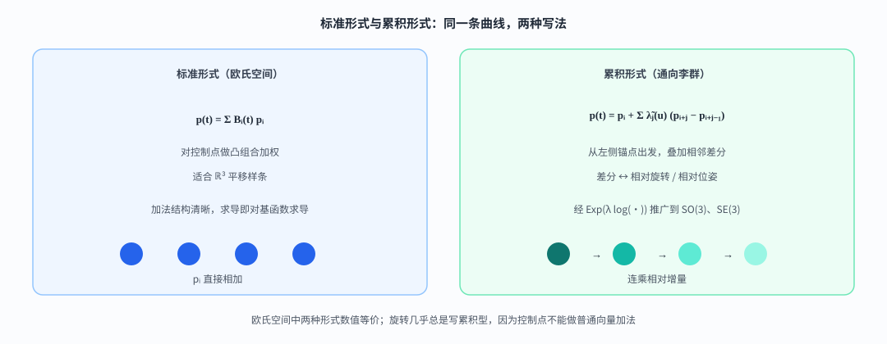

这套构造可以概括成一条连续的关系。连续或离散的 box 卷积产生 $B_d$，平移后得到基函数，递推保证不等距节点也能计算，局部支撑和连续性带来稀疏且可求导的曲线，均匀节点下则可以进一步写成固定矩阵。

$$
\text{连续/离散 box 卷积 }B_d
\;\Rightarrow\;
\text{平移基 / 递推 }N_{i,d}
\;\Rightarrow\;
\text{局部支撑}+C^{d-1}
\;\Rightarrow\;
\text{均匀三次矩阵 (M3)–(M5)}.
$$

同一套对象在两个领域里承担不同的角色。

---

## 同一套数学怎样走进真实问题

## 在 Poisson 表面重建里把点云变成平滑场

Poisson 表面重建求解 $\Delta\chi=\nabla\cdot\mathbf V$，其中 $\mathbf V$ 由点云法向构造，$\chi$ 的零等值面为表面。离散在三维格点上时，常把 $\chi$ 用局部基展开：

$$
\chi(\mathbf x)=\sum_i c_i\,B(\mathbf x-\mathbf x_i).
$$

这里的 $B$ 取可分离的三次 B 样条核，也就是前面推导的 $B_3$。紧支撑使刚度矩阵稀疏；$C^{2}$ 让梯度与 Laplace 在网格上更稳定；可分离加上离散多次 box，可以用积分图快速完成滤波与装配。

| 重建里的说法 | 对应的数学 |
|--------------|----------|
| “用 box 自卷积代替高斯平滑” | $B_3$ 的卷积构造 |
| “三次 B-spline 基” | (C4) 与可分离扩张 |
| “多次 box / 积分图” | 离散卷积 |
| “局部支撑” | $\operatorname{supp}N_{i,d}$ |

何时滤波、如何进线性系统，见 [Poisson 专文](../poisson_recon_box_filter/index.html)。

典型路径是法向溅射得到 $\mathbf V$，再用离散 $B_3$ 对应的多次 box 平滑，随后组装并求解得到 $\{c_i\}$，最后提取零等值面。瓶颈往往在滤波与稀疏线性解，而不是解析展开 $B_3$ 的每一段；公式保证平滑对象确实处在 $C^{2}$ 样条尺度上。

---

## 在连续时间 SLAM 里把轨迹变成可求导的曲线

多传感器 SLAM / 标定面对异步时间戳、运动畸变，以及 IMU 对 $\boldsymbol\omega$、$\mathbf a$ 的导数观测。连续时间路线把位姿写成时间的样条，控制点作为优化变量，在任意 $t_j$ 上求值或求导后再构造残差。

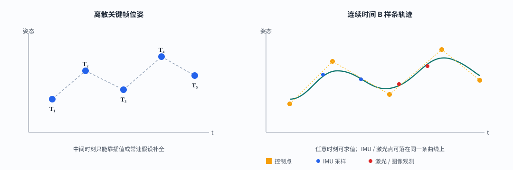

| 需求 | 数学保证 |
|------|----------|
| 任意时刻曲线值 | (R2) / (M4) 可求值 |
| 角速度、加速度 | $d\ge 2$ 或 $3$ 的 $C^{d-1}$ + (M5) |
| 大规模批优化 | 局部支撑 → 稀疏 Hessian |

**平移**控制点 $\mathbf p_i\in\mathbb{R}^{3}$，均匀三次下直接用 (M4)–(M5)。

**旋转**不能按 $b_j$ 做向量加权。用前面介绍的累积权重，令相对增量 $\mathbf d_j=\mathrm{Log}(\mathbf R_{i+j-1}^{\top}\mathbf R_{i+j})$（$\mathrm{Log}$ 把旋转映到旋转向量），再

$$
\mathbf R(u)=\mathbf R_i\prod_{j=1}^{3}\mathrm{Exp}\bigl(\tilde\lambda_j(u)\mathbf d_j\bigr),
$$

姿态留在 $SO(3)$ 上。四元数写法把 $\mathrm{Exp}/\mathrm{Log}$ 换成单位四元数指数即可。李群导数的完整递推可参考 Sommer 等人的工作。

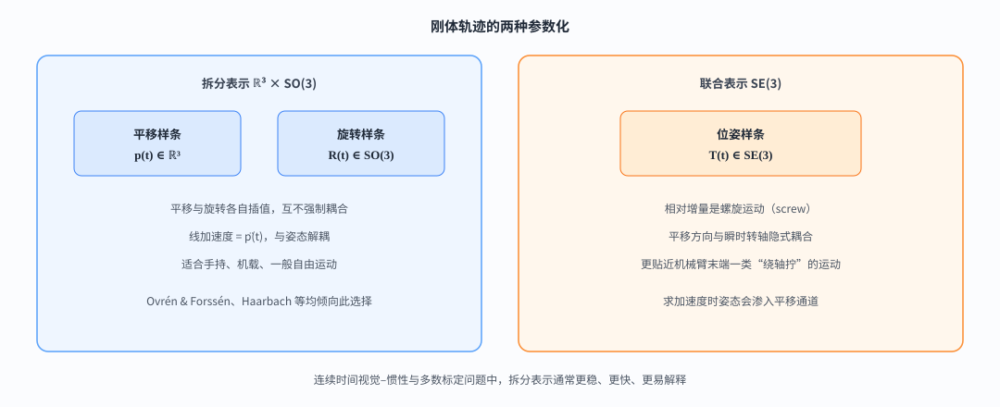

- **拆分** $\mathbb{R}^{3}\times SO(3)$。平移与旋转各一条样条；线加速度即 $\ddot{\mathbf p}$。手持、车载、机载更常见。
- **联合** $SE(3)$。相对增量是螺旋，平移与转轴耦合；更贴近某些机械臂末端，但加速度含义纠缠，通常更重。

多数视觉–惯性与标定默认拆分（Ovrén & Forssén、Haarbach 等的比较）。拆分下 IMU 接口为

$$
{}^{B}\boldsymbol\omega(t)\leftrightarrow\mathbf R^{\top}\dot{\mathbf R},
\qquad
{}^{B}\mathbf a(t)=\mathbf R^{\top}(\ddot{\mathbf p}-\mathbf g).
$$

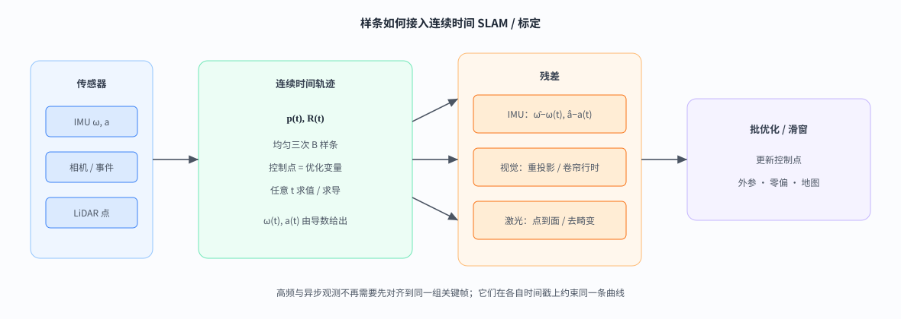

预积分适合关键帧滑窗；连续时间批估计、卷帘成像、逐点激光去畸变更常直接使用样条导数。实例见 [LI-Calib](../li-calib-continuous-time/index.html)；[IMU 预积分](../imu-preintegration/index.html) 是另一条关键帧路线。

| 路线 | 轨迹如何存在 | 典型场景 |
|------|----------------|----------|
| 关键帧 + 预积分 | 状态在关键帧 | 实时 VIO / LIO |
| 滤波 / ESIKF | 名义状态 + 协方差 | 高频里程计 |
| 连续时间样条 | 控制点描述整段曲线 | 离线标定、卷帘 SfM、多传感器批估计 |

---

## 核心结论

全文的逻辑链条可以概括为：矩形窗口自卷积得到 $B_d$；沿节点平移后得到局部基 $N_{i,d}$；Cox–de Boor 递推使这套构造适用于不等距节点；均匀节点下，三次样条在每个区间只需要四个控制点，并且可以直接用矩阵求值和求导。Poisson 重建把这个“小山包”作为空间基函数，连续时间 SLAM 则把同样的权重用于时间轨迹表示。

- 对 Poisson 重建，重点是卷积构造、离散滤波和局部基函数。  
- 对连续时间 SLAM 与标定，重点是递推关系、局部支撑、矩阵形式以及轨迹导数。
- 只需「B 样条是什么」：读开头到三次核的部分即可。

---

## 公式索引

粗体小写为向量，粗体大写为矩阵或李群元素。

### 卷积核与一维函数

| 符号 | 含义 |
|------|------|
| $b(x)$、$B_0(x)$ | 单位宽度 box / 0 次基数 B 样条 |
| $B_d(x)$ | 次数 $d$ 的基数核：$b$ 自卷积 $d+1$ 次 |
| $*$ | 连续卷积 |
| $b_{\mathrm{d}}[n]$、$B_d^{\mathrm{d}}[n]$、$\beta[n]$ | 离散 box；离散 $d$ 次核；长度 2 的离散门 |
| $\operatorname{supp} f$ | 支撑集 |
| $C^{m}$ | $m$ 阶连续可微 |

### 节点、基函数与矩阵

| 符号 | 含义 |
|------|------|
| $t$、$t_i$、$\{t_i\}$ | 参数；节点；节点向量 |
| $\Delta t$、$u$ | 均匀间距；局部坐标 $u=(t-t_i)/\Delta t\in[0,1)$ |
| $d$、$k=d+1$ | 次数；阶数（部分文献的 order $k$） |
| $N_{i,d}(t)$ | 第 $i$ 个 $d$ 次基；支撑 $[t_i,t_{i+d+1})$ |
| $\mathbf p_i$、$\mathbf p(t)$ | 控制点；曲线 $\sum_i\mathbf p_i N_{i,d}(t)$ |
| $b_j(u)$、$\mathbf u$、$\mathbf M^{(4)}$、$\mathbf P$ | 局部权重；单项式向量；均匀三次基矩阵；活跃控制点 |
| $\tilde\lambda_j$、$\tilde{\mathbf M}^{(4)}$ | 累积权重与累积矩阵 |

**下标习惯：** de Boor 常写「$[t_j,t_{j+1})$ 依赖 $\mathbf p_{j-d},\ldots,\mathbf p_j$」；轨迹实现常标成 $\mathbf p_i,\ldots,\mathbf p_{i+d}$。活跃个数均为 $d+1$。

### 刚体与 Poisson

| 符号 | 含义 |
|------|------|
| $SO(3)$、$SE(3)$ | 旋转群；刚体位姿群 |
| $\mathbf R(t)$、$\mathbf T(t)$、$\mathbf R_i$ | 旋转轨迹；位姿；旋转控制点 |
| $\mathrm{Exp}/\mathrm{Log}$ | 李群指数/对数 |
| $\boldsymbol\omega$、$\mathbf a$、$\mathbf g$ | 角速度；加速度相关量；重力 |
| $\chi$、$\mathbf V$、$c_i$ | 指示函数；引导梯度场；基系数 |

---

## 参考文献

1. Carl de Boor. *A Practical Guide to Splines*. Springer-Verlag, 1978.
2. Michael Unser, Akram Aldroubi, Murray Eden. *B-Spline Signal Processing*. IEEE Transactions on Signal Processing, 1993.
3. M. Kazhdan, M. Bolitho, H. Hoppe. *Poisson Surface Reconstruction*. SGP, 2006.
4. Hannes Ovrén, Per-Erik Forssén. *Trajectory Representation and Landmark Projection for Continuous-Time Structure from Motion*. IJRR, 2019.
5. Adrian Haarbach, Tolga Birdal, Slobodan Ilić. *Survey of Higher Order Rigid Body Motion Interpolation Methods…*. 3DV, 2018.
6. Christiane Sommer et al. *Efficient Derivative Computation for Cumulative B-Splines on Lie Groups*. CVPR, 2020.
7. Myoung-Jun Kim et al. *A General Construction Scheme for Unit Quaternion Curves…*. SIGGRAPH, 1995.
8. Jiajun Lv et al. *Targetless Calibration of LiDAR-IMU System Based on Continuous-time Batch Estimation*. IROS, 2020.
9. 本站：[Poisson 表面重建——B-spline 核函数和 box filter](../poisson_recon_box_filter/index.html).
10. 本站：[LI-Calib 无靶标 LiDAR-IMU 标定中的连续时间批估计](../li-calib-continuous-time/index.html).
