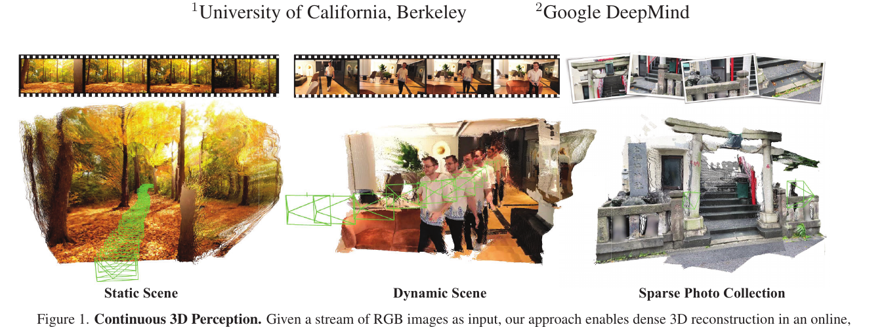
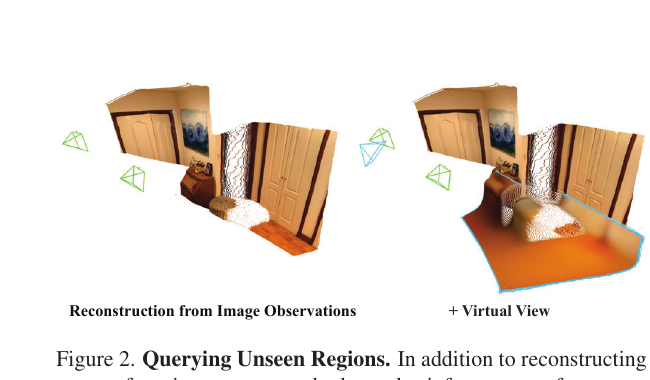
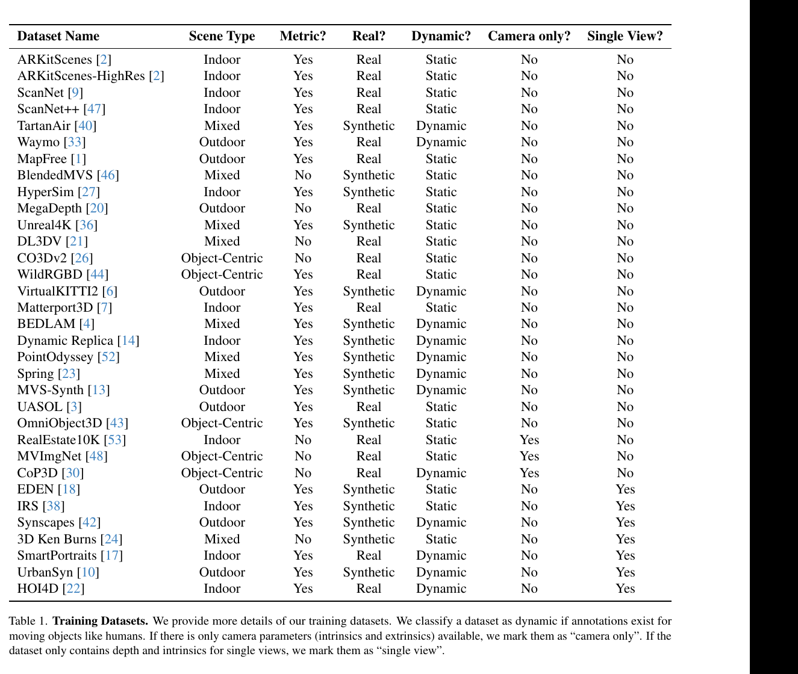
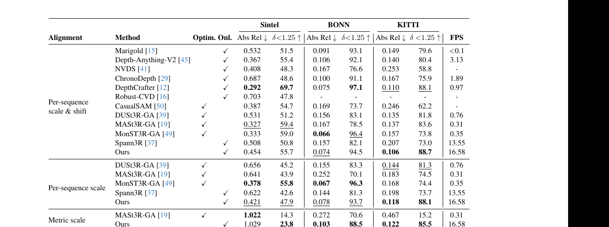
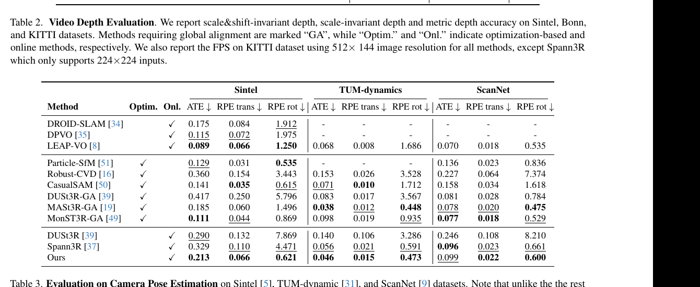

# CUT3R 论文解读

> Qianqian Wang、Yifei Zhang、Aleksander Holynski、Alexei A. Efros、Angjoo Kanazawa，*Continuous 3D Perception Model with Persistent State*，CVPR 2025 正式版及补充材料。[论文页面](https://openaccess.thecvf.com/content/CVPR2025/html/Wang_Continuous_3D_Perception_Model_with_Persistent_State_CVPR_2025_paper.html) · [主文 PDF](https://openaccess.thecvf.com/content/CVPR2025/papers/Wang_Continuous_3D_Perception_Model_with_Persistent_State_CVPR_2025_paper.pdf) · [补充材料 PDF](https://openaccess.thecvf.com/content/CVPR2025/supplemental/Wang_Continuous_3D_Perception_CVPR_2025_supplemental.pdf) · [项目页](https://cut3r.github.io/) · [代码](https://github.com/CUT3R/CUT3R)

## 摘要

CUT3R（Continuous Updating Transformer for 3D Reconstruction）提出一个带持久状态的循环模型。图像流中的每张新图都会更新状态，并从状态读取已有上下文，逐帧输出米制尺度的点图和相机参数；各帧点图处于共同坐标系，可累积成稠密场景重建。状态还可由虚拟相机的 raymap 查询，生成未观测视角的点图与颜色。模型支持不同长度的视频或无序照片集合，也覆盖静态与动态内容。作者在多项 3D/4D 任务上报告有竞争力或最优结果。论文的关键不是只做在线点图预测，还把同一持久状态作为跨视图几何记忆和未观测区域推断的载体。

## 1 引言

人会在不断观察世界时更新心中的场景模型：已有经验帮助解释当前视野，新观察又会修正过去的理解。CUT3R把这个过程建模为在线三维感知：输入可以是连续视频，也可以是稀疏、无序的照片；模型每来一张图就更新内部状态，并输出该视图的稠密三维几何和相机内外参。

这样做的动机来自两方面。SfM、SLAM、NeRF 和 3D Gaussian Splatting 等逐场景方法通常要从当前数据重新估计场景，在稀疏视图、退化运动或动态物体下较难工作。DUSt3R可以从图像对直接预测共享坐标系中的点图，但处理多视图仍需离线全局对齐，不能随着新帧到来持续更新。CUT3R利用跨场景学习得到的先验，以持久状态整合历史观测；作者希望同时做到少量输入重建、持续细化，以及推断输入没有覆盖的场景区域。

每个新观察会同时写入状态并读取状态，以预测当前视角点图和相机参数；累积点图形成在线重建。另一个读出接口接受虚拟相机的 raymap，从状态中生成查询视角的点图与颜色。模型可以从单图、稀疏图像或视频开始，也可处理动态场景中的移动物体。

*原论文图 1 展示连续图像输入下的静态场景、动态场景和稀疏照片集重建，并说明每张新图到来时同步估计相机参数与稠密几何。*

*原论文图 2 将输入图像重建和虚拟相机查询并列展示。蓝色相机代表只用于查询的未观测视角，其预测结构来自持久状态中的场景先验。*

## 2 相关工作

### 从零开始的三维重建

传统 SfM、SLAM、NeRF 和 Gaussian Splatting 通常针对当前场景执行几何估计或优化，可视为从零开始拟合场景。观测稀疏或问题约束不足时，模型容易缺少足够信息。CUT3R的不同点在于从大规模训练集学习场景先验，因此可在已知相机内外参之外，从少量图像甚至单张图像直接预测稠密几何。

### 学习式三维重建

学习方法有的替换局部特征、在经典系统中加入深度先验，有的端到端预测单图或图像对的几何。单目深度转换成点云需要相机内参，且许多模型不估计外参。DUSt3R直接从图像对预测共享坐标中的点图，联合处理几何和相机关系，但多视图扩展依赖离线全局对齐。CUT3R则逐帧输出共同坐标下的点图，允许新观察持续加入。

### 连续重建方法

视觉 SLAM 可在线估计运动和点云，但常假设相机内参已知。早期学习式循环重建多聚焦物体或要求输入图像带位姿。同期 Spann3R用空间记忆支持连续重建，但其记忆主要缓存已观察内容，并以静态场景为假设。CUT3R把信息压入可学习的固定长度状态，并用它推断未观测结构，也训练动态场景。

### 单目动态场景重建

动态物体会破坏静态场景假设。Robust-CVD、CasualSAM等方法通过逐视频优化处理深度或运动；MonST3R在动态数据上微调 DUSt3R，但仍需全局对齐后处理。MegaSaM能估计动态视频的结构与相机运动，但采用优化流程，不提供在线预测。CUT3R试图通过学习的状态隐式整合帧间关系。

### 三维场景先验

从未观测视角生成三维内容与新视角合成、图像或视频生成密切相关。许多方法限于某一物体类别，需要输入相机参数，或需额外蒸馏才能得到几何。CUT3R采取以几何为中心的方式：在已有图像形成的场景状态上直接查询虚拟相机，回归米制点图，不要求给输入图像预先提供相机内外参。

## 3 方法

CUT3R接收不带相机信息的图像流，输入可以来自视频或照片集合。每次图像到达后，模型更新持续状态，并从该状态提取点图与位姿；同一状态也可响应虚拟视角查询。方法部分依次介绍图像与状态交互、未观测视角查询、训练目标和训练策略。

### 3.1 状态与输入交互

图像编码器将第 $t$ 帧 $I_t$ 转成视觉 token：

$$
F_t=\operatorname{Encoder}_i(I_t).
\tag{1}
$$

状态也表示成 token 集合。新场景开始时，状态 token 由跨场景共享的可学习参数初始化。图像 token 与状态发生双向交互：state-update 将新观察写入状态，state-readout 从状态取回历史上下文。两者由两个互相连接的 Transformer 解码器联合实现：

$$
[z'_t,F'_t],s_t=\operatorname{Decoders}([z,F_t],s_{t-1}).
\tag{2}
$$

$s_{t-1}$ 和 $s_t$ 分别表示交互前后的状态，$F'_t$ 是融合了状态信息的当前图像 token。$z$ 是加在图像 token 前的可学习 pose token，$z'_t$ 汇集当前图像层面的信息，如相机运动。每个解码块中，图像侧与状态侧都会交叉注意力，因此当前帧既能读取历史，又能更新状态。与逐帧保存所有历史图像 token 不同，这个状态长度固定为 768 个 token，每个 token 维度 768；历史被压缩在固定容量中。

交互后，模型输出当前相机坐标系点图及其置信度：

$$
\hat X_t^{\mathrm{self}},\hat C_t^{\mathrm{self}}=\operatorname{Head}_{\mathrm{self}}(F'_t),
\tag{3}
$$

并输出首帧相机坐标系（论文称 world frame）中的点图：

$$
\hat X_t^{\mathrm{world}},\hat C_t^{\mathrm{world}}=\operatorname{Head}_{\mathrm{world}}(F'_t,z'_t),
\tag{4}
$$

相机头从 pose token 预测当前相机到世界坐标的六自由度位姿：

$$
\hat P_t=\operatorname{Head}_{\mathrm{pose}}(z'_t).
\tag{5}
$$

两个点图头都输出每像素三维点及置信度，位姿头输出相机坐标系之间的变换。所有点图和位姿采用米制尺度。局部点图描述每帧可见几何，全局点图可直接合并成场景点云；相机位姿则为两种坐标系之间的联系提供显式预测。冗余输出使每种标注都能直接监督相应任务，也允许利用只有相机参数或单视图深度的数据。

*原论文图 3 展示每张图像 token 与状态 token 的双向更新/读出，并列出点图、相机输出和虚拟 raymap 查询。虚拟查询只读取状态，不更新状态。*

### 3.2 用未观测视角查询状态

虚拟相机通过 raymap 表示。它是六通道图像，每个像素编码射线起点和方向，因而包含相机内参与外参。独立的 raymap 编码器将查询 $R$ 转为 token：

$$
F_r=\operatorname{Encoder}_r(R).
\tag{6}
$$

查询 token 使用与图像交互相同的解码器权重读取当前状态，得到融合特征 $F'_r$，但不将查询写回状态，因为虚拟视角并非新观测。点图头据此预测查询相机坐标中的几何，额外的颜色头预测射线上的 RGB 值。该过程类似 MAE 的补全，但补全单位从单张图像内被遮挡的 patch 扩展到由整个场景状态提供上下文的未观测视角。

### 3.3 训练目标

训练序列中每帧有局部、世界点图和相应置信度。点图使用置信度加权回归损失：

$$
\mathcal L_{\mathrm{conf}}=\sum_{(\hat x,c)\in(\hat X,\hat C)}\left[c\left\|\frac{\hat x}{\hat s}-\frac{x}{s}\right\|_2-\alpha\log c\right].
\tag{7}
$$

$x$、$\hat x$ 分别为真值与预测点，$s$、$\hat s$ 是尺度归一化因子。对度量尺度标注，设 $\hat s=s$，保留米制误差；尺度未知时则通过归一化降低整体尺度差异的影响。置信度 $c$ 对各像素误差加权，$-\alpha\log c$ 避免模型将置信度全部压低。

相机位姿以四元数 $q_t$ 和平移 $\tau_t$ 参数化，损失为：

$$
\mathcal L_{\mathrm{pose}}=\sum_{t=1}^{N}\left[\|\hat q_t-q_t\|_2+\left\|\frac{\hat\tau_t}{\hat s}-\frac{\tau_t}{s}\right\|_2\right].
\tag{8}
$$

该项同时监督旋转和平移，后者按尺度归一化。启用 raymap 查询时，模型再以像素颜色平方误差监督颜色头：$\mathcal L_{\mathrm{rgb}}=\|\hat I_r-I_r\|_2^2$。所以训练目标分别约束稠密几何、相机运动以及查询视角的颜色。

### 3.4 训练策略

#### 训练数据

模型使用 32 个数据集，涵盖真实/合成、静态/动态、室内/室外和场景/物体中心数据。例子包括 CO3Dv2、ARKitScenes、ScanNet++、TartanAir、Waymo、MegaDepth、MapFree、DL3DV 和 DynamicStereo。数据可以只有部分标注，例如 RealEstate10K 只有相机参数，Synscapes 提供单视图数据。附录列出完整集合。训练分阶段增加难度：先用以静态场景为主的四视图序列，再加入动态场景和部分标注数据；第三阶段提高分辨率并采用不同宽高比，最后冻结图像编码器，只训练解码器和预测头，并将序列长度扩展到 4–64 张图像，以学习长上下文场景推理。

#### 实现细节

图像编码器使用从 DUSt3R 初始化的 ViT-Large，两个解码器用 ViT-Base；patch 大小 $16\times16$。状态为 768 个 768 维 token。Raymap 编码器为两层 Transformer。训练前两阶段在 $224\times224$ 分辨率上使用线性点图头，后两阶段改为 DPT 头。世界坐标点图头还使用 pose token 调制图像特征：pose token 通过 LayerNorm 调制和两个自注意力块参与隐式刚性变换预测。模型用 RoPE 对注意力 Query、Key 编码。

优化器为 AdamW，初始学习率 $10^{-4}$，先线性 warmup 后余弦衰减，在 8 张 80 GB A100 上训练。作者采用多阶段课程，以控制计算量并逐步从短序列扩展到长序列。

## 4 实验

实验覆盖单帧/视频深度、相机位姿和三维重建。主要基线包括 DUSt3R、MASt3R、Spann3R、MonST3R；其中 DUSt3R、MASt3R 和 MonST3R 的多帧比较需要额外全局对齐，Spann3R 与 CUT3R支持在线处理。除 MASt3R 外，多数方法预测相对尺度点图。解释对比时需要区分在线推理、优化式方法和全局对齐耗时。

### 4.1 单目与视频深度估计

单帧深度实验在未参与训练的 KITTI、Sintel、Bonn、NYU-v2 上评估，覆盖动态/静态、室内/室外场景。指标是 Abs Rel 与 $\delta<1.25$，逐帧使用中位数尺度对齐。CUT3R在 Bonn 上 Abs Rel 为 0.063、准确率为 96.2；KITTI 为 0.092、91.3；NYU-v2 为 0.086、90.9。表 1 中它在 Bonn 的两项指标最佳，在 KITTI 的 Abs Rel 居第二，在 NYU-v2 表现有竞争力。由于逐帧尺度对齐，这些数据不评估模型输出的绝对米制尺度。

*原论文表 1 报告四个数据集的 Abs Rel 与 $\delta<1.25$。评测逐帧以中位数尺度对齐。*

视频深度同时考察每帧精度和跨帧一致性。尺度不变结果按每段视频统一尺度对齐；度量尺度结果不做这种对齐。KITTI 的按序列尺度误差中，CUT3R 的 Abs Rel 为 0.118；度量尺度误差为 0.122，$\delta<1.25$ 为 85.5。速度在 A100、$512\times144$ 输入下测量为 16.58 FPS，Spann3R因模型限制使用 $224\times224$。全局对齐方法依赖额外逐序列处理，比较 FPS 时不能仅看网络前向。

*原论文表 2 分别列出每序列尺度对齐和度量尺度结果，并在 KITTI 上测量速度。论文此处只列部分基线，扩展比较见补充材料。*

### 4.2 相机位姿估计

位姿实验使用 Sintel、TUM-dynamics 和 ScanNet，报告经 Sim(3) 对齐的绝对平移误差 ATE、相对平移误差 RPE-trans 和相对旋转误差 RPE-rot。Sintel 和 TUM-dynamics 包含明显动态物体。CUT3R不需要相机标定，在在线方法中表现最好：ATE 分别为 0.213、0.046、0.099。优化式方法可达到更低误差，例如 MonST3R-GA 在 Sintel 上 ATE 为 0.111；其结果需结合全局对齐和优化理解。表 3 第一组 DROID-SLAM、DPVO 等方法还需要真值相机内参作为输入，论文特别将其与无需内参的在线比较分开。

*原论文表 3 报告三个数据集上的 ATE、平移和旋转相对误差。最上方三种 VO 方法要求真值内参；优化式方法和在线方法也应分开比较。*

### 4.3 三维重建

7-Scenes 和 NRGBD 场景重建使用 Acc、Comp 和 NC。Acc 衡量重建点与真值表面的距离，Comp 衡量表面覆盖，NC 衡量法线一致性；前两项越低越好，NC 越高越好。作者对 7-Scenes 每场景取 3–5 帧，对 NRGBD 取 2–4 帧，以评估稀疏、低重叠图像。CUT3R在线运行时，在 7-Scenes 的 Acc/Comp/NC 均值为 0.126/0.154/0.727，在 NRGBD 为 0.099/0.076/0.837；相对 Spann3R表现更好，并在部分指标上接近或超过使用全局对齐的 DUSt3R-GA。表中速度为 17 FPS，DUSt3R-GA 为 0.68 FPS。速度受处理分辨率、全局优化范围等设定影响。

*原论文图 4 比较 Spann3R、MonST3R 与 CUT3R 在互联网视频中的重建。作者观察到 CUT3R对动态人物和静态背景均能给出较完整结果；可视化用于展示质量，不提供单独的定量测量。*

*原论文表 4 报告两数据集的 Acc、Comp、NC 均值和中位数，并标明优化式或在线方法。*

### 4.4 分析

#### 状态更新分析

在线版本只能使用已到达的观察。作者另设“重访”模式：先在线处理整段序列，取得已经看过全部输入的最终状态；冻结状态后再处理同一序列，生成第二遍预测。重访借用了全序列上下文，因此不是严格在线设置，而是检验状态能否从后续输入中累积有用信息。表 5 中 7-Scenes 的 Acc/Comp 从在线的 0.126/0.154 改善到 0.113/0.107，NC 从 0.727 变为 0.732；NRGBD 的 Acc 从 0.099 降到 0.094，Comp 保持 0.076，NC 从 0.837 上升到 0.844。

*原论文表 5 比较在线预测与重访预测。重访对 Acc、Comp 有改善，但不是所有指标都大幅变化。*

*原论文图 5 可视化在线版本与重访版本的点云差异；第二遍预测使用的状态已在首遍读过整段序列。*

#### 通过状态读出推断未观测结构

作者在未用于训练的 MapFree 与 ARKitScenes 验证场景中测试虚拟视角查询。每个案例先输入一张图像更新状态，再利用另一张未输入图像的真值相机参数构造 raymap；模型没有看到该视角 RGB，却要预测相应点图。预测能跟随大视角变化，并补出输入视角中不可见的灌木、地面、烤箱或凳子等结构，说明状态包含可泛化的场景先验。由于模型采用确定性回归，远离观测视角时仍可能缺少高频细节并出现模糊；这项结果是基于先验的推断，不是恢复该场景真实未知像素的保证。

*原论文图 6 从上至下展示输入图像、未提供给模型的真值图像、预测深度、查询前点图及查询后合并的点图。真值视角只用于生成相机 raymap，RGB 真值不作为模型输入。*

## 5 结论

CUT3R以可读写的固定长度状态持续融合新观察，逐帧输出米制点图与相机运动，并可通过 raymap 读取状态来预测未观测视角。作者在深度、位姿和稀疏重建基准上报告了具有竞争力的在线性能，并展示了状态随着观察增加而改善重建的证据。相对于只缓存观测的记忆机制，CUT3R的状态还承担了场景先验读出；这是方法中连接在线重建与未观测结构推断的核心。

论文指出三项限制：长序列中缺少全局对齐可能造成漂移；确定性回归在远视角外推时容易模糊；循环网络训练耗时较长。作者将显式或隐式全局对齐、生成式结构预测和更高效训练留作未来方向。

## 补充材料

### 1 训练数据集

补充材料完整列出 32 个训练集：ARKitScenes、ARKitScenes-HighRes、ScanNet、ScanNet++、TartanAir、Waymo、MapFree、BlendedMVS、Hypersim、MegaDepth、Unreal4K、DL3DV、CO3Dv2、WildRGBD、VirtualKITTI2、Matterport3D、BEDLAM、Dynamic Replica、PointOdyssey、Spring、MVS-Synth、UASOL、OmniObject3D、RealEstate10K、MVImgNet、CoP3D、EDEN、IRS、Synscapes、3D Ken Burns、SmartPortraits、UrbanSyn 和 HOI4D。

*补充材料表 1 按场景类型、尺度、真实/合成、动态性和标注类型整理训练数据集。*

其中 MapFree 与 DL3DV 原始数据没有稠密深度，作者使用已知相机参数运行多视图立体视觉生成深度监督。RealEstate10K、CoP3D 和 MVImgNet 只用相机参数训练位姿头；RealEstate10K仅用 2325 个训练场景。EDEN、IRS、Synscapes、SmartPortraits 和 HOI4D等单视图数据按独立图像处理；训练时把不同图像拼成指定上下文长度，但每张图之后重置状态，避免将独立视图误认为同一场景连续观测。SmartPortraits 的相机标注不同步于 RGB-D，EDEN 相机坐标约定不清，因此按单视图处理。PointOdyssey中过雾、运动或材质不真实的序列，以及 BEDLAM 全景背景序列被筛除。

### 2 更多实现细节

视频按数据集帧率与相机运动，从随机帧间隔 1 到 $k$ 采样；固定间隔与可变间隔各约占一半。照片集合按视图重叠率采样。静态视频约一半会打乱帧顺序作为照片集训练；含明显动态物体的序列保持时间顺序。度量尺度数据中，除首帧外每帧有 20% 概率替换为其真值相机生成的 raymap；尺度未知的数据关闭该模式，以免查询尺度与状态中的场景尺度冲突。

为控制成本，训练前两阶段在 $224\times224$ 下使用线性点图头，后两阶段分辨率提高到长边 512 并换成 DPT。世界点图头通过 pose token 调制 LayerNorm 特征，再经两个自注意力块和点图预测头输出；pose token 维度为 768，位姿 MLP 两层、隐藏维度 768。最后的长上下文训练排除单视图数据集，专门学习序列内场景推理。颜色抖动在同一序列各帧之间共享，避免逐帧颜色增强破坏视频一致性。

### 3 更多比较

补充材料扩充了视频深度基线，加入 Marigold、Depth Anything V2、NVDS、ChronoDepth、DepthCrafter、Robust-CVD、CasualSAM 等单帧/视频深度和位姿深度方法；还在位姿比较中加入 DROID-SLAM、DPVO 和 LEAP-VO。论文指出这些 VO 方法需要真值相机内参，而 CUT3R 不需要。相较于只看主文表格，附录比较显示 CUT3R 在每序列尺度与平移对齐协议下 KITTI Abs Rel 为 0.106，视频深度误差优于其他在线基线；对应速度 16.58 FPS。对于相机位姿，附录将需真值内参的方法单独标出，避免与无标定输入的方法直接混淆。

*补充材料表 2 加入单帧深度、视频深度及联合深度/位姿基线，并区分尺度与平移对齐、尺度对齐和度量尺度。*

*补充材料表 3 加入 DROID-SLAM、DPVO 和 LEAP-VO 等基线；前三种视觉里程计方法依赖真值内参，因此论文单独标出这一输入条件。*

## 方法关系

CUT3R的持久状态以固定长度 token 保存压缩历史，每帧通过双向解码器同时读取和更新；STream3R则缓存各帧解码特征并使用因果注意力。两者都逐帧处理，但历史表示方式不同。CUT3R额外将状态作为可查询的场景先验，通过 raymap 预测未观测视角的几何与颜色。持续输出点图和位姿有助于前端重建，却不等价于传统 SLAM 后端：CUT3R没有回环检测和全局地图优化，长时间运行仍可能漂移。
