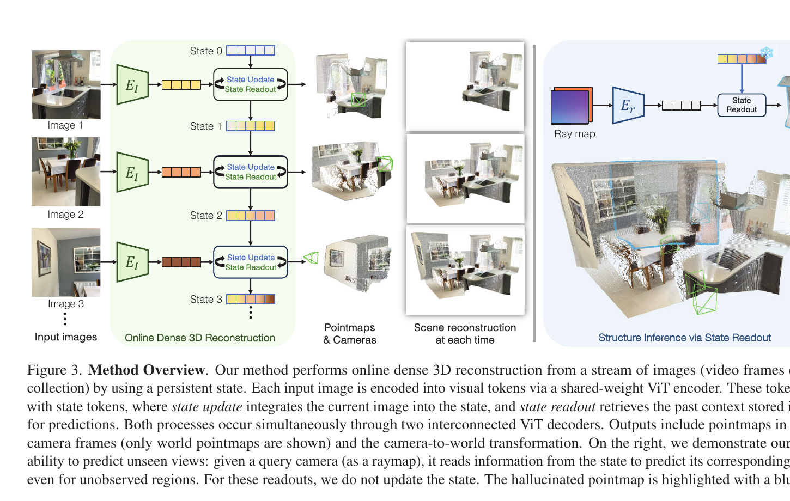
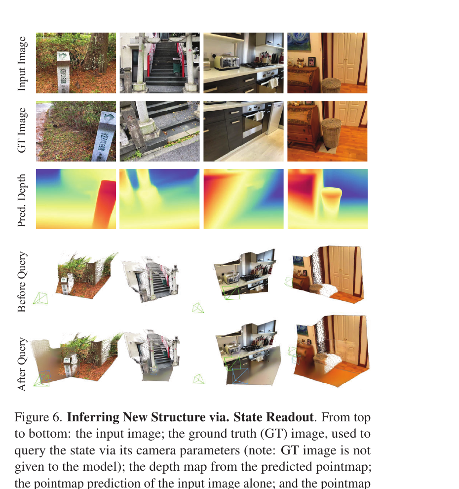
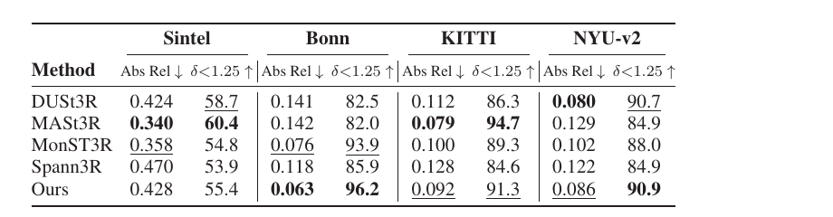
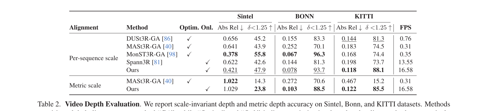
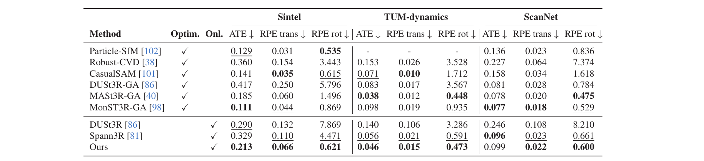
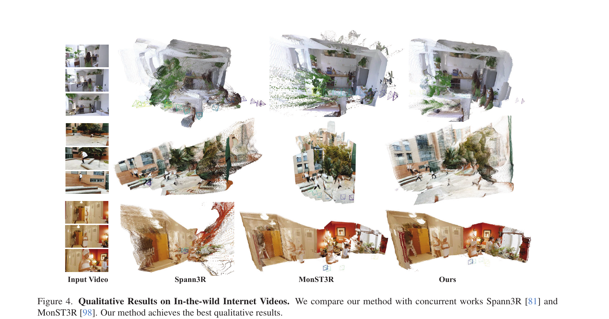
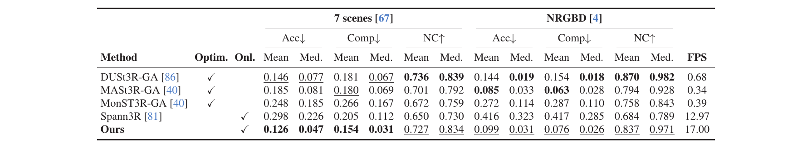
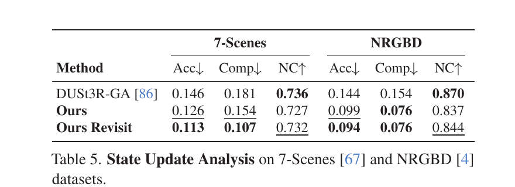
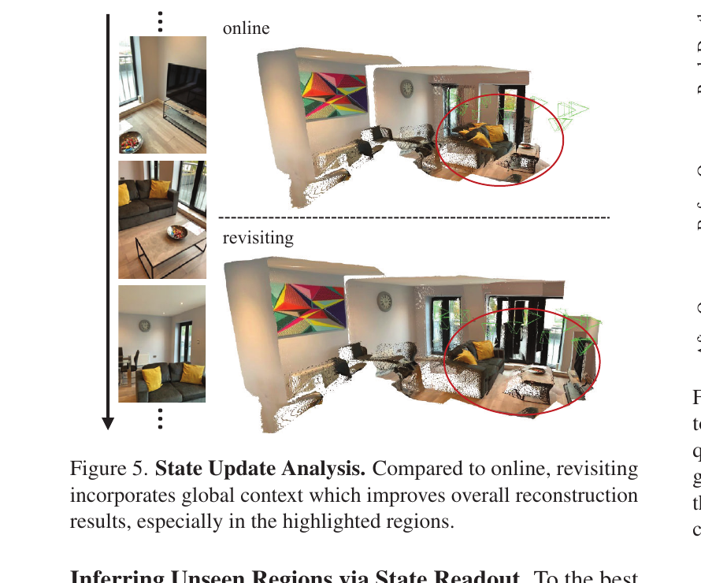

# CUT3R 论文解读

> Qianqian Wang、Yifei Zhang、Aleksander Holynski、Alexei A. Efros、Angjoo Kanazawa，*Continuous 3D Perception Model with Persistent State*，发表于 CVPR 2025。本文依据 CVPR 正式版主文及补充材料，共 18 页。[论文页面](https://openaccess.thecvf.com/content/CVPR2025/html/Wang_Continuous_3D_Perception_Model_with_Persistent_State_CVPR_2025_paper.html) · [主文 PDF](https://openaccess.thecvf.com/content/CVPR2025/papers/Wang_Continuous_3D_Perception_Model_with_Persistent_State_CVPR_2025_paper.pdf) · [补充材料 PDF](https://openaccess.thecvf.com/content/CVPR2025/supplemental/Wang_Continuous_3D_Perception_CVPR_2025_supplemental.pdf) · [项目页](https://cut3r.github.io/) · [代码](https://github.com/CUT3R/CUT3R)

视频或照片陆续到来时，三维重建系统需要让新观察与已有场景保持一致。逐帧调用两视图网络，再做全局对齐，可以积累点云，却要反复处理帧间关系；保留空间记忆可以在线更新，但通常主要保存已观测内容。CUT3R 选择另一种表示：让 Transformer 维护一个跨帧持续更新的隐状态，并从中直接回归当前视图的稠密几何和相机运动。

这份状态还承担了场景先验的作用。给定一张虚拟相机的 raymap，模型可以读取状态并预测该视角下的点图和颜色，即便相机看到的部分没有出现在输入图像中。由此，CUT3R 把在线重建和未观测结构推断放在同一个几何表示里。它能连续输出点图和位姿，但没有显式回环检测或全局位姿图优化，长期地图一致性仍是单独的问题。

这条路线承接了两类已有方法的缺口。DUSt3R 和 MASt3R 从图像对直接预测共享坐标系中的点图，但扩展到多视图通常要额外做离线全局对齐；Spann3R 则用空间记忆支持连续重建，主要面向已观测场景内容。CUT3R 将每帧历史汇入可读写的隐状态，并把对未观测区域的推断作为状态读出的一种用法。与传统 SfM/SLAM 从当前场景观测逐步建图的方式相比，它利用跨场景训练得到的先验，因此可以从少量图像开始，也可以处理动态内容；相应地，它的长期稳定性仍受状态累积和漂移影响。

## 持久状态怎样读写

对第 $t$ 张输入图像 $I_t$，ViT 编码器先提取视觉 token $F_t$。模型将场景状态 $s_{t-1}$ 也表示为一组 token；在任意场景开始前，这些状态 token 都从同一组可学习参数初始化。随后，图像 token 与状态 token 通过两个互相连接的 Transformer 解码器交互：图像一边把当前观察写入状态，一边读取状态中累积的上下文。

论文把这一过程写为：

$$
 [z'_t,F'_t],s_t=\operatorname{Decoders}([z,F_t],s_{t-1}),
 \tag{2}
$$

其中 $z$ 是附加在图像 token 前的可学习 pose token。解码器输出的 $s_t$ 保存更新后的状态；$F'_t$ 是融合了状态信息的图像特征；$z'_t$ 汇集与当前图像级相机运动有关的信息。两个解码器在各层相互传递信息，使状态写入和当前帧预测协同发生。状态 token 数量固定为 768，每个 token 的维度为 768；这使历史信息被压缩到固定长度的表示中，而非逐帧保留全部图像 token。

*原论文图 3。左侧展示图像逐次到达时的状态更新、读出与点图预测；右侧将 raymap 编码后读入状态，得到虚拟相机对应的点图。虚拟查询只读取状态，不将查询视角再次写入状态。*

每帧会得到两种点图和一组相机位姿。局部点图 $\hat X_t^{\mathrm{self}}$ 以当前图像的相机坐标系为参考；世界点图 $\hat X_t^{\mathrm{world}}$ 则统一放在第一张图像的相机坐标系中。两者各自带有置信度图。位姿头从 pose token 预测当前相机相对世界坐标系的六自由度变换 $\hat P_t$。训练标签具备度量尺度时，点图和位姿以米为单位；推理输入不需要预先提供相机内参或位姿。

同时预测局部和世界点图看起来有些重复，但两种输出可以分别接受直接监督。这样既能约束当前相机下的局部几何，也能训练共同坐标系中的场景结构；在只有位姿、单视图深度等部分标注时，模型仍可使用相应输出参与训练。世界点图头还通过 pose token 调制特征：补充材料说明，它在归一化层中用 pose token 调节图像 token，再通过线性层或 DPT 生成坐标。这个设计让相机运动信息进入世界坐标几何预测，而不是只在另一个输出头中独立回归。

## raymap 将状态变成可查询的场景

raymap 是由相机参数构成的六通道图像，每个像素编码一条射线的起点与方向。它同时表达虚拟相机的内参和外参。CUT3R 用单独的轻量编码器将 raymap 转成 token，再通过与图像相同的解码器权重读取状态；此时不更新状态，因为查询视角不应被当成新的观测写入场景。几何头输出查询视角点图，额外的颜色头预测每条射线对应的 RGB 值。

训练时，只有带度量尺度三维标注的数据启用 raymap 模式。对序列中除首帧外的图像，作者以 20% 概率将输入替换成对应的 raymap，并以相机真值生成查询；在尺度未知的数据上关闭这种训练，避免查询的尺度与状态中表达的场景尺度不一致。除点图损失外，raymap 查询还使用颜色均方误差监督预测像素颜色。

*原论文图 6。每组从上到下为输入图像、未输入给模型的真值图像、预测深度，以及查询前后的点图。模型只以第一张图更新状态，再用真值相机参数构造 raymap；查询后生成的点图在共享坐标系中补出此前未观测到的结构。*

这个实验使用 MapFree 和 ARKitScenes 的验证场景，它们未用于训练。实验中模型先读入一张图像，再由未输入的真值视角生成 raymap 查询。预测能够跟随显著视角变化，在例子中补出输入画面外的灌木、地面、烤箱或凳子。结果说明状态中包含可用于外推的场景先验；它并不表示模型从未观察的区域恢复了该场景的真实细节。论文指出，确定性回归对远离观测视角的区域会产生模糊、缺少高频结构的预测。

## 几何与位姿监督

点图损失沿用 MASt3R 的置信度加权回归。对像素点的预测坐标 $\hat x$、目标坐标 $x$ 和预测置信度 $c$，损失为：

$$
\mathcal L_{\mathrm{conf}}=\sum_{(\hat x,c)}\left[c\left\|\frac{\hat x}{\hat s}-\frac{x}{s}\right\|_2-\alpha\log c\right].
\tag{7}
$$

$s$ 与 $\hat s$ 分别归一化目标和预测点图的尺度；对于度量尺度目标，作者令两者相同，从而保留真实尺度误差。对尺度未知的目标，尺度归一化使监督侧重相对几何。置信度 $c$ 调节各像素坐标误差的权重，$-\alpha\log c$ 项则防止模型仅靠降低置信度来逃避误差。

位姿写成四元数 $q_t$ 与平移 $\tau_t$。论文将四元数误差和按尺度归一化的平移误差相加，得到序列位姿损失：

$$
\mathcal L_{\mathrm{pose}}=\sum_{t=1}^{N}\left(\|\hat q_t-q_t\|_2+\left\|\frac{\hat\tau_t}{\hat s}-\frac{\tau_t}{s}\right\|_2\right).
\tag{8}
$$

在 raymap 输入下再加颜色损失 $\mathcal L_{\mathrm{rgb}}=\|\hat I_r-I_r\|_2^2$。所以模型学习的并非单一深度图：点图提供稠密三维监督，位姿把局部和全局坐标联系起来，虚拟视角的颜色目标则让状态读出对查询视角也能生成外观预测。

## 混合数据和逐步增长的上下文

CUT3R 在 32 个数据集上训练，覆盖真实与合成、室内与室外、静态与动态、场景级与物体中心数据。数据可以只有单视图深度或相机参数等部分标注。补充材料说明，MapFree 和 DL3DV 的稠密深度通过给定相机参数的多视图立体重建补齐；RealEstate10K、CoP3D 和 MVImgNet 则只用相机参数监督位姿。对缺少可靠同步相机标注的 SmartPortraits、缺少明确相机约定的 EDEN 等数据，作者按单视图处理。

视频训练样本按数据集帧率和相机运动，在间隔 1 到 $k$ 帧之间抽样；固定间隔和可变间隔样本各占大约一半。对大体静态的视频会打乱帧顺序，作为照片集合训练；有显著动态物体的序列则保持时间顺序。单视图数据通过拼接独立图像构成长序列，并在每张独立图像后重置状态，这样既能混合训练，也不把不同视图误当成同一场景的连续观测。

训练分四阶段扩展任务难度。开始先用以静态场景为主的四视图序列训练；第二阶段加入动态场景和部分标注数据；第三阶段增至更高分辨率并采用不同宽高比，图像长边最高 512 像素；最后冻结图像编码器，只训练解码器和预测头，使用 4 至 64 张图像的长序列学习场景级推理。主文报告 ViT-Large 图像编码器由 DUSt3R 权重初始化，解码器使用 ViT-Base，图像 patch 为 $16\times16$；补充材料进一步说明，前两阶段用线性点图头，后两阶段换成 DPT 头，raymap 编码器为两层 Transformer。优化使用 AdamW，初始学习率 $10^{-4}$，经过线性 warmup 和余弦衰减，在 8 张 80 GB A100 上训练。循环结构可以在相同批次中混合视频、无序照片集和部分标注数据，但长上下文的阶段只用多视图数据，并且训练循环网络需要较长时间。

## 深度、位姿与稀疏场景重建

单帧深度实验在 Sintel、Bonn、KITTI 和 NYU-v2 上评估，按 DUSt3R 协议逐帧以中位数尺度对齐。CUT3R 在 Bonn 上 Abs Rel 为 0.063、$\delta<1.25$ 为 96.2；在 KITTI 上为 0.092 和 91.3；NYU-v2 的阈值准确率为 90.9。它在这些领域外测试上表现有竞争力，但中位尺度对齐意味着该表主要比较深度形状，不能作为绝对尺度准确性的证据。

*原论文表 1。表中按数据集列出 Abs Rel 和阈值准确率。评估对每帧做中位尺度对齐；CUT3R 在 Bonn 上两项最优，NYU-v2 的 $\delta<1.25$ 略高于表中的其他结果。*

视频深度评估使用每序列尺度对齐以及未经对齐的度量尺度两种协议。前者把预测与真值间的整体序列尺度差异消去；后者直接检验米制输出。在按序列尺度对齐的 KITTI 结果中，CUT3R 的 Abs Rel 为 0.118，Spann3R 为 0.198；在度量尺度 KITTI 上，CUT3R 的 Abs Rel 为 0.122、阈值准确率为 85.5。论文报告在 A100、输入 $512\times144$ 时 KITTI 推理速度为 16.58 FPS；同表中 MonST3R-GA 为 0.35 FPS，但它需要全局对齐等额外处理，因此速度对比反映的是论文设定下整套流程类别的差异。

*原论文表 2。上半部分报告每序列尺度对齐结果，下半部分保留度量尺度；FPS 在 A100 上测得，输入分辨率为 $512\times144$，Spann3R 例外使用 $224\times224$。论文仅展示了部分基线，完整比较见补充材料。*

位姿评估在 Sintel、TUM-dynamics 和 ScanNet 上报告经 Sim(3) 对齐后的 ATE、相对平移误差和相对旋转误差。CUT3R 在三组数据上的 ATE 分别为 0.213、0.046 和 0.099；论文称它在无需测试时优化的在线方法中总体表现最好。与优化式方法相比，结果仍有差距；例如 Sintel 上 MonST3R-GA 的 ATE 为 0.111。这个实验支持 CUT3R 能从图像直接给出可用的相机轨迹，但它不是传统 SLAM 中经过回环和全局优化的轨迹。

*原论文表 3。比较在线预测与测试时优化方法在三个数据集上的 ATE、相对平移和旋转误差。位姿轨迹在计算误差前经过 Sim(3) 对齐；最优优化式结果和在线结果须分开理解。*

在 7-Scenes 和 NRGBD 的稀疏图像重建中，每个场景分别只采样 3–5 张和 2–4 张图像。CUT3R 的在线结果在 7-Scenes 上 Acc/Comp/NC 均值为 0.126/0.154/0.727，在 NRGBD 上为 0.099/0.076/0.837；Acc 与 Comp 越低越好，NC 越高越好。论文报告其优于 Spann3R，并在部分指标上达到或超过离线全局对齐基线 DUSt3R-GA。相应速度为 17.00 FPS，DUSt3R-GA 为 0.68 FPS。下面的定性对比显示动态人物和背景同时存在的真实网络视频重建；定性图展示形态差异，定量指标仍是比较性能的主要依据。

*原论文图 4。CUT3R、Spann3R 和 MonST3R 在网络视频上的重建可视化，包含室内、室外和有运动人物的片段。论文观察到 CUT3R 在静态背景和动态内容上都能给出较完整的结果；图像本身不是定量测量。*

*原论文表 4。Acc、Comp 和 NC 分别描述重建点准确度、表面覆盖和法线一致性；表中同时列出均值和中位数，以及各方法的优化/在线属性。*

## 状态重访能否补回全局上下文

逐帧在线输出必须只用已经到达的观察。作者另设一个“重访”实验：第一遍按在线方式处理全序列，得到看过所有图像的最终状态；冻结该状态后，再把同一组图像重新输入一次以生成预测。这个设置已经利用了全局上下文，因此不是严格在线推理，而是用来检查状态是否随着新观察吸收了有用信息。

*原论文表 5。重访在 7-Scenes 上将 Acc/Comp 从在线的 0.126/0.154 降至 0.113/0.107；NRGBD 的 Acc 从 0.099 降至 0.094。法线一致性变化较小且并非每项都上升。*

*原论文图 5。第二遍读取包含完整序列信息的状态后，沙发周围的点云覆盖更完整。图中改善来自重访允许模型预先见过后续帧，不能解读为单次在线过程中的未来信息可用。*

## 方法关系与适用边界

CUT3R 的设计核心是固定大小的递归状态：每帧都写入当前信息、读出已有上下文，再用点图和位姿头产生显式三维预测。与 [StreamVGGT](../streamvggt/) 和 [STream3R](../stream3r/) 的逐帧因果注意力及历史 token 缓存相比，它把跨帧历史压入可读写状态；这限制了状态长度，但也让当前预测依赖模型学到的状态压缩能力。Raymap 查询进一步表明，这个状态可以承担场景先验，推断输入视角之外的结构。

从系统定位看，CUT3R 是在线三维感知与重建模型，也可提供 SLAM 前端所需的几何和相机运动估计。它没有传统 SLAM 的回环识别、重定位与全局地图优化机制；论文明确指出，超长序列可能因缺乏全局对齐而漂移。其余限制包括确定性回归在远视角外推时生成模糊结构，以及循环网络训练耗时。因而，持续更新的状态解释了模型如何在线整合观察，但并未消除长期定位和地图一致性问题。
