# D4RT 论文解读

> Chuhan Zhang、Guillaume Le Moing、Skanda Koppula、Ignacio Rocco、Liliane Momeni、Junyu Xie、Shuyang Sun、Rahul Sukthankar、Joëlle K. Barral、Raia Hadsell、Zoubin Ghahramani、Andrew Zisserman、Junlin Zhang、Mehdi S. M. Sajjadi，*Efficiently Reconstructing Dynamic Scenes One D4RT at a Time*，CVPR 2026 正式版，论文页码 7382–7392。本文依据 CVF Open Access 11 页论文和 6 页补充材料。[论文页面](https://openaccess.thecvf.com/content/CVPR2026/html/Zhang_Efficiently_Reconstructing_Dynamic_Scenes_One_D4RT_at_a_Time_CVPR_2026_paper.html) · [论文 PDF](https://openaccess.thecvf.com/content/CVPR2026/papers/Zhang_Efficiently_Reconstructing_Dynamic_Scenes_One_D4RT_at_a_Time_CVPR_2026_paper.pdf) · [补充材料 PDF](https://openaccess.thecvf.com/content/CVPR2026/supplemental/Zhang_Efficiently_Reconstructing_Dynamic_CVPR_2026_supplemental.pdf) · [项目页](https://d4rt-paper.github.io/)

D4RT 把整段视频先编码成一个全局场景表示，再用统一的小型解码器逐个回答时空点查询。一次查询指定源帧中的二维像素、该像素的源时刻、要预测的目标时刻，以及输出坐标所采用的相机参考时刻。改变这几个索引，就能从同一表示得到三维点轨迹、完整点云、深度图、相机外参与内参。论文的关键取舍是将全局一致性主要交给视频编码器形成的场景特征，而不让大量点查询彼此做注意力；这样稀疏查询便可以独立、并行地解码。论文报告，该结构支持动态区域的稠密三维对应，并在跟踪、点云、视频深度和相机估计任务上取得较快推理和有竞争力的精度。

## 1. 引言

传统三维重建试图一次恢复所有位置、所有时刻的场景几何。面对动态视频，这种完整重建目标会遇到两类困难：场景中的物体在运动，同一物体在不同帧的位置并不相同；同时，相机也可能移动，因此必须区分物体运动与视点变化。

已有系统经常把工作拆成多个独立环节。例如，MegaSaM 会调用不同模型估计单目深度、度量深度和运动分割，再用测试时优化把这些信息对齐。[VGGT](/blog/articles/vggt/) 等前馈模型能够从整段视频中直接预测几何，但常为深度、姿态、点图等任务配置不同解码头；另一些方法即使处理动态物体，也只能从某个参考帧跟踪点，无法补全被遮挡区域随时间出现的几何。SpatialTrackerV2 能跟踪动态区域，但采用多阶段迭代，且无法用一个轻量接口直接完成整段视频的所有像素重建。

D4RT 提出按需查询的方案：编码器只需处理视频一次，生成潜在全局场景表示 $F$；之后解码器可以独立回答任意数量的时空点查询。图 1 用一段行人视频概括了统一输出：同一模型既可以重建点云，也能预测点轨迹和相机参数。

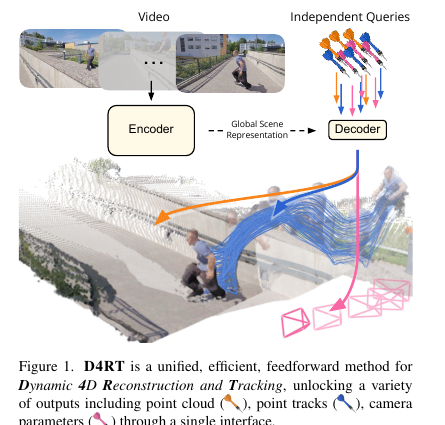

作者归纳了四项贡献：提出面向视频的点级四维信息查询；用同一架构处理动态对应、点云、深度与相机参数；展示多种四维重建和跟踪基准上的精度与速度；并设计根据已访问区域跳过冗余点的稠密跟踪算法。

## 2. 方法

D4RT 是受 Scene Representation Transformer 启发的编码器—解码器结构。编码器理解整段环境和帧间关系，解码器接收一个点查询，返回该点在指定时刻、指定相机坐标系下的三维位置。方法的关键不是输出一个固定分辨率的稠密张量，而是把时空任务写成一组可组合、彼此独立的点查询。

### 2.1. D4RT 框架

给定视频 $V\in\mathbb{R}^{T\times H\times W\times3}$，编码器 $E$ 产生全局场景表示：

$$
F=E(V)\in\mathbb{R}^{N\times C}.
$$

在解码阶段，$F$ 保持不变，每个查询都由轻量解码器独立处理。查询写为

$$
q=(u,v,t_{\mathrm{src}},t_{\mathrm{tgt}},t_{\mathrm{cam}}),\qquad P=D(q,F)\in\mathbb{R}^3.
$$

其中，$(u,v)\in[0,1]^2$ 是源帧中的归一化像素坐标，$t_{\mathrm{src}}$ 指源点所在帧，$t_{\mathrm{tgt}}$ 指要预测的场景时刻，$t_{\mathrm{cam}}$ 指输出三维坐标所采用的参考相机时刻。$P$ 表示源像素所对应的场景点，在目标时刻、相机参考系 $t_{\mathrm{cam}}$ 下的三维坐标。三个时间索引可独立指定，因此源点、物体状态和坐标系不必来自同一帧。

这个查询接口组合出多种输出。固定源像素和源帧，再改变目标时刻，可以获得该点随时间变化的三维轨迹；若参考相机固定，整条轨迹就会表达在同一坐标系中。对每帧的像素逐点查询，并令 $t_{\mathrm{tgt}}=t_{\mathrm{src}}$、把 $t_{\mathrm{cam}}$ 固定到共同参考帧，可以直接得到统一坐标系下的整段视频点云。若令 $t_{\mathrm{src}}=t_{\mathrm{tgt}}=t_{\mathrm{cam}}$，每个查询返回相机坐标中的点，只保留 $Z$ 分量即可形成深度图。

表 1 将任务写成查询索引的取值范围。点跟踪固定源点和源帧，并随时间查询；点云对各帧像素查询、使用固定参考相机；深度图将源、目标和相机时刻设为同一帧；相机内外参则从一组像素查询的三维点集合中恢复。表中的相机参数只在较稀疏的 $(h,w)$ 网格查询，以控制推理开销。

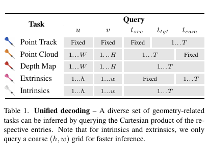

#### 相机外参与内参

对帧 $i$ 和 $j$ 的相对相机变换，作者在规则 $(h,w)$ 网格上采样 $k$ 个源像素 $(u,v)$，分别构造

$$
q_i=(u,v,i,i,i),\qquad q_j=(u,v,i,i,j).
$$

两组查询追踪的是同一批源像素所对应的三维点，但结果分别表达在帧 $i$ 与帧 $j$ 的相机坐标系中。对两组三维点集合求解对齐变换即可得到相机之间的相对姿态。论文使用 Umeyama 算法，以 $3\times3$ 的 SVD 求解这个变换；做法避免了直接回归每一对相机参数。

相机内参从同一帧像素的三维坐标中解析估计。对帧 $i$，令 $t_{\mathrm{src}}=t_{\mathrm{tgt}}=t_{\mathrm{cam}}=i$，得到网格采样点 $P=(p_x,p_y,p_z)$。在针孔模型、主点位于归一化坐标 $(0.5,0.5)$ 的假设下，焦距为

$$
f_x=p_z\frac{u-0.5}{p_x},\qquad f_y=p_z\frac{v-0.5}{p_y}.
$$

每个采样点都会给出一组焦距估计，最终对 $k$ 组结果取中位数以减小异常值影响。论文指出，鱼眼等带畸变相机也可在这一步之后加入非线性细化。这里的内参恢复依赖针孔几何假设以及模型预测的三维点，网格采样和中位数共同构成其稳健性来源。

### 2.2. 模型架构

#### 视频编码器

编码器基于 Vision Transformer，并交替使用逐帧局部自注意力与全局时空自注意力。局部层保留单帧内部的空间细节，全局层让不同帧的信息进入同一场景表示 $F$。为了支持不同宽高比，输入视频先缩放为固定正方形，再切成时空 patch；原视频宽高比会另行编码成 token，和视频 token 一起送入 Transformer。

#### 点级解码器与局部外观

解码器是小型交叉注意力 Transformer。查询 token 由二维坐标的 Fourier 特征、源时刻、目标时刻和相机参考时刻的可学习离散时间嵌入相加得到。它以查询为 Query，从 $F$ 读取与该点相关的时空特征，再经 MLP 投影出三维点位置。每个点查询单独解码，不在查询 token 之间建立自注意力。

单独查询节省了显存与计算：训练时只需从每个视频抽样一小批有标注的点，不用一次生成整段视频的所有像素；推理时则能把不同查询并行处理。作者还报告，若在查询之间加入自注意力，模型会对训练时的查询分布过拟合，并使推理性能下降。全局一致性因此主要由视频编码器写入 $F$，而不是依赖解码阶段的查询间交互。

查询还包括源帧中以 $(u,v)$ 为中心的 $9\times9$ RGB 局部块嵌入。位置和时间编码告诉解码器“查哪里、查何时”，局部外观则补入边缘、纹理等低层线索，帮助它在全局特征中找到对应物体和细节。后面的局部块消融会看到，这些像素外观对锐利边界和相机估计都有明显影响。

解码器输出共 13 维：三维位置 $XYZ$、二维图像位置 $UV$、可见性、三维位移、表面法向和置信度。这些量共同服务于主任务与辅助监督。可见性用于判断轨迹点是否仍在画面中；二维位置和位移约束跨帧对应；法向提供局部表面几何；置信度对三维误差加权。这样一个点级预测头便可以为不同应用提供共享表示。

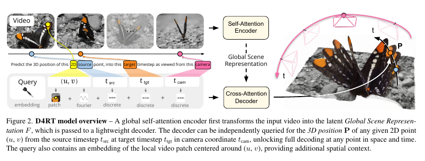

### 2.3. 训练与推理

#### 点级监督与训练查询

训练时从真实点轨迹中抽取 $N$ 个查询。主要监督是归一化三维点位置的 $L_1$ 损失：预测点和真值点分别按各自的平均深度归一化，再通过 $\operatorname{sign}(x)\log(1+|x|)$ 压缩远距离点的影响。此外，解码器输出还接受二维坐标 $L_1$、表面法向余弦相似度、目标可见性二元交叉熵、三维位移 $L_1$ 和置信度损失。可用标签才参与相应损失。模型同时预测置信度 $c$，用它加权三维点误差并加入 $-\log c$ 惩罚，避免通过把置信度一律压低来逃避几何监督。

补充材料把总损失写为各任务损失的加权和：

$$
\mathcal L=\frac1N\sum_{i=1}^N\left(c_i\lambda_{3D}\mathcal L_{3D}-\lambda_{conf}\log c_i+\lambda_{2D}\mathcal L_{2D}+\lambda_{vis}\mathcal L_{vis}+\lambda_{disp}\mathcal L_{disp}+\lambda_{conf}\mathcal L_{conf}+\lambda_{normal}\mathcal L_{normal}\right).
$$

附录给出的权重为 $\lambda_{3D}=1.0$、$\lambda_{2D}=0.1$、$\lambda_{vis}=0.1$、$\lambda_{disp}=0.1$、$\lambda_{conf}=0.2$、$\lambda_{normal}=0.5$，但最后又重复列出一次 $\lambda_{conf}=0.2$。原文没有说明第二个置信度权重是否应属于另一项，因此这里保留其损失结构，并将重复记号视作附录中的未澄清之处。

采样并非完全均匀：30% 的空间查询被放在深度不连续或运动边界附近，这些边界由深度图上的 Sobel 滤波器预先计算。作者的消融显示，移除这种偏向边缘和动态区域的采样后，Sintel 上姿态平均误差从 0.13 升至 0.21，3D 跟踪 AJ 从 0.225 降至 0.168。源时刻、目标时刻和相机参考时刻通常均匀采样；另有 40% 的概率强制 $t_{\mathrm{tgt}}=t_{\mathrm{cam}}$，以改善下游任务。

训练采用时间一致的亮度、饱和度、对比度和色调变换，随机颜色丢弃概率为 0.2，高斯模糊概率为 0.4。空间增强包括原图 0.3–1.0 比例随机裁剪、对数域均匀采样的宽高比，以及概率 0.05 的随机放大；时间维度则以随机步长从完整视频中抽帧。

#### 稠密动态对应与高效点跟踪

逐个为每帧每个像素在整个视频中查询轨迹，最直接的做法需要约 $O(T^2HW)$ 次点查询，其中大量查询会重复经过同一段可见轨迹。D4RT 利用时空冗余建立占用网格 $G\in\{0,1\}^{T\times H\times W}$：初始时所有像素都标为未访问；算法从未访问位置抽取一批源点，对每个源点查询所有目标时刻；预测轨迹经过且可见的位置都标记为已访问；之后只从剩余未访问位置开始新轨迹。

这个循环不会省略已经访问区域中的轨迹信息，而是避免从同一条可见轨迹的许多像素重复启动完整查询。作者报告，该算法相对朴素全像素做法根据视频运动复杂度可节省约 5–15 倍计算。算法 1 展示了占用网格和批量查询的步骤。

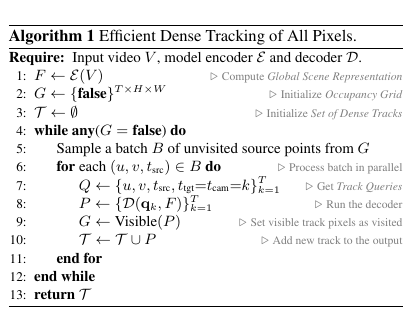

## 3. 相关工作

经典 SfM 与 MVS 依赖显式多视图几何，逐步优化相机和场景结构。它们有清楚的几何约束，但计算开销较大，在视频运动和动态物体场景中也容易受到对应关系破坏的影响。D4RT 的背景工作分成前馈三维重建和二维点跟踪到三维跟踪两条路线。

### 3.1. 前馈三维重建

DUSt3R 展示了从无位姿图像对端到端预测几何的做法；[VGGT](/blog/articles/vggt/) 将这一范式扩展到多帧，并以全局注意力融合视频信息。后续工作进一步适配动态视频、提升推理速度。论文指出，这类方法有时不支持一段视频中相机内参变化，或只能以首帧作为相机参考；多任务方法还可能分别配置深度、相机、点云等头，或者把子任务交给不同模型。D4RT 把这些输出统一到一个时空点查询接口中。

### 3.2. 从二维到三维点跟踪

视频点跟踪从稀疏点逐渐发展到逐像素稠密跟踪。已有方法会把二维轨迹结合真值或估计深度和相机内参，提升到三维坐标；另一些方法直接预测三维轨迹。[St4RTrack](/blog/articles/st4rtrack/) 与 SpatialTrackerV2 都将跟踪扩展到动态三维场景。论文将 DPM、St4RTracker、SpatialTrackerV2、L4P 等作为近期代表，并指出其中有的方法仍以图像对为单位，有的方法要迭代精化，还有的为稀疏和稠密任务设置不同输出头。D4RT 的目标是从完整视频直接建立统一参考系下的点轨迹，同时允许用同一组查询解码密集场景几何。

表 2 按任务、功能和架构特性对比方法。D4RT 在表中同时支持三维重建、动态对应、灵活参考帧、稀疏解码和全局上下文，并使用单一解码器。表格总结的是论文作者选择的功能维度，并不代表所有方法在其未列任务上都完全不可用。

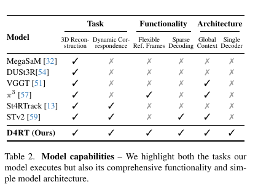

## 4. 实验

D4RT 与近期前馈重建、视频跟踪方法进行比较。主模型采用 40 层 ViT-g 编码器和 8 层交叉注意力解码器，参数量分别为 1B 和 144M。训练混合包括 BlendedMVS、Co3Dv2、Dynamic Replica、Kubric、MVS-Synth、PointOdyssey、ScanNet++、ScanNet、TartanAir、Virtual KITTI、Waymo Open 及内部数据集。训练视频为 48 帧、分辨率 $256\times256$，每段视频解码 2,048 个查询。模型使用 AdamW 训练 500k 步，64 个 TPU 芯片上每芯片本地 batch size 为 1，总训练时间略多于两天。

作者先观察不同方法的动态场景重建差别，再评估 4D 重建和跟踪，接着评估点云、视频深度、相机估计，最后做设计消融。以下按论文的实验小节展开。

### 4.1. 定性分析

图 4 比较 MegaSaM、$\pi^3$、SpatialTrackerV2 和 D4RT 在河边天鹅、花朵及火车场景中的输出。MegaSaM 和 $\pi^3$ 将视频像素累积为点云，但天鹅会在多个位置重复，或整朵花无法重建；SpatialTrackerV2 能跟踪动态物体，却只从一个参考帧跟踪点，因此被遮挡的区域留下空缺。D4RT 则把整段视频中的动态像素纳入一个四维表示。

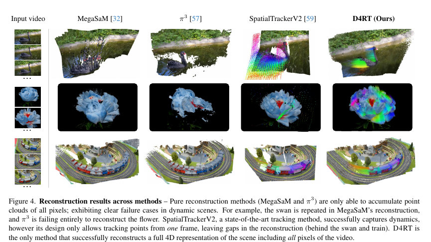

图 5 展示室外静态场景和动态场景的重建。作者报告，在动态场景中，D4RT 还能提供连贯的三维点轨迹。图中展示的是若干代表性视频，不单独构成量化性能结论。

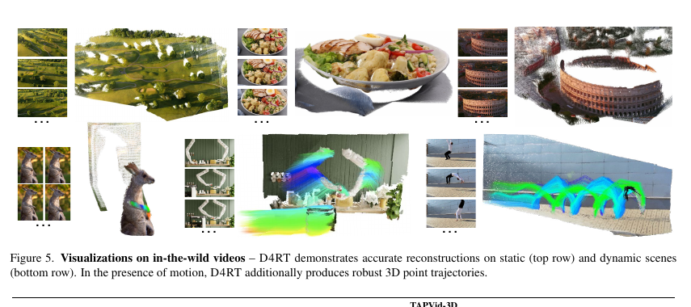

### 4.2. 四维重建与跟踪

动态对应评估使用 TAPVid-3D 的 DriveTrack、ADT、PStudio 三个真实视频子集。局部相机坐标任务评估每个观测点在各帧相机坐标系下的位置，报告 3D Average Jaccard（AJ）、Average Percent of Points within Delta 3D（APD3D）和 Occlusion Accuracy（OA），三者越高越好。世界坐标跟踪使用同一全局坐标系，报告 APD3D 和预测轨迹与真值的 L1 距离（越低越好）；PStudio 没有相机运动，因此世界坐标任务与局部坐标任务等价，论文不重复报告。

表 4 将是否已知真值内参分成两部分。D4RT 在不输入真值内参时，DriveTrack 局部坐标 AJ/APD3D/OA 为 0.257/0.345/0.875，ADT 为 0.240/0.319/0.926，PStudio 为 0.138/0.186/0.897；相机坐标切换到世界坐标后，DriveTrack 的 APD3D/L1 为 0.373/0.020，ADT 为 0.319/0.096。提供真值内参后，D4RT 的 DriveTrack AJ/APD3D/OA 提高到 0.304/0.410/0.875，ADT 为 0.307/0.408/0.926，PStudio 为 0.372/0.498/0.897；世界坐标 DriveTrack APD3D/L1 为 0.470/0.017，ADT 为 0.398/0.093。结果说明相机内参条件会影响三维跟踪表现，比较两种协议时不能混合表格上下两块数据。

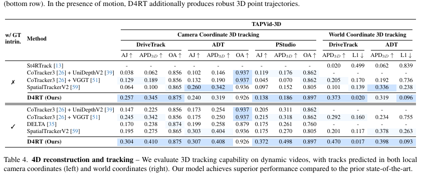

作者最后用表 3 比较稠密轨迹吞吐量：单张 A100 在目标帧率为 60、24、10、1 FPS 时，D4RT 分别生成 550、1,570、3,890、40,180 条完整视频 3D 轨迹。相较 DELTA 和 SpatialTrackerV2，论文报告其速度提升为 18–300 倍；每条 D4RT 轨迹仍需针对视频的 $T$ 个时刻分别解码，效率来自查询可并行处理以及占用网格省去重复启动的轨迹。该对比是在同一硬件和目标帧率设置下测得。

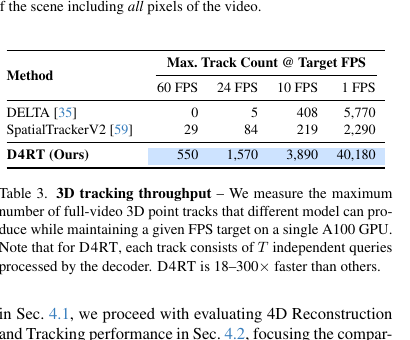

### 4.3. 三维重建

#### 点云与视频深度

表 5 的点云部分在动态 Sintel 和静态 ScanNet 上评估重建点云的平均 $L_1$ 距离，先用均值平移对齐预测和真值。D4RT 分别取得 0.768 和 0.028，低于表中其他方法。视频深度在 Sintel、ScanNet、KITTI、Bonn 上评估，并报告只做全序列尺度对齐（S）与尺度加平移对齐（SS）两种协议。D4RT 的 AbsRel（S/SS）依次为：Sintel 0.171/0.148、ScanNet 0.020/0.018、KITTI 0.055/0.051、Bonn 0.036/0.036。

这些数值表明 D4RT 在点云误差上取得表中最佳结果，深度估计整体有竞争力，但并非每个设置都领先：例如 Bonn 上 $\pi^3$ 的 S/SS 误差为 0.033/0.032，低于 D4RT 的 0.036/0.036。S 与 SS 的对齐条件不同，也应分别比较。

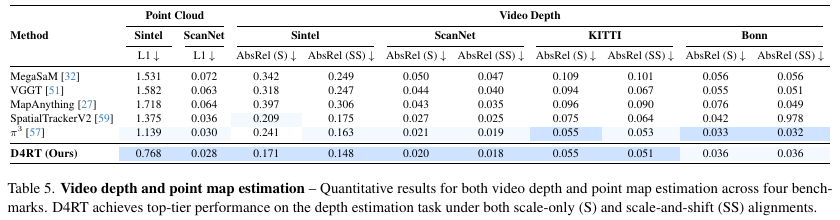

#### 相机位姿

表 6 在 Sintel 的 14 段含运动模糊和大气效应的视频、ScanNet 室内场景及 RealEstate10K 上评估相机估计。Sintel 的 ATE、相对平移误差 RPE-T、相对旋转误差 RPE-R 在 Sim(3) 对齐后报告；RealEstate10K 报告 Pose AUC@30。D4RT 在 Sintel 的 ATE/RPE-T/RPE-R 为 0.065/0.024/0.126，ScanNet 为 0.014/0.010/0.302，RealEstate10K 的 AUC 为 83.5。论文称这些结果优于表中其他方法；跨数据集的误差尺度不同，因此应在同一数据集和协议内比较。

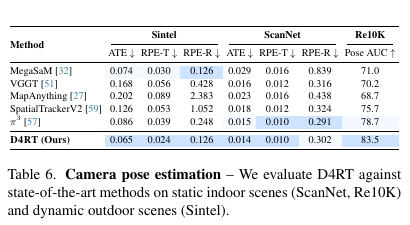

图 3 将相机姿态精度与推理速度放在同一坐标图中：D4RT 在单张 A100 上超过 200 FPS，作者报告其比 VGGT 快约 9 倍、比 MegaSaM 快约 100 倍。为公平比较，基线移除了与姿态估计无关的解码头；精度定义为 Sintel 和 ScanNet 上 ATE、RTE、RPE 的平均 $1-\mathrm{error}$。这反映特定任务与测试设置下的精度—速度关系，不应直接外推到其他硬件或完整模型配置。

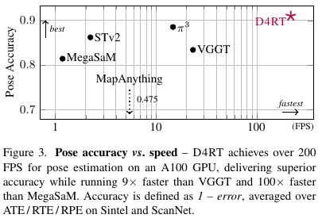

### 4.4. 消融研究

主文消融默认使用 ViT-L 编码器、6 层解码器、300k 次迭代和 batch size 16，评估均在 Sintel 上进行。这个设置与前面主结果使用的 ViT-g、8 层解码器和 500k 步训练不同，不能将两套训练配置当作同一个实验。

#### 查询局部 RGB 块

表 7 中加入局部 RGB 块后，视频深度 AbsRel（S/SS）从 0.366/0.306 降到 0.302/0.257，姿态 ATE/RPE-T/RPE-R 从 0.173/0.031/0.262 降到 0.091/0.028/0.245。图 6 显示，局部块能保留竹叶边缘等细节并产生更锐利的物体边界。作者将提升归因于两点：外观线索帮助查询与视频特征建立对应，也帮助区分物体与周围区域。

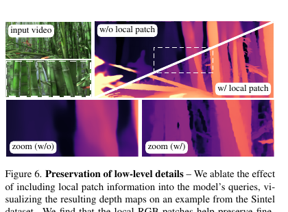

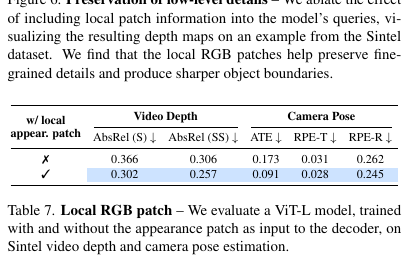

#### 编码器规模

表 8 将 ViT-B、ViT-L、ViT-H、ViT-g 四种预训练编码器进行比较。Sintel 上，视频深度 AbsRel（S/SS）由 ViT-B 的 0.319/0.232 降到 ViT-g 的 0.191/0.168，RPE-R 从 0.266 降至 0.160；但 ATE 并非随规模单调下降，ViT-H 为 0.070，ViT-g 为 0.078。整体趋势支持更大编码器改善深度和部分位姿指标，不支持“所有指标随模型变大都单调改善”。

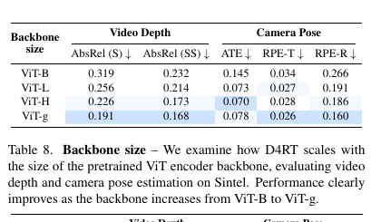

#### 辅助损失

表 9 以完整 D4RT 为基准，逐项去掉二维位置、法向、位移、可见性或置信度损失，并列出指标变化量。移除二维位置损失后深度 AbsRel（S/SS）增加 0.071/0.063；移除法向损失后分别增加 0.043/0.026；移除位移损失后相机 ATE 增加 0.011。移除置信度损失则姿态误差明显上升，ATE/RPE-T/RPE-R 增加 0.126/0.061/0.115。某些单项深度指标在移除可见性或置信度时略有下降，说明辅助损失之间存在权衡；作者的结论是它们整体有助于任务表现，而非每项损失都让每个指标分别变好。

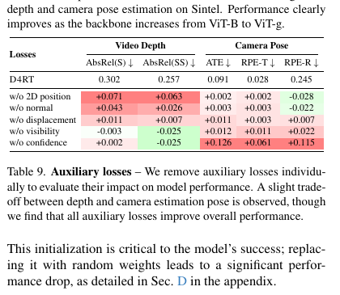

预训练编码器也很关键：主文用公开 VideoMAEv2 初始化。随机初始化会使深度和相机结果显著变差，补充材料表 11 进一步量化这一点。公开数据消融和辅助损失分析则见补充材料 D。

## 5. 结论

D4RT 将动态场景重建写成点级时空查询：一个视频编码器形成全局场景表示，轻量解码器根据源像素、源时刻、目标时刻和相机参考时刻独立输出三维点。通过查询参数组合，同一模型可以估计深度、点云、三维轨迹和相机参数。查询之间相互独立，既降低了训练时解码大量像素的负担，也让推理端可以并行处理稀疏或稠密查询；占用网格再利用轨迹的时空可见性，减少全像素跟踪中的重复查询。

论文结果支持两点：D4RT 能在动态区域建立稠密对应，且点级解码在多种重建任务中具有较高吞吐；局部 RGB 块、预训练编码器和辅助监督会明显影响细节、深度与相机精度。能力边界也应一并保留：主干编码整段视频，长视频需分段并做 Sim(3) 对齐；论文长序列实验省略了回环检测和全局优化，所以并未展示完整 SLAM 后端；高分辨率边界细节依赖原始 RGB 查询块；训练数据包括内部数据集，公开数据版本虽有结果但指标并非全部领先。D4RT 因而是一种统一的四维点查询和重建模型，不应被等同于已经具备回环和全局优化的完整 SLAM 系统。

## 补充材料

### A. 模型总览与训练细节

补充图 7 汇总模型输入、编码器、点级解码器和 13 维输出。图中也显示宽高比 token、时空 patch、源像素的 Fourier 编码和离散时间嵌入如何进入查询。训练数据增强和查询采样细节已在方法部分说明；补充材料还报告，AdamW 权重衰减为 0.03，学习率在 2,500 步内预热至 $10^{-4}$，再余弦衰减至 $10^{-6}$，梯度 $L_2$ 范数裁剪为 10。

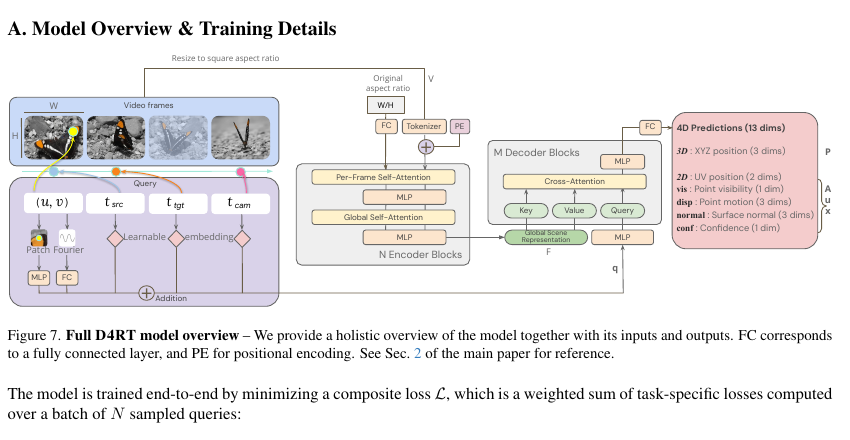

### B. 长视频泛化

长视频不能一次性输入时，作者把视频切成有重叠的片段，再根据重叠区域中置信度最高的 85% 点，用 Umeyama 算法估计片段间 Sim(3) 变换并拼接。这个流程类似 VGGT-Long 的第一阶段，但省略回环检测和全局优化，用来观察模型分段预测本身的精度。

图 8 在 KITTI 上展示 1,000 帧序列和两段相机轨迹。第一段中，D4RT 的 ATE 为 15.5 m，低于 VGG-T 的 58.7 m 和 $\pi^3$ 的 35.6 m；第二段 D4RT 为 16.3 m，接近 $\pi^3$ 的 15.8 m，优于 VGG-T 的 36 m。该实验说明分段拼接能够延伸到长序列，但因为没有回环和全局精化，仍是原始拼接精度而非完整 SLAM 结果。

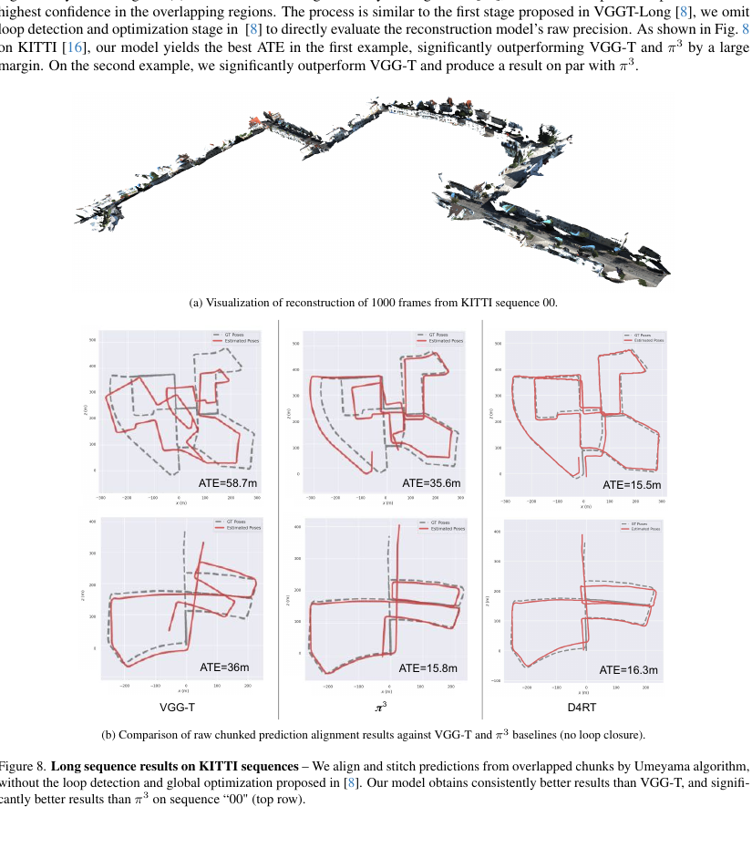

### C. 亚像素精度的高分辨率解码

查询坐标 $(u,v)$ 定义在连续归一化空间中，因此解码分辨率可以独立于场景编码分辨率。作者固定 ViT-g 编码输入为 $256\times256$，比较四种配置：原生低分辨率输出；加入低分辨率 RGB 局部块；用稀疏查询生成原始分辨率输出；以及在原始分辨率采样局部 RGB 块后解码原始分辨率输出。表 10 同时报告尺度对齐和尺度加平移对齐下的 AbsRel，以及 Pseudo Depth Boundary Error（PDBE），均越低越好。

配置 4 的尺度加平移 AbsRel 为 0.176，PDBE 为 2.185；配置 3 的 PDBE 为 2.258。配置 4 的尺度对齐 AbsRel 为 0.220，略高于配置 3 的 0.217，说明细节指标改善并非所有全局指标同步改善。图 9 展示头发、物体边界等高频细节更清楚，而平滑区域变化较小；作者称局部原始分辨率 RGB 块增加细节时，不提高整体模型的计算或显存需求。

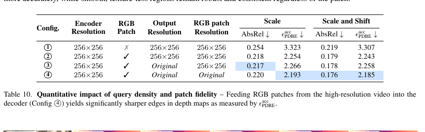

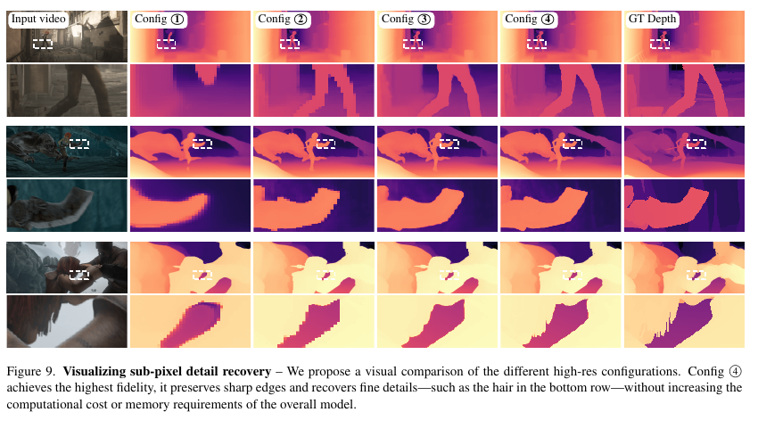

### D. 更多消融

#### 预训练编码器

补充材料表 11 称初始化权重为 VideoMAE，而主文写作 VideoMAEv2。论文没有进一步说明表格记名与主文型号之间的关系，因此保留这一版本命名差异。无预训练时深度 AbsRel（S/SS）为 0.738/0.520，姿态 ATE/RPE-T/RPE-R 为 0.334/0.139/1.126；采用预训练后分别降至 0.302/0.257 和 0.091/0.028/0.245。

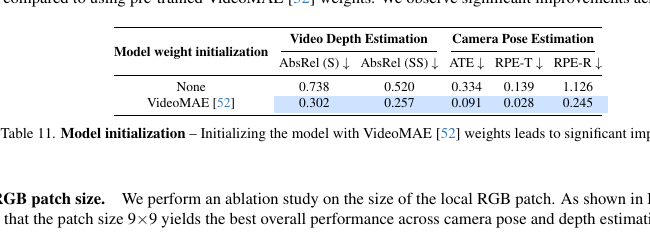

#### 局部 RGB 块尺寸

图 10 比较局部块边长 0、3、6、9、12、15 时深度与姿态平均误差。9 和 12 像素附近整体较好，作者选择 $9\times9$ 作为默认设置；深度误差在 9、12 处接近，姿态误差在这一区间也较低。局部块设计是在保留周边外观、避免输入过大的折中。

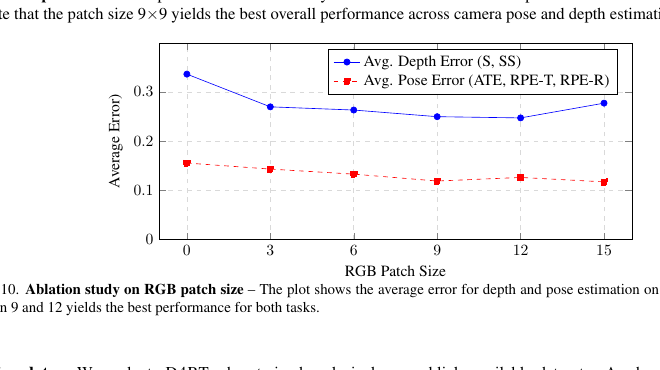

#### 只用公开数据训练

表 12 比较不同训练数据来源下的相机、点云、深度和 3D 跟踪指标。D4RT 使用 14 个公开数据集训练时，Sintel/ScanNet 的 ATE 为 0.077/0.014，点云 L1 为 1.098/0.030；加入内部数据后，分别为 0.080/0.014 和 0.909/0.028。各项指标变化并不统一。论文认为仅用公开数据训练的 D4RT 仍能和使用公开加内部数据的基线竞争，同时提醒这些基线可能利用了专有预训练或大规模内部数据，而且公开数据版本没有针对受限数据重新调参。

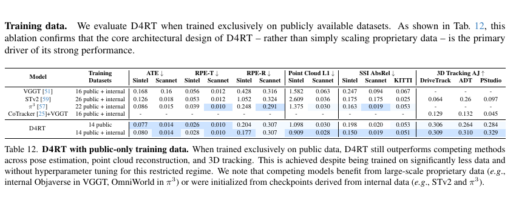

### E. 更多定性结果

补充图 11 展示静态场景与动态场景的额外重建；图 12 对比 MegaSaM、$\pi^3$、SpatialTrackerV2 和 D4RT 的点云与轨迹输出；图 13 对比车辆、室内场景、狗和行人视频的深度图。图中 D4RT 对动态区域给出更完整的逐像素结果，并保留较细边界。它们扩展了主文的定性示例，仍需与表格指标结合判断。

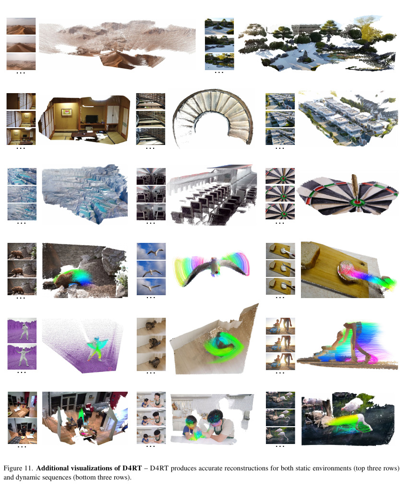

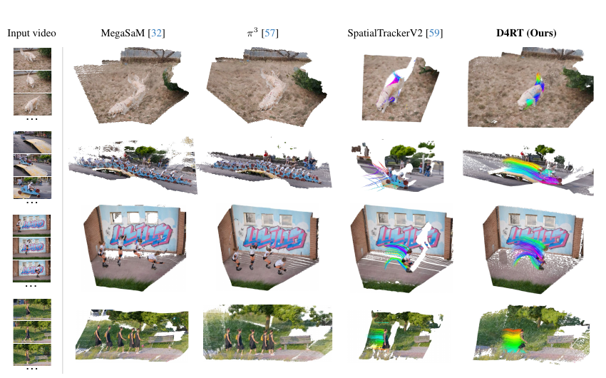

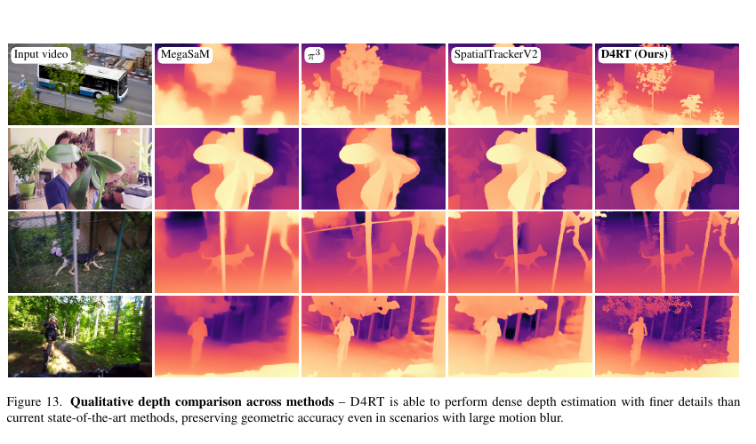
