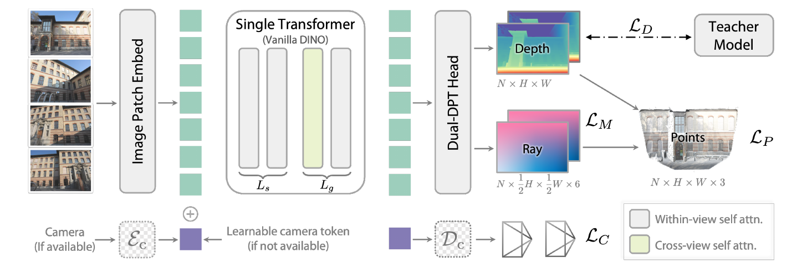
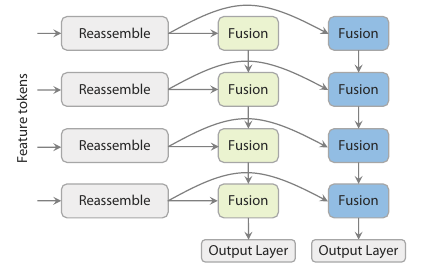
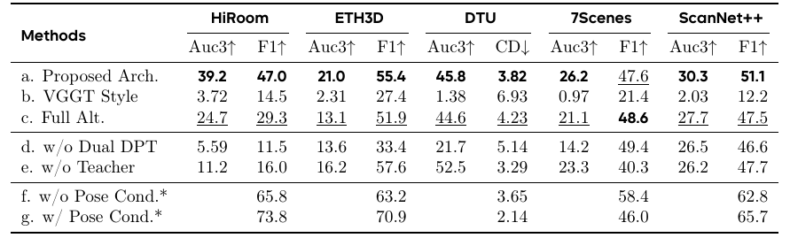
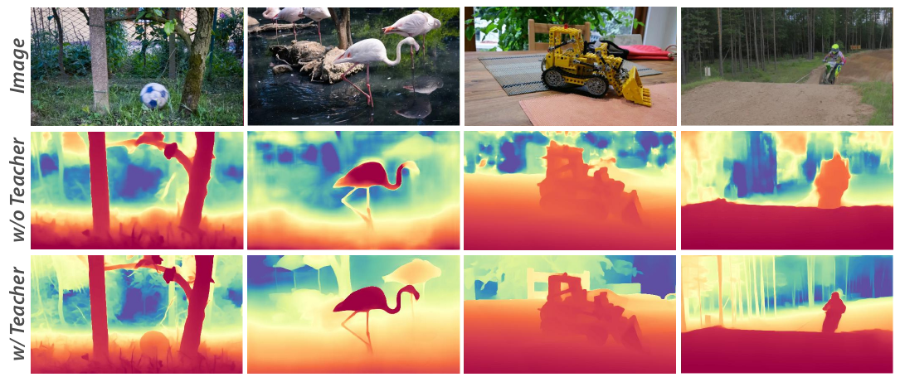

# Depth Anything 3 论文解读

> Depth Anything 3 用深度与射线统一描述场景和相机几何，通过单个预训练 Transformer 处理单图、多视图及可选相机条件。论文为 Haotong Lin、Sili Chen 等人的 *Depth Anything 3: Recovering the Visual Space from Any Views*，以下以 arXiv v1（2025 年 11 月 13 日）为准。[论文页面](https://arxiv.org/abs/2511.10647) · [v1 PDF](https://arxiv.org/pdf/2511.10647v1) · [官方项目页](https://depth-anything-3.github.io/)

## 摘要

DA3 研究一个统一的几何预测问题：给定一张或多张图像，在相机参数已知或未知的条件下，恢复彼此协调的深度与相机几何。它将主要预测目标设为逐像素深度和射线，使用单个预训练视觉 Transformer 进行联合推理，再通过教师学生学习改善真实图像的监督质量。

论文的贡献可以沿三个层次理解：深度射线表示规定输出的几何含义；后段引入跨视图注意力的骨干规定证据怎样交换；经测量深度对齐的教师标签改善监督细节。位姿、重建、单目深度和前馈新视角合成实验分别检验这些设计的能力。

## 1 引言

论文将单目深度、多视图立体、SfM 和 SLAM 视为关联紧密的空间理解问题：它们都需要由图像推断三维结构，只是可用视图、已知相机条件和系统目标有所不同。DA3 关注其中的几何预测部分，希望在输入条件变化时继续使用同一个模型。

作者考察的两个问题是：恢复场景几何究竟需要哪些预测目标，以及常规的预训练 Transformer 能否承担多视图推理。这两个问题相互联系。如果输出之间能通过清楚的几何关系组合，就可能减少冗余任务；若视图之间的信息交换能通过常规注意力实现，网络也更容易沿用视觉预训练参数。

DA3 给出的方案是联合预测深度图和射线图，并在同一个 ViT 的后段让不同图像交换特征。真实数据的相机关系有价值，但深度往往稀疏或含噪；因此作者另行训练单目教师，生成细密伪深度，再用已有测量对齐这些标签。论文还增加几何评估基准和前馈 3DGS 实验，观察这一几何表征对相机、表面及渲染的作用。

这里的“统一”指输入形式和几何输出的统一。完整 SLAM 还包括时序状态、数据关联、地图维护、回环和优化等环节。DA3 处理给定图像集合，论文没有因此建立一个带持续地图状态的 SLAM 系统。

## 2 相关工作

### 多视图视觉几何估计

理解 DA3 的位置，需要区分三种组织几何的方法。传统 SfM/MVS 将匹配、相机估计、BA 和稠密重建接成多个阶段；学习式模块可以改善局部特征、匹配或深度推断。DUSt3R 则让图像对直接输出点图，之后再组织多对结果。后续方法进一步扩大联合输入范围、引入视频状态或相机条件。

VGGT 已经能通过多视图 Transformer 同时预测相机与稠密几何。DA3 在这个方向上重新选择表示和骨干：保留联合推理，减少对额外网络结构和冗余几何目标的依赖。π³ 研究视图身份和置换等变性，侧重点与 DA3 的深度射线表示不同，两条设计方向可以分别讨论。

站内 [VGGT 文章](../vggt/index.md)可作为多视图联合推理的背景，[π³ 文章](../pi3/index.md)解释输入换序与参考视图问题。二者有助于区分“网络可以一次读取多少张图”“每张图是否具有特殊身份”和“输出采用什么几何参数化”。

### 单目深度估计

单目深度模型由早期面向固定数据分布的监督学习，发展为混合数据、大规模预训练和相对深度学习。Depth Anything 系列的重要经验是利用高质量合成标签训练教师，再将其几何知识迁移到更广的真实图像分布。

DA3 延续这条数据与监督路线，但通用模型还承担相机和多视图几何预测。论文中的通用 DA3、单目教师、单目学生及度量模型因此需要分开理解。

### 前馈新视角合成

前馈新视角合成要求网络由上下文图像直接生成场景表示，随后渲染其他相机视角。早期方法使用辐射场，近期方法更多采用可显式预测和快速光栅化的 3D 高斯。几何先验可来自极线关系、代价体、深度或预训练几何骨干。

DA3 的渲染扩展用来检验：已经学会几何的骨干，配上一个稠密高斯参数头，能否成为有效的前馈渲染基础。它与[逐场景优化的 3DGS](../3dgs/index.md)在场景参数的获得方式上不同。

## 3 Depth Anything 3

### 3.1 问题表述

输入图像集合记为 $\mathcal I=\{\mathbf I_i\}_{i=1}^{N_v}$，其中 $\mathbf I_i\in\mathbb R^{H\times W\times3}$。每幅图对应深度 $\mathbf D_i$、旋转 $\mathbf R_i$、平移 $\mathbf t_i$ 和内参 $\mathbf K_i$。相机也用九维向量 $\mathbf v_i=(\mathbf t_i,\mathbf q_i,\mathbf f_i)$ 表示：三维平移、四维旋转四元数，以及两个视场角。

原文反投影关系为

$$
\mathbf P=\mathbf R_i\bigl(\mathbf D_i(u,v)\mathbf K_i^{-1}\mathbf p\bigr)+\mathbf t_i,
\qquad \mathbf p=(u,v,1)^\mathsf T.
$$

这个表达式规定 $\mathbf R_i$ 将相机系方向变到世界系，$\mathbf t_i$ 是世界系中的相机中心。它不同于世界到相机外参中的平移。原文将 $\mathbf P$ 标作四维齐次点，上式右侧却是三维量；以下涉及运算时，将右侧理解为点的三维非齐次部分。

#### 深度射线表示

DA3 用每像素六维量 $\mathbf r=(\mathbf t,\mathbf d)$ 表示射线，前半部分为起点，后半部分为方向。方向定义为

$$
\mathbf d=\mathbf R\mathbf K^{-1}\mathbf p,
\qquad
\mathbf M\in\mathbb R^{H\times W\times6}.
$$

将方向与深度相乘后，世界点可写为

$$
\mathbf P=\mathbf t+\mathbf D(u,v)\mathbf d.
$$

这里保留方向向量的长度。深度与射线具有不同作用：深度给出沿反投影方向的表面位置，射线给出观察几何。网络可分别预测二者，再通过逐像素运算形成点图。

常规针孔内参满足 $\mathbf K^{-1}\mathbf p=(x_n,y_n,1)^\mathsf T$，因此 $\mathbf D$ 是相机光轴方向的深度。取 $\mathbf R=I$、$\mathbf t=0$、$\mathbf K^{-1}\mathbf p=(0.5,0,1)^\mathsf T$ 和 $\mathbf D=2$，得到 $\mathbf P=(1,0,2)^\mathsf T$。其距离为 $\sqrt5$。如果把方向单位化，乘数就需要改成射程 $\sqrt5$；直接沿用深度 2 会改变点的位置。

同一理想针孔相机的所有射线起点相同，方向也受共同内参和旋转约束。稠密向量回归没有自动施加这些严格条件，需要训练监督促使预测接近有效相机。因而“射线表示便于学习”与“任意射线图都是合法相机”是两件事。

#### 由射线图恢复相机参数

射线图前三个通道的平均给出相机中心估计，原文式（1）为

$$
\mathbf t_c=\frac1{H\times W}
\sum_{h=1}^{H}\sum_{w=1}^{W}\mathbf M(h,w,:3).
\tag{1}
$$

原文接着拟合一个方向映射，再利用矩阵分解恢复内参与旋转。其优化式为

$$
\mathbf H^*=\arg\min_{\lVert\mathbf H\rVert=1}
\sum_{h=1}^{H}\sum_{w=1}^{W}
\left\lVert\mathbf H\mathbf p_{h,w}\times\mathbf M(h,w,3:)\right\rVert.
\tag{2}
$$

叉积使拟合向量与预测方向平行，范数约束排除零矩阵。论文说明用 DLT 求解，并将映射写成 $\mathbf H=\mathbf K\mathbf R$，之后做 RQ 分解。

> 原文这一处的映射方向与前面的射线定义不一致。沿用 $\mathbf d=\mathbf R\mathbf K^{-1}\mathbf p$，像素到世界方向的矩阵应是 $A=\mathbf R\mathbf K^{-1}$；逆关系则为

$$
\mathbf p\sim A^{-1}\mathbf d,
\qquad A^{-1}=\mathbf K\mathbf R^\mathsf T.
$$

因此在这一约定下，可对逆映射做 RQ 分解，将上三角因子解释为内参，正交因子解释为世界到相机旋转。分解还需处理整体尺度、对角符号、$K_{33}=1$ 与旋转行列式。这里是对原文公式关系的分析，没有把原文式（2）静默改成另一套符号。

DLT 的计算过程也可以展开。记 $[\mathbf d]_\times$ 为叉乘矩阵，平行约束等价于 $[\mathbf d]_\times A\mathbf p=0$。把矩阵的九个元素展开并堆叠所有像素方程，就得到齐次线性系统；通过单位范数约束下的最小奇异向量求近似解。每个非零方向通常提供两个独立约束，还需要足够且分布不退化的像素对应，才能确定整体尺度之外的映射。常规 DLT 对应平方代数残差，而式（2）写的是范数之和，这两种目标的数值求解不能直接等同。

#### 精简预测目标与相机头

作者通过实验比较点图、深度、相机参数和射线的组合，认为深度与射线已能有效描述场景和观察几何。“精简”针对训练目标的组织，并不表示六维逐像素射线在参数自由度上最少。

最终模型还加入轻量相机头 $\mathcal D_C$，由每幅图的相机 token 直接输出 $\mathbf f,\mathbf q,\mathbf t$，用于避免每次都从完整射线图恢复相机。它保留了表示学习上的射线监督，也提供便捷的相机结果。

### 3.2 网络结构

骨干是单个预训练 ViT，稠密输出使用 Dual-DPT，相机已知时还有相机条件编码器。下面按左到右读取原图：图像先成为 patch token，中间进行帧内和跨视图注意力，右侧生成深度与射线；教师和损失属于训练路径。

*原论文图 2。灰色块是帧内注意力，绿色块是跨视图注意力；下方相机 token 既承载可选相机输入，也供相机头读取。图中射线输出标为半分辨率，正文则按像素对齐的稠密表示定义任务，组合时需要对应采样位置。*

#### 单 Transformer 骨干

总层数为 $L=L_s+L_g$。前 $L_s$ 层只处理各自图像，后 $L_g$ 层交替进行跨视图和帧内注意力，默认比例 $L_s:L_g=2:1$。实现改变注意力所读取的 token 排列，继续使用普通 Transformer block。

设每幅图有 $T$ 个 token，特征维数为 $C$。帧内层可将输入看作 $N_v\times T\times C$，每幅图分别读取自身；全局层可组织为 $1\times(N_vT)\times C$，全部图像 token 参加同一次注意力。同一层输出读取同一层的输入状态，更新结果在下一层继续传播。

这种重排没有增加一套专用几何算子，但改变了信息可见范围和计算开销。朴素帧内注意力的规模为 $N_vT^2$，全局注意力为 $N_v^2T^2$；后段交互减少了昂贵层的数量，没有消除图像数的二次项。单图输入时，两种读取范围重合；多图输入时，可利用其他视图证据，但特征交互本身不等于显式匹配和三角化。

#### 相机条件注入

已知相机时，MLP 通过 $\mathbf c_i=\mathcal E_c(\mathbf f_i,\mathbf q_i,\mathbf t_i)$ 编码条件。未知时，使用共享可学习 token。它们与图像 token 一起参与各层注意力。

已知相机在这里影响特征推理。另一个常见操作是在最终融合时使用真值位姿，它只影响几何组织。第 7 节的有位姿实验涉及这两种信息使用位置，归因时要分别判断。

#### Dual-DPT 预测头

多层 token 先经过共享 reassembly 模块，恢复成多尺度空间特征。之后深度、射线各使用自己的融合层和输出层。

*原论文图 3。共享范围是左侧多尺度特征重组，后面的两列 Fusion 与底部输出分别属于两个分支。*

深度与射线需要在相应像素上组合。共享重组使两个分支读取共同的多尺度特征，独立融合再分别适应各自的回归目标。这可以理解为兼顾输出协调与回归灵活性；实际收益仍以表 7 的对照为依据。

### 3.3 训练

通用模型的深度来源包括合成数据、重建和真实深度采集。教师为真实图像生成稠密相对深度，再与原始测量对齐，具体过程放在第 4 节。训练同时监督深度、射线、组合点和可选相机输出。

原文映射写为 $\mathcal F_\theta:\mathcal I\mapsto\{\hat{\mathbf D},\hat{\mathbf R},\hat{\mathbf c}\}$。这里 $\hat{\mathbf R}$ 表示预测射线图，注意区别于前面的旋转矩阵 $\mathbf R_i$。在计算损失前，标签使用有效反投影点平均范数定义的公共尺度归一化。

原文总体目标为

$$
\begin{aligned}
\mathcal L={}&\mathcal L_D(\hat{\mathbf D},\mathbf D)
+\mathcal L_M(\hat{\mathbf R},\mathbf M)\\
&+\mathcal L_P(\hat{\mathbf D}\odot\mathbf d+\mathbf t,\mathbf P)
+\beta\mathcal L_C(\hat{\mathbf c},\mathbf v)
+\alpha\mathcal L_{\mathrm{grad}}(\hat{\mathbf D},\mathbf D).
\end{aligned}
$$

$\alpha=\beta=1$。深度的置信度加权形式为

$$
\mathcal L_D(\hat{\mathbf D},\mathbf D;D_c)
=\frac1{Z_\Omega}\sum_{p\in\Omega}m_p
\left(D_{c,p}|\hat{\mathbf D}_p-\mathbf D_p|
-\lambda_c\log D_{c,p}\right).
$$

梯度项保留原文式（3）：

$$
\mathcal L_{\mathrm{grad}}=
\lVert\nabla_x\hat{\mathbf D}-\nabla_x\mathbf D\rVert_1+
\lVert\nabla_y\hat{\mathbf D}-\nabla_y\mathbf D\rVert_1.
\tag{3}
$$

$m_p$ 规定有效标签位置，$Z_\Omega$ 是归一化因子，$D_{c,p}>0$ 是置信度。减小困难像素的置信度能降低残差项，对数惩罚则限制整体压低置信度的退化做法。梯度项比较标签与预测的深度变化：例如相邻标签深度为 2、5，而预测为 3、4，前者差值为 3，后者只有 1，边界变化因而受到惩罚。平面区域的作用相同，只是标签差值接近零。它约束的是符合标签的变化，而非一律削平边缘。

射线标签由相机参数构造，点标签由深度和相机反投影得到。点损失用于联系深度、方向和起点：深度正确但方向偏转，点仍然会错；只监督深度看不到这部分误差。原文点损失中的 $\mathbf d,\mathbf t$ 没有加预测帽号，按输出组合的语义通常应理解为预测射线的分量；这一理解仍需与对应版本代码核对。

公共尺度的作用可由 $\mathbf P=\mathbf t+D\mathbf d$ 直接展开。若尺度为 $a$，则 $\mathbf P/a=\mathbf t/a+(D/a)\mathbf d$：点、深度和平移共同改变长度单位，方向保持原样。不同视图不能任意各选一个独立标尺，否则组合点不再处于相同尺度。

### 3.4 实现细节

通用几何模型混合多种公开数据，包含 Aria、ARKitScenes、BlendedMVS、CO3Dv2、DL3DV、MegaDepth、Objaverse、ScanNet++ 等。[原表 1，第 9 页](https://arxiv.org/pdf/2511.10647v1#page=9)列出完整数据及场景规模；ScanNet++ 按场景隔离训练和测试。

训练使用 128 张 H100，共 200k 步，8k 步 warm-up，峰值学习率 $2\times10^{-4}$。输入在多种尺寸间采样，包括 $504\times504$、$504\times378$、$504\times336$、$504\times280$、$336\times504$、$896\times504$、$756\times504$ 与 $672\times504$。$504\times504$ 下视图数均匀取自 2–18，batch 随之调整，以近似保持 token 总量。

120k 步后由原深度切换到教师标签监督，相机条件以 0.2 概率启用。教师承担标签生成，推理时不需要再调用它。训练规模也说明：网络形式简洁与训练成本低是不同的判断。

## 4 教师学生学习

这一节的核心联系是标签来源与几何用途。合成数据提供精细、完整的几何监督，真实图像提供实际视觉分布；教师将前者学到的深度形状传递给后者，原测量负责把相对预测接回已有几何标尺。

### 4.1 构建教师模型

教师采用 DINOv2 与 DPT。相较 DA2，论文扩大合成数据覆盖范围，改变深度表示，并增加局部几何监督。其来源涵盖室内、驾驶和物体数据，附录说明了标签清理过程。

DA2 使用具有尺度和平移自由度的视差，DA3 教师改为深度，并采用指数深度输出。论文希望使预测更适合后续直接在深度空间工作的几何任务，同时改善近处细节的表达。

深度与逆深度中的“仿射不变”不是同一个自由度。若预测满足 $\tilde D=aD+b$，其倒数一般不能写成 $a'/D+b'$。因此，将视差目标改为深度目标，同时改变了误差和标签对齐发生的空间；不能只把二者理解成最后加一次取倒数。

教师还使用 MoGe 的 ROE 对齐与全局、局部损失，并引入距离加权法线约束。原文给出的权重、合成法线和角度损失为

$$
w_i=\sum_{j=0}^{4}\lVert n_j\rVert-\lVert n_i\rVert,
\tag{4}
$$

$$
n_m=\sum_{i=0}^{4}w_i\frac{n_i}{\lVert n_i\rVert},
\tag{5}
$$

$$
\mathcal L_N=\mathcal E(\hat n_m,n_m)
+\sum_{i=0}^{4}\mathcal E(\hat n_i,n_i).
\tag{6}
$$

$n_i$ 是局部未归一化法线，$\mathcal E$ 为方向夹角误差。教师的完整目标是

$$
\mathcal L_T=\alpha\mathcal L_{\mathrm{grad}}
+\mathcal L_{\mathrm{gl}}+\mathcal L_N
+\mathcal L_{\mathrm{sky}}+\mathcal L_{\mathrm{obj}},
\qquad\alpha=0.5.
\tag{7}
$$

天空与物体背景中可能缺乏有效深度，额外预测对应掩码并用 MSE 监督。

非单位法线的长度受构造它的局部点间距和面积影响。式（4）使较大范数项获得相对较小的权重，式（5）则在合成方向前单独单位化各法线。角度损失约束的是局部朝向，而深度梯度约束深度图变化，二者提供的几何信息不同。

> 正文描述采样四个邻点，式（4）–（6）却采用 $0\ldots4$ 五项；原文没有明确展开法线的索引对应。由这组公式还不能确定具体三角形组合、采样策略或退化法线处理办法。

### 4.2 用教师监督 DA3

教师深度具有尺度和平移自由度，不能直接与已知相机的测量几何混用。原文用有效测量拟合正尺度 $s$ 和深度平移 $t$：

$$
\begin{aligned}
(\hat s,\hat t)&=\arg\min_{s>0,t}
\sum_{p\in\Omega}m_p(s\tilde{\mathbf D}_p+t-\mathbf D_p)^2,\\
\mathbf D^{T\to M}&=\hat s\tilde{\mathbf D}+\hat t.
\end{aligned}
\tag{8}
$$

其中 $\tilde{\mathbf D}$ 为教师预测，$\mathbf D$ 为原测量，$m_p$ 指示有效位置。作者使用 RANSAC 和最小二乘提高鲁棒性，内点阈值按相对于残差中位数的平均绝对偏差设定。

取两个便于手算的测量：教师预测为 1、3，测量为 2.5、6.5。方程 $s+t=2.5$、$3s+t=6.5$ 给出 $s=2,t=0.5$。于是没有测量的位置，只要教师输出 2，就能得到对齐深度 4.5。真实拟合使用更多点，RANSAC 还需要识别异常测量；式（8）表达的是拟合目标，并未单独写出全部采样过程。

这个 $t$ 是标量深度偏移，与第 3 节的三维相机中心 $\mathbf t_i$ 不同。对齐补上整体深度标尺，教师提供稠密形状，但全局仿射变换无法纠正局部形变，也不能严格保证多幅伪深度满足同一三维表面。后续联合监督继续承担协调几何的任务。

### 4.3 训练单目模型

论文另行蒸馏一个单目学生，在真实无标签图像上使用教师伪深度监督，并采用相同类型的几何损失。这个学生输出相对深度；它与“通用 DA3 接收一张图像”是不同的训练模型。第 7 节分别引用表 4 与表 10，避免把两组结果合并。

### 4.4 训练度量深度模型

度量模型还需要处理焦距对成像尺度的影响。论文使用规范相机变换，将标签按 $f^c/f$ 缩放，规范焦距 $f^c=300$。这里的 $f$ 是相机焦距，与第 3.1 节表示两个视场角的向量 $\mathbf f_i$ 不同；规范焦距与真实焦距必须采用相同单位及图像尺寸约定。教师深度先与度量标签对齐，部分立体数据使用 FoundationStereo 标签。

训练采用 AdamW，编码器与解码器学习率分别为 $5\times10^{-6}$、$5\times10^{-5}$，batch 为 64，训练 160k 步。基础尺寸为 504，横纵比随机变化；以 5% 概率采用 90° 或 270° 旋转增强。标签以对齐教师为主，20% 概率使用原始真值，目标包括深度、梯度和天空掩码。

标签的规范化为 $D^c=(f^c/f)D$，已知真实焦距后可按 $D=(f/f^c)D^c$ 恢复。这个关系说明模型学习的是规范相机下的距离，恢复过程仍依赖真实相机信息。相对深度、相机规范化后的深度与最终度量深度应分别命名。

## 5 应用——前馈 3D Gaussian Splatting

### 5.1 位姿条件下的前馈 3DGS

DA3 特征上新增 GS-DPT，可逐像素预测高斯的不透明度、旋转、尺度与 RGB 颜色。中心位置通过深度反投影获得，不透明度由置信度头输出。把各视图的高斯变到世界系后，光栅化器便能在目标相机下渲染图像。

该版本用于检验几何骨干。训练同时比较目标视图的渲染图像与真实图像，使用 MSE 和 LPIPS；输入视图的深度则接受尺度和平移不变的监督。

深度确定高斯中心，尺度与旋转确定局部空间覆盖，不透明度影响沿射线的颜色合成，外观描述被渲染的颜色。它们通过可微渲染获得联合反馈。中心位置准确仍不足以保证渲染准确，遮挡覆盖和外观也会影响结果。

### 5.2 位姿自适应的前馈 3DGS

另一个版本同时接收有相机和无相机的输入，高斯先在局部相机系表达。相机已知时，以 Umeyama 类对齐确定与已知相机对应的尺度，再变换到世界系；未知时，使用预测相机完成变换。

这一版本冻结预训练 DA3，仅训练 GS-DPT。它允许高斯中心带额外深度偏移，并用球谐系数表示视角相关外观。训练还联合变化视图数和图像尺寸，高分辨率搭配较少视图，低分辨率搭配较多视图。

若局部协方差为 $\Sigma_c$，相机到世界的旋转为 $R_i$，则 $\Sigma_w=R_i\Sigma_cR_i^\mathsf T$。中心按刚体变换移动，协方差也随相机旋转；统一尺度变化时，中心距离和高斯尺寸需同步处理。这是局部高斯进入共同坐标系的几何关系。

额外深度偏移允许渲染表示偏离严格表面，因此渲染质量与几何精度需要分别评价。论文的位姿条件版本和这里冻结骨干的自适应版本，也不应描述成同一个微调流程。

### 5.3 实现细节

NVS 使用 DL3DV 的 10,015 个训练场景，相机来自 COLMAP，评估的 140 个 DL3DV 场景与训练完全隔离。各基线重训的资源与步数条件在第 7.5 节说明。

## 6 视觉几何基准

### 6.1 评估流程

位姿评估按场景组织输入，图像过多时用固定随机种子抽取最多 100 张。网络预测一组相机与深度，再计算相对位姿误差。

几何评估先借助相机轨迹估计预测到真值的对齐变换。作者反复抽取轨迹子集，用 evo 求对齐，并按平移误差阈值统计内点、选择较稳健的变换。之后将深度与相机变到共同标尺，进行融合，比较重建与真值。DTU 使用其专门的去背景和深度融合流程。

渲染评估从约 300–400 张图中每八张选一张作目标，其余相机按平移和旋转距离做最远点采样，选 12 张上下文。各模型在给定相机下渲染同一组目标视角。

轨迹对齐消除了场景公共坐标与尺度的自由度。重建分数评价的是对齐后形状和相机关系，不能解释为模型已经直接输出正确地理位置或米制尺度。渲染表的给定位姿条件，也不能自动延伸成无位姿输入的同等结果。

### 6.2 评价指标

位姿 AUC 综合相对旋转和相对平移方向的角度准确率，主要报告 3°、30° 两种范围，越大越好。按论文描述，先在各角度阈值下分别计算旋转、平移方向的准确率，取两者中较小的值形成曲线，再计算指定范围内的曲线下面积。它度量角度阈值下的表现，不是相机位置的厘米误差。

几何指标区分预测点到真值的距离与真值到预测点的距离。设预测点集为 $R$，真值为 $G$，二者的平均最近邻距离共同构成 CD。给定阈值 $d$，可进一步写出

$$
\mathrm{precision}=\frac1{|R|}\sum_{r\in R}
[\operatorname{dist}(r,G)<d],
\qquad
\mathrm{recall}=\frac1{|G|}\sum_{g\in G}
[\operatorname{dist}(g,R)<d],
$$

$$
F1=\frac{2\,\mathrm{precision}\,\mathrm{recall}}
{\mathrm{precision}+\mathrm{recall}}.
$$

方括号表示条件成立取 1，否则取 0。CD 越低越好，F1 越高越好。

只重建一小块非常准确的墙面，预测点可能都靠近真值，但大量真值表面没有覆盖，召回率仍低。F1 同时考虑两边，避免仅用一个距离方向掩盖不完整性。它受阈值影响，因此跨数据集的 F1 数值不能脱离协议直接比较。

渲染使用 PSNR、SSIM 和 LPIPS。PSNR 与 SSIM 越高越好，LPIPS 越低越好；三者评价的是目标图像，不替代三维几何误差。

### 6.3 数据集

原表 1 列出 HiRoom 29 个、ETH3D 11 个、DTU 22 个、7Scenes 7 个、ScanNet++ 20 个场景，共 89 个。HiRoom 是合成室内场景，ETH3D 覆盖室内外激光扫描，DTU 是受控物体重建，7Scenes 含低分辨率和运动模糊，ScanNet++ 提供高质量室内扫描参考。

HiRoom、7Scenes、ScanNet++ 的 F1 距离阈值为 0.05 米，ETH3D 为 0.25 米；TSDF 体素尺寸分别为 0.007、0.007、0.02、0.039 米。DTU 主结果使用毫米单位 CD，并用 RMBG 2.0 去除背景。7Scenes 和 ScanNet++ 分别按 11、5 的间隔下采样图像；ScanNet++ 真值使用激光扫描重建采样深度，而非默认采用 iPhone LiDAR 深度。

NVS 测试由 DL3DV 140 场景、Tanks and Temples 6 场景、MegaDepth 19 场景组成，使用 COLMAP 相机。它与前面的五数据集几何基准是两套评估集合。

> 第 6.3 节另称 HiRoom 包含 30 个场景，与表 1 的 29 个不一致。这里保留表格统计，同时标出正文差异；未据此推断具体哪个场景被排除。

## 7 实验

### 7.1 与现有方法比较

> 下载的 PDF 摘要给出相对 VGGT 的位姿、几何平均增益 35.7% 和 23.6%；arXiv 摘要页使用 44.3% 和 25.1%，PDF 正文也出现 25.1%。这些汇总口径并不一致，比较收益应以对应表项及其评价条件为准。

比较对象包括 DUSt3R、Fast3R、MapAnything、π³ 和 VGGT。几何主表既评价预测相机融合，也评价使用真值相机的条件。后者对不同模型可能意味着网络内条件输入或融合时替换位姿，不能视为完全相同的算法操作。

位姿表 2 中，DA3-Giant 在 HiRoom 的 AUC@3° 为 80.3，VGGT 为 49.1；ScanNet++ 为 85.0 对 62.6。更宽容的 DTU AUC@30° 则为 99.4 对 99.8，Giant 没有领先这一项。

重建表 3 中，Giant 在五个无位姿设置均优于列出的基线。HiRoom F1 为 85.1，VGGT 为 56.7；ETH3D 为 79.0 对 57.2；DTU CD 为 1.85 毫米对 2.05 毫米。提供位姿后，HiRoom F1 达到 95.6，但 DTU CD 仍为 1.85 毫米，大于 VGGT 的 1.44 毫米；7Scenes 的 F1 为 56.5，也小于 π³ 的 57.5。

单图比较在表 4：通用 DA3 的 KITTI $\delta_1$ 为 95.3%，DA2 为 94.6%；SINTEL 为 75.5% 对 77.2%，NYU 为 97.4% 对 97.9%。通用模型有较好的整体表现，但在后两个数据集上没有超过 DA2。

$\delta_1$ 是满足 $\max(\hat D/D,D/\hat D)<1.25$ 的有效像素比例。相对深度评估还要遵循相应对齐协议；高比例不等于直接预测米制距离同样准确。专用单目学生另在第 7.3 节讨论。

NVS 表 5 比较了专用模型与不同几何骨干。DL3DV 上 DA3 的 PSNR / SSIM / LPIPS 为 21.33 / 0.711 / 0.241，VGGT 骨干为 20.96 / 0.697 / 0.253；MegaDepth 对应为 17.89 / 0.561 / 0.351 和 16.45 / 0.500 / 0.417。几何骨干的迁移能力在这些设置中得到支持。

作者将预训练几何能力视为渲染收益的重要来源，但完整模型间还存在预训练历史和其他实现差别。域外数据整体分数更低，支持存在泛化落差；仅凭这些结果，还不足以单独分离轨迹分布与场景内容各自的因果作用。

### 7.2 Depth Anything 3 分析

Giant 完整训练约需 128 张 H100 运行十天。该节消融改用 ViT-L、最多 10 视图，约需 32 张 H100 运行四天。模块比较与完整 Giant 结果应分别理解。

#### 7.2.1 深度射线表示的充分性

表 6 固定骨干、训练条件、10 视图、batch 128 和 120k 步，并且不使用相机条件 token。HiRoom 上 depth + cam 的 AUC@3° / F1 为 10.8 / 16.5，depth + ray 为 48.7 / 60.3；ETH3D 由 9.9 / 48.0 提升到 25.5 / 65.4。深度射线组合的作用因此有相对受控的对照。

> 作者将辅助相机头概括为没有额外收益，但数字有取舍：加 cam 后 HiRoom 变成 37.2 / 45.4，DTU AUC@3° 却从 46.5 升到 56.3，CD 从 3.919 降到 3.066。更准确的理解是，射线目标已经足够有效，相机头的收益并不一致；最终保留它，还因为能方便输出相机。

#### 7.2.2 单个常规 Transformer 的充分性

表 7 比较默认结构、相近参数量的 VGGT-style 对照，以及全部层交替的 Full Alt.。HiRoom 默认 AUC@3° / F1 为 39.2 / 47.0，Full Alt. 为 24.7 / 29.3；其余多数设置也支持后段交互。

作者认为骨干预训练覆盖率解释了单 Transformer 的优势。该比较同时改变层数、结构和预训练覆盖，因而支持的是整套设计在这一设置中的表现，无法单独证明某一个因素贡献了全部差异。正文“降至 79.8%”的汇总语句没有给出清楚的聚合定义，无法据此另算整体性能。

#### 7.2.3 消融与分析

*原论文表 7。a 为默认结构，b 为 VGGT-style，c 为 Full Alt.，d 改用独立 DPT，e 去掉教师。f、g 带星号，使用真值位姿融合，与前面各行的融合条件不同。*

独立 DPT 的 HiRoom F1 为 11.5，默认 Dual-DPT 为 47.0；ETH3D 为 33.4 对 55.4。教师监督使 HiRoom F1 从 16.0 提高到 47.0，也在原图 8 中改善细节。位姿条件在真值融合下使 HiRoom F1 从 65.8 升到 73.8，ETH3D 从 63.2 升到 70.9。

*原论文图 8。自上而下是 RGB、无教师监督、有教师监督。鸟腿、树枝和物体轮廓更适合观察局部细节，平均误差和多视图一致性仍需看对应指标。*

> 正文有“一致提高”的概括，表格存在例外：7Scenes 独立 DPT 的 F1 为 49.4，高于默认 47.6；无教师在 ETH3D 为 57.6，高于默认 55.4；位姿条件在 7Scenes 使 F1 从 58.4 降到 46.0。这些例外限制的是结论的普遍程度，并不抹掉其他数据集的收益。

表 8 的吞吐测试使用 A100、32 张图、$504\times336$ 分辨率，Giant 为 37.6 FPS，Large 为 78.37 FPS，VGGT 为 34.1 FPS。80 GB A100 的容量测试中，Giant 约能处理 900–1000 张图，VGGT 约为 400–500 张。

32 图吞吐与最大容量是不同测试，不能合成为千图输入仍保持同样速度的结论。每图平均 FPS 也不同于单图交互延迟，论文未由此证明完整数据读写、融合和导出的系统速度。参数统计同样存在口径差异：主表 Large 为 0.36B，部分正文写 0.30B，表 8 又分列骨干、Dual-DPT 和相机头，应按各自统计对象理解。

### 7.3 单目模型分析

#### 7.3.1 教师模型

表 9 的数据消融显示，由 V2 到 V3 并增加多分辨率训练，平均 $\delta_1$ 从 0.919 提升到 0.938，AbsRel 从 0.087 降到 0.072。该表还比较视差、点图与深度，以及法线损失的作用。

AbsRel 先对每个有效像素计算 $|\hat D-D|/D$，再取平均；SqRel 则对 $(\hat D-D)^2/D$ 取平均。深度表示在表中有更低的 AbsRel、SqRel，但 $\delta_1=0.918$，略低于视差的 0.919。因此不同指标可能对相同预测给出不同排序；法线约束关注的局部表面质量也不一定完全反映在单项二维平均分数中。

#### 7.3.2 学生模型

表 10 的专用单目学生在五个所列测试集上均高于 DA2。SINTEL 的 $\delta_1$ 为 82.3%，DA2 为 77.2%；ETH3D 为 98.8% 对 86.5%。这里是百分比像素比例的比较，SINTEL 相差 5.1 个百分点。

该学生由教师伪标签蒸馏，结果应与表 4 通用 DA3 分开。教师、数据规模和监督方式共同发生变化，不能将全部收益单独归到深度参数化。

### 7.4 度量深度模型分析

表 11 比较 DA3-metric、DepthPro、Metric3D v2 和 UniDepth 系列。ETH3D 上 DA3-metric 的 $\delta_1$/AbsRel 为 0.917/0.104，UniDepthv2 为 0.863/0.152；NYUv2 和 KITTI 则有其他模型更好。SUN-RGBD 的 AbsRel 为 0.105，说明优势分布与场景条件有关。

教师消融揭示另一种取舍：去掉教师可改善 NYUv2、KITTI 的部分数值，教师却能改善深度边界锐度。该消融与最终模型的训练分辨率略有不同，应在消融行内部比较，不把它与最终模型行混成一个严格单因素实验。

### 7.5 前馈 3DGS 分析

模型按 12 个上下文视图重新训练，分辨率为 $270\times480$。多数方法在 8 张 A100 上以 batch 1 训练 200k 步，pixelSplat 因开销较大训练 100k 步。基线也加入深度损失，并使用注意力、并行等实现优化。

原论文图 11 展示细结构和宽基线场景的渲染对比，定量依据为表 5。两类证据共同说明几何预训练对渲染有帮助。训练步数的例外、不同骨干的预训练历史，以及给定位姿评估条件，仍限制更强的单因素归因。

## 8 结论与讨论

DA3 的结果表明，几何预测可以围绕一组可组合的稠密目标组织：深度描述表面位置，射线联系相机与公共空间，预训练骨干通过部分跨视图交互读取多张图的证据。教师学生学习则改善细节监督，使单目和多视图任务共享高质量深度知识。相同几何表征还可以支持前馈高斯预测。

作者将动态场景、语言与交互信息，以及更大规模预训练列为后续方向。这里的实验主要检验图像集合的联合几何推断与渲染，视频输入并没有自动建立持续状态或动态场景模型。

表示上的统一没有消除单图尺度歧义，也没有硬性保证预测射线满足同一台相机、不同视图严格重投影一致。它提供的是学习式几何前端。完整系统中的几何验证、优化、长序列管理和地图维护，可以继续围绕这些输出构建。

## 附录 A 数据处理

合成标签也会包含无效背景、图像深度错位和裁切问题。附录最值得保留的联系是：数据规模扩大之前，标签仍需经过几何质量控制。

IRS 的筛选从 RGB 灰度图和深度图分别提取 Canny 边缘，比较小半径与较大半径膨胀后的重合情况，以筛查空间错位。TartanAir、UnrealStereo4K 和 PointOdyssey 则去除带有明确背景、裁切或地面深度问题的场景与样本。GTA-SfM、KenBurns、OmniObject3D 等设定合理的深度上限，Trellis 还筛除缺乏纹理的样本来源。具体场景名、阈值和图 12–14 可在 [PDF 附录 A，第 31–32 页](https://arxiv.org/pdf/2511.10647v1#page=31)核对。

边缘比较的意义在于区分“小范围内已经对齐”和“扩大搜索范围后才重合”。如果二者差异较大，可能说明图像与深度发生位置偏移。RGB 边缘也包含纹理、阴影等非深度边界，所以它是数据筛选启发式，不能作为逐像素正确性的充分证明。原文未给出最终比例阈值，不能从附录文字恢复完全相同的过滤结果。

## 参考资料

Haotong Lin, Sili Chen, et al. *Depth Anything 3: Recovering the Visual Space from Any Views*. 2025. [论文页面](https://arxiv.org/abs/2511.10647) · [v1 PDF](https://arxiv.org/pdf/2511.10647v1)
