# DKM 论文解读

> Johan Edstedt、Ioannis Athanasiadis、Mårten Wadenbäck 与 Michael Felsberg，*DKM: Dense Kernelized Feature Matching for Geometry Estimation*，CVPR 2023，论文集第 17765–17775 页，共 11 页。[论文页面](https://openaccess.thecvf.com/content/CVPR2023/html/Edstedt_DKM_Dense_Kernelized_Feature_Matching_for_Geometry_Estimation_CVPR_2023_paper.html) · [论文 PDF](https://openaccess.thecvf.com/content/CVPR2023/papers/Edstedt_DKM_Dense_Kernelized_Feature_Matching_for_Geometry_Estimation_CVPR_2023_paper.pdf) · [补充材料 PDF](https://openaccess.thecvf.com/content/CVPR2023/supplemental/Edstedt_DKM_Dense_Kernelized_CVPR_2023_supplemental.pdf) · [官方实现](https://github.com/Parskatt/DKM)

## 1 引言

两张来自同一场景的照片可能有很大的视角、光照、季节和时间变化。图像匹配需要找出两幅图中指向同一场景位置的像素对应；两视图几何再利用这些对应，估计相机之间的相对关系。传统稀疏方法先检测关键点，再匹配局部描述子。若重复纹理、弱纹理或外观变化使关键点不稳定，后续几何估计也会受到影响。无检测器方法在低分辨率网格上做全局匹配，再提取有限的稀疏对应，但网格量化会限制匹配位置的重复性和精度。

DKM 选择稠密匹配：对图像中每个可能匹配的位置，预测它在另一幅图里的对应坐标，形成 dense warp；同时预测对应的可信度。论文希望在保留稠密对应覆盖率的同时，让最终几何估计超过当时的稀疏与稠密基线。方法由三部分组成：以高斯过程回归建立全局匹配器，以多尺度网络细化粗 warp，再根据三维深度一致性训练置信度，并用均衡采样挑选 RANSAC 所需的对应点。

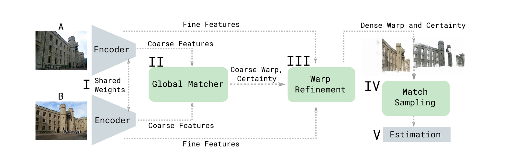

*原论文图 2。共享 ResNet 编码器提取多尺度特征；全局匹配器生成粗 warp 和置信度，细化网络逐级改善坐标，之后依据置信度均衡采样匹配点，由稳健估计器恢复几何关系。*

> 图里的 warp 可以理解成一张“坐标查找表”：A 图的每个位置都存着它在 B 图里对应到哪里。DKM 先给整张图预测这张表，再把高置信度位置抽成点对交给 RANSAC。这样既保留了稠密预测的信息，也能按几何估计的需要选择点；warp 本身不是相机姿态。

## 2 相关工作

稀疏匹配通常以关键点和描述子为基础，SuperGlue 等方法进一步利用图结构或最优传输约束匹配关系。无检测器方法跳过关键点检测，在规则网格上做粗匹配，再筛选和细化匹配点。稠密方法则直接预测 warp，并为不可匹配的位置保留较低置信度。与只输出有限匹配点的方案相比，稠密输出让模型可以在下游几何估计之前再决定如何抽样。

已有稠密方法常在全局阶段对四维相关体做回归，在细化阶段用局部相关性修正 warp。DKM 将全局匹配改写成特征相似度条件下的嵌入坐标回归，并用高斯过程计算预测后验；细化时把目标图中按 warp 采样得到的特征也输入网络，配合较大的深度可分离卷积核更新坐标。由于稠密对应可能落在遮挡、弱纹理或视野外区域，DKM 又把几何监督中的深度一致性转化为置信度标签，并为后续 RANSAC 设计分布更均衡的采样方式。

## 3 方法

### 3.1 稠密匹配与整体流程

设输入图像为 $I^{\mathcal A}$ 和 $I^{\mathcal B}$。DKM 估计从 A 到 B 的稠密 warp $W^{\mathcal A\to\mathcal B}$，它将 A 中坐标 $x^{\mathcal A}$ 映射到 B 中的对应位置 $x^{\mathcal B}$；$\hat p^{\mathcal A\to\mathcal B}$ 表示模型对这项对应满足几何一致性的置信度。模型本身负责产生像素对应与置信度，后续 RANSAC 使用抽样出的匹配点估计单应矩阵或相对位姿。

整个流程分为五步。首先，权重共享的 ResNet-50 对两幅图提取多尺度特征，论文使用 ImageNet-1K 预训练权重。stride 32 和 16 的特征进入全局匹配器；stride 8、4、2、1 的特征留给细化器。其次，全局匹配器估计低分辨率 warp 和置信度。随后，细化器逐级将二者上采样，并在各分辨率更新坐标与置信度。得到完整稠密对应后，模型先按置信度筛选，再用均衡采样取出匹配点，交给 RANSAC 等标准几何估计器。

这里的 warp 是一张坐标映射场。对 A 图中的每个位置，模型记录它在 B 图中的对应位置；下游几何模块只需取出一批可靠的跨图坐标对，便可以估计相机关系。因而 DKM 处理的是几何估计前的匹配步骤，RANSAC 仍负责由匹配点求几何模型。

### 3.2 高斯过程全局匹配器

#### 从特征相似性回归到目标坐标

在粗尺度上，DKM 要为 A 中各位置找到 B 中的候选对应。对两幅图的粗特征 $\varphi^{\mathcal A}_{\mathrm{coarse}}$ 和 $\varphi^{\mathcal B}_{\mathrm{coarse}}$，模型先把 B 中每个坐标转换成一个高维坐标嵌入 $\chi^{\mathcal B}_{\mathrm{coarse}}$，再根据特征相似度推断 A 中每个位置对应的嵌入坐标。高斯过程（Gaussian Process, GP）在此承担非参数回归器：它以特征相似度构造核矩阵，并据此计算目标嵌入的预测后验。

论文选用指数余弦相似度核：

$$
k(\varphi,\varphi')=\exp\!\left(\tau\left(\frac{\langle\varphi,\varphi'\rangle}{\sqrt{\langle\varphi,\varphi\rangle\langle\varphi',\varphi'\rangle+\varepsilon}}-1\right)\right),
$$

其中 $\varphi$ 和 $\varphi'$ 是两个位置的特征，$\tau$ 控制相似度的集中程度，$\varepsilon$ 避免分母为零。论文固定 $\tau=5$，取 $\varepsilon=10^{-6}$。用 A 与 B 之间的核矩阵 $K^{\mathcal A\mathcal B}$、B 内部的核矩阵 $K^{\mathcal B\mathcal B}$ 以及 B 的坐标嵌入，可以写出预测均值：

$$
\mu^{\mathcal A\to\mathcal B}=K^{\mathcal A\mathcal B}\left(K^{\mathcal B\mathcal B}+\sigma_n^2 I\right)^{-1}\chi^{\mathcal B}_{\mathrm{coarse}}.
$$

矩阵 $K^{\mathcal A\mathcal B}$ 衡量 A 中每个位置与 B 中各位置的特征相似性；$K^{\mathcal B\mathcal B}$ 则描述 B 内部特征之间的相似关系。可以把右侧矩阵逆理解为在回归中考虑目标特征之间的相关性，减少相似目标位置被重复计入的影响。噪声标准差 $\sigma_n$ 在论文中取 0.1。由此，GP 为 A 中每个位置给出目标坐标嵌入的预测均值；论文还给出预测协方差 $\Sigma^{\mathcal A\to\mathcal B}$，但送入坐标解码器的是均值与 A 特征的拼接，而不是直接把协方差当成最终匹配置信度。

$$
\Sigma^{\mathcal A\to\mathcal B}=K^{\mathcal A\mathcal A}-K^{\mathcal A\mathcal B}\left(K^{\mathcal B\mathcal B}+\sigma_n^2 I\right)^{-1}K^{\mathcal B\mathcal A}.
$$

其中 $K^{\mathcal A\mathcal A}$ 描述 A 内部特征关系，$K^{\mathcal B\mathcal A}$ 是 $K^{\mathcal A\mathcal B}$ 的转置方向。这个协方差表达 GP 后验在嵌入空间中的变化；DKM 的最终匹配置信度仍由 CNN 解码器预测，并由深度一致性标签监督。

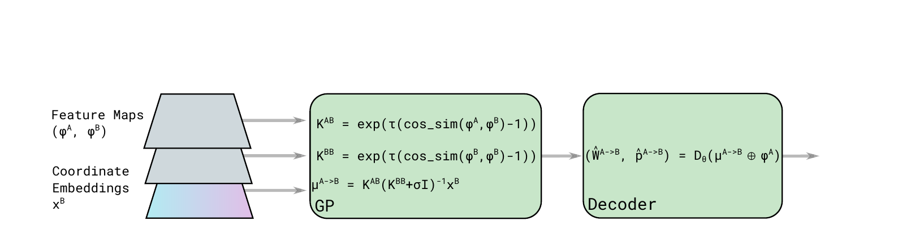

*原论文图 3。GP 根据跨图特征核矩阵和目标图坐标嵌入计算预测均值，再由 CNN 解码器将均值与 A 图特征结合，输出 warp 和有效性分数。*

#### 用余弦坐标嵌入表达多峰匹配

场景中重复出现的窗口或柱子会让同一个源位置有多个外观相近的目标候选。坐标空间中的高斯过程后验本身是单峰的；若直接对二维坐标回归，多个合理位置容易被压成平均坐标，平均值甚至可能落在没有对应物的区域。DKM 因此先把目标坐标映射到余弦特征空间：

$$
\mathcal B_{\mathcal F}(x;A,b)=\cos(Ax+b),
$$

其中 $x\in\mathbb R^2$ 是图像坐标，$A$ 的元素从 $\mathcal N(0,\ell^2)$ 采样，$b$ 的元素从 $[0,2\pi]$ 均匀采样，嵌入维度为 $C$。这种带周期结构的坐标表示让空间位置可以在嵌入维度呈现重复响应，GP 在嵌入空间中的回归因而能保留与多种位置候选相容的信息。图 4 通过重复建筑结构展示了这一表示的作用。最终 CNN 解码器从 GP 预测均值与源特征中预测规范化坐标 $[-1,1]^2$，并为每个像素输出匹配有效性 logit。

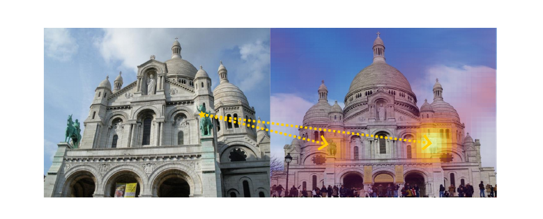

*原论文图 4。重复建筑结构对应多个外观相似的目标区域；坐标嵌入与 GP 后验相关后，在图像网格上显出多个候选响应。*

模型在 stride 32 和 stride 16 两级使用全局匹配器；stride 16 的解码器还接收 stride 32 解码器输出的上下文特征。解码后仍得到粗 warp，后续细化器才逐步恢复更精细的像素位置。

### 3.3 多尺度 warp 细化

粗匹配器输出的坐标还受低分辨率特征网格限制。DKM 将 warp 和置信度双线性上采样到下一个尺度，让细化器根据两幅图在局部的特征关系预测坐标残差 $\Delta W$ 和置信度 logit 残差 $\Delta p$。以 stride 16 上的粗 warp 为起点，细化器依次处理 stride 8、4、2、1，最终得到全分辨率输出。

每一级细化器使用四类信息：A 图当前位置的特征；按当前 warp 在 B 图采样得到的目标特征；围绕 warp 目标位置计算的局部相关性；以及经线性嵌入的当前位移和置信度。将 B 图特征按预测坐标采样，直接提供候选对应位置的视觉描述；局部相关性则说明该候选附近的匹配分布。两者与 A 特征拼接后，网络可以判断预测是否对齐，并把误差转成下一步坐标修正。

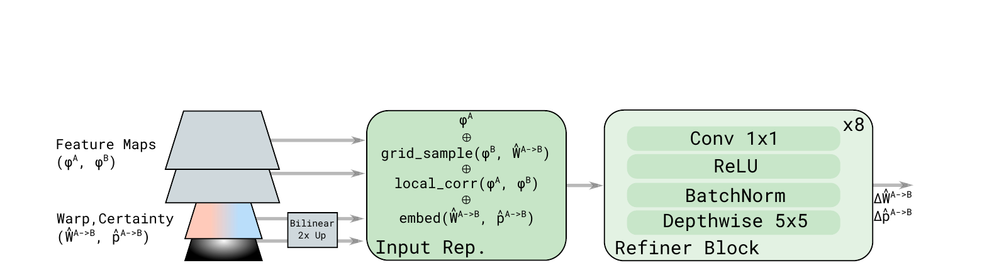

*原论文图 5。每次细化先上采样 warp 和置信度，再组合 A 特征、warp 位置的 B 特征、局部相关性以及 warp 编码；8 个由 1×1 卷积、ReLU、批归一化和 5×5 深度卷积组成的块输出 warp 与置信度残差。*

以往稠密匹配细化器常使用堆叠式稠密卷积网络和 3×3 普通卷积。DKM 改用 5×5 深度可分离卷积核后接 1×1 卷积，并在每个尺度使用 8 个细化块。较大的空间核聚合更广的局部线索，深度卷积分开处理各通道，再由 1×1 卷积混合通道；具体收益由表 6 的消融实验比较。论文的定性示例显示，在大视角和极端透视变化下，粗匹配加细化仍可产出可用的 warp 与置信度。

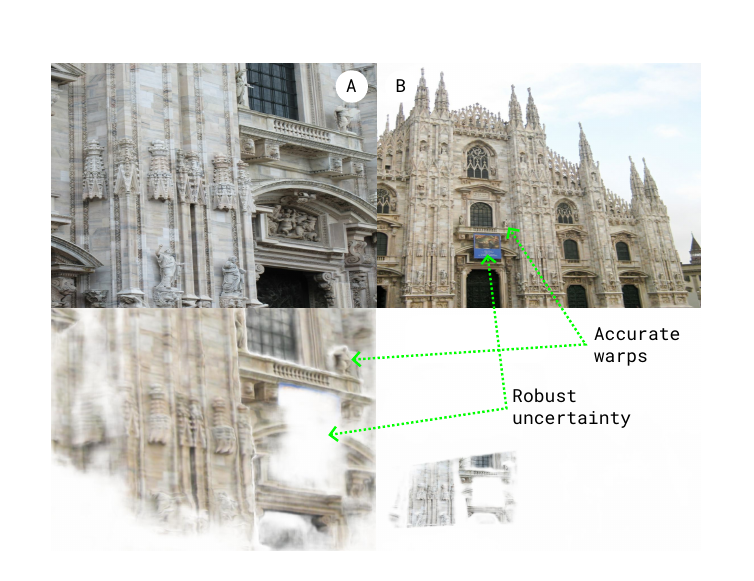

*原论文图 6。上方为图像 A、B，下方展示双向 warp 加权置信度后的结果；示例说明模型能在明显透视变化下恢复较准确的对应，同时为不确定区域降低权重。*

### 3.4 深度一致性置信度与均衡采样

稠密输出会覆盖遮挡、视野外和缺乏辨识纹理的位置。几何估计若把这些错误对应当成内点，会影响模型拟合。DKM 在 MegaDepth 的三维重建与稠密深度监督上构造置信度标签：先用 A 的真值深度把三维点投影到 B，得到 $z^{\mathcal A\to\mathcal B}$，再与 B 中观测深度 $z^{\mathcal B}$ 比较。若相对深度差小于阈值 $\alpha=0.05$，则将该像素对应标记为深度一致：

$$
p^{\mathcal A\to\mathcal B}=\mathbf 1\!\left[\frac{|z^{\mathcal A\to\mathcal B}-z^{\mathcal B}|}{|z^{\mathcal B}|}<\alpha\right].
$$

这个标签既用于 warp 回归损失的有效区域掩码，也用于监督网络预测的匹配置信度。置信度不是直接取 GP 的预测方差：训练时，网络学习哪些预测对应与场景三维结构一致；推理时则以预测置信度筛选匹配。图 7 对照 PDC-Net+ 展示，DKM 在可重复结构上给出较高置信度，而在不可见或缺少纹理的区域更少出现过度自信。

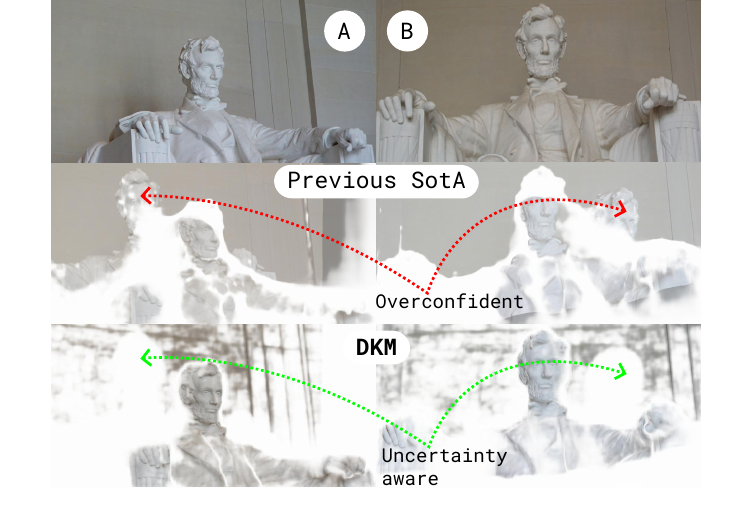

*原论文图 7。PDC-Net+ 在部分无纹理、不可共视区域仍给出较高置信度；DKM 将高置信度更多分配给可重复的对应。*

几何估计需要有限数量的匹配点。DKM 先以 0.05 为阈值去掉低置信度位置，再按置信度抽取一个较大的候选集；论文实验每对图像最多采样 5,000 个点。接着，模型在四维匹配空间 $(x^{\mathcal A},y^{\mathcal A},x^{\mathcal B},y^{\mathcal B})$ 估计核密度 $\rho_i$，并用倒数 $1/\rho_i$ 作为权重重新抽样。高密度区域中的重复匹配被降权，较少见的几何对应得到更多机会。这样可以让 RANSAC 看到更丰富的场景约束，而不仅是大量相邻像素的重复观测。

### 3.5 损失函数

DKM 在各个特征尺度上联合训练 warp 和置信度。warp 损失只在深度一致的真值位置上累计欧氏坐标误差；置信度分支则用二元交叉熵拟合深度一致性掩码。将两项相加，可写为

$$
\mathcal L=\sum_{l=1}^{L}\left(\mathcal L_{\mathrm{warp}}(\hat W_l^{\mathcal A\to\mathcal B})+\lambda\mathcal L_{\mathrm{conf}}(\hat p_l^{\mathcal A\to\mathcal B})\right),\qquad \lambda=0.01,
$$

$$
\mathcal L_{\mathrm{warp}}=\sum_{\mathrm{grid}}p_l\,\|W_l^{\mathcal A\to\mathcal B}-\hat W_l^{\mathcal A\to\mathcal B}\|_2.
$$

这里 $W_l$ 是真值 warp，$\hat W_l$ 是预测 warp，$p_l$ 是深度一致性标签；不可靠对应不参与 warp 回归。预测 warp 在粗层偏离真值超过阈值时，论文也将该位置从细尺度回归监督中屏蔽，并在各尺度之间停止梯度传播。

论文式（13）将置信度项写成 $\sum[p_l\log\hat p_l+(1-p_l)\log(1-\hat p_l)]$，未显示负号；但正文称其为 binary cross entropy，且总目标把该项与非负 warp 误差相加。若按最小化损失训练，标准二元交叉熵应在该对数似然前加负号。这里按正文的损失描述理解为负二元交叉熵，并保留这一处原文符号不一致供读者核对。

## 4 实验

### 4.1 训练设置

DKM 在 MegaDepth 上训练室外匹配模型，输入缩放到 $540\times720$；室内两视图几何评测使用 ScanNet 训练的模型，输入分辨率为 $480\times640$。训练 batch size 为 32，解码器与细化器学习率为 $4\times10^{-4}$，骨干网络为 $2\times10^{-5}$；优化器为 AdamW，权重衰减 $10^{-2}$，共训练 250,000 步，在 166,666 与 225,000 步将学习率乘以 0.2。论文报告训练使用 4 张 A100 GPU，约需 5 天。

### 4.2 几何估计与视觉定位

在 HPatches 平面图像匹配测试中，评价目标是由匹配点估计单应矩阵。表 1 的 AUC 越高代表误差阈值内的估计表现越好。DKM 在 3、5、10 像素阈值下分别得到 71.3、80.6、88.5；表中先前最佳稠密方法 PDC-Net+ 分别为 67.7、77.6、86.3。

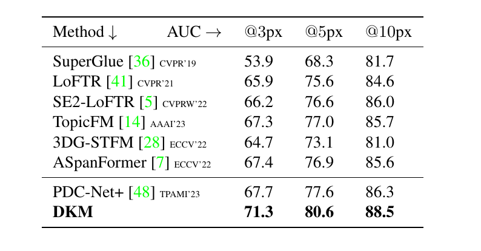

*原论文表 1。HPatches 单应估计比较，DKM 在三个像素阈值下均高于表中其他方法。*

MegaDepth-1500 使用 1,500 对来自两个场景的图像，报告相对位姿 AUC。按论文沿用的评测协议，先由匹配估计相对姿态，再在一系列误差阈值下统计正确估计的召回率并计算 AUC；表中阈值为 $5^\circ/10^\circ/20^\circ$。该基准的 RANSAC 阈值为 0.5，输入图像按较长边 1,200 像素缩放。DKM 得到 60.4/74.9/85.1，最强稀疏基线 ASpanFormer 为 55.3/71.5/83.1，强稠密基线 PDC-Net+ 为 51.5/67.2/78.5。论文正文报告 DKM 的 $5^\circ$ AUC 较此前最佳稀疏方法提高 4.9、较稠密方法提高 8.9；但表中四舍五入后的 60.4 与 55.3 相减为 5.1，数值与文字略有出入。ScanNet-1500 是室内相对位姿基准，DKM 的 AUC 为 29.4/50.7/68.3，高于表中 ASpanFormer 的 25.6/46.0/63.3 和 PDC-Net+ 的 20.3/39.4/57.1。正文报告相对最佳稀疏法提高 4.0，而表中显示值相减为 3.8；这也可能来自未展示的小数位。

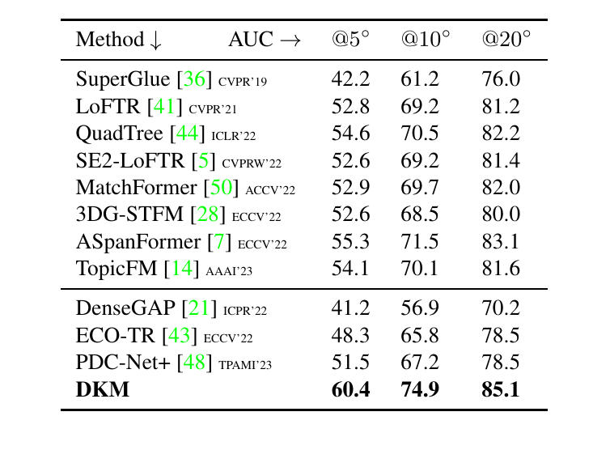

*原论文表 2。MegaDepth-1500 上 DKM 与稀疏、稠密方法的相对位姿 AUC 比较。*

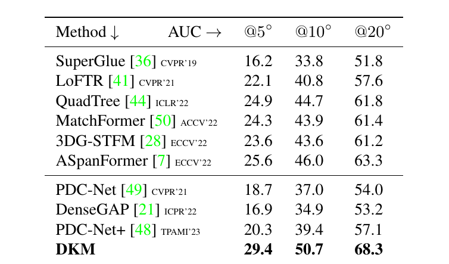

*原论文表 3。ScanNet-1500 室内相对位姿结果，DKM 在表列阈值下均取得最高 AUC。*

视觉定位实验使用 HLoc 和 InLoc 的 DUC1、DUC2 区域。表中每个数值依次对应 $(0.25\text{m},10^\circ)/(0.5\text{m},10^\circ)/(1.0\text{m},10^\circ)$ 的定位阈值，表示同时满足平移和旋转误差要求的查询比例。DKM 在 DUC1 的结果为 51.5/75.3/86.9%，在 DUC2 为 63.4/82.4/87.8%；与 ASpanFormer 比，DUC2 在前两个阈值下都提高 8.4 个百分点。

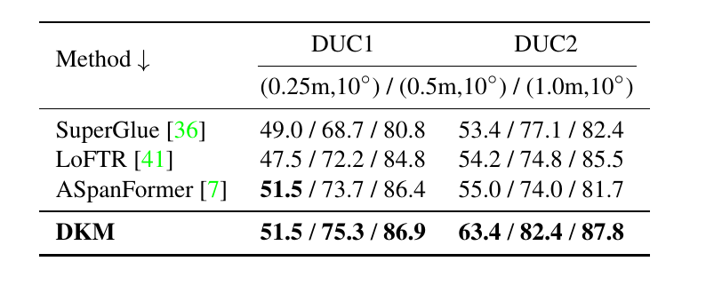

*原论文表 4。InLoc 的 DUC1 和 DUC2 区域正确定位比例。*

补充材料扩大了室外场景范围：MegaDepth-8-Scenes 从 8 个不同场景采样 1,600 对图像，DKM 的 AUC 为 60.5/74.5/84.2；相对 ASpanFormer 的 $5^\circ$ 结果提高 3.3。补充材料还报告 St. Paul’s Cathedral 上五次运行的 mAA 均值与估计标准差，表中 DKM 的均值在 $5^\circ$ 下为 53.3，ECO-TR 为 45.3。两组结果表明 DKM 的优势不只出现在 MegaDepth-1500 的两个测试场景中。

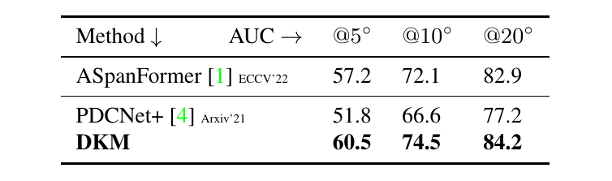

*原论文补充材料表 1。MegaDepth-8-Scenes 的相对位姿 AUC。*

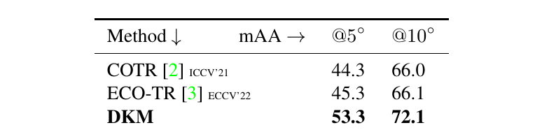

*原论文补充材料表 2。St. Paul’s Cathedral 上与 COTR、ECO-TR 的 mAA 比较，数值为五次运行的平均值。*

### 4.3 消融实验

全局匹配器的消融在 MegaDepth-1500 上比较相关体回归、线性坐标嵌入和余弦坐标嵌入。$5^\circ$ AUC 从相关体回归的 57.0 提高到 GP 加余弦嵌入的 58.1；余弦嵌入也略高于线性嵌入的 57.9。该消融采用 $384\times512$ 输入、单向匹配的设置，与最终高分辨率双向结果不同。这个比较支持 GP 嵌入回归设计，但提升幅度小于细化器和采样模块带来的变化。

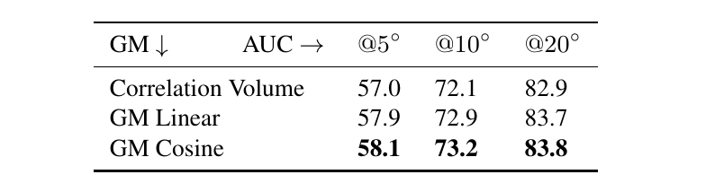

*原论文表 5。相关体回归、线性坐标嵌入和余弦坐标嵌入的相对位姿比较。*

细化器消融分别移除深度可分离卷积结构或堆叠特征图。完整模型的 $5^\circ$ AUC 为 58.1；去掉深度卷积降至 54.9，去掉堆叠特征降至 56.5。结果显示，大核深度可分离细化器和把 warp 目标位置的 B 特征加入输入都贡献了增益。

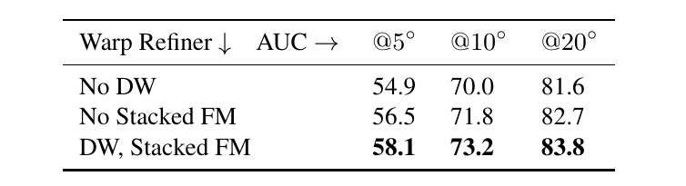

*原论文表 6。完整细化器与移除深度卷积或堆叠特征图的变体比较。*

采样消融揭示了置信度和空间分布两方面的作用。不使用置信度采样时，$5^\circ$ AUC 为 42.9；按置信度采样后为 56.1；再引入基于 KDE 倒数的均衡采样后升至 58.1。只剔除低可信匹配能减少错误点，进一步降低高密度匹配区域的权重，则能为几何估计提供分布更广的样本。

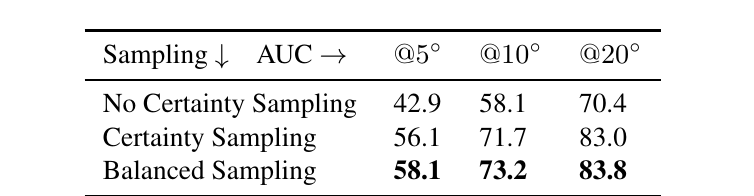

*原论文表 7。置信度筛选及均衡采样对两视图位姿 AUC 的影响。*

输入分辨率从 $384\times512$ 提高到 $540\times720$ 时，$5^\circ$ AUC 从 58.1 升到 59.4，论文据此指出高分辨率有助于位姿估计。把单向 warp 改成双向 warp，再拼接反向匹配点，$5^\circ$ AUC 从 59.4 升至 60.4。

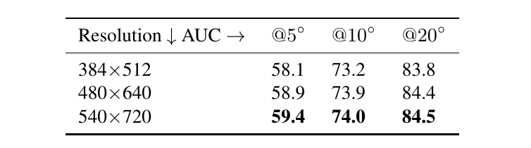

*原论文表 8。训练输入分辨率对两视图位姿估计结果的影响。*

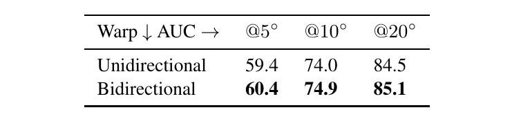

*原论文表 9。加入反向 warp 对两视图位姿估计的影响。*

## 5 讨论与局限

DKM 的置信度监督依赖有深度信息的三维重建数据，这使模型可以学习“这组对应是否符合场景三维结构”，而不只学习匹配外观相似度。均衡采样则把这个置信度转化成更适合几何估计的匹配点集合。两者解决不同问题：置信度压低错误或不可见对应，KDE 重加权避免有限样本集中在同一区域。

方法仍有两类局限。第一，细化器最终输出单一 warp，深度边界上的真实对应可能是不连续或多峰的，单一局部回归难以同时保留两侧候选。第二，论文观察到小物体与天空边界附近可能被模型赋予过低置信度；作者推测这与监督目标将深度一致性当作确定标签有关，和直接预测模型不确定性并不相同。补充材料还展示极度缺少独特纹理的失败例子：模型无法恢复正确 warp，但整体置信度也很低，说明低置信度能提示失败，却不能保证匹配一定正确。

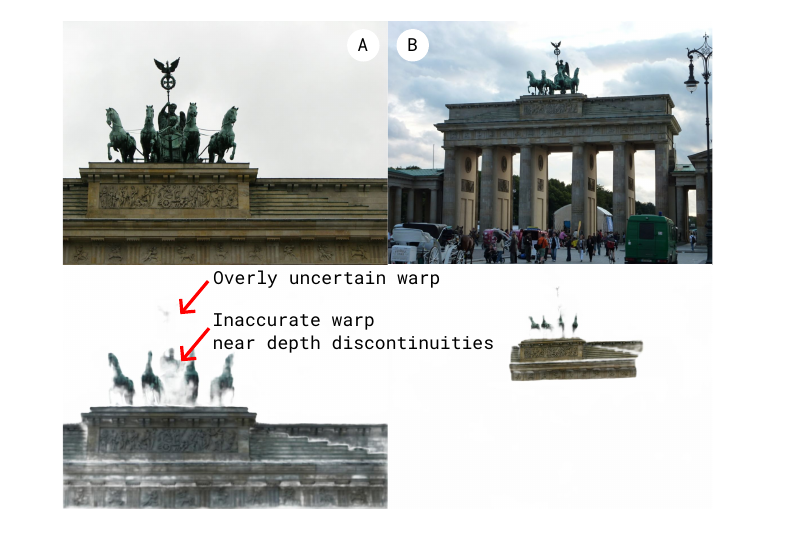

*原论文图 8。深度边界附近的 warp 细化可能不准确，模型置信度也偶尔过低；单峰细化是作者指出的局限。*

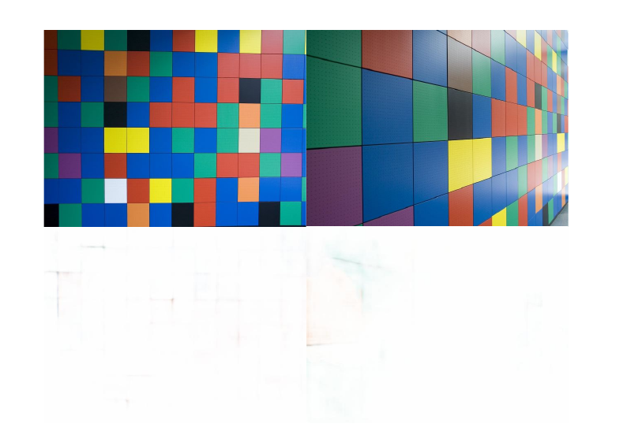

*原论文补充材料图 11。场景缺少独特局部纹理，DKM 的 warp 完全失败；模型同时给出较低置信度。*

## 6 结论

DKM 把稠密匹配拆成全局定位、逐层精化和几何估计前的样本选择。高斯过程借助特征核相似性回归目标图的坐标嵌入，余弦坐标表示帮助处理重复结构带来的多候选；细化器再将粗坐标变成高分辨率 warp。训练中的深度一致性标签让网络学习匹配置信度，均衡采样则把密集候选转成空间分布更有利于 RANSAC 的匹配集合。实验表明，这一组合在论文评估的单应估计、相对位姿和视觉定位基准上取得了有竞争力的结果，同时保留了深度边界单峰细化和置信度标定方面的局限。

[RoMa 论文解读](../roma/index.md) 沿用 DKM 的高斯过程匹配编码器与粗到细 warp 细化框架，并将全局匹配解码器改为 Transformer，进一步改造粗细特征和损失设计。两篇论文的关系可从“稠密匹配的基本框架”与“在该框架上的特征和解码改进”来理解。
