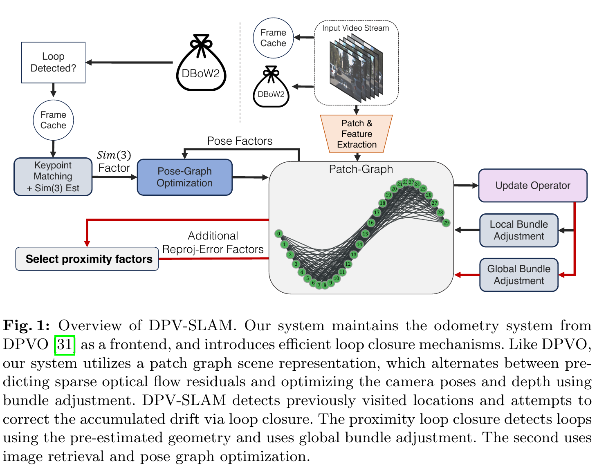
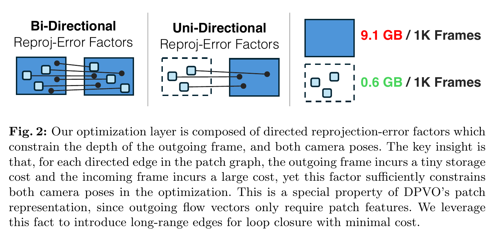
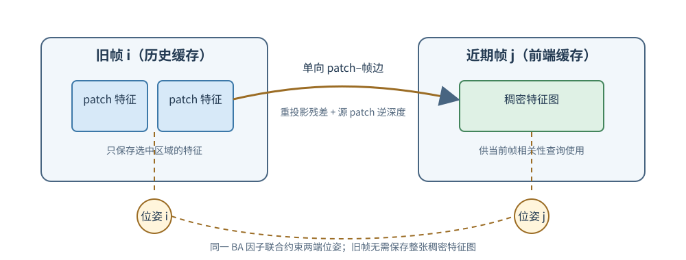
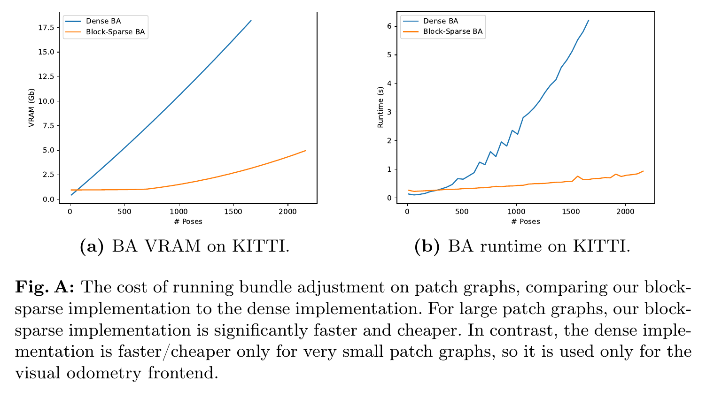
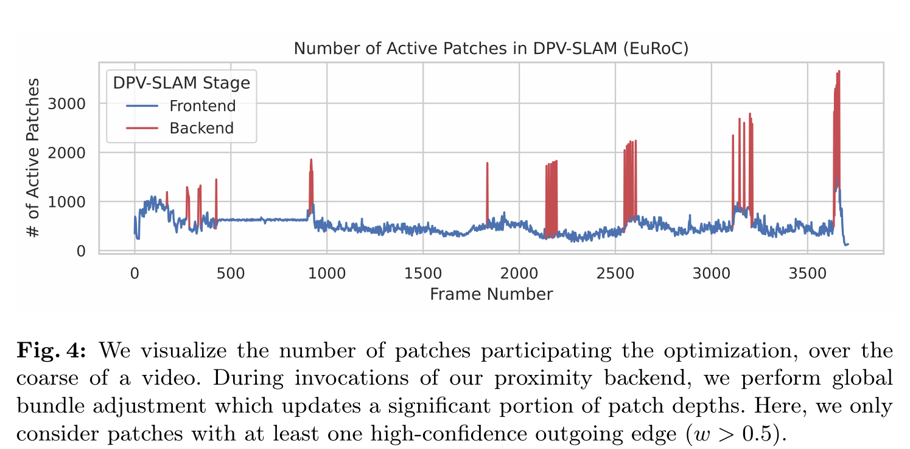
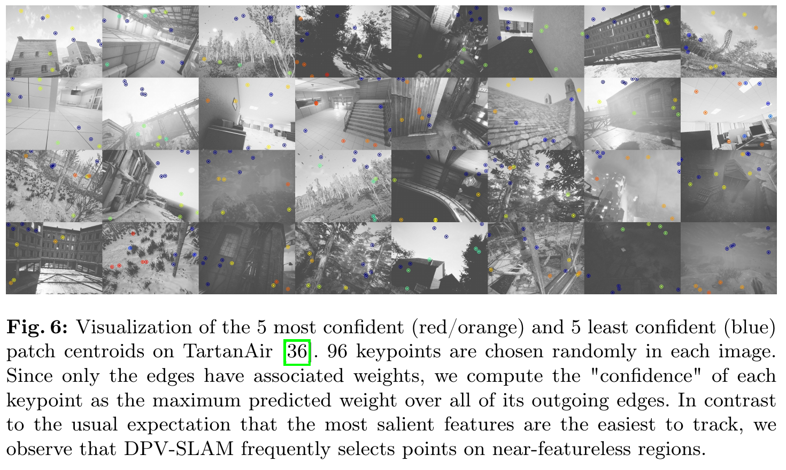
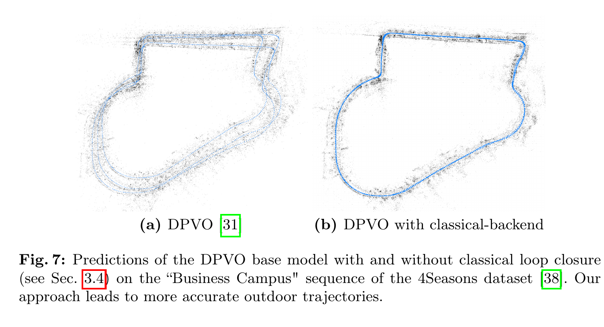

# Deep Patch Visual SLAM 论文解读

> Lahav Lipson、Zachary Teed 与 Jia Deng 的 *Deep Patch Visual SLAM*（ECCV 2024 正式发表版；文中原论文图均从正式版 PDF 或补充材料提取）将 DPVO 扩展为单目视觉 SLAM：一条回环路径用已有几何寻找邻近帧并做全局光束法平差，另一条路径用图像检索、三维匹配和 Sim(3) 位姿图优化校正长程尺度漂移。[论文页面](https://www.ecva.net/papers/eccv_2024/papers_ECCV/html/272_ECCV_2024_paper.php) · [论文 PDF](https://www.ecva.net/papers/eccv_2024/papers_ECCV/papers/00272.pdf) · [补充材料](https://www.ecva.net/papers/eccv_2024/papers_ECCV/papers/00272-supp.pdf) · [arXiv v1 页面](https://arxiv.org/abs/2408.01654v1) · [官方实现](https://github.com/princeton-vl/DPVO)

## 1. 引言

单目视觉里程计（Visual Odometry，VO）逐帧估计相机运动，但只在近期帧组成的窗口里优化。窗口外的旧帧被移除后，里程计误差会随时间累积。视觉 SLAM（Simultaneous Localization and Mapping）需要在相机再次到达旧地点时识别重访，把新观测与旧地图连起来，借此修正长期漂移。

*Deep Patch Visual SLAM* 的核心问题是：怎样在保留 DPVO 速度和低显存开销的同时，增加能够校正长程漂移的回环机制。DPVO 用少量 patch 跟踪图像中的局部区域，并以可微光束法平差（Bundle Adjustment，BA）联合调整相机位姿与 patch 逆深度；它是高效的 VO 前端，却没有真正的回环后端。论文的回答是给同一个 patch 图加入两种互补连接：一种根据当前估计的空间位置连到附近旧帧，另一种通过图像检索寻找视觉上重访的地点。

*原论文图 1　系统保留 DPVO 里程计前端，并增加两条漂移校正路径：邻近回环在 patch 图中添加长程因子并执行全局 BA；经典回环通过图像检索和位姿图优化建立长期数据关联。*

两条路径解决的尺度并不相同。邻近回环借助现有位姿和深度估计，把同一地点附近的新旧观测重新放进几何优化；传统回环则从图像外观重新建立 3D 对应，显式估计两个时刻之间的旋转、平移和尺度。前者可直接沿用 DPVO 学到的 patch 表示，后者更适合纠正户外单目场景中逐渐累积的尺度误差。

## 2. 相关工作与系统目标

DROID-SLAM 将神经网络预测的稠密对应接入可微 BA，定位效果好，但其特征与后端优化开销较高。DPVO 延续“循环预测对应修正，再以 BA 更新几何”的思路，把稠密对应改成少量 patch 轨迹，因此更轻快。它的局限也与这一设计相关：跟踪前端只优化滑动窗口；过去帧的高分辨率特征图如果都为后端保留，存储成本会随序列长度增长；如果丢弃旧帧，则没有长程约束修正漂移。

论文把目标归纳为跨域泛化、实时或更快的推理，以及较低资源占用。系统仅在合成数据上训练，评估时直接用于室内和室外数据；作者将此称为 zero-shot 泛化。论文的比较对象也限定为不针对各测试域重新训练的方法，因此结果不能解释为 DPV-SLAM 在每一种专用场景中都优于专门调校的系统。

作者把回环分为两类。**中期回环**利用当前位姿和深度估计发现不同时间帧之间的关联，并通过 BA 更新位姿与深度；DROID-SLAM 与 DPV-SLAM 的邻近后端属于这一类。**长期数据关联**通过视觉位置识别在很远的时间间隔上寻找同一地点，再以位姿图优化调整轨迹；DPV-SLAM 的经典回环属于这一类。完整系统可以选择仅运行前一种，也可以像 DPV-SLAM++ 一样组合两种。

## 3. DPVO 前端与 patch 图

DPV-SLAM 沿用 DPVO 的 patch 图场景表示。有关 DPVO 前端循环和可微 BA 的详细推导也见[《Deep Patch Visual Odometry 论文解读》](../dpvo/index.md)。每个 patch 是图像中的一个小方块，包含其 $p^2$ 个位置的像素坐标和逆深度：

$$
\mathbf P_{ik}=
\begin{pmatrix}
\mathbf x\\ \mathbf y\\ \mathbf 1\\ \mathbf d
\end{pmatrix},
\qquad \mathbf x,\mathbf y,\mathbf d\in\mathbb R^{1\times p^2}.
\tag{1}
$$

下标 $i$ 表示 patch 所属的源帧，$k$ 表示该帧中的 patch 编号；$\mathbf d$ 是逆深度。二分图的一侧是 patch，另一侧是视频帧，有向边 $(i,k,j)$ 表示把第 $i$ 帧的 patch $k$ 投影到第 $j$ 帧，并在该位置查询图像特征。

若 $G_i$ 表示第 $i$ 帧的全局相机位姿，$\pi$ 表示从相机坐标投影到图像平面的操作，重投影位置为

$$
\mathbf P'_{ikj}=\pi\!\left[G_j^{-1}G_i\,\pi^{-1}(\mathbf P_{ik})\right].
\tag{2}
$$

右侧先将源 patch 的像素和逆深度还原为三维点，再用相对位姿 $G_j^{-1}G_i$ 换到目标相机坐标系，最后投影到目标图像。若位姿和深度准确，投影就应落在同一场景区域的真实观测处。

网络在当前投影周围计算 patch 特征和目标帧稠密特征的相关性，循环更新算子据此预测二维修正 $\Delta_{ikj}$ 及二维置信权重 $w_{ikj}$。目标位置 $\mathcal I_{ikj}=\mathbf P'_{ikj}+\Delta_{ikj}$ 是本轮网络提出的观测。记当前参与 BA 的 patch 图边集合为 $\mathcal F$，优化器联合调整位姿和 patch 深度，使几何重投影尽量接近这些目标：

$$
\underset{G,\mathbf d}{\arg\min}\;\sum_{(i,k,j)\in\mathcal F}
\left\|
\pi\!\left[G_j^{-1}G_i\pi^{-1}(\mathbf P_{ik})\right]
-\mathcal I_{ikj}
\right\|^2_{\Sigma_{ikj}},
\qquad \Sigma_{ikj}=\operatorname{diag}(w_{ikj}).
\tag{3}
$$

具体地，令 $\mathbf g(u,v)$ 表示源 patch 在局部坐标 $(u,v)$ 处的特征，$\mathbf f$ 表示目标帧的稠密特征图，$\Delta_{\alpha\beta}$ 枚举以零为中心的 $7\times7$ 偏移网格，则单边的局部相关特征为

$$
\mathbf C(u,v,\alpha,\beta)
=\left\langle \mathbf g(u,v),\,
\mathbf f\!\left(\mathbf P'_{ikj}(u,v)+\Delta_{\alpha\beta}\right)\right\rangle,
\qquad
\mathbf C\in\mathbb R^{p\times p\times7\times7}.
\tag{4}
$$

目标特征在非整数投影位置通过双线性采样取得。相关张量每轮更新时重新计算，因此它描述的是当前位姿和深度所诱导的投影附近、每个 patch 像素的局部匹配证据。更新网络读取这些证据与循环隐藏状态，再输出上面的二维修正和置信权重。

权重较低的观测会减弱其残差对几何求解的影响。几何更新又改变下一轮重投影中心，网络在新位置附近重新读取相关性。由此形成“估计投影—学习修正—BA 更新几何”的闭环。相比完整复述 DPVO，论文在这里重点说明的是：怎样把这样的局部 patch 图扩展到远距离帧，同时不把所有历史稠密特征图都留在 GPU 上。

## 4. 邻近回环与单卡全局优化

### 4.1 只保存旧 patch 特征

常见深度 SLAM 后端要在回环时重新计算旧帧与新帧的特征相关性。若每帧都要保存稠密特征图，长视频会累积很大的显存占用。DPVO 的一条有向边不对称地使用两端信息：源端只需保存 patch 的局部特征，目标端需要稠密特征图；但产生的重投影残差仍会约束两端相机位姿和源 patch 深度。

这个不对称性让系统可以把边的方向选为“旧帧 patch → 当前帧”。旧帧长期保留小型 patch 特征，当前帧的稠密特征图本来就在前端缓存中。这样，旧帧不必保存整张稠密图，仍可通过新建的长程边影响旧、新两端的几何。作者报告，永久保留 patch 特征的额外存储约为每 1000 帧 0.6 GB；原论文图 2 对比的双向边方案约需 9.1 GB/1000 帧。

*原论文图 2　双向边需要同时为两端保留较大的稠密特征，约为每 1000 帧 9.1 GB；单向边把历史帧作为只需保存 patch 特征的出边端，约为每 1000 帧 0.6 GB。图中同时说明，单向重投影因子仍约束源帧深度和两端相机位姿。原图裁自[正式版论文 PDF 第 7 页](https://www.ecva.net/papers/eccv_2024/papers_ECCV/papers/00272.pdf#page=7)。*

*补充自绘图　将原图中的存储不对称性展开为帧间连接：旧帧提供 patch 特征，当前帧提供稠密特征图，生成的因子仍约束两端位姿和源 patch 逆深度。*

因此，空间邻近并非只用于判断“这里可能回环了”。它还决定具体连接哪一块旧地图：前端按当前相机估计的位置寻找空间上接近的历史帧，再从这些旧帧向近期帧建立单向重投影因子。新边让局部跟踪外的旧 patch 也参与接下来的全局 BA。

### 4.2 为什么需要块稀疏 BA

小窗口 VO 的图较密，DPVO 原有 GPU BA 可以有效处理；加入少量长程边之后，优化图覆盖全程，却仍然是稀疏的。若把它当作稠密问题求解，内存和计算会浪费在绝大多数互不相连的变量块上。DPV-SLAM 因而实现了适配可变大小 patch 图的 CUDA 块稀疏 BA，利用 Hessian 矩阵由相机位姿块与局部深度块组成的稀疏结构进行全局优化。

前端与邻近后端的 GPU 工作都在同一进程、同一设备中顺序执行。论文指出，拆成两个进程并不能让 CUDA 核心同时并行运行；如果后端耗时很长，前端仍要等待。因此，关键在于让全局 BA 足够轻，使其能够作为系统的一部分运行，而非假设独立后端能在同一 GPU 上隐藏计算成本。

块稀疏 BA 也不是对所有图规模都更快。补充材料图 A 比较了固定深度变量数和边数时不同位姿规模的求解开销：较大图上，块稀疏实现明显节省显存并加快求解；很小的 VO 前端图中，原稠密实现反而更高效，因为块稀疏实现的索引开销占比较大。DPV-SLAM 在局部 VO 前端继续使用稠密实现，在全局图上使用块稀疏实现。全局优化的代价随位姿数量近似二次增长，主要瓶颈是 Cholesky 分解，因此论文将范围限制在 1000 个关键帧（[补充材料 PDF 第 1 页](https://www.ecva.net/papers/eccv_2024/papers_ECCV/papers/00272-supp.pdf#page=1)）。

*原论文补充材料图 A　横轴是位姿数；块稀疏 BA 在较大 patch 图上显著降低显存并缩短运行时间，稠密实现只在很小的前端图上更合适。*

*原论文图 4　邻近后端运行时，全局 BA 会更新大量 patch 深度；图中只统计至少有一条高置信出边（$w>0.5$）的 patch。*

## 5. 经典位置识别与 Sim(3) 回环

邻近回环依赖已有位姿和深度估计；若户外单目序列的尺度已经明显漂移，单靠这些估计未必能可靠地把旧地点重新接上。经典后端提供第二条路径：先按图像外观寻找旧位置，再从局部图像匹配恢复回环两端的三维关系。

### 5.1 从图像检索建立候选回环

系统对每帧提取 ORB 特征，以 DBoW2 建立视觉词袋并检索候选旧帧。为提高精确率，论文采用连续多帧检索命中作为回环证据。特征提取、索引和检索在单独进程中进行；作者报告这些操作比 DPVO 前向计算更快，因此通常可以与主流程并行。

前端随机采样 patch，并不使用可重复的关键点检测器；这有利于跟踪小运动，却意味着前端 patch 不适合直接在远隔图像间重新检测和匹配。经典回环只在检索到候选地点时调用传统检测器与匹配器：在候选图像及其时间邻帧之间建立二维对应，通过结构 BA 三角化局部深度，再把两个候选时刻得到的 3D 点云互相匹配。最后用 RANSAC 和 Umeyama 对齐，估计七自由度的 $\mathrm{Sim}(3)$ 变换，包括旋转、平移和尺度。

这条路径刻意让不同模块各做擅长的工作：随机 patch 负责连续帧的稳定跟踪；传统局部特征负责低频、跨很长时间间隔的地点匹配。传统特征不需要被放进每一帧的高频前端，只在需要估计回环时承担一次额外工作。

论文还可视化了前端 patch 的置信度。作者从每个 patch 的所有出边权重中取最大值作为该 patch 的置信度；图 6 显示，高置信 patch 并不总是落在最显眼的纹理上，系统有时会选择近乎无纹理的区域。这说明网络预测的可跟踪性不能简单等同于传统角点检测器给出的显著性。

*原论文图 6　红色和蓝色分别表示置信度最高与最低的五个 patch 中心；每幅图随机采样 96 个关键点。*

### 5.2 位姿图校正累计漂移

设 $S_i\in\mathrm{Sim}(3)$ 为第 $i$ 个关键帧的绝对相似变换。相邻帧的前端相对运动提供连续约束，检索到的回环提供跨时刻约束。论文把两类残差写在 $\mathrm{Sim}(3)$ 的切空间中：

$$
r_i=\log_{\mathrm{Sim}(3)}\!\left(\Delta S_{(i,i+1)}^{-1}S_i^{-1}S_{i+1}\right).
\tag{5}
$$

$$
r_{jk}=\log_{\mathrm{Sim}(3)}\!\left(\Delta S^{\mathrm{loop}}_{jk}S_j^{-1}S_k\right).
\tag{6}
$$

$\Delta S_{(i,i+1)}$ 是前端给出的相邻运动，$\Delta S^{\mathrm{loop}}_{jk}$ 是 3D 点云对齐得到的回环变换。若当前位姿图与这些测量一致，残差就较小。优化器以 Levenberg–Marquardt 最小化全部相邻边和回环边的残差平方和：

$$
\underset{S_1,\ldots,S_N}{\arg\min}\;
\sum_i\|r_i\|_2^2+\sum_{(j,k)\in\mathcal L}\|r_{jk}\|_2^2,
\tag{7}
$$

其中 $\mathcal L$ 是检测到的回环集合。优化结果不仅调整旋转和平移，也估计各时刻的尺度。论文按 $G_i\leftarrow(t_i,R_i)$ 更新全局位姿，并以 $d_i\leftarrow d_i/s_i$ 缩放逆深度。这个步骤让回环能够校正单目尺度漂移，而普通固定尺度的 $SE(3)$ 位姿图做不到这一点。位姿图优化运行在 CPU 上，与主进程并行；经典后端额外调用 U-Net 关键点检测器，论文报告其 GPU 显存代价约为 2 GB。

DPV-SLAM 仅启用邻近回环；同时启用邻近回环与经典回环的版本称为 DPV-SLAM++。这两个名称在实验比较中很重要：DPV-SLAM++ 的精度变化和资源开销包括了传统检索、3D 对齐以及 Sim(3) 位姿图这一整条路径。

## 6. 实验结果

论文在 TUM-RGBD、KITTI、EuRoC-MAV 和 TartanAir 上测试单目 SLAM。TUM-RGBD 使用 Freiburg 1 全部序列，KITTI 使用训练集序列 00–10，EuRoC 使用 Machine Hall 与 Vicon 1、2 序列，TartanAir 使用 ECCV 2020 SLAM 竞赛测试集。作者重复运行五次并报告中位数；运行时比较在 RTX 3090 上进行，比较对象限于报告跨室内外结果且无需按测试域重新训练的方法。结果集中体现了两条回环路径的互补性，也显示不同数据集上的优势并不完全相同。

| 数据集与指标 | DPV-SLAM | DPV-SLAM++ | 对照与解释 |
| --- | ---: | ---: | --- |
| EuRoC 平均 ATE（米） | 0.023 | 0.023 | DROID-SLAM 为 0.022；两种方法精度接近 |
| EuRoC 速度 / 显存 | 50 FPS / 5 GB | 50 FPS / 7 GB | DROID-SLAM 为 20 FPS / 20 GB；经典后端增加约 2 GB |
| KITTI 平均 ATE（米） | 53.03 | 25.76 | DROID-SLAM 为 118.7；加上经典回环后误差显著降低 |
| KITTI 速度 | 39 FPS | 39 FPS | 平均速度高于数据集 10 FPS 的采集频率 |
| TUM-RGBD 平均 ATE（米） | 0.076 | 0.054 | DROID-SLAM 为 0.038；该室内集合中 DROID-SLAM 的平均误差更低 |

ATE 是轨迹对齐后的绝对轨迹误差。表中数字来自论文报告，不能脱离其数据集划分和运行设置推广成所有应用条件下的速度或精度结论。就论文展示的对照而言，EuRoC 上 DPV-SLAM 以约四分之一显存和 2.5 倍速度取得接近 DROID-SLAM 的 ATE；在 KITTI 的户外长序列上，经典回环把平均 ATE 从 DPV-SLAM 的 53.03 米降到 25.76 米。TUM-RGBD 上 DPV-SLAM++ 的平均值则仍高于 DROID-SLAM，说明增加回环并不保证每组指标都变好。

与 DPVO 前端相比，EuRoC 平均 ATE 从 0.105 米降至 0.023 米，约为原来的 $1/4.5$；速度从约 60 FPS 降到 50 FPS，显存从约 4 GB 增至 5 GB。这个对照呈现了邻近回环和全局优化带来的收益及成本。

TartanAir 测试集上，DPV-SLAM 的平均 ATE 为 0.16 米，DROID-SLAM 为 0.24 米；论文报告速度分别为 27 FPS 和 8 FPS。4Seasons 的回环前后轨迹对照见原论文图 7。速度分布图显示，邻近全局 BA 会造成短时帧率下降：EuRoC 前端约 58 FPS，回环运行时约降至 42 FPS；KITTI 的回环较少见，发生时会短暂降至 5–10 FPS，再回到约 40 FPS。因此平均速度高于实时频率，并不意味着每一帧延迟恒定。

*原论文图 7(a)(b)　4Seasons 的 Business Campus 序列中，经典回环改善了 DPVO 基础模型的户外轨迹。*

论文报告 DPV-SLAM 在评测设置中没有 catastrophic failure，并将跨室内外数据的表现归因于只在合成 TartanAir 上训练而无需按域微调。不过这一结论应限定在论文选择的数据集、基线和评价协议之内。作者也明确指出，本文的目标是跨域通用系统，并未声称优于专门针对 KITTI 等驾驶场景优化的 SLAM 方法。

## 7. 局限与方法关系

DPV-SLAM 仍依赖 GPU，而且只输出稀疏三维重建。全局块稀疏 BA 随关键帧数量近似二次增长，论文将优化范围限制在 1000 个关键帧。经典图像检索偶尔会产生错误回环，可能导致灾难性失败；经典后端的 U-Net 检测器还增加约 2 GB 显存。因此，DPV-SLAM 与 DPV-SLAM++ 的资源数字不能混为一谈。

两条回环路径最终连接到同一套局部 patch 图和全局位姿估计，却有不同的观测来源。邻近回环重用当前网络预测和几何状态，以少量长程 patch 因子做联合 BA；它的计算依赖已有地图几何，优势是无需为旧帧保留完整特征图。经典回环重新通过图像检索和局部特征恢复远距离 3D 对应，再用 Sim(3) 位姿图显式校正尺度。前者补足了 VO 前端缺失的几何闭环，后者针对单目户外长序列中的长期数据关联和尺度漂移。

这篇论文的主要贡献因而不在于替换 DPVO 的匹配网络，而在于把稀疏 patch 表示变成一个可扩展的 SLAM 后端入口：有向观测因子降低旧帧缓存成本，块稀疏 BA 处理长程几何约束，经典 Sim(3) 后端提供另一种回环证据。实验也支持这种系统层面的理解：邻近回环以较低开销换取普遍的几何一致性，图像检索回环在户外长序列上进一步改善尺度漂移，但伴随额外显存与误检风险。
