# Deep Patch Visual Odometry 论文解读

> Zachary Teed、Lahav Lipson 与 Jia Deng 的 *Deep Patch Visual Odometry*（arXiv:2208.04726v2，2023 年 5 月 23 日）提出单目视觉里程计 DPVO：网络跟踪稀疏图像 patch，并通过可微光束法平差更新相机位姿和 patch 逆深度。[论文页面](https://arxiv.org/abs/2208.04726v2) · [PDF](https://arxiv.org/pdf/2208.04726v2) · [官方实现](https://github.com/princeton-vl/DPVO)

## 1. 引言

单目视觉里程计（Visual Odometry，VO）只凭连续图像估计相机走过的路线。系统需要判断第一帧里选中的局部区域在第二帧出现在哪里。位置一旦找错，由这些位置反推的相机运动也会错；跟踪区域太少时，偶尔一次误匹配就可能把估计带偏。

[DROID-SLAM](../droid-slam/index.md)为大量像素估计跨帧对应，再用可微的光束法平差（Bundle Adjustment，BA）联合调整相机运动和深度，显著改善了鲁棒性。但大量像素的对应及相关特征需要较多计算和存储。DPVO 试图在每帧只跟踪少量局部区域的条件下，保持对应的可靠性和几何优化的精度。稀疏化省下计算量，也减少了应对误匹配的冗余，因而不能简单地从稠密系统中删掉像素。

DPVO 用少量 **patch** 代替整幅图的稠密对应。patch 就是围绕一个采样位置截取的小方块，它携带周围的图像特征，比孤立的一个像素更容易辨认。系统先根据当前相机位姿和深度，猜它在下一帧的位置；网络检查猜测位置附近的图像特征，建议把位置往哪里修正；BA 再调整相机位姿和 patch 深度，让许多这样的建议能够由同一套三维几何解释。下一轮会用调整后的几何重新猜位置。

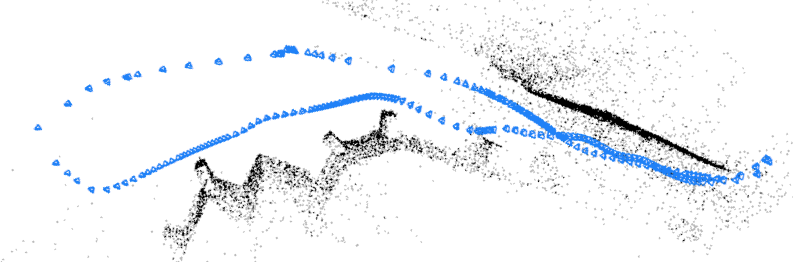

*原论文图 1　系统通过反复修正 patch 在时间上的二维轨迹，估计相机位姿与稀疏三维结构。这里的二维修正先由网络提出，再由几何优化落实到位姿和深度。*

论文把 DPVO 定位为 VO 系统：它执行局部优化，未包含回环检测、重定位和全局校正。与完整 DROID-SLAM 的结果并列时，需要保留这一系统范围的差别。

## 2. 相关工作

传统视觉里程计通常从跨帧图像观测出发，联合估计位姿和三维结构。间接法先检测、匹配特征点，再压低重投影误差；直接法用像素强度差构造误差。两类方法都可能受到动态物体、特征跟踪中断或优化收敛不良的影响。VO 长时间运行会累积漂移；SLAM 还可借助回环检测和全局优化校正它。因此比较算法时，必须看清它是 VO 前端还是完整 SLAM 系统。

DPVO 与 DSO 一样使用局部 patch 和跨帧重投影，但 DSO 根据像素亮度差构造残差，DPVO 让网络预测二维修正和置信权重。它也继承了 DROID-SLAM 交替进行网络更新和 BA 的框架；DROID 估计稠密对应，DPVO 把观测压缩为稀疏 patch，并为稀疏图设计时间传播和跨 patch 信息交换。论文还提到已有可微 BA 网络，但那些系统的观测表示和独立重建能力与 DPVO 不同。

DPVO 与 DROID-SLAM 的相似处来自共同的迭代优化框架，差异主要在观测表示和系统范围。DPVO 论文也将自己称为 DROID-SLAM VO 模式下的稀疏化变体：

| 对比维度 | DROID-SLAM | DPVO |
| --- | --- | --- |
| 对应表示 | 帧对之间的稠密像素对应 | 少量 patch 在多帧中的投影轨迹 |
| 几何变量 | 相机位姿与逐像素逆深度 | 相机位姿与 patch 逆深度；单个 patch 采用常深度近似 |
| 更新网络 | 按帧图边更新对应场与置信权重 | 沿 patch 轨迹传递时间信息，并在共享帧边之间聚合信息 |
| 几何优化 | 可微 Dense Bundle Adjustment（DBA）联合更新位姿和稠密深度 | 可微稀疏 BA 联合更新位姿和 patch 深度 |
| 系统范围 | 局部跟踪加全局关键帧优化，可加入回环边；也可单独运行 VO 模式 | 局部单目 VO，不含回环检测与全局校正 |
| 主要取舍 | 保留更多像素观测，计算与显存开销较大 | 用稀疏 patch 控制开销，同时依靠局部特征和图上传播维持匹配质量 |

DPVO 沿用迭代对应更新与可微 BA 的主干，同时围绕 patch 重新设计观测图和更新网络。论文中的速度、显存比较对应 DPVO 与 DROID-VO（关闭全局后端的 DROID-SLAM 前端），因此这组比较不涵盖 DROID-SLAM 的回环和全局优化能力。

## 3. 方法

要让网络提出的二维对应真正约束相机运动，先要定义哪些量由几何决定。视频有 $N$ 帧，相机位姿集合为 $\mathbf T\in SE(3)^N$；一个位姿说明相机的位置和朝向。论文从各帧抽取边长为 $p$ 的方形 patch。第 $k$ 个 patch 的每个像素都要记录源帧坐标和逆深度，合在一起写成

$$
\mathbf P_k=
\begin{pmatrix}
\mathbf x\\ \mathbf y\\ \mathbf 1\\ \mathbf d
\end{pmatrix},
\qquad
\mathbf x,\mathbf y,\mathbf d\in\mathbb R^{1\times p^2}.
\tag{1}
$$

矩阵的每一列对应一个 patch 像素：前两项是图像坐标，第三项 $1$ 供齐次投影使用，第四项 $d$ 是逆深度，即实际深度的倒数。例如深度为 $5$ 米时，逆深度为 $0.2\,\mathrm m^{-1}$。论文假设同一 patch 的深度为常数，所以它在源帧相机坐标系中构成一个近似正对相机的平面。这个假设把整块区域的几何变化压缩到一个深度变量；若真实表面有明显起伏，它只是局部近似。

若 patch $k$ 来自第 $i$ 帧，把它投影到第 $j$ 帧的表达式是

$$
\mathbf P'_{kj}\sim
\mathbf K\mathbf T_j\mathbf T_i^{-1}\mathbf K^{-1}\mathbf P_k,
\tag{2}
$$

其中 $\mathbf K$ 是论文式（3）的 $4\times4$ 齐次标定矩阵：

$$
\mathbf K=\begin{pmatrix}
f_x&0&c_x&0\\
0&f_y&c_y&0\\
0&0&1&0\\
0&0&0&1
\end{pmatrix}.
\tag{3}
$$

计算式（2）时从右往左看：$\mathbf K^{-1}$ 把源帧像素坐标换成归一化相机坐标，$\mathbf T_j\mathbf T_i^{-1}$ 把源帧中的位置关系换到目标帧，$\mathbf K$ 再换回目标帧像素坐标。最后把前两个分量分别除以第三个分量，得到投影位置。此后把整个操作简写为 $\omega_{ij}(\mathbf T,\mathbf P_k)$。

逆深度出现在第四行，是因为 $(x_n,y_n,1,d)$ 与欧氏三维点 $(x_n/d,y_n/d,1/d)$ 表示同一位置。这样写以后，平移对投影的影响自然带上 $d$。例如仅考虑源帧到目标帧的水平相对平移 $t_x$，且没有旋转和前后移动，归一化横坐标由 $x_n$ 变为 $x_n+t_xd$；像素横坐标便移动 $f_xt_xd$。取焦距 $100$ 像素、$t_x=0.1$ 米、深度 $5$ 米，位移是 $100\times0.1\times(1/5)=2$ 像素。实际系统仍用完整的式（2）计算旋转和三维平移；这个一维例子只说明深度为何会影响重投影。

系统只在部分“patch、目标帧”组合上做上述投影，于是用一张二分图记录这些组合：一侧放 patch，另一侧放视频帧，边 $(k,j)$ 表示需要在第 $j$ 帧跟踪 patch $k$。例如第一帧里的同一个 patch 连向第二、三帧，就有两条边和两个投影位置；这串位置叫 **patch trajectory**。它是同一源 patch 在不同帧中的二维投影，并非每帧重新裁出的方块。随着视频前进，图上会加入新边，也会移除过旧的边。

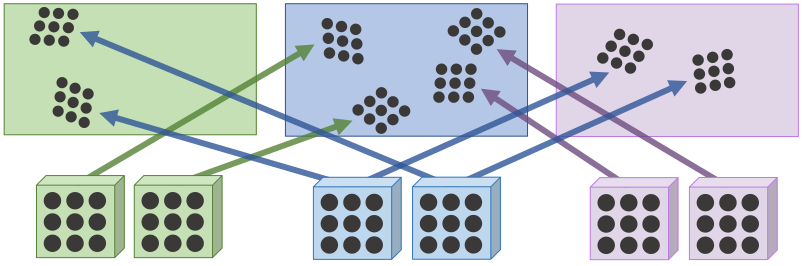

*原论文图 3　左侧 patch 与右侧相邻帧的边定义了需要跟踪、计算相关性以及参与 BA 的观测。沿同一 patch 的边可以交换时间信息；指向同一目标帧的不同 patch 也可以交换信息。*

图已经告诉系统该跟踪哪些 patch；接下来要判断当前投影有没有对准。每帧先经过两个结构相近的残差网络，分别生成**匹配特征**和**上下文特征**。前者供不同帧比较外观，后者留给循环网络判断如何更新。特征主图在输入的四分之一分辨率；匹配分支还构成两级特征金字塔。patch 中每个位置的特征通过双线性采样取得。patch 中心是随机采样的二维位置，并不要求由特征点检测器筛出。

附录 H 给出了两类特征的通道数：匹配特征为 128 维，并经过实例归一化；上下文特征为 384 维，不作这种归一化。两者都在输入图像的四分之一分辨率上提取。稀疏 patch 只需在有限位置读取特征，因此作者认为可以使用比 DROID-SLAM 更高的特征分辨率，而不承担稠密特征图同等的显存代价。这里的取舍是把计算集中到少量局部区域，同时保留足够细的空间信息。

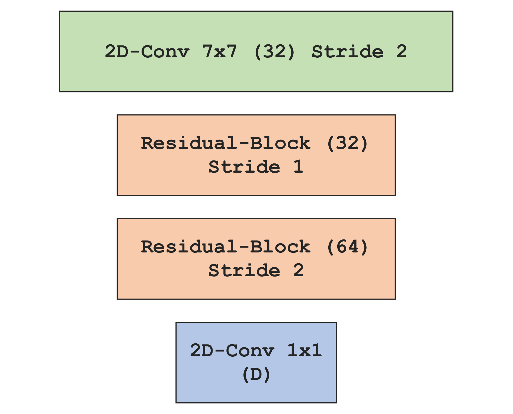

*原论文附录图 J　匹配特征与上下文特征使用相同的残差网络骨架，输出通道数和归一化方式不同。*

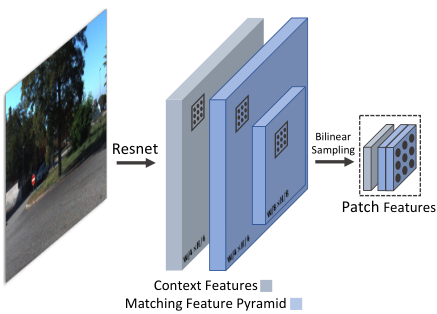

*原论文图 2　残差网络提取上下文与匹配特征，再从特征图裁取局部 patch。图中两级匹配特征让网络在不同尺度上检查投影附近的外观。*

### 3.1 更新算子

当前位姿和逆深度给出的投影只是搜索起点。对图上的边 $(k,j)$，DPVO 不预先保存整张图像之间的全局相关体，而是在当前投影 $\mathbf P'_{kj}$ 附近查询。设源 patch 的匹配特征为 $\mathbf g$，目标帧的匹配特征为 $\mathbf f$，patch 内像素 $(u,v)$ 与目标帧附近某个候选位置的相似度为

$$
\mathbf C_{uv\alpha\beta}=
\left\langle
\mathbf g_{uv},
\mathbf f\bigl(\mathbf P'_{kj}(u,v)+\Delta_{\alpha\beta}\bigr)
\right\rangle.
\tag{4}
$$

$\Delta_{\alpha\beta}$ 枚举以当前投影为中心的 $7\times7$ 整数网格；目标特征在非整数坐标处由双线性插值读取。对 patch 中一个像素，式（4）给出 49 个候选位置的相似度；整块 patch 的每个像素都做同样的局部查询，因而每个尺度有 $p\times p\times7\times7$ 组数值。网络读取这些相似度以及上下文，预测修正，而不直接选最高分候选点。每条边在两级金字塔上各做一次查询，再拼接结果。下一轮的查询中心随几何状态移动，有限的搜索窗口因此可以逐步靠近对应位置。

每个匹配特征是 128 维向量，因此内积是在 128 个通道上计算的。附录 G 说明，系统在四分之一和八分之一分辨率两级特征上分别查询局部邻域，每级得到 $p\times p\times7\times7$ 个相关值，再将两级结果交给更新网络。实现用双线性采样读取非整数位置，并以专门的 CUDA 算子计算相关性。一块区域产生 $p^2$ 组局部相关响应，网络可以利用区域内部的外观结构判断修正方向。后文的消融实验也显示，改用单像素特征后，验证集表现变差。

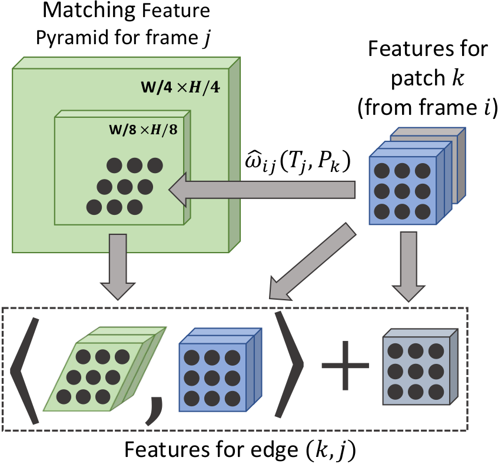

*原论文附录图 F　将源 patch 重投影到目标帧后，在目标特征图相应位置采样匹配特征；上下文特征与相关结果一起组成这条边的输入。图中为便于展示省略了每个采样点周围的 $7\times7$ 邻域。*

原论文图 2 把匹配金字塔两层标为原图的 $1/4$ 与 $1/8$，而正文所写平均池化核和步长与后一比例并不完全一致。这里按图示说明两个尺度的局部查询，不据此推断实现中的第二级精确分辨率。

#### 稀疏边上的信息传播

局部相似度还不能直接决定修正方向：同一 patch 在相邻帧中的运动应当相互衔接，不同 patch 对同一对相机的运动也应当相容。DPVO 因此为每条 patch–帧边保存一份**隐藏状态**，可以把它理解为这条跟踪关系从前几轮留下的信息。相关特征和源 patch 的上下文进入循环更新算子，算子沿同一 patch 的时间轨迹传递消息，也让具有共同来源帧与目标帧的不同 patch 交换信息。随后，转换模块更新隐藏状态，因子头输出二维修正与权重。

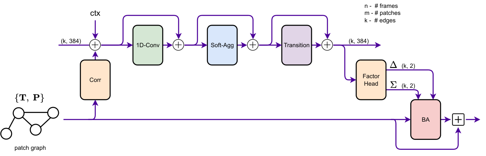

*原论文图 4　相关性、上下文、时间卷积和图聚合更新每条边的隐藏状态；因子头产生二维修正 $\delta$ 与置信权重 $\Sigma$；BA 利用这些建议更新全图共享的相机位姿和 patch 逆深度。图中的残差连接后还有层归一化。*

沿时间的传递并未假定所有轨迹等长。对边 $(k,j)$，系统读取同一 patch 在相邻目标帧的边 $(k,j-1)$、$(k,j+1)$，拼接这些特征后作线性投影。假如第二帧的局部纹理有歧义，来自第一、三帧的跟踪信息就能参与判断。论文把这一步称为一维时间卷积。

跨 patch 的聚合采用按通道加权的邻域平均。对边 $e$ 及邻域 $N(e)$，论文的式（5）是

$$
\psi\!\left(
\frac{\sum_{x\in N(e)}\sigma(x)\,\phi(x)}
{\sum_{x\in N(e)}\sigma(x)}
\right).
\tag{5}
$$

这条式子先用 $\phi$ 变换邻边特征，再用 $\sigma$ 给它们逐通道分配权重，求和后除以权重总量，最后交给 $\psi$ 变换。只看一个通道，若两条邻边的特征值为 $2$ 和 $6$，权重为 $0.75$ 和 $0.25$，送入 $\psi$ 前的值就是 $(0.75\times2+0.25\times6)/(0.75+0.25)=3$。实际网络在多个通道上分别完成这项计算。$\phi$ 与 $\psi$ 是线性层，$\sigma$ 是线性层后接 sigmoid。

论文分别按“连接同一 patch”和“源帧、目标帧相同而 patch 不同”组织邻域。前一种让同一轨迹的不同观测交流；后一种可以想成第一帧里的两个不同 patch 都在第二帧寻找对应，它们共享第一、二帧之间的相机运动，因此有信息可交换。作者把模块称为 SoftMax Aggregation，但式（5）实际写成 sigmoid 权重的归一化加权平均；这里依公式解释，不把它误写成标准 softmax 注意力。

聚合结果经过两个带门控的残差单元，更新隐藏状态。因子头对每条边输出 $\delta_{kj}\in\mathbb R^2$ 和 $\Sigma_{kj}\in(0,1)^2$。$\delta_{kj}$ 是 **patch 中心投影** 应该移动的二维量；$\Sigma_{kj}$ 控制这条边在后续 BA 中的两个坐标分量各有多大影响。相机位姿和深度尚未在这一步改变。新边的隐藏状态初始化为零，随后进入同样的循环。

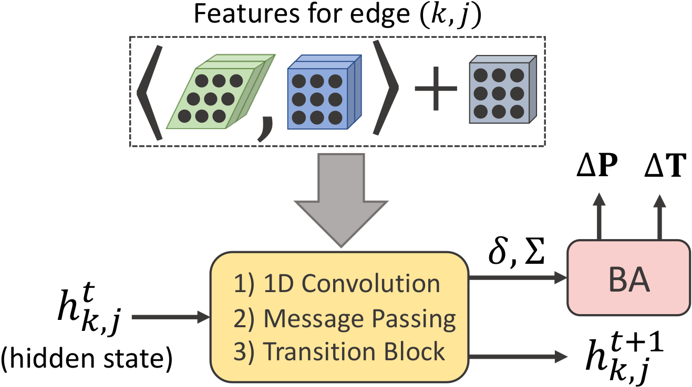

*原论文附录图 G　相关与上下文特征经一维卷积、消息传递和状态转换后，产生新的隐藏状态及二维流修正、置信权重；BA 再据此更新相机位姿和 patch 深度。图中省略了因子头。*

附录 H 的图 I 展开了可学习更新算子的网络结构。它只画网络中的可学习层，因此不包括相关性计算和 BA；附录图 G 则把相关输入、状态更新和几何优化之间的关系放在同一张图里。

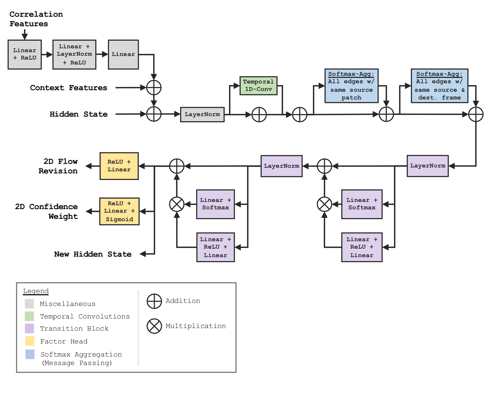

*原论文附录图 I　更新算子内部的网络层结构；相关计算与 BA 不属于这张网络结构图的范围。*

#### 可微 BA 更新几何状态

有了 $\delta_{kj}$，系统先把当前投影中心 $\hat{\mathbf P}'_{kj}$ 加上修正，得到网络提出的二维目标。接下来 BA 改变相机位姿和 patch 逆深度，让重新计算的几何投影靠近这个目标。多条边各有目标，却共享位姿和部分深度变量，因此必须一起求解。论文式（6）把这件事写为

$$
\sum_{(k,j)\in\mathcal E}
\left\|
\hat\omega_{ij}(\mathbf T,\mathbf P_k)
-\bigl[\hat{\mathbf P}'_{kj}+\delta_{kj}\bigr]
\right\|_{\Sigma_{kj}}^2.
\tag{6}
$$

帽号在这里表示取投影 patch 的中心。方括号里是本轮网络给出的目标位置；左侧是由待优化位姿和深度重新算出的投影。为了只看清残差的含义，假设当前中心投影是 $(108,82)$，网络建议修正 $(3,-2)$；目标就是 $(111,80)$，当前残差为 $(-3,2)$ 像素。优化会让许多边的加权残差一起变小。源图像中 patch 的像素坐标保持固定，变化的是相机位姿和 patch 逆深度。$\|\cdot\|_{\Sigma_{kj}}^2$ 表示按网络置信度加权的二维误差：权重小的边对求解影响较小，因而网络可以减弱可疑匹配的作用。附录 G 明确说明置信权重没有直接标签，它通过 BA 后位姿的监督间接学习。

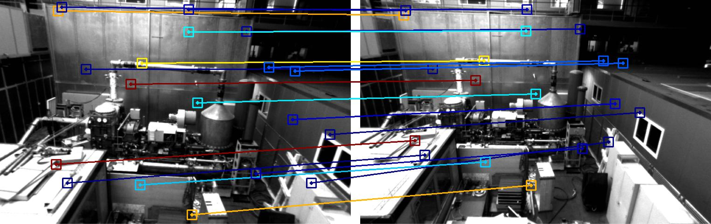

*原论文附录图 H　蓝色表示置信度较高的 patch–帧边，红色表示置信度较低的边；每条边的因子头分别预测二维流修正及两个坐标方向的权重。*

若把一条边的二维残差记为 $\mathbf r_{kj}$，在当前状态附近作一阶展开，形式上得到

$$
\mathbf r_{kj}(\Delta\boldsymbol\xi,\Delta d_k)
\approx \mathbf r_{kj}(\mathbf 0,0)
+\mathbf J^{\mathrm{pose}}_{kj}\Delta\boldsymbol\xi
+\mathbf J^{d}_{kj}\Delta d_k.
$$

这里 $\Delta\boldsymbol\xi$ 是相关相机位姿的李代数增量，$\Delta d_k$ 是该 patch 的逆深度增量；两个雅可比分别描述“移动相机”和“改变深度”各会让投影中心移动多少。它们可由上面的重投影函数对位姿和逆深度求导得到。把所有边的增量合成向量 $\Delta\boldsymbol\theta$，雅可比合成矩阵 $J$，当前残差合成 $r$，再把边的置信度放进权重矩阵 $W$，局部问题就是最小化 $\|r+J\Delta\boldsymbol\theta\|_W^2$。展开并对增量求导，会得到

$$
(J^\mathsf TWJ)\Delta\boldsymbol\theta=-J^\mathsf TWr.
$$

这是 BA 线性化后的基本求解形式；实际求解还加入阻尼。由于一个 patch 的逆深度只参与与该 patch 相连的边，深度块具有稀疏结构；Schur 补可以先消去这些深度增量，再求相机位姿增量，最后回代深度。论文每轮使用两次高斯—牛顿迭代；附录 F 说明 BA 结构沿用 DROID-SLAM，但阻尼值固定为 $10^{-4}$，稀疏求解部分另作 CUDA 实现。

一个 patch 在多帧中的建议会共同约束它的逆深度；多个 patch 又共享相机位姿。因此，如果某一条边希望相机大幅向右，而其他边都支持较小的运动，BA 会依照所有残差和权重求一个共同结果。BA 求得的新几何会改变下一轮的投影中心，相关查询便从新位置开始。网络给出观测建议，BA 更新几何，新的几何再帮助网络检查观测，循环由此闭合。

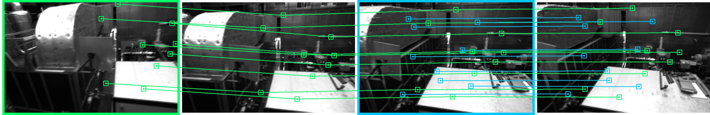

*原论文图 5　同一源关键帧中的 patch 被投影到后续帧；新关键帧加入后产生新 patch。图中的置信度决定对应边对 BA 的贡献。*

### 3.2 训练与监督

前面一轮更新里，BA 的输出依赖网络给出的二维修正与权重。BA 可微，训练时就能用最终位姿的误差反过来调整网络。作者完全用合成的 TartanAir 数据训练；数据提供真实位姿与深度，因此还能通过重投影生成光流监督。训练序列采样在相邻帧间有 $16$ 到 $72$ 像素光流幅度的片段，以覆盖有明显运动但仍可跟踪的情形。更新算子的中间输出也受到监督，而每次更新前的位姿与 patch 状态从计算图中分离。

位姿损失先用 Umeyama 方法对齐预测轨迹与真值的尺度。这里的对齐是在评价两条轨迹的形状与相对运动前，先消除单目视频无法观测到的绝对尺度差。随后比较每对帧的相对位姿。原文式（7）可写成

$$
\mathcal L_{\mathrm{pose}}=
\sum_{i\ne j}
\left\|
\operatorname{Log}_{SE(3)}\!\left[
(\mathbf G_i^{-1}\mathbf G_j)^{-1}
(\mathbf T_i^{-1}\mathbf T_j)
\right]
\right\|,
\tag{7}
$$

其中 $\mathbf G$ 是真值，$\mathbf T$ 是预测。两个括号分别表示真值和预测中从帧 $i$ 到帧 $j$ 的相对运动；先将真值相对运动取逆，再乘预测相对运动，得到二者之间的变换误差。$\operatorname{Log}_{SE(3)}$ 将这个误差变成可计算范数的六维运动量。如此约束的是多帧之间相互一致的运动，而非单独一帧的位置。光流损失则比较 patch 对邻近帧产生的**几何光流**与真值光流：即便网络给出的二维建议看起来合理，BA 后的位姿与深度仍须诱导出正确的像素运动。论文对 $p\times p$ 个位置的误差取最小值。总损失为

$$
\mathcal L=10\mathcal L_{\mathrm{pose}}+0.1\mathcal L_{\mathrm{flow}}.
\tag{8}
$$

训练时每段长度为 15 帧：前 8 帧用于初始化，后 7 帧逐一加入，展开 18 次更新。最初 1000 步固定真值位姿，只让网络估计 patch 深度，然后才同时学习位姿和深度。论文报告在单张 RTX 3090 上以批大小 1 训练 24 万步，约需 3.5 天；优化器为 AdamW，初始学习率 $8\times10^{-5}$ 并线性衰减。附录 D 还列出随机裁剪、颜色扰动、灰度化、颜色反转和尺度变化等增强。这里的端到端指监督可以经过可微 BA 影响网络参数；它不意味着整段长序列都不截断地反向传播。

### 3.3 在线 VO 系统

训练得到的网络进入视频流后，还需要决定何时开始、每次保留多少计算。推理时先积累 8 帧，并要求新帧相对上一帧的平均光流至少 8 像素；若相机几乎不动，最初几帧就难以提供初始化所需的几何变化。积累后运行 12 轮更新来初始化。新帧加入时，位姿先按恒速运动估一个起点；新 patch 深度则用前 3 帧 patch 深度的中位数作初值。这些只是本轮相关查询的起点，后续还会被网络与 BA 修正。

图上的边只连接源帧附近的帧：新 patch 连向此前 $r$ 个关键帧，已有 patch 连向新帧，因此单个 patch 最多关联 $2r-1$ 帧。这限制了每次新帧到来时需要处理的边数。

每次扩图后运行一轮更新算子及两次 BA 迭代。BA 仅放开最近 10 个关键帧的位姿，所有仍在窗口内的 patch 逆深度可更新；滑出窗口的 patch 被移出优化。最近 3 帧始终保留为关键帧。系统在更新后检查较早帧间的光流：若 $t-5$ 与 $t-3$ 两帧间小于 64 像素，就移除 $t-4$ 帧，并保存相邻帧相对位姿以便恢复完整轨迹。

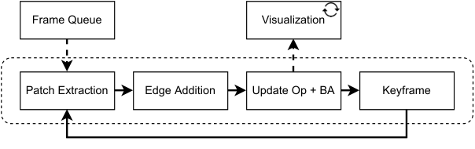

*原论文附录图 D　输入帧依次经过 patch 提取、图边更新、更新算子与 BA，随后执行关键帧维护。*

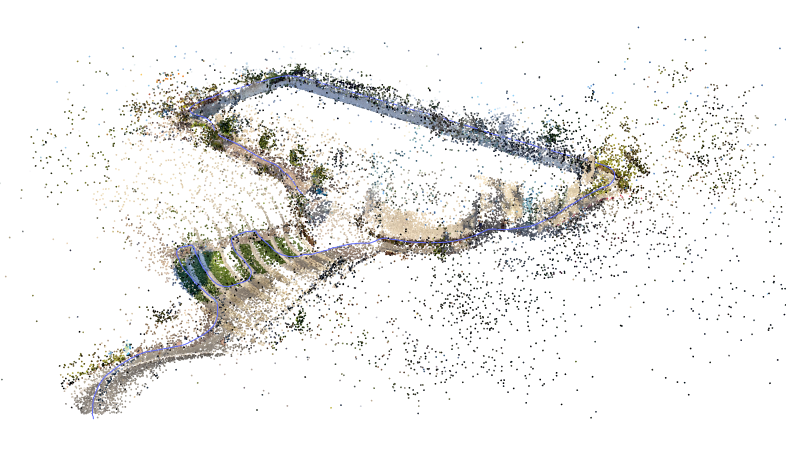

*原论文附录图 B　DPVO 在视频演示中的稀疏三维重建。*

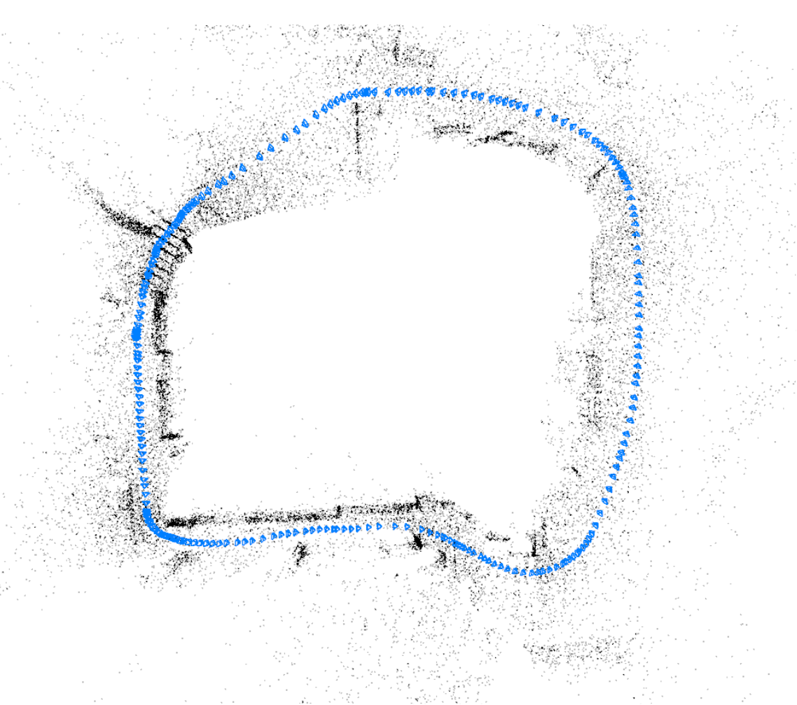

*原论文附录图 C　ETH-3D 数据集上的重建示例。*

这一“先接收、后删除冗余帧”的机制有助于稳定逐帧开销：快速运动时不会因为临时产生更多关键帧而突然扩大计算。但它在相机静止或运动很慢时也会处理一些终将被删除的冗余帧；论文附录 B 明确承认了这项速度代价。

附录 B 报告 DPVO 默认配置平均约 60 FPS，运行时间分布很少低于 50 FPS（约 17 毫秒一帧）。论文观察到 DROID-SLAM 的速度会随关键帧数量和场景运动而波动：在其测试中可从约 40 FPS 降至 11 FPS。这个结果解释了 DPVO 固定逐帧处理的动机，但它是论文所用硬件和测试协议下的报告值，不应视为不同设备上的速度保证。附录 E 还说明，作者将 Pangolin 可视化放在独立线程中读取张量，仍带来约 10% 的运行开销；因此评估可视化开启时的速度时也要留意这部分成本。

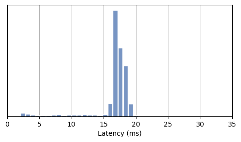

*原论文附录图 A　Default 配置每帧约需 17 毫秒，运行时间分布较集中；论文报告其速度很少低于 50 FPS。*

## 4. 实验

论文在 TartanAir、EuRoC、TUM-RGBD 与附录中的 ICL-NUIM 上评价。DPVO Default 每帧 96 个 patch，使用 10 帧优化窗口；Fast 每帧 48 个 patch，使用 7 帧窗口。主要测试结果对不同随机 patch 集合运行 5 次并报告中位数；TartanAir 验证集和消融实验另按论文所述运行 3 次。

表中的 ATE 是绝对轨迹误差，数值越小表示估计轨迹与真值越接近。论文附录 C 先以相似变换对齐预测轨迹 $\tilde{\mathbf T}$ 与真值轨迹 $\hat{\mathbf T}$，再给出式（9）：

$$
E(\tilde{\mathbf T},\hat{\mathbf T}):=
\sum_{t=1}^{N}
\left\|\tilde{\mathbf T}^{xyz}_t-\hat{\mathbf T}^{xyz}_t\right\|_2.
\tag{9}
$$

这里的上标 $xyz$ 取相机位置，逐帧比较的是对齐后的三维位置。原式写成求和，表格数值沿用作者的 EVO 评价结果；不能从式（9）单独推断各表是否另作了长度归一化。相似变换对齐消除了单目尺度与坐标基准的自由度，所以这些数字反映尺度对齐后的轨迹质量，并非绝对尺度估计精度。

| 论文报告的比较 | DROID-VO | DPVO Default | DPVO Fast |
| --- | ---: | ---: | ---: |
| TartanAir 测试集平均 ATE，表 1 | 0.58 | **0.21** | 0.28 |
| EuRoC 平均 ATE，表 2，单位 m | 0.186 | **0.105** | 0.129 |
| TUM-RGBD fr1 平均 ATE，表 3，单位 m | 0.098 | **0.089** | 0.097 |
| EuRoC 测得显存，图 10 | 8.7 GB | 4.9 GB | **2.5 GB** |

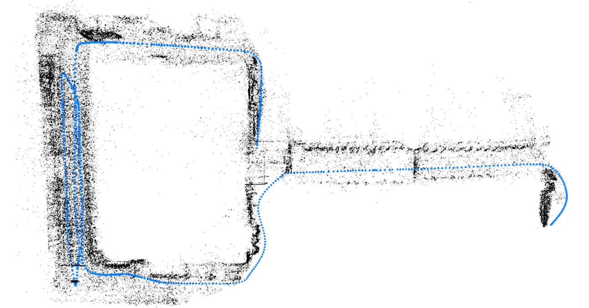

*原论文图 6　DPVO 在 TartanAir 上的重建示例。*

TartanAir 还包含与测试表分开的 32 序列验证集结果：在 $[0,1]$ 米误差区间内，DPVO 的 AUC 为 0.80，DROID-SLAM 为 0.71；论文报告 DPVO 在该验证设置下快 4 倍。验证集 AUC 与测试集按序列汇总的 ATE 是两种不同协议，不能合并成同一列比较。

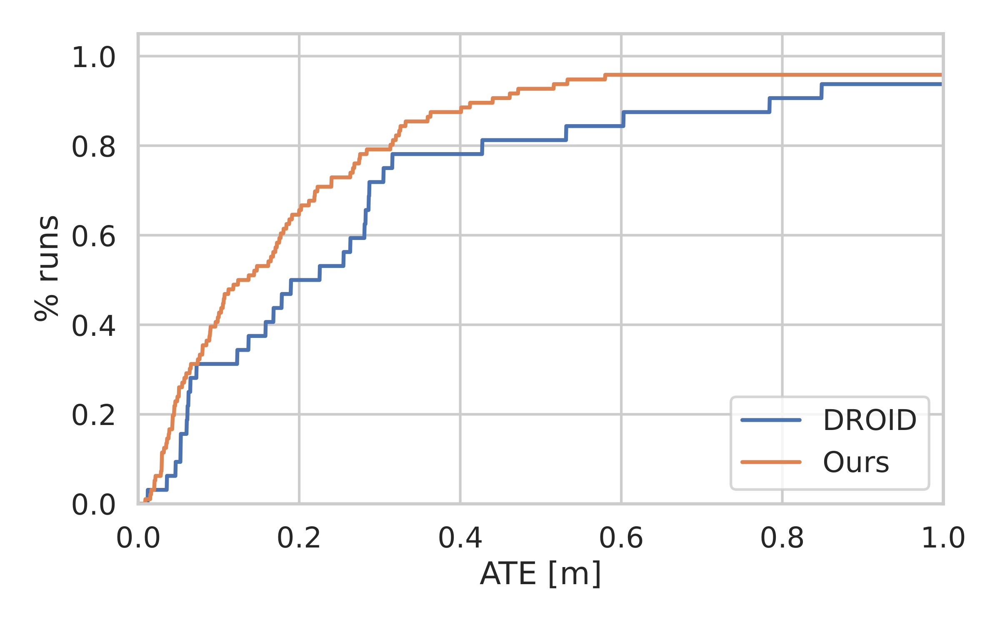

*原论文图 7　验证集上按 ATE 阈值统计的结果；曲线下面积对应 DPVO 0.80、DROID-SLAM 0.71。*

TartanAir 测试集表 1 还列出完整 DROID-SLAM 的平均 ATE 为 0.33，但它使用全局优化或回环；比较 VO 前端时，DROID-VO 是更直接的基线。EuRoC 的视频为 20 FPS，实验与 DROID-SLAM 一样跳过隔帧，论文报告的 60/120 FPS 是处理能力，并不表示输入视频有相应采样帧率。速度测试中，Default 相对 DROID-VO 平均快 1.5 倍，Fast 平均快 3 倍；在运行较慢的帧上，两者分别快 4.3 倍和 8.9 倍。显存“约三分之一”对应 Fast 的 2.5 GB 对 8.7 GB，Default 则为 4.9 GB。

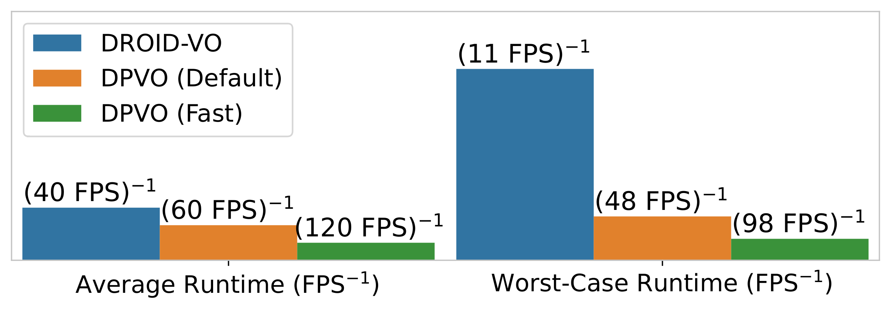

*原论文图 8　Default 与 Fast 的平均速度分别为 60 FPS 和 120 FPS；图中同时显示运行较慢帧上的速度差距。*

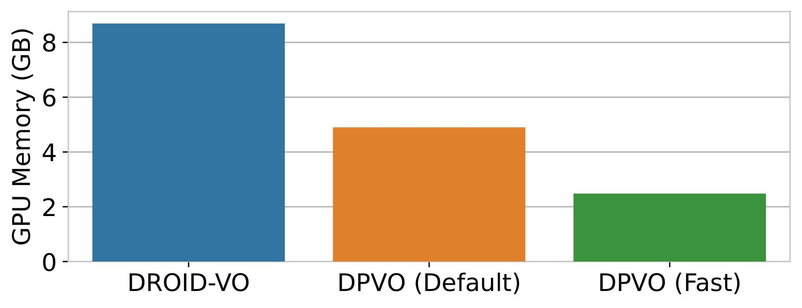

*原论文图 10　DROID-VO、DPVO Default 与 DPVO Fast 的显存分别为 8.7 GB、4.9 GB 和 2.5 GB。*

这些平均值也应结合逐序列结果看。EuRoC 上 DPVO Default 的平均 ATE 较低，但 MH05、V101 等序列并没有优于 DROID-VO；TUM-RGBD 的平均差距只有 0.009 m。附录 A 的 ICL-NUIM 是合成室内数据，包含重复纹理和大面积单色墙面，专门暴露了外观信息不足时的跟踪困难。下表摘出该附录中 DROID 与 DPVO 的逐序列结果；ATE 单位为米，数值越低越好。

| 方法 | Living Room 0 | Living Room 1 | Living Room 2 | Living Room 3 | Office Room 0 | Office Room 1 | Office Room 2 | Office Room 3 | 平均 |
| --- | ---: | ---: | ---: | ---: | ---: | ---: | ---: | ---: | ---: |
| DROID-SLAM | 0.008 | 0.027 | 0.039 | 0.012 | 0.065 | 0.025 | 0.858 | 0.481 | 0.189 |
| DROID-VO | 0.010 | 0.123 | 0.072 | 0.032 | 0.095 | 0.041 | 0.842 | 0.504 | 0.215 |
| DPVO Default | **0.006** | **0.006** | 0.023 | **0.010** | 0.067 | **0.012** | **0.017** | 0.635 | 0.097 |
| DPVO Fast | 0.008 | **0.007** | **0.021** | **0.010** | 0.071 | 0.015 | 0.018 | **0.593** | **0.093** |

这组数据说明平均值掩盖了明显的场景差异：DPVO 在 Living Room 以及 Office Room 2 上误差较低，但在 Office Room 3 上仍达到 0.635 米（Fast 为 0.593 米），而 DROID 两种设置在 Office Room 2 的误差都超过 0.8 米。困难序列并没有被某一种方法稳定解决。表中 DROID-SLAM 含完整系统的全局优化能力，DROID-VO 则关闭全局后端；这两行的差异也提醒读者，方法的序列误差会受系统范围影响。论文所说的鲁棒性由多个数据集上的多次试验支持，尚不能理解为任意场景都不会丢失跟踪。

### 4.1 消融实验

图 9 的三组消融给出较清晰的机制证据：patch 特征优于单点特征；移除时间卷积或图聚合会使验证集表现变差；随机 patch 中心优于 SIFT、ORB、SuperPoint 或高梯度位置。附录图 E 还显示，EuRoC 上 patch 数超过约 96 后精度收益很快趋缓。实验说明的是**在该网络、训练数据和评价协议下，稀疏 patch 设计足以支持强 VO 精度**；这一观察不能直接外推到所有视觉估计任务。

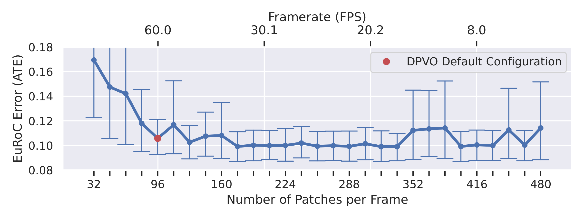

*原论文附录图 E　在 EuRoC 上增加 patch 数可以用更多计算换取精度，但超过约 96 个后，精度提升很快趋缓。*

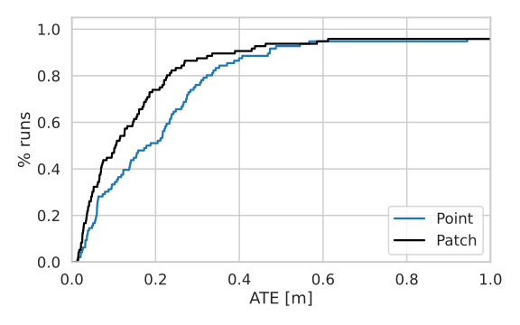

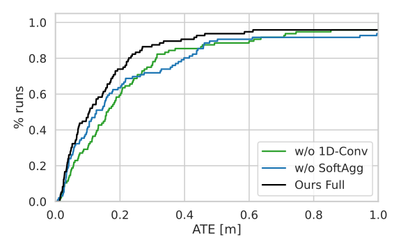

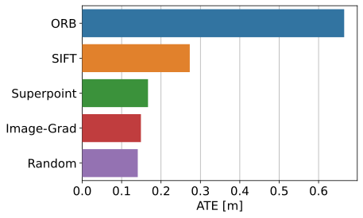

*原论文图 9　以上三幅子图分别比较观测表示、更新算子组件和采样位置。曲线来自同一验证协议，显示各组件在该设置下对误差的影响。*

## 5. 结论

DPVO 把视觉里程计中的“少量观测”设计成一套闭环：带局部上下文的 patch 提供可辨别的外观；稀疏图上的时间传播与跨 patch 聚合补足观测间的信息交流；网络给出二维修正及置信度；可微 BA 将这些建议约束到共享位姿和逆深度上。节省计算并未发生在单个模块，而是发生在整条链路都围绕稀疏 patch 重写之后。

论文也保留了明确边界。每个 patch 的常深度模型是近似，系统依赖已知相机内参和一定初始化运动；它只做局部 VO，长轨迹累计漂移仍需要 SLAM 系统的全局校正。实验显示的是特定数据集及硬件上的精度、速度和显存权衡。这些限定不削弱它的主要结论：高质量学习式对应与几何优化可以不以稠密光流为前提。
