# DROID-SLAM in the Wild 论文解读

> **论文**：*DROID-SLAM in the Wild*
>
> **作者**：Moyang Li、Zihan Zhu、Marc Pollefeys、Daniel Barath
>
> **版本**：CVPR 2026 Open Access 版本，共 11 页
>
> **补充材料**：CVPR 官方补充 PDF，共 6 页
>
> [CVPR 论文页面](https://openaccess.thecvf.com/content/CVPR2026/html/Li_DROID-SLAM_in_the_Wild_CVPR_2026_paper.html) · [论文 PDF](https://openaccess.thecvf.com/content/CVPR2026/papers/Li_DROID-SLAM_in_the_Wild_CVPR_2026_paper.pdf) · [补充材料 PDF](https://openaccess.thecvf.com/content/CVPR2026/supplemental/Li_DROID-SLAM_in_the_Wild_CVPR_2026_supplemental.pdf) · [代码与数据集](https://github.com/MoyangLi00/DROID-W.git)

DROID-SLAM in the Wild（论文中简称 DROID-W）把 DROID-SLAM 的可微束调整扩展到动态场景。它在每个低分辨率像素上估计动态不确定性，用该不确定性降低可疑重投影对应对位姿和逆深度更新的影响；不确定性本身则由 DINOv2 特征在相机运动补偿后的跨帧相似度来约束。系统还用 Metric3D 单目深度作为 BA 正则项，并在关键帧局部优化期间交替更新位姿、深度和不确定性。

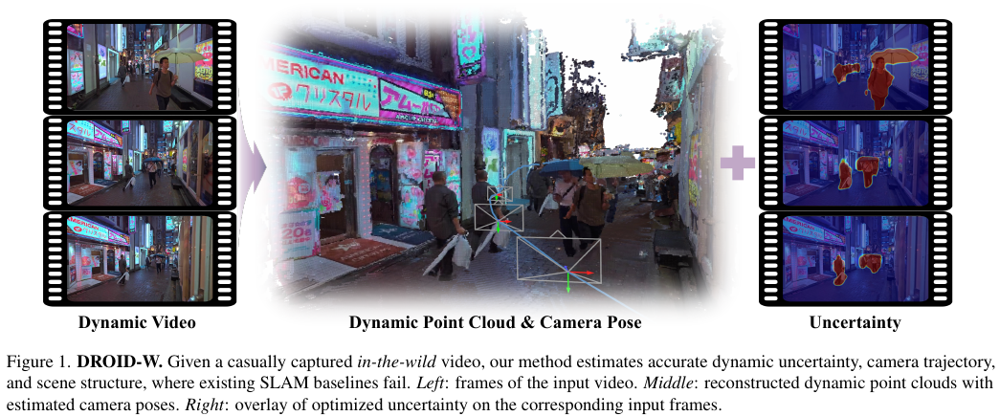

*原论文图 1。方法从随手拍摄的视频估计相机轨迹、动态点云和逐像素不确定性；不确定性图与场景几何一起呈现。*

## 1. 引言

视觉 SLAM 要从连续图像中估计相机运动并恢复场景结构。动态物体和非刚性运动会破坏常用的静态场景假设，使来自移动物体的对应关系也进入位姿估计和地图构建，最终同时损害轨迹和几何。

已有动态 SLAM 常用物体检测、语义分割或光流来标记运动区域，再屏蔽这些区域；这类方法对未见类别或复杂拥挤场景的适应能力有限。另一类不确定性感知系统从 DINO 特征预测每像素权重，但其不确定性学习通常依赖高质量的静态 NeRF 或 Gaussian 地图。若动态环境中的地图本身不可靠，地图监督也会变得不可靠。

DROID-W 的出发点是把不确定性直接放进 DROID-SLAM 的稠密 BA 残差中，并用跨帧视觉特征一致性学习不确定性，不要求预先提供运动类别或先构造高质量静态地图。作者还提出 DROID-W 户外数据集，包含七段带相机轨迹真值的街区视频，并用 YouTube 视频补充真实世界评测。图 1 概括了输入、重建结果与不确定性估计。

## 2. 相关工作

### 传统视觉 SLAM

许多传统视觉 SLAM 假设环境静止。应对动态干扰的一类方法会利用较大的帧间残差或帧到模型的对齐误差，隐式降低异常区域的影响；另一类方法使用目标检测或语义分割显式屏蔽动态物体。前者不必事先知道物体类别，但残差也可能来自错误位姿或低纹理；后者能用类别先验识别运动物体，却容易漏掉未见类别。DROID-W 延续残差优化框架，但把动态可信度作为连续的逐像素不确定性来估计。

### NeRF 与 Gaussian Splatting SLAM

神经隐式场和 3D Gaussian Splatting 为 SLAM 提供稠密地图表示。动态版本通常结合语义分割、运动预测或逐像素不确定性处理动态区域。论文指出，一些不确定性方法把权重学习与场景表示绑定：地图若在复杂场景中重建失败，不确定性也可能被错误的渲染或几何监督带偏。DROID-W 改以两帧图像特征之间的相似度作为不确定性线索，让不确定性更新不直接依赖 NeRF 或 Gaussian 地图的质量。

### 前馈式重建

DUSt3R、VGGT 等前馈模型能快速预测场景几何；MonST3R、Easi3R 将动态线索引入前馈重建，CUT3R 与 TTT3R 则支持更长序列的在线处理。论文认为，这类方法在视觉上可得到合理几何，但相机轨迹与公制一致性仍可能弱于带优化后端的 SLAM。DROID-W 因而保留显式位姿、深度和关键帧图优化，以逐帧迭代的方式融合学习到的特征与几何约束。

## 3. 方法

DROID-W 建立在 DROID-SLAM 上。系统从 RGB 图像中抽取关键帧对，DROID 特征网络预测稠密对应与置信度，BA 更新相机位姿和逆深度；Metric3D 提供单目深度约束，DINOv2 特征则用于更新动态不确定性。图 2 展示这些模块如何通过交替优化连接起来。

图中的雪花标记表示 Metric3D、DROID 特征提取器和 DINOv2 特征提取器冻结；参与在线更新的是位姿、逆深度和由特征生成的不确定性映射。因而系统利用预训练网络提取线索，再由 SLAM 后端不断调整几何与局部不确定性。

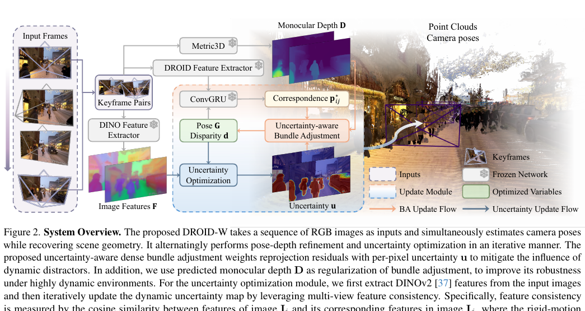

*原论文图 2。橙色路径更新 BA 中的位姿与深度，蓝色路径更新不确定性；两条路径共享当前估计的相机几何和关键帧特征。*

### 3.1 DROID-SLAM 预备知识

DROID-SLAM 为每帧维护相机位姿 $G_t\in SE(3)$ 和低分辨率视差图 $d_t\in\mathbb R^{H/8\times W/8}$。论文将其称作 disparity；下文在涉及几何含义时按逆深度理解。帧图 $(\mathcal V,\mathcal E)$ 记录哪些帧对有重叠；若 $(i,j)\in\mathcal E$，则在两帧间建立稠密对应约束。

对帧 $i$ 中像素网格点 $p_i$，使用逆投影、相对位姿和投影函数得到在帧 $j$ 中由刚体运动预测的位置：
\[
p_{ij}=\Pi_c\!\left(G'_{ij}\circ\Pi_c^{-1}(p_i,d'_i)\right). \tag{1}
\]
其中，\(\Pi_c\) 与 \(\Pi_c^{-1}\) 分别是相机投影和逆投影，\(G'_{ij}\) 是当前估计的帧间相对位姿，\(d'_i\) 是待优化逆深度。DROID-SLAM 的网络另行预测对应位置 \(p^*_{ij}\) 和置信度 \(w_{ij}\)。因此优化器能比较“网络预测的对应”与“当前位姿、深度所解释的对应”。

对所有共视帧对，基础 BA 最小化带置信度的稠密重投影误差：
\[
E(G',d')=\sum_{(i,j)\in\mathcal E}\|p^*_{ij}-p_{ij}\|^2_{\Sigma_{ij}},\qquad
\Sigma_{ij}=\operatorname{diag}(w_{ij}). \tag{2}
\]
这里的马氏距离由 \(w_{ij}\) 对应位置加权，高置信度对应对优化影响更大。位姿增量 \(\Delta\xi\) 和逆深度增量 \(\Delta d\) 通过 Gauss–Newton 正规方程求解：
\[
\begin{aligned}
\begin{bmatrix}B&E\\E^\top&C\end{bmatrix}
\begin{bmatrix}\Delta\xi\\\Delta d\end{bmatrix}
&=\begin{bmatrix}v\\w\end{bmatrix},\\
\Delta\xi&=(B-EC^{-1}E^\top)^{-1}(v-EC^{-1}w),\\
\Delta d&=C^{-1}(w-E^\top\Delta\xi).
\end{aligned} \tag{3}
\]
\(B,E,C\) 是线性化后正规方程的块矩阵，\(v,w\) 是残差对应的右端项。由于每个深度变量只与其自身相关，\(C\) 为对角矩阵，便于通过 Schur 补消去深度变量，先解较小的位姿系统，再回代得到深度更新。这是后续把逐像素不确定性并入 BA 的基础。

### 3.2 不确定性感知束调整

动态物体不服从相机运动诱导的刚体对应关系。它的对应误差会被普通 BA 当成相机或深度错误，导致错误更新。DROID-W 为每个低分辨率像素维护动态不确定性 \(u_t\)，并用其缩小相应残差的权重：
\[
\Sigma^{\mathrm{uncer}}_{ij}
=\operatorname{diag}\!\left(w_{ij}\cdot\frac{1}{u'_i}\right). \tag{4}
\]
因此，基础置信度 \(w_{ij}\) 仍提供网络对匹配的信任程度，而 \(1/u'_i\) 再根据像素的不确定性衰减该权重。高不确定像素对 BA 的贡献变小，低不确定像素仍可约束位姿和深度。

直接用 Gauss–Newton 联合求解位姿、深度与不确定性代价过高，论文采用交替优化：先固定不确定性，用加权残差更新位姿和逆深度；再固定当前几何，更新不确定性。前一步对应：
\[
\hat E(G',d')=\sum_{(i,j)\in\mathcal E}
\|p^*_{ij}-p_{ij}\|^2_{\Sigma^{\mathrm{uncer}}_{ij}}. \tag{5}
\]
式 (5) 只改变了式 (2) 中残差的权重。几何优化器仍处理相同的对应误差，但动态区域的高残差不再能像原来那样主导位姿与深度更新。

### 3.3 不确定性优化

若用重投影残差直接判断动态区域，位姿尚未收敛时，静态像素也可能呈现大残差。作者改用图像特征的一致性来估计不确定性：对每个帧对 \((I_i,I_j)\)，先从图像抽取 FiT3D 特征（基于 DINOv2 的特征模型）；再用当前位姿和深度按式 (1) 将帧 \(i\) 的像素投影到帧 \(j\)，通过双线性插值得到对应特征 \(F_{ij}\) 与不确定性 \(u'_{ij}\)。若跨帧匹配特征相似，则更像是静态背景；相似度低则可能由运动或错误对应导致。

作者用余弦相似度 \(\frac{F_i\cdot F_{ij}}{\|F_i\|_2\|F_{ij}\|_2}\) 计算两帧特征一致性，并用两个方向的不确定性调节其损失：
\[
E_{\mathrm{sim}}(u')=\sum_{(i,j)\in\mathcal E}
\frac{1-\dfrac{F_i\cdot F_{ij}}{\|F_i\|_2\|F_{ij}\|_2}}
{u'_i\,u'_{ij}}. \tag{6}
\]
分子是特征不相似度；相似度越高，分子越接近零，越符合静态对应。分母使模型倾向于把不一致对应解释为高不确定区域，但如果只优化这一项，把所有不确定性增大也能降低损失。为避免这种平凡解，作者加入对数先验：
\[
E_{\mathrm{prior}}(u')=\sum_i\log(u'_i+1.0), \tag{7}
\]
并把偏置 1.0 加入对数，避免先验项取负。总不确定性目标为：
\[
E_{\mathrm{uncer}}(u')=E_{\mathrm{sim}}(u')+
\gamma_{\mathrm{prior}}E_{\mathrm{prior}}(u'). \tag{8}
\]
\(\gamma_{\mathrm{prior}}\) 控制抑制过大不确定性的强度。于是，不一致特征会推动局部不确定性增大，而先验代价阻止其无限增长。

不确定性图若逐像素自由优化，可能出现空间噪声和帧间跳变。论文让 FiT3D 特征经过局部仿射映射，再通过 Softplus 得到正值不确定性：\(u=\operatorname{Softplus}(\theta\cdot F)\)。局部映射参数 \(\theta\) 将相邻特征与不确定性联系起来，起到局部正则化作用。作者不用大型 Hessian 的 Newton 更新，而用梯度下降并加入权重衰减；其链式梯度与参数更新写为：
\[
\begin{aligned}
g_t&=\sum_{i=0}^{N}\frac{\partial E_{\mathrm{uncer}}}{\partial u'_i}
\frac{\partial u'_i}{\partial\theta_{t-1}}\\
&=\sum_{i=0}^{N}\frac{\partial E_{\mathrm{uncer}}}{\partial u'_i}
\frac{1}{1+\exp(-\theta_{t-1}\cdot F_i)}F_i,\\
\theta_t&=\theta_{t-1}-\lambda g_t-\eta\theta_{t-1}.
\end{aligned} \tag{9}
\]
这里 \(\lambda\) 是梯度步长，\(\eta\) 是权重衰减系数；式 (9a) 中的 sigmoid 因子来自 Softplus 对仿射响应的导数。更新后的映射再作用于特征，生成供下一轮 BA 使用的不确定性。

### 3.4 SLAM 系统

初始化阶段先积累 12 个有足够运动的关键帧。DROID-SLAM 原本将逆深度初始化为常数 1；在动态场景中，这种粗初始化可能使追踪不稳。DROID-W 改用 Metric3D 预测的单目深度 \(D_i\) 约束 BA。文中将目标扩展为：
\[
E^+(G',d')=\sum_{(i,j)\in\mathcal E}
\|p^*_{ij}-p_{ij}\|^2_{\Sigma^{\mathrm{uncer}}_{ij}}
+\gamma_d\sum_i\|d'_i-D_i\|_2^2.
\]
第一项保留不确定性感知的稠密对应约束，第二项让优化后的深度不要偏离 Metric3D 预测过远；\(\gamma_d\) 平衡两种约束。新关键帧到达后，系统在滑动窗口中进行局部 BA，并交替优化位姿、逆深度和不确定性。前端跟踪后，再对所有关键帧做全局 BA 更新位姿与逆深度；不确定性映射在这一步被冻结，因为其局部仿射先验是针对局部窗口设计的。

这里需要保留原文的一个记号问题：3.1 节把 \(d_i\) 定义为逆深度，而 3.4 节将 Metric3D 输出称为深度 \(D_i\)，式中直接写 \(\|d'_i-D_i\|_2^2\)，没有说明是否先将其中一个量取倒数或做尺度转换。因而可以确认其意图是用单目深度正则 BA，但不能从论文正文确定该项在实现中如何统一量纲。

## 4. 实验

### 数据集、基线与指标

作者在 Bonn RGB-D Dynamic、TUM RGB-D 和 DyCheck 上评估，并提出户外 DROID-W 数据集。DROID-W 由刚性安装在 RGB 相机上的 Livox Mid-360 采集，共有 Downtown 1–7 七段 1200×1600 视频，并同步提供相机轨迹真值、IMU 与 LiDAR 测量。Downtown 1、2 的轨迹真值由 FAST-LIVO2 估计，其余序列使用 RTK 真值。另用六段 YouTube 动态视频做重建展示，长度从 8 秒到 30 分钟；超过 5 分钟的视频分成不重叠的 5 分钟片段，内参由 MonST3R 使用 20 帧估计。

对比方法包括传统 SLAM、动态 SLAM、静态场景 NeRF/GS SLAM、动态 NeRF/GS SLAM，以及 MonST3R、TTT3R 等前馈方法。主要指标是 ATE RMSE。DyCheck 轨迹按 MegaSaM 协议归一化为单位长度；估计轨迹先补回非关键帧，再和真值做 Sim(3) Umeyama 对齐。速度以输入帧数除以总耗时计算。由于使用的传感器和评测条件不同，表格按论文报告解读，不把各数据集的数值直接互相比较。

### 4.1 实验结果

#### 定量跟踪结果

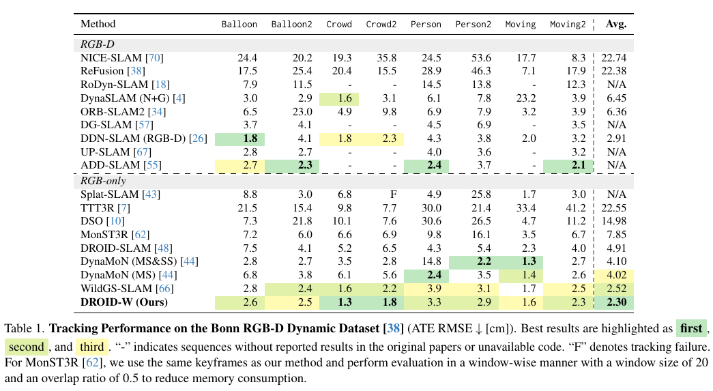

*原论文表 1。指标为 ATE RMSE，单位厘米，越低越好；表格按 RGB-D 与 RGB-only 方法分组。*

Bonn 上，DROID-W 的 RGB-only 平均误差为 2.30 cm，优于表中其他 RGB-only 方法；其中部分 RGB-D 基线仍有各自最优序列表现，不能将表格解读为每个子序列都全面领先。

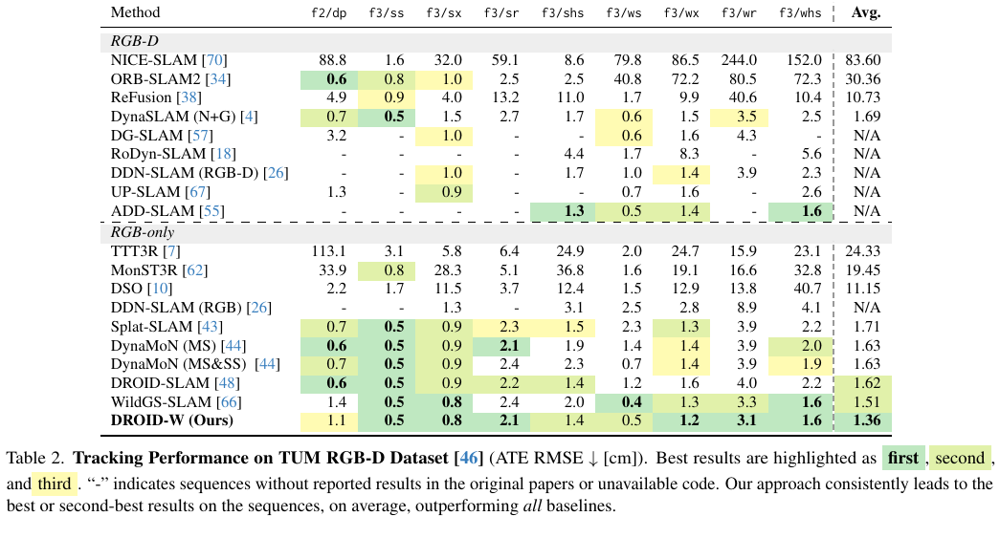

*原论文表 2。ATE RMSE 单位为厘米，DROID-W 的平均误差为 1.36 cm。*

TUM 上 DROID-W 的平均值为 1.36 cm，低于 DROID-SLAM 的 1.62 cm 和 WildGS-SLAM 的 1.51 cm。不过它在 f3/dp 的 1.1 cm 并非该列最优，且个别序列仅小幅领先，因此主要证据是平均表现，而不是所有场景都取得相同幅度收益。

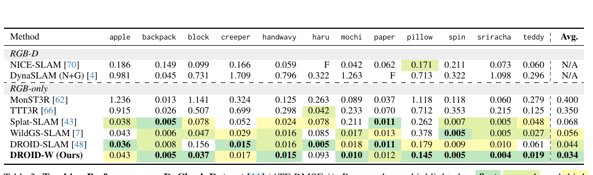

*原论文表 3。DyCheck 的 ATE RMSE 按单位长度轨迹评估；表中“F”表示跟踪失败。*

DyCheck 上，DROID-W 平均误差为 0.034，优于 DROID-SLAM 的 0.044 和 WildGS-SLAM 的 0.056。但该表也显示明显的场景差异：Haru 序列上 DROID-W 为 0.093，而 DROID-SLAM 为 0.005。论文解释，Haru 中移动狗占据主要视野，可靠静态背景特征变少，抑制动态区域后可供追踪的背景约束不足。这个例子说明动态不确定性并不总能提高跟踪，场景中静态背景是否充足同样关键。

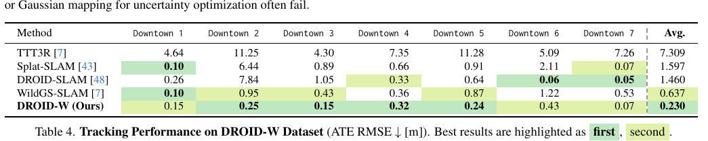

*原论文表 4。单位为米，DROID-W 的七段序列平均 ATE 为 0.230 m。*

在新建的 DROID-W 数据集上，DROID-W 的平均 ATE 为 0.230 m，低于 WildGS-SLAM 的 0.637 m、DROID-SLAM 的 1.460 m 和 TTT3R 的 7.309 m。它在 Downtown 1 上不是最优，但在其余大多数片段上误差较低。该数据集是作者采集的新评测集，因此结果有助于展示真实户外场景下的表现，也需要后续独立复现与更广泛使用来验证其代表性。

#### 不确定性与重建质量

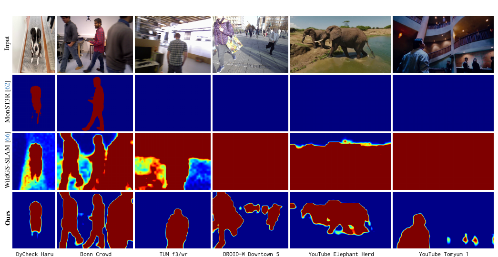

*原论文图 3。MonST3R 输出二值运动掩码；WildGS-SLAM 与 DROID-W 输出动态不确定性。作者展示 DROID-W 在这些片段中的不确定性更连贯，但图像比较属于定性证据。*

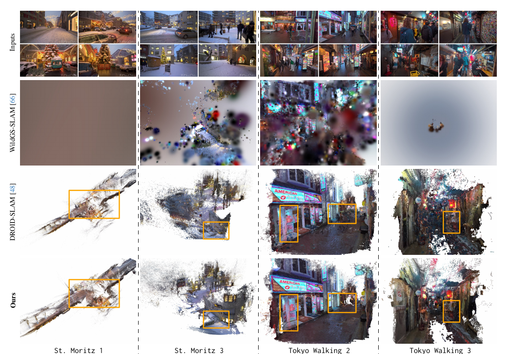

*原论文图 4。DROID-SLAM、WildGS-SLAM 与 DROID-W 在四段视频上的点云或 Gaussian 重建；橙框标出局部结构差异。*

作者在图 4 中展示，动态干扰会令 DROID-SLAM 出现尺度漂移、几何错误或运动噪声；WildGS-SLAM 在这些片段中也难以形成稳定地图。DROID-W 的点云更完整、时序更一致。需要留意，DROID-SLAM 与 DROID-W 以点云显示，而 WildGS-SLAM 以 3DGS viewer 渲染，因此视觉呈现方式并不完全相同，定性图不能取代轨迹误差表。

#### 运行速度

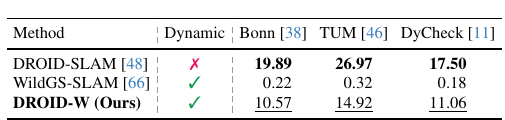

*原论文表 5。测试使用 RTX 3090 与 16 核 CPU，单位为 FPS。*

表 5 报告 DROID-W 在 Bonn、TUM 和 DyCheck 上分别为 10.57、14.92、11.06 FPS；WildGS-SLAM 分别为 0.22、0.32、0.18 FPS。作者据此称达到约 10 FPS，并报告相对 WildGS-SLAM 的显著加速。DROID-W 略慢于原始 DROID-SLAM，论文将额外开销归因于 Metric3D 深度预测和 DINOv2 特征提取。这里的速度来自特定 RTX 3090 和 16 核 CPU，不能直接当作所有硬件上的实时帧率保证。

### 4.2 消融实验

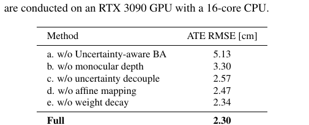

*原论文表 6。指标为 Bonn 的 ATE RMSE，单位厘米，完整模型为 2.30 cm。*

去掉不确定性感知 BA 后误差升至 5.13 cm；去掉单目深度约束后为 3.30 cm；不确定性不解耦时为 2.57 cm；去掉局部仿射映射为 2.47 cm；去掉权重衰减为 2.34 cm。完整模型在这组消融中误差最低，说明几个部分都对该数据集有贡献，其中不确定性感知 BA 和单目深度项的影响最大。

论文对“不确定性不解耦”进一步给出替代损失：
\[
E^*_{\mathrm{sim}}(u')=\sum_{(i,j)\in\mathcal E}
\frac{1-\dfrac{F_i\cdot F_{ij}}{\|F_i\|_2\|F_{ij}\|_2}}
{(u'_i)^2}. \tag{10}
\]
与式 (6) 中分别使用两帧不确定性 \(u'_i u'_{ij}\) 不同，式 (10) 只用 \((u'_i)^2\)，不再分别建模帧对两侧的动态性。该变体误差上升至 2.57 cm。作者还指出，不使用仿射映射时直接更新不确定性，会破坏其空间与时间一致性；移除权重衰减则会使仿射映射缺少正则化，并导致结果略差。

## 5. 结论

DROID-W 以 DROID-SLAM 的稠密 BA 为骨架，通过逐像素不确定性减弱动态对应对位姿和深度优化的影响。与依赖地图重建质量或预定义运动类别的做法相比，它用相机运动补偿后的 DINOv2 特征一致性作为跨帧线索，并以局部仿射映射约束不确定性图的平滑性；Metric3D 深度则补充了动态场景中的几何正则。

实验在 Bonn、TUM、DyCheck 和新建 DROID-W 户外集上展示出较强的平均跟踪结果，并以消融说明不确定性感知 BA、单目深度和不确定性正则化的作用。但逐场景表现并不一致，Haru 的退化尤其说明当动态物体占据大部分视野时，静态背景约束会变少。作者也指出，系统依赖帧间对齐；SLAM 初始化时位姿仍不可靠，可能使初期不确定性估计出错。论文提出后续可引入重建先验来提升初始化鲁棒性。

## 补充材料

### 7. 数据集补充信息

DROID-W 数据集的 RGB 视频以 20 FPS 采集，RTK 位姿以 10 Hz 提供。Downtown 1 和 2 缺少卫星定位，作者用 FAST-LIVO2 的轨迹作为真值；补充材料报告 FAST-LIVO2 在 Downtown 3–7 上的平均 ATE 为 0.071 m，DROID-W 为 0.242 m。二者使用的输入不同：FAST-LIVO2 融合 RGB、IMU 与 LiDAR，DROID-W 仅用 RGB。该比较用来说明前者精度足以作为前两段的参考轨迹，不是 DROID-W 与多传感器系统在同等输入下的性能对比。

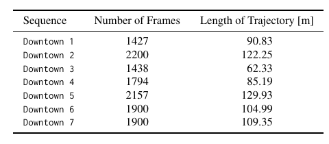

*补充表 7。七段序列各含 1,427–2,200 帧，轨迹长度约 62–130 m。*

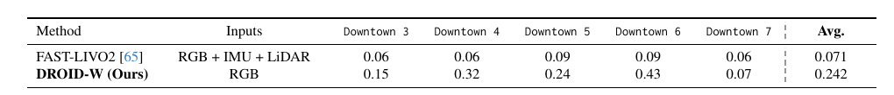

*补充表 8。FAST-LIVO2 使用 RGB、IMU 和 LiDAR，DROID-W 只使用 RGB；两者平均误差不能按同一传感器条件直接比较。*

补充材料列出用于评测的 YouTube 视频片段、时长、帧率和分辨率。原始视频共有六段，长于五分钟的 St. Moritz 被切成多个不重叠片段，因此表中列出九个序列名。

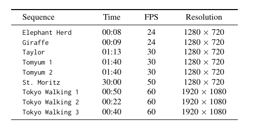

*补充表 9。St. Moritz 片段最长为 30 分钟；东京街景视频为 1920×1080，其余列出的片段为 1280×720。*

主文说长于五分钟的视频会拆成不重叠片段，但补充表 9 仍将 St. Moritz 列为 30 分钟，且没有列出拆分后的边界或各片段帧率。论文没有解释这两处统计口径如何对应，因此不能从表格还原具体的分段方案。

### 8. 不确定性优化的雅可比

补充材料把主文的不确定性目标写成逐帧特征到不确定性的映射，以及帧图边上的相似度损失之和。记 \(e_{ij}\) 为式 (6) 中一个有向帧对的特征不一致损失，\(\theta\) 为特征仿射映射参数，则：
\[
u'_i=\log(\exp(\theta\cdot F_i)+1),\qquad
E_{\mathrm{uncer}}(u')=\sum_{(i,j)\in\mathcal E}e_{ij}
+\gamma_{\mathrm{prior}}\sum_i\log(u'_i+1.0),
\]
\[
E_{\mathrm{uncer}}(u')=
\sum_{(i,j)\in\mathcal E}
\frac{1-\dfrac{F_i\cdot F_{ij}}{\|F_i\|_2\|F_{ij}\|_2}}
{u'_i u'_{ij}}+
\gamma_{\mathrm{prior}}\sum_i\log(u'_i+1.0). \tag{11}
\]
这里 Softplus 使预测不确定性为正。单个帧对损失对参考帧和目标帧不确定性的导数分别为：
\[
\frac{\partial e_{ij}}{\partial u'_i}=-\frac{e_{ij}}{u'_i},\qquad
\frac{\partial e_{ij}}{\partial u'_j}=-\frac{e_{ij}}{u'_j}\,\varepsilon_{ij}. \tag{12}
\]
\(u'_{ij}\) 是帧 $j$ 在重投影位置双线性插值得到的不确定性；因此 \(\varepsilon_{ij}\) 表示该插值对帧 $j$ 像素网格的权重矩阵，把目标端梯度分配回相邻像素。汇总帧 \(l\) 在所有出边与入边上的贡献，并加入对数先验，可以得到对不确定性的梯度；再乘 Softplus 对参数的导数，得到对 \(\theta\) 的梯度：
\[
\frac{\partial E_{\mathrm{uncer}}}{\partial u'_l}=
-\sum_{(l,m)\in\mathcal E}\frac{e_{lm}}{u'_l}
 -\sum_{(k,l)\in\mathcal E}\frac{e_{kl}}{u'_k}\varepsilon_{kl}
+\gamma_{\mathrm{prior}}\frac{1}{u'_l+1.0},
\]
\[
\frac{\partial u'_l}{\partial\theta}=
\frac{1}{1+\exp(-\theta\cdot F_l)}F_l,\qquad
\frac{\partial E_{\mathrm{uncer}}}{\partial\theta}=
\sum_{l=0}^{N}\frac{\partial E_{\mathrm{uncer}}}{\partial u'_l}
\frac{\partial u'_l}{\partial\theta}. \tag{13}
\]
式 (12) 的第一项表示增大参考像素的不确定性会降低该边的损失；第二项通过 \(\alpha_{ij}\) 把目标像素的不确定性梯度传播回像素网格。式 (13) 则把所有涉及帧 \(l\) 的有向边贡献累加，因此一帧既作为边的参考端，也作为其他边的目标端参与更新。

### 9. 附加实验

#### 9.1 不确定性估计

补充图 5 扩展了主文中的不确定性比较。作者称 DROID-W 能在反射、阴影、小目标、运动模糊和低动态范围区域提高不确定性；这使其能在静态区域仍可用时保留跟踪线索。图中同时展示 WildGS-SLAM 的渲染与不确定性，作者指出其 Gaussian 地图在复杂序列里不稳定，继而带来噪声不确定性。该比较仍是定性结果。

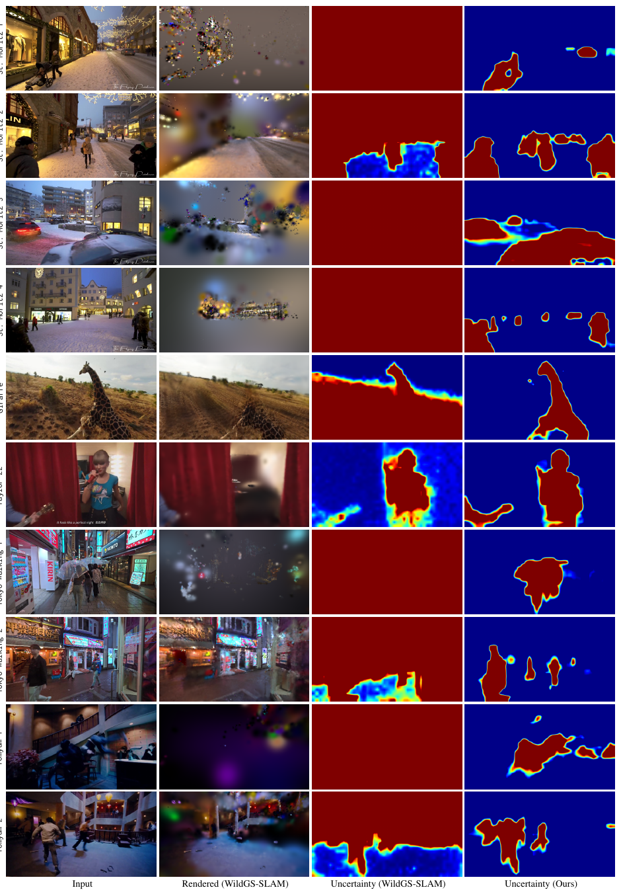

*补充图 5。从左到右为输入、WildGS-SLAM 渲染、WildGS-SLAM 不确定性和 DROID-W 不确定性。*

补充图 6 跟踪 Tomyum 1 中一扇门从静止到被推开的过程。门开始移动前，系统仍把门作为可用的静态对应；运动出现后，不确定性随之升高。补充图 7 展示 Tomyum 2 的镜面反射：视角相关外观变化会让模型在镜面区域赋予较高不确定性。这些例子说明特征不一致不只来自物体运动，也可能来自反射等非朗伯外观变化。

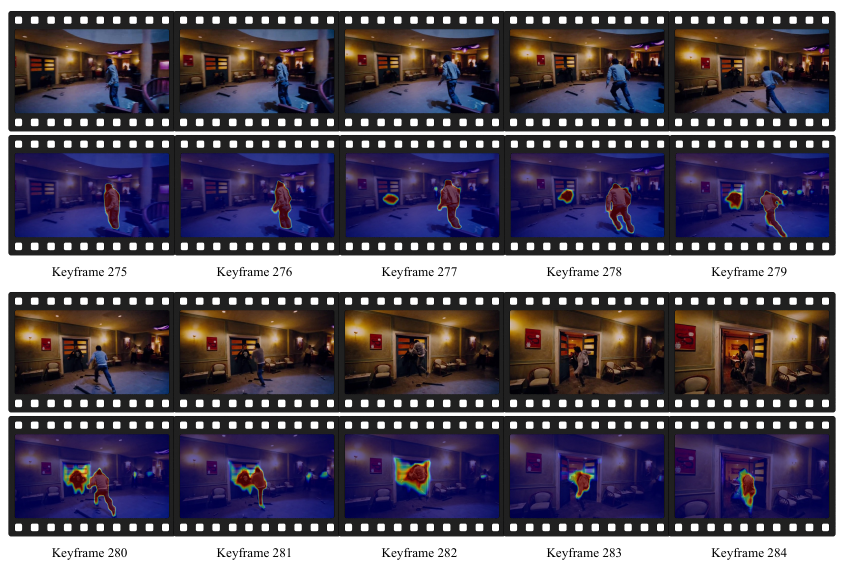

*补充图 6。关键帧 280 前，门仍可提供稳定匹配；门被推开后，不确定性覆盖其运动区域。*

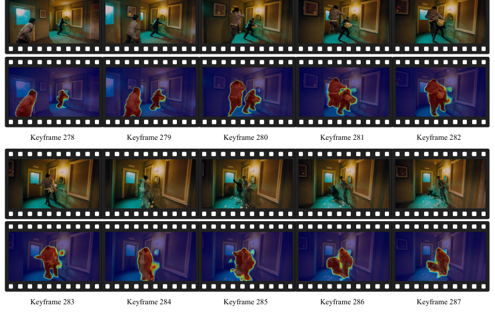

*补充图 7。镜面在相邻视角下外观明显变化，因此关键帧 283 的镜面区域得到较高不确定性。*

#### 9.2 点云重建

补充图 8 比较 DROID-SLAM 与 DROID-W 的静态点云。Taylor 22 中，DROID-SLAM 将同一走廊重建成两段；Tokyo Walking 1 中，路面白色标线在其点云中断裂，而 DROID-W 中更连续。补充图 9 从四个输入视角对照静态场景和动态点云，补充图 10 则在多段 St. Moritz 序列上比较全局对齐的静态重建和动态点云。作者据此说明，动态不确定性可以滤除动态点，同时尽量保留稳定的静态结构。

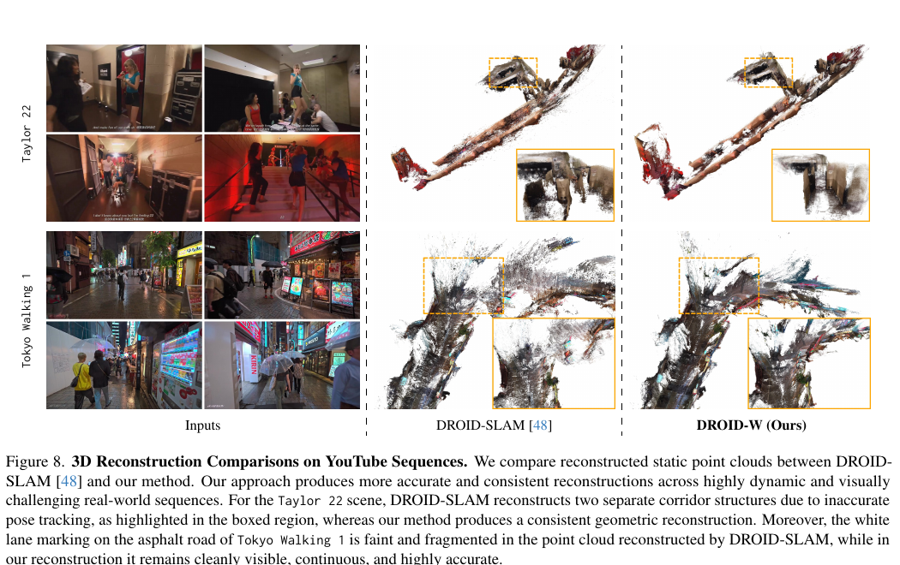

*补充图 8。DROID-W 与 DROID-SLAM 的静态点云比较，框选区域显示走廊结构和路面标线的差异。*

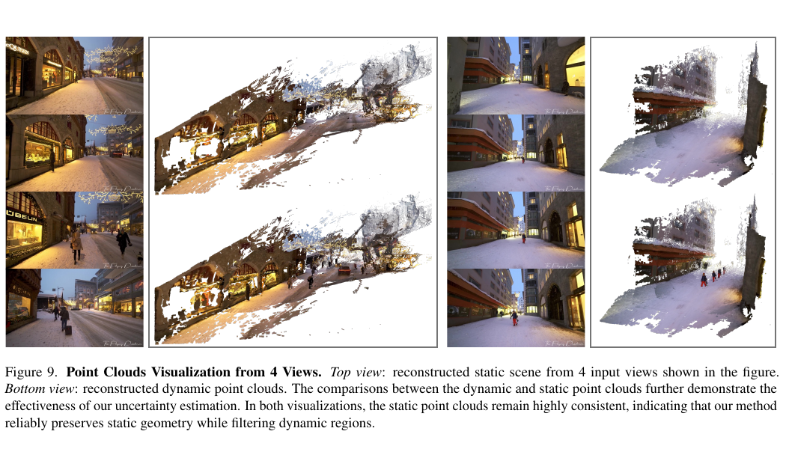

*补充图 9。上方为多视角静态场景点云，下方为动态点云；静态部分在两种表示中保持较高几何一致性。*

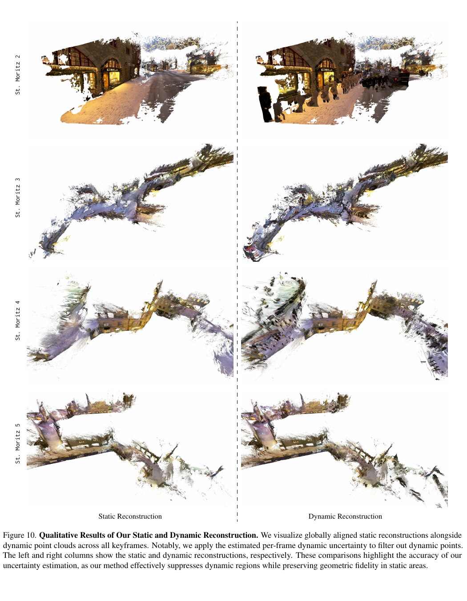

*补充图 10。左列为静态重建，右列为动态重建；动态不确定性用于从逐帧点云中筛除动态点。*

#### 9.3 先验项消融

补充表 10 单独移除对数先验。没有先验时，目标会鼓励不确定性统一变大，使 BA 接近“关闭不确定性感知”的变体；Bonn ATE 从完整模型的 2.30 cm 上升到 5.18 cm。

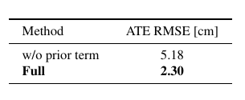

*补充表 10。移除 prior term 后误差明显上升，支持对数先验用于避免不确定性退化到统一大值。*
