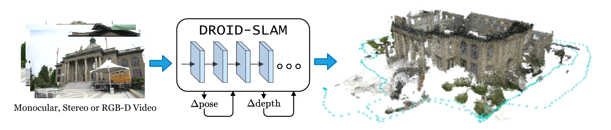
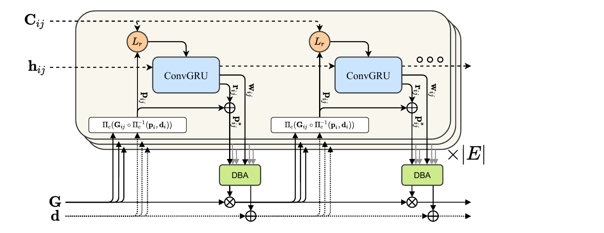
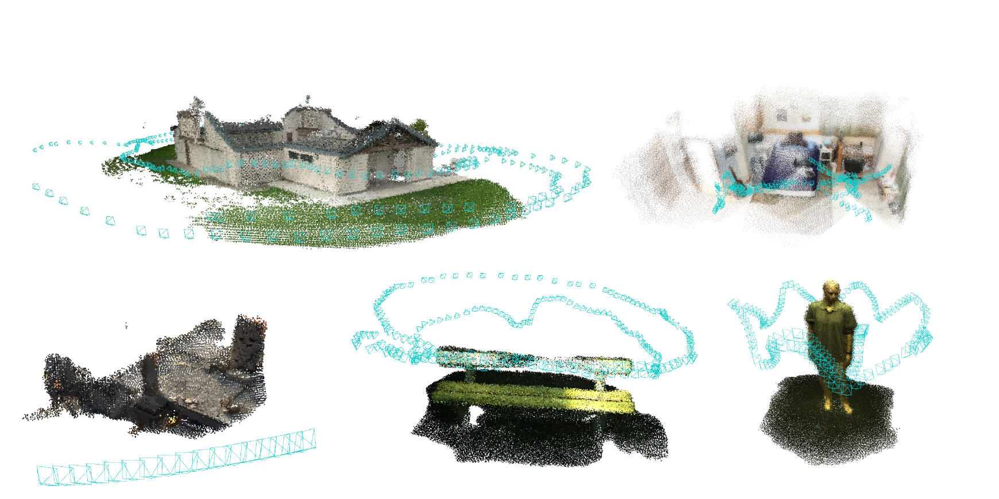
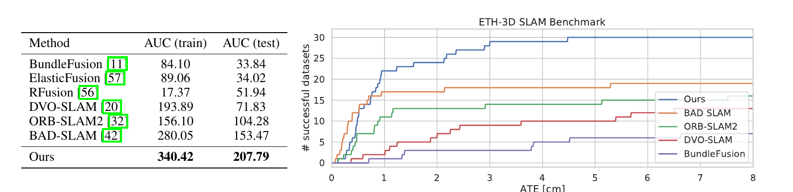
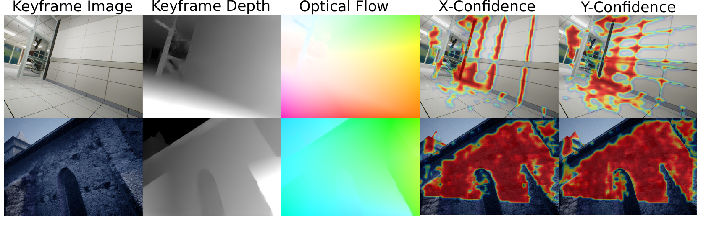
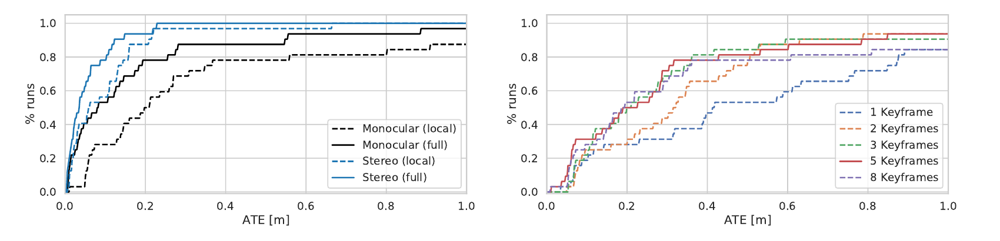
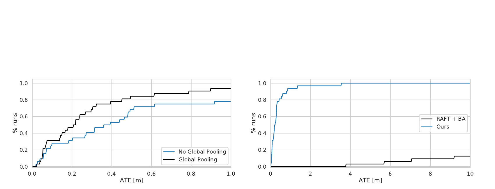
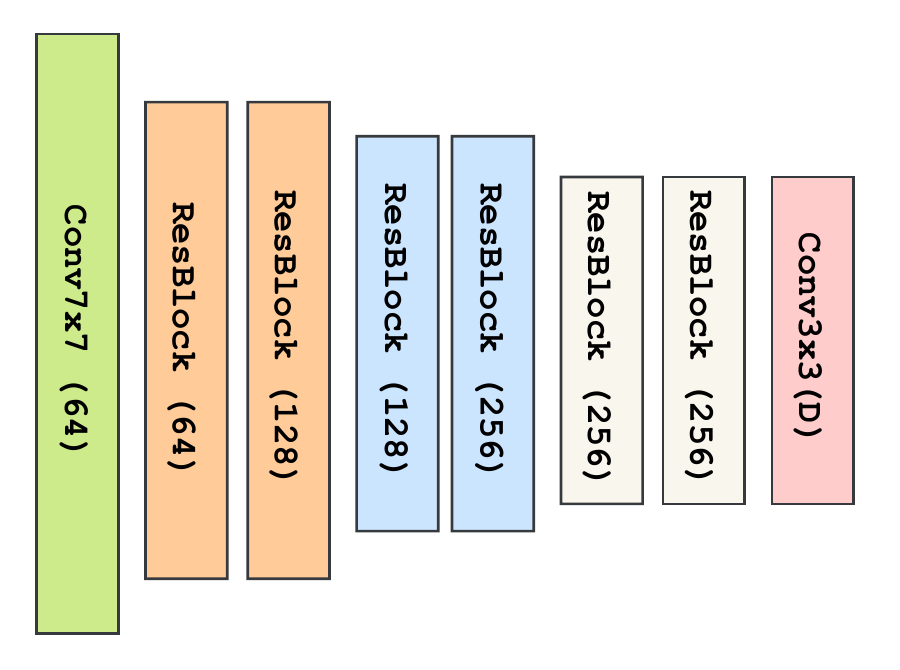
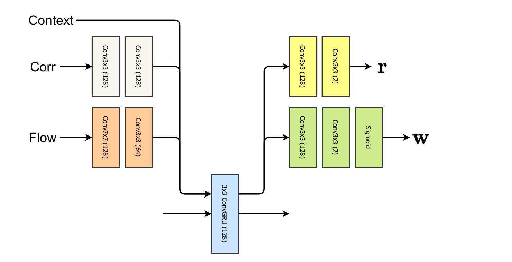

# DROID-SLAM 论文解读

> Zachary Teed 与 Jia Deng 的 *DROID-SLAM: Deep Visual SLAM for Monocular, Stereo, and RGB-D Cameras*（arXiv v2，2022 年 2 月 2 日）把学习式像素对应估计接入可微的稠密光束法平差，在视频中联合更新相机位姿与逆深度。[论文页面](https://arxiv.org/abs/2108.10869v2) · [论文 PDF](https://arxiv.org/pdf/2108.10869v2) · [官方实现](https://github.com/princeton-vl/DROID-SLAM)

*原论文图 1　单目、双目或 RGB-D 视频进入同一迭代系统，反复更新相机位姿和深度，输出轨迹与稠密地图。右侧是重建示例；论文没有以统一的三维重建指标量化这类地图。*

## 1. 引言

**DROID-SLAM 的核心创新，是让学习式像素对应估计与多帧几何优化形成一个可端到端训练的迭代过程，直接联合更新相机位姿与逐像素深度。** 神经网络提供对应修正与置信度，几何求解器把这些预测转化为多帧一致的轨迹和地图；更新后的几何又为下一轮对应估计提供依据。

这针对的是视觉 SLAM 中两个相互牵连的问题。图像里的重复纹理和运动模糊可能破坏对应估计，把几何优化带偏；即便局部跟踪成功，逐步积累的误差仍会使长轨迹漂移。传统系统用光束法平差（Bundle Adjustment，BA）联合优化相机位姿与地图，早期学习式方法则常集中于匹配、深度等局部任务。DROID-SLAM 把学习式对应估计与完整 SLAM 所需的长期优化连接起来。相对于它所借鉴的 RAFT 光流网络，论文明确提出了两项关键创新：

1. **把两帧光流的循环更新扩展为多帧位姿与深度的循环更新。** RAFT 反复修正两张图像之间的光流；DROID-SLAM 则在帧图上维护共享的相机位姿和逐像素逆深度，通过多条帧间关联共同更新几何状态。这样，迭代过程可以覆盖长轨迹，重访区域的关联也能进入全局优化，用于减小累计漂移。
2. **用可微的稠密光束法平差层产生每轮几何更新。** 稠密光束法平差（Dense Bundle Adjustment，DBA）依据网络给出的修正后像素对应及其权重，通过高斯—牛顿法联合求解位姿与逐像素逆深度增量。它直接优化每个像素的深度变量，并让训练梯度经过几何求解器回到网络，使对应预测能够根据后续几何更新的效果得到训练。

具体到一轮计算，系统先依据当前位姿与深度计算几何投影，网络查看投影附近的图像特征，给出对应位置的修正量和置信度；DBA 随后求出使这些对应尽量一致的位姿和逆深度更新。更新后的几何改变下一轮查询相关性的坐标。作者将这种可微、循环、受优化启发的设计称为 DROID（Differentiable Recurrent Optimization-Inspired Design）。

这一设计还带来了跨传感器使用能力：同一模型仅用合成 TartanAir 的单目视频训练，测试时就能通过几何约束接入双目或 RGB-D 测量，无需重新训练。论文在四个数据集上验证了定位精度与跟踪鲁棒性的提升，具体比较条件和失败情况在第 4 节展开。

## 2. 相关工作

论文第 2 节先区分间接法与直接法。间接法检测、匹配显式特征点，再最小化重投影误差；直接法在图像区域上构造光度误差，可以利用更密的亮度信息，但其优化目标对成像变化与几何畸变更敏感。DROID-SLAM 读取密集图像特征，以预测的像素对应构造几何重投影误差，因而同时使用较密的信息和多视图几何约束。

已有学习式系统常把网络放在局部子问题中，或只处理少量图像，缺少长轨迹所需的全局优化。DeepV2D 交替更新位姿与深度；BA-Net 在预先预测的深度基上优化少量系数；DeepFactors 也使用学习到的深度基并支持长短距离回环。DROID-SLAM 则在帧图上联合优化相机位姿与逐像素逆深度。其几何残差与可微求解器一起参与训练，这才是“稠密、联合、可微”三个限定相互关联的地方。

## 3. 方法

### 3.1 状态与帧图

对每帧图像 $I_i$，系统维护相机位姿 $G_i\in SE(3)$ 与逐像素逆深度 $d_i$。逆深度是实际深度的倒数；图像中远处的点对应较小逆深度。这里的“稠密”指在特征图网格上为每个像素维护深度变量，与只优化少量特征点的稀疏 BA 区别开来。网络特征在输入分辨率的 $1/8$ 上计算，逆深度也在该网格上求解，之后再上采样。

帧图 $(\mathcal V,\mathcal E)$ 记录哪些图像有共同可见区域。顶点对应图像，边 $(i,j)$ 让第 $i$ 帧的像素在第 $j$ 帧寻找对应。帧图在训练和推理时都会动态构建：位姿或深度更新后，可以重新估计共同可见关系，调整帧间连接；重访场景时加入远距离边，把长期漂移纳入共同优化。接下来的相关特征和循环隐藏状态按边维护，相机位姿与逆深度按帧维护。

### 3.2 特征提取与相关性计算

对于帧图中的一条边 $(i,j)$，系统需要判断：第 $i$ 帧某个像素，在第 $j$ 帧的哪些位置有相似外观？这一节先把两张图像变成可比较的特征，再保存所有位置之间的相似性，最后根据当前几何估计，从中读取本轮更新需要的部分。特征提取、相关金字塔和相关查询分别承担这三步。

#### 两套编码器提供不同的信息

每张新图像都经过两套参数独立的网络：特征编码器和上下文编码器。两者采用相同的基本结构，都包含六个残差块与三次下采样，将图像高、宽各缩小到原来的 $1/8$。附录 D 的图 8 进一步说明，特征编码器使用实例归一化，输出 128 维特征；上下文编码器不使用归一化，输出 256 维特征。

下面用 $H,W$ 表示**下采样后**特征图的高、宽。例如，输入为 $384\times512$ 时，$H=48,W=64$。特征编码器为每个网格位置生成一个 128 维向量，整张图的输出记为 $g_\theta(I_i)\in\mathbb R^{H\times W\times128}$。两个位置的特征向量做内积，便得到网络学到的外观相似性分数。

上下文编码器提供的是源图像自身的信息。其输出在每次调用更新算子时进入 GRU，供网络结合局部图像内容解释匹配证据。因而，这两路信息的用途不同：相关特征描述跨帧位置之间的相似性，上下文特征保留源帧的图像信息。上下文编码器不参与下面的全对相关计算。

论文正文没有展开这 256 个通道如何进入循环状态。[官方更新网络实现](https://github.com/princeton-vl/DROID-SLAM/blob/main/droid_slam/droid_net.py)（`main` 分支，2026-10-21 查阅）将它们拆成两组 128 通道：一组经 $\tanh$ 初始化隐藏状态，另一组经 ReLU 作为各轮重复输入的上下文特征。初始化后，隐藏状态随迭代改变，上下文输入则由源图像决定。这个实现细节说明了图像信息如何同时进入循环状态的起点和每一轮更新。

#### 四维相关体保存所有位置对的相似性

对每条边 $(i,j)\in\mathcal E$，系统将两张特征图的所有位置两两配对。源位置为 $(u_1,v_1)$、目标位置为 $(u_2,v_2)$ 时，其相关值是

$$
C^{ij}_{u_1v_1u_2v_2}
=\left\langle g_\theta(I_i)_{u_1v_1},g_\theta(I_j)_{u_2v_2}\right\rangle . \tag{1}
$$

这里的内积沿特征通道求和，得到一个标量。四个下标对应两张图像各自的两个空间坐标，所以 $C^{ij}$ 的形状是 $H\times W\times H\times W$。固定前两个下标，就得到一张 $H\times W$ 的二维分数图：它记录**同一个源像素与目标图像所有位置**的相似程度。遍历源图像的所有像素，就得到完整的四维相关体。

例如，在 $48\times64$ 的特征图上，固定一个源像素，需要保存它与目标图像 3072 个位置的分数；所有源像素合计产生 $3072^2=9\,437\,184$ 个相关值。这里计算的是每条帧图边上的所有位置对，帧图本身仍负责选择哪些图像之间需要建立关联。相关值只是匹配证据，尚未选定最终对应位置。

#### 只压缩目标坐标，构建四级相关金字塔

接下来，系统沿相关体的**最后两个维度**反复做平均池化，形成四级相关金字塔。按每次 $2\times2$ 平均池化写开，第 $\ell$ 层到下一层的关系是

$$
C^{ij,\ell+1}_{u_1v_1ab}
=\frac14\sum_{\delta_u=0}^{1}\sum_{\delta_v=0}^{1}
C^{ij,\ell}_{u_1v_1,\,2a+\delta_u,\,2b+\delta_v},
\qquad \ell=0,1,2,
$$

其中 $C^{ij,0}=C^{ij}$。源图像的网格一直保留为 $H\times W$，目标图像的网格依次缩小为 $H\times W$、$H/2\times W/2$、$H/4\times W/4$ 和 $H/8\times W/8$。因此，每个源像素始终都有自己的匹配分数图，只是目标位置从精细网格逐步变成了较粗的区域。

这一点决定了金字塔的用途：系统要为每个源像素保留独立的对应估计，同时在目标图像上查看不同范围。粗层的一个网格间距覆盖更大的图像位移；在各层查询相同半径，就能同时取得精细位置和较大范围内的匹配证据。四层结果会一起进入更新算子。

#### 以几何预测为中心，读取局部相关特征

相关体建立时比较了所有位置，但每轮更新只读取当前预测附近的分数。用 $p_{ij}(u_1,v_1)$ 表示当前位姿与深度将源像素投影到第 $j$ 帧后得到的二维坐标，其几何计算在式 (3) 中展开。它为这一轮查询提供中心。

在第 $\ell$ 层，目标坐标已经缩小了 $2^\ell$ 倍，因此查询中心也要变成 $p_{ij}(u_1,v_1)/2^\ell$。在这个中心附近按固定偏移网格取值，可以写成

$$
\mathbf c^{ij}_{\ell}(u_1,v_1)
=\left[
\operatorname{bilinear}\!\left(
C^{ij,\ell}_{u_1v_1,:,:},
\frac{p_{ij}(u_1,v_1)}{2^\ell}+\delta
\right)
\right]_{\delta\in\mathcal N_r},
\qquad
\mathcal N_r=\{-r,\ldots,r\}^2.
$$

方括号表示把所有偏移处的分数排成一个向量。这个操作固定源像素，在它对应的二维分数图上移动查询位置。由于几何投影通常得到非整数坐标，查询通过双线性插值取得连续位置上的分数。

例如，在某一层，假设查询位置是 $(20.25,12.5)$，其左上、右上、左下、右下四个相邻网格点的相关值依次为 $1,3,5,7$。横向小数部分为 $0.25$，纵向为 $0.5$，插值得到

$$
(1-0.25)(1-0.5)\cdot1
+0.25(1-0.5)\cdot3
+(1-0.25)0.5\cdot5
+0.25\cdot0.5\cdot7
=3.5.
$$

这只是查询向量中的一个分量。对邻域内各个偏移重复取值，再把四个金字塔层的结果拼接，才得到该源像素本轮完整的相关特征。它保留了周围分数的分布，由更新网络判断对应位置应该怎样修正；此处并未通过取最大值直接决定匹配。

将拼接写出来，就是 $\mathbf c^{ij}=\operatorname{concat}(\mathbf c^{ij}_0,\mathbf c^{ij}_1,\mathbf c^{ij}_2,\mathbf c^{ij}_3)$。每个源像素对应一个长度为 $4(2r+1)^2$ 的向量，整条边的查询输出则为 $H\times W\times4(2r+1)^2$。空间索引仍对应源像素，通道索引记录不同尺度和偏移处的相似性。

> 原文把半径为 $r$ 的查询算子写为 $\mathcal L_r:\mathbb R^{H\times W\times H\times W}\times\mathbb R^{H\times W\times2}\to\mathbb R^{H\times W\times(r+1)^2}$。其中输出维数与通常的方形半径邻域计数不一致。这里按 $\{-r,\ldots,r\}^2$ 解释，每层应有 $(2r+1)^2$ 个分量。核对的[官方相关查询实现](https://github.com/princeton-vl/DROID-SLAM/blob/main/droid_slam/modules/corr.py)及[更新网络实现](https://github.com/princeton-vl/DROID-SLAM/blob/main/droid_slam/droid_net.py)（`main` 分支，2026-10-21 查阅）采用四层、半径 3，共 $4\times7\times7=196$ 个相关通道，与此解释一致。这是对论文维数记号的核对；半径 3 是该实现的设置。

对固定的图像对，图像特征及相关金字塔可以在迭代间复用。每轮位姿和深度更新后，改变的是投影坐标 $p_{ij}$，因此从同一组相关数据中读出的局部特征也随之改变。这样，当前几何决定到哪里读取外观证据，外观证据再帮助网络修正对应，供后面的几何优化使用。

### 3.3 迭代更新算子

*原论文图 2　每条帧图边都有相关体与循环更新状态。当前位姿和逆深度决定投影位置，ConvGRU 预测对应修正与权重，DBA 把它们转换为共享的位姿和逆深度更新；图中的两组模块表示这个过程反复执行。*

上一节得到的相关特征描述了当前投影附近的匹配证据。更新算子还要结合运动信息与历史状态，决定这些证据该如何改变像素对应，再由 DBA 使多帧几何尽量符合修正后的对应。

更新算子以 $3\times3$ 卷积 GRU 为核心。GRU 在每条帧图边上维护隐藏状态 $h_{ij}$，在连续迭代之间保留信息；位姿 $G_i$ 和逆深度 $d_i$ 则是同一帧各条边共享的几何状态。一次更新先读取当前几何产生的相关与运动特征，由网络预测对应修正，再交给 DBA 求出位姿增量 $\Delta\xi$ 和逆深度增量 $\Delta d$，最后按论文式 (2) 更新状态：

$$
G^{(k+1)}=\operatorname{Exp}(\Delta\xi^{(k)})G^{(k)},\qquad d^{(k+1)}=d^{(k)}+\Delta d^{(k)}. \tag{2}
$$

其中 $\Delta\xi$ 是六维的位姿局部增量，指数映射把它变成 $SE(3)$ 上的刚体变换，再左乘到当前位姿；逆深度则直接加上逐像素增量。论文希望反复应用更新算子后，位姿与深度能收敛到稳定的重建状态，但没有给出任意输入下的收敛保证。

对帧图中的边 $(i,j)$，$p_i\in\mathbb R^{H\times W\times2}$ 是第 $i$ 帧的规则像素坐标网格。对其中每个位置，$\Pi_c^{-1}$ 根据该像素的逆深度把它反投影为三维点，$G_{ij}$ 再把点从源相机坐标系变换到目标相机坐标系，最后由 $\Pi_c$ 投影到第 $j$ 帧。整张网格得到的预测对应场是

$$
p_{ij}=\Pi_c\!\left(G_{ij}\,\Pi_c^{-1}(p_i,d_i)\right),
\qquad G_{ij}=G_jG_i^{-1}. \tag{3}
$$

这里采用 $G_i$ 将世界坐标变到第 $i$ 个相机坐标系的约定，所以 $G_jG_i^{-1}$ 先从源相机回到世界，再进入目标相机。$p_{ij}$ 的形状仍是 $H\times W\times2$：它按源图像网格排列，每个元素保存一个目标图像中的二维坐标。因此 $p_{ij}$ 是**几何预测的对应**，还不是网络修正后的观测。位姿或逆深度发生变化，$p_{ij}$ 就会移动，下一轮相关查询也随之换位置。这里的像素坐标与上一节的特征网格一致；使用下采样网格时，相机内参也要相应缩放。

卷积 GRU 的输入有相关特征、运动特征及上下文特征。相关特征就是上一节查询得到的多尺度局部分数。运动特征由两部分拼接而成：一部分是当前几何诱导的二维光流，另一部分是上一轮 BA 求解后剩余的二维对应残差。

论文将几何流写为 $p_{ij}-p_j$。这里的 $p_j$ 是目标图像的规则坐标网格；两帧尺寸相同时，它在数值上与源图像的规则网格相同，因此相减得到各源像素到预测目标位置的二维位移。例如，网格位置 $(10,12)$ 投影到 $(13,11)$，对应的流就是 $(3,-1)$。整张流场提供了运动随空间变化的形态，能在局部外观有歧义时为网络提供额外依据。

上一轮 BA 残差则回答另一个问题：上一轮网络要求的对应位置，在更新几何后还剩下多少偏差？若上一轮修正后的目标为 $p^{*,(k-1)}_{ij}$，当前几何重新投影为 $p^{(k)}_{ij}$，反馈给第 $k$ 轮的残差可写为

$$
e^{(k-1)}_{ij}=p^{*,(k-1)}_{ij}-p^{(k)}_{ij}.
$$

一个几何状态需要同时解释很多像素和帧对，所以 BA 未必能完全满足网络提出的每个目标。这个残差使下一轮网络能够看到上一次几何求解后仍未满足的对应。二维光流与二维残差拼成每个位置的四个运动分量；它们与外观相关特征一起，为新的对应修正提供依据。

相关与运动特征分别经过两层卷积，再送入 GRU；源帧上下文特征按论文描述通过逐元素相加注入 GRU。$3\times3$ 卷积主要在局部邻域内交换信息，论文还对隐藏状态沿空间维度取平均，把得到的全局特征向量作为额外输入。作者用大面积运动物体举例说明这个设计的用途：局部相似的匹配可能来自独立运动，网络需要更大范围的信息来识别和抑制错误对应；这一机制的实验效果见附录 B 的图 7。

GRU 得到新的隐藏状态 $h^{(k+1)}_{ij}$ 后，通过额外的卷积输出二维对应修正 $r_{ij}\in\mathbb R^{H\times W\times2}$，以及非负置信权重 $w_{ij}\in\mathbb R_+^{H\times W\times2}$。权重在横、纵方向各有一个分量，供 DBA 分别衡量两个方向的对应误差。修正后的目标位置为

$$
p^*_{ij}=p_{ij}+r_{ij}.
$$

$r_{ij}$ 在图像平面上移动对应目标，位姿和逆深度则必须通过下一节的几何优化共同解释这些移动。例如，几何预测为 $(13,11)$，网络输出 $r_{ij}=(-0.5,0.2)$，就把本轮 DBA 要拟合的目标设成 $(12.5,11.2)$。这个二维修正本身不能直接当成相机的六维运动增量。

同一源帧 $i$ 可以连向多个目标帧，每条边都有自己的隐藏状态，但它们共享源帧逆深度 $d_i$。论文因此把具有相同源帧的边的隐藏特征汇合，预测一张逐像素阻尼图 $\lambda$，并通过 softplus 保证其为正。阻尼控制后面深度变量的线性求解；它与衡量对应误差的权重 $w_{ij}$ 作用不同。同一组汇合特征还预测将低分辨率逆深度上采样为 $8\times8$ 输出块所需的 mask。对应修正和置信权重按边预测，阻尼及深度上采样参数按源帧预测，这与几何状态的共享方式相对应。

### 3.4 稠密光束法平差

给定每条边的 $p^*_{ij}$ 和 $w_{ij}$，DBA 在所有相关帧上求解

$$
E(G',d')=\sum_{(i,j)\in\mathcal E}
\left\|p^*_{ij}-\Pi_c\!\left(G'_{ij}\Pi_c^{-1}(p_i,d'_i)\right)\right\|^2_{\Sigma_{ij}},
\qquad \Sigma_{ij}=\operatorname{diag}(w_{ij}). \tag{4}
$$

在本轮 DBA 内，网络给出的 $p^*_{ij}$ 和 $w_{ij}$ 是固定的目标与权重，待求变量是新的位姿 $G'$ 和逆深度 $d'$。式 (4) 对帧图的所有边求和，每条边内还包含源图像所有参与优化的像素。若某个像素的二维残差为 $(e_x,e_y)$，对应权重为 $(w_x,w_y)$，它贡献的代价就是

$$
\|e\|^2_{\Sigma}=w_xe_x^2+w_ye_y^2.
$$

因此，权重低的方向对求解影响小；这里的置信度作为误差权重使用，并不自动具有经过校准的概率含义。每项代价都比较“网络希望对应到的位置”和“新几何状态投影出的位置”。多个边共享相机位姿与源帧逆深度，所以它们不能各自独立改变几何：同一个 $G_i$ 必须同时满足与多张图像的关系，同一个源像素的 $d_i$ 也必须解释它在多个目标帧中的投影。这是把稠密对应变成多视图一致几何的关键。

在当前状态附近，把每个重投影残差线性化为 $e+J_G\Delta\xi+J_d\Delta d$。将所有像素和边的雅可比按位姿、逆深度两组列堆叠，记权重矩阵为 $W$，最小二乘的一阶条件是 $J^TWJ\Delta=-J^TWe$。按两类变量拆开，再用舒尔补消去深度变量，就得到原论文式 (5)：

$$
\begin{aligned}
\begin{bmatrix}B&E\\E^T&C\end{bmatrix}
\begin{bmatrix}\Delta\xi\\\Delta d\end{bmatrix}
&=\begin{bmatrix}v\\w\end{bmatrix},\\
\Delta\xi&=(B-EC^{-1}E^T)^{-1}(v-EC^{-1}w),\\
\Delta d&=C^{-1}(w-E^T\Delta\xi).
\end{aligned}\tag{5}
$$

$B$、$E$、$C$ 是 $J^TWJ$ 的位姿块、交叉块和深度块，右侧 $v$、$w$ 是负梯度的对应分块。这里的向量 $w$ 沿用原论文式 (5) 的记号，与式 (4) 逐像素置信权重 $w_{ij}$ 是不同对象。

同一源像素的逆深度可以参与多条边，但它不会和另一像素的逆深度直接出现在同一残差中。因此深度块 $C$ 是对角的。原论文式 (5) 没有单列阻尼符号；实际求解时，向深度块对角线加入逐像素的 $\lambda$，即使用 $C+\operatorname{diag}(\lambda)$，仍可逐元素求逆。正阻尼会抑制约束弱、深度曲率小的位置出现过大的更新。下面的消元过程把加入阻尼后的深度块仍记为 $C$。

式 (5) 中的位姿表达式来自块消元：由矩阵方程第二行先写出 $\Delta d=C^{-1}(w-E^T\Delta\xi)$，代入第一行得到 $(B-EC^{-1}E^T)\Delta\xi=v-EC^{-1}w$，再求位姿增量。最后把位姿增量回代，就得到逐像素逆深度增量。

这样主要线性求解落在相机位姿上，求出位姿增量后再回代每个像素的逆深度增量。位姿增量在 $SE(3)$ 上更新，逆深度增量通过向量加法更新。DBA 位于训练计算图内：后续位姿与光流损失对求解结果的梯度，经线性求解与式 (4) 的残差回到网络输出的对应修正 $r_{ij}$、权重 $w_{ij}$ 和阻尼 $\lambda$，进而训练产生这些量的特征与更新算子。由此，网络学到的是能在几何更新后改善轨迹的对应与权重，而不只是单独降低两帧光流误差。

位姿与逆深度的雅可比决定了式 (5) 中各块的取值；附录 C 将针孔投影、逆深度齐次表示及位姿扰动的链式导数逐项展开。

### 3.5 训练

训练要让网络产生有利于后续几何求解的对应、权重与阻尼。作者使用 PyTorch 实现系统，并通过 LieTorch 在位姿所在李群的切空间中传播梯度。训练片段具有真值位姿和深度，因此可以监督每次迭代后的几何结果。

单目序列只能恢复到一个整体相似变换。例如，同时把场景深度与相机平移乘以相同的正数，不改变像素投影；整个重建还可以一起旋转和平移。这些变化不影响观测，却会给求解留下不唯一的方向，即规范自由度。论文训练时固定前两个相机位姿为真值：第一帧去除整体六自由度规范自由度，第二帧再约束尺度，以改善线性系统条件和梯度稳定性。

每个训练样本取七帧。作者先为训练视频建立两两帧间的平均光流距离矩阵，将共同视野不足 50% 的帧对距离置为无穷大；再在这个矩阵上采样路径，要求相邻采样帧的平均光流在 8～96 像素之间。这样，七帧不必是原视频中连续的七帧，采样间隔由运动幅度与视野重叠共同限制，避免训练片段过于容易或过于困难。

监督同时落在位姿和相邻帧几何诱导的光流上。前者以真值位姿 $T_i$ 为参照，使用

$$
L_{\mathrm{pose}}=\sum_i\left\|\operatorname{Log}_{SE(3)}(T_i^{-1}G_i)\right\|_2.
$$

$T_i^{-1}G_i$ 描述预测与真值之间的位姿差，$\operatorname{Log}_{SE(3)}$ 将其映射为六维局部误差，再对各帧误差求和。光流损失则分别用预测位姿、深度和真值位姿、深度，按式 (3) 产生两组投影，得到两组几何流，并在相邻帧上取平均二维欧氏距离。这里被监督的是 DBA 输出的几何所诱导的流；网络给出的修正对应经过几何求解后，才通过这一路结果接受监督。

两项损失因此约束不同的结果：位姿损失直接衡量相机轨迹，光流损失同时依赖位姿和深度，衡量这些状态在图像平面上的投影效果。即使某一轮的位姿误差已经较小，深度错误仍可能使投影偏离真值，光流损失便能继续提供训练信号。

训练将更新算子展开 15 次，每次迭代的输出都受监督。若迭代从 1 编号到 $K=15$，第 $k$ 轮损失的指数权重可写为 $\gamma^{K-k}$，其中 $\gamma=0.9$；最后一轮权重为 1，较早迭代依次减小。训练只使用合成 TartanAir 的单目视频。

### 3.6 在线 SLAM 系统与传感器扩展

推理时，系统把上述更新算子嵌入两个异步线程。前端接收新帧、抽取特征、维护关键帧图并做局部 BA；后端在历史关键帧上重建帧图，加入相邻与非相邻边，做全局 BA。

初始化先收集 12 帧：根据一次更新估计的光流，仅在光流超过 16 像素时保留候选帧；随后连接时间距离不超过三帧的关键帧，迭代十轮。前端以线性运动模型初始化新帧位姿，将其与按平均光流距离选择的三个最近邻相连。跟踪与局部优化之后，前端依据帧间平均光流剔除冗余关键帧；若没有冗余候选，则移除最旧关键帧。推理时仍固定前两个位姿以去除规范自由度，所有逆深度仍可更新。

后端对历史关键帧计算两两光流距离矩阵，先加入时间邻近边，再依距离从小到大选择新边。每选一条边，就在帧对索引的切比雪夫距离 2 以内抑制重复候选，让帧图覆盖多样的关联。重访区域的远距离边由此进入同一次全局优化。后端可处理数千帧及边；完整相关体会超出显存，因此采用 RAFT 的节省内存实现。训练阶段的 DBA 使用 PyTorch 自动微分；推理阶段以自定义 CUDA 核利用稀疏结构，并对消去深度后的相机块做稀疏 Cholesky 求解。完整 BA 只作用于关键帧，非关键帧位姿通过与邻近关键帧之间、只优化位姿的 BA 恢复；论文评测的是完整相机轨迹。

双目输入把左右图像都纳入帧图，并在 DBA 中固定左右相机的已知相对位姿。RGB-D 输入保留逆深度为优化变量，另加一项让估计深度贴近传感器测量，因此能容纳噪声和缺失值。网络在这两种模式下没有重新训练；新增测量经由几何目标进入系统。这说明其跨传感器使用能力来自可扩展的优化形式，而不是网络在训练时见过每种输入。

## 4. 实验

论文主要用绝对轨迹误差（ATE）评估相机定位。需要把不同传感器输入、不同数据集和失败序列的处理分开阅读。下列数值均按原论文表 1–5 转录；“X”表示跟踪失败，“—”表示没有报告可比较的平均值。论文没有以统一协议直接评价稠密三维重建质量，因此图 1、图 3 的地图是定性展示。

*原论文图 3　展示 Tanks & Temples、ScanNet、Sintel、ETH3D 场景中的单目重建示例。它说明系统能在训练集以外生成轨迹与点云，但不能由图片直接推断统一的重建精度。*

### 4.1 TartanAir：同域测试与竞赛协议

网络只在合成 TartanAir 单目视频上训练，25 万步、batch size 4、$384\times512$ 分辨率、七帧片段，每段展开 15 次更新；论文报告训练耗时为四块 RTX 3090 约一周。表 1 测试的是 TartanAir Hard 序列的单目 ATE，DeepV2D 基线也重新在 TartanAir 上训练。DROID-SLAM 的平均值 0.24 低于 TartanVO 的 1.92 和 DeepV2D 的 5.03；ORB-SLAM 有两条失败，表中未给平均值。

| 原论文表 1：方法 | MH000 | MH001 | MH002 | MH003 | MH004 | MH005 | MH006 | MH007 | 平均 ATE |
| --- | ---: | ---: | ---: | ---: | ---: | ---: | ---: | ---: | ---: |
| ORB-SLAM | 1.30 | 0.04 | 2.37 | 2.45 | X | X | 21.47 | 2.73 | — |
| DeepV2D | 6.15 | 2.12 | 4.54 | 3.89 | 2.71 | 11.55 | 5.53 | 3.76 | 5.03 |
| TartanVO | 4.88 | 0.26 | 2.00 | 0.94 | 1.07 | 3.19 | 1.00 | 2.04 | 1.92 |
| DROID-SLAM | 0.08 | 0.05 | 0.04 | 0.02 | 0.01 | 1.31 | 0.30 | 0.07 | 0.24 |

竞赛表 2 用的是长度 5、10、……、40 米片段上的**归一化相对位姿误差**，不能与表 1 的 ATE 直接比较。该协议下 DROID-SLAM 的单目/双目结果为 0.129/0.047，较最好的既有提交 0.340/0.119 分别降低约 62%/60%。

| 原论文表 2：方法 | 单目 | 双目 |
| --- | ---: | ---: |
| OV²SLAM | 0.510 | 0.182 |
| VOLDOR + COLMAP | 0.440 | 0.177 |
| SuperGlue + SuperPoint + COLMAP | 0.340 | 0.119 |
| DROID-SLAM | 0.129 | 0.047 |

论文指出，排名靠前的两个既有方案依赖 COLMAP，运行速度约比实时慢 40 倍；DROID-SLAM 相对这两个方案快约 16 倍。这个速度比较对应竞赛实现及作者报告的运行条件，并不意味着它在所有数据集上都能实时运行。

### 4.2 EuRoC：跨场景的单目与双目轨迹

EuRoC 是真实无人机视频。单目表 3 覆盖 11 段序列，DROID-SLAM 全部完成，平均 ATE 0.022 m；只做里程计、没有完整 SLAM 后端的消融平均为 0.186 m，说明全局优化对长轨迹漂移的作用。在同样完成全部 11 段的方法中，DSM 为 0.126 m，论文据此报告约 82% 的误差降低。ORB-SLAM3 在 V203 失败，论文因而只在其成功的十段上报告约 43% 的相对改善，不能把失败项忽略后再称作同口径 11 段平均。标记 † 的方法是视觉里程计。D3VO + DSO 只报告部分序列，论文说明它在剩余序列上做了包含相同场景的无监督训练，比较时也须保留这一条件。

| 原论文表 3：单目方法 | MH01 | MH02 | MH03 | MH04 | MH05 | V101 | V102 | V103 | V201 | V202 | V203 | 平均 ATE / m |
| --- | ---: | ---: | ---: | ---: | ---: | ---: | ---: | ---: | ---: | ---: | ---: | ---: |
| DeepFactors | 1.587 | 1.479 | 3.139 | 5.331 | 4.002 | 1.520 | 0.679 | 0.900 | 0.876 | 1.905 | 1.021 | 2.040 |
| DeepV2D† | 0.739 | 1.144 | 0.752 | 1.492 | 1.567 | 0.981 | 0.801 | 1.570 | 0.290 | 2.202 | 2.743 | 1.298 |
| DeepV2D (TartanAir)† | 1.614 | 1.492 | 1.635 | 1.775 | 1.013 | 0.717 | 0.695 | 1.483 | 0.839 | 1.052 | 0.591 | 1.173 |
| TartanVO† | 0.639 | 0.325 | 0.550 | 1.153 | 1.021 | 0.447 | 0.389 | 0.622 | 0.433 | 0.749 | 1.152 | 0.680 |
| D3VO + DSO† | — | — | 0.08 | — | 0.09 | — | — | 0.11 | — | 0.05 | 0.19 | — |
| ORB-SLAM | 0.071 | 0.067 | 0.071 | 0.082 | 0.060 | 0.015 | 0.020 | X | 0.021 | 0.018 | X | — |
| DSO† | 0.046 | 0.046 | 0.172 | 3.810 | 0.110 | 0.089 | 0.107 | 0.903 | 0.044 | 0.132 | 1.152 | 0.601 |
| SVO† | 0.100 | 0.120 | 0.410 | 0.430 | 0.300 | 0.070 | 0.210 | X | 0.110 | 0.110 | 1.080 | — |
| DSM | 0.039 | 0.036 | 0.055 | 0.057 | 0.067 | 0.095 | 0.059 | 0.076 | 0.056 | 0.057 | 0.784 | 0.126 |
| ORB-SLAM3 | 0.016 | 0.027 | 0.028 | 0.138 | 0.072 | 0.033 | 0.015 | 0.033 | 0.023 | 0.029 | X | — |
| DROID-SLAM（仅里程计）† | 0.163 | 0.121 | 0.242 | 0.399 | 0.270 | 0.103 | 0.165 | 0.158 | 0.102 | 0.115 | 0.204 | 0.186 |
| DROID-SLAM | 0.013 | 0.014 | 0.022 | 0.043 | 0.043 | 0.037 | 0.012 | 0.020 | 0.017 | 0.013 | 0.014 | 0.022 |

同一模型在 EuRoC 双目输入下的逐序列结果列于文末附录 A 表 5；它检验了单目训练权重能否直接利用双目几何。

### 4.3 TUM-RGBD：以 RGB-D 数据集检验单目跟踪

表 4 使用 TUM-RGBD 的 Freiburg1 九段视频，但协议中大多数方法只接收**单目图像**。DeepTAM 使用 RGB-D；TartanVO 使用真值缩放相对位姿。DROID-SLAM 九段全部完成、平均 ATE 0.038 m。完成全部九段的 DeepFactors 为 0.233 m，论文据此报告约 83% 的误差降低。这里支持的是困难室内视频上的单目跟踪表现，不能把它算作 DROID-SLAM 的 RGB-D 输入实验。

| 原论文表 4：方法 | 360 | desk | desk2 | floor | plant | room | rpy | teddy | xyz | 平均 ATE / m |
| --- | ---: | ---: | ---: | ---: | ---: | ---: | ---: | ---: | ---: | ---: |
| ORB-SLAM2 | X | 0.071 | X | 0.023 | X | X | X | X | 0.010 | — |
| ORB-SLAM3 | X | 0.017 | 0.210 | X | 0.034 | X | X | X | 0.009 | — |
| DeepTAM（RGB-D） | 0.111 | 0.053 | 0.103 | 0.206 | 0.064 | 0.239 | 0.093 | 0.144 | 0.036 | 0.116 |
| TartanVO（真值尺度） | 0.178 | 0.125 | 0.122 | 0.349 | 0.297 | 0.333 | 0.049 | 0.339 | 0.062 | 0.206 |
| DeepV2D | 0.243 | 0.166 | 0.379 | 1.653 | 0.203 | 0.246 | 0.105 | 0.316 | 0.064 | 0.375 |
| DeepV2D (TartanAir) | 0.182 | 0.652 | 0.633 | 0.579 | 0.582 | 0.776 | 0.053 | 0.602 | 0.150 | 0.468 |
| DeepFactors | 0.159 | 0.170 | 0.253 | 0.169 | 0.305 | 0.364 | 0.043 | 0.601 | 0.035 | 0.233 |
| DROID-SLAM | 0.111 | 0.018 | 0.042 | 0.021 | 0.016 | 0.049 | 0.026 | 0.048 | 0.012 | 0.038 |

### 4.4 ETH3D：真正使用 RGB-D 测量

ETH3D 实验在原有 DBA 目标上加入传感器逆深度残差，不微调网络。原论文图 4 左侧的 AUC 同时反映误差与灾难性失败，DROID-SLAM 在训练划分和测试划分都取得表中最高值。右侧曲线显示各 ATE 阈值下成功完成的数据集数：可用图像的 32 段测试序列中，它完成 30 段，论文报告下一名为 19 段。“dark” 序列没有可用图像，系统没有提交预测，不计入这里的 32 段。

*原论文图 4　左侧给出 ETH3D-SLAM 训练/测试划分 AUC，DROID-SLAM 分别为 340.42/207.79；右侧横轴是 ATE 阈值（厘米），纵轴是在该阈值内成功的序列数。曲线同时展示了精度与完成率，不能只读单一 AUC 数字。*

### 4.5 运行速度与显存

论文报告 EuRoC 约 20 fps：两块 RTX 3090 分别运行前端与后端，图像降至 $320\times512$，并隔帧处理；TUM-RGBD 约 30 fps，降至 $240\times320$，同样隔帧处理。TartanAir 因运动更快，平均只有约 8 fps。前端可在 8 GB 显存 GPU 上运行；TUM-RGBD 的报告结果可由单块 1080Ti 产生。较长序列的后端需保存历史特征，EuRoC、TartanAir、ETH3D 的结果使用 24 GB 显存。因而“实时”的判断要带上分辨率、跳帧与硬件条件。

## 5. 结论

DROID-SLAM 把 SLAM 的两种迭代合在了一起：学习式更新算子根据当前几何寻找更可信的像素对应；DBA 根据这些对应联合校正多帧位姿和逐像素逆深度。前者为几何优化提供观测，后者以新的几何投影改变下一轮网络查询的位置。训练时让梯度穿过 DBA，使两者学会配合；推理时再把同一更新过程放进局部跟踪和全局关键帧优化。论文最有说服力的结果是跨数据集、跨单目/双目/RGB-D 的轨迹精度与完成率，代价则是显著的显存和算力需求。

## 附录 A：EuRoC 双目结果

附录表 5 给出同一数据集的双目 ATE。网络仍使用单目训练得到的权重。DROID-SLAM 平均 0.024 m，ORB-SLAM3 平均 0.084 m，论文据此报告约 71% 的误差降低。

| 原论文表 5：双目方法 | MH01 | MH02 | MH03 | MH04 | MH05 | V101 | V102 | V103 | V201 | V202 | V203 | 平均 ATE / m |
| --- | ---: | ---: | ---: | ---: | ---: | ---: | ---: | ---: | ---: | ---: | ---: | ---: |
| D3VO + DSO | — | — | 0.08 | — | 0.09 | — | — | 0.11 | — | 0.05 | — | — |
| ORB-SLAM2 | 0.035 | 0.018 | 0.028 | 0.119 | 0.060 | 0.035 | 0.020 | 0.048 | 0.037 | 0.035 | — | — |
| VINS-Fusion | 0.540 | 0.460 | 0.330 | 0.780 | 0.500 | 0.550 | 0.230 | — | 0.230 | 0.200 | — | — |
| SVO | 0.040 | 0.070 | 0.410 | 0.170 | 0.120 | 0.040 | 0.040 | 0.070 | 0.050 | 0.090 | 0.790 | 0.159 |
| ORB-SLAM3 | 0.029 | 0.019 | 0.024 | 0.085 | 0.052 | 0.035 | 0.025 | 0.061 | 0.041 | 0.028 | 0.521 | 0.084 |
| DROID-SLAM | 0.015 | 0.013 | 0.035 | 0.048 | 0.040 | 0.037 | 0.011 | 0.020 | 0.018 | 0.015 | 0.017 | 0.024 |

## 附录 B：消融实验

原论文图 5 展示图像、估计深度、光流与横纵方向置信度。两张置信度图不必相同：网络对同一像素的水平、垂直对应误差可以分别赋权。该图是定性例子，不能替代置信度的校准评估。

*原论文图 5　两组关键帧的估计结果，右侧两列分别是对应修正的横向和纵向权重。*

*原论文图 6　左图比较单目/双目输入与仅局部/完整全局优化；在相同 ATE 阈值下，完整优化与双目观测提高成功比例。右图比较跟踪所保留的关键帧数，论文正式实验使用五帧。曲线来自 TartanAir 验证集，纵轴是误差低于横轴阈值的运行比例。*

*原论文图 7　左图显示加入 GRU 全局池化上下文后的收益；右图比较在训练中使用 DBA 与先按光流训练、测试时才加 BA。后者更易失败，说明训练阶段的几何求解反馈对网络输出有实际作用。*

## 附录 C：相机模型与雅可比

附录 C 从针孔投影给出 DBA 所需的雅可比。令 $q=((p_x-c_x)/f_x,(p_y-c_y)/f_y,1)^T$，把射线和逆深度写作四维齐次向量 $\mathbf X=(q^T,d)^T$。相对位姿 $G_{ij}=(R,t)$ 作用后，$\mathbf X'=(X',Y',Z',W')^T=(Rq+td,d)^T$。投影只取前三个坐标的比值：

$$
\Pi_c(\mathbf X')=
\begin{pmatrix}f_x X'/Z'+c_x\\f_y Y'/Z'+c_y\end{pmatrix},
\qquad
J_\Pi=\frac{\partial\Pi_c}{\partial\mathbf X'}=
\begin{bmatrix}
f_x/Z'&0&-f_xX'/Z'^2&0\\
0&f_y/Z'&-f_yY'/Z'^2&0
\end{bmatrix}.
$$

由于 $Rq$ 不依赖 $d$，逆深度只通过平移项 $td$ 和末坐标 $W'=d$ 进入变换，因此原文式 (14) 的链式导数为

$$
\frac{\partial\mathbf X'}{\partial d}=(t_x,t_y,t_z,1)^T,
\qquad
\frac{\partial p'}{\partial d}
=\frac{\partial\Pi_c(\mathbf X')}{\partial\mathbf X'}
\begin{pmatrix}t_x\\t_y\\t_z\\1\end{pmatrix}.
$$

位姿雅可比也使用链式法则。记 $A(\mathbf X')$ 为左扰动在齐次点上的 $4\times6$ 生成元雅可比，其前三行由平移块 $W'I_3$ 和旋转块 $-[X',Y',Z']_\times$ 组成，最后一行为零。目标帧位姿的左扰动直接作用在投影前的点上；源帧位姿的左扰动经过求逆和伴随变换后作用在同一点上，因而

$$
\frac{\partial p'}{\partial\xi_j}=J_\Pi A(\mathbf X'),
\qquad
\frac{\partial p'}{\partial\xi_i}=-J_\Pi A(\mathbf X')\operatorname{Adj}_{G_{ij}}.
$$

两个 $2\times6$ 位姿雅可比与一个 $2\times1$ 逆深度雅可比一起进入每个像素的重投影残差，累积后形成正文式 (5) 的三个块。这个计算使用局部线性化，并不保证一次高斯—牛顿更新就达到全局最优；每轮更新后要用新状态重新投影、重新线性化。

> PDF 与 HTML 的式 (7) 第一行都把横坐标主点写成 $c_y$，与内参定义及针孔投影不一致；上面的投影式按 $c_x$ 理解。原文式 (14) 的中间等号漏掉了乘以 $(t_x,t_y,t_z,1)^T$ 的链式项，末项保留了这一步。这里据原文的齐次表示和最终雅可比指出这两处歧义。

## 附录 D：网络结构

图 8 细化了正文两套编码器的通道设置和归一化选择；图 9 展开了相关特征、几何流到 ConvGRU，再到对应修正和权重的两条输出支路。这些结构参数帮助定位网络的具体计算，但主方法的几何关系仍由式 (1)–(5) 定义。

*原论文图 8　两个编码器都用六个残差块、三次下采样到输入分辨率的 $1/8$；特征编码器使用实例归一化并输出 128 维特征，上下文编码器不使用归一化并输出 256 维特征。图中的结构是共用设计示意，末层维数 $D$ 随编码器而异。*

*原论文图 9　相关与流特征分别经卷积处理，再与上下文一起进入 $3\times3$ ConvGRU；更新后的隐藏状态经过两条输出分支，分别预测二维修正 $r$ 与经 Sigmoid 限制的权重 $w$。*

