# DUSt3R 论文解读

> *DUSt3R: Geometric 3D Vision Made Easy*（Shuzhe Wang 等，CVPR 2024，arXiv v3，2024-12-02）将未标定图像对的三维重建表述为点图回归，再通过全局对齐组织多视图几何。点图同时保留像素关系与公共三维坐标，为匹配、深度和相机恢复提供统一输出。[论文页面](https://arxiv.org/abs/2312.14132v3) · [PDF](https://arxiv.org/pdf/2312.14132v3)

## 摘要

在真实环境中进行多视图立体重建（Multi-view Stereo，MVS），需要先估计相机参数，例如内参和外参。获取这些参数通常繁琐而费力，但要将对应像素三角化到三维空间，它们又不可或缺；三角化正是表现最好的 MVS 算法的核心。

DUSt3R 将稠密、无约束立体三维重建（Dense and Unconstrained Stereo 3D Reconstruction）组织为学习式点图预测与多视图对齐。它可以在事先不知道相机标定和视点位姿的条件下工作。两视图重建被表述为点图（pointmap）回归，放松了通常投影相机模型施加的硬约束，并以相同接口处理单目和双目重建。

输入超过两幅图像时，方法进一步引入全局对齐策略，将各图像对的点图表达在共同参考系中。网络采用标准的 Transformer 编码器和解码器，因此可以利用强大的预训练模型。这种表述直接提供场景的三维模型和深度信息，还能方便地从中恢复像素匹配以及相机的相对、绝对位姿。

在这些任务上的全面实验表明，DUSt3R 能够统一多种三维视觉任务，并在单目深度、多视图深度及相对位姿估计上取得论文发表时的先进结果。这些任务通过同一几何输出连接起来，减少了分别设计预测流程的工作。

这里的“无约束”指输入不必事先提供相机标定与位姿；各任务的具体输入条件、数据划分和评价协议见第 4 节。

[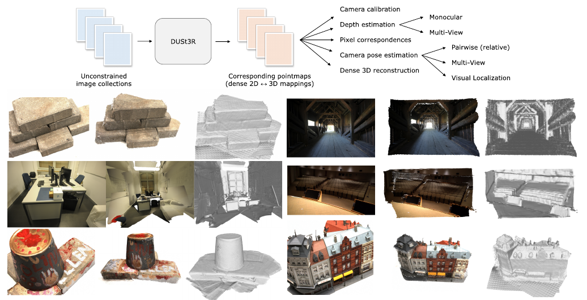](figures/overview.png)

*图 1　方法概览。对于相机位姿和内参未知的照片集合，DUSt3R 输出相应的点图，由此可以直接恢复通常难以同时估计的相机参数、像素对应、深度图及全局一致的三维重建。方法也适用于单幅输入图像，此时执行单目重建。图中还展示了在未知相机参数条件下，对 DTU、Tanks and Temples 和 ETH3D 数据集的定性结果 [1, 51, 108]。每个示例从左到右为输入图像、彩色点云和带明暗效果的渲染，最后一种展示便于观察底层几何。*

## 1 引言

根据无约束的多视图图像进行稠密三维重建，是计算机视觉长期研究的目标之一 [24, 72, 90]。简单来说，这项任务以某个场景的一组照片为输入，估计该场景的三维几何与相机参数。它在建图 [13, 73]、导航 [15]、考古 [87, 133]、文化遗产保护 [38]、机器人 [79] 等领域有广泛应用。更根本的一点是，它在三维视觉任务中具有特殊地位，几乎涵盖了其余所有几何三维视觉任务。因此，现代三维重建方法往往将各子领域数十年的研究成果组合起来，包括关键点检测 [26, 28, 63, 97] 与匹配 [10, 60, 100, 120]、鲁棒估计 [3, 10, 181]、运动恢复结构（SfM）与束调整（BA）[20, 59, 106]、稠密多视图立体重建 [40, 107, 139, 158, 176] 等。

归根结底，现代 SfM 和 MVS 流程需要解决一系列基本问题：匹配点、求本质矩阵、三角化点、稀疏重建场景、估计相机，最后进行稠密重建。近期进展说明，这条相当复杂的链路在一些条件下确实可行 [31, 71, 77, 143, 146, 148, 163]，但作者认为各组件之间的协作仍有改善空间。每个子问题都不能被完美解决，误差会传递到下一步，使整条流程的复杂度和工程工作量不断增加。

尤其值得注意的是，各子问题之间缺乏沟通。更合理的情况应当是它们能够相互帮助：为恢复相机位姿而建立的稀疏场景，应该自然地帮助稠密重建，稠密重建也应反过来提供帮助。此外，流程中的关键步骤较为脆弱，容易在很多情况下失败 [59]。例如，承担全部相机参数估计的 SfM，在场景视图很少 [109]、物体表面不满足朗伯反射 [16]、相机运动不足 [13] 等常见情况下就可能失效。这令人担忧，因为最终“MVS 算法的表现取决于输入图像和相机参数的质量”[32]。

DUSt3R 面向未标定、未知位姿相机的稠密无约束立体三维重建。核心是一个网络，仅根据一对图像，就能回归稠密而准确的场景表示，无须预先输入场景几何、相机位姿或内参。输出表示采用三维点图，同时包含三类信息：场景几何、像素与场景点之间的关系，以及两个视点之间的关系。仅凭这一输出，几乎所有场景参数——相机和场景几何——都能直接提取出来。

这一点之所以可行，是因为网络对输入图像和相应的三维点图进行联合建模，学习二维结构与三维形状之间的联系。它有机会同时解决多个基本问题，使这些问题能够在网络内部相互协作。

网络采用完全监督训练，使用简单的回归损失。训练依赖大型公开数据集，其中的真值标注来自合成生成 [69, 104]、SfM 软件重建 [56, 162] 或专用传感器采集 [25, 94, 122, 166]。模型采用基于通用 Transformer 的数据驱动策略，避免依赖面向特定任务的模块 [165]：推理时不显式强制任何几何约束，同时利用强大的预训练方法。网络学到强几何先验和形状先验，类似于 MVS 中常用的纹理、明暗或轮廓形状线索 [111]。

为了融合多个图像对的预测，作者将全局对齐目标定义在三维点图空间中，优化相机位姿与几何对齐，而传统 BA 最小化的是重投影误差。这个过程速度快，在实际中也表现出良好的收敛性。实验表明，即使真实场景中使用了各种未知传感器，也能得到准确、视图间一致的重建。同一种网络结构还能自然处理真实环境中的单目和多视图重建。图 1 和随附视频给出了重建示例。

论文的贡献主要落在四个方面。第一，提出一种从未标定、未知位姿图像出发的整体端到端三维重建流程，统一单目和双目重建。第二，将点图表示引入 MVS，使网络能在规范参考系中预测三维形状，同时保留像素与场景之间的隐式关系，由此放松通常透视相机表述中的许多约束。第三，提出多视图三维重建中的点图全局对齐优化，可以方便地提取经典 SfM 与 MVS 流程中常见的各类中间结果。这种方法统一了多项三维视觉任务，相比传统流程大幅简化了重建过程。第四，在一系列三维视觉任务上展示了有前景的性能；尤其是，同一个模型在单目、多视图深度和多视图相机位姿估计基准上取得了当时的最佳结果。

## 2 相关工作

与点图重建直接相关的工作包括 SfM、MVS 和由 RGB 预测三维的方法；附录 C 进一步讨论隐式模型与稠密 SLAM。

**运动恢复结构（SfM）** [20, 21, 45, 48, 106] 根据一组图像重建稀疏三维地图，并联合确定相机参数。传统流程从多幅图像间的关键点匹配 [4, 5, 43, 63, 99] 得到像素对应，确定几何关系，再通过束调整共同优化三维坐标与相机参数。近年来，学习方法大幅增强了 SfM 的各个子过程，包括更好的特征描述 [26, 28, 97, 135, 167]、更准确的图像匹配 [3, 17, 60, 82, 100, 120, 126, 145]、特征度量细化 [59] 和神经束调整 [58, 153]。尽管如此，SfM 的串行结构依然存在，因此仍容易受到各个组件噪声与误差的影响。

**多视图立体重建（MVS）** 通过多个视点之间的三角化，稠密地重建可见表面。经典 MVS 假定所有相机参数都作为输入给定。无论是完全手工设计的方法 [32, 34, 107, 147, 175]，较新的场景优化方法 [31, 71, 76, 77, 143, 146, 148, 163]，还是学习方法 [40, 53, 65, 86, 161, 164, 180]，都依赖相机参数估计。这些参数需要复杂的标定过程：或者在数据采集时获得 [1, 23, 109, 166]，或者在真实环境重建中通过 SfM 获得 [48, 106]。实际场景中，预估相机参数的不准确可能严重影响这些算法。DUSt3R 则直接预测可见表面的几何，无须显式知道相机参数。

**直接由 RGB 得到三维。** 最近出现了一些从单幅 RGB 图像直接预测三维几何的方法。由于不引入额外假设时，这个问题本身是不适定的，这些方法依赖神经网络从大规模数据中学到强三维先验，以消除歧义。它们可以分成两类。

第一类使用物体类别先验。例如 Pavllo 等人 [83–85] 根据大量二维图像训练模型，从单幅图像完整恢复形状、位姿和外观。这类方法能力很强，但无法推断未见类别物体的形状。第二类与 DUSt3R 更接近，面向一般场景，通常建立在已有的单目深度估计（MDE）网络之上，或直接复用它们 [6, 91, 169, 171]。深度图编码了一种三维信息，结合相机内参就能直接形成与像素对齐的三维点云。

例如，SynSin [151] 在已知全部相机参数时，通过渲染带特征的深度图，从单幅图像合成新视点。在内参未知时，可以利用视频帧间的时间一致性推断内参：一种途径是强制全局对齐 [156]，另一种途径是使用可微渲染和光度重建损失 [36, 117]。也可以显式学习预测相机内参，与 MDE 结合，从单幅图像进行米制三维重建 [168, 170]。这些方法都受到深度估计质量的内在限制，而单目深度本身通常是不适定的。

DUSt3R 同时处理两个视点，输出深度图，更准确地说，是点图。至少在理论上，两个视点提供了在不同视线之间进行三角化的可能。过去也有多视图三维重建网络，其主要思路是构建可微 SfM 流程：复现传统流程，但进行端到端训练 [131, 136, 184]。这些方法仍需要将真值相机内参作为输入，输出一般是深度图和相机相对位姿 [136, 184]。DUSt3R 采用通用结构，输出由三维点构成的稠密二维场，即点图，将相机位姿隐式包含在表示中，使回归问题更易于求解。

**点图。** 在 MVS 中用点图集合表示形状似乎不太直观，但这种表示在视觉定位中已经广泛使用，既包括依赖场景的优化方法 [8, 9, 11]，也包括场景无关的推理方法 [96, 124, 159]。逐视图建模在单目三维重建 [57, 113, 127, 141] 和视图合成 [151] 中也很常见：将规范三维形状保存在多个规范视图中，从而在图像空间开展计算。这些方法通常通过渲染规范表示，显式使用透视相机几何。

## 3 方法

在介绍具体方法前，先说明点图这一核心概念。

**点图。** 将三维点构成的稠密二维场记为点图 $X\in\mathbb R^{W\times H\times3}$。它与分辨率为 $W\times H$ 的 RGB 图像 $I$ 关联，为图像像素和三维场景点建立一一映射：对所有像素坐标 $(i,j)\in\{1,\ldots,W\}\times\{1,\ldots,H\}$，有 $I_{i,j}\leftrightarrow X_{i,j}$。这里假定每条相机射线只遇到一个三维点，忽略半透明表面。

**相机与场景。** 给定相机内参 $K\in\mathbb R^{3\times3}$，根据真值深度图 $D\in\mathbb R^{W\times H}$，可以直接得到所观测场景的点图：

$$
X_{i,j}=K^{-1}[iD_{i,j},\ jD_{i,j},\ D_{i,j}]^\mathsf T.
$$

此时 $X$ 在相机坐标系中。下文用 $X^{n,m}$ 表示相机 $n$ 的点图 $X^n$ 在相机 $m$ 坐标系中的表达：

$$
X^{n,m}=P_mP_n^{-1}h(X^n). \tag{1}
$$

其中 $P_m,P_n\in\mathbb R^{3\times4}$ 为图像 $m,n$ 的世界到相机位姿，$h:(x,y,z)\mapsto(x,y,z,1)$ 为齐次映射。

> 原文用 $3\times4$ 矩阵记位姿，同时简写其逆。计算时可将它补齐为 $4\times4$ 刚体变换 $T_n$，末行为 $(0,0,0,1)$。若 $\pi_3$ 表示取齐次坐标的前三项，则严格的写法为

$$
X^{n,m}_{i,j}=\pi_3\!\left(T_mT_n^{-1}h(X^n_{i,j})\right).
$$

这里的深度 $D$ 表示相机光轴方向的 $z$ 坐标。$K^{-1}[i,j,1]^\mathsf T$ 给出第三个分量为 1 的视线方向，乘以 $D_{i,j}$ 就还原出相机 $n$ 下的三维点；$T_n^{-1}$ 将它变到世界系，$T_m$ 再将它变到相机 $m$ 下。因此，$X^{n,m}$ 的第一个上标说明像素属于哪幅图，第二个上标说明三维坐标使用哪个参考系。改变第二个上标只改变坐标表达，像素索引仍属于图像 $n$。

### 3.1 概览

网络学习广义立体三维重建的回归映射 $\mathcal F$，输入两幅 RGB 图像 $I^1,I^2\in\mathbb R^{W\times H\times3}$，输出两张相应的点图 $X^{1,1},X^{2,1}\in\mathbb R^{W\times H\times3}$，以及置信度图 $C^{1,1},C^{2,1}\in\mathbb R^{W\times H}$。两张点图都表达在图像 $I^1$ 的坐标系中。这与已有方法有根本区别，也带来关键优势，见第 1、2、3.3 和 3.4 节。为表述清晰，假定两幅图像分辨率相同；实际中它们可以不同。

[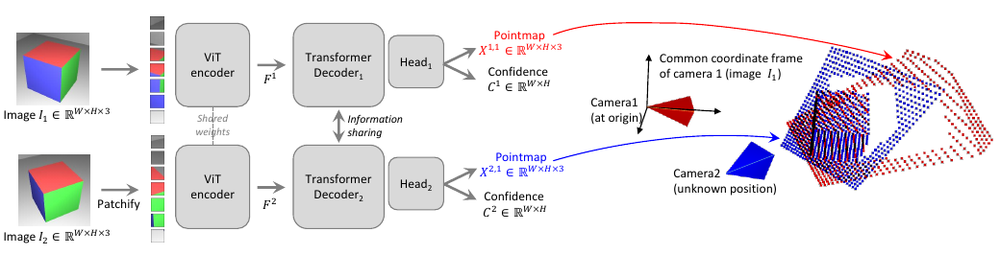](figures/architecture.png)

*图 2　网络 $\mathcal F$ 的结构。首先用共享权重的 ViT 编码器，以孪生方式编码场景的两个视图 $(I^1,I^2)$。得到的 token 表示 $F^1,F^2$ 进入两个 Transformer 解码器，解码器通过交叉注意力持续交换信息。最后，两个回归头输出相应的点图和置信度图。两张点图均位于第一幅图像 $I^1$ 的坐标系中。网络使用简单的回归损失训练，见式 (4)。*

**网络结构。** 网络 $\mathcal F$ 受 CroCo [150] 启发，可以直接受益于 CroCo 预训练 [149]。如图 2 所示，它包含两个结构相同的分支，每幅图像对应一个分支，每个分支包括图像编码器、解码器和回归头。两幅输入先由同一个共享权重的 ViT 编码器 [27] 编码，产生两组 token：

$$
F^1=\operatorname{Encoder}(I^1),\qquad
F^2=\operatorname{Encoder}(I^2).
$$

随后，网络在解码器中对两者联合推理。与 CroCo [150] 类似，解码器是带交叉注意力的通用 Transformer。每个解码块依次执行自注意力——每个 token 读取本视图的 token，交叉注意力——每个 token 读取另一视图的全部 token，最后通过 MLP。两个分支在整个解码过程中持续共享信息，这是输出正确对齐点图的关键。具体来说，各解码块读取另一分支的 token：

$$
\begin{aligned}
G_i^1&=\operatorname{DecoderBlock}_i^1(G_{i-1}^1,G_{i-1}^2),\\
G_i^2&=\operatorname{DecoderBlock}_i^2(G_{i-1}^2,G_{i-1}^1),
\end{aligned}
$$

其中 $i=1,\ldots,B$，$B$ 为解码块数，初始状态为 $G_0^1:=F^1$、$G_0^2:=F^2$。$\operatorname{DecoderBlock}_i^v(G^1,G^2)$ 表示分支 $v\in\{1,2\}$ 的第 $i$ 个块，第二个参数是另一分支的输入 token。最后，每个分支独立的回归头读取解码 token，输出点图及相应置信度图：

$$
\begin{aligned}
X^{1,1},C^{1,1}&=\operatorname{Head}^1(G_0^1,\ldots,G_B^1),\\
X^{2,1},C^{2,1}&=\operatorname{Head}^2(G_0^2,\ldots,G_B^2).
\end{aligned}
$$

**讨论。** 回归得到的点图 $X^{1,1}$ 和 $X^{2,1}$ 带有未知尺度因子。通用网络结构从不显式强制几何约束，因此点图未必对应任何物理上可行的相机模型。作者让网络从训练集中学习相关先验，训练集本身只包含几何一致的点图。通用结构可以利用强预训练，从而超越现有的任务专用结构。下一节详述学习过程。

两幅图看到同一表面位置时，它们在各自图像中的像素位置通常不同，但两张预测点图应为它给出相近的三维坐标。这样，可以直接在三维空间比较两幅图的点。网络的工作是根据图像预测这些坐标，前面的深度反投影公式用于定义几何和构造标签。

交叉注意力更新的是特征：两个分支在第 $i$ 层读取另一分支第 $i-1$ 层的状态，下一层再读取更新后的状态。几何坐标在回归头中产生。两分支共享编码器权重，两个解码器和两个输出头分别使用各自参数，承担参考图与第二幅图的角色。

### 3.2 训练目标

**三维回归损失。** 唯一的训练目标建立在三维空间回归上。用 $\bar X^{1,1},\bar X^{2,1}$ 表示根据式 (1) 获得的真值点图，$\mathcal D^1,\mathcal D^2\subseteq\{1,\ldots,W\}\times\{1,\ldots,H\}$ 表示真值有效的像素集合。对于视图 $v\in\{1,2\}$ 中的有效像素 $i\in\mathcal D^v$，回归损失就是欧氏距离：

$$
\ell_{\mathrm{regr}}(v,i)=
\left\|\frac{1}{z}X_i^{v,1}-\frac{1}{\bar z}\bar X_i^{v,1}\right\|. \tag{2}
$$

为处理预测与真值之间的尺度歧义，分别用 $z=\operatorname{norm}(X^{1,1},X^{2,1})$ 和 $\bar z=\operatorname{norm}(\bar X^{1,1},\bar X^{2,1})$ 归一化预测点图与真值点图。它们就是所有有效点到原点的平均距离：

$$
\operatorname{norm}(X^1,X^2)=
\frac{1}{|\mathcal D^1|+|\mathcal D^2|}
\sum_{v\in\{1,2\}}\sum_{i\in\mathcal D^v}\|X_i^v\|. \tag{3}
$$

对一次两图预测，两张点图共用一个 $z$。如果所有预测坐标同时乘以 $s>0$，式 (3) 的 $z$ 也乘以 $s$，于是 $sX/(sz)=X/z$，式 (2) 不变。损失因此比较归一化后的几何结构，容许整体尺度未知。

这里需要保留两张图之间的相对尺度。若分别归一化两张预测，网络可能在一张图里将场景放大两倍，在另一张图里放大三倍，却仍分别得到很小的误差；它们便无法组成同一份几何。共同的 $z$ 保留了这个跨图约束。归一化也保留参考相机原点及方向，所消除的是整体尺度。

**考虑置信度的损失。** 实际上，与前面的假设不同，有些三维点并没有良好定义，例如天空或半透明物体上的点。更一般地，图像中有些部分比其他部分更难预测。因此，模型联合学习每个像素的分数，表示网络对该像素的置信程度。最终训练目标是在所有有效像素上，对式 (2) 进行置信度加权：

$$
\mathcal L_{\mathrm{conf}}=
\sum_{v\in\{1,2\}}\sum_{i\in\mathcal D^v}
\left[C_i^{v,1}\ell_{\mathrm{regr}}(v,i)-\alpha\log C_i^{v,1}\right]. \tag{4}
$$

$C_i^{v,1}$ 为像素 $i$ 的置信度，$\alpha$ 是控制正则项的超参数 [137]。为保证置信度严格为正，论文采用参数化 $C_i^{v,1}=1+\exp(\widetilde C_i^{v,1})>1$。这会迫使网络也在较难区域进行推断，例如只被一个视图覆盖的区域。该目标使网络无须显式的置信度监督，就能估计置信度分数。图 3，以及附录图 4、5、8，展示了输入图像对及相应输出。

暂时固定某个像素的几何误差 $\ell>0$，将其损失写为 $L(C)=C\ell-\alpha\log C$，则

$$
\frac{\mathrm dL}{\mathrm dC}=\ell-\frac{\alpha}{C}.
$$

如果仅要求 $C>0$，驻点为 $C=\alpha/\ell$：误差越小，较大的置信度越有利。$-\alpha\log C$ 抑制将置信度压到零的做法。论文还使用 $C>1$ 的参数化，因此当上述驻点低于 1 时，最优值趋近下界 1，几何误差仍至少承受接近 1 的权重。网络无法仅靠降低置信度完全绕过困难像素。

这种分数在后续匹配筛选和全局对齐中可以当作可靠性权重。它的定义没有要求各像素分数加起来等于 1，也没有将它标定为正确概率。

[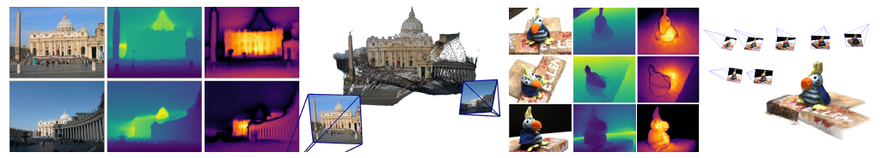](figures/pairwise-results.png)

*图 3　训练中未见过的两个场景的重建示例。从左到右依次为 RGB、深度图、置信度图、重建结果。左侧场景展示 $\mathcal F(I^1,I^2)$ 的原始输出；右侧场景展示全局对齐后的结果，见第 3.4 节。*

### 3.3 下游应用

输出点图包含丰富信息，因此可以相对容易地完成多种操作。

**点匹配。** 通过在三维点图空间进行最近邻搜索（NN），就能直接建立两幅图像之间的像素对应。为减小误差，通常只保留图像 $I^1,I^2$ 间的双向一致匹配 $\mathcal M_{1,2}$：

$$
\mathcal M_{1,2}=\left\{(i,j)\mid
 i=\operatorname{NN}^{1,2}_1(j),\quad
 j=\operatorname{NN}^{2,1}_1(i)\right\},
$$

其中

$$
\operatorname{NN}^{n,m}_k(i)=
\underset{j\in\{0,\ldots,WH\}}{\operatorname{argmin}}
\left\|X_j^{n,k}-X_i^{m,k}\right\|.
$$

对图像 2 的像素 $j$，先在图像 1 的点图中找与 $X_j^{2,1}$ 三维距离最近的点；再从找到的图像 1 像素反查图像 2，只有回到原像素 $j$ 才保留。两张点图都在相机 1 坐标系中，距离才有共同含义。双向检查可以减轻遮挡和多对一对应引起的错误，但实际匹配仍取决于坐标预测质量。原文最近邻公式中的像素索引上界写为 $WH$；实现时应按实际展平索引范围取 $WH$ 个像素。

**恢复内参。** 点图 $X^{1,1}$ 按定义表达在 $I^1$ 的坐标系中，因此可以通过简单优化估计相机内参。该焦距估计假定主点近似位于图像中心，像素为正方形，于是只剩焦距 $f_1^*$ 需要估计：

$$
f_1^*=\underset{f_1}{\operatorname{argmin}}
\sum_{i=0}^{W}\sum_{j=0}^{H}
C_{i,j}^{1,1}
\left\|(i',j')-
 f_1\frac{(X_{i,j,0}^{1,1},X_{i,j,1}^{1,1})}{X_{i,j,2}^{1,1}}\right\|,
$$

其中 $i'=i-W/2$、$j'=j-H/2$。采用快速迭代求解器，例如基于 Weiszfeld 算法的方法 [88]，只需几次迭代即可得到最优 $f_1^*$。要恢复第二台相机的焦距 $f_2^*$，最简单的做法是对反序图像对 $(I^2,I^1)$ 再执行一次推理，将上式中的 $X^{1,1}$ 换成 $X^{2,2}$。

针孔模型在主点平移后满足 $i'=fx/z$、$j'=fy/z$。像素位置提供等式左边，点图提供右边的 $x/z,y/z$，所以可以让所有像素共同约束一个焦距。预测坐标整体乘以相同尺度时，比值保持不变，因此焦距恢复不要求先确定场景的米制尺度。

这里的目标函数使用二维欧氏范数，原文没有将其平方；不能直接将其视为普通线性最小二乘闭式解。相机 2 的焦距需要在它自己的相机系下计算，反序推理提供的正是 $X^{2,2}$。只拿 $X^{2,1}$ 的第三个分量，会得到相机 1 方向上的坐标，几何含义不同。

**相对位姿估计** 可以采用多种途径。一种是先按上述方法进行二维匹配和内参恢复，再估计极几何矩阵并恢复相对位姿 [45]。更直接的方法是用 Procrustes 对齐 [64]，比较点图 $X^{1,1}\leftrightarrow X^{1,2}$（原文括注另列为 $X^{2,2}\leftrightarrow X^{1,2}$），得到相对位姿 $P^*=[R^*\mid t^*]$：

$$
R^*,t^*=\underset{\sigma,R,t}{\operatorname{argmin}}
\sum_i C_i^{1,1}C_i^{1,2}
\left\|\sigma(RX_i^{1,1}+t)-X_i^{1,2}\right\|^2.
$$

这一问题可以闭式求解。遗憾的是，Procrustes 对噪声和离群值敏感。最后一种更稳健的选择是将 RANSAC [30] 与 PnP [45, 52] 结合。

> 原文括注中的 $X^{2,2}$ 与 $X^{1,2}$ 分别属于图像 2 和图像 1，像素索引不天然对应；与主公式一致的另一组同像素点图应为 $X^{2,2}\leftrightarrow X^{2,1}$。这里保留原文信息，解释时采用“同一幅图的点，表达在两个不同相机系中”的对应关系。

对于主公式，$X^{1,1}$ 和 $X^{1,2}$ 来自正序及反序推理，同一个像素 $i$ 对应两份三维预测。拟合的相似变换将相机 1 系下的预测对齐到相机 2 系。原文把尺度写在 $RX+t$ 外面；若使用常见的 $\sigma RX+\tau$ 形式，实际平移变量是 $\tau=\sigma t$。

对图像 2 的每个像素 $i$，$X_i^{2,1}$ 已经给出了它在相机 1 系下的三维位置。因此，像素 $i$ 与 $X_i^{2,1}$ 天然构成一组二维—三维对应。有了相机 2 内参，PnP 就能估计相机 1 系到相机 2 系的位姿；RANSAC 用于剔除不符合共同位姿的对应。求出的平移沿用输入点图的尺度。

**绝对位姿估计** 又称视觉定位，同样有多种实现。用 $I^Q$ 表示查询图像，$I^B$ 表示已知二维—三维对应的参考图像。首先，可以从 $X^{Q,Q}$ 估计 $I^Q$ 的内参。一种做法是在 $I^Q,I^B$ 间取得二维对应，由此构造 $I^Q$ 的二维—三维对应，再运行 PnP-RANSAC [30, 52]。另一种做法是按前述方法取得 $I^Q,I^B$ 间的相对位姿，然后根据 $X^{B,B}$ 与参考图像真值点图之间的尺度关系，适当缩放位姿，将其转换到世界坐标系。

第一条路径中，查询像素匹配到数据库像素后，后者已有的世界三维点提供了外部参考系。第二条路径则先得到局部相对关系，用数据库几何确定长度尺度，再结合数据库相机的世界位姿。两条路径都通过参考数据连接到世界坐标。

### 3.4 全局对齐

目前的网络 $\mathcal F$ 只能处理一对图像。这里引入一种快速、简单的场景级后处理优化，将多幅图像预测的点图对齐到共同三维空间。之所以能这样做，是因为点图本身包含两张已经相互对齐的点云，以及各自的像素到三维位置的映射。

**图像对图。** 给定场景图像集 $\{I^1,I^2,\ldots,I^N\}$，首先构造连接图 $\mathcal G(\mathcal V,\mathcal E)$。$N$ 幅图像构成节点 $\mathcal V$，每条边 $e=(n,m)\in\mathcal E$ 表示 $I^n,I^m$ 具有部分共同视觉内容。可以使用现成的图像检索方法建立连接，也可以将所有图像对送入 $\mathcal F$，根据每对输出的平均置信度估计重叠程度，再过滤低置信度图像对。网络在 H100 GPU 上一次推理约需 40 ms。

**全局优化。** 根据连接图 $\mathcal G$，为所有相机 $n=1,\ldots,N$ 恢复全局对齐的点图 $\{\chi^n\in\mathbb R^{W\times H\times3}\}$。首先，对每条边 $e=(n,m)$，预测两张点图 $X^{n,n},X^{m,n}$ 及相应置信度图 $C^{n,n},C^{m,n}$。为便于表述，定义 $X^{n,e}:=X^{n,n}$、$X^{m,e}:=X^{m,n}$，置信度使用相应的边索引。

为了将所有图像对的预测变换到共同参考系，为每条边 $e\in\mathcal E$ 引入图像对位姿 $P_e\in\mathbb R^{3\times4}$ 和尺度 $\sigma_e>0$。优化问题为

$$
\chi^*=\underset{\chi,P,\sigma}{\operatorname{argmin}}
\sum_{e\in\mathcal E}\sum_{v\in e}\sum_{i=1}^{HW}
C_i^{v,e}\left\|\chi_i^v-\sigma_eP_eX_i^{v,e}\right\|. \tag{5}
$$

这里将 $v\in\{n,m\}$ 简记为 $v\in e$。对于一条边 $e$，同一个刚体变换 $P_e$ 应当把 $X^{n,e}$ 和 $X^{m,e}$ 分别对齐到世界系点图 $\chi^n,\chi^m$，因为这两张局部点图本来就在同一个参考系下。为避免所有 $\sigma_e=0$ 的平凡最优解，施加约束

$$
\prod_{e\in\mathcal E}\sigma_e=1.
$$

边 $(n,m)$ 的两张预测已经具有共同的局部坐标系，因此必须共用一个边变换和一个边尺度。不同边之间的连接来自同一幅图像：只要另一条边也包含图像 $n$，它就会为图像 $n$ 的每个像素产生另一份三维预测。两份预测经过各自边变换后，都需要靠近唯一的全局点图 $\chi^n$。共同的 $\chi^n$ 就把不同局部重建约束在一起。

式 (5) 的一个残差比较同一幅图、同一个像素的两种三维表达，因此像素索引直接提供对应。这里不需要在每次优化迭代中重新搜索点云对应。置信度则决定各个局部预测对全局结果的影响程度。若 $P_e=[R_e\mid t_e]$，局部点经变换后为 $\sigma_e(R_eX+t_e)$，与同像素的全局点比较三维距离。$P_eX$ 仍采用齐次变换简写；与式 (1) 一样，计算时需要补齐齐次坐标。

尺度乘积约束排除了把整套结构一起缩到零的退化解，也固定了一种整体尺度规范。物理长度单位仍需外部信息。仅从该目标看，共同参考系还可整体平移、旋转；求解时可以选择参考相机来固定这部分自由度。若连接图不连通，各连通分量之间缺少恢复相对关系的约束。

**恢复相机参数。** 这个框架可以直接扩展到恢复全部相机参数。只需用针孔相机模型替换 $\chi^n$：

$$
\chi_{i,j}^n:=P_n^{-1}h\!\left(
K_n^{-1}[iD_{i,j}^n;\ jD_{i,j}^n;\ D_{i,j}^n]
\right).
$$

也就是像式 (1) 那样强制使用标准针孔模型，便可估计所有图像的相机位姿 $\{P_n\}$、内参 $\{K_n\}$ 和深度图 $\{D^n\}$。

在式 (5) 的基本形式里，每个 $\chi_i^n$ 都是可以独立移动的三维点。替换后，图像 $n$ 的一个像素先由深度与内参反投影到本相机系，再通过 $P_n^{-1}$ 变到世界系。这样，每张图的所有像素共用一套相机参数，优化相机时会同时影响整张点图。

网络输出的局部点图在优化中保持固定，待求的是能解释这些三维观测的相机、深度及边对齐变量。这也说明了两层约束的区别：前向网络自由预测三维坐标，全局优化阶段可以进一步要求结果符合针孔相机模型。

**讨论。** 与传统束调整相比，这种全局优化在实践中快速而简单。这里最小化的是三维空间中的对齐误差，传统 BA 通常最小化二维重投影误差。优化使用标准梯度下降，一般几百步就收敛，在普通 GPU 上只需数秒。

> 这里的数秒描述全局优化过程，前面约 40 ms 描述 H100 上的两图网络推理。整个图像集合还需要构图和逐边预测，不能将其中任一计时直接当作任意规模重建的总耗时。

## 4 DUSt3R 实验

**训练数据。** 训练混合了八个数据集：Habitat [104]、ARKitScenes [25]、MegaDepth [56]、Static Scenes 3D [110]、Blended MVS [162]、ScanNet++ [166]、CO3Dv2 [94] 和 Waymo [122]。这些数据覆盖室内、室外、合成、真实世界及以物体为中心等不同场景。数据集没有直接提供图像对时，使用文献 [149] 的方法，通过现成的图像检索和点匹配算法寻找并验证图像对，总共提取 850 万对。

> 原文正文的数据列表重复写了一次 MegaDepth；这里按附录 F.1 的八项列表整理。原文对文献 [110] 对应数据的命名存在不一致：正文与附录文字写作 Static Scenes 3D，表 8 写作 Static Thing 3D。两种名称和相应文献编号在这里保留，以便核对。

**训练细节。** 每个 epoch 从各数据集中随机抽取相同数量的图像对，以平衡数据集规模差异。训练希望利用较高分辨率图像，例如最长边 512 像素。为降低训练成本，采用逐阶段训练：先使用 $224\times224$ 图像，再使用较大的 512 像素图像。

每个 batch 随机选择宽高比，例如 16:9、4:3，使网络在测试时能够适应不同形状的图像。具体做法是裁剪到目标宽高比，再缩放到最长边 512 像素。

整体采用标准数据增强和训练设置。网络编码器使用 ViT-Large [27]，解码器使用 ViT-Base，预测头使用 DPT [91]。训练和结构细节见附录 F。开始训练前，使用现成的 CroCo 预训练权重 [149] 初始化网络。跨视图补全（Cross-View Completion，CroCo）是一种受 MAE [46] 启发的预训练范式，在多项下游三维视觉任务中效果出色，因此特别适合本框架。第 4.6 节分析 CroCo 预训练和提高图像分辨率的作用。

**评价。** 本节在一组有代表性的经典三维视觉任务上评估 DUSt3R，逐项说明数据集、指标，并与已有最佳方法比较。所有结果使用同一个 DUSt3R 模型，默认模型记为 DUSt3R 512，其他变体用于第 4.6 节的消融。模型不针对各下游任务另外微调。测试时，图像保持宽高比缩放至 512 像素。由于第 3.3、3.4 节提供了多条提取任务输出的路径，每项实验都会说明实际采用的路径。

**定性结果。** 即使在困难条件下，DUSt3R 也能生成高质量稠密重建。附录 B 展示了没有特意挑选的双视图和多视图可视化结果。

### 4.1 视觉定位

**数据集与指标。** 首先在 7Scenes [114] 和 Cambridge Landmarks [49] 上评估绝对位姿估计。7Scenes 包含七个室内场景，提供视频中的 RGB-D 图像及六自由度相机位姿。Cambridge Landmarks 包含六个室外场景，提供 RGB 图像及通过 SfM 获得的相机位姿。报告的指标是平移误差和旋转误差的中位数，单位分别为厘米和度。

**协议与结果。** 为计算世界坐标系下的相机位姿，该实验将 DUSt3R 作为二维像素匹配器，匹配查询图像和最相关的数据库图像，相关性通过现成的 AP-GeM 图像检索 [95] 获得。具体使用 $\mathcal F(I^Q,I^B)$ 输出的原始点图，无须细化，其中 $I^Q$ 为查询图、$I^B$ 为数据库图。Cambridge Landmarks 使用检索结果的前 20 张图像，7Scenes 使用前 1 张，并利用已知查询内参。内参未知时的结果见附录 E。

表 1 按场景与已有方法比较。与基于特征匹配的方法 [101, 103] 及端到端学习方法 [11, 55, 102, 125, 152] 相比，本方法取得了相当精度，一些情况下还超过 HLoc [101] 这样的强基线。这一结果值得结合训练条件理解：首先，DUSt3R 从未以任何方式为视觉定位专门训练；其次，查询图和数据库图均未在 DUSt3R 训练中出现。

[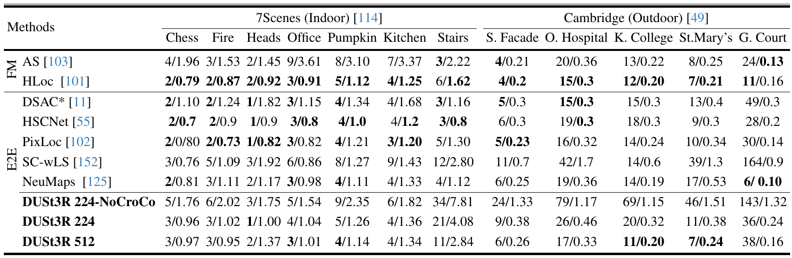](figures/table-1-localization.png)

*表 1　7Scenes [114] 与 Cambridge Landmarks [49] 上的绝对相机位姿。各单元格依次为平移、旋转误差中位数，单位为 cm/°，越小越好。FM 表示特征匹配方法，E2E 表示端到端学习方法。粗体为每一类中的最佳结果。场景列保留原名，S. Facade、O. Hospital、K. College、St. Mary’s 和 G. Court 分别对应 Shop Facade、Old Hospital、King’s College、St. Mary’s Church 和 Great Court。*

### 4.2 多视图位姿估计

接着评估第 3.4 节全局对齐后的多视图相对位姿估计。

**数据集。** 遵循文献 [140]，使用 CO3Dv2 [94] 和 RealEstate10K [186]。CO3Dv2 包含约 3.7 万段视频提取的 600 万帧，覆盖 51 个 MS-COCO 类别。真值相机位姿由 COLMAP 对每段视频的 200 帧进行重建获得。RealEstate10K 包含约 8 万段 YouTube 视频中的 1000 万帧，覆盖室内和室外，位姿由带束调整的 SLAM 获得。

沿用文献 [140] 的协议，在 CO3Dv2 的 41 个类别和 RealEstate10K 测试集的 1800 段视频上评价。每个序列随机选 10 帧，将所有 45 个图像对送入 DUSt3R。

**基线与指标。** 将通过 PnP-RANSAC 或全局对齐获得的位姿，与学习方法 RelPose [177]、PoseReg [140]、PoseDiffusion [140]，以及基于结构的方法 PixSfM [59]、COLMAP+SPSG 比较。后者是将 SuperPoint [26]、SuperGlue [100] 与 COLMAP [107] 结合。

与文献 [140] 相同，逐图像对计算相对旋转准确率 RRA 和相对平移准确率 RTA，阈值设为 $15^\circ$，报告 RRA@15 与 RTA@15。另计算 mAA@30，即相对旋转和平移角度准确率共同决定的准确率曲线在 $30^\circ$ 范围内的面积。

> 原文将 mAA 的定义简写为关于 $\min(\mathrm{RRA}@30,\mathrm{RTA}@30)$ 的角度准确率曲线面积。此处保留其同时考虑两类角误差的含义，具体计算沿用论文评估协议。RTA 衡量的是平移方向误差，不能用它判断米制平移长度是否准确。10 帧产生 $10\times9/2=45$ 个无序图像对。

**结果。** 如表 2 所示，采用全局对齐的 DUSt3R 在两个数据集上取得最佳的整体表现，显著超过 PoseDiffusion [140]。使用 PnP 的 DUSt3R 同样超过已有学习方法和结构方法。

需要说明，PoseDiffusion 在 RealEstate10K 上的上述结果来自 CO3Dv2 上训练的模型。作者认为该比较有意义，因为 DUSt3R 的训练也没有使用 RealEstate10K。附录 D 还报告较少输入视图——3 到 10 幅——的结果，DUSt3R 在两个基准上同样表现出色。

[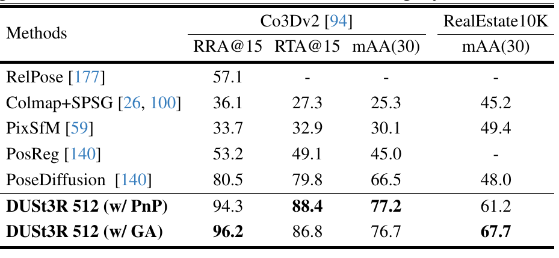](figures/table-2-pose.png)

*表 2 右　CO3Dv2 [94] 和 RealEstate10K [186] 上的多视图位姿回归，输入为随机选取的 10 帧。RRA@15、RTA@15 和 mAA(30) 均越高越好；w/ PnP、w/ GA 分别表示采用 PnP 和全局对齐。*

CO3Dv2 上，GA 的 RRA@15 为 96.2，高于 PnP 的 94.3；但其 RTA@15 和 mAA 分别为 86.8、76.7，低于 PnP 的 88.4、77.2。RealEstate10K 上 GA 的 mAA 为 67.7，高于 PnP 的 61.2。因此，作者对整体结果的概括需要结合具体指标阅读，全局对齐的收益并非每项指标都增加。

### 4.3 单目深度

单目任务只需把同一幅图像输入两次，即 $\mathcal F(I,I)$。按照点图定义，深度就是预测三维点的 $z$ 坐标。

**数据集与指标。** 在两个室外数据集 DDAD [41]、KITTI [35]，以及三个室内数据集 NYUv2 [115]、BONN [80]、TUM [119] 上评估。比较方法包括监督、自监督和零样本三类，DUSt3R 属于零样本。使用两种单目深度常用指标 [6, 117]：真值 $y$ 与预测 $\hat y$ 间的绝对相对误差 $\mathrm{AbsRel}=|y-\hat y|/y$，以及阈值准确率 $\delta_{1.25}$，其条件为 $\max(\hat y/y,y/\hat y)<1.25$。

AbsRel 对有效像素的相对误差取平均，越低越好；$\delta_{1.25}$ 统计预测与真值的比值误差在阈值内的像素比例，越高越好。表 2 将误差和准确率按百分数列出，例如 DUSt3R 512 在 NYUv2 的 Rel=6.50 对应 AbsRel=0.065，$\delta_{1.25}=94.09$ 表示 94.09% 的像素通过阈值检查。

**结果。** 零样本方法中，近期的 SlowTv [117] 代表当时的先进水平。它收集经过整理的城市、自然、合成、室内数据混合训练同一模型；混合中的各数据集相机参数已知，或用 COLMAP 估计。如表 2 所示，DUSt3R 能适应室内和室外环境，超过自监督基线 [6, 37, 121]，并达到与先进监督方法 [91, 174] 相当的表现。

[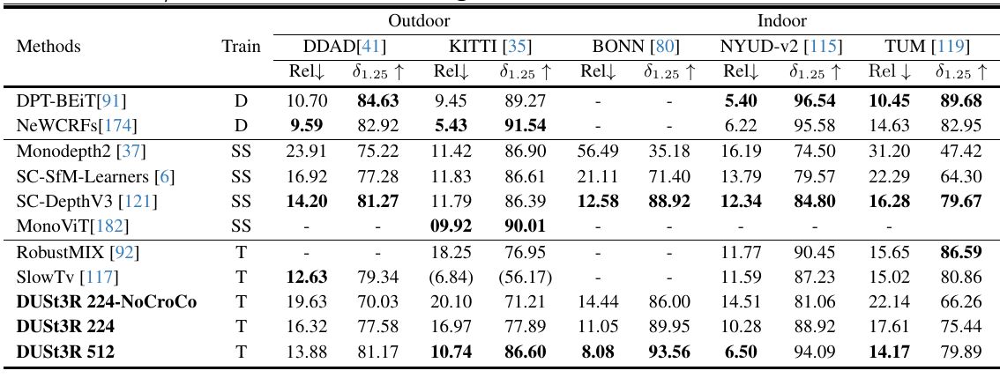](figures/table-2-depth.png)

*表 2 左　多个基准上的单目深度估计。D 表示监督训练，SS 表示自监督训练，T 表示迁移、即零样本测试；括号表示在同一集合上训练。Rel 越低越好，$\delta_{1.25}$ 越高越好。“—”表示未报告。*

> 论文保留各方法不同的训练设置，比较时应同时看 Train 列和括号标记。DUSt3R 的训练损失容许整体尺度变化；本表不能单独证明绝对物理尺度恢复。

### 4.4 多视图深度

这里评估多视图立体深度估计，同样从预测点图的 $z$ 坐标提取深度。同一幅图像有多张深度预测时，先重新缩放使它们相互对齐，再按置信度加权平均。

**数据集与指标。** 沿用文献 [110]，在 DTU [1]、ETH3D [109]、Tanks and Temples [50]、ScanNet [23] 上评价，报告各测试集及所有测试集平均的绝对相对误差 Rel 和阈值为 1.03 的内点率 $\tau$。

该实验不使用真值相机参数、位姿或深度范围，因此预测只在未知尺度意义下有效。为进行定量测量，遵循文献 [110]，用预测深度与真值深度的中位数进行归一化。

**结果。** 表 3 显示，DUSt3R 在 ETH3D 上取得当时最佳精度，总体超过大多数近期先进方法，包括使用真值相机位姿的方法。时间上也明显快于传统 COLMAP 流程 [106, 107]。这表明，本方法能应用于室内、室外及不同大小尺度的多种场景，并且没有在测试域训练；例外是 ScanNet，其训练划分包含在 Habitat 数据中。

[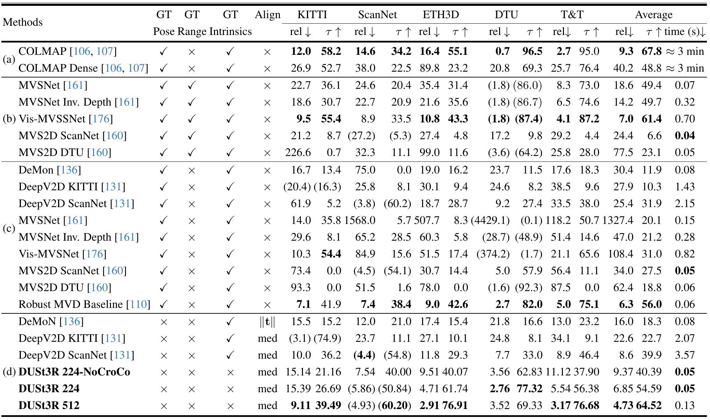](figures/table-3-multiview-depth.png)

*表 3　不同设置下的多视图深度评价。a 为传统方法；b 为提供位姿、深度范围且不对齐；c 为提供位姿、不提供深度范围且不对齐的绝对尺度评价；d 为不提供位姿和深度范围、但执行对齐。GT Pose、GT Range、GT Intrinsics 分别表示是否提供真值位姿、深度范围、内参，Align 表示对齐方法，med 为中位数对齐，$\|t\|$ 表示利用平移长度对齐。括号表示使用同域数据训练。各设置中的最佳结果以粗体标出。原表还列出 KITTI；Rel 为百分数、越低越好，$\tau$ 为百分数、越高越好，时间单位为秒。*

提取相机 $n$ 的深度，需要该相机自身坐标系中的点图 $X^{n,n}$，详见附录 F.1。对相机 2，反序推理可以提供 $X^{2,2}$；也可以在恢复相机后将共同系点图转换到本相机系。$X^{2,1}$ 的第三个坐标本身不能直接作为相机 2 深度。

中位数对齐使用 $s=\operatorname{median}(D_{\mathrm{GT}})/\operatorname{median}(D_{\mathrm{pred}})$ 缩放预测，再评价相对几何。表中 DUSt3R 512 在 ETH3D 的 Rel 为 2.91%、内点率为 76.91%；这里的 1.03 比单目任务的 1.25 更严格。不同表中的准确率需要结合阈值理解。另一个值得注意的结果是 DTU 的 Rel 从 DUSt3R 224 的 2.76% 变为 512 的 3.52%，总体提升仍可能伴随个别数据集的下降。

### 4.5 三维重建

最后评估第 3.4 节全局对齐后完整重建的质量。这一实验仍不以已知相机内外参作为重建输入。为量化重建质量，将预测对齐到真值坐标系。具体在第 3.4 节优化中将相应参数固定为常量，使得到的一致重建表达在真值坐标系下。

**数据集与指标。** 在 DTU [1] 上以零样本方式评价，不在 DTU 训练集微调，直接使用已有模型。表 4 报告基准作者提供的平均 Accuracy、Completeness 和 Overall 误差。对于重建点，Accuracy 定义为它到真值的最小欧氏距离；对于真值点，Completeness 定义为它到重建形状的最小欧氏距离；Overall 为前两项均值。

**结果。** 本方法尚未达到最佳方法的精度。这些方法均利用真值位姿，并在适用时专门使用 DTU 训练集训练。此外，这项任务的最佳结果通常依赖亚像素精度的三角化，需要显式相机参数；DUSt3R 采用回归，精度通常较低。尽管事先不知道相机参数，本方法仍达到平均 Accuracy 2.7 mm、Completeness 0.8 mm 和 Overall 1.7 mm。考虑到方法即插即用的性质，作者认为这一精度仍具有实际用途。

[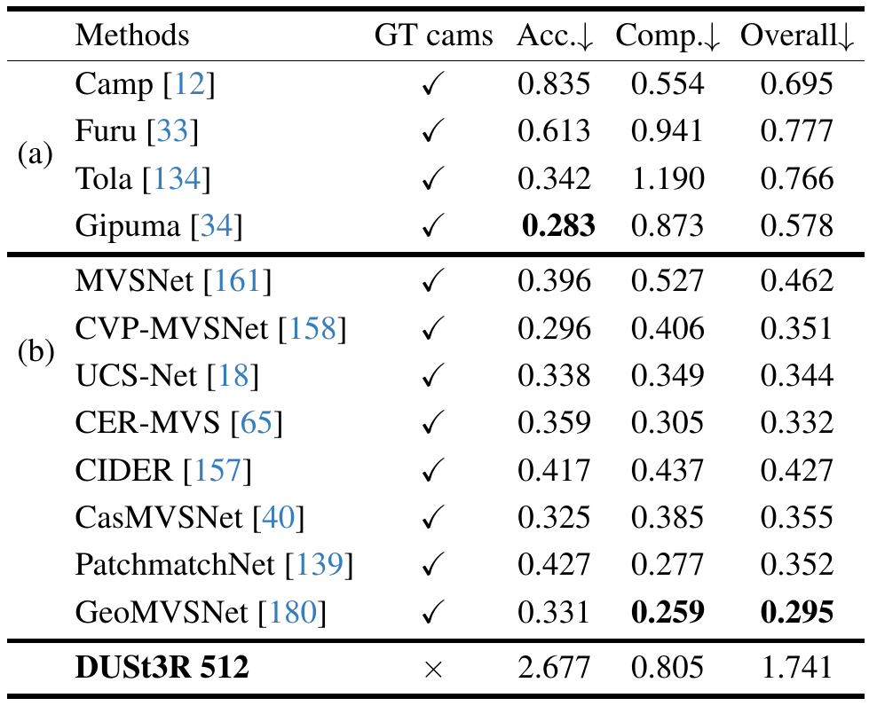](figures/table-4-reconstruction.png)

*表 4　DTU 上的 MVS 重建结果，单位 mm，均越低越好。GT cams 表示是否使用真值相机参数。传统手工方法 a 已被在该特定域训练的学习方法 b 超过。DUSt3R 512 的三项误差分别为 2.677、0.805、1.741；原文段落使用了四舍五入数值。*

### 4.6 消融

消融分析 CroCo 预训练和图像分辨率对 DUSt3R 性能的影响。表 1、2、3 汇报前述任务上的结果。总体上，持续的性能提升说明预训练和高分辨率在现代数据驱动方法中的关键作用，这也与文献 [78, 149] 的观察一致。

> DUSt3R 224-NoCroCo、224、512 分别用于考察预训练及高分辨率训练的收益。附录 F.2 说明 512 模型还经过额外训练和 DPT 头训练，因此这些结果反映训练方案的组合效果，不能将全部差异单独归于图像像素数量。

## 5 结论

DUSt3R 既能在事先不知道场景和相机信息的条件下解决真实环境三维重建，也能处理一整类三维视觉任务。

## 附录

本附录提供 DUSt3R 的更多细节和定性结果。附录 B 展示网络在困难真实数据集上的两视图预测，并介绍随附视频；附录 C 扩展相关工作，覆盖更多方法类别和几何视觉任务；附录 D 提供正文篇幅未能容纳的多视图位姿补充消融；附录 E 研究内参未知时的视觉定位；附录 F 详述训练和数据增强。

### B 定性结果

**点云可视化。** 图 4–8 展示 DUSt3R 的双视图结果。这些场景没有在训练中出现，也没有经过特意挑选。除按输出置信度滤除低置信度点，以及为可视化移除天空区域外，结果没有经过后处理。因此，这些图如实展示了 DUSt3R 的原始输出。总体而言，网络仅使用两幅图像就能进行相当准确的三维重建。

[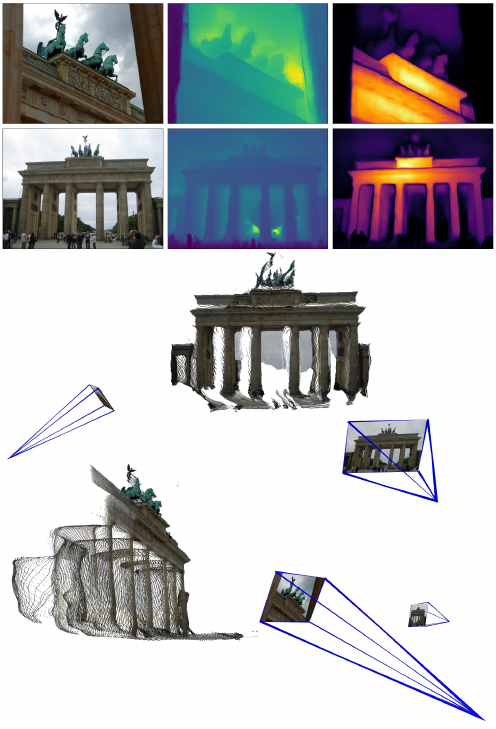](figures/figure-4-megadepth.png)

*图 4　仅由两幅图像重建未见过的 MegaDepth [56] 场景。左上为两幅输入；上中、上右为网络原始输出的深度图与置信度图；中部、底部为彩色点云的两个观察视角。深度图关系见式 (8)，相机参数从原始点图恢复，见第 3.3 节。DUSt3R 能处理较大的视点和焦距变化。*

[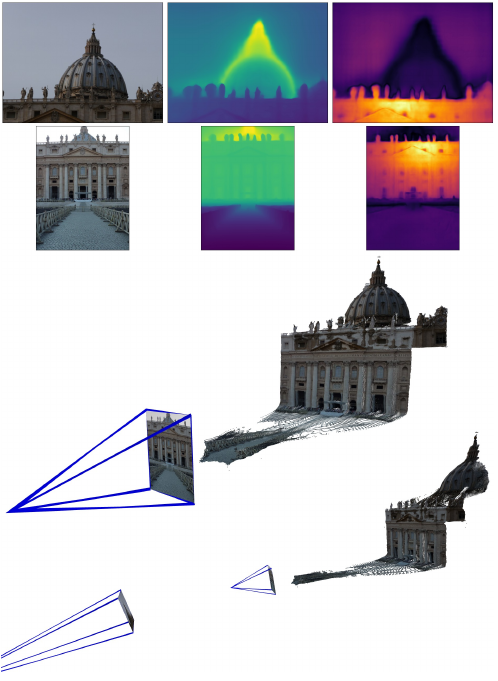](figures/figure-5-megadepth.png)

*图 5　仅由两幅图像重建的另一个未见 MegaDepth [56] 场景。上中为深度图，上右为置信度图，中部和底部为彩色点云的不同观察视角，均展示网络原始输出。相机参数从原始点图恢复，见第 3.3 节。DUSt3R 能处理较大的视点和焦距变化。*

[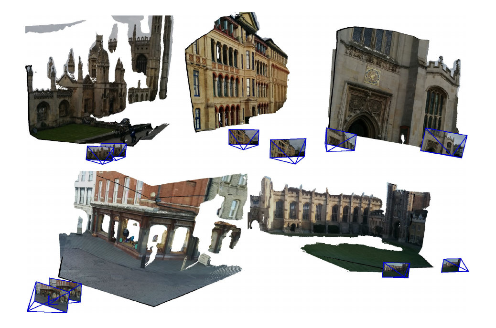](figures/figure-6-cambridge.png)

*图 6　只用两幅图像重建未见过的场景：King’s College（左上）、Old Hospital（上中）、St. Mary’s Church（右上）、Shop Facade（左下）、Great Court（右下）。图中展示网络原始输出彩色点云的新观察视角，相机参数按第 3.3 节从点图恢复。*

[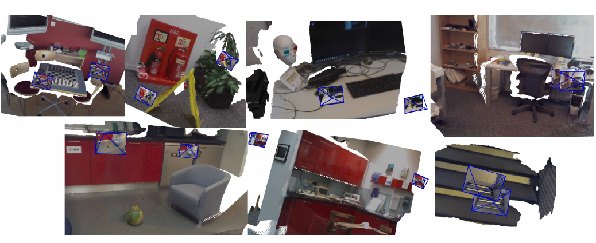](figures/figure-7-7scenes.png)

*图 7　仅使用两幅图像重建未见过的场景：上排为 Chess、Fire、Heads、Office，下排为 Pumpkin、Kitchen、Stairs。图中展示网络原始输出彩色点云的新观察视角，相机参数按第 3.3 节从点图恢复。*

[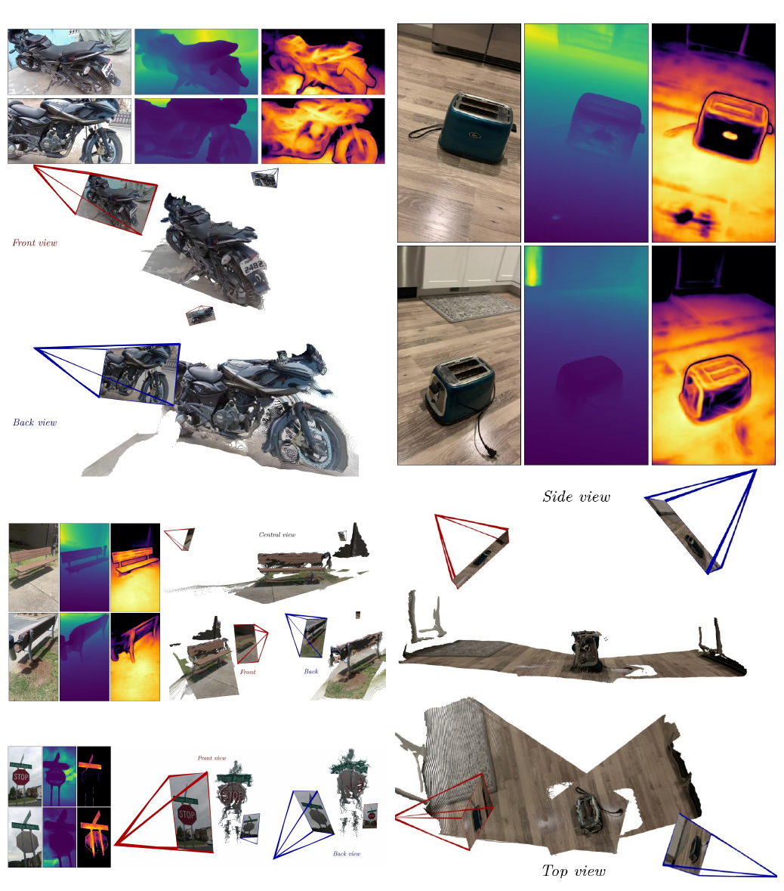](figures/figure-8-opposite-views.png)

*图 8　近乎相反视点的三维重建示例。四种情况为摩托车、烤面包机、长椅和停车标志；各示例展示两幅输入（左上）、网络原始深度（上中）与置信度（右上），以及彩色点云的两个视角（中部、底部）。相机参数按第 3.3 节恢复。即使图像几乎没有共同视觉内容，例如停车标志和摩托车，DUSt3R 也能处理剧烈视点变化。这些示例从未见过的 CO3Dv2 序列中随机选择，随附视频提供动态展示。*

双视图公共区域很少时，直接从两幅图像建立几何约束会更困难。网络还会利用训练中学到的形状与外观先验补充推断。图 8 展示这种能力，但定性展示本身没有证明每一处预测都能由当前图像唯一确定；具体误差仍需由相应评价协议判断。

图 9 给出全局对齐后的输出。网络处理四幅输入的全部图像对，输出空间上一致的四张点图及相应相机参数。

[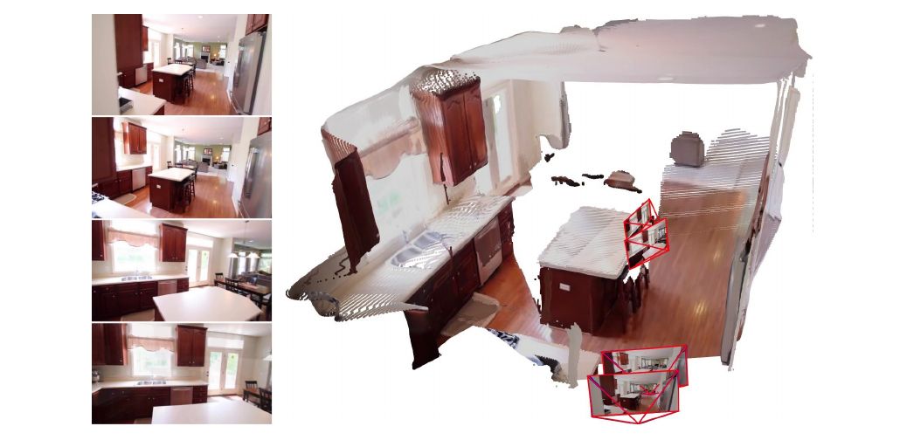](figures/global-alignment.png)

*图 9　从 RealEstate10K 某室内序列随机选取四帧，全局对齐后的重建。左侧为四幅输入，右侧为点云及恢复的相机内参和位姿。*

即使图像序列由同一台相机拍摄，全局对齐也不强制各帧内参相同，而是分别优化所有内参。原论文正文及附录的全部结果均如此，包括 CO3Dv2 [94]、RealEstate10K [186] 上的多视图位姿估计。

**补充视频。** 随附视频展示 DUSt3R 的各个步骤：从少量原始 RGB 图像进行稠密重建，无须真值内外参；自然处理单目预测；在两台相机相向的极端双目情况下进行重建和位姿估计；并展示 ETH3D [109] 中一些较大尺度场景的定性重建。

### C 扩展相关工作

为了便于阐述，正文第 2 节只介绍了一部分最相关研究。由于论文覆盖多种几何任务，这里补充其他同样重要的方向。

**隐式相机模型。** DUSt3R 网络不显式输出相机参数。类似地，一些研究将三维形状表达在与输入视点不直接关联的规范空间中。形状可以保存为规则栅格中的占据 [19, 98, 112, 118, 138, 154, 155]、八叉树 [128]、参数化曲面片集合 [39]、点云编码 [29, 66, 67]、模板网格的自由形变 [89]，或逐视图深度图 [54]。

有人认为这些方法更像分类，而非真正的三维重建 [129]。整体而言，它们主要在非常受限的设置下工作，通常使用 ShapeNet [14]，难以泛化到视图并非围绕单个物体拍摄的自然场景 [187]。如何在单一规范参考系中表达具有多个物体实例的复杂场景，仍是一个问题。DUSt3R 也在规范参考系中表达重建，但借助点图表示保留像素与三维空间的关系，从而能够进行一致的三维重建。

**稠密视觉 SLAM。** 在视觉 SLAM 中，早期稠密重建和自运动估计工作使用主动深度传感器 [74, 136, 184]。近期从 RGB 视频流进行稠密视觉 SLAM 的方法，能够生成高质量深度图和相机轨迹 [7, 22, 116, 122, 130, 132]，但仍继承传统 SLAM 的限制，如预测噪声、漂移和像素对应中的离群值。

为增强重建鲁棒性，R3D3 [105] 同时利用多相机约束和单目深度线索。较新的 GO-SLAM [179] 考虑全部历史输入帧并持续对齐全部位姿，进行实时全局位姿优化，实现即时闭环与全局结构修正。不过，SLAM 方法通常假定输入是一串紧密关联的图像，例如内参相同、相机位姿相近、光照变化较小。相比之下，DUSt3R 面向无需预先提供标定与位姿的图像集合。

> 这段比较针对作者讨论的稠密视觉 SLAM 路线及当时的实验设置，强调视频连续观测与无序图像集合两种输入条件的差别。

**基于隐式模型的三维重建** 已取得显著进展，主要由神经网络的引入推动 [61, 72, 81, 148, 173]。早期方法 [61, 75, 81] 使用多层感知机（MLP），仅凭已知位姿的 RGB 图像生成连续表面。NeRF [72] 及后续工作 [47, 68, 70, 94, 144, 178] 推动了基于密度的体渲染，将占据与颜色表达为连续五维函数，展现了合成复杂场景新视图的出色能力。为了处理大规模场景，近期方法 [42, 173, 188, 189] 将几何先验引入隐式模型，得到细节更丰富的重建。

DUSt3R 侧重显式三维重建。DUSt3R 既能重建三维细节，又能提供多项下游三维任务所需的丰富几何信息。

**从 RGB 图像对到三维** 源自两视图几何 [44]，既可以是一项独立任务，也可以是通往多视图重建的中间步骤。通常需要从两个视点估计稠密深度和相对相机位姿。近期学习方法将其表述为位姿与单目深度回归 [93, 172, 185]，或位姿估计与立体匹配 [123, 131, 136, 142, 183]；最终目标是根据预测几何得到三维重建 [2]。

两视图学习也推动了无监督预训练。近期 CroCo [149, 150] 通过大量图像对上的跨视图补全辅助任务，从无标注数据中学习三维几何，再将隐式表示用于下游任务。DUSt3R 借鉴 CroCo 的预训练与结构，但采用不同的任务目标：直接从图像对生成三维点图。在这一框架中，深度图和相机位姿只是由点图导出的结果。

### D 多视图位姿估计

这里补充正文第 4.2 节的实验，评价更少输入图像时的位姿精度。图像从完整测试序列中随机选取。表 5 与当时最佳方法比较，其中其他方法的数值取自近期 PoseDiffusion [140] 论文的表格和曲线，因此部分为近似值。

本方法在 CO3Dv2 上持续以较大幅度超过其他方法，即使输入帧很少也如此。图 8 和随附视频显示，DUSt3R 能处理近乎相反、约 $180^\circ$ 的视点。整体来看，输入视图数量变化时，性能相对稳定。

在 RealEstate10K 上比较 PoseDiffusion [140] 时，分别报告了是否在同一数据集训练的结果。DUSt3R 的训练只包括 CO3Dv2 的小部分：每个类别使用 50 个序列，占完整训练集不到 7%；完全不使用 RealEstate10K 数据。

图 9 为 RealEstate10K 重建示例。即使最前与最后一对帧之间有宽基线视点变化，网络仍输出一致点云。

[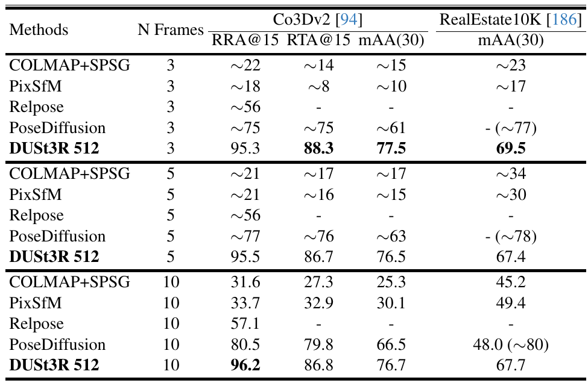](figures/table-5-view-count.png)

*表 5　CO3Dv2 [94] 与 RealEstate10K [186] 上，随机输入 3、5、10 帧的多视图位姿回归。括号内为在 RealEstate10K 训练后的结果；DUSt3R 报告全局对齐结果，训练未使用 RealEstate10K。约号表示从已有曲线等来源取得的近似值；各准确率越高越好。*

### E 视觉定位

这里补充 7Scenes 与 Cambridge Landmarks [49, 114] 上的视觉定位结果，研究查询相机焦距未知的情况。将查询图和数据库图送入 DUSt3R，得到尺度尚未确定的三维重建；再按数据库图的真值点图缩放重建，并按正文第 3.3 节提取位姿。

表 6 显示，这种方法在 7Scenes 上表现较好，平移误差中位数为几厘米。但 Cambridge Landmarks 上的误差明显更大。检查发现，数据库真值点图较稀疏，无法可靠确定重建尺度；相反，7Scenes 提供稠密真值点图。因此，在内参未知的真实环境视觉定位中，仍需要进一步研究。

[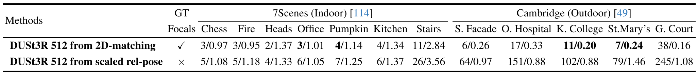](figures/table-6-unknown-focal.png)

*表 6　7Scenes 使用检索排名第一的数据库图像，Cambridge Landmarks 使用前 20 张。报告平移、旋转误差中位数，单位为 cm/°。GT Focals 表示是否提供真值焦距；from 2D-matching 表示二维匹配路线，from scaled rel-pose 表示缩放相对位姿路线。*

此处两行同时改变了内参是否已知和位姿求解路线。差异反映两套流程的结果，不能全部归因于焦距未知。数据库点图通过尺度拟合接入世界参考系，它的覆盖和质量会直接影响第二条路线。

### F 训练细节

#### F.1 训练数据

**真值点图。** 正文式 (2) 中两幅图像 $I^1,I^2$ 的真值点图 $\bar X^{1,1},\bar X^{2,1}$，由真值内参 $K_1,K_2\in\mathbb R^{3\times3}$、相机位姿 $P_1,P_2\in\mathbb R^{3\times4}$ 和深度图 $D^1,D^2\in\mathbb R^{W\times H}$ 得到。具体将两张点图都表达在 $P_1$ 的参考系中：

$$
\bar X^{1,1}=K_1^{-1}\bigl([U;V;1]\cdot D^1\bigr), \tag{6}
$$

$$
\begin{aligned}
\bar X^{2,1}
&=P_1P_2^{-1}h(\bar X^{2,2})\\
&=P_1P_2^{-1}h\!\left(K_2^{-1}([U;V;1]\cdot D^2)\right).
\end{aligned} \tag{7}
$$

$X\cdot Y$ 表示逐元素乘法，$U,V\in\mathbb R^{W\times H}$ 是像素的横、纵坐标网格，$h$ 为齐次映射，见正文式 (1)。

式 (6) 把第一幅图的有效深度反投影到相机 1 系。式 (7) 先把第二幅图的有效深度反投影到相机 2 系，再变换到相机 1 系。两张标签因此与第 3.1 节网络输出的参考系一致，可以一起代入式 (2)–(4)。训练使用相机与深度真值，推理时由图像回归点图，两阶段所需的输入不同。

**深度图与点图的关系。** 因而，图像 $I^1$ 中像素 $(i,j)$ 的深度 $D^1_{i,j}$ 可由下式恢复：

$$
D^1_{i,j}=\bar X^{1,1}_{i,j,2}. \tag{8}
$$

正文和本附录展示的所有深度图，均直接从 DUSt3R 的输出提取：图像 $I^1$ 使用 $X^{1,1}_{:,:,2}$，图像 $I^2$ 使用 $X^{2,2}_{:,:,2}$。

**数据集混合。** DUSt3R 使用八个数据集混合训练：Habitat [104]、ARKitScenes [25]、MegaDepth [56]、Static Scenes 3D [110]、Blended MVS [162]、ScanNet++ [166]、CO3Dv2 [94]、Waymo [122]。它们覆盖室内、室外、合成、真实世界、以物体为中心等不同场景。表 8 列出各数据集提取的图像对数量，共约 850 万。

[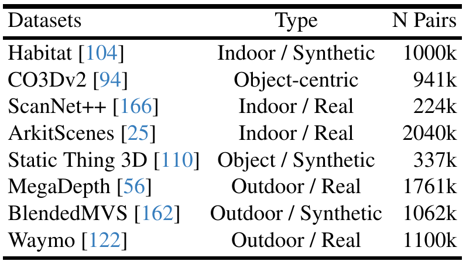](figures/table-8-datasets.png)

*表 8　DUSt3R 的训练数据混合与样本量。Type 为类型，N Pairs 为图像对数量，k 为千：Habitat 为室内合成数据 1000k，CO3Dv2 为物体中心数据 941k，ScanNet++ 为室内真实数据 224k，ARKitScenes 为室内真实数据 2040k，Static Thing 3D 为物体合成数据 337k，MegaDepth 为室外真实数据 1761k，BlendedMVS 为室外合成数据 1062k，Waymo 为室外真实数据 1100k。表中的数据名称保留原文。*

**数据增强。** 使用标准随机颜色扰动和随机中心裁剪。后者也是一种焦距增强：某些数据集由一台或少数几台相机采集，因此很多图像的内参几乎相同；中心随机裁剪可以产生更多焦距。裁剪保持居中，使训练图像对的主点始终位于中心。测试时，观察到主点没有完全居中对结果影响较小。

训练中还会同时输入每个图像对 $(I^1,I^2)$ 及其反序 $(I^2,I^1)$，以帮助泛化。两个图像对之间的 token 自然不会交互。

若从原图中心裁出较小视野，再缩放到固定输入尺寸，同一视角范围占据的像素更多，焦距的像素数值相应变化。中心裁剪保持主点在中心附近，配套的标签与内参需对应变换后的图像。这与第 3.3 节主点近似居中的焦距估计假设相衔接。

#### F.2 训练超参数

表 7 给出 DUSt3R 训练使用的详细超参数。

[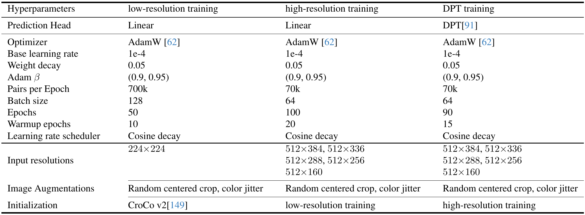](figures/table-7-training.png)

*表 7　训练分三个阶段：先以线性头进行低分辨率训练，再用线性头进行高分辨率训练，最后用 DPT 头进行高分辨率训练，以节省训练时间。三列依次对应低分辨率、高分辨率和 DPT 训练。*

**表头与参数说明。** 三阶段均使用 AdamW，基础学习率为 $10^{-4}$，权重衰减 0.05，Adam 的 $\beta=(0.9,0.95)$，学习率采用余弦衰减，图像增强为随机中心裁剪和颜色扰动。

低分辨率阶段使用线性预测头，输入 $224\times224$，每个 epoch 采样 700k 对，batch size 为 128，共 50 个 epoch，其中 warmup 为 10 个 epoch，以 CroCo v2 [149] 初始化。

高分辨率阶段仍使用线性头，输入尺寸在 $512\times384$、$512\times336$、$512\times288$、$512\times256$、$512\times160$ 中选择。每个 epoch 采样 70k 对，batch size 为 64，共 100 个 epoch，其中 warmup 为 20 个 epoch，继承低分辨率阶段权重。

最后的 DPT 阶段使用 DPT 预测头 [91]，输入分辨率、每个 epoch 样本量及 batch size 与前一阶段相同，共 90 个 epoch，其中 warmup 为 15 个 epoch，以高分辨率阶段初始化。

前两阶段先以线性头训练和适应更高分辨率；最后切换到 DPT 头，从前阶段已有的网络权重继续训练。表中每个 epoch 的样本量是混合数据的抽样量，不能把一个 epoch 理解成完整遍历约 850 万图像对。主文第 4 节还说明，每轮对八个数据集均衡抽样。

## 原文与参考文献

下列文献编号对应原论文。文献 [1]–[189] 的作者、题目和出版信息见[原文参考文献，第 16–23 页](https://arxiv.org/pdf/2312.14132v3#page=16)，作品名称以原文为准。

- Wang et al. [*DUSt3R: Geometric 3D Vision Made Easy*，arXiv v3](https://arxiv.org/abs/2312.14132v3)，CVPR 2024。
- [原论文 PDF](https://arxiv.org/pdf/2312.14132v3)，本文公式、实验和原图的来源。
- [DUSt3R 官方项目页](https://dust3r.europe.naverlabs.com/)，包含补充视频与交互演示。
- [DUSt3R 官方代码](https://github.com/naver/dust3r)。
