# Dynamic Visual SLAM using a General 3D Prior 论文解读

> Xingguang Zhong、Liren Jin、Marija Popović、Jens Behley、Cyrill Stachniss，*Dynamic Visual SLAM using a General 3D Prior*，CVPR 2026。[CVF 论文页与 PDF](https://openaccess.thecvf.com/content/CVPR2026/html/Zhong_Dynamic_Visual_SLAM_using_a_General_3D_Prior_CVPR_2026_paper.html) · [arXiv 论文页](https://arxiv.org/abs/2512.06868) · [补充材料 PDF](https://openaccess.thecvf.com/content/CVPR2026/supplemental/Zhong_Dynamic_Visual_SLAM_CVPR_2026_supplemental.pdf) · [官方代码](https://github.com/PRBonn/Pi3MOS-SLAM)

动态场景里的视觉 SLAM 容易把运动物体的像素当成静态几何来跟踪，导致相机位姿和地图同时出错。本文把两类能力放进同一系统：DPV-SLAM 在局部窗口内跟踪图像 patch 并通过束调整优化位姿；一个基于 π³ 扩展的前馈网络则为多帧预测深度、相机信息和逐像素运动概率。系统用运动概率只在静态区域初始化跟踪点，再将跨批次有尺度歧义的深度与已经优化的 patch 对齐，最后根据束调整估计出的深度不确定性调节深度先验权重。前馈网络提供语义与几何上下文，传统 SLAM 则维持逐帧位姿和长序列尺度的一致性。

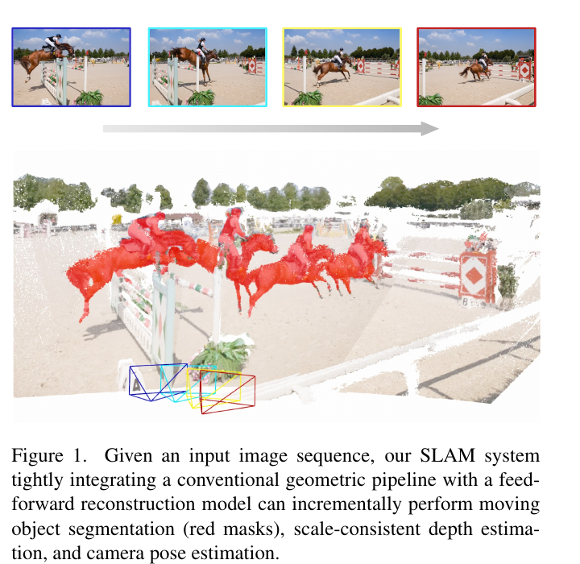

*原论文 Figure 1。系统从输入帧序列中标出运动物体，并逐步估计相机轨迹和尺度一致的深度；红色区域表示被分割出的运动内容。*

## 1 引言

视觉里程计和 SLAM 需要从连续 RGB 图像估计相机运动，并逐步恢复场景几何。许多传统方法依赖场景静止这一假设：运动物体上的特征也会进入数据关联和优化，动态像素比例较高时，错误对应会扭曲位姿，进而污染地图。即便把移动区域作为外点剔除，稀疏点图也难以表达细致几何；单目系统还缺少可靠深度先验，低纹理或视差不足时更容易退化。

前馈重建网络在大规模多视图数据上学习到了场景几何和相机关系，能在一次推理中给出深度、点云或相机位姿。它们在动态画面中也往往能从跨视图上下文区分运动内容。不过，直接以这些网络替代 SLAM 会遇到长序列漂移、批次间尺度变化和推理开销等问题。论文提出的核心问题是：能否让前馈模型弥补传统 SLAM 对动态区域和深度的脆弱性，同时保留几何优化逐帧估计位姿的稳定性？

作者以 DPV-SLAM 为几何后端，并将 π³ 扩展成带运动物体分割头的模型 π³mos。该模型额外预测像素级运动概率。SLAM 用该概率过滤动态区域，用网络深度为 patch 逆深度提供约束，并通过当前批次中历史关键帧已有的 SLAM 深度解出比例因子，消除网络在不同推理批次之间的尺度漂移。论文的三项贡献分别是这个可分割运动物体的前馈模型、结合深度先验与不确定性加权 BA 的统一系统，以及在线校准批次尺度的方法。

## 2 相关工作

### 动态环境中的视觉 SLAM

传统 SLAM 通常把运动物体当成离群点；另一类方法用人、车等类别检测器或分割模型排除动态物体，但类别封闭，难以处理未见过的运动目标，也难区分同一类别中静止与移动的实例。基于长时轨迹的方法需要跨多帧追踪点，动态物体占据画面大部分或有非刚性运动时容易失效。依赖 SAM 一类离线分割模型的方案还不能直接提供在线静态地图。与本文相关的 MegaSaM 在 DROID-SLAM 上训练运动概率网络，但论文指出它是高内存的离线方法。

另一类系统通过在线 NeRF 或 Gaussian Splatting 学习动态物体分割，需要累积多次观测来稳定初始化；快速相机运动时可能无法及时形成可靠掩码。本文把分割放进多视图前馈模型中，每次利用当前帧与若干历史关键帧的上下文直接产生运动概率，再交给在线 SLAM 使用。

### 前馈三维重建模型

DUSt3R、MASt3R 等早期模型主要处理两张图像。之后的 VGGT、π³ 等离线模型可联合处理多视图，但输入越长，显存和推理延迟越高；流式模型如 CUT3R 将场景压缩到持续更新的状态中，虽能逐帧运行，论文认为其长序列位姿仍会有明显误差与轨迹漂移。MonST3R、CUT3R、π³ 等前馈模型在动态视频中表现出的深度和相机估计鲁棒性，促使作者把它们看作 SLAM 的先验，而非完整替代物。

本文方法把前馈网络的预测放入 patch 跟踪和束调整中：分割帮助选择静态观测，深度帮助约束弱视差下的几何，尺度对齐把独立批次的网络输出连接到同一 SLAM 坐标尺度。它因此仍是显式估计每帧相机位姿的单目 SLAM。有关基础模型和在线状态模型的背景，可参见站内的 [π³ 解读](../pi3/index.md)、[DPV-SLAM 解读](../dpv-slam/index.md) 与 [CUT3R 解读](../cut3r/index.md)。

## 3 方法

给定动态环境中的单目 RGB 序列，目标是在线估计相机位姿 $\mathbf T_i\in SE(3)$ 和尺度一致的稠密深度图 $\mathbf D_i$。系统由两部分组成：基于光流跟踪 patch、在滑动窗口中优化位姿与逆深度的 DPV-SLAM；以及输出逐帧相机、深度、置信度和运动概率的 π³mos。下面依照原文顺序，先说明 patch 束调整，再介绍前馈分割模型、在线数据流、尺度估计、不确定性权重和训练细节。

### 3.1 基于 patch 的视觉 SLAM 形式

DPV-SLAM 在参考图像 $I_i$ 中选取 $K$ 个方形 patch $P_k^i$，用轻量网络在另一帧 $I_j$ 中追踪其中心像素 $\mathbf p_k^{ij}$。每个 patch 在参考帧中还带有逆深度 $d_k^i$。多组帧间观测形成滑动窗口图 $\mathcal E$，系统通过重投影误差估计相机位姿与 patch 深度：

$$
\mathcal L_{\mathrm{BA}}=\sum_{(i,j)\in\mathcal E}\sum_{k=1}^K\left\|\mathbf p_k^{ij}-\pi\!\left(\mathbf T_j\mathbf T_i^{-1}\pi^{-1}(\mathbf p_k^i,d_k^i)\right)\right\|^2.
\tag{1}
$$

这里 $\pi^{-1}$ 将像素和逆深度反投影成三维点，$\mathbf T_j\mathbf T_i^{-1}$ 把该点变换到目标相机坐标系，$\pi$ 再投影回图像。预测投影与光流实际追踪到的中心位置之差就是残差。对位姿和逆深度线性化后，Levenberg–Marquardt 迭代求解联合增量：

$$
\begin{bmatrix}\mathbf B&\mathbf E\\\mathbf E^\top&\mathbf C\end{bmatrix}
\begin{bmatrix}\Delta\boldsymbol\xi\\\Delta\mathbf d\end{bmatrix}
=\begin{bmatrix}\mathbf v\\\mathbf w\end{bmatrix}.
\tag{2}
$$

$\mathbf B$ 和 $\mathbf C$ 分别对应相机位姿与 patch 逆深度的 Hessian，$\mathbf E$ 表示两者的交叉项，$\mathbf v,\mathbf w$ 是相应梯度。将深度变量用 Schur 补消去后，先求位姿增量，再回代求深度增量：

$$
\Delta\boldsymbol\xi=\left(\mathbf B-\mathbf E\mathbf C^{-1}\mathbf E^\top\right)^{-1}\left(\mathbf v-\mathbf E\mathbf C^{-1}\mathbf w\right).
\tag{3}
$$

$$
\Delta\mathbf d=\mathbf C^{-1}\left(\mathbf w-\mathbf E^\top\Delta\boldsymbol\xi\right).
\tag{4}
$$

这样的分块求解利用了每个深度只与少量位姿相连的结构，避免直接对所有未知量构造稠密大矩阵。传统 BA 的弱点也由此显现：如果动态 patch 产生错误光流，它们会进入重投影残差；如果相机几乎没有平移，单靠视差也难以可靠恢复 patch 深度。后续的运动掩码和深度先验分别应对这两种情况。

### 3.2 通过 π³mos 分割运动物体

π³mos 保留原 π³ 的主要架构，并增加 Moving Object Segmentation（MOS）头。输入是一组 RGB 图像；DINOv2 为每帧提取语义特征，交替进行帧内自注意力和跨帧全局自注意力，再由三个轻量预测头输出相机相对位姿、稠密深度和逐像素运动概率。模型输出写作：

$$
\pi^3_{\mathrm{mos}}(\mathcal I)=\left(\mathbf T_i,\mathbf D_i,\mathbf C_i,\mathbf M_i\right)_{i=1}^{N}.
\tag{5}
$$

$\mathbf C_i$ 是与深度对应的置信度图，$\mathbf M_i\in[0,1]^{H\times W}$ 表示每个像素属于运动区域的概率。这里的 MOS 不是类别标签预测：网络判断的是场景中的像素是否在运动，因而可以覆盖没有专门语义类别的新物体。网络深度 $\mathbf D_i$ 在每个批次内有相对一致的尺度，但不同批次的尺度可能变化，因此后面仍需单独校准。

作者从原 π³ 权重初始化，只训练新增的 MOS 头。运动概率由二元交叉熵监督；训练视频中的对象只要在所采样帧之间改变位置，就将整个对象标为动态。更多训练数据、输入尺度和数据量见补充材料 A。

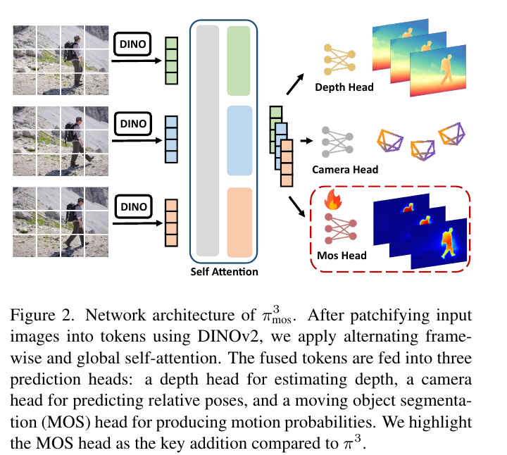

*原论文 Figure 2。DINOv2 特征经交替帧内与全局注意力融合，再分别进入深度、相机和 MOS 预测头；相较 π³，运动分割头是新增部分。*

### 3.3 系统流程

每当新帧到达，系统将它与选出的历史关键帧组成小批次，交给 π³mos，获得当前帧深度和运动概率。系统将 $M_i<s_d$ 的像素作为静态区域，从中采样 patch 并与历史帧计算光流；动态区域不用于新 patch 初始化。这样，新观测的几何约束主要来自静态背景，而不是移动物体上的错误对应。

接着，历史关键帧和当前帧的网络深度进入尺度校正。历史关键帧已经由 SLAM 估计出相互一致的逆深度，可作为参照；校正后的当前深度与光流约束一起加入滑动窗口。最后，不确定性感知 BA 联合优化窗口内相机位姿与 patch 逆深度，并输出可持续累积的静态稠密地图。在线系统因此保留两种尺度的上下文：短期滑动窗口通过光流维持几何约束，历史关键帧则为最新网络批次提供尺度参照。

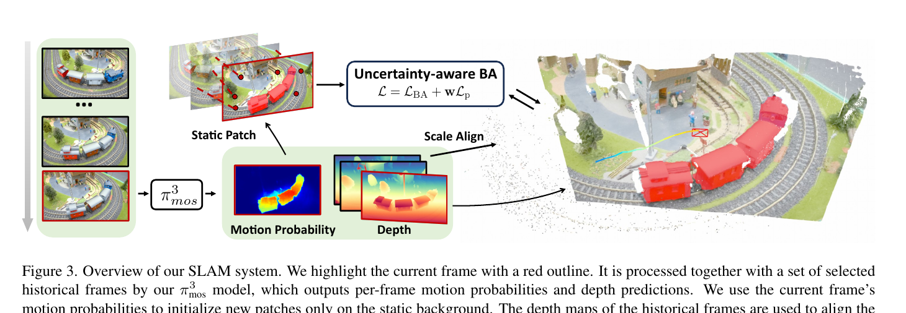

*原论文 Figure 3。当前帧与所选历史帧共同输入 π³mos；静态 patch 产生光流约束，历史深度对齐当前预测尺度，深度与光流最终进入 BA。*

### 3.4 深度尺度估计

同一图像与不同帧组成输入批次时，π³mos 对它预测的深度尺度可能不同。若直接把每批深度拼成地图，局部几何即使准确，整体也会出现尺度跳变。作者选取 $N-1$ 个历史关键帧与当前帧共同推理。对历史帧 $i$ 中第 $k$ 个 patch，在预测深度图中心位置采样网络逆深度 $\hat d_k^i=1/\hat z_k^i$ 和置信度 $c_k^i$；同一 patch 的 SLAM 逆深度 $d_k^i$ 已经处于全局一致尺度。

目标是在逆深度域求一个比例 $s$，使网络预测与这些历史参照尽量对齐：

$$
s^*=\arg\min_s\sum_{i=1}^{N-1}\sum_{k=1}^{K}c_k^i\,\rho\!\left(d_k^i-s\hat d_k^i\right).
\tag{6}
$$

$\rho$ 是 Huber 鲁棒损失，置信度高的 patch 对尺度估计贡献更大。优化以加权中位数初始化：先计算 SLAM 逆深度与网络逆深度之比，再用网络置信度作权重。这个初值比简单平均更不易被少量错误深度影响。得到 $s^*$ 后，将它应用于当前帧深度 $D_N$，而不是重新改变已建立的历史 SLAM 尺度。参与尺度估计的 patch 已由运动掩码限制在静态区域，因此动态点不会直接拉偏尺度。

### 3.5 不确定性感知 BA

当相机平移充分、光流可靠时，重投影 BA 能从视差恢复位姿和 patch 深度；平移不足时，深度方差会变大。此时把前馈深度作为额外约束可稳定几何；但若网络先验本身不可靠，过强约束也会把错误深度带进地图。论文为窗口中每帧 $f$ 的 $K$ 个 patch 加入深度先验损失：

$$
\mathcal L_p=\sum_{f=1}^{F}\sum_{k=1}^{K}\left\|d_k^f-s_f\hat d_k^f\right\|^2.
\tag{7}
$$

其中 $d_k^f$ 是 BA 中优化的逆深度，$\hat d_k^f$ 是前馈模型给出的逆深度，$s_f$ 是将网络预测对齐到系统尺度的比例。总目标把这个先验按帧权重加入重投影 BA：

$$
\mathcal L=\mathcal L_{\mathrm{BA}}+\sum_{f=1}^{F}w_f\sum_{k=1}^{K}\left\|d_k^f-s_f\hat d_k^f\right\|^2.
\tag{9}
$$

原文此处公式编号从（7）跳到（9）；这里保留论文编号。权重 $w_f$ 来自窗口当前的状态不确定性。对式（2）的正规方程，逆深度的边缘协方差为：

$$
\mathbf\Sigma_d=\mathbf C^{-1}+\mathbf C^{-1}\mathbf E^\top\mathbf\Sigma_T\mathbf E\mathbf C^{-1}.
\tag{10}
$$

$$
\mathbf\Sigma_T=\left(\mathbf B-\mathbf E\mathbf C^{-1}\mathbf E^\top\right)^{-1}.
\tag{11}
$$

$\mathbf\Sigma_T$ 是通过 Schur 补得到的相机位姿协方差；第一项 $\mathbf C^{-1}$ 描述逆深度自身的不确定性，第二项则把位姿不确定性传播到深度中。第 $j$ 个逆深度的方差为 $\sigma_{d_j}^2=[\operatorname{diag}(\mathbf\Sigma_d)]_j$。由于真实深度 $z_j=1/d_j$，一阶误差传播得到 $\sigma_{z_j}=\sigma_{d_j}/d_j^2$，进一步除以 $z_j$ 后，尺度无关的相对标准差为：

$$
\sigma_{d_j}^2=\left[\operatorname{diag}(\mathbf\Sigma_d)\right]_j.
\tag{12}
$$

$$
\sigma_{z_j}^{\mathrm{rel}}=\frac{\sigma_{z_j}}{z_j}=\frac{\sigma_{d_j}}{d_j}.
\tag{13}
$$

作者对一帧内所有 patch 的相对标准差取中位数，再通过 sigmoid 映射到帧权重：

$$
w_f=\frac{1}{1+\exp\!\left[-\alpha\left(\sigma_{z,\mathrm{med}}^{\mathrm{rel}}-\beta\right)\right]}.
\tag{14}
$$

$\alpha$ 控制曲线斜率，$\beta$ 控制转折位置。相对不确定性高时，$w_f$ 增大，深度先验更强地约束 BA；不确定性低时，系统更多依赖原始重投影优化。尺度校正还会剔除相对标准差超过阈值 $t_\sigma$ 的点。此处的不确定性表达的是几何优化对深度的把握程度，并不等同于网络置信度 $C_i$；置信度主要用于第 3.4 节的比例估计。

### 3.6 实现细节

π³mos 使用 Kubric、Dynamic Replica、Virtual KITTI 2 三个合成数据集和真实室内 HOI4D 训练。数据提供运动物体真值掩码，或提供可导出掩码的场景流标注。初始化使用原 π³ 的预训练权重，只训练 MOS 头，以二元交叉熵预测运动概率。训练样本约包括 HOI4D 25 万张、Kubric 12 万张、Dynamic Replica 1.45 万张和 Virtual KITTI 2 的 2.1 万张图像；8 张 NVIDIA A40 训练约 48 小时。具体样本组织和 SLAM 参数见补充材料 A。

## 4 实验

实验分别评估运动物体分割、相机跟踪、视频深度估计和系统组件消融。论文没有把所有比较压成一个总分：分割用 DAVIS 的区域指标，相机跟踪用轨迹误差，深度用逐序列尺度对齐后的误差，因此结果要按任务和评价协议分别理解。

### 4.1 运动物体分割

评测使用 DAVIS-16 和更具挑战性的 DAVIS-17，直接比较各方法输出，不额外做耗时的后处理。区域平均交并比 $J_M$ 衡量所有帧的总体分割质量，交并比召回 $J_R$ 表示 IoU 超过 50% 的帧占比。π³mos 在 DAVIS-16 上得到 $J_M=68.1$、$J_R=78.3$，在 DAVIS-17 上为 $70.6$、$81.3$，高于 DUSt3R、MonST3R、DAS3R 和基于这两种骨干的 Easi3R。论文认为，利用多视图空间上下文和 DINOv2 语义特征有助于处理光流不可靠的纹理稀少区域；Figure 4 展示的运动模糊和细结构是定性例子。

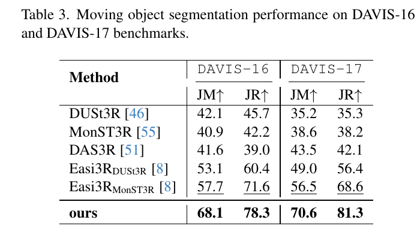

*原论文 Table 3。$J_M$ 与 $J_R$ 越高越好；π³mos 在两个数据集的四项指标上均高于所列基线。*

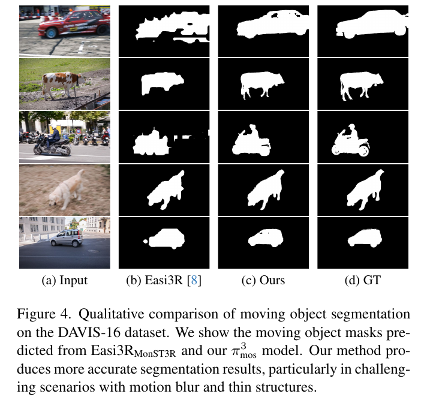

*原论文 Figure 4。对比输入、Easi3R、本文方法和真值掩码；论文指出运动模糊与细结构场景中，本文掩码更贴近目标形状。*

### 4.2 相机跟踪

相机跟踪在两个真实室内数据集和 MPI Sintel 上评估。Bonn RGB-D Dynamic 与 Wild-SLAM MoCap 提供动捕真值，场景中除行人外还有桌子、笔记本电脑、雨伞等运动物体；Bonn 序列约 400–1000 帧，Wild-SLAM 多为 1000–2000 帧。Sintel 由动画电影渲染，包含大尺度室外环境、深度变化、复杂运动和快速相机运动，论文选取 14 段、每段 20–50 帧。

Bonn 与 Wild-SLAM 报告对齐后的 ATE RMSE，单位为厘米；Sintel 还报告 ATE、相邻帧相对平移误差 RTE（厘米）和相对旋转误差 RRE（度）。在 Bonn 上，本文平均 ATE 为 2.20 cm，低于表中 WildGS-SLAM 的 2.36 cm 和 MegaSaM 的 3.51 cm；在 Wild-SLAM 上平均为 0.42 cm，低于 WildGS-SLAM 的 0.66 cm。Sintel 上本文的 ATE/RTE/RRE 分别为 1.9 cm、1.0 cm 和 0.11°，优于表中方法。论文将 WildGS-SLAM 在小尺度室内场景中的表现归因于足够的视图重叠；相机快速运动或视图重叠不足时，它依赖多次观测识别干扰物的方式会退化。

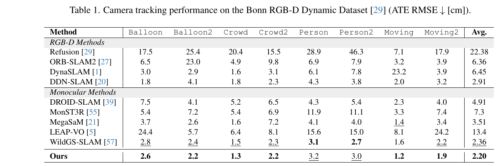

*原论文 Table 1。Bonn 各序列的 ATE RMSE，数值越低越好。RGB-D 基线与单目基线分组列出。*

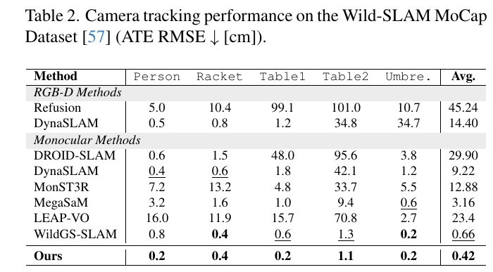

*原论文 Table 2。Wild-SLAM MoCap 子序列的 ATE RMSE；本文平均 0.42 cm。*

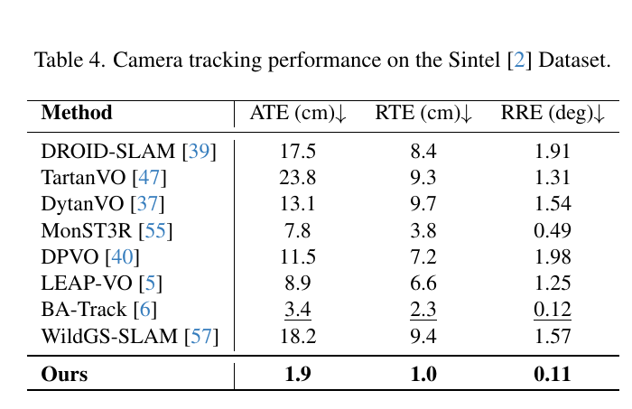

*原论文 Table 4。Sintel 的 ATE、RTE 和 RRE；本文在三项均取得表中最低值。*

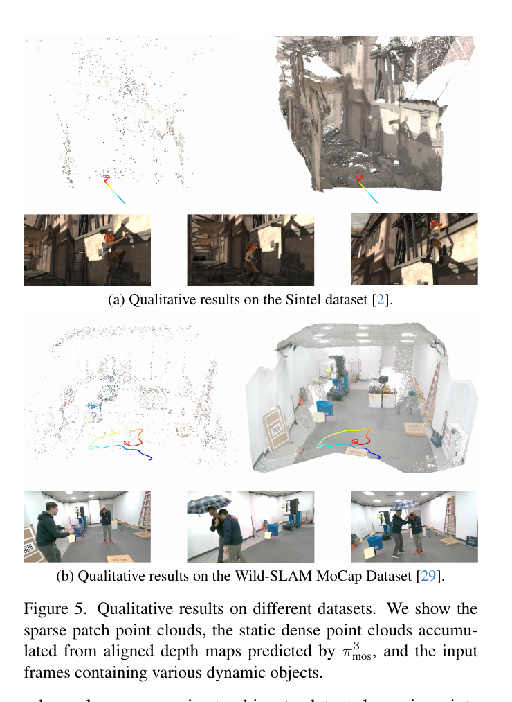

*原论文 Figure 5。点云由关键帧尺度对齐后的深度累积而成，红色标记运动物体；不同数据集的轨迹和地图示例展示逐帧融合后的空间结果。*

### 4.3 视频深度估计

视频深度实验在 Bonn 的五段高动态序列和 Sintel 的 14 段序列上进行。指标是绝对相对误差 Abs Rel 和真实深度落在预测值 1.25 倍范围内的像素比例 $\delta<1.25$；每段序列分别进行尺度对齐。离线 Fast3R、VGGT 和 π³ 一次性处理整段序列，在线对照包括两视图模型及 Spann3R、CUT3R、Point3R、StreamVGGT 等增量模型。

本文在所有列出的在线方法中取得最低 Abs Rel：Sintel 为 0.287，Bonn 为 0.054；Bonn 的 $\delta<1.25$ 也最高，为 0.985。Sintel 上 π³ 的 Abs Rel 0.233、$\delta=0.664$ 仍优于本文的 0.287、0.625。因此证据支持其在线深度具有竞争力，不能概括为所有数据集上超过离线模型。离线模型整段推理能维持更好的批次尺度一致性，但需要更多显存；本文的增量尺度对齐是在在线处理约束下弥补这一差异。

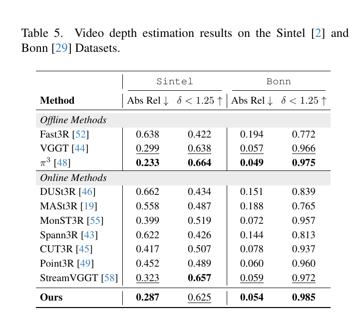

*原论文 Table 5。指标在逐序列尺度对齐后计算，离线与在线方法分组比较。*

### 4.4 消融实验

消融在 Bonn 和 Wild-SLAM 上比较运动掩码、深度先验和不确定性加权 BA。完整系统的 ATE RMSE 分别为 2.20 cm 和 0.42 cm。只使用掩码、不加深度先验时为 2.67 cm 和 0.98 cm；再加入固定权重深度先验后为 2.52 cm 和 0.82 cm；最后以状态不确定性调整权重，达到完整结果。反过来看，缺少运动掩码的设置即使加入深度先验，在 Wild-SLAM 上误差仍为 3.78 cm，明显高于只使用运动掩码的 0.98 cm。这表明先清除动态观测是使用深度先验的重要前提；若把运动区域残留点的预测深度强行纳入优化，反而可能扩大误差。

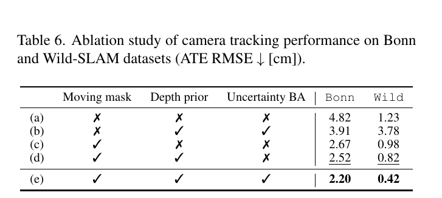

*原论文 Table 6。逐项开启三个组件的 ATE RMSE；完整方法在 Bonn 与 Wild 两组数据上均为最佳。*

## 5 结论

本文没有把大模型直接当作完整 SLAM，而是将它作为几何后端的先验来源：π³mos 预测动态区域和深度，DPV-SLAM 在静态 patch 上建立光流约束并用滑窗 BA 估计位姿，历史关键帧把当前网络深度拉回既有尺度，不确定性再控制深度先验在优化中的影响。分割、尺度对齐和 BA 各自补足不同环节，消融显示单独加入深度先验不能替代运动点过滤。

论文在 DAVIS 分割、Bonn/Wild-SLAM/Sintel 跟踪和视频深度任务上取得有竞争力的在线结果。不过，“在线”描述的是按新帧递增处理的系统结构，速度仍受到前馈推理限制：主配置下五个历史关键帧加当前帧约需 350 ms 推理，完整系统在补充实验中的吞吐为 Bonn 2.61 FPS、Wild-SLAM 2.42 FPS。它展现了前馈几何与经典 BA 的互补方式，也留下了推理吞吐与历史上下文规模之间的工程权衡。

## 附录 A 补充实现细节

训练时每个样本从一段视频均匀选取 2–24 张图像；只要某对象在样本帧中改变位置，就把该对象的完整掩码标为动态。图像缩放到 $518\times518$，AdamW 学习率为 $10^{-4}$，训练 20 个 epoch。系统每帧采样 $K=128$ 个 patch，以 $s_d=0.4$ 区分动态与静态像素；位姿 BA 窗口为 10 帧，尺度校正剔除点的阈值 $t_\sigma=0.75$。每隔 5 个关键帧选一个历史关键帧，主实验使用 5 个历史帧加当前帧输入网络。系统启动时，先用前 12 帧初始化相机位姿和 patch 深度，再进行不确定性感知 BA。

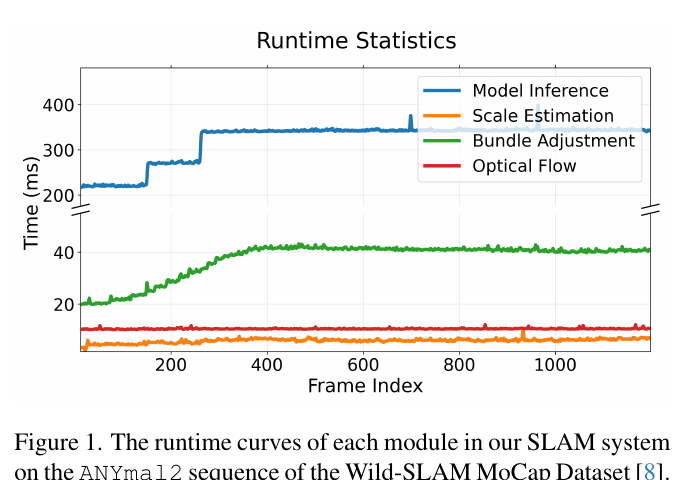

*原论文补充材料 Figure 1。π³mos 推理在序列初期随关键帧缓存填充而增加，之后成为主要耗时模块；尺度估计、光流和 BA 相对较短。*

补充材料以 Wild-SLAM 的 ANYmal2（1200 张图像）统计模块耗时。当前配置的网络对 5 个历史关键帧和当前帧约耗时 350 ms；尺度估计与光流分别低于 10 ms，BA 低于 40 ms。历史帧数量消融显示，减少到 2 个历史帧时系统可达到 4.32 FPS（Bonn）和 3.96 FPS（Wild），ATE 分别为 2.75 cm 和 0.43 cm；使用 5 个历史帧时 ATE 为 2.20 cm 和 0.35 cm，吞吐降至 2.61 和 2.42 FPS。超过 5 个历史帧未继续改善跟踪，故主实验固定用 5 帧。实验使用 RTX A6000。

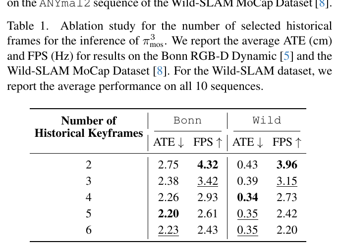

*原论文补充材料 Table 1。更多历史帧提升前馈上下文，能改善 ATE，但推理帧率下降；超过 5 帧收益有限。*

## 附录 B 运行时间分析

运行时间曲线显示，随着历史关键帧缓冲区从空到满，网络推理与 BA 的单帧耗时逐步增加并达到稳定值。前馈推理约 350 ms/六帧，是瓶颈；BA 在 40 ms 内，光流与尺度对齐分别低于 10 ms。减少历史关键帧能换取吞吐，但当前结果显示相机跟踪误差也会随之变化。因而系统具备流式输入能力，但论文的实测速度不等同于常见相机的 30 FPS 实时处理。

## 附录 C 更多实验与细节

### 在线和离线运动分割

补充材料把掩码概率以阈值 $s_d$ 二值化，预测掩码记为 $\hat M_i$，真值为 $\bar M_i$。单帧 IoU 为：

$$
\operatorname{IoU}(\hat M_i,\bar M_i)=100\times\frac{|\hat M_i\cap\bar M_i|}{|\hat M_i\cup\bar M_i|}.
\tag{S1}
$$

$J_M$ 是逐帧 IoU 的平均；$J_R$ 是 IoU 大于 50 的帧比例（原文以百分数报告）。在线设定维护 6 帧滑动窗口，只报告每次窗口末帧；离线设定把整段视频分成最多 20 帧的小批次，并评估其中所有帧。离线设置利用更多上下文，DAVIS-16 达到 $J_M/J_R=71.9/82.3$，DAVIS-17 达到 $73.5/84.8$，略高于在线值。主文只与其他在线方法比较，以保持推理方式一致。

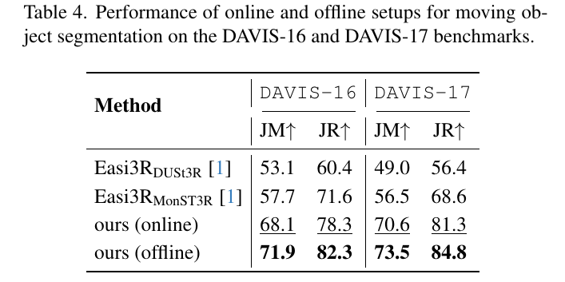

*原论文补充材料 Table 4。离线批次提供更长上下文，因此分割指标高于在线滑窗结果。*

### 额外相机跟踪对照

补充材料加入 VGGT-SLAM 和 π³-Long。后两者将序列切成 chunk 或子图并在子图间配准，没有逐帧估计相机位姿，故未放入主文在线比较。Bonn 上，本文 ATE 平均 2.20 cm，VGGT-SLAM 为 4.68 cm、π³-Long 为 11.96 cm；Wild-SLAM 上分别为 0.35 cm、18.00 cm 和 6.45 cm。这里补充表 3 汇总 Wild-SLAM 的全部 10 段序列，主文表 2 则只列出 5 段；两张表中本文的均值因此不同。两个基线主要依赖前馈点云，且没有显式运动物体处理。

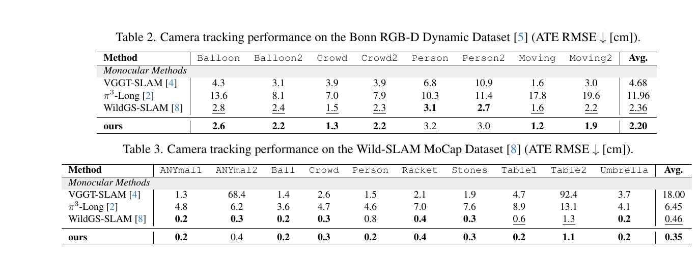

*原论文补充材料 Tables 2、3。与 VGGT-SLAM、π³-Long 和 WildGS-SLAM 比较相机跟踪 ATE RMSE；后两张表分别对应 Bonn 与 Wild-SLAM。*

## 附录 D 更多定性结果

补充材料 Figure 2 将关键帧深度累计成全局点云，并叠加相机轨迹；红色点表示被识别为运动物体的内容。图中展示的序列覆盖室内和室外场景，可观察到系统逐帧生成深度地图并过滤动态区域。Figure 3 则展示 DAVIS 中越野摩托、舞蹈、人与狗、多人推车等序列的输入帧和逐帧运动掩码，补充运动分割的时间一致性例子。这些是代表性定性结果，不替代主文的定量指标。

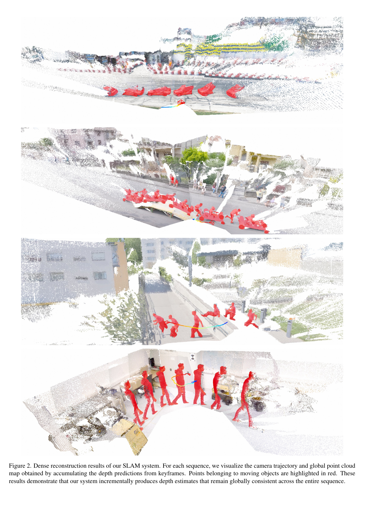

*原论文补充材料 Figure 2。每行对应一个序列，显示累计深度地图、相机轨迹和红色动态点。*

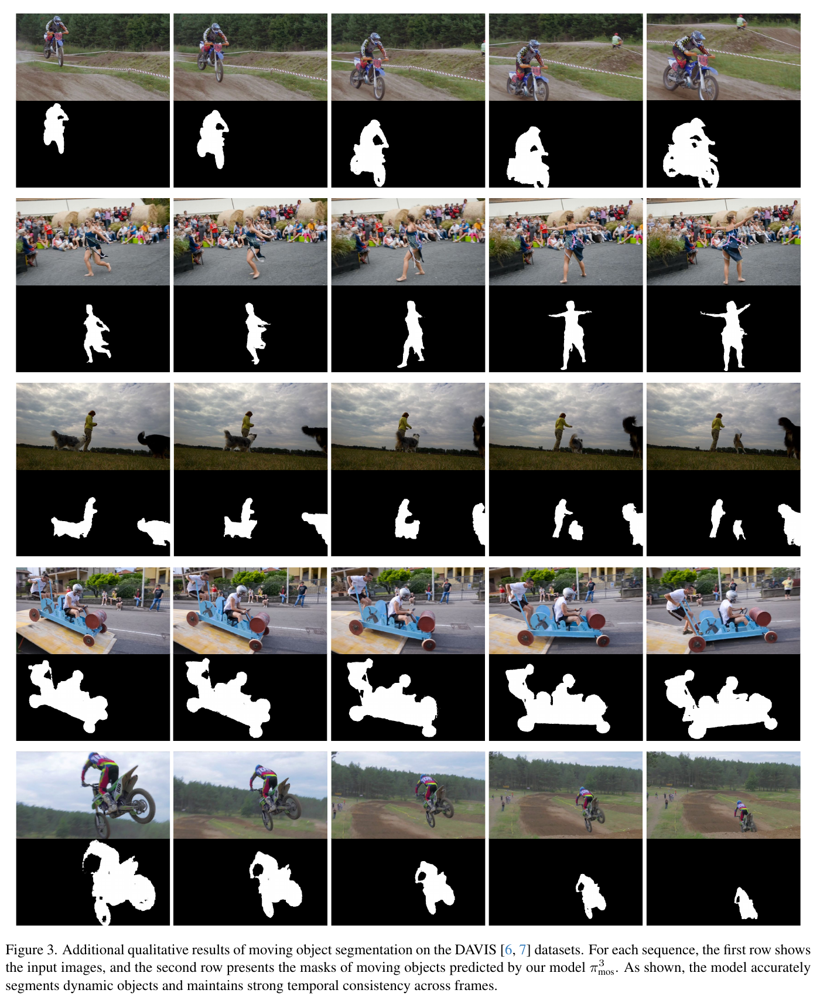

*原论文补充材料 Figure 3。上排为输入帧，下排为 π³mos 预测掩码，展示动态目标随时间变化时的分割结果。*
