# EC3R-SLAM 论文解读

> **论文**：EC3R-SLAM: Efficient and Consistent Monocular Dense SLAM with Feed-Forward 3D Reconstruction  
> **作者**：Lingxiang Hu、Naima Ait Oufroukh、Fabien Bonardi、Raymond Ghandour  
> **版本**：arXiv:2510.02080v1，2025 年 10 月 2 日提交  
> **论文页面**：[arXiv](https://arxiv.org/abs/2510.02080) · **PDF**：[arXiv PDF](https://arxiv.org/pdf/2510.02080) · [作者项目页](https://h0xg.github.io/ec3r/) · [官方代码](https://github.com/hulxgit/EC3R-SLAM)

EC3R-SLAM 要解决的是前馈三维重建模型与 SLAM 系统之间的工程落差：VGGT 能从一组图像快速恢复几何，但一次处理很多帧会占用大量显存；若把视频切成小批次逐段重建，子图之间又容易产生尺度和位姿不一致。作者把系统拆成轻量特征跟踪与稠密建图两部分，再用局部和全局闭环将稀疏跟踪与前馈稠密子图联系起来。相机内参由重建模型估计，因此不要求用户预先标定。

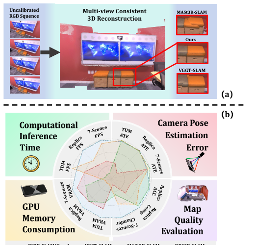

*图 1：左侧展示连续未标定图像经子图融合后的重建，右侧雷达图比较重建质量、位姿误差、推理时间和显存。原图结果表明，论文强调的是多指标效率与一致性折中。*

## 问题背景与贡献

单目稠密 SLAM 需要同时恢复相机轨迹和场景几何。传统神经场或 Gaussian 系统可以生成稠密地图，但优化链路可能耗时且占用显存；VGGT、Fast3R 等前馈模型则以批量图像为输入，能很快生成稠密几何，却不直接解决长期视频中的增量定位、闭环和全局一致性。对资源受限设备而言，把几十帧甚至更多帧一次送入模型也可能超过显存预算。

EC3R-SLAM 通过关键帧缓冲降低前馈建图调用频率。每帧先由 XFeat 提取局部特征，并在稀疏地图上做 2D–3D 匹配和 PnP 位姿估计；只有跟踪质量变差或关键帧间隔条件满足时才提升新关键帧。积累到一定数量后，VGGT 对缓冲帧生成稠密子图。局部闭环关联附近关键帧，全局闭环从历史数据库检索相似子图，二者产生的约束进入 Sim(3) 位姿图优化。

论文将贡献归为三点：把稀疏特征点跟踪与前馈三维重建整合成稠密 SLAM；联合局部和全局闭环，并将结果放入位姿图以提高多视图一致性；在多个数据集上展示精度、速度和显存之间的竞争力。论文所说“无标定”指系统不要求给定相机内参，并不表示完全不需要几何估计：VGGT 子图解码器会输出相机参数，其他基线则按作者采用的协议由首帧估计内参。

## 相关工作

许多 SLAM 系统把跟踪前端与建图后端分开。前端以轻量算法估计位姿和选择关键帧，后端负责稠密地图；若两部分衔接松散，地图信息可能没有充分反馈给跟踪，也可能重复处理过多图像。EC3R-SLAM 保留这种职责划分，但让跟踪在局部稀疏地图上运行，并由关键帧缓冲决定何时调用稠密网络，因而把稠密推理限制在新关键帧上。

数据关联又分为两个时间尺度。中期关联连接相机位置相近的帧，帮助保持短程几何连续；长期关联依靠地点识别找回较早访问的位置。作者把局部投影和全局特征检索结合起来，并复用前馈重建模型提取的关键帧嵌入，不另加地点识别网络。

DUSt3R、MASt3R、VGGT 等模型能够从未标定图像恢复三维结构，后续工作将它们扩展到序列重建或 SLAM。EC3R-SLAM 的设计点是把 VGGT 当作稠密子图生成器，而把每帧高频定位交给较轻的特征跟踪模块。这样做的代价是系统依然依赖关键帧选择、子图配准和闭环，而不是由前馈模型一次直接输出整个长序列的全局一致地图。

## 方法

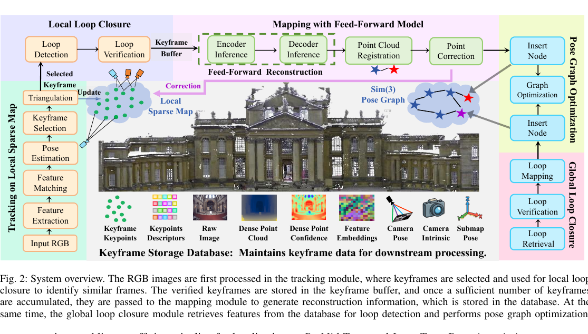

*图 2：跟踪模块维护局部稀疏地图并选择关键帧；局部闭环候选与新关键帧进入缓冲区，达到阈值后批量交给 VGGT 建图；数据库保存关键帧特征和子图信息，供全局闭环检索和图优化使用。*

### 局部稀疏地图跟踪

跟踪模块在当前关键帧的局部稀疏地图上工作。地图保存与关键点对应的三维点，关键帧更新时会加入新三角化点；稠密建图和子图对齐完成后，部分旧点又会由更准确的全局坐标修正。系统初始化时先选取一组图像，由建图模型估计内参并生成初始三维结果，再从中建立稀疏地图。

对于每张新图像，XFeat 提取二维关键点 \(x_i\) 与描述子，并将描述子和局部地图中的三维点 \(X_i\) 匹配，形成二维到三维对应 \((x_i,X_i)\)。相机位姿 \((R,t)\) 通过最小化重投影误差估计：

$$
\min_{R,t}\sum_{i=1}^{N}\|\pi(RX_i+t)-x_i\|_2^2. \tag{1}
$$

其中 \(\pi(\cdot)\) 是透视投影函数。实际匹配包含离群点，所以作者用基于 RANSAC 的 PnP 求解，而不是直接对全部匹配做最小二乘。RANSAC 同时给出内点比例 \(\tau_{inlier}\)。若该比例低于阈值 \(\tau_1\)，或位姿估计失败，当前图像升级为关键帧并进行三角化，把新三维点加入局部地图。否则，当前帧只更新跟踪位姿，不触发完整稠密重建。

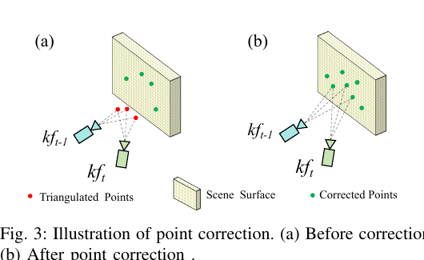

*图 3：左图是三角化得到的初始点，右图是经过全局子图配准后用更准确坐标修正的点；修正降低稀疏前端长期累积的漂移。*

### 局部闭环和关键帧缓冲

局部闭环在跟踪之后运行，目标是连接相机位置相近的帧。系统把当前局部稀疏地图投影到一组时间上相邻的关键帧中；若投影点数量超过阈值 \(\tau_p\)，该帧成为候选。随后以 RANSAC 单应性估计计算内点比例 \(r_{inlier}\)：当比例不超过 \(\tau_2\) 时丢弃候选；超过 \(\tau_2\) 时将候选加入关键帧缓冲；若进一步超过 \(\tau_1\)，则认为两帧高度相似，并用闭环候选替换当前关键帧。作者在实验中设 \(\tau_1=0.4\)、\(\tau_2=0.3\)、\(\tau_p=0.7\)。

缓冲区同时保留新关键帧、局部闭环候选以及上一批中最近的关键帧。帧数超过 \(N=5\) 后，缓冲区刷新并把积累的关键帧送往稠密建图；刷新后保留最新关键帧，作为下一批的连续性锚点。论文另提到，当缓冲区帧数达到 2 时会触发一次额外建图，只为当前关键帧获取全局坐标并修正前端稀疏点，目的是避免跟踪前端丢失。这个快速校正触发条件与常规的 5 帧批次刷新承担不同作用。

### VGGT 前馈子图重建与 Sim(3) 对齐

建图进程与跟踪并行运行。为避免重复计算，只有缓冲区中的新关键帧经过 VGGT 图像编码器；旧关键帧的 embedding 从存储数据库读取。新旧 embedding 拼接后送入解码器：

$$
E_1=\mathcal{E}(I_1), \tag{2}
$$

$$
(D,C,g)=\mathcal{D}(\operatorname{Concat}(E_1,E_2)). \tag{3}
$$

其中 \(E_1\) 是新关键帧的图像特征，\(E_2\) 是已有关键帧的缓存特征；\(D\) 为深度图，\(C\) 为每像素置信度，\(g\) 包含相机内参与外参。用 \(D\) 和由 \(g\) 得到的投影矩阵反投影后，每个像素转成带置信度的三维点，得到当前局部子图。论文将子图定义在第一台相机的坐标系中。

不同子图可能存在尺度、旋转和平移差异。作者从共享旧关键帧中建立三维点对应 \(P=\{p_i\}\) 与 \(Q=\{q_i\}\)，再把置信度归一化为权重 \(w_i\)。配准求解加权 Sim(3)：

$$
\min_{s,R,t}\sum_{i=1}^{N}w_i\|sRp_i+t-q_i\|_2^2. \tag{4}
$$

这里 \(s>0\) 是尺度，\(R\in SO(3)\) 是旋转，\(t\in\mathbb{R}^3\) 是平移。作者用加权 Umeyama 闭式算法估计变换，并将结果作为子图位姿图中的相对约束。高置信度对应点对配准影响更大，低置信度点的作用较弱。

有了子图到全局坐标的变换后，系统得到更准确的三维点位置。对于与跟踪稀疏地图对应的点，作者直接用全局坐标替换本地坐标，形成图 3 所示的点修正。关键帧数据库保存跟踪与建图过程中得到的信息，并放在 CPU 上以节省 GPU 资源。

### 全局闭环检索

全局闭环在线程中独立运行，利用前馈模型已经提取的关键帧 embedding 建立稀疏相似度矩阵。系统先比较数据库中每隔 \(N\) 个关键帧的特征；若发现相似帧，再把它们相邻的帧也加入局部相似度矩阵。全局检索的阈值为 \(\tau_{global}=0.93\)，局部邻域验证阈值为 \(\tau_{local}=0.96\)；通过阈值筛选后再用单应性和内点比例确认闭环。确认后，选取相似度最高的关键帧 embedding 重新解码成子图，配准后加入位姿图。

论文这里有一处阈值记号不一致：方法正文把触发单应性验证的最大相似度阈值写成 \(\tau_{local}\)，图 4 则把全局矩阵筛选标成 \(\tau_{global}\)，再用 \(\tau_{local}\) 从邻域矩阵中筛选。结合图示和实验参数，本文按“先全局检索，再局部邻域筛选”的流程解释；原文没有进一步消除文字与图示之间的歧义。

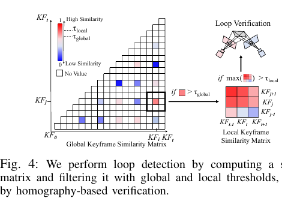

*图 4：从稀疏全局相似矩阵找到候选关键帧后，系统检查其时间邻域，再以几何验证过滤错误匹配。*

### Sim(3) 位姿图优化

每个节点表示一个子图在世界坐标系中的 Sim(3) 位姿 \(T_i\)，边表示由子图点云配准得到的相对变换 \(T_{ij}\)。为在流形上优化，系统把边残差映射到 Sim(3) 李代数的七维最小表示：

$$
e_{i,j}=\log_{Sim(3)}(T_{ij}^{-1}T_i^{-1}T_j). \tag{5}
$$

总目标是最小化各条边残差的加权平方和：

$$
\chi^2(T_1,\ldots,T_m)=\sum_{(i,j)\in\mathcal{E}}e_{i,j}^{\top}\Omega_{i,j}e_{i,j}. \tag{6}
$$

\(\Omega_{i,j}\) 是测量信息矩阵，控制每条相对约束的权重。节点初值通过串接相对 Sim(3) 得到，随后用 PyPose 中 Levenberg–Marquardt 求解器共同调整所有子图位姿。优化后的图提供一致的全局子图位姿，并把局部点云对齐结果带来的闭环信息传播到整条轨迹。

## 实验

### 实验设置

作者在 TUM-RGBD 的 fr1 序列、7-Scenes 和 Replica 上评价系统。Replica 与 7-Scenes 用于重建精度和完整度评估；TUM-RGBD 手持运动、滚动快门和运动模糊更明显。所有图像不做时间下采样，只保持长边为 518 像素并按比例缩放。基准系统默认采用各自论文建议设置。Pose 指标是 ATE RMSE（米），稠密重建比较 Accuracy、Completeness 和 Chamfer 距离；效率报告序列平均 FPS 与 GPU 显存。

为模拟未标定输入，MASt3R-SLAM 和 VGGT-SLAM 本身可估计内参；其他假定已标定的基线按对比协议使用 GeoCalib 从每条序列首帧估计内参。EC3R-SLAM 的建图网络也输出相机参数。主要实验使用 NVIDIA RTX 5090 与 Intel Core i9-12900KF；作者还以 Fast3R 替换 VGGT 作为不同前馈建图骨干，记作 Ours (w. Fast3R)。论文在数据集设置段写 7-Scenes 使用 seq-01，但表 IV 报告了七个场景序列的完整结果，跨设备表 VII 则只比较 seq-01/chess；下文按各表实际列出的范围说明。

### 相机位姿估计

表 I 的 TUM-RGBD 结果显示，EC3R-SLAM 平均 ATE 为 0.070 m，显存 9.3 GB，平均 31 FPS；VGGT-SLAM 的平均 ATE 为 0.059 m、显存 23.5 GB、34 FPS。因此它在 TUM 上并非总体精度第一，而是在显存较低的同时保持了接近实时速度。作者重点指出较大尺度序列上的表现：例如 room、floor 等场景中，闭环和全局约束可以减轻局部跟踪漂移。

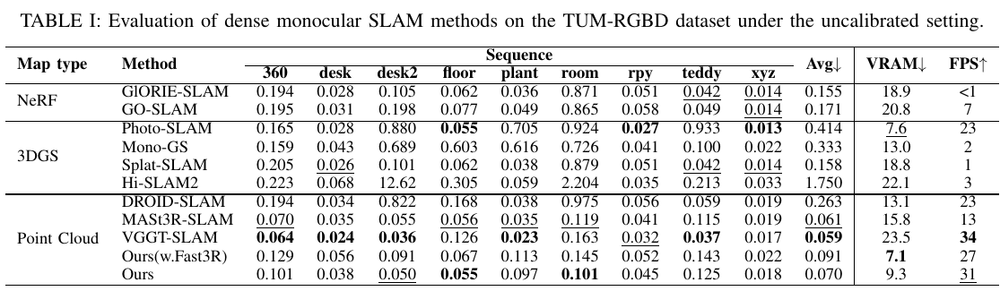

*表 I：每种方法的轨迹误差、显存和速度；数值越低越好的是 ATE 与 VRAM，FPS 越高越好。EC3R-SLAM 在显存和精度之间折中。*

在 Replica 上，表 II 中 EC3R-SLAM 平均 ATE 为 0.041 m、显存 9.1 GB、速度 45 FPS；该表的平均轨迹误差优于 VGGT-SLAM 的 0.043 m 和 MASt3R-SLAM 的 0.045 m，且速度更快、显存更低。不同室内场景的难度差异较大，系统在某些单独序列上的排名并不相同，因此平均值不能替代逐场景比较。

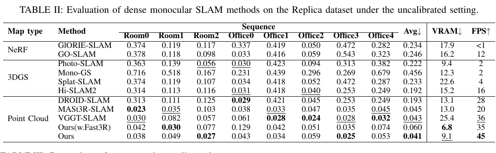

*表 II：EC3R-SLAM 的 Replica 平均 ATE 为 0.041 m，低于 VGGT-SLAM 与 MASt3R-SLAM；“Ours (w. Fast3R)”是更换建图骨干的系统变体。*

表 IV 的 7-Scenes 平均 ATE 为 0.075 m，显存 11.4 GB，速度 36 FPS。MASt3R-SLAM 的平均 ATE 是 0.065 m，VGGT-SLAM 是 0.072 m；因此 EC3R-SLAM 同样没有取得该数据集的最低平均误差，但其显存低于这两个模型，速度接近 VGGT-SLAM。7-Scenes 上各序列的最优方法也不同，整体结果更适合解读为资源和精度的折中。

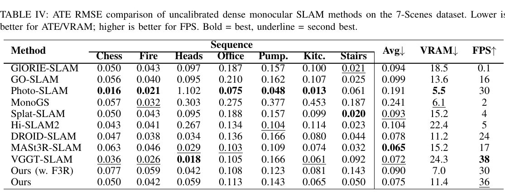

*表 IV：7-Scenes 的 Chess、Fire、Heads、Office、Pumpkin、Kitchen 和 Stairs 序列结果。EC3R-SLAM 平均 ATE 为 0.075 m；最低平均误差由 MASt3R-SLAM 取得。*

### 稠密重建质量

在 7-Scenes 重建表 III 中，EC3R-SLAM 的 Accuracy、Completeness、Chamfer 和 ATE 分别为 0.025、0.054、0.040、0.075；Accuracy 是表中最佳，但 Completeness 并非最佳，Spann3R@2 的 Completeness 为 0.043。这里 Accuracy 衡量重建点到真值表面的距离，Completeness 衡量真值表面到重建点的距离，Chamfer 综合两个方向的距离，三者都越低越好。表格结果比正文“在 accuracy 上突出”更具体，也避免把单项优势扩大成所有指标都最优。

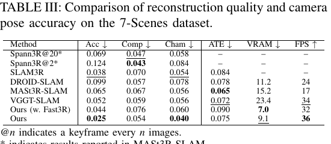

*表 III：7-Scenes 重建 Accuracy、Completeness、Chamfer 距离、ATE、显存与帧率；较低值更好。*

在 Replica 上，表 V 的平均 Accuracy 和 Completeness 分别为 2.82 cm 与 2.07 cm，均优于表中其他方法。作者据此报告该数据集上的重建精度与完整度均有提升。相比之下，TUM 与 7-Scenes 的位姿平均误差更能体现：闭环有助于长期一致性，但不保证每个序列或每项指标都成为第一。

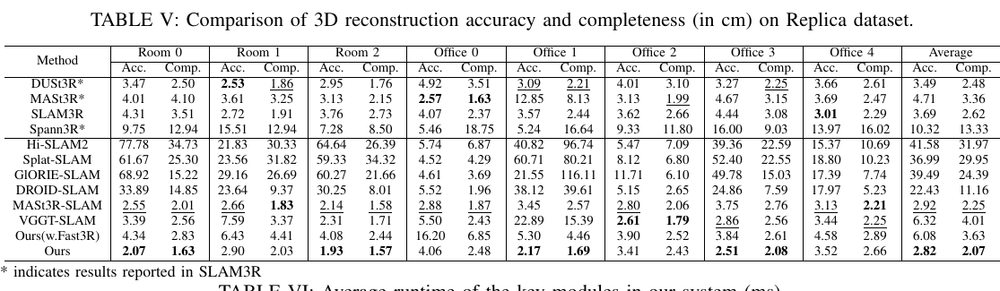

*表 V：Accuracy 与 Completeness 均以厘米计。EC3R-SLAM 的平均值为 2.82 cm 和 2.07 cm。星号表示来自 SLAM3R 的报告结果。*

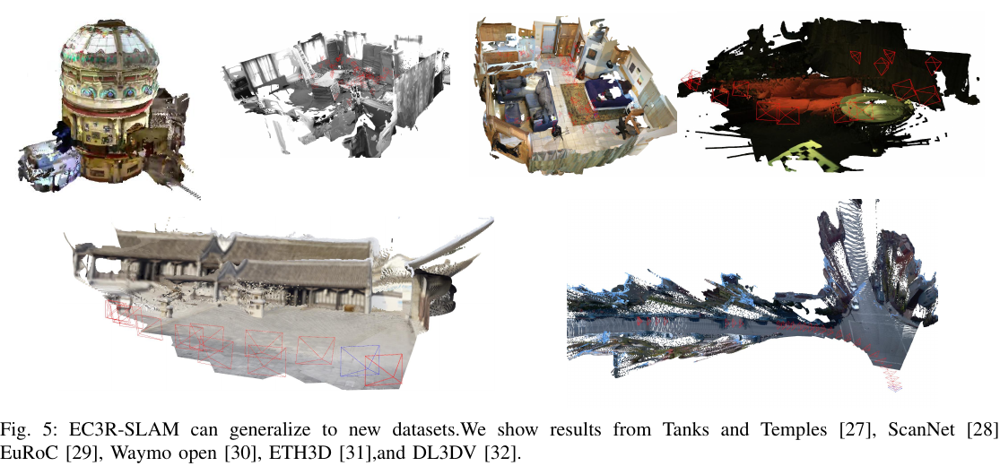

*图 5：论文展示在多个训练外数据集上的重建，以说明前馈子图与跟踪系统的跨数据适应性。*

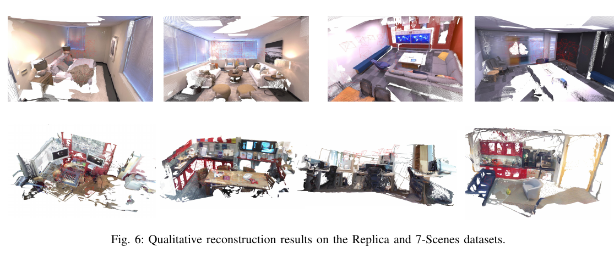

*图 6：不同室内场景的稠密重建结果。*

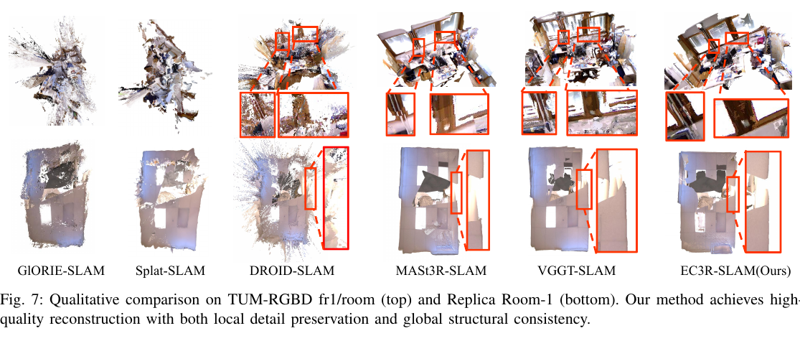

*图 7：行列对比多种 SLAM 地图。作者指出，EC3R-SLAM 保留了局部细节，并改善了全局结构的一致性。*

### 运行时间与设备适配

表 VI 将系统分成逐帧跟踪、逐关键帧操作和稠密建图。跟踪部分包括图像载入、特征提取与匹配、位姿估计；逐关键帧部分包含三角化与局部闭环；稠密映射则包含前馈重建和点云配准。一次子图生成加配准约需 304–355 ms，但这一模块在独立线程运行，不阻塞每帧跟踪。各测试序列总结 FPS 为 TUM 31.20、7-Scenes 36.13、Replica 45.21。Replica 速度更高，作者将其归因于相机运动更平滑、触发的关键帧更少。

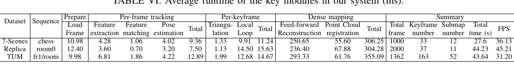

*表 VI：单模块时间以毫秒计，最后几列统计每个序列的帧数、关键帧数、子图数、总时间和 FPS。*

表 VII 比较桌面 PC、笔记本和 Jetson Orin NX。桌面 PC 一栏中，Fast3R 建图变体在 TUM 与 7-Scenes 上分别为 27 和 32 FPS；在 8 GB 显存 RTX 4060 笔记本上为 15 和 18 FPS；Jetson Orin NX 上为 7 和 9 FPS。这里的移动设备结果来自 Ours (w. Fast3R)，不能直接当作默认 VGGT 配置的速度。VGGT-SLAM 在该表的笔记本和 Jetson 条件下无法运行，表中标作 Failed。

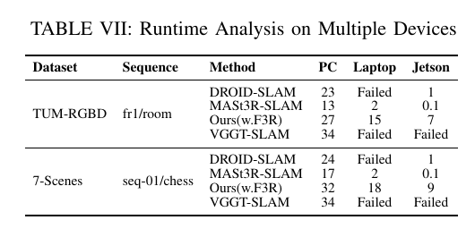

*表 VII：不同设备上运行的速度。只有更换为 Fast3R 的版本报告了笔记本和 Jetson 帧率。*

### 闭环消融与定性轨迹

表 VIII 比较关闭或开启局部、全局闭环后的结果。两种闭环都关闭时，TUM ATE 为 0.225 m，7-Scenes 为 0.185 m，Replica 为 0.084 m；两者都启用时，表格报告 0.070、0.075 和 0.041 m。单独开启全局闭环会降低 TUM 和 Replica 的误差，但 7-Scenes 的 ATE 从 0.185 增至 0.153 仍有改善；单独开启局部闭环时，三组数据也都比无闭环基线更低。两者结合总体最好。

不过，消融文字与表 VIII 的数值不完全一致：正文把联合闭环结果写为 0.062、0.072、0.051 m，而表中对应值为 0.070、0.075、0.041 m。正文报告的单模块相对下降比例也不能逐一由表中数值复算出来。为保证可追溯，本文以表 VIII 的数据描述趋势，并将这些数字差异保留为原文疑点。

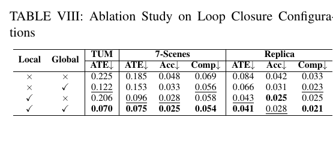

*表 VIII：两种闭环都启用时，表格中的 TUM、7-Scenes 与 Replica 指标整体最好。原文正文与表格的联合闭环 ATE 数值存在差异。*

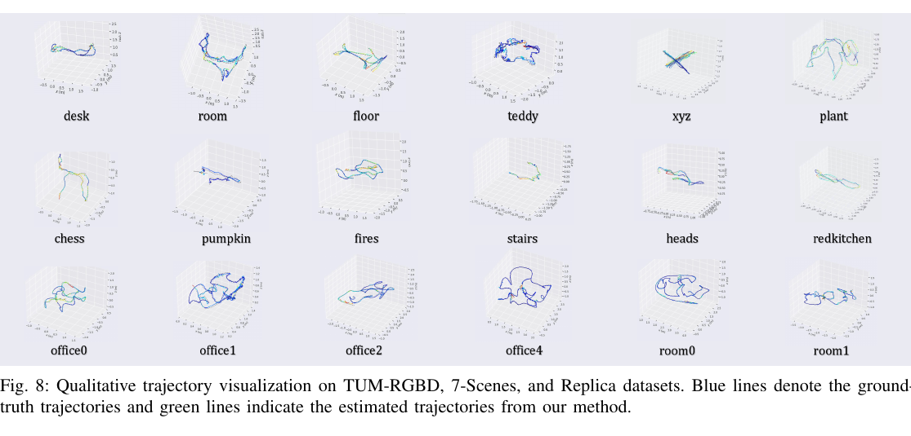

*图 8：蓝线为真值轨迹，绿线为系统估计轨迹；图中列出三个数据集的多个序列。*

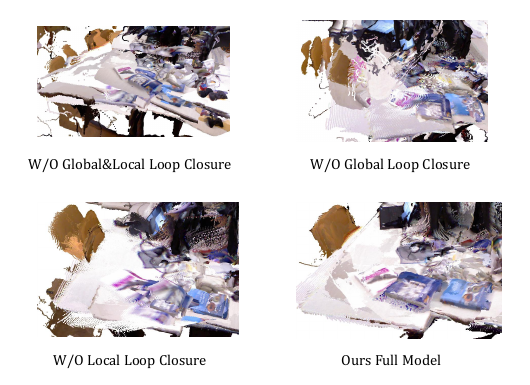

*图 9：关闭两种闭环、仅关闭全局闭环、仅关闭局部闭环及完整系统的地图对照。完整系统的跨视角结构更连贯。*

## 总结与局限

EC3R-SLAM 的系统结构把高频定位交给稀疏特征跟踪，把稠密几何交给批量关键帧上的 VGGT 前馈推理，再用局部闭环、全局检索和 Sim(3) 位姿图把两者连接起来。其关键不在于让前馈网络独自承担长序列定位，而在于通过关键帧和数据库控制稠密推理频率，并把子图对齐结果反馈到稀疏跟踪地图。

实验支持一个有边界的结论：Replica 上的平均轨迹误差和重建质量较强，TUM 与 7-Scenes 上显存和速度较有优势，但两者的平均位姿误差并非最低；7-Scenes 的重建 Completeness 也不是最佳。笔记本与 Jetson 的速度来自 Fast3R 变体。系统仍包含多个依赖阈值的模块，稠密映射本身也比逐帧跟踪慢得多，只是由于异步运行不直接阻塞跟踪。此外，论文表格与正文关于闭环消融的数值存在冲突，复现实验时应以实现和数据为准。
