# F²-SLAM 论文解读

> Zhisong Xu、Fan Zhu、Jiawei Qian、Ziyu Chen、Zhenjun Zhao、Javier Civera，*F² SLAM: Turning Feed-Forward Geometry into Persistent Factors for SLAM*，arXiv:2610.05207v1，2026 年 10 月 4 日提交。论文共 21 页，附录 A.1–A.7 已包含在该版本中。[论文页面](https://arxiv.org/abs/2610.05207) · [PDF](https://arxiv.org/pdf/2610.05207)

VGGT、MASt3R 等前馈三维模型能够同时看多张图像，利用比相邻帧更宽的视角范围预测相机和稠密几何；在线 SLAM 则依靠持续到来的局部观测更新相机轨迹与地图。两类方法互补，但把它们组合起来并不自动解决长期一致性：前馈模型常在局部窗口或子图上重建，SLAM 系统再把结果对齐、融合或用来修正当前状态。这样得到的多视图几何通常只在对齐时发挥一次作用，之后到来的观测不能在同一个优化过程中重新调整这份证据。

F²-SLAM（Feed-forward Factor SLAM）改变了前馈几何进入系统的方式：它把两种来源的预测都表示成稠密重投影测量，保存在持久因子图的边上。高频跟踪维护短时约束和图结构；低频多视图模型则在较宽时间范围上预测几何，并在通过一致性检查后，替换已有边上的测量。两种来源最终共同约束同一组相机位姿、稠密逆深度和可选的相机内参，由一个稠密束调整（BA）后端反复优化。

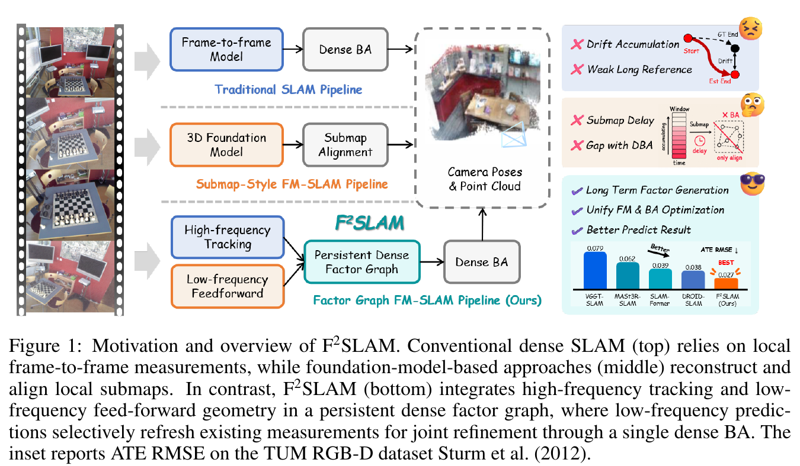

*原论文图 1。上、中、下三行分别表示传统局部跟踪与 BA、前馈模型重建子图后再对齐、以及 F²-SLAM 将两类测量放入持久稠密因子图的流程。右下角柱状图给出论文报告的 TUM RGB-D ATE RMSE。*

## 从外部子图变成可优化的测量

传统稠密 SLAM 用局部帧对约束当前轨迹和深度，优化器可以随着新图像到来不断重看这些测量。前馈重建模型则一次联合处理一组图像，通常在自己的参考坐标系中输出点图、位姿或深度。已有的前馈 SLAM 系统会把这些结果构成子图，再估计子图间变换或将地图融合进 SLAM 状态。F²-SLAM 指出，这种“预测之后再拼接”的接口会把宽视角几何留在 BA 之外；如果未来的局部证据改变了状态，之前的外部预测并不会作为原有测量重新参与调整。

F²-SLAM 的核心设计是让低频模型的预测成为因子图测量，而不是另存一套需要事后配准的几何状态。需要区分测量与状态：测量提供“源图像中某个像素应投影到目标图像哪个位置”的约束；状态则由各关键帧位姿、每帧逆深度以及可选内参组成。优化器调整状态，让几何重投影尽量符合图中保存的测量。

这一做法承接了稠密 BA 的常见形式，也与 [DROID-SLAM](../droid-slam/index.md) 的循环相关性更新和 [VGGT-SLAM](../vggt-slam/index.md) 的前馈几何建图形成对照。F²-SLAM 并未取消前馈模型的坐标系与尺度问题；它通过坐标规约与状态一致性检查，先把候选测量转换到当前 SLAM 状态能够解释的参考系，再决定是否允许它替换现有因子。

## 持久几何状态与 target-weight 因子

输入是一条 RGB 图像流。到时刻 $t$，系统保留关键帧索引集合

$$
\mathcal{K}_t=\{k_1,\ldots,k_{N_t}\},
\tag{1}
$$

其中 $k_{N_t}$ 是最新关键帧。对每个关键帧 $i$，持久几何状态包括世界到相机的变换 $T_i\in \mathrm{SE}(3)$ 和稠密逆深度图 $d_i\in\mathbb{R}^{h\times w}_{+}$。若相机未标定，还把内参参数 $\theta=(f_x,f_y,c_x,c_y)^\top$ 放入待优化状态：

$$
\mathcal{X}_t=\{T_i,d_i\}_{i\in\mathcal{K}_t}\cup\{\theta\}.
\tag{2}
$$

已知标定时 $\theta$ 固定，不作为优化变量。这里使用逆深度，是因为源图像上的像素与其逆深度可以反投影到三维，再由两帧位姿变换后投影到另一帧。

因子图的节点是关键帧，活动有向边 $(i,j)$ 保存从关键帧 $i$ 到 $j$ 的稠密测量。每个测量称为 target-weight：

$$
M_{ij}=(p^*_{ij},w_{ij}).
\tag{4}
$$

对源图像中的每个像素 $p\in\Omega_i$，$p^*_{ij}(p)\in\mathbb{R}^2$ 是预测的目标图像坐标；$w_{ij}(p)\in\mathbb{R}^{2}_{+}$ 则为横向和纵向残差分别给出置信权重。论文将它写成对角信息矩阵：

$$
\Lambda_{ij}(p)=\operatorname{diag}(w_{ij}(p)).
\tag{5}
$$

因此，一个边不是单一的相对位姿测量，而是一张稠密的像素对应场及逐像素权重图。权重高的像素对优化目标影响较大，权重低的像素影响较小。图边还保存测量来源标签 $\ell_{ij}\in\{\mathrm{high},\mathrm{low}\}$ 和更新锁 $\gamma_{ij}\in\{0,1\}$；它们只控制因子如何被刷新，不是几何状态，也不进入 BA 的目标函数。

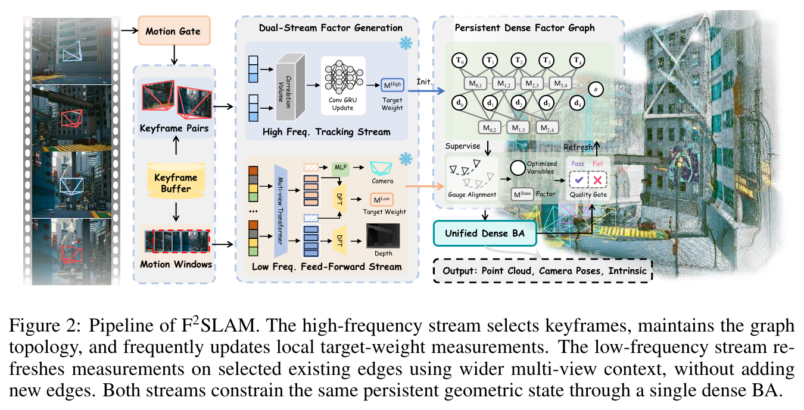

*原论文图 2。上方的高频跟踪流更新局部关键帧对；下方的低频前馈流从运动窗口提取多视图特征并生成候选测量。低频测量只刷新已有边，二者通过统一稠密 BA 约束同一组几何变量。*

## 高频跟踪维护关键帧图

每帧到达后，系统先依据相对最新关键帧的图像运动决定是否插入关键帧。附录 A.1 将从最新关键帧到当前帧的稠密位移记为 $u_{k_n t}$，并计算有效像素上的平均位移：

$$
m(k_n,t)=\frac{1}{|\Omega|}\sum_{p\in\Omega}\|u_{k_n t}(p)\|_2.
\tag{24}
$$

当 $m(k_n,t)>\tau_{\mathrm{kf}}$ 时，当前帧成为新的图节点；否则它只用于短时跟踪，不进入持久关键帧集合。实验统一采用 $\tau_{\mathrm{kf}}=40$。这是图像平面上的运动阈值，单位是像素，不代表米制相机位移。

插入新关键帧后，高频流选择时间上邻近和几何上相近的关键帧作为邻居，并为邻接帧对建立双向边。论文默认使用 3 个时间邻居和 2 个近邻。边数或更新时间超过限制时，因子会从活动图中退休，但其测量可能保留供局部 BA 重用。因此，“持久”指这些预测被纳入长期维护的几何状态与因子管理中，并不意味着每一条边永远保持活动。

高频测量由一个循环更新器生成。它读取源帧特征、当前重投影处采样的相关体，以及几何引起的位移和当前重投影相对已存目标的差异，输出增量位移与置信权重。若当前状态预测的目标位置为 $\hat p_{ij}(p;\bar{\mathcal{X}}_t)$，网络给出增量 $\Delta p^{\mathrm{high}}_{ij}(p)$，则新的目标坐标为

$$
p^{*,\mathrm{high}}_{ij}(p)
=\hat p_{ij}(p;\bar{\mathcal{X}}_t)
+\Delta p^{\mathrm{high}}_{ij}(p).
\tag{10}
$$

更新后的测量在随后的 BA 求解期间固定。只要因子没有被低频测量锁定，高频更新就可继续修正这条边上的 target-weight。

## 低频窗口提供更宽的多视图证据

新关键帧同时进入低频缓冲区。附录说明，系统累计相邻关键帧的图像运动量；缓冲区有足够的上下文且累计运动超过阈值时，触发一次前馈推理。缓冲区长度也有上限，避免慢速运动时延迟无限增长。实验中低频上下文最多包含 20 个关键帧，默认累计运动阈值为 800。

需要注意，累计量仍是像素位移的和，只用于调度，不是实际相机平移距离。低频窗口也不等同于另一张独立子图：它只规定哪些现有活动边可以作为前馈候选测量的对象，并不创建新的图结构或独立待优化几何状态。

每张图像的特征先经多视图 Transformer 在窗口中聚合；Flow3r 因子解码器随后为窗口内已有边上的图像对预测稠密位移和置信度。论文的实验配置使用预训练 DINO 提取单帧特征，跨帧聚合后交给 Flow3r。低频流也可输出相机位姿与深度，用于初始化当前 SLAM 状态；这些预测须先与当前 SLAM 的参考坐标和尺度规约对齐。论文将这一步称为 gauge alignment。正文没有进一步展开这项对齐具体如何估计；附录主要说明后续 BA 的状态与求解。位姿和深度预测用于初始化状态，不会直接改写低频预测的像素位移测量。

低频位移 $f^{\mathrm{low}}_{ij}(p)$ 表示 BA 网格上的完整源到目标位移，而不是相对于当前重投影的增量。候选目标坐标因此写作

$$
p^{*,\mathrm{low}}_{ij}(p)=p+f^{\mathrm{low}}_{ij}(p),
\qquad
w^{\mathrm{low}}_{ij}=\eta_{\mathrm{low}}c^{\mathrm{low}}_{ij},
\tag{15}
$$

其中 $c^{\mathrm{low}}_{ij}$ 是预测置信度，$\eta_{\mathrm{low}}$ 控制低频测量的相对权重，论文默认值为 $0.25$。与高频流使用“当前重投影加增量”的参数化不同，低频流直接预测整个目标坐标场；进入 BA 之前，两者都被转换到同一 target-weight 格式。

## 状态一致性检查决定是否刷新因子

较宽视野不保证每次前馈结果都可靠。遮挡、弱重叠和大视角变化都可能让低频测量偏离当前地图。如果直接将错误候选写入活动图，它可能让 BA 朝错误方向移动。F²-SLAM 因此在每个候选图像对上比较“当前几何状态预测的重投影”与“低频候选目标坐标”。

记两者差值为

$$
e^{\mathrm{low}}_{ij}(p)
=\hat p_{ij}(p;\bar{\mathcal{X}}_t)-p^{*,\mathrm{low}}_{ij}(p).
\tag{17}
$$

先用有效投影和最低置信度筛出支持像素；再把满足 $\|e^{\mathrm{low}}_{ij}(p)\|_2\leq\tau_{\mathrm{geo}}$ 的支持像素记为内点。由此统计支持比例 $r^{ij}_{\mathrm{sup}}$、内点比例 $r^{ij}_{\mathrm{in}}$、支持区域的平均置信度 $\bar c_{ij}$，以及内点的平均重投影误差 $\bar e^{\mathrm{low}}_{ij}$。配对得分为

$$
s_{ij}
=
\frac{\bar c_{ij}\,r^{ij}_{\mathrm{in}}\,r^{ij}_{\mathrm{sup}}}
{1+\bar e^{\mathrm{low}}_{ij}}.
\tag{18}
$$

当支持比例和配对得分都达到阈值，候选才被接纳：

$$
r^{ij}_{\mathrm{sup}}\geq\tau_{\mathrm{sup}}
\quad\land\quad
s_{ij}\geq\tau_{\mathrm{score}}.
\tag{19}
$$

默认 $\tau_{\mathrm{sup}}=0.05$，像素级几何容差 $\tau_{\mathrm{geo}}=3.0$。论文没有把接纳判断交给模型自身的置信度一项；几何残差、内点比例、覆盖支持和模型置信度共同决定候选是否与当前状态相容。被接纳的低频测量会替换已有边上的测量，并在活动期间阻止高频流覆盖；被拒绝的候选则不改变原有因子。低频流由此更新的是测量内容，而不是拓扑或待优化变量集合。

## 两类测量由同一个稠密 BA 求解

对源帧像素 $p$，系统先用逆深度和内参反投影到相机 $i$ 坐标，再借 $T_i^{-1}$ 与 $T_j$ 转换至相机 $j$，最后投影到目标图像：

$$
\hat p_{ij}(p;\mathcal{X}_t)
=
\pi_\theta
\left(
T_jT_i^{-1}\,
\pi_\theta^{-1}(p,d_i(p))
\right).
\tag{21}
$$

重投影残差是当前投影位置与因子中保存的目标位置之差：

$$
r_{ij}(p;\mathcal{X}_t)=
\hat p_{ij}(p;\mathcal{X}_t)-p^*_{ij}(p).
\tag{22}
$$

这里 $p^*_{ij}$ 和权重 $w_{ij}$ 在一次 BA 求解中视为固定观测。高频因子与通过门控的低频因子具有相同的数据格式，所以 BA 不需要知道每个残差来自循环跟踪还是多视图前馈模型。

论文优化的目标为

$$
\begin{aligned}
\mathcal{X}_t^*=\arg\min_{\mathcal{X}_t}\quad&
\sum_{(i,j)\in\mathcal{E}_{\mathrm{BA}}^t}
\sum_{p\in\Omega_i}
v_{ij}(p)\,
\rho\!\left(
r_{ij}(p;\mathcal{X}_t)^\top
\Lambda_{ij}(p)
r_{ij}(p;\mathcal{X}_t)
\right)\\
&+\frac{\lambda_d}{2}\sum_{i\in\mathcal{K}_t}
\|\nabla d_i\|_2^2
+\frac{\lambda_\theta}{2}
\|\theta-\theta_0\|_{\Sigma_\theta^{-1}}^2.
\end{aligned}
\tag{23}
$$

第一项汇总有效像素的置信度加权稠密重投影误差，$\rho$ 是鲁棒损失，$v_{ij}(p)$ 屏蔽无效投影；第二项惩罚逆深度图的空间变化，避免深度在邻近像素间无约束振荡；第三项把未标定场景下优化出的内参约束在先验 $\theta_0$ 附近，$\Sigma_\theta$ 表示先验不确定度。已标定时，最后一项与内参变量一并省去。

这个目标展示了“因子化”带来的直接后果：低频观测不会在 BA 之外直接挪动整幅点云，也不会再额外增加一套低频状态。接纳候选只替换现有边上的 $p^*_{ij}$ 和 $w_{ij}$，接下来的优化再根据同一批相机位姿、逆深度和内参重新计算投影误差。

附录 A.2 将鲁棒目标通过迭代重加权最小二乘写成局部线性问题。把位姿增量、逆深度增量和内参增量合并为 $\Delta$，重投影残差在当前估计附近近似为 $r+J\Delta$。深度梯度项与内参先验分别产生附加 Hessian 和梯度块，随后求解带阻尼的 Gauss–Newton 线性系统：

$$
\left(J^\top W_fJ+H_d+H_\theta+\lambda_{\mathrm{lm}}I\right)\Delta
=
-\left(J^\top W_fr+g_d+g_\theta\right).
\tag{45}
$$

求得增量后，位姿通过李群右乘更新 $T_i\leftarrow T_i\exp(\delta\xi_i^\wedge)$；逆深度和内参则采用加法更新。若内参固定，对应的 Jacobian、Hessian 和增量块都移除。每条活动边在每次求解中只有一个当前测量残差，因此刷新低频测量是替换观测，不是把相同边的两组预测都重复计算一次。

## 轨迹与稠密重建实验

论文在 TUM RGB-D、7-Scenes、Replica 和 KITTI Odometry 上评估系统。轨迹指标为 ATE RMSE；估计轨迹与真值按时间戳关联，并通过 Sim(3) 对齐后计算误差。稠密重建在 Replica 上报告 accuracy 与 completion，在 7-Scenes 上另报告 Chamfer distance。实验运行于 NVIDIA A100 40 GB GPU 和 AMD EPYC 7542 CPU。除特别注明外，高频分支使用预训练 DROID-Net；低频分支使用预训练 DINO 特征和 Flow3r。基线结果部分来自各方法原论文或先前基准报告，论文逐表注明了复现实验标记。

需要留意，轨迹先经过 Sim(3) 对齐，因此 ATE 比较反映对齐后的轨迹形状和相对几何误差，不等于未经对齐的绝对尺度误差。论文分别报告已标定与未标定设定；未标定组不使用真值内参，而由系统联合优化相机内参、位姿和逆深度。

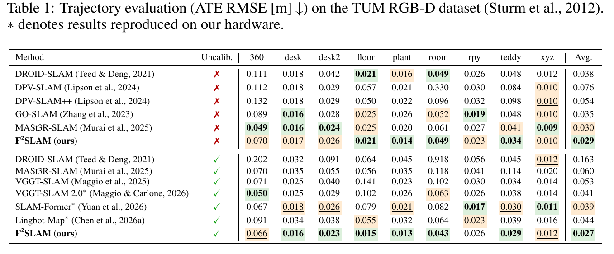

*原论文表 1。TUM RGB-D 上按序列报告已标定与未标定条件下的 ATE RMSE，单位为米；星号表示作者在其硬件上复现的结果。*

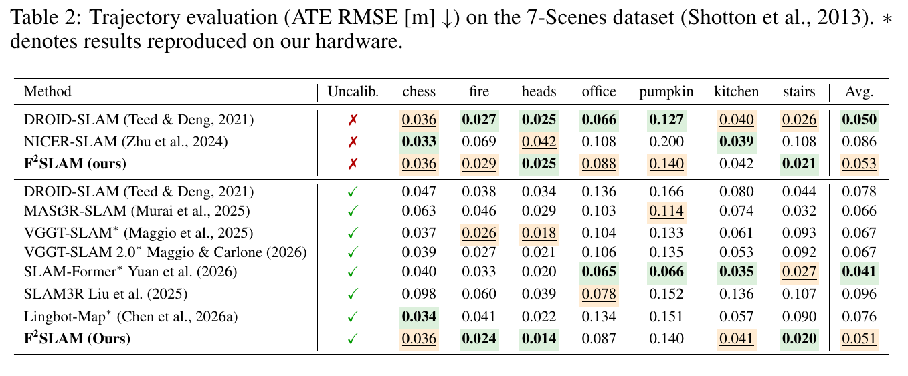

*原论文表 2。7-Scenes 轨迹误差，按场景和标定条件拆分。*

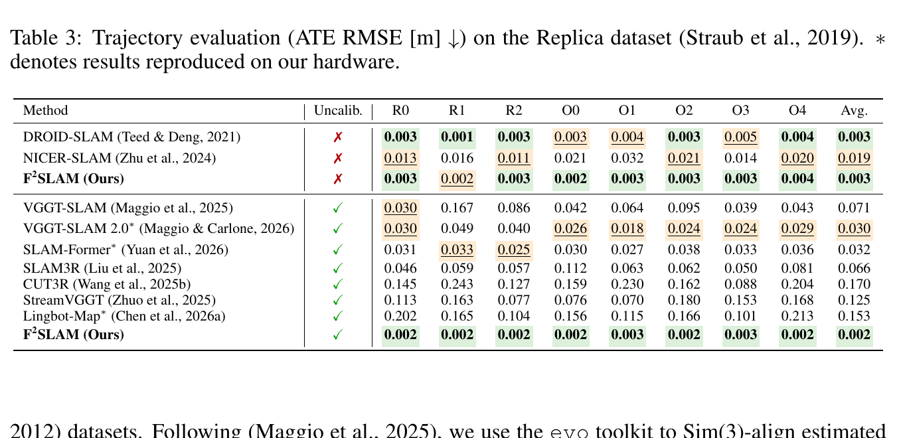

*原论文表 3。Replica 轨迹误差。未标定 F²-SLAM 的平均 ATE RMSE 为 0.002 m；论文报告的 VGGT-SLAM 2.0 平均值为 0.030 m。*

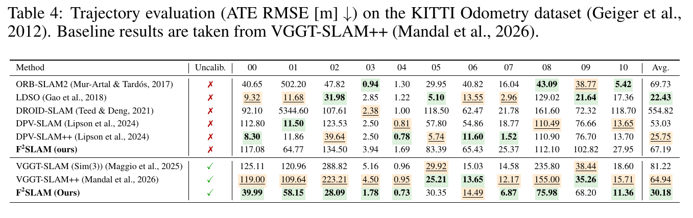

*原论文表 4。KITTI Odometry 上的平均 ATE RMSE；该表基线结果取自 VGGT-SLAM++。*

四个轨迹数据集呈现了不同难度。未标定设置下，论文报告 F²-SLAM 在 TUM RGB-D 和 Replica 上取得最低平均误差，在 7-Scenes 上平均 ATE 为 0.051 m，低于除 SLAM-Former（0.041 m）之外的同组方法。KITTI 上未标定平均 ATE 为 30.18 m，低于表中 VGGT-SLAM（Sim(3)）的 81.22 m 和 VGGT-SLAM++ 的 64.94 m；但已标定方法 LDSO 与 DPV-SLAM++ 的平均值分别为 22.43 m 和 25.75 m，低于 F²-SLAM 的未标定值。作者指出，当前系统缺少显式回环，长程户外序列仍是弱项。

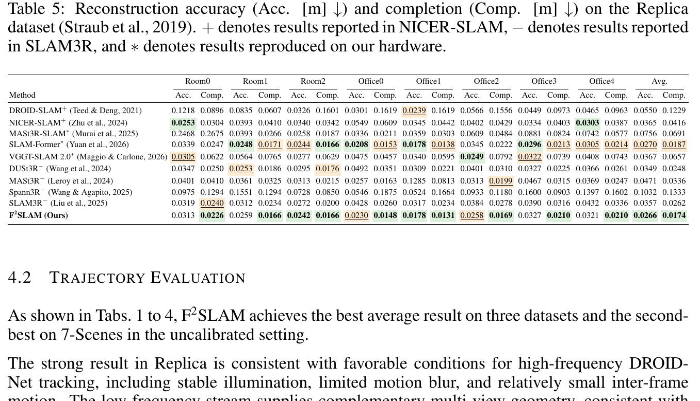

*原论文表 5。Replica 的 accuracy 和 completion 均以米计，数值越低越好；不同上标表示结果来自不同先前论文或作者复现。*

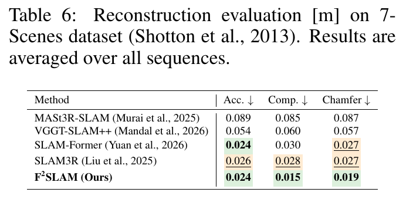

*原论文表 6。7-Scenes 的 accuracy、completion 和 Chamfer distance，单位为米。*

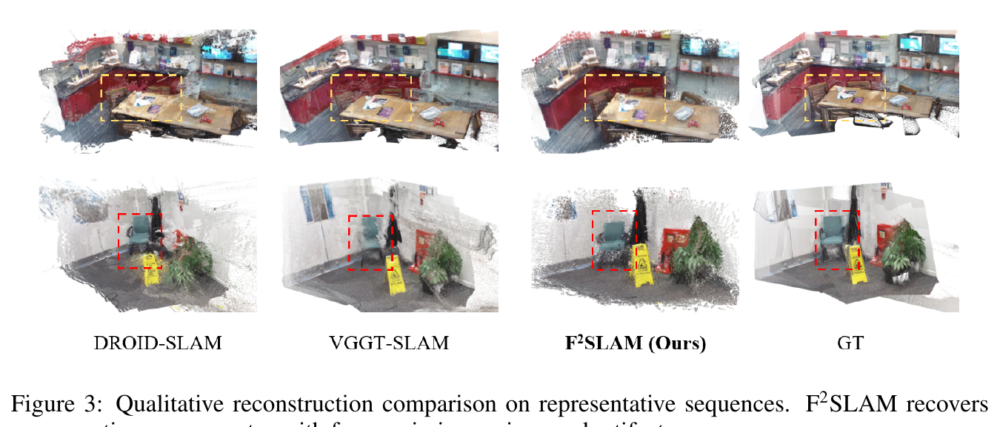

*原论文图 3。论文展示代表性场景的 DROID-SLAM、VGGT-SLAM、F²-SLAM 与真值重建。F²-SLAM 在图示区域呈现较连续的几何并减少缺失部分；定性图说明具体案例，不能替代跨场景定量指标。*

在 Replica 上，F²-SLAM 的平均 accuracy 为 0.0266 m、completion 为 0.0174 m，是表中最佳值。7-Scenes 上，accuracy 为 0.024 m，与 SLAM-Former 并列最低；completion 从 SLAM-Former 的 0.030 m 降至 0.015 m，Chamfer distance 从 0.027 m 降至 0.019 m。这里的 completion 衡量参考表面到重建表面的覆盖误差，降低说明更多真值表面被重建到，而不是点云“更完整”这一主观判断本身。

## 消融实验说明门控的重要性

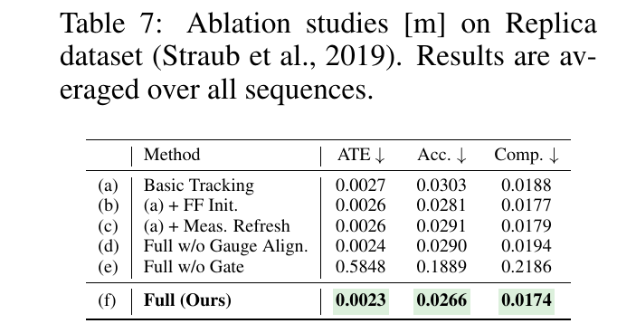

*原论文表 7。Replica 上依次加入前馈初始化、测量刷新、完整规约和门控；ATE、accuracy、completion 均以米计。*

基础跟踪的 ATE 为 0.0027 m；加入前馈初始化或测量刷新后为 0.0026 m。完整方法将 ATE 降到 0.0023 m，accuracy 从 0.0303 m 改善到 0.0266 m，completion 从 0.0188 m 改善到 0.0174 m。去掉 gauge alignment 后，ATE 为 0.0024 m，重建指标也变差，说明不同预测坐标系之间的规约会影响测量能否在共享状态中表达。

最显著的变化来自去掉状态一致性门控：ATE 升至 0.5848 m，accuracy 与 completion 分别恶化到 0.1889 m 和 0.2186 m。也就是说，把多视图候选直接写入图中并不足够；系统需要在刷新因子之前检查候选能否被现有几何状态支持。

附录进一步研究低频窗口大小、触发运动阈值和几何容差：

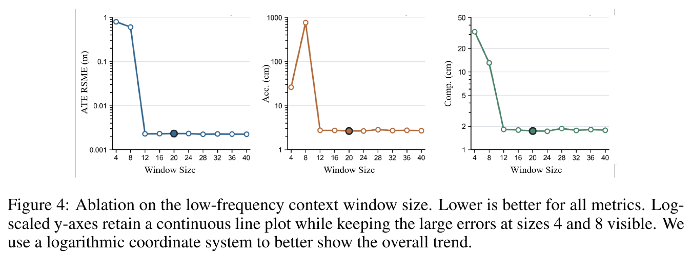

*原论文图 4。横轴为低频窗口最大关键帧数，纵轴分别为 ATE RMSE、accuracy 和 completion；纵轴使用对数刻度。窗口为 4、8 时误差显著上升，约 12 帧起进入较稳定区间。*

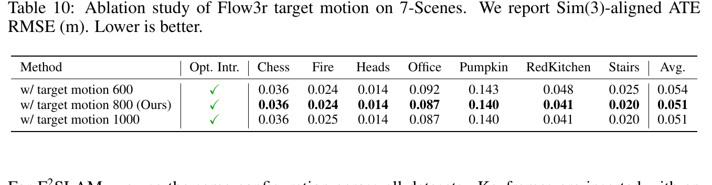

*原论文表 10。7-Scenes 上将低频触发运动量设为 600、800、1000 的比较；该量是图像运动调度值，不是米制位移。*

从 4 帧或 8 帧增加到至少 12 帧后，窗口中才有足够的视角与基线支撑多视图估计；在较大窗口区间，三项指标变化较小且并非随帧数单调改善。作者最终选 20 帧，理由是 accuracy 最佳，completion 接近最佳且 ATE 处于稳定区间。把触发阈值从 600 提到 800 后，7-Scenes 平均 ATE 从 0.054 m 降到 0.051 m；继续增至 1000 没带来一致改善。几何容差 $\tau_{\mathrm{geo}}$ 在 2、3、4 像素间变化时，表 9 的 ATE 报告值变化较小；这些绝对值与主表的量级不一致，详见下文说明。

## 效率与长序列表现

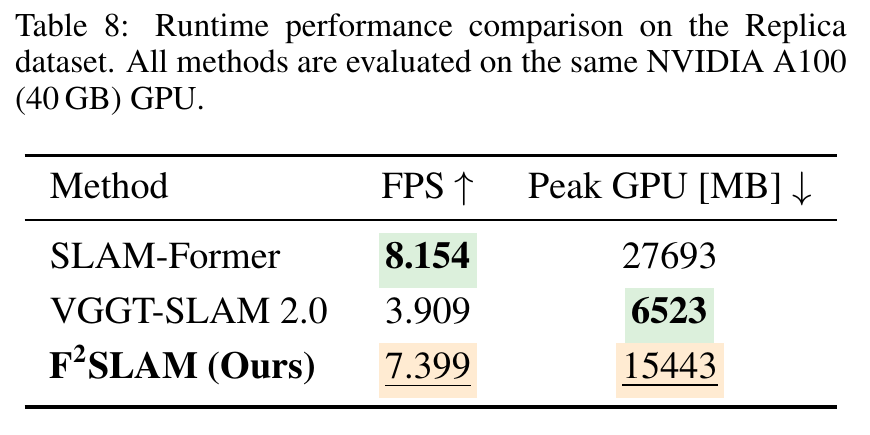

*原论文表 8。三种系统在同一块 NVIDIA A100 40 GB GPU 上运行，报告平均帧率和峰值 GPU 显存。*

在该硬件与 Replica 测试条件下，F²-SLAM 达到 7.399 FPS，峰值 GPU 显存为 15,443 MB。SLAM-Former 为 8.154 FPS、27,693 MB；VGGT-SLAM 2.0 为 3.909 FPS、6,523 MB。因而，F²-SLAM 比 SLAM-Former 稍慢但显存更低，比 VGGT-SLAM 2.0 更快但显存使用更多。论文所说的“有竞争力”应限定在这些方法、数据和硬件设置中，不能直接推出移动端实时性能。

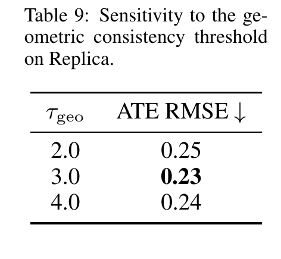

*原论文表 9。Replica 上 $\tau_{\mathrm{geo}}$ 取 2、3、4 时的 ATE RMSE，最优值出现在默认的 3 像素。*

表 9 按论文原样列出 ATE RMSE 0.25、0.23、0.24 m。这个量级与论文主表中 Replica ATE 约 0.002–0.003 m 相差两个数量级；原文没有解释这一差异。因此这里只能据该表说明不同门限下的排序趋势，不能把这些绝对数值与主表直接比较，也不自行猜测或改写小数点。

论文附录还给出更多轨迹可视化。二维投影强调路径形状和端点偏差；三维图能显露平面投影看不到的竖直漂移。它们补充定量误差，但轨迹仍经过 Sim(3) 对齐。

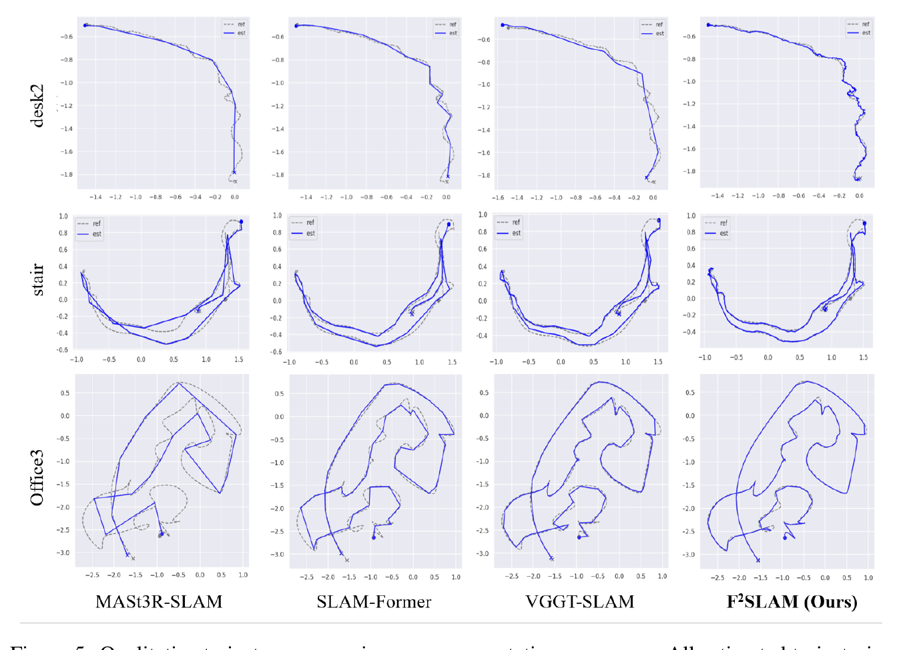

*原论文图 5。对齐后的估计轨迹与参考轨迹在若干序列上的比较。*

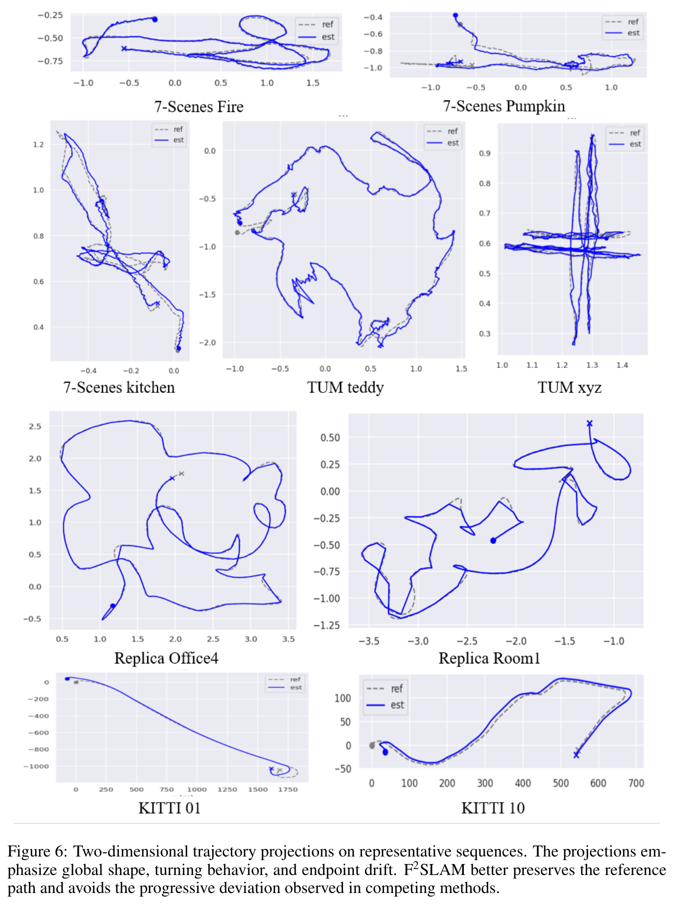

*原论文图 6。不同数据集序列的平面轨迹投影，显示局部转弯和长路径上的累计偏差。*

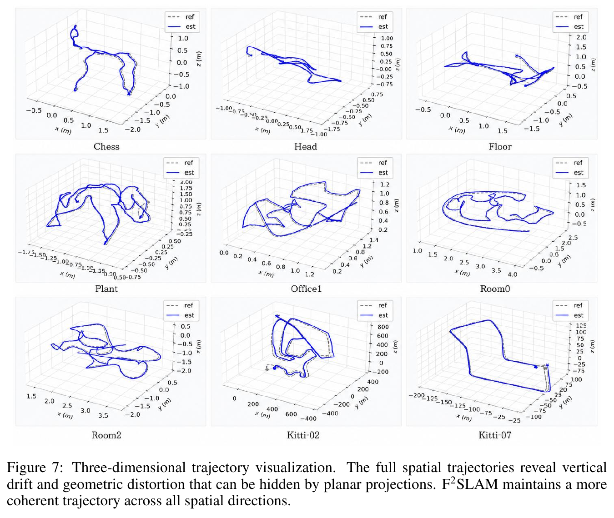

*原论文图 7。完整三维轨迹对比可展示垂直方向和离开投影平面的形变。*

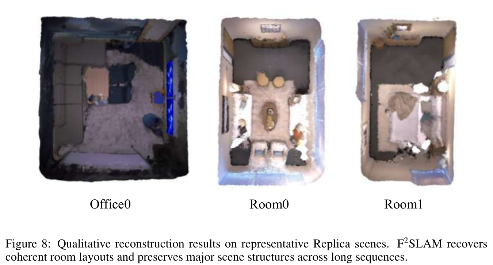

*原论文图 8。Office0、Room0、Room1 的重建场景。*

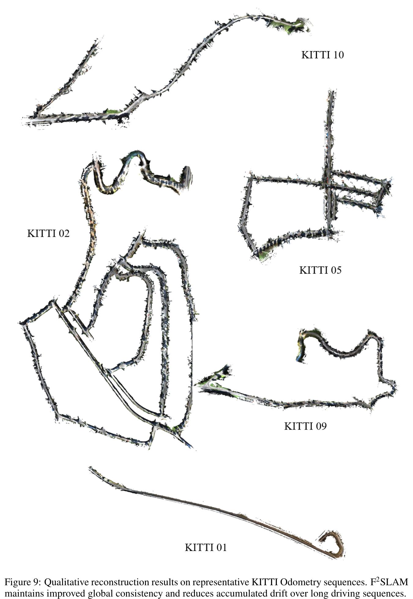

*原论文图 9。KITTI Odometry 代表序列上的重建结果，作者报告长距离行驶下的全局一致性有所改善。该图为定性结果；论文同时指出户外长序列上的轨迹误差与缺少回环仍是限制。*

## 方法关系与局限

F²-SLAM 的重点不在提出一种全新的图像前端，而在重新定义学习式几何与 SLAM 后端之间的接口。高频分支沿用 DROID-Net 一类的循环更新，为相邻关键帧提供局部连续约束；低频分支从 Flow3r 一类多视图模型得到宽基线几何。系统把两种输出都转成 target-weight 测量后，持续由同一个 BA 状态解释。相较于把前馈点云对齐到地图，这种因子化接口保留了“优化器可以如何使用预测”的明确路径。

这套设计的关键风险也落在接口上。前馈网络的置信度不能完全反映多视图几何是否与当前 SLAM 状态一致，所以论文另用当前状态下的重投影误差检查候选；消融结果中去门控后性能大幅恶化，支持了这一设计在所测设置下的重要性。但这并不构成对动态场景、极弱纹理或超长序列都能稳定接纳测量的保证。

作者明确指出，当前系统没有显式回环机制，因此 KITTI 这类长时户外运动仍会积累误差；低频预测还可能受弱纹理、动态物体、大视角变化和尺度歧义影响。另一个实际边界是速度：A100 上报告的 7.399 FPS 说明系统包含较重的双流推理与 BA，尚不能据此宣称适合高帧率或资源受限设备。论文将回环和更稳健的低频测量列为后续方向。

从系统角度看，F²-SLAM提出了一个有用的研究问题：学习模型的输出要怎样被表示，才能进入传统几何优化、接受后续观测反复检验？它的回答是把预测转为带置信权重的像素目标测量，并让门控、因子生命周期和 BA 共同管理这些测量。这个接口把前馈几何从一次性的地图修正，变成在线优化可以持续调用的约束。
