# FastVGGT 论文解读

> You Shen、Zhipeng Zhang、Yansong Qu、Xiawu Zheng、Jiayi Ji、Shengchuan Zhang、Liujuan Cao，*FastVGGT: Fast Visual Geometry Transformer*，ICLR 2026 正式版。本文依据 ICLR 论文 PDF 及其中的附录；官方补充包提供代码材料。[论文页面](https://proceedings.iclr.cc/paper_files/paper/2026/hash/9f5b159f2c1d216d73bc0c289763dbfc-Abstract-Conference.html) · [论文 PDF](https://proceedings.iclr.cc/paper_files/paper/2026/file/9f5b159f2c1d216d73bc0c289763dbfc-Paper-Conference.pdf) · [补充材料](https://proceedings.iclr.cc/paper_files/paper/2026/file/9f5b159f2c1d216d73bc0c289763dbfc-Supplemental-Conference.zip) · [项目页](https://fastvggt.github.io/)

VGGT 把多张图像一起送入全局注意力，以前馈方式预测相机、深度和点图。输入变长后，跨帧 token 两两交互的成本迅速上升；论文还观察到，不同 token 的全局注意力图往往相似，意味着其中有可压缩的重复计算。FastVGGT 不重新训练主干，而是在全局注意力前合并部分 token，保留首帧作为几何参照，并保护一小部分显著 token；全局注意力计算后再把合并特征映回原序列，以便后续帧内注意力和稠密解码继续使用。

这套做法针对的是长图像序列。实验中，FastVGGT 在 1,000 张图像上将重建用时从 724.6 秒降至 180.7 秒，同时改善点云距离和相机轨迹误差；但 5 到 10 帧的短序列对激进合并更敏感。论文的要点因此不只是“减少 token”，还在于按三维重建的跨视图结构决定哪些 token 可以合并，以及何时这种近似会失效。

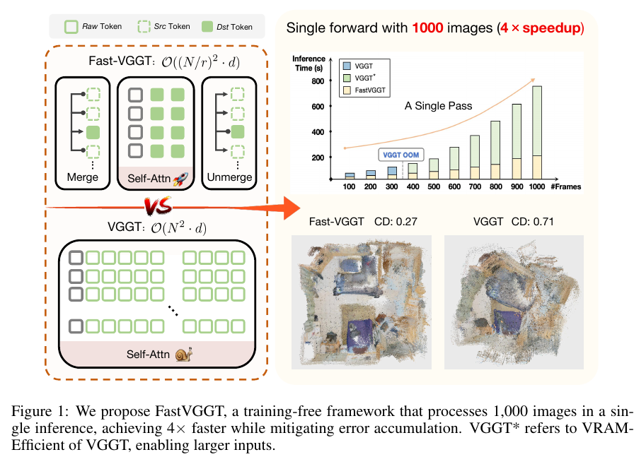

## 1. 引言

传统重建通常需要特征匹配、相机估计和几何优化等多个环节。DUSt3R、VGGT 等前馈几何模型则把场景先验编码进网络，直接从图像预测三维结构。VGGT 能联合估计相机内外参、深度、点图和二维轨迹，但它的全局注意力要让不同帧的 token 互相交换信息。输入帧数增加时，注意力计算量按 token 数的平方增长；即使使用 FlashAttention 降低显存占用，计算时间仍会随 token 数平方增加。

作者把长序列问题分成两个相互关联的部分：全局注意力逐渐成为推理时间的主项，且预测中的微小偏差会沿长序列积累。VGGT-Long 等方法通过分块和子地图对齐降低漂移，但会增加处理环节并降低速度。FastVGGT 希望在保留 VGGT 一次前馈、多视图联合推理方式的同时，减少全局注意力真正处理的 token 数量。

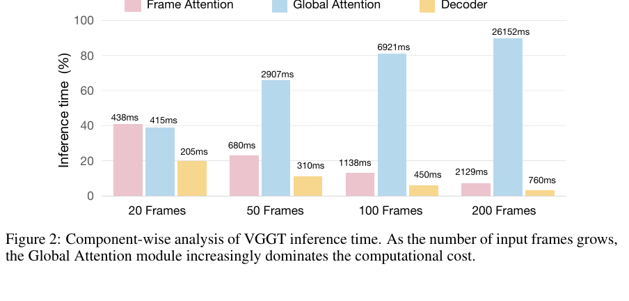

## 2. 相关工作

### 2.1. 前馈三维重建

DUSt3R 从两张 RGB 图像预测相互一致的点图，后续模型把这一思路扩展到更多视图。VGGT 进一步采用约 12 亿参数的 Transformer，对整个图像集合联合预测相机、深度、点图和轨迹。这样的全局交互提升跨视图推理能力，也让长序列的计算和误差累积成为瓶颈。VGGT-Long 通过对子地图对齐抑制漂移，FastVGGT 则选择减少全局注意力输入的 token。

### 2.2. Token 合并

常见 token 合并方法把 token 分为源集合和目标集合，再把每个源 token 合并到最相似的目标 token 中。这在图像分类或生成中能压缩重复表示，但三维重建依赖跨图像对应关系；若空间覆盖不均，局部区域可能被过度压缩，影响稠密几何。FastVGGT 因此同时考虑世界坐标参照、跨帧对应和帧内空间覆盖，而不直接套用面向单张图像的合并策略。

## 3. 方法

### 3.1. 全局注意力图的观察

在 ScanNet 的输入中，每帧被编码为 1,041 个 token：一个相机 token、四个 register token 和 28×37 个图像 patch token。作者可视化不同 token 在全局注意力层的注意力图，发现许多 token 在不同网络层上关注相近区域。图 3 展示了六个代表 token 在若干层的注意力分布；相似性不是说这些 token 的内容完全相同，而是它们分配给其他 token 的注意力模式有明显重合。

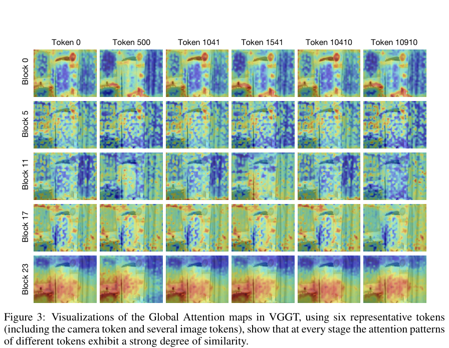

作者将这种冗余称为 token collapse，并把它与 DINO 系列的特征退化现象联系起来，但也强调二者影响不同。DINO 的 patch 特征趋向 CLS token 会损害稠密识别所需的局部差异；VGGT 则交替使用全局注意力和帧内注意力：前者整合跨视图关系，后者重新引入帧内细节。因此，VGGT 全局注意力中的相似模式可以被视为一种全局语义汇聚，也为减少重复计算提供了机会。此处实验证据直接比较的是注意力图，不应把“token collapse”理解成已经证明所有 token 表征都坍缩成同一个向量。

作者先测试 ToMe 的随机采样版 ToMe-R、固定步长版 ToMe-S，以及 PiToMe。表 1 显示它们虽然加速，却会明显增加 Chamfer Distance（CD，越低越好）。例如 300 帧、合并率 0.9 时，ToMe-R、ToMe-S、PiToMe 的 CD 分别为 0.582、0.708、0.567，而 VGGT 为 0.416。这个结果说明，仅按相似度合并并不足以保留 VGGT 所依赖的跨视图几何关系。

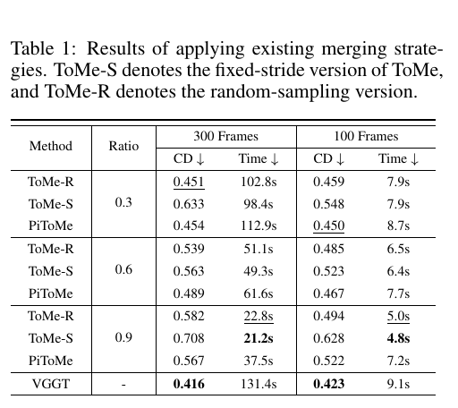

### 3.2. Token 分组

FastVGGT 把 token 分为显著 token、目标 token（destination，dst）和源 token（source，src）。目标 token 作为合并后的代表；源 token 是待并入的信息；显著 token 则不参与合并，直接保留给全局注意力。三组共同服务于三个目标：留住跨帧对应、保证每帧均匀覆盖，并把冗余信息合并到有代表性的 token 上。

**首帧作为参照。** VGGT 把首帧定义为场景坐标参照。首帧 token 因而能帮助后续帧维持共同几何坐标。注意力可视化也显示其他 token 常对首帧有较强响应。FastVGGT 将首帧的所有 token 固定为 dst，不允许它们被合并。

**保留显著 token。** 图像之间需要可靠对应，作者把有辨识度的 token 类比为传统匹配算法中的关键点。一个选法是按 token 范数取 top-k；但序列变长后，计算 top-k 的开销也变大。论文最终默认用固定步长采样，每帧保留约 10% token 作为显著 token。消融结果显示，这种方式的精度与 top-k 接近，速度更快且在不同层保持更均匀的空间分布。

**帧内均匀抽样。** 对剩余 token，方法按帧恢复成图像 patch 网格，再将每帧划分为小区域。每个区域按预设合并率随机选出 dst，其余归入 src。这样可避免整张图某些位置几乎没有代表 token、另一些位置却保留过多 token。合并率 0.9 表示大幅减少参与全局注意力的普通 token；首帧和显著 token 仍受保护。

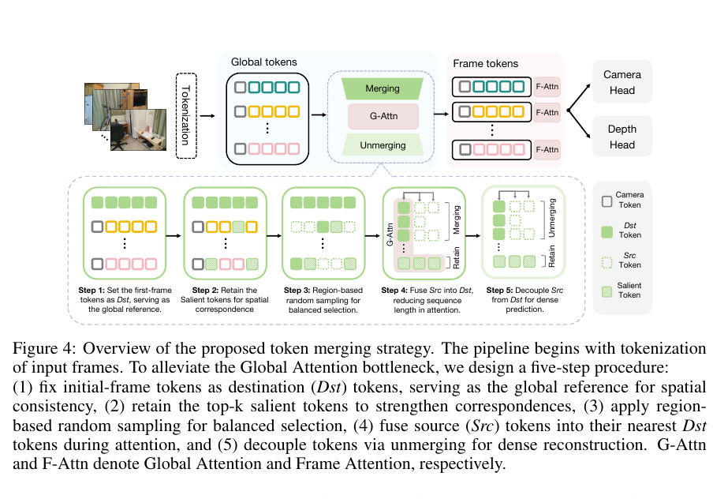

### 3.3. 合并与解合并

令源 token 为 $x_s$，候选目标 token 为 $x_d$。方法用余弦相似度挑选目标：

$$
d(s)=\arg\max_{d\in D}\frac{x_s^\top x_d}{\lVert x_s\rVert_2\lVert x_d\rVert_2}.
$$

选中后，以平均值更新目标表示：

$$
x'_d=\frac{x_d+x_s}{2}.
$$

被合并的源 token 暂时从全局注意力序列中移除，计算结束后再将目标表示复制回这些源 token 的原位置。这样恢复了原序列长度，供后续逐帧注意力和稠密解码使用。解合并不会复原源 token 被移除前的独立信息；它恢复的是输出位置和张量形状，近似误差仍可能存在。

实际网络交替执行全局注意力和帧内注意力。FastVGGT 只在全局注意力前合并，结束后立即解合并；帧内注意力仍处理所有 token。加速来自跨帧全局交互的序列缩短，而不是把整条网络永久降采样。

### 3.4. 降低显存的推理实现

作者发现原始 VGGT 在约 300 帧附近会因显存不足而无法推理。VGGT 有 24 个编码器块，但推理解码只需第 4、11、17、23 层的输出；原实现仍保存全部中间结果。作者据此实现 VGGT*，在推理时丢弃后续不再使用的层输出。论文报告该实现不改变重建质量，并把可处理序列扩展到 1,000 帧。除非特别说明，实验中的 VGGT 基线均为 VGGT*。

这个优化和 token 合并解决不同问题：VGGT* 减少不必要的中间激活存储，主要缓解显存；FastVGGT 减少全局注意力实际运算的 token 数，主要降低计算时间。论文还指出，帧内注意力前必须恢复原 token 数，因此不能指望在帧内注意力层持续减少显存与计算。

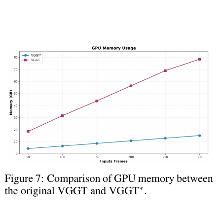

## 4. 实验

### 4.1. 设置

实验使用 ScanNet、NRGBD 和 7 Scenes。ScanNet 共 1,500 个场景，作者均匀抽取 50 个组成可复现实验划分 ScanNet-50。任务包括相机位姿估计与点云重建。模型采用 VGGT 的 24 个编码器块，在帧内注意力与全局注意力间交替处理，并集成 FlashAttention2；图像按 VGGT 的方式预处理，长边缩放到 518 像素。表 2–7 默认合并率为 0.9；作者在表 8 和补充材料研究不同合并率。所有实验使用 80 GiB 显存的 NVIDIA A800。

### 4.2. 三维重建

表 2 比较 ScanNet-50 上 1,000、500、300 和 100 帧序列的点云 CD 与推理时间。1,000 帧时，FastVGGT 用时 180.7 秒，VGGT* 用时 724.6 秒，约为四分之一；CD 从 0.471 降至 0.425。500 帧时用时从 177.5 秒降至 55.2 秒，CD 从 0.420 降至 0.411。300 帧时两者 CD 都为 0.416；100 帧时 FastVGGT 为 0.426，略高于 VGGT* 的 0.423。因而长序列上的速度收益和误差抑制最明显，短序列并非每项指标都提升。

表中 π³ 和 StreamVGGT 在这些序列长度下遇到显存溢出（OOM）；这描述的是论文使用的硬件与评测配置，不代表这些方法在任何设置下都无法运行。Fast3R、CUT3R 能处理长输入，但在该实验的 CD 上逊于 VGGT 系列。

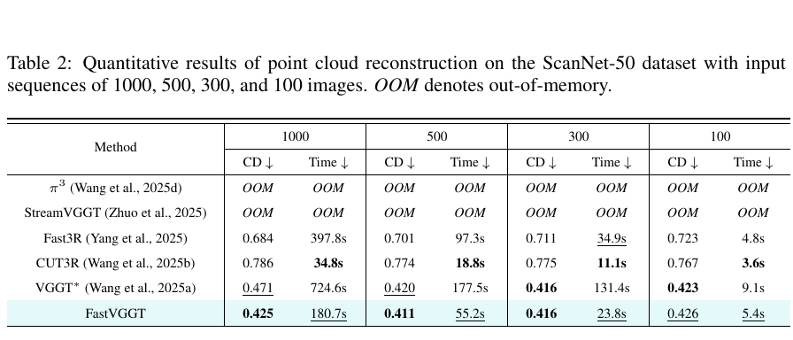

表 3 和表 4 延续 CUT3R 的评测协议，在 7 Scenes 与 NRGBD 上按每 3 帧或每 10 帧采样关键帧，并报告准确度（Acc）、完整度（Comp）、法线一致性（NC）及时间。7 Scenes 的 FastVGGT 在 stride 3 时 Acc/Comp/NC 均值为 0.018/0.026/0.617，VGGT* 为 0.019/0.027/0.611；stride 10 时两者也接近。NRGBD 上 FastVGGT 与 VGGT* 同样总体相近，例如 stride 3 的均值 Acc 为 0.029 对 0.029，NC 为 0.730 对 0.727，同时耗时由 136.1 秒降到 53.1 秒。结果支持加速后仍保持接近基线的重建质量，但不能据此说所有数据集和指标均有大幅精度提升。

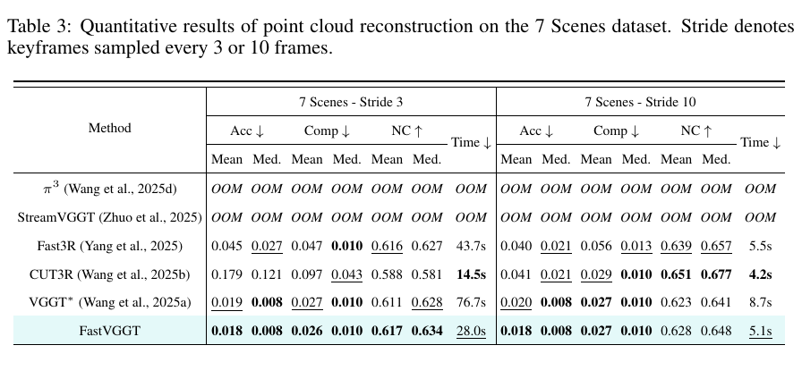

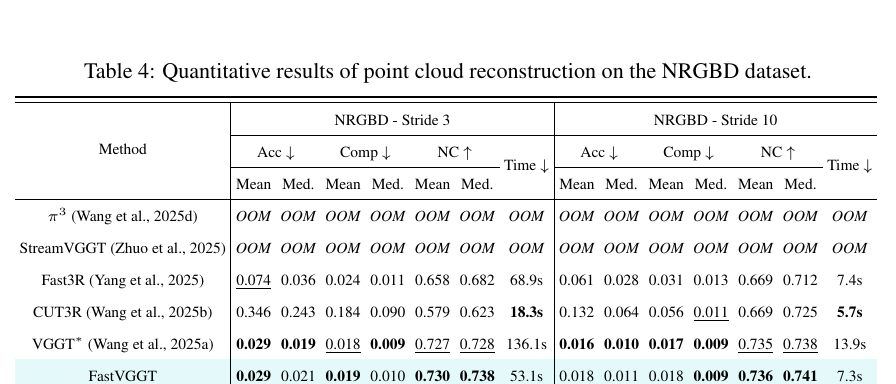

### 4.3. 相机位姿估计

在 ScanNet-50 上，论文以 ATE 衡量整段轨迹偏差，以 ARE 衡量旋转误差，并用 RPE-rot、RPE-trans 衡量相邻帧的局部旋转和平移误差。表 5 中，500 帧时 FastVGGT 的 ATE 从 0.174 降至 0.145；1,000 帧时从 0.196 降至 0.164。100 帧时 ATE 则由 0.140 微升到 0.141，RPE 各列也有略好或略差的情况。作者因此强调长序列的漂移改善。图 5 展示了轨迹对照；表中的指标单位没有在该表标题中注明，本文保留原始数值，不自行补单位。

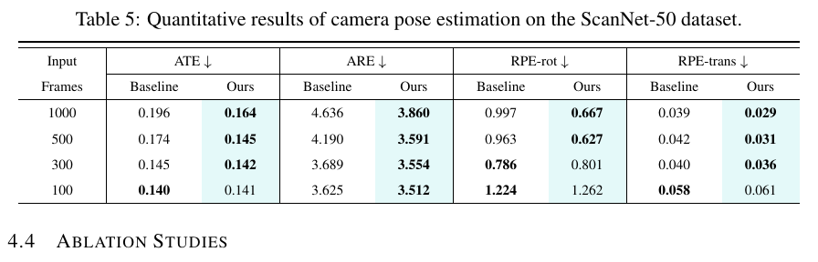

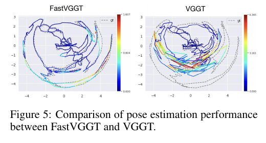

### 4.4. 消融实验

表 6 比较 top-k 与固定步长显著 token 采样。以 500 帧为例，Stride-10% 的 CD 为 0.411、耗时 55.2 秒；TopK-10% 为 0.423、73.8 秒。固定步长在该设置下更快且精度相近，作者遂选它为默认方案。

表 7 逐步加入区域均匀采样、首帧参照和显著 token 保护：CD 从 0.947 降至 0.637、0.431，再降至完整方法的 0.411；ATE 从 0.842 降至 0.141。表 8 改变合并率和开始合并的网络块。越早开始、合并越多通常更快；在第 0 块、合并率 0.9 时耗时 55.2 秒，CD 为 0.411。只从第 20 块开始，即使合并率 0.9，耗时仍为 157.3 秒，说明节省效果取决于减少多少早期全局注意力计算。

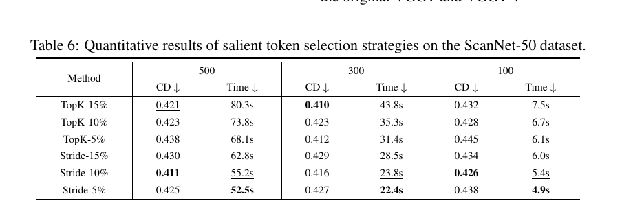

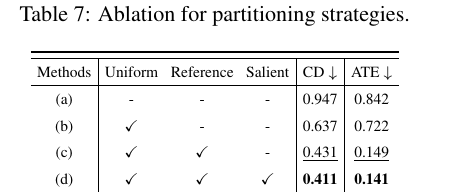

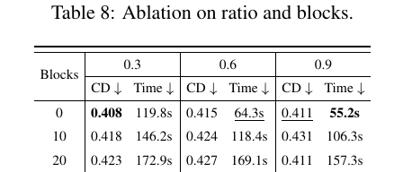

### 4.5. Token collapse 的定量分析

作者在 ScanNet-50 上从不同帧抽取六个 token，计算它们全局注意力图之间的平均两两余弦相似度。相似度范围为 −1 到 1，1 表示模式高度相似，0 表示不相关。图 6 显示，多数层相似度较高，但第 1 层和第 14 层附近有明显下降。即使在这些相似度较低的层，0.9 合并率也没有明显损害表 2–5 的最终结果。作者推测，这是因为全局注意力的高响应集中于类似关键点的区域，保留其中一部分对应仍足以支撑重建；这与 SfM 中有限但可靠的特征对应可支持位姿估计有相似之处。该解释是对实验现象的分析，不等同于证明删除任意 token 都安全。

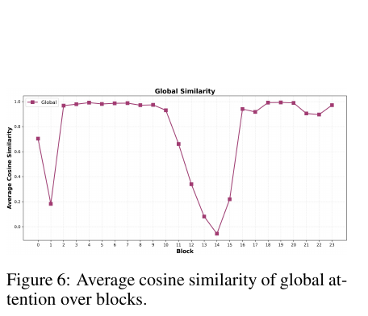

## 5. 结论

FastVGGT 在 VGGT 的全局注意力前合并冗余 token，合并后再恢复 token 序列，以兼容帧内注意力和稠密三维解码。首帧 token 提供坐标参照，显著 token 留住跨视图对应，区域抽样则让每帧的压缩更均匀。ScanNet-50、7 Scenes 和 NRGBD 的结果显示，长序列上可显著提速并抑制误差累积，短序列则需要更保守的合并策略。

## 附录

### A. 大语言模型使用与可复现性

作者声明使用 Gemini 等大语言模型仅改善论文语言和可读性，不参与提出研究想法或构造方法框架；所有作者审阅终稿并对内容负责。核心代码以匿名补充材料提交，接收后公开。

### B. Token collapse 现象讨论

#### B.1. DINOv3 与 VGGT 中的差异

DINOv3 的多裁剪自蒸馏使 CLS token 学习跨视图语义，同时可能让 patch token 趋向 CLS 表征，削弱局部判别性。Gram Anchoring 通过匹配学生与早期教师的 patch 特征 Gram 矩阵，尽量保留 patch 间相似结构。若两组单位化 patch 特征为 $X_S,X_G\in\mathbb R^{P\times d}$，其损失为 $\mathcal L_{\mathrm{Gram}}=\lVert X_SX_S^\top-X_GX_G^\top\rVert_F^2$，比较的是 patch 两两相似关系，而非直接回归教师特征。VGGT 的注意力图相似性主要出现在全局注意力层，作用是建立跨视图对应；在帧内注意力层仍会恢复局部变化。因此作者把 VGGT 中的冗余看作可能利用的计算机会，而不直接套用针对 DINO 稠密表征退化的结论。

### C. 短序列表现

补充表 9 把 ScanNet-50 的输入长度扩展到 50、30、10、5 帧。50 帧时合并率 0.9 的 ATE 为 0.143，基线为 0.138；10 帧时分别为 0.250 和 0.197；5 帧时为 0.452 和 0.345。5 帧条件下，合并率 0.3 的 ATE 为 0.330，优于基线。图 8 显示 5 帧时高合并率可能导致明显重建失败。这说明可用时间上下文越少，越不能沿用长序列的激进压缩。

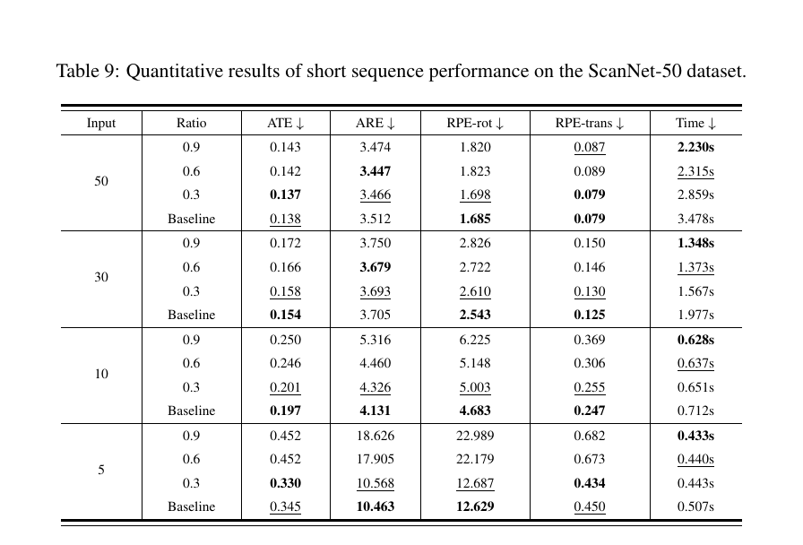

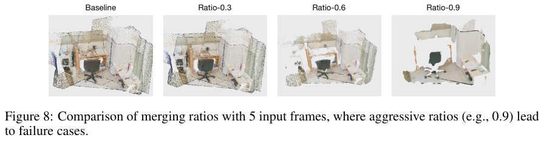

### D. 对首帧遮挡和模糊的鲁棒性

作者在 ScanNet-50 对首帧使用尺寸为 201、标准差为 30 的模糊核，或以 40×40 掩码遮挡 50%/80% 区域。表 10 中 FastVGGT 在 500、300、100 帧上均取得比 VGGT 更低的 CD。例如首帧遮挡 50% 时，500 帧 CD 从 0.501 降至 0.471；80% 遮挡时从 0.514 降至 0.476；首帧模糊时，500 帧 CD 从 0.509 降至 0.477。作者还统计，在 500 帧输入中只有 1.96% 的合并目标 token 来自首帧，100 帧时为 9.17%。他们据此解释，首帧受损时，后续帧的匹配信息能分担其参照作用；这是一种对实验现象的解释，不意味着首帧质量不再重要。

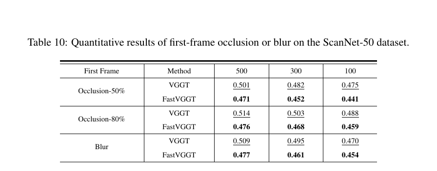

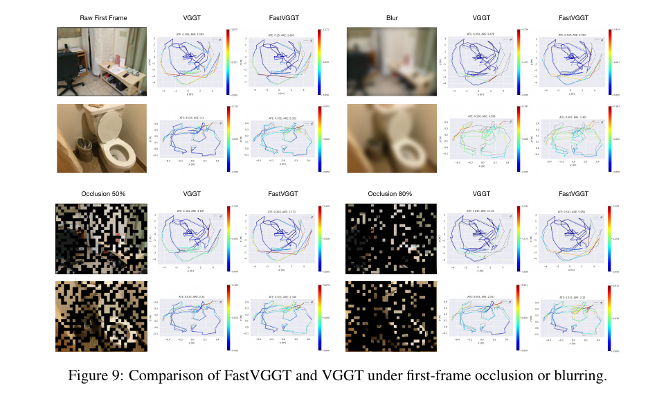

### E. 核心代码流程

补充伪代码把推理过程写成四个连续步骤：把每帧图像转为 patch token；按首帧参照、显著 token 和区域采样划分 token；在每个全局注意力块前把 src 合并到最相似的 dst，结束后按索引解合并；帧内注意力对完整 token 序列执行，最后解码深度、相机位姿和点图。实现中通过索引缓存追踪 src、dst 和受保护 token 的原位置，合并和解合并都按同一组索引处理，因此张量顺序可恢复。

### F. 更多可视化结果

#### F.1. 注意力图

补充图 11 和图 12 展示 Waymo 户外场景 segment-102751 中，分别以参考帧和第十帧为查询时的全局注意力图。作者观察到室内外场景中不同 token 的注意力分布都存在相似结构；随网络深度增加，注意力整体呈现集中、分散再集中的变化。末层高响应主要落在参考帧及与其共视度高的帧上。这些可视化支持“全局注意力存在重复模式”的观察，但不是独立的速度或精度评估。

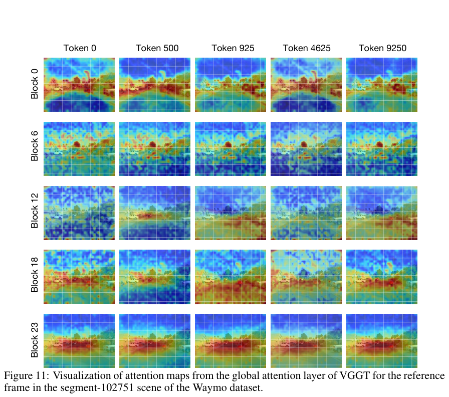

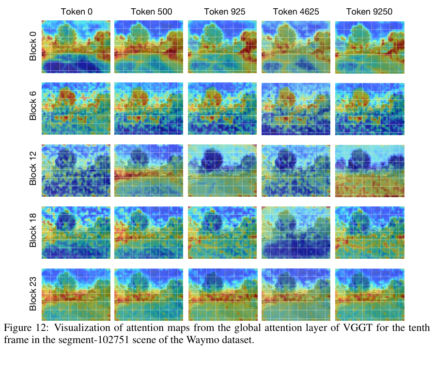

#### F.2. 显著 token 的空间分布

补充图 10 对比 top-k 与固定步长选择。浅层中 top-k 能较好覆盖语义显著区域，但到较深层时采样位置更集中；固定步长定位语义点不如 top-k 精确，却在不同层维持更均匀的空间分布。这解释了作者为何优先考虑固定步长的效率和覆盖稳定性。

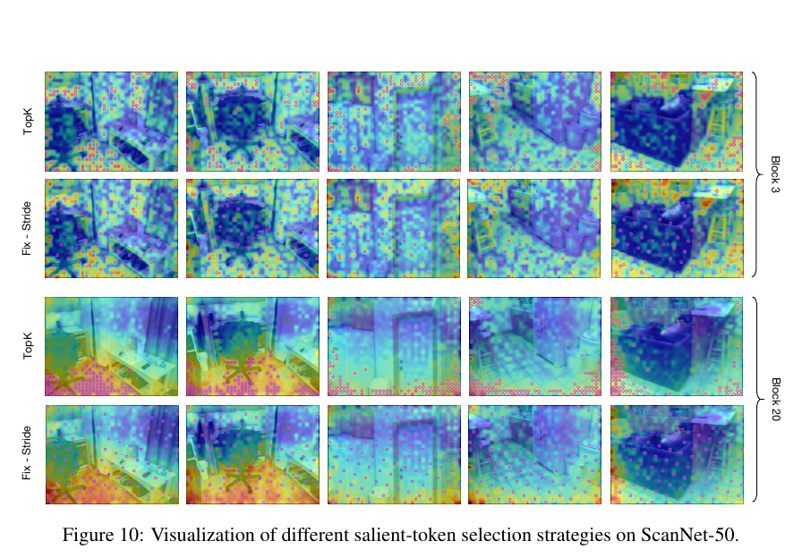

#### F.3. 位姿可视化

补充图 13 给出 ScanNet 多个序列上的 FastVGGT 与 VGGT 轨迹对照，作为位姿定量结果的补充。

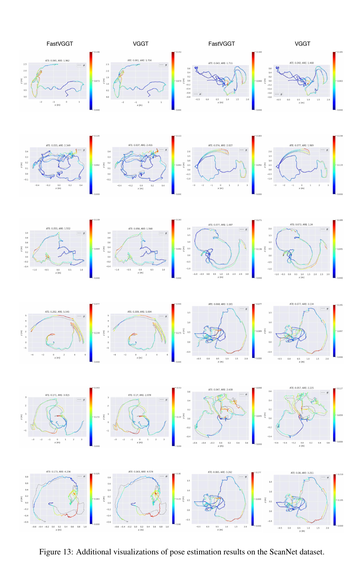

### G. 局限与未来工作

论文指出四项限制。第一，固定高合并率针对长序列设计，在短序列上可能删掉有用细节，后续需要根据序列长度和场景复杂度自适应。第二，能否扩展到 PI3 等 VGGT 后续架构仍待验证，现有证据只是初步观察。第三，FastVGGT 仍有长时漂移，未来可结合时间对齐或记忆机制。第四，当前方法没有显式处理动态物体，在动态场景占比高时重建质量可能下降，运动监督、动态目标过滤或运动分割可作为后续方向。
