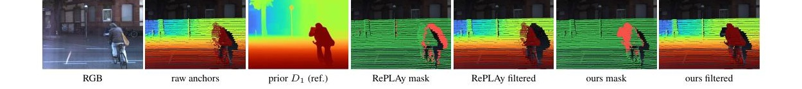
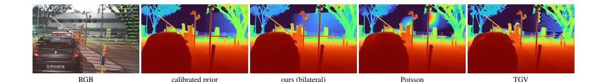
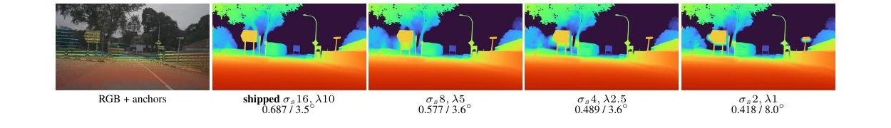
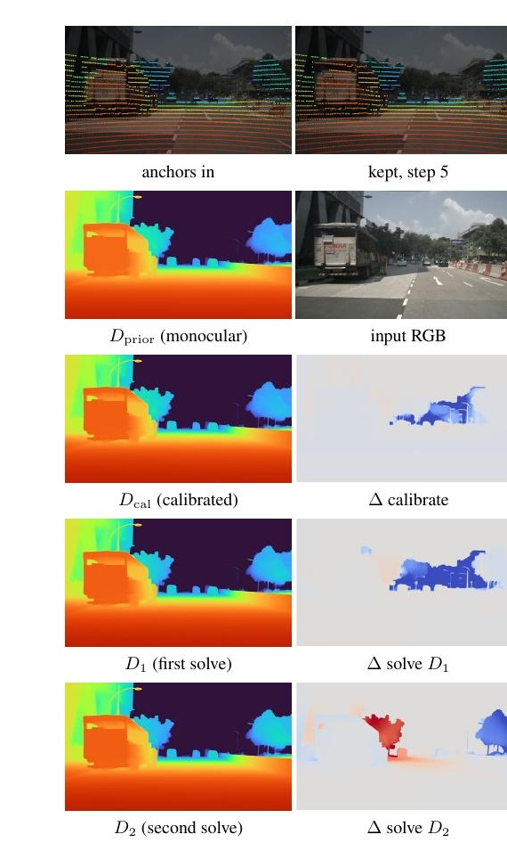
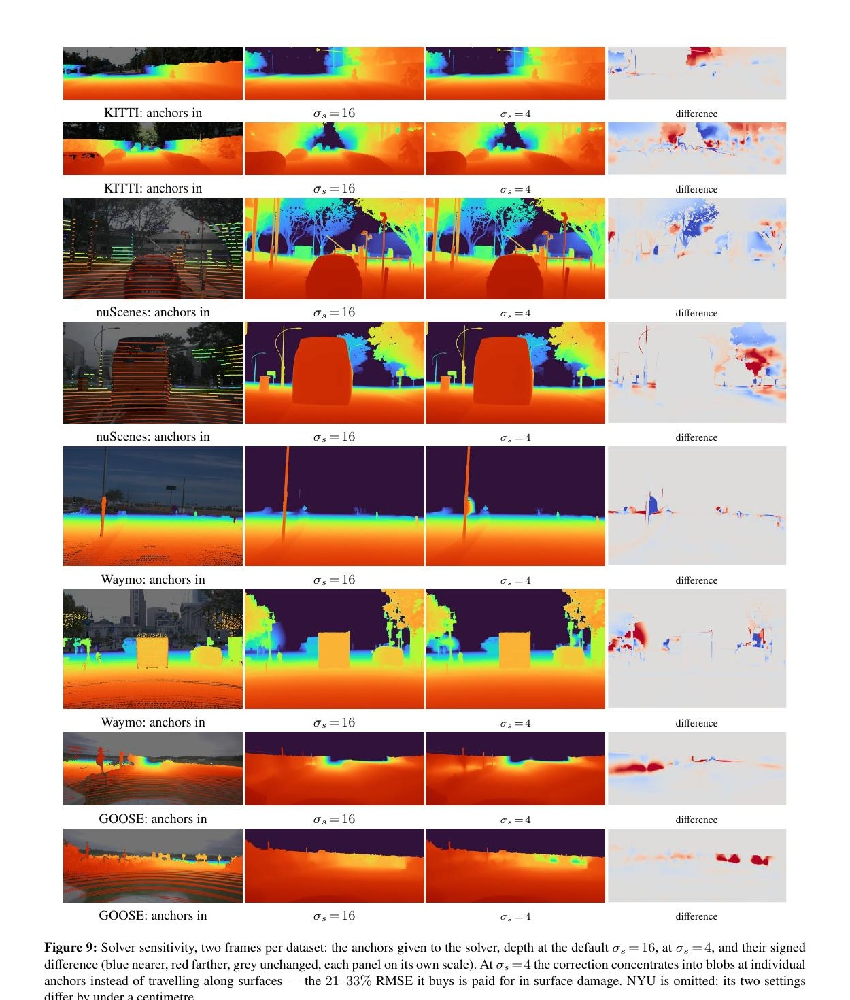
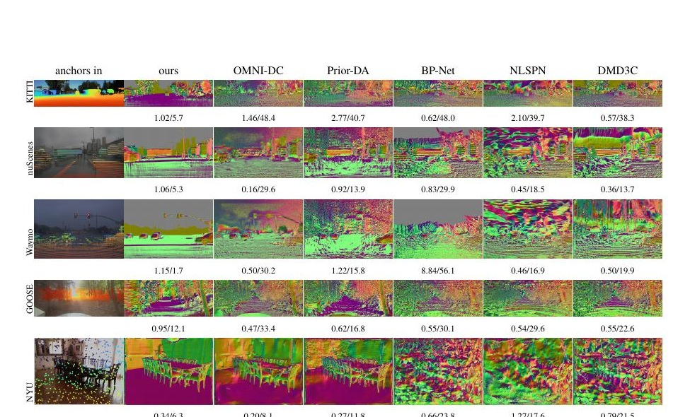
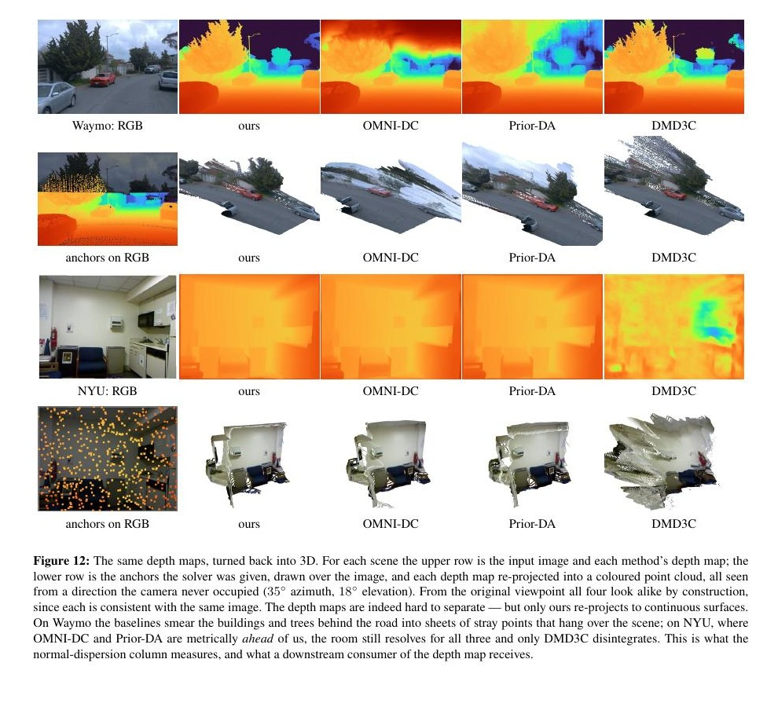

# FounRef 论文解读

> FounRef 用稀疏度量锚点校准冻结的单目深度先验，并在保留先验表面结构的条件下估计局部度量修正。论文为 Dan Halperin、Mirko Mählisch 的 *FounRef: Robust, Structure-Preserving, and Fast Metric Refinement of Frozen Monocular Foundation Priors with Sparse Anchors*。以下以 arXiv v1（2026 年 9 月 24 日）为准。[论文页面](https://arxiv.org/abs/2609.29224) · [PDF](https://arxiv.org/pdf/2609.29224)

## 1. 引言

从单张图像估计米制深度，本身是一个欠约束问题。图像可以提供遮挡、纹理、透视和语义等线索，帮助模型判断物体的相对位置与表面形状，却没有足够信息在任意场景和任意相机条件下唯一确定绝对尺度。近年来的单目基础模型已经能输出锐利边界和较完整的场景结构，但跨越训练域或观察较远区域时，米制距离仍可能存在明显偏差。

另一方面，实际传感器系统常能提供少量直接的米制观测。相机与 LiDAR 组合后，可将激光回波投影到图像中，形成带米制深度的稀疏锚点。它们补上了单目图像缺少的绝对尺度，却没有覆盖锚点之间的表面，而且可能因遮挡、运动、标定误差和时间同步而投影到错误位置。

学习式深度补全把 RGB 图像与稀疏深度共同输入网络，直接回归稠密深度。这条路线能够取得较低的逐点误差，但输出会受到训练数据、相机配置和稀疏深度模式影响。论文进一步强调：逐点误差低不等于表面几何可靠。一个方法可以精确拟合 LiDAR 点，同时把扫描线或锚点附近的局部凸起写入深度图；这些伪影在法线图和侧视点云中比在原深度图中明显得多。

FounRef 将问题拆成两个相对独立的部分：

- 冻结的单目基础模型负责预测稠密结构；
- 稀疏锚点负责校准这些结构的米制位置。

它不训练新的 RGB—稀疏深度映射，而是对每张图像单独估计全局校准和局部修正。论文以 MoGe-2 和 LiDAR 实例化这套框架，先把单目先验映射到米制深度，再利用临时参考表面过滤异常锚点，最后沿先验表面传播保留下来的度量修正。

这使论文关注的目标不再只有 RMSE。作者同时考察度量准确性、表面连续性、跨域稳定性和运行时间，并将 FounRef 定位在这些指标共同构成的经验 Pareto 前沿上。

## 2. 相关工作

### 2.1 单目深度基础模型

Depth Anything V2/V3、Metric3D-V2、UniDepth、Depth Pro 和 MoGe-2 等模型已经能在陌生场景中预测细致的深度或三维几何。它们的结构先验具有较强迁移能力，但米制标定仍会受训练域、相机和距离范围影响，远距离误差尤其明显。

FounRef 不替代这些模型，而是把它们当作可插拔的冻结先验。先验提供完整表面、物体边界和细粒度结构；锚点只补充图像无法可靠确定的米制证据。站内的 [MoGe 论文解读](../moge/index.md)讨论了单目几何中的不可观测自由度，可以作为理解这种分工的背景。

### 2.2 学习式深度补全

深度补全方法从 RGB 图像和稀疏深度预测稠密米制深度。NLSPN 使用非局部传播，CompletionFormer 引入 Transformer 上下文，DMD3C 将单目基础模型的知识蒸馏到深度补全网络；PromptDA、Prior Depth Anything 和 OMNI-DC 则从基础模型条件化或零样本迁移的角度改善泛化。

这些方法学习“图像内容、稀疏观测与输出深度”之间的映射。其优势是能在训练分布内充分拟合数据，限制则是模型可能依赖训练时见过的传感器稀疏模式和场景分布。FounRef 不学习这条映射，而是在推理时显式求解当前图像的度量修正。

### 2.3 优化式深度细化

显式细化方法通常在稀疏观测与平滑正则之间求解一个修正场。Screened Poisson 通过数据项与空间平滑项平衡锚点拟合，二阶总广义变分 \(TGV^2\) 进一步约束修正梯度及其空间变化。Fast Bilateral Solver 则把求解放到低维双边网格中，使修正优先在空间相近、引导值相似的区域传播。

FounRef 采用最后一种思路，但引导量不是 RGB 亮度，而是单目先验的对数深度。这样可以沿预测表面传播修正，并在预测深度边界处停止。

### 2.4 锚点异常处理

投影 LiDAR 可能包含基线引起的遮挡伪影。RePLAY 利用极线几何，从点云投影关系中检测这类问题。FounRef 的目标更宽：它将每个锚点与局部细化后的稠密参考表面比较，从而检测运动、时间累积、跨传感器错位和遮挡等多种不一致。两种方法使用的证据不同，因而并非完全针对同一个异常模型。

## 3. 方法

### 3.1 问题定义与完整流程

给定 RGB 图像 \(I\)，冻结的单目模型输出深度先验 \(D_{\mathrm{prior}}\)，以及模型支持时的有效掩码 \(M\)。稀疏度量锚点记为

$$
\mathcal A=\{(\mathbf u_i,z_i)\}_{i=1}^{N},
$$

其中 \(\mathbf u_i\) 是图像位置，\(z_i\) 是该位置的米制深度。目标是得到稠密米制深度 \(D\)。

论文算法依次执行：

1. 预测冻结的单目深度先验与有效掩码；
2. 将锚点截断在 \(D_{\max}=50\text{ m}\) 内，并按固定方式分成 80% 拟合集和 20% 留出集；
3. 用拟合锚点全局校准先验，得到 \(D_{\mathrm{cal}}\)；
4. 用一次轻量局部求解得到参考表面 \(D_1\)；
5. 将拟合集和留出集中的锚点分别与 \(D_1\) 比较，标记通过筛选的锚点；
6. 只使用通过筛选的拟合锚点进行完整求解，得到最终结果 \(D_2\)。

留出锚点会经过同一一致性筛选，以形成更可靠的评价目标，但不会参与全局校准或局部修正。先验判为无效的像素不参与拟合，最终被赋为最大深度上限。

这里需要区分 \(D_1\) 与 \(D_2\)。二者使用相同类型的局部求解器，主要区别在输入锚点：\(D_1\) 使用尚未过滤的当前扫描锚点，为锚点验证提供局部度量表面；\(D_2\) 使用过滤后的拟合锚点，才是完整方法的输出。

### 3.2 全局单调校准

单目先验首先需要被放入米制深度空间。对每个拟合锚点，论文定义

$$
t_i=\log D_{\mathrm{prior}}(\mathbf u_i),\qquad
y_i=\log z_i.
$$

随后拟合直线

$$
f(t)=\alpha t+\beta
$$

以及稳健目标

$$
(\hat\alpha,\hat\beta)
=
\underset{\alpha,\beta}{\arg\min}
\sum_i
\rho_{\mathrm{Huber}}\bigl(y_i-f(t_i)\bigr).
\tag{1}
$$

作者使用迭代重加权最小二乘求解。对数空间使乘法尺度转化为加法偏移：若 \(z=sD_{\mathrm{prior}}\)，则 \(\log z=\log D_{\mathrm{prior}}+\log s\)。允许 \(\alpha\) 偏离 1，还能拟合随深度逐渐变化的系统偏差。Huber 损失则限制少量大残差对整条校准线的影响。

单一直线不能同时拟合所有距离段。论文将锚点按深度分成 \(K=24\) 个区间，记录直线在每个区间中的平均残差，再插值得到随先验深度变化的小修正 \(c\)：

$$
\log D_{\mathrm{cal}}(\mathbf x)
=
f\!\left(\log D_{\mathrm{prior}}(\mathbf x)\right)
+
c\!\left(\log D_{\mathrm{prior}}(\mathbf x)\right).
\tag{2}
$$

\(K=24\) 是在验证集上选出的最小饱和值。最终映射保持单调，稀疏区间中的修正会被抑制，也不向没有锚点支持的范围外推。锚点过少时只使用 \(f\)，没有锚点时保留原始先验。

全局校准改变的是“某一先验深度应映射到多少米”。相同先验深度会获得相同校正，因此它还不能处理不同图像区域的局部偏差。局部求解器接着估计这种空间变化。

### 3.3 基于参考表面的锚点验证

投影锚点并不都对应当前图像中的可见表面。相机与 LiDAR 的视点差异可能造成投影遮挡，动态物体会在扫描与曝光之间移动，多帧累积还会引入位姿误差和运动拖影。锚点的测距值可以是正确的，它与当前像素的对应关系却可能错误。

直接用 \(D_{\mathrm{cal}}\) 筛点并不充分，因为全局映射仍有局部误差。FounRef 先用当前扫描的拟合锚点进行轻量求解，形成局部更准确的参考表面 \(D_1\)。锚点 \(i\) 满足

$$
\left|
\log z_i-\log D_1(\mathbf u_i)
\right|
\leq \tau
\tag{3}
$$

时才被保留。

对数差衡量相对不一致。两个深度的对数差可写成

$$
\log z_i-\log D_1(\mathbf u_i)
=
\log\frac{z_i}{D_1(\mathbf u_i)},
$$

所以相同深度比例在近处和远处得到相同残差。固定米制阈值则会随着距离增大改变相对容差。

\(\tau\) 由验证工作曲线选定。论文在较干净的 KITTI 上使用 0.45，在噪声更大的 nuScenes 上使用更严格的 0.2。FounRef 无需训练新网络，但筛选阈值仍然依赖数据噪声条件。

\(D_1\) 由待筛锚点参与生成，因此它不是独立真值。这里可以把它理解为先验结构、全局尺度与局部锚点共识共同形成的参考。只要异常点占比较低，稳健权重和空间正则就会限制单个锚点拖动整片表面；与局部共识明显冲突的锚点随后会被式（3）拒绝。论文通过删除点与保留点相对于 KITTI 真值的误差差异检验了这一机制，而没有将 \(D_1\) 本身当作真值。

### 3.4 结构保持的局部修正

局部求解器不重新估计一张独立深度图，而是在校准先验上增加对数深度修正：

$$
\log D(\mathbf x)
=
\log D_{\mathrm{cal}}(\mathbf x)+b(\mathbf x).
\tag{4}
$$

锚点 \(i\) 所要求的修正为

$$
t_i
=
\log z_i-\log D_{\mathrm{cal}}(\mathbf u_i).
\tag{5}
$$

式（5）与式（1）中的 \(t_i\) 复用了同一符号，但含义不同：式（1）中它表示先验的对数深度，式（5）中则表示锚点相对校准先验的对数残差。这是原论文的符号复用，阅读时需要依上下文区分。

论文求解

$$
E(b)
=
\sum_i
w_i\bigl(b(\mathbf u_i)-t_i\bigr)^2
+
\lambda b^\mathsf TLb.
\tag{6}
$$

第一项使锚点位置的修正接近观测残差，\(w_i\) 是锚点置信度。第二项用双边拉普拉斯 \(L\) 约束修正场，\(\lambda\) 控制锚点拟合与平滑之间的权衡。

在原始深度空间中，式（4）等价于

$$
D(\mathbf x)
=
D_{\mathrm{cal}}(\mathbf x)\exp b(\mathbf x).
$$

因此 \(b\) 表示局部乘法修正。论文选择纯 shift field，而没有在每个局部同时拟合 scale-and-shift；这样需要求解的自由度更少，也减少了局部修正重塑先验几何的能力。

### 3.5 双边网格中的传播

\(L\) 构建在由图像位置和先验对数深度组成的双边网格上。两个像素只有在图像位置接近、先验深度也相似时才会强耦合。修正由此沿预测表面传播，并在深度不连续处减弱。

例如，近处杆件与远处背景在图像中相邻，但先验深度差异很大。杆件上的锚点可以沿杆件共享修正，却不会把后方区域一起拉近。这里的边界来自单目先验，而不是 RGB 颜色。作者没有把图像强度加入双边网格，因为它虽然可能改善点误差，也可能把纹理和阴影复制成几何起伏。

实际求解在半分辨率进行。每个 \(2\times2\) 块中的锚点在对数深度中按权重聚合；论文说明这种处理避免来自不同表面的回波被直接平均成一个不存在的中间深度。求出的只有修正场 \(b\)，它被上采样后再施加到全分辨率先验，因此先验细节无需经过低分辨率深度重建。

双边网格经过五次双随机归一化，最终稀疏正定系统使用 Jacobi 预条件共轭梯度法求解。权重 \(w_i\) 结合局部稳健共识与深度相关置信度，使求解器在近处更信任先验，在单目预测开始漂移的距离上增加锚点作用。

## 4. 实验

### 4.1 数据与评价协议

论文在一张 NVIDIA A100 上使用 PyTorch 2.10 与 CUDA 12.8 评测。比较模型分别常驻独立进程，在支持时使用 fp16。五个数据集分别是 KITTI、nuScenes、Waymo、GOOSE 和 NYU Depth V2，每个验证集使用 500 张图像。

KITTI 和 NYU Depth V2 提供整理后的稠密深度目标。nuScenes、Waymo 和 GOOSE 没有同等形式的稠密真值，论文主要在留出的 20% 原始度量观测上评估。为了获得更高覆盖率，作者还累积邻近帧的观测，最多约十帧。

时序累积同时带来动态物体、遮挡、位姿误差与传感器噪声。论文使用独立的 Metric3D-V2 先验筛除明显偏离可见表面的评价点。FounRef 的修正先验是 MoGe-2，评价目标使用另一模型，可以降低评价目标直接偏向本方法先验的风险；但这些目标仍然经过视觉先验筛选，不能等同于人工验证的完整稠密真值。

输入锚点限制在 50 米以内，主表中的 `far` 指 \(30<z\leq50\text{ m}\) 的 RMSE。先验选择实验还报告 \(z>50\text{ m}\) 的误差，用于观察没有局部锚点支持时的外推。

论文同时使用三类指标：

- RMSE、AbsRel 等逐点度量误差；
- 表面法线离散度和频谱指标，用于观察平面噪声与细节；
- 单帧运行时间。

主实验的 `surf.` 是法线离散度。附录进一步说明，它取输出法线与自身 \(15\times15\) 局部均值之间夹角的中位数，用于捕捉大范围表面起伏。求解器对比中的 `surf.` 则描述平滑区域内输出法线相对校准先验法线的中位角。二者都不等于对真值法线的逐像素误差，具体定义需要随表格读取。

### 4.2 单目先验选择

先验决定初始深度、细节结构和大部分总运行时间。论文在相同 KITTI 图像、相同锚点、相同全局校准与局部求解下，比较 MoGe-2、Metric3D-V2、Depth Anything V2/V3、UniDepth-V2 和 Depth Pro。

评价同时考察：

- 稠密目标上的 RMSE、AbsRel 与 50 米外 RMSE；
- 平坦区域的高频能量 `incoh`，越低表示表面越干净；
- 纹理区域的高频能量 `detail`，越高表示保留的细节越多；
- 单帧耗时。

`incoh` 与 `detail` 必须一起解释。一个过度平滑的结果可能同时具有很低的噪声和很低的细节，不能只凭 `incoh` 判断结构更好。

Metric3D-V2 的 RMSE 为 2.76 m，略低于 MoGe-2 的 2.83 m，但其 `detail` 为 0.004，明显低于 MoGe-2 的 0.025。Depth Pro 的 RMSE同为 2.83 m，`incoh` 却达到 0.213，而 MoGe-2 为 0.007。作者据此选择 MoGe-2，理由是它在度量兼容性、干净表面、细节与 49 ms 运行时间之间更均衡，并非因为它在每个单项指标上都最好。

### 4.3 局部求解器选择

为隔离正则项的影响，Fast Bilateral Solver、Screened Poisson 与 \(TGV^2\)-L2 接收逐字节相同的先验、校准结果、锚点和权重，只改变对同一对数残差场的正则化。

在 100 张 KITTI 图像上，双边求解器的 RMSE 为 1.050 m，高于 Screened Poisson 的 0.880 m 和 \(TGV^2\)-L2 的 0.934 m。对应的表面扰动分别为 \(1.77^\circ\)、\(4.75^\circ\) 和 \(6.32^\circ\)，耗时分别为 14、42 和 300 ms。

Poisson 与 TGV 更积极地拟合锚点，因而逐点误差更低；图 4 显示它们会在稀疏锚点周围形成局部凸起。双边求解器接受一定 RMSE 代价，把修正共享到更大的预测表面上，同时降低法线扰动和计算成本。这个实验支持的是准确率、表面结构和速度之间的权衡，而不是双边求解器在逐点误差上优于所有正则化方法。

*原论文图 3。RePLAY 与 FounRef 在同一 KITTI 局部区域上的锚点筛选结果。*

*原论文图 4。双边求解器、Poisson 与 TGV 使用相同校准先验和锚点；Poisson 与 TGV 在锚点附近形成更明显的局部凸起。*

*原论文图 5。空间带宽减小时，修正逐渐局部化，RMSE 降低而法线离散度增大。*

### 4.4 锚点筛选

论文在 KITTI 上比较 FounRef、RePLAY 和由 KITTI 数据处理流程给出的 oracle 筛选结果。单帧情况下，FounRef 删除 2.3% 的锚点；这些删除点相对稠密真值的平均相对误差为 1.08，保留点为 0.04，相差约 27 倍。十帧累积情况下删除比例为 2.2%，删除点与保留点误差为 0.80 和 0.04，相差约 20 倍。

RePLAY 在单帧中删除 4.5%，删除点与保留点的真值误差相差约 12 倍；时序累积时相差约 7 倍。其筛选耗时分别为 452 ms 和 868 ms，FounRef 为 13 ms。结果表明，表面一致性测试能以较小删除比例识别一批高误差锚点，并覆盖纯投影遮挡之外的异常。该实验仅在 KITTI 协议下进行，不能据此断言它对所有 LiDAR 异常都优于几何过滤。

### 4.5 五数据集深度补全结果

主实验让所有方法接收相同锚点，使用公开检查点，不做按数据集重新校准。FounRef 默认配置在 KITTI、nuScenes、Waymo、GOOSE 和 NYU 上的 RMSE 分别为 0.726、0.687、0.745、1.687 和 0.174 m，单帧总延迟为 78 ms。

结果没有显示 FounRef 在所有数据集都取得最低 RMSE：

- KITTI 上 DMD3C 为 0.677 m，优于 FounRef 默认配置的 0.726 m；
- nuScenes、GOOSE 和 NYU 上，OMNI-DC 的 RMSE 分别为 0.353、0.702 和 0.099 m，也低于 FounRef；
- Waymo 上 OMNI-DC 为 0.590 m，接近 FounRef 更激进配置的 0.587 m。

FounRef 的区别主要体现在表面与速度。它在五个数据集上都取得最低法线离散度。以 Waymo 为例，FounRef 为 \(1.7^\circ\)，OMNI-DC 为 \(41.7^\circ\)，DMD3C 为 \(25.6^\circ\)。其 78 ms 延迟也明显低于 OMNI-DC 的 1011 ms、DMD3C 的 1219 ms 和 Prior-DA 的 1621 ms。

摘要中的“最多降低 24% 深度误差、降低 92% 表面法线噪声、接近 15 倍速度”描述的是相对于 DMD3C 的最佳跨域改善幅度，不表示每个数据集和每项指标都同时达到这一比例。

更激进的 \(\sigma_s=4\) 配置将 KITTI、nuScenes、Waymo、GOOSE 和 NYU 的 RMSE 降至 0.663、0.489、0.587、1.073 和 0.164 m，运行时间保持 78 ms。它提高逐点精度，却开始把修正集中到锚点周围。主表中仅轻微变化的中位法线指标没有完整显示这种局部损伤，附录的差分图对此作了补充。

## 5. 附录中的进一步分析

### 5.1 逐阶段消融

附录在 KITTI、Waymo 和 GOOSE 上依次加入全局校准、参考表面 \(D_1\) 和最终表面 \(D_2\)。这部分使用自己的帧子集和评价目标，绝对数字不能与主表直接比较。

KITTI 的 RMSE 从 \(D_{\mathrm{cal}}\) 的 1.407 m 降到 \(D_1\) 的 0.698 m，再降到 \(D_2\) 的 0.567 m；Waymo 从 2.522 m 降到 0.959 m 和 0.826 m。因为两次局部求解的主要差别是第二次只接收筛选后的锚点，\(D_1\) 到 \(D_2\) 的改善反映了锚点筛选带来的收益。

GOOSE 是例外：RMSE 从 3.268 m 降到 \(D_1\) 的 1.101 m，随后在 \(D_2\) 上变为 1.131 m。植被和栅栏后的 LiDAR 回波可能是真实观测，但与图像先验表达的可见前景不一致。筛选规则无法区分“传感器错位”和“先验没有表达的穿透结构”，因此过滤后逐点误差反而略有增加。

*原论文图 7。左列依次为单目先验、全局校准、第一次局部求解和第二次局部求解；右列显示各阶段施加的改变量。顶部给出输入锚点和筛选后保留的锚点。*

### 5.2 锚点密度

附录将锚点保留比例从 100% 逐步降到 1%，每个方法接收同一随机子集。FounRef 的误差在五个数据集上增长为 1.4 至 2.1 倍；DMD3C 增长 2.9 至 12.9 倍，在极稀疏输入下退化明显。

论文将这种差异归因于信息分工：FounRef 的表面结构来自先验，删除锚点主要削弱度量校准；依赖稀疏点回归深度的模型则更依赖输入密度与模式。

OMNI-DC 和 Prior-DA 在 KITTI 或 GOOSE 上出现非单调曲线，删掉部分锚点后误差反而降低。KITTI 的时序点云由逐扫描 ICP 注册，GOOSE 主要使用自车运动累积，动态物体和配准误差会形成错误锚点。稀疏化同时删除一部分污染，使强拟合锚点的模型暂时受益。nuScenes 和 Waymo 使用数据集位姿及逐物体运动补偿，没有出现同样现象。

### 5.3 锚点扰动

作者分别扰动锚点的深度数值与像素投影位置，评价目标保持不变。5% 的乘性深度噪声使各数据集 RMSE 变化约 3% 或更少；在 KITTI 上施加 5 像素投影偏移，则使 RMSE 从 0.832 m 增至 1.624 m。

深度噪声仍作用在大致正确的表面位置上，可以被局部共识和网格聚合减弱。投影偏移会把一个表面的度量深度施加给相邻表面，直接破坏求解器的对应假设。论文据此指出，准确的外参和时间同步仍然重要，表面一致性筛选不能替代传感器标定。

### 5.4 双边网格尺度

双边网格的空间带宽 \(\sigma_s\) 决定修正传播的范围。固定 \(\lambda\) 时，将 \(\sigma_s\) 从 16 降到 4，可使四个室外数据集的 RMSE 改善约 21%–33%，NYU 改善约 6%。继续降到 2 后，Waymo 和 GOOSE 的法线离散度开始明显恶化。

论文仍选择 \(\sigma_s=16\) 作为默认值。图 9 显示，\(\sigma_s=4\) 时修正停止沿道路和立面传播，而在锚点周围形成局部斑块。法线离散度使用中位数，少量锚点斑块不足以显著改变中位数，因此表 7 的指标低估了这种局部损伤。作者明确提出，高分位法线角可能更适合补充衡量该现象。

*原论文图 9。每组从左到右为输入锚点、默认 \(\sigma_s=16\)、更细的 \(\sigma_s=4\) 以及二者差异。较细网格的修正更集中在单个锚点附近。*

这项消融说明 FounRef 的结构保持也依赖工作点。更细的网格更贴近锚点，点误差更低；更粗的网格让多个锚点共享修正，表面更连续。默认设置主动选择了后者。

## 6. 讨论与局限

FounRef 将几何预测与度量对齐解耦，因此可以继承单目先验的跨域结构，同时避免学习固定的 RGB—稀疏深度映射。更换先验、锚点来源或局部求解器时，整体框架不需要重新训练；未来更强的单目模型也可以直接改善其初始结构。

这种模块化也清楚地暴露了能力边界。局部求解器能够移动先验已经表达的表面，不能可靠恢复先验遗漏或错误解释的几何。GOOSE 中的植被和栅栏说明，结构保持是一种归纳偏置：它偏向图像中的连续可见表面，而 LiDAR 可能观测到空隙后的多层结构。对表面重建而言这种偏置可能有利，对需要保留穿透回波的任务则可能增加误差。

方法虽然无需训练，却仍有按数据选择的筛选阈值 \(\tau\)，50 米锚点上限也来自作者对先验可靠距离的设定。超过 50 米的结果主要由全局映射和冻结先验支撑，并没有获得同样的局部度量约束。

评价协议也需要与结果一起理解。KITTI 和 NYU 使用稠密真值，另外三个数据集主要依赖留出点和经视觉先验筛选的时序累积目标。法线离散度擅长识别大范围波纹，但其中位数形式会忽略稀疏的局部锚点斑块。因此，论文的实验支持 FounRef 在给定协议下取得较好的精度—结构—速度平衡，而不是给出对任意传感器和任意表面类型的普遍保证。

*原论文图 11。各列使用相同输入锚点，面板下方给出 RMSE 与法线离散度。部分深度补全网络把 LiDAR 扫描模式复制成了道路和立面上的高频几何。*

*原论文图 12。相近的正视深度图从未观测方向查看时差异明显；连续表面、悬浮点和深度波纹会直接传递给下游三维任务。*

## 7. 结论

FounRef 用全局单调映射修正冻结单目先验的米制尺度，用局部参考表面筛除跨传感器不一致的锚点，再通过双边网格将保留下来的修正沿预测表面传播。整个过程不重新训练单目模型，也不要求优化器重新生成场景结构。

论文最重要的结论是，稠密米制深度需要同时评价逐点准确性、表面连续性与运行成本。更积极地拟合锚点可以继续降低 RMSE，却可能暴露稀疏测量模式；更强的结构保持则会接受一定点误差。FounRef 默认配置选择保留连续表面，并用较低延迟获得跨五个数据集相对稳定的结果。

## 参考文献

- Halperin, D., Mählisch, M. [*FounRef: Robust, Structure-Preserving, and Fast Metric Refinement of Frozen Monocular Foundation Priors with Sparse Anchors*](https://arxiv.org/abs/2609.29224). arXiv:2609.29224v1, 2026.
- Barron, J. T., Poole, B. [*The Fast Bilateral Solver*](https://arxiv.org/abs/1511.03296). ECCV 2016.
- Zhu, S., et al. [*RePLAY: Remove Projective LiDAR Depthmap Artifacts via Exploiting Epipolar Geometry*](https://arxiv.org/abs/2407.19154). 2024.
