# GaussianShader 论文解读

> Yingwenqi Jiang、Jiadong Tu、Yuan Liu、Xifeng Gao、Xiaoxiao Long、Wenping Wang、Yuexin Ma，*GaussianShader: 3D Gaussian Splatting with Shading Functions for Reflective Surfaces*，CVPR 2024，页码 5322–5332。本文依据 CVPR 正式版及补充材料。[CVF 论文页](https://openaccess.thecvf.com/content/CVPR2024/html/Jiang_GaussianShader_3D_Gaussian_Splatting_with_Shading_Functions_for_Reflective_Surfaces_CVPR_2024_paper.html) · [论文 PDF](https://openaccess.thecvf.com/content/CVPR2024/papers/Jiang_GaussianShader_3D_Gaussian_Splatting_with_Shading_Functions_for_Reflective_Surfaces_CVPR_2024_paper.pdf) · [补充材料 PDF](https://openaccess.thecvf.com/content/CVPR2024/supplemental/Jiang_GaussianShader_3D_Gaussian_CVPR_2024_supplemental.pdf) · [项目页](https://asparagus15.github.io/GaussianShader.github.io/) · [代码](https://github.com/Asparagus15/GaussianShader)

3D Gaussian Splatting（3DGS）主要通过优化高斯的颜色和形状来复现训练图像。这样的表示能快速渲染，但当场景里有金属、釉面或其他强反射材质时，单靠每个高斯的球谐颜色很难解释高光为何会随视角变化，也难以把材质本身与环境光分开。GaussianShader沿着逆渲染的思路，为高斯增加漫反射颜色、镜面色调、粗糙度、法线和残差颜色，并用一个可学习环境光贴图估计直接镜面照明。

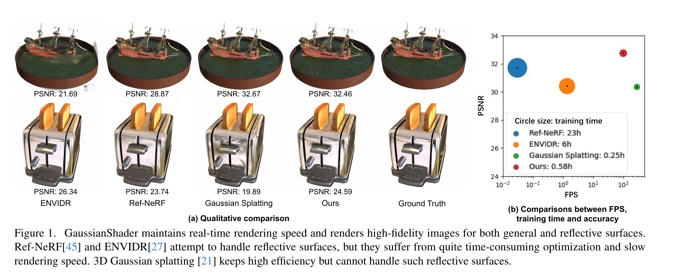

*原论文 Figure 1。上方比较反射船只，下方比较烤面包机；右侧散点图同时呈现 PSNR、FPS 与训练时间。GaussianShader在这些反射对象上比原始3DGS更能还原视角相关外观，同时保留实时渲染能力。*

## 从拟合颜色转向解释光与表面

普通3DGS给每个高斯存储随方向变化的SH颜色，模型可以把外观直接拟合到图像上，却没有显式表示光照与表面属性。于是面对一个反光茶壶时，训练数据里的亮斑可能被记进颜色系数；相机换个角度，模型未必能按光线与表面朝向的关系重新生成亮斑。

GaussianShader把一个高斯的出射颜色拆成四部分：与视角无关的漫反射颜色 $\mathbf{c}_d$、镜面色调 $\mathbf{s}$、由表面法线和粗糙度决定的直接镜面光 $L_s$，以及吸收复杂残余变化的视角相关颜色 $\mathbf{c}_r$：

$$
\mathbf{c}(\boldsymbol{\omega}_o)=\gamma\left(\mathbf{c}_d+\mathbf{s}\odot L_s(\boldsymbol{\omega}_o,\mathbf{n},\rho)+\mathbf{c}_r(\boldsymbol{\omega}_o)\right).
\tag{3}
$$

$\boldsymbol{\omega}_o$ 是观察方向，$\mathbf{n}$ 是表面法线，$\rho\in[0,1]$ 是粗糙度，$\odot$ 表示逐通道相乘。$\gamma$ 是论文所用的色调映射函数。镜面色调 $\mathbf{s}$ 表示表面本身对不同颜色的反射偏好，$L_s$ 则表示环境光在当前几何和视角下贡献了多少镜面亮度。两者分开后，模型可以改变照明而保留表面颜色。残差 $\mathbf{c}_r$ 用三阶 SH 表示，用来补偿简化的直接光模型解释不了的间接反射和散射；补充材料说明，这个分支在训练前期先关闭，后期再加入细化。

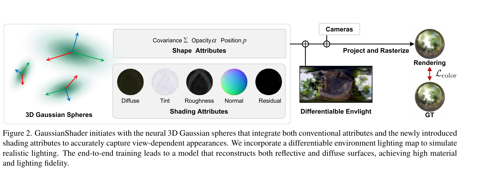

*原论文 Figure 2。每个高斯保留位置、协方差和不透明度等几何属性，同时携带漫反射、色调、粗糙度、法线与残差等着色属性；环境光图参与端到端优化。*

这是一种简化的着色模型，而非完整的路径追踪。作者把镜面照明写成环境光在上半球上的积分：

$$
L_s(\boldsymbol{\omega}_o,\mathbf{n},\rho)=
\int_{\Omega} L(\boldsymbol{\omega}_i)D(\mathbf{r},\rho)(\boldsymbol{\omega}_i\cdot\mathbf{n})\,d\boldsymbol{\omega}_i.
\tag{4}
$$

$L(\boldsymbol{\omega}_i)$ 是从入射方向 $\boldsymbol{\omega}_i$ 来的环境光，$D$ 是 GGX 微表面模型的法线分布函数，$\mathbf{r}=2(\boldsymbol{\omega}_o\cdot\mathbf{n})\mathbf{n}-\boldsymbol{\omega}_o$ 是反射方向。粗糙表面把较多能量摊到反射方向附近较宽的区域，光泽表面则形成更窄的亮瓣。因此 $D$ 和积分范围会随粗糙度变化。

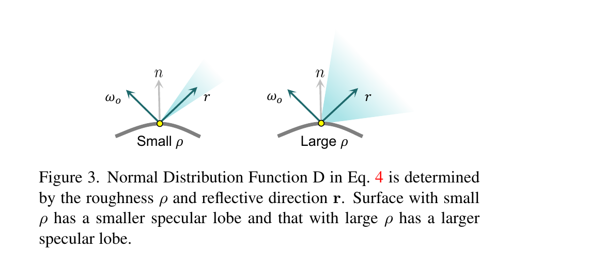

*原论文 Figure 3。较小粗糙度对应集中、狭窄的镜面瓣；较大粗糙度会把响应扩展到反射方向周围更宽的范围。*

环境光使用每个场景一张可训练的 $6\times64\times64$ 立方体贴图。为了快速查询不同粗糙度下的积分结果，论文先把环境光预处理成多级 mipmap，每一级记录不同反射方向和粗糙度所需的积分值；渲染时再根据反射方向与粗糙度在这些层级间插值。这样避免为每个可见高斯逐次采样整片环境半球，也比用方向 MLP 隐式表示照明更适合该光栅化框架。

这个设计在训练后可以切换环境光贴图，对应补充材料中的重新打光结果。不过它只显式近似直接镜面照明，复杂的间接反射仍由残差项承担；因此重新打光有明确的分解基础，但不等于场景所有光传输都被物理准确地恢复。

## 从高斯短轴估计表面法线

上述着色计算依赖法线，而3DGS由离散的高斯椭球组成，没有连续网格可直接求法线。论文观察到，优化中的高斯逐渐变扁，三个主轴中最短的轴会接近局部表面法线方向。作者因此取短轴方向 $\mathbf{v}$ 作为法线初值，再为每个高斯学习一个小的法线残差 $\Delta\mathbf{n}$：

$$
\mathbf{n}=
\begin{cases}
\mathbf{v}+\Delta\mathbf{n}_1,&\boldsymbol{\omega}_o\cdot\mathbf{v}>0,\\
-(\mathbf{v}+\Delta\mathbf{n}_2),&\text{otherwise}.
\end{cases}
\tag{5}
$$

短轴正负方向有歧义：它可能朝向表面外侧，也可能朝内。模型针对两种方向分别学习残差，并按照观察方向与短轴的夹角选择当前使用的一支。残差受到平方惩罚，避免预测法线偏离高斯形状太远。

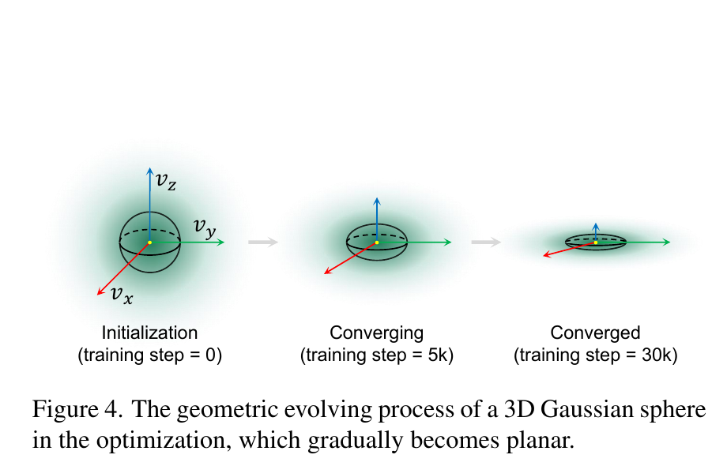

*原论文 Figure 4。高斯从近似球形逐渐收敛为扁平形状，作者据此使用最短主轴作为局部法线的起点。*

仅依赖颜色误差分别训练每个高斯的法线，可能让相邻高斯各自找到能解释训练图像、却彼此不一致的方向。为此，论文把每个高斯预测的法线渲染成法线图，再将它与深度图经过 Sobel 类算子得到的几何梯度法线比较：

$$
\mathcal{L}_{\text{normal}}=\left\|\bar{\mathbf{n}}-\hat{\mathbf{n}}\right\|^2.
\tag{7}
$$

$\bar{\mathbf{n}}$ 是渲染得到的预测法线图，$\hat{\mathbf{n}}$ 是从渲染深度图计算出的局部几何法线。前者来自高斯各自携带的法线属性，后者来自许多高斯合成的深度表面。让两者接近，就能借助整个局部表面的形状来约束单个高斯的法线，不必在动态变化的高斯集合上反复做近邻搜索。

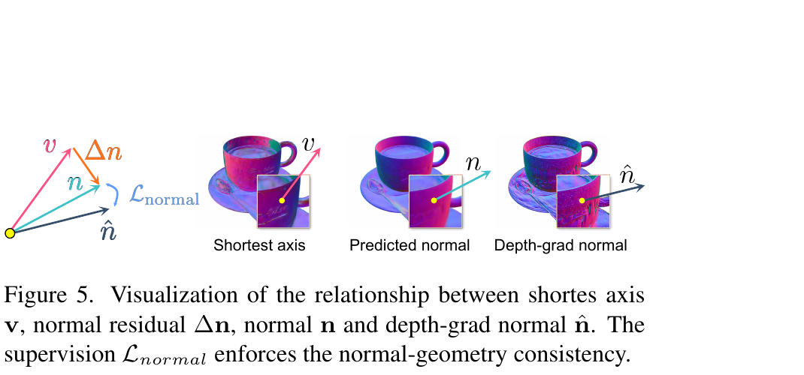

*原论文 Figure 5。法线损失把单个高斯的短轴与残差预测，同由渲染深度反映的局部表面方向联系起来。*

训练总损失还包括颜色重建、法线一致性、法线残差正则和不透明度稀疏项。稀疏损失推动高斯不透明度靠近 0 或 1，使有效高斯更接近薄片状表面；这会让高斯形状和法线估计更适合着色。论文使用的权重分别为 $\lambda_n=0.01$、$\lambda_s=0.001$、$\lambda_r=0.001$。这里的几何仍然是从多视图图像拟合出的高斯表面，并非带有拓扑保证的显式网格。

## 反射场景的质量提升与速度折中

论文在 NeRF Synthetic、Shiny Blender、Glossy Synthetic 和 Tanks and Temples 等数据集上评估渲染质量。NeRF Synthetic 主要说明着色分解没有明显破坏一般场景的拟合：表中平均 PSNR 从原始 3DGS 的 33.30 dB 变为 33.38 dB，LPIPS 从 0.030 变为 0.029；SSIM 则从 0.969 变为 0.968，略有下降。因此它的优势主要应在镜面材质上观察，而不是把每项指标都理解成普遍提升。

在反射物体为主的 Shiny Blender 上，GaussianShader 的平均 PSNR 为 31.94 dB，原始 3DGS 为 30.37 dB；平均 LPIPS 从 0.083 降至 0.068。它优于3DGS，但 PSNR 仍低于 Ref-NeRF 的 32.32 dB 和 ENVIDR 的 32.88 dB。误差图和茶壶、汽车等例子显示，改善集中在高光明显的局部区域。

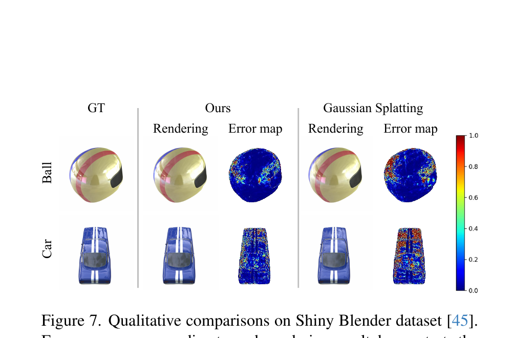

*原论文 Figure 7。球体和汽车的误差图显示，GaussianShader 在强镜面区域比原始3DGS具有更低的重建误差。*

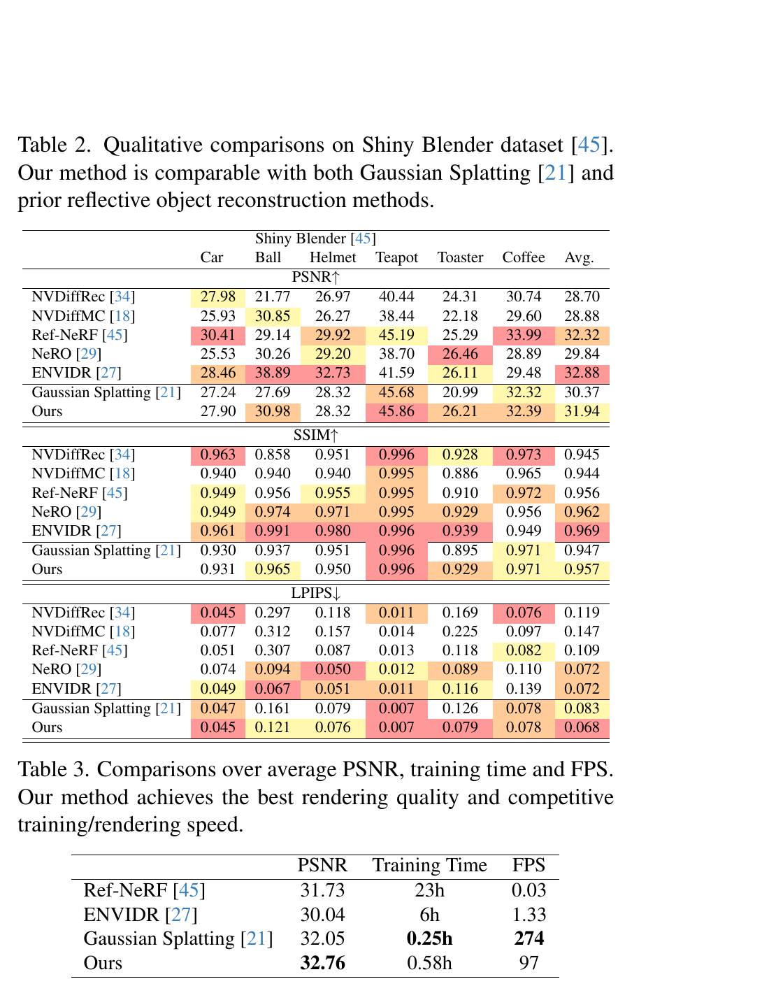

*原论文 Tables 2、3。Table 2 列出 Shiny Blender 各物体的 PSNR、SSIM 与 LPIPS；Table 3 汇总 Shiny Blender 和 NeRF Synthetic 的平均 PSNR、训练时间及帧率。*

在与原始3DGS的平均效率对照中，GaussianShader 的 PSNR 从 32.05 dB 提升至 32.76 dB，训练时间由 0.25 小时增至 0.58 小时，帧率由 274 降至 97 FPS。设置为 RTX 3090、每场景 30,000 次迭代。这仍属于实时渲染，但额外着色属性和环境光计算确实增加了训练、推理成本。

Glossy Synthetic 的补充实验更直接地针对镜面材质：平均 PSNR 从 26.26 dB 提升到 27.36 dB，LPIPS 从 0.085 降至 0.080。Tanks and Temples 以漫反射物体居多，论文报告的收益较小；这符合该方法重点改善反射外观的设计目标。

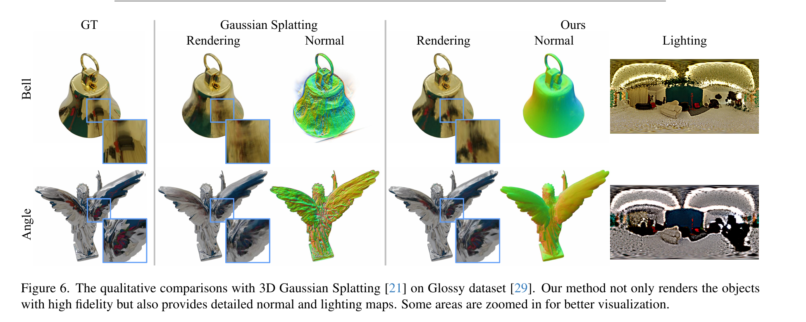

*原论文 Figure 6。除了 RGB 结果，GaussianShader 还输出法线和照明图；这让优化出的外观分解能够被查看，也支撑了后续重新打光。*

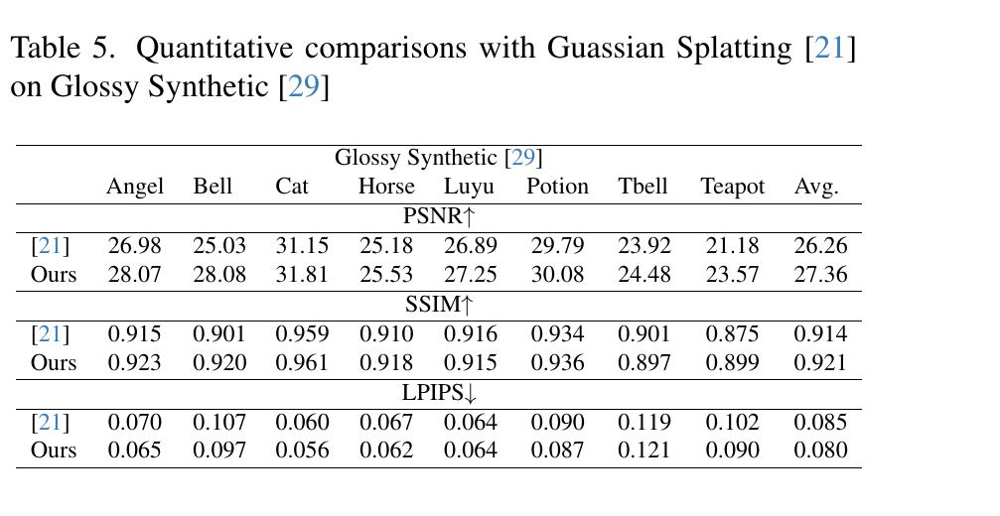

*补充材料 Table 5。Glossy Synthetic 的平均 PSNR、SSIM 与 LPIPS 均比原始3DGS有所改善；不同物体的变化幅度并不相同。*

## 消融说明法线约束和光照分解的作用

Shiny Blender 上的消融结果显示，去掉法线一致性损失后 PSNR 从 32.09 降到 30.93 dB；去掉环境光图、改用方向 MLP 后降到 29.73 dB。去掉法线短轴先验或残差颜色也会降低指标。这些对照支持两点：可用的法线需要与整体几何保持一致；显式环境光表示比单纯让方向 MLP 隐式拟合照明更适合这套高斯渲染框架。

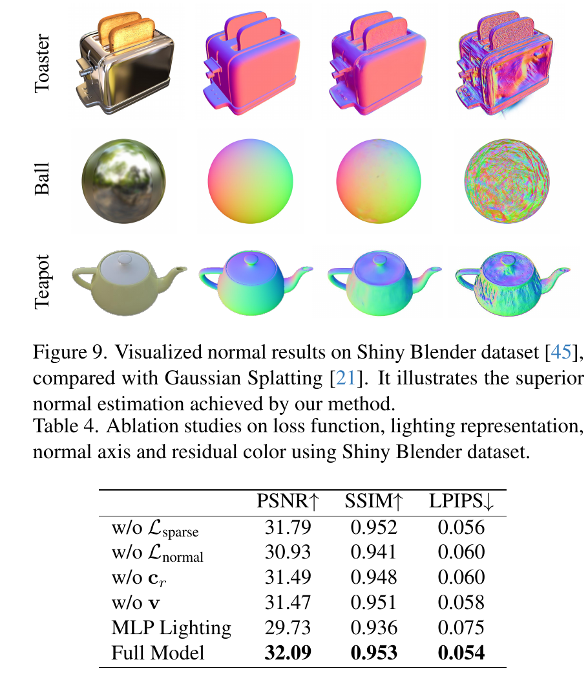

*原论文 Figure 9 与 Table 4。上方对比预测法线与3DGS法线图；下方消融表显示法线损失、环境光表示、短轴先验和残差颜色对 Shiny Blender 结果的影响。该组消融在半分辨率上进行。*

补充材料进一步展示了四种环境光下的重新打光：同一批物体在室内暖光、室内偏冷光和户外环境中呈现不同高光。这是外观分解比直接存储方向颜色更有解释力的地方。不过，模型依然受到输入视图覆盖和简化反射模型的约束；论文没有证明任意未见环境下都能恢复真实 BRDF，也没有完整处理多次反射。

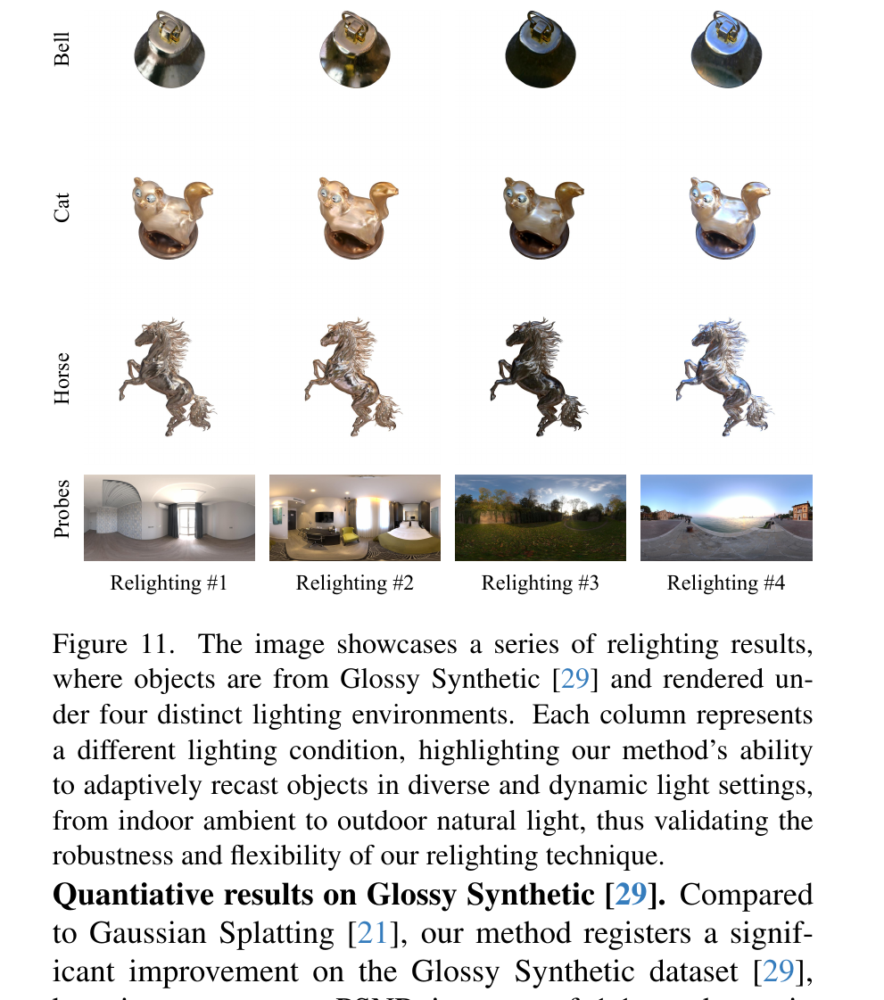

*补充材料 Figure 11。Glossy Synthetic 中的钟、猫形摆件和马分别在四种环境光下渲染，亮斑随照明变化而改变。*

## 和 Spec-Gaussian 的方法关系

前一篇解读的 Spec-Gaussian 用 ASG 特征增强视角相关高光的表达，镜面外观由潜在特征和 MLP 解码；GaussianShader则显式预测粗糙度、法线和环境光，再用简化着色函数合成直接镜面项。这两条路线分别偏向更强的方向外观拟合，以及更明确的光照—材质分解。后者因此可以输出法线、照明并展示重新打光，但要承担额外属性和照明查询成本。两者都是面向高光质量的3DGS扩展，解决问题的层次不同。

总体来看，GaussianShader把高光从“随视角变化的颜色”推进到“法线、粗糙度和环境光共同决定的着色结果”，并用深度梯度约束弥补离散高斯没有连续表面的困难。它在反射物体上明显改善了原始3DGS的质量，同时保留实时性；但完整物理反射、一般场景下的全面指标提升和原始3DGS级别的渲染速度都不是论文结果所能支持的结论。
