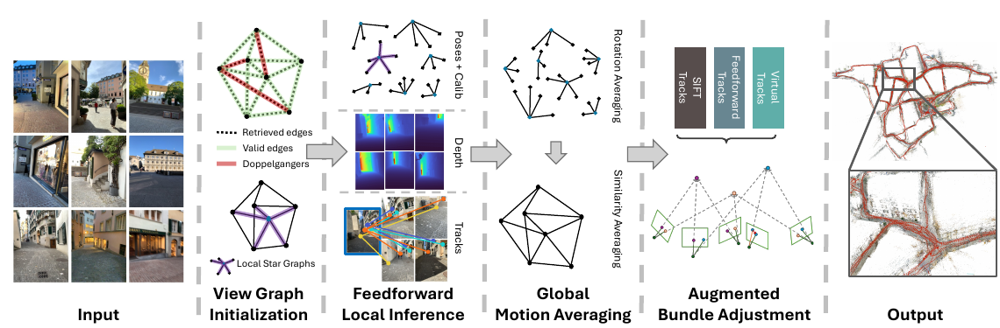
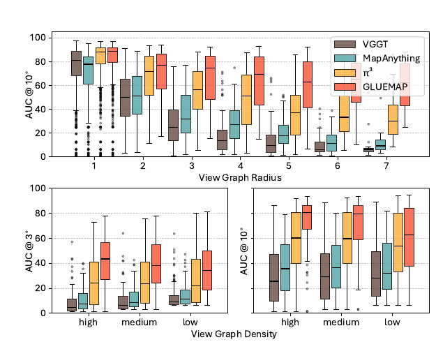
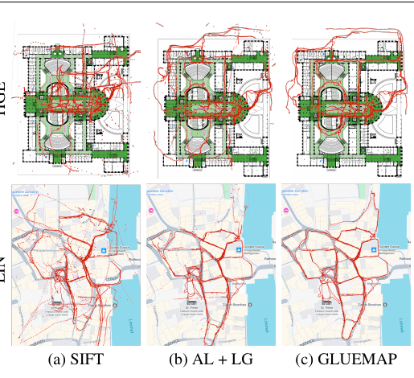

# GLUEMAP 论文解读

> *Global Structure-from-Motion Meets Feedforward Reconstruction*（Linfei Pan、Johannes Schönberger、Marc Pollefeys，CVPR 2026 Highlight，arXiv v2）提出 GLUEMAP：前馈模型估计局部星形图中的几何，全局 SfM 通过运动平均和增广 BA 合并位姿、尺度与匹配轨迹。[论文页面](https://arxiv.org/abs/2605.26103v2) · [PDF](https://arxiv.org/pdf/2605.26103v2)

无序图像集合的 SfM 同时依赖可靠对应和视图图连通性。重复结构容易造成错连，弱纹理和低重叠又可能导致轨迹不足；即使后端优化能够调整位姿，也需要先获得足以连接场景的观测。

多视图前馈模型能直接预测局部位姿和深度，为难以建立轨迹的照片提供几何线索。但把整组照片送入多视图 Transformer 受显存限制；即使能运行，大量弱相关视图也可能干扰估计。论文实验中，增加输入照片有时反而降低位姿精度。

GLUEMAP 把前馈推理限制在局部星形图，再用全局优化合并各组结果。输入是无序照片，输出是已注册相机的内参与位姿，以及场景三维点；无法与主场景可靠连接的照片可能被舍弃。下面以三张照片的局部连接说明各阶段的输入输出。

*图 1　裁自论文图 2。沿箭头从左往右看：先找可能拍到同一场景的照片，并围绕每张照片组成小组；再预测每组的相机和深度；最后把各组放进同一坐标系，用图像对应点和预测的对应关系一起调整结果。下文会逐步解释图中的星形图、轨迹和 BA。*

## 局部前馈与全局优化的分工

增量式 SfM 逐步注册照片，全局 SfM 则先汇集相对关系，再共同求解相机。GLUEMAP 采用后一种骨架：局部模型生成大量相互重叠、却各有尺度的相机预测，全局求解负责把它们统一到同一坐标系。

前端仍是关键：弱纹理和低重叠让可用轨迹稀少，相似走廊或对称建筑则会制造错误边。纯旋转、远景等两视图退化情形，也难以从经典相对位姿估计中获得可靠平移与尺度。GLUEMAP 需要在这些关系不稳的地方引入局部前馈估计，同时防止错误邻居进入局部推理。

已有逐张处理的前馈方法受输入顺序和早期错误影响，整组处理的方法又受显存及弱相关视图影响。GLUEMAP 只让模型处理**局部星形图**：每次估计中心照片及其邻居的几何，再通过全局运动平均统一旋转、位置和尺度，最后做增广束调整（BA）。

## 视图图筛选与局部星形图

用三张照片举例。A 和 B 拍到同一段走廊，B 和 C 拍到转弯处；A 和 C 实际看不到同一片区域，却因为两段走廊长得像，被检索系统误判为可能重叠。理想的连接是 A-B、B-C，不应有 A-C。这个例子只用于解释流程，并非论文里的实验样本。

若逐一检查所有照片对，$n$ 张照片需要接近 $n^2$ 次比较。GLUEMAP 先用 SALAD 为每张照片检索固定数量 $c$ 的候选邻居，把候选规模控制在约 $O(cn)$；再用 Doppelgangers++ 排查外观相似却不重叠的候选对。构图时，系统先只接纳得分超过 $0.8$、能够连起两个独立分量的边；如果视图图还没连通，就每次降低 $0.1$ 的阈值继续尝试。阈值降到 $0.2$ 以下仍连不起来时，只保留最大连通分量。

回到三张照片，筛选后只剩 A-B、B-C。以 A、B、C 为中心的星形图分别包含 {A,B}、{A,B,C}、{B,C}；星形图只要求中心与邻居相连。B 在几个局部重建中重复出现，后面就能用这些共同观测对齐结果。中心节点若有超过 25 个邻居，系统只保留 Doppelgangers++ 得分最高的 25 个。

为什么只看直接相连的邻居？中心与这些照片更可能拍到同一片场景，后面预测的对应点也更容易成立。把图上距离更远的照片塞进同一次推理，会增加计算量，还可能拉低局部估计质量。跨走廊、跨房间的关系留给全局优化处理。照片拍得很密时，这种一跳小组可能会重复覆盖相似画面；论文把如何自适应调整范围留给后续研究。

到这里还没有恢复三维结构，但每次前馈推理该看哪些照片已经确定；小组之间有哪些共同照片，也已经确定。

## 局部前馈几何与共视率

每个小组分别交给已训练的多视图模型 $\pi^3$，预测组内相机的位姿、焦距和深度图；VGGSfM 的跟踪推断则给出同一个场景点在各张照片里的像素位置，这些位置连起来称为“轨迹”。B 组一次处理 A、B、C，A 组和 C 组各处理两张。论文比较了几种前馈主干，$\pi^3$ 的局部估计整体更好，因此选用它。GLUEMAP 的新意主要在于怎样筛选、拼合和优化这些已有模型的输出，并没有另行训练一个叫 GLUEMAP 的网络。

这三次推理彼此独立，每个小组都有自己的坐标系和尺度。B 会在三个小组中各出现一次，预测的位置不一定相同。轨迹也可能重复：两个小组在同一张照片上找到了同一个点，却各给它一个编号。作者用 SIFT 关键点做对齐：预测位置距某个关键点不超过 $1$ 像素时，就把它吸附到该点；吸附到同一关键点的轨迹随之合并。这样既能让不同小组认出同一条轨迹，也保留了最后 BA 所需的传统特征轨迹。

有了局部预测，还要再检查一次邻居是否真的可靠。仅凭外观筛选，仍可能把看起来相像、实际几乎不重叠的照片放进同一组。作者利用刚预测的深度做往返检查：从照片 $i$ 的像素 $(x,y)$ 出发，按深度 $D_i(x,y)$ 找到对应三维点；把它投到照片 $j$，再用 $j$ 的深度找回三维点，最后投回 $i$。若回来的位置 $(x'',y'')$ 接近起点，两张照片在这个位置的几何预测就是一致的。起点的三维位置和最终像素误差写成

$$
X_i=D_i(x,y)\,\Pi_i^{-1}(x,y),\qquad
\epsilon_{i\to j}
=\left\|(x,y)^{\mathsf T}-(x'',y'')^{\mathsf T}\right\|_2.
$$

$\Pi_i^{-1}$ 根据相机内参把像素变成一条射线；深度决定点在射线上的位置。把往返误差小于阈值 $\tau$ 的像素数，除以照片 $i$ 的像素总数，就得到从 $i$ 看向 $j$ 的原始重叠率 $\tilde o^l_{ij}$。上标 $l$ 表示这次测量来自以 $l$ 为中心的小组。从 $j$ 出发反向计算，比例不一定相同。

两张照片直接重叠不多，却可能通过第三张照片建立较强联系。论文把连接 $i$ 与 $j$ 的每条路径上的重叠率相乘，再取这些路径中最大的乘积：

$$
o^l_{ij}
=\max_{\tilde O\in\mathcal O_{ij}}
\prod_{(p,q)\in\tilde O}\tilde o^l_{pq}.
$$

例如在 B 组里，假设模型给 A-C 的直接重叠率估为 $0.3$，A-B 为 $0.8$、B-C 为 $0.7$，那么 A 经 B 到 C 的路径得分是 $0.8\times0.7=0.56$，高于直接路径。这里的 $0.56$ 表示两张照片经 B 建立联系的可靠程度，**不表示 A 和 C 有 56% 的画面直接重叠**；它们仍可以没有初始连接。这些数字只是讲解用例。论文删除共视率低的边，但会保留那些一旦删除就会让视图图断开的边；留下的共视率还将决定后面全局优化中各条测量的权重。

两次筛选看的是不同证据：Doppelgangers++ 用图像外观排除明显的假连接，深度检查则看局部预测在几何上能否相互印证。一对照片即使看着相像，只要往返投影大多对不上，后面的优化就不该过分相信它们之间的关系。

现在每个小组都有了相机位姿、深度、焦距、轨迹，以及照片之间的可靠程度。但 B 在三个小组中仍有三个位置；要形成一张地图，必须把它们统一起来。

## 运动平均与局部坐标系对齐

先统一焦距：同一台物理相机可能在多个小组中得到不同预测，GLUEMAP 取其中位数。再统一朝向。每个小组都给出了相机 $i$ 到 $j$ 的相对旋转 $R^l_{ij}$；如果全部相机共用一套全局朝向 $R_i,R_j$，这段相对旋转就应接近 $R_jR_i^{\mathsf T}$。作者让可靠边的误差尽量小，并用 Huber 损失减弱明显冲突的预测：

$$
\min_{\{R_i\}}\sum_{(i,j)\in E}
\rho\!\left(
o^l_{ij}\,d\!\left(R^l_{ij},R_jR_i^{\mathsf T}\right)
\right).
$$

这里 $d$ 是两个朝向之间的旋转角，$\rho$ 表示 Huber 损失。A 组和 B 组都会预测 A 相对 B 转了多少度，结果可能相差几度。旋转平均要找到一套 A、B、C 的朝向，尽量兼顾这些预测；共视率低或冲突过大的预测影响较小。

统一相机位置还要处理尺度。同一小组中，各段相机间距离可以相互比较；不同小组却可能把同一段距离预测成不同数值。因此作者给**每个小组一个尺度 $s_l$**，让组内所有位移一起换算。局部预测的平移 $t^l_{ij}$ 与全局相机中心 $c_i,c_j$ 的关系是

$$
t^l_{ij}=s_l R^l_{ij}(c_i-c_j).
$$

系统联合求解全局相机中心 $c_i$ 和各组尺度 $s_l$，并固定一个参考组的 $s_0=1$ 以消除整体尺度自由度。优化目标把所有小组中的相机对放在一起：

$$
\min_{\{c_i\},\{s_l\}}
\sum_l\sum_{(i,j)\in S_l}
o^l_{ij}\,
d\!\left((R^l_{ij})^{\mathsf T}t^l_{ij},
s_l(c_i-c_j)\right),
\qquad s_0=1.
$$

式中 $S_l$ 是以 $l$ 为中心的小组中的连接，$d$ 衡量局部位移换算后与全局位移的差异；论文主文没有展开它的具体形式。求解时先按共视率挑出一棵最大生成树，用较可靠的连接搭起初始骨架，再调整所有相机与尺度。

用一条直线上的三个位置就能看出尺度为什么必须按组设置。假设全局 A、B、C 位于 $0,1,2$：A 组把 A-B 的距离记成 $1$，B 组把 A-B 和 B-C 都记成 $2$，C 组把 B-C 记成 $4$。分别给三个小组 $s_A=1,s_B=2,s_C=4$，它们就都对应同一组全局位置。真实方法求的是三维相机中心；这里的数字只用来解释尺度变量。

深度也随所在小组的尺度一起换算：$\tilde D_i^l=D_i^l/s_l$。至此，相机的全局朝向与位置、处在统一尺度下的深度都已准备好，下一步可以继续精修。传统相似变换平均常从有噪声的三角化结果为每条边分别估尺度；GLUEMAP 则利用前馈模型在一个小组内给出的、彼此一致的位移。

## 增广 BA 与虚拟轨迹

标准 BA 依赖足够多、跨度足够长的真实特征轨迹。弱纹理使轨迹难以建立，低重叠则限制轨迹能跨越的视图数；即使匹配器完全正确，某些相机仍可能缺少足够约束。GLUEMAP 的增广 BA 就是为这类缺口设计的。

前面的局部模型已经预测了深度和相机之间的位置关系，GLUEMAP 用它们补上这类缺口。在中心照片 $l$ 中取一个像素，按统一尺度下的深度求出三维点，再算它应该投到邻居 $m$ 的哪里。比如从 B 照片的一个像素出发，就能预测它在 A、C 上的位置。A、C 未必真的检测到了对应关键点；这条轨迹表达的是模型对几何的估计。

同一个三维点可以按两套相机位置投影：一套来自局部前馈预测，一套来自刚完成的全局优化。论文两套都保留：

$$
\begin{aligned}
V^l_{l\to m}
&=\Pi_m\!\left(
R^l_{lm}\left(
\tilde D_l^l(x,y)\Pi_l^{-1}(x,y)-c^l_{lm}
\right)\right),\\
\tilde V^l_{l\to m}
&=\Pi_m\!\left(
R_m\left(
R_l^{\mathsf T}\tilde D_l^l(x,y)\Pi_l^{-1}(x,y)+c_l
\right)-c_m\right).
\end{aligned}
$$

$\Pi_l^{-1}$ 把中心像素变成相机射线，$\Pi_m$ 把三维点投到邻居照片上；$c^l_{lm}$ 和 $R^l_{lm}$ 来自局部预测，$c_l,c_m,R_l,R_m$ 来自全局运动平均。前一套轨迹保留了局部模型的判断，后一套保留了刚建立的全局相机关系。假如优化把 B 和 C 拉得过远，B 上某个点在 C 中的投影就会偏离先前生成的虚拟位置；这段偏差会把两台相机往预测所支持的关系拉回去。论文约采样 100 条虚拟轨迹，其中约 10% 按全局位姿生成；这一比例越高，最后的 BA 结果通常越接近运动平均的结果。

这些位置是模型算出的**虚拟观测**，并不表示邻居照片中真的拍到了那个点。它们的作用是把局部模型预测的相机关系写成 BA 可以优化的约束，因此论文允许投影落在照片边界之外，也允许三维点位于邻居相机后方；只有与成像平面重合、计算不稳定的观测会被忽略。BA 最终使用三类轨迹：SIFT 特征轨迹、学习式跟踪轨迹，以及刚构造的两套虚拟轨迹。前两类轨迹的三维点由三角化得到，虚拟轨迹的点来自采样深度。它们都以重投影误差约束相机，但前两类使用 Huber 鲁棒损失，虚拟轨迹使用 Arctan 鲁棒损失，以降低错误预测的影响。

三类轨迹进入 BA 还有先后顺序。先放入全部 SIFT 轨迹；再检查每条学习式跟踪轨迹，只要它连接的某对照片目前少于 512 条匹配，就把它加入；最后按同样规则加入虚拟轨迹。这样，A-B 如果已经有充分的真实匹配，就主要依赖图像证据；B-C 若缺少观测，模型预测才来补足。512 是判断是否需要补充的阈值，并非每对照片固定保留 512 条。

这样做的目的，是让有充分真实匹配的地方继续由照片说话，让低重叠、弱纹理的地方也有约束可用。虚拟轨迹毕竟来自预测，也可能把错误带入 BA，所以前面的邻居筛选和这里的鲁棒损失都很重要。

## 实验与消融

看结果前，先说清分数是什么意思。论文对每对照片计算相对旋转、相对平移方向的角度误差，取其中较大的一个；AUC@$X$ 是在 $X$ 度以内统计的召回曲线面积，越高越好。$X$ 小时更考验精细位姿，$X$ 大时也能看出有多少照片对被成功恢复。为让比较更接近同一条件，经典 GLOMAP 基线也使用 Doppelgangers++ 筛选后的照片关系。下文的 $\pi^3$ + BA 是给前馈结果接常规 BA，GLUEMAP† 则是本方法在最终 BA 之前的结果。不同数据集、不同角度阈值的数字不能直接横比。

先看作者为什么坚持用小组推理。他们从 LaMAR 的连续照片中取不同长度、不同采样间隔的子序列，观察照片关系图变化后，各方法的精度怎样变。图的“半径”可以理解为：从最居中的照片出发，走到最远照片至少要经过多少条连接；半径大，单次局部推理就更难覆盖整组关系。另一项指标是代数连通度 $\lambda_2$，值越小，整张图越容易被少数连接切开。图 2 上半部显示，半径增大时，VGGT、MapAnything 和 $\pi^3$ 的精度下降，GLUEMAP 则相对稳定。下半部显示，照片关系变稀疏时，几种纯前馈方法反而可能改善；GLUEMAP 通常能从更密的连接中获益。这个分析使用真值网格渲染深度，并剔除了约 11.7% 深度不一致的序列。不同采样还会改变照片数量与间隔，因此不能把精度变化全归因于某一个图指标。

*图 2　裁自论文图 3。上排比较图半径，下排比较图的连接密度；纵轴是位姿 AUC，越高越好。红色 GLUEMAP 曲线在半径增大时下降较少，在连接更密时通常获益。*

ETH3D 首先检验能否达到传统 SfM 擅长的高精度。AUC@1 上，单独使用 $\pi^3$ 为 13.2，接普通 BA 后为 30.6；GLUEMAP 达到 53.0，超过 GLOMAP + SIFT 的 45.6。AUC@5 上两者分别为 83.6 和 66.7。前馈预测本身并不够精确，真正拉开差距的是后续的全局拼合与优化。若直接提供真实相机标定，GLUEMAP 的 AUC@1 还会升至 74.0；这说明焦距估计也影响最终精度，不能把不同标定条件的结果混在一起解读。

IMC2021 接着改变每组照片的数量。只取 5 张时，AUC@5 的 SIFT、$\pi^3$、GLUEMAP 分别为 47.3、58.4、65.3；用完整照片集时，分别变为 83.8、49.2、81.3。照片少，前馈模型学到的场景规律能帮上忙；照片多，SIFT 能利用越来越多的真实对应关系，单独使用 $\pi^3$ 的分数却下降。GLUEMAP 随照片增多从 65.3 升到 81.3，避开了单独使用 $\pi^3$ 时的掉分；全量设置仍略低于 SIFT 的 83.8。

CO3Dv2 关注以物体为中心、纹理较少的照片，前馈模型在这里本来就很强。10 张照片时，AUC@10 的 SIFT 为 36.3，$\pi^3$ 为 77.1，GLUEMAP 为 79.3。增加到 20、40 张时，GLUEMAP 分别为 79.8、80.7，而 $\pi^3$ 加普通 BA 分别为 80.9、81.3，略高一些。在这类局部前馈已经很准的物体场景，全局管线没有带来稳定的额外优势。20、40 张设置每个类别至多抽取 10 个序列，趋势也会受样本变化影响。

SMERF 包含相似房间，照片之间的重叠从 minimal 到 high 分成四档。minimal 档的 AUC@20，$\pi^3$ 为 51.7，GLUEMAP 为 82.0；high 档分别为 51.4 和 97.0。照片变密并没有自动解决纯前馈方法混淆相似房间的问题，可靠边筛选和全局优化仍然重要。更严格的 high 档 AUC@1，GLUEMAP 为 47.4，远高于 $\pi^3$ 的 0.9；但 MP-SFM 的 dense 轨迹版本达到 57.1。若把阈值放宽到 20 度，GLUEMAP 的 97.0 又高于 MP-SFM 的 94.1。选择哪种方法，还要看应用更在意极严格的角度精度，还是较宽阈值内的重建覆盖。

这些收益具体来自哪一步？附录去掉深度共视检查后，SMERF minimal 的运动平均 AUC@20 从 82.4 降到 78.1，说明只靠 Doppelgangers++ 的外观筛选还不够。去掉虚拟轨迹、只留 SIFT 和学习式轨迹时，同一设置的 AUC@20 从 82.1 降到 68.3，说明稀少的真实观测确实需要预测关系补足。换到纹理更充足的 ETH3D，单用 SIFT 的 AUC@1 为 55.8，三类轨迹一起使用却为 52.6；虚拟轨迹并非在每种场景下都提高严格精度。

LaMAR 则把规模推到几千张照片。论文只使用手机拍摄的图像，因为其他参评方法不能直接利用多相机设备的相机间固定关系。CAB、HGE、LIN 分别有 6,587、7,553、9,319 张照片，视图图半径达 49、61、59。纯前馈基线和 MASt3R-SfM 因显存不足没有给出结果。GLOMAP + ALIKED + LightGlue 的三场景平均 AUC@3 / @10 / @30 为 10.9 / 30.1 / 46.0；GLUEMAP 在运动平均后为 18.3 / 53.7 / 78.1，增广 BA 后为 26.4 / 59.1 / 80.6。其中 AUC@3 从 18.3 升到 26.4，说明最后一步进一步收紧了位姿。

能处理大场景，不等于运行很快。论文在 Neoverse-V2 CPU、856 GB 内存和 GH200 96GB GPU 上计时：LaMAR 的运动平均中位耗时为 177.5 秒，增广 BA 却要 19,505.91 秒，约 5.4 小时。由于每张照片只检索固定数量的候选、局部组最多取 25 个邻居，前面的筛选和局部推理工作量随照片数近似线性增长；最后的 BA 仍可能成为主要时间开销。作者报告系统能放进 RTX 4090 的 24GB 显存。如果下游任务能接受较低精度，可以跳过跟踪和增广 BA，节省计算时间。

*图 3　裁自论文图 4。两行分别展示 HGE、LIN；三列依次是 SIFT、ALIKED + LightGlue 和 GLUEMAP。读图时关注红色重建轨迹与背景标注的贴合程度；该图是现象示例，总体结果以上面的 AUC 数值为准。*

## 方法关系与适用范围

回头看三张照片的例子，GLUEMAP 先排除 A-C 这样的可疑连接，让前馈模型分别处理可靠的小组；再用 B 等共同照片对齐各组的朝向、位置和尺度；最后把预测深度变成虚拟轨迹，补足真实匹配稀少处的 BA 约束。局部模型解决“这里几乎找不到点”的困难，全局几何解决“各组结果如何放进同一张地图”的困难。

这条路线仍依赖局部预测的质量。如果深度或位姿严重出错，全局初始化和虚拟轨迹都会受到影响。论文也明确指出，现有前馈模型按针孔相机图像训练，系统还不能处理鱼眼照片。对于相机只旋转、不平移的情况，作者称目前的增广 BA 形式能够处理，并希望进一步利用局部重建的软深度先验提高鲁棒性；主文没有单列这类实验。系统还依赖几种不同的前馈组件，作者计划进一步统一架构，并在外观剧变、动态物体较多的无序照片集上继续检验。

前馈模型一次只看少量、彼此相关的照片，留下的全局一致性问题交给 SfM 求解：这就是 GLUEMAP 的分工。弱纹理和低重叠场景因此有了额外几何线索，图像数量增加时也仍能利用真实匹配。论文没有证明这套分工在所有场景都更好；部分严格精度指标由其他方法领先，LaMAR 上的增广 BA 还需要数小时。

## 参考资料

- Linfei Pan, Johannes Schönberger, Marc Pollefeys, [*Global Structure-from-Motion Meets Feedforward Reconstruction*](https://arxiv.org/abs/2605.26103), arXiv:2605.26103v2, 2026，CVPR 2026 Highlight。
- [论文 PDF](https://arxiv.org/pdf/2605.26103)。
- [作者实现 colmap/gluemap](https://github.com/colmap/gluemap)。
