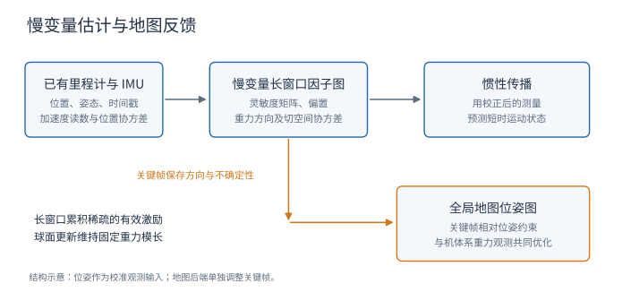
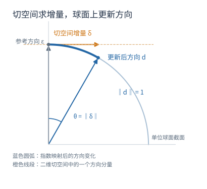

# Joint On-Manifold Gravity and Accelerometer Intrinsics Estimation 论文解读

> *Joint On-Manifold Gravity and Accelerometer Intrinsics Estimation for Inertially Aligned Mapping*（Ryan Nemiroff、Kenny Chen、Brett T. Lopez，2023，arXiv v2）利用里程计位姿和 IMU 读数联合估计重力、偏置与灵敏度，通过消去速度构造长窗口观测，并将重力约束反馈到地图。[论文页面](https://arxiv.org/abs/2303.03505v2) · [PDF](https://arxiv.org/pdf/2303.03505v2)

激光里程计的局部几何一致性与地图的竖直对齐是两个相关但不同的问题。启动时的一次重力标定若受到加速度计零偏污染，地面就可能整体倾斜；运动过程中横滚、俯仰逐渐漂移，不同位置的地面和墙面还会失去一致性。IMU 提供了竖直参考，但要使用这项参考，必须同时理解传感器误差与机器人运动。

该方法利用已有里程计的位姿和 IMU 读数，在一个独立模块中联合估计重力方向、加速度计偏置和灵敏度矩阵，再将重力观测用于全局地图校正。重力、内参和地图姿态通过这两层估计相互联系。

这个方法承接了 [IMU 零偏可观性与姿态激励](../imu-bias-estimation/index.html) 中的耦合问题。姿态变化能帮助区分重力与零偏，但实际机器人可能很久才产生一次有效激励。若显式历史很短，间隔较远的观测难以共同约束参数。该方法通过消去速度、只优化缓慢变化的量，以较小状态规模保留一分钟量级的历史。

整个系统包含两个相互连接的过程。前端里程计提供位置和姿态，慢变量图根据这些观测估计内参与重力，并改善后续 IMU 预测；地图后端为关键帧保存机体系中的重力方向及其不确定性，调整不同时间的姿态，使地图的竖直方向更加一致。

其中，“联合”指重力、偏置和灵敏度共同估计；“独立”指它们与完整的位姿、速度轨迹分开求解。与 [IMU 预积分](../imu-preintegration/index.html) 中直接连接位姿、速度和偏置的做法相比，这里构造的是一个专门约束慢变量的观测。重力自身只有两个方向自由度，它直接约束横滚和俯仰；绝对航向仍然需要其他信息。

## 1. 重力对齐中的误差耦合

为说明耦合，可以先忽略灵敏度误差，把原文后续采用的运动模型写成：

$$
\mathbf a_I(t)=\mathbf R(t)\bigl(\tilde{\mathbf a}_B(t)-\mathbf b\bigr)-\mathbf g_I.
$$

这里 $\mathbf R$ 把机体系向量旋转到里程计参考系，$\mathbf b$ 是机体系中的偏置，$\mathbf g_I$ 是该参考系中的重力补偿向量。机器人静止时有 $\mathbf a_I=0$，因此：

$$
\mathbf R\bigl(\tilde{\mathbf a}_B-\mathbf b\bigr)=\mathbf g_I.
$$

在单一、固定姿态下，一组读数可以被多种偏置和重力组合解释。仅凭“静止”这个条件，通常无法将两者唯一分开。

姿态变化可以增加信息，因为偏置固定在传感器坐标系中，转到参考系后会随姿态变化；同一参考系中的真实重力方向则应保持一致。多种姿态之间的共同解释因此能帮助区分它们。论文依据其引用的可观性研究指出，偏置与重力的完整可观性需要非零角速度，并在某些时刻改变旋转轴；更强的均匀完全可观性要求这样的变化足够频繁。

现实机器人可能长时间平移，或者只绕竖直轴转弯。纯 yaw 运动比完全没有旋转提供更多信息，但仍不保证完整可观。用于区分参数的姿态变化可能相隔很远，如果估计器只看很短的历史，就容易丢掉它们之间的联系。

这就引出了长窗口设计：内参通常变化缓慢，可以把它们按较粗的时间间隔建模，不必为每一个 IMU 时刻都加入完整状态。这降低了未知量规模，使分散的运动激励能够在同一个窗口里发挥作用。

上述可观性条件主要用于解释偏置与重力的困难。加入完整的灵敏度矩阵以后，待估参数更多，不能把“改变旋转轴”直接理解为所有灵敏度分量都必然可辨识。论文没有给出其完整增广模型在任意轨迹下的严格可观性证明。

这一设计也与重力在 LIO 系统中的使用方式有关。部分系统把启动时标定出的重力固定下来；LINS 和 FAST-LIO2 等系统把重力纳入滤波状态；Wildcat 和 D-LIOM 等系统则在局部轨迹优化中处理重力。估计重力和利用重力校正全局地图，是两个可以分别实现的环节。Wildcat 已使用全局重力因子，其他方法也曾在静止关键帧或局部优化中使用竖直参考。

这项工作更具体的贡献是三项结构的配合：不需要速度输入的内参观测、在单位球面上表示重力方向，以及面向慢变量的长历史估计。它同时估计比例因子和跨轴灵敏度，减少这些误差被偏置或重力方向吸收的可能。已有方法的描述均指论文比较时采用的版本。

## 2. 独立的慢变量估计器

模块输入是已有里程计提供的位姿，以及 IMU 加速度观测。单次观测不能确定所有参数，但多个具有不同运动条件的观测可以共同约束它们。作者把这样的观测称为 odometry factors，即里程计因子。

估计窗口被划分为长度为 $T_m$ 的时间段，每段对应一组变量：

$$
\mathcal X_j=\{\mathbf S_j,\mathbf b_j,\mathbf d_j\},\qquad
\mathbf g_j=g_0\mathbf d_j,\quad \|\mathbf d_j\|=1.
$$

$\mathbf S_j$ 是 $3\times3$ 灵敏度矩阵，$\mathbf b_j$ 是三维偏置，$\mathbf d_j$ 是只有两个自由度的重力方向。每段的局部未知量维数因此为 $9+3+2=14$，而不用再为该段中的每次观测估计位置、速度和姿态。

原文举例使用 3 秒作为慢变量的分段尺度，并以一分钟说明长窗口。按这个例子计算，60 秒内约有 20 组慢变量，约 280 个局部标量未知量；这是帮助理解规模的估算，不是论文另行报告的运行统计。观测因子仍会随位姿测量不断加入，所以图的总成本也取决于观测数量。

到期变量会被边缘化。以高斯线性化系统的观点看，边缘化相当于消去旧变量，把其对保留变量的信息压缩成先验；不是简单地把旧信息全部扔掉。不过，这些信息已不再以原始历史变量的形式保留，后续重新线性化的自由也会受到限制。

估计结果还会用于地图层：为关键帧保存重力方向和协方差，再加入全局地图优化。内参估计模块负责获得信息，地图模块负责利用信息调整关键帧。

图中两条反馈分别对应惯性预测和地图姿态校正。位姿是慢变量图的输入，关键帧姿态是地图后端的未知量；这两个优化过程的职责不同。

## 3. 位置积分中的速度消元

位置是加速度两次积分的结果，但两次积分会引入初速度。若把每段速度都作为未知量，估计器会重新依赖快速运动状态。作者用共享起点的两个位置积分区间，把同一个初速度消掉。

先把加速度校正写成与后续线性估计一致的形式：

$$
\mathbf a_I(t)=
\mathbf R(t)\bigl(\mathbf S\tilde{\mathbf a}_B(t)-\mathbf b_c\bigr)
-\mathbf g_I-\mathbf R(t)\mathbf w_c(t).
$$

$\tilde{\mathbf a}_B$ 是机体系中的加速度计读数，$\mathbf R$ 把机体系向量旋转到里程计参考系。$\mathbf S$ 接近单位阵，对角元素表示各轴比例修正，非对角元素描述跨轴耦合和轴向不对齐。部分 IMU 旋转外参误差也能被这个矩阵吸收，因此它并不唯一对应某一种物理误差来源。

$\mathbf b_c$ 是校正后尺度中的偏置。如果原始读数偏置为 $\mathbf b_{\rm raw}$，则 $\mathbf b_c=\mathbf S\mathbf b_{\rm raw}$；噪声同样以 $\mathbf w_c=\mathbf S\mathbf w_{\rm raw}$ 表示。下面把 $\mathbf b_c$ 简记为 $\mathbf b$。在这个参数化下，真实加速度对 $\mathbf S$、$\mathbf b$ 和 $\mathbf g_I$ 都是线性的。原文式（1）与式（2）存在偏置尺度的符号不一致，文末集中说明其代数关系。

重力符号也需保持一致。上式中 $\mathbf g_I$ 被扣除，是重力补偿向量；在竖直向上的参考系中它指向 $+z$，物理向下的重力加速度则为 $-\mathbf g_I$。

接下来选择三个位置时刻 $t_0<t_k<t_n$。对两个共享起点的区间积分，可以写成原文式（3）：

$$
\begin{aligned}
\mathbf p^k-\mathbf p^0
&=\beta_A\mathbf v^0+\sum_{i=0}^{k}\alpha_A^i\mathbf a_I^i,\\
\mathbf p^n-\mathbf p^0
&=\beta_B\mathbf v^0+\sum_{i=0}^{n}\alpha_B^i\mathbf a_I^i.
\end{aligned}
\tag{3}
$$

$\beta_A$ 和 $\beta_B$ 表示区间时长，量纲为秒；$\alpha_A^i$、$\alpha_B^i$ 是加速度两次积分形成的权重，量纲为秒的平方。具体值取决于采样时间和积分方式。

把两式分别除以时长，再相减：

$$
\frac{\mathbf p^n-\mathbf p^0}{\beta_B}
-\frac{\mathbf p^k-\mathbf p^0}{\beta_A}
=
\frac{1}{\beta_B}\sum_{i=0}^{n}\alpha_B^i\mathbf a_I^i
-\frac{1}{\beta_A}\sum_{i=0}^{k}\alpha_A^i\mathbf a_I^i.
\tag{4}
$$

两个 $\mathbf v^0$ 正好抵消。左边是两个区间平均速度之差，但它通过位置计算，不需要输入速度测量；右边仍由加速度积分决定。

下面补一个可手算的例子。假设三个时刻等间隔为 $0,\Delta t,2\Delta t$，且参考系中的加速度 $\mathbf a$ 恒定，那么：

$$
\begin{aligned}
\mathbf p^1&=\mathbf p^0+\mathbf v^0\Delta t+
\tfrac12\mathbf a\Delta t^2,\\
\mathbf p^2&=\mathbf p^0+2\mathbf v^0\Delta t+
2\mathbf a\Delta t^2.
\end{aligned}
$$

于是：

$$
\mathbf p^2-2\mathbf p^1+\mathbf p^0
=\mathbf a\Delta t^2.
$$

未知初速度被消掉，位置的二阶差分留下了加速度信息。这个例子解释了观测的结构；论文实际使用积分权重处理随时间变化的加速度和姿态，并非直接用简单差分替代 IMU 积分。

为了把式（4）展开得更清楚，定义讲解用权重：

$$
c_i=\frac{\alpha_B^i}{\beta_B}
-\frac{\alpha_A^i}{\beta_A},
$$

其中第二段求和之外的 $\alpha_A^i$ 置零。再令：

$$
\mathbf q=
\frac{\tilde{\mathbf p}^n-\tilde{\mathbf p}^0}{\beta_B}
-\frac{\tilde{\mathbf p}^k-\tilde{\mathbf p}^0}{\beta_A}.
$$

忽略噪声时，将上述校正模型代入即可得到：

$$
\mathbf q=
\sum_i c_i\mathbf R_i\mathbf S\tilde{\mathbf a}_{B,i}
-\left(\sum_i c_i\mathbf R_i\right)\mathbf b
-\left(\sum_i c_i\right)\mathbf g_I.
$$

这一步说明，一条观测把三个量绑在同一个残差里。灵敏度矩阵影响读数的校正，偏置通过每个时刻的姿态进入参考系，重力补偿则直接在参考系中扣除。

把 $\mathbf S$ 按列展开为九维向量 $\mathbf s=\operatorname{vec}(\mathbf S)$，利用恒等式：

$$
\mathbf R_i\mathbf S\tilde{\mathbf a}_{B,i}
=\left(\tilde{\mathbf a}_{B,i}^{\mathsf T}\otimes\mathbf R_i\right)\mathbf s,
$$

就可以给出与原文式（6）一致的显式结构：

$$
\begin{aligned}
\mathbf M_s&=\sum_i c_i
\left(\tilde{\mathbf a}_{B,i}^{\mathsf T}\otimes\mathbf R_i\right),\\
\mathbf M_b&=-\sum_i c_i\mathbf R_i,\\
\mathbf M_g&=-\left(\sum_i c_i\right)\mathbf I_3,\\
\mathbf r_o&=\mathbf M_s\mathbf s+\mathbf M_b\mathbf b
+\mathbf M_g\mathbf g_I-\mathbf q.
\end{aligned}
$$

这些显式矩阵是根据原文模型补充的展开。原文把位置项写成：

$$
\mathbf r_o=
\mathbf M_s\mathbf s+\mathbf M_b\mathbf b+\mathbf M_g\mathbf g_I
-\bigl(\gamma_1\tilde{\mathbf p}^0+
\gamma_2\tilde{\mathbf p}^k+
\gamma_3\tilde{\mathbf p}^n\bigr),
\tag{6}
$$

其中 $\gamma_1=\beta_A^{-1}-\beta_B^{-1}$、$\gamma_2=-\beta_A^{-1}$、$\gamma_3=\beta_B^{-1}$。位置组合正好就是上面的 $\mathbf q$。每个因子产生三维残差，但一组慢变量有十四个局部自由度，所以必须依赖多条观测、运动变化和先验共同估计。

论文式（5）为位置观测加入独立高斯噪声：

$$
\tilde{\mathbf p}(t)=\mathbf p(t)+\mathbf w_p(t),\qquad
\mathbf w_p(t)\sim\mathcal N(0,\boldsymbol\Sigma_p(t)).
\tag{5}
$$

式（7）和式（8）把加速度与位置噪声传播到里程计因子的协方差。在校正后加速度噪声为各向同性、各样本独立，且姿态视为已知的情况下，保留噪声尺度的写法为：

$$
\boldsymbol\Sigma_o=
\sigma_a^2\sum_i c_i^2\mathbf I_3
+\gamma_1^2\boldsymbol\Sigma_p^0
+\gamma_2^2\boldsymbol\Sigma_p^k
+\gamma_3^2\boldsymbol\Sigma_p^n.
$$

这里的噪声方差指校正后模型中的噪声。若使用原始读数的噪声模型，还需通过灵敏度矩阵传播，不能混用两个尺度。

协方差决定观测的权重。走廊等退化几何中的位置估计不应像充分约束场景中的位置估计一样可信。作者从 GICP 配准的 Hessian 近似获得位置协方差，同时承认它只是粗略近似。

这项观测还带来几条实际边界：

- 姿态 $\mathbf R(t)$ 被视为已知，其不确定性没有完整进入该估计器；实际它仍会受到配准与陀螺积分误差影响。
- 原文为推导简洁假设位姿与加速度采样对齐，但说明实现不需要两者同时采样。
- 实现使用最近三个连续位置观测；作者并未证明这样的选点最优。
- 相邻因子会共享位置和 IMU 样本。单个因子的内部噪声传播，并不等于建模了所有因子之间的相关性；原文没有详细展开这种跨因子处理。

因此，“velocity-agnostic”准确地说是该校准因子不需要速度输入或速度未知量，整个里程计系统仍然可以维护和使用速度。

## 4. 单位球面上的重力方向更新

作者利用重力模长已知这一条件，写成：

$$
\mathbf g_I=g_0\mathbf d,\qquad
\mathbf d\in S^2=\{\mathbf x\in\mathbb R^3:\|\mathbf x\|=1\}.
$$

原文采用标准值 $g_0=9.80665\,\mathrm{m/s^2}$，并指出地表重力变化约在 $\pm0.3\%$ 范围，精度要求更高时可使用已知的当地重力。$S^2$ 是嵌入三维空间、内在维数为二的球面。固定模长后，估计器只需优化两个方向自由度。

球面更新的基本困难是：直接给三维单位向量加一个普通增量，会使它离开球面。作者在二维切空间里求增量，再把增量映射回球面。重力协方差也在这个二维空间里表示。

先选择参考方向 $\boldsymbol\varepsilon=\mathbf e_3$，并以 $\mathbf B_\varepsilon=[\mathbf e_1\ \mathbf e_2]$ 作为其切空间的正交基。为避免原文用同一个符号表示球面点和切向量造成混淆，下面用 $\boldsymbol\delta\in\mathbb R^2$ 表示更新量。

原文式（9）的指数映射为：

$$
\operatorname{Exp}_\varepsilon(\boldsymbol\delta)=
\cos(\|\boldsymbol\delta\|)\boldsymbol\varepsilon
+\sin(\|\boldsymbol\delta\|)
\mathbf B_\varepsilon\frac{\boldsymbol\delta}{\|\boldsymbol\delta\|}.
\tag{9}
$$

这表示沿着切向量指定的方向，在球面上转过 $\|\boldsymbol\delta\|$ 弧度。参考方向与切向方向正交，因此结果的模长为 $\sqrt{\cos^2\theta+\sin^2\theta}=1$。$\boldsymbol\delta=0$ 时定义结果为 $\boldsymbol\varepsilon$，保持连续。

例如从 $\mathbf e_3$ 出发，令 $\boldsymbol\delta=[0.01,0]^{\mathsf T}$，就得到 $[\sin0.01,0,\cos0.01]^{\mathsf T}$：方向向 $x$ 侧倾斜约 $0.573^\circ$，但模长仍为一。

式（10）的对数映射执行反向操作：

$$
\operatorname{Log}_\varepsilon(\mathbf d)=
\arccos(\boldsymbol\varepsilon^{\mathsf T}\mathbf d)
\frac{\mathbf B_\varepsilon^{\mathsf T}\mathbf d}
{\|\mathbf B_\varepsilon^{\mathsf T}\mathbf d\|}.
\tag{10}
$$

输出的长度是两个方向之间的球面夹角，方向是相应的切空间方向。它把球面差异转成优化器能处理的二维残差。在参考点处定义结果为零；在对跖点 $-\boldsymbol\varepsilon$ 处没有唯一最短方向，因此不定义该映射。

这张二维截面示意图中，蓝色圆弧对应固定模长的方向更新，橙色线段对应切空间增量。增量的长度指定角度，最终方向留在单位圆上；三维情形中相应的约束面就是单位球面。

为了在任意当前方向附近更新，作者构造式（11）的旋转：

$$
\mathbf R(\mathbf d)=\mathbf I+
[\boldsymbol\varepsilon\times\mathbf d]_\times+
\frac{[\boldsymbol\varepsilon\times\mathbf d]_\times^2}
{1+\boldsymbol\varepsilon^{\mathsf T}\mathbf d}.
\tag{11}
$$

$[\mathbf x]_\times$ 表示叉乘矩阵。此旋转将参考方向 $\boldsymbol\varepsilon$ 转到 $\mathbf d$，也将参考切空间基转到 $\mathbf B_d=\mathbf R(\mathbf d)\mathbf B_\varepsilon$。这里的 $\mathbf R(\mathbf d)$ 是辅助旋转，需与机器人的姿态 $\mathbf R(t)$ 区分。

有了它，就能定义原文式（12）和式（13）：

$$
\operatorname{Exp}_{d_1}(\boldsymbol\delta)
=\mathbf R(\mathbf d_1)\operatorname{Exp}_\varepsilon(\boldsymbol\delta),
\tag{12}
$$

$$
\operatorname{Log}_{d_1}(\mathbf d_2)
=\operatorname{Log}_\varepsilon\bigl(\mathbf R(\mathbf d_1)^{-1}\mathbf d_2\bigr).
\tag{13}
$$

更新时先在参考切空间形成方向，再旋转到当前点附近；计算误差时先把两个方向的比较拉回参考空间。这些操作分别作为 GTSAM 的 retract 和 local 操作。

作者特别说明，$S^2$ 不是李群。上述辅助旋转虽然可以构造出类似组合的操作，但不满足结合律，不能直接把它当作群运算。优化器需要的是适合局部更新、残差和协方差表达的一套映射。

这套映射还需要落实到三个涉及重力的因子中。

### 4.1 相邻方向的扩散约束

 相邻慢变量之间的误差为：

$$
\mathbf e_d(\mathbf d_1,\mathbf d_2)
=\operatorname{Log}_{d_1}(\mathbf d_2).
\tag{14}
$$

它是二维向量，模长为相邻重力方向的夹角。该因子对方向突变施加惩罚，但允许小幅变化。物理重力本身基本不变，变化主要用于容纳里程计参考系的姿态漂移。

原文在相邻方向足够近、约不超过 $5^\circ$ 时，采用近似雅可比：

$$
\frac{D\mathbf e_d}{D\mathbf d_1}\approx-\mathbf I_2,
\qquad
\frac{D\mathbf e_d}{D\mathbf d_2}\approx\mathbf I_2.
\tag{15}
$$

这是对局部二维扰动的导数：移动起点会减少方向差，移动终点会增加方向差。它是一项小角度近似，并非球面上任意两点间的全局精确公式。

式（16）进一步给出对数映射的局部雅可比。为解释原文的矩阵乘积，令 $\mathbf v=\mathbf B_\varepsilon^{\mathsf T}\mathbf d$、$\rho=\|\mathbf v\|$、$\theta=\arccos(\boldsymbol\varepsilon^{\mathsf T}\mathbf d)$，并在 $\rho\ne0$ 时令 $\mathbf u=\mathbf v/\rho$。按文中切空间基约定，同一个二维矩阵可写为：

$$
\mathbf J_{\log}=
\mathbf u\mathbf u^{\mathsf T}
+\frac{\theta}{\rho}
\left(\mathbf I_2-\mathbf u\mathbf u^{\mathsf T}\right).
$$

这是对原文式（16）的等价整理：沿球面径向变化的系数为一，横向系数为 $\theta/\sin\theta$。当方向差趋于零时，两个系数都趋于一，因此与小角度单位阵近似相容。它应在指定的二维局部扰动坐标下使用，不能当作对三维环境坐标求导的 $2\times3$ 雅可比。

### 4.2 初始方向的先验

 原文使用：

$$
\mathbf e_p(\mathbf d)=-\operatorname{Log}_d(\bar{\mathbf d}).
$$

$\bar{\mathbf d}$ 是初始方向，协方差表达对它的信任程度。启动时静止加速度平均值可以提供一个粗略方向，但偏置尚未准确估计，所以这个先验应允许后续观测修正。其雅可比可以按与扩散因子相似的方式近似。

### 4.3 里程计残差对重力的局部导数

 里程计残差中的重力项是 $\mathbf M_g\mathbf g_I=g_0\mathbf M_g\mathbf d$。小扰动下有：

$$
\operatorname{Exp}_d(\boldsymbol\delta)
\approx\mathbf d+\mathbf B_d\boldsymbol\delta.
$$

所以其局部雅可比为：

$$
\frac{\partial\mathbf r_o}{\partial\boldsymbol\delta}
=g_0\mathbf M_g\mathbf B_d.
$$

它是 $3\times2$ 矩阵：三维里程计残差对两个重力方向自由度的敏感度。这样既保留了 速度消元观测 的观测结构，又保证重力更新满足固定模长。

## 5. 长窗口中的约束与边缘化

原文图 3 展示的是按时间分段的慢变量图。第 $j$ 段对应 $\mathbf S_j$、$\mathbf b_j$ 和重力方向；该段内不断到来的里程计因子共同连接这组变量，相邻时间段则通过扩散因子连接。

图里主要有四类约束。

1. **初始先验。** $\mathbf S_0$ 大致接近单位阵，$\mathbf b_0$ 大致接近零；初始重力方向通过启动时的 IMU 观测粗略获得，并给予较松约束。
2. **里程计观测。** 每次新的位姿观测到达，就利用最近三个位置及中间 IMU 数据构造速度消元观测的残差，协方差由噪声传播给出。
3. **扩散约束。** 相邻段的偏置、灵敏度和重力方向允许缓慢变化，使过去的信息可以约束现在，而不要求所有参数在整个运行期间绝对不变。
4. **内参幅度约束。** 后续内参变量也会被弱约束在合理范围，防止缺少观测时沿随机游走不断偏离 $\mathbf S\approx\mathbf I$、$\mathbf b\approx0$。

偏置和灵敏度分量被近似建模为 Wiener 过程。以偏置为例：

$$
\mathbf r_b=\mathbf b_{j+1}-\mathbf b_j,\qquad
\boldsymbol\Sigma_b=\sigma_b^2T_m\mathbf I_3.
$$

间隔越长，允许的变化方差越大。灵敏度向量采用类似结构。重力方向的扩散不同：作者认为其漂移与关键帧放置相关，因此按该时间段内的关键帧数量缩放相应方差；实际球面残差则使用 球面优化 的对数映射。

幅度约束是一个有实际作用的正则项。纯随机游走会允许参数无限扩散，但真实内参通常有界。它有助于在弱激励时稳定估计，同时也意味着：当数据不充分时，结果会依赖先验强度。被先验稳定下来的参数，不能据此被认为已由测量充分识别。

作者使用 iSAM2 做估计和边缘化，并在每步重新线性化。变量超过滞后时间 $T_l$ 后退出显式窗口，且 $T_l\gg T_m$。新因子的添加频率与求解频率分开，实际可积累若干扫描后再更新估计，以控制 CPU 成本。

用统一形式概括，这个图的目标可以理解为：

$$
\min_{\{\mathbf S_j,\mathbf b_j,\mathbf d_j\}}
\sum_\ell\|\mathbf r_{o,\ell}\|_{\boldsymbol\Sigma_{o,\ell}}^2
+\sum_j\|\mathbf r_{{\rm diff},j}\|_{\boldsymbol\Sigma_{{\rm diff},j}}^2
+\text{初始先验代价}+\text{内参幅度代价},
$$

其中 $\|\mathbf r\|_{\Sigma}^2=\mathbf r^{\mathsf T}\Sigma^{-1}\mathbf r$，并且每个 $\mathbf d_j$ 都在 $S^2$ 上。这个总目标是对原文各因子的汇总表达，原文没有将其作为一条独立编号公式列出。

## 6. 重力观测对全局地图的反馈

前面的图提高了内参和重力估计质量，但如果不把它们用于地图，旧关键帧仍可能保留倾斜或姿态漂移。地图层因此增加一类观测：向全局位姿图加入重力方向观测。

这里需要区分三个坐标系。$O$ 是里程计参考系，$B$ 是机体系，$M$ 是全局地图系。关键帧放置时，模块保存重力方向估计 $\bar{\mathbf d}_O$ 及二维切空间协方差 $\boldsymbol\Sigma_O$，以及当时的机体姿态 $\mathbf R_O$。

先用式（17）把方向转到机体系：

$$
\bar{\mathbf d}_B=\mathbf R_O^{-1}\bar{\mathbf d}_O.
\tag{17}
$$

这项观测描述“这个关键帧处，重力补偿方向相对于机器人的方向”。把它存为机体系观测，后端就可以调整该关键帧在地图中的姿态，而不必把里程计坐标系永久当作正确的全局方向。

协方差也要转换。但它是二维切空间协方差，不能直接按普通三维向量协方差做旋转。先定义两个切空间之间的线性映射：

$$
\mathbf A=
\mathbf B_{\bar d_B}^{\mathsf T}\mathbf R_O^{-1}
\mathbf B_{\bar d_O},
$$

再用原文式（18）：

$$
\boldsymbol\Sigma_B=
\mathbf A\boldsymbol\Sigma_O\mathbf A^{\mathsf T}.
\tag{18}
$$

该过程先把二维扰动嵌入里程计系的三维切平面，再旋转到机体系，最后投影到新的二维切空间基中。这里仍以 $\mathbf R_O$ 为已知，未额外传播它本身的不确定性。

全局地图固定竖直参考 $\mathbf d_M=\mathbf e_3$。若优化中的关键帧姿态是 $\mathbf R_M$，地图预测该关键帧机体系中的重力方向为 $\mathbf R_M^{-1}\mathbf d_M$。因此重力因子比较：

$$
\mathbf e_g(\mathbf R_M)=
\operatorname{Log}_{\bar d_B}
\left(\mathbf R_M^{-1}\mathbf d_M\right),
$$

并以 $\boldsymbol\Sigma_B$ 加权。残差大意味着地图给出的姿态，与校准模块推断出的机体重力方向不一致。后端在关键帧相对位姿约束和这些重力约束之间求平衡，进而调整地图姿态和相关位置。

如果所有关键帧只有同一个全局倾斜，一个整体旋转就能纠正。若不同时间的横滚、俯仰漂移不同，则需要分别调整关键帧，才能缓解地图内部的不一致。原文图 1 展示后者的作用，图 5 则更直观地展示竖直方向对齐的改善。

这个因子具有两个直接方向约束。绕全局重力轴的旋转不会改变重力在机体系中的预测投影，因此它无法独立提供绝对 yaw。重力也不能直接解决所有平移漂移；位置改善来自它与相对位姿约束在图中的共同作用。

## 7. 实验中的三类精度

实验并非只比较一个最终定位误差，而是沿着方法的使用链条分开检查计算成本、内参和惯性传播、重力方向以及地图质量。

作者将模块接入 DLIO。原始 DLIO 使用几何观测器估计运动状态和 IMU 偏置，没有在线重力估计；新模块接管其中的加速度计偏置估计，并同时估计灵敏度和重力。地图层则加入前述全局重力因子。

实验记号含义如下：

- **DLIO w/o GE**：原始 DLIO，没有论文提出的重力与内参估计模块。
- **DLIO w/ GE**：接入该模块的 DLIO。
- **DLIO w/ GE⊖S**：去掉灵敏度矩阵估计的消融版本，用于检验是否有必要估计超出偏置之外的内参。
- **FAST-LIO2**：通过全状态迭代扩展卡尔曼滤波器估计重力；论文比较版本不进行全局地图优化。
- **D-LIOM**：有全局地图优化，但论文指出其重力约束只用于局部优化，且其重力与偏置处理没有采用论文提出的联合方式。

这些系统仍有不同的前端和后端结构。因此，与另外两种完整系统的比较可以说明所测配置下的实际结果，不能把全部差异唯一归因于一个重力估计算法。

原文用 A—H 标识数据集：A 为自采 Slow Yaw，B 为自采 Lab-E4-Boelter，C 为 Dynamic Spinning，D 为 Maths-Hard，E 为 Stairs，F 为 Quad with Dynamics，G 为 Parkland，H 为 Cloister。其中 A 使用 Ouster OS0 的 IMU，B 使用 MPU-6050；建图实验还使用 Short Experiment，图 1 另展示 Hilti-Oxford Cupola。

### 7.1 计算成本

实验平台为 Intel i7-11800H，原文表述为 16-core。求解在独立线程中进行，每积累 5 帧激光扫描执行一次待处理的边缘化和优化：10 Hz 雷达对应每 0.5 秒一次，20 Hz 雷达对应每 0.25 秒一次。

原文报告平均每次因子图更新的耗时：

- 10 Hz 雷达：约 3—4 ms。
- 20 Hz 雷达：约 4—5 ms。

这些数字支持“该模块的额外开销较小”。它们指一次因子图更新，不是完整 SLAM 的每帧耗时，也不是整个全局地图优化的总耗时。按更新频率看，该模块每秒仅执行数次毫秒级更新；但论文没有在这一小节中提供所有对比方法的统一计时表或长期运行的峰值时延。

这一结果对应慢变量分段与长窗口因子图的设计：保留较长观测历史，同时让状态只按慢变量时间段增长，再把新增观测与实际求解频率分开。

### 7.2 内参误差与惯性传播

这部分实验分成合成数据、Slow Yaw 和多数据集传播误差三层。

合成数据用于检验内参，因为真实数据通常缺少精确内参真值。传感器在一个箱体环境中运动，轨迹包含分段恒定的线性 jerk 和角加速度；点云与 IMU 测量加入高斯噪声，以及常量偏置和常量灵敏度矩阵。jerk 是加速度对时间的导数，这样的轨迹能提供变化的加速度与姿态。

在具有良好激励的模拟轨迹中，作者报告轨迹末端平均偏置误差为 $0.09\,\mathrm{m/s^2}$，灵敏度矩阵元素的平均误差为 $0.008$，即约 $0.8\%$。当偏置对初始重力标定影响较大时，相比原始 DLIO 的偏置误差降低最多约 $36\%$。

这里“具有良好激励”是成立条件。这组结果说明足够丰富的模拟运动下能够估计参数，不能据此推断长期静止或单轴运动也能恢复完整灵敏度矩阵。

接着，Slow Yaw 数据包含两次 $180^\circ$ 的旋转，中间停止。原文图 4 的上半部分显示，固定重力的 DLIO 中，偏置估计随 yaw 角发生较大变化，IMU 与 LiDAR 的位置差也出现尖峰；下半部分显示新模块在第一次旋转之后获得更稳定的偏置估计，预测偏差更稳定。

这个现象可以由误差投影解释。设固定使用的重力与实际需要的重力相差 $\Delta\mathbf g$，为了弥补它，估计器可能把一部分误差写入偏置：

$$
\Delta\mathbf b(t)\approx\mathbf R(t)^{-1}\Delta\mathbf g.
$$

符号取决于重力误差的定义，但随姿态变化这一点不变。机器人转向后，同一个参考系中的重力误差投影到机体系会变化，于是偏置看起来也随 yaw 变化。联合估计允许重力方向本身被修正，减少偏置对这项误差的吸收。这是对图 4 现象的机制解释，不是论文额外证明的偏置误差定理。

最后，Table I 使用 **IMU-LiDAR deviation** 衡量传播质量：从当前时刻之前 0.5 秒的状态开始进行 IMU 传播，比较预测位置与当前 LiDAR 位置。报告的是这一距离的 RMSE，单位厘米。原文数值为：

- A／Slow Yaw：$1.9\to1.5$ cm，表中改善 $21\%$。
- B／Lab-E4-Boelter：$8.7\to7.6$ cm，改善 $13\%$。
- C／Dynamic Spinning：$4.6\to3.5$ cm，改善 $24\%$。
- D／Maths-Hard：$10.3\to5.1$ cm，改善 $50\%$。
- E／Stairs：$4.6\to2.6$ cm，改善 $43\%$。

百分比按原表转述。表内误差经过取舍，直接用显示的小数重新计算可能有少量差异。

这五组数据均有改善，支持新估计模块有利于短时惯性传播。作者把 LiDAR 位置视为较准确的参考，因此该指标是 IMU 预测误差的代理。它并不直接等于相对于独立真值的轨迹 ATE；若 LiDAR 也有误差，二者的差异会同时受两边影响。

### 7.3 重力方向精度与消融结果

不同方法的里程计坐标系可以有任意整体姿态，不能直接比较其中重力向量与 $\mathbf e_3$ 的夹角。作者先用 evo 对估计轨迹和真值做 $SE(3)$ 刚体对齐，再用同一个旋转变换重力估计，最后计算其与竖直方向的夹角。

论文假定 Newer College 的真值地图具有较准确的重力对齐，理由是生成真值的 Leica BLK360 设备具有 IMU 和自动倾斜补偿。作者同时说明该功能的公开细节有限，因此这个评价仍依赖真值地图的竖直参考质量。

Table II 给出五组最终重力方向误差，单位度。为保留所有原始比较值，下面按数据集列出，顺序均为“原始 DLIO、D-LIOM、FAST-LIO2、不估计灵敏度的版本、完整方法”：

- **D／Maths-Hard**：$1.31$、$3.81$、$0.14$、$0.39$、$0.37$。
- **E／Stairs**：$1.08$、失败、$0.29$、$0.49$、$0.31$。
- **F／Quad with Dynamics**：$1.93$、$1.62$、$0.39$、$0.04$、$0.02$。
- **G／Parkland**：$2.99$、$2.10$、$0.14$、$0.35$、$0.32$。
- **H／Cloister**：$1.31$、$13.37$、$0.06$、$0.12$、$0.07$。

完整方法在这五组数据上的误差均小于原始 DLIO。FAST-LIO2 在其中四组具有更低误差，该方法在 Quad with Dynamics 上更低。因此，合理概括是该方法达到有竞争力的重力精度；不能说其重力方向估计在所有数据集都优于 FAST-LIO2。

此外还有两个直接检验设计选择的消融实验。

第一，比较 60 秒窗口与 10 秒窗口，作者报告较长窗口平均改善约 $21\%$。这支持“较长显式历史能帮助利用稀疏激励”，但正文未逐数据集列出该消融结果，也没有展示所有可能窗口长度。

第二，比较完整方法与不估计灵敏度的版本，作者报告平均改善约 $28\%$。Table II 中完整版本在五组数据上都不差于消融版本，支持显式处理灵敏度误差。对于精度已很高的样例，例如 $0.04^\circ\to0.02^\circ$，应同时看相对变化和绝对变化，不能仅用百分比评价实际意义。

作者还提到 D-LIOM 某些数据上的重力结果甚至不如固定初始重力，并推测可能与重力和偏置没有真正联合估计有关。这是作者的解释假设，论文没有通过单独控制该因素来证明因果关系。

原文图 5 展示 Quad with Dynamics 地图侧视效果：初始重力标定错误对应可见倾斜，加入该模块后地图的竖直对齐更好。它是方向改善的视觉例证，与 Table II 的数值评价相互补充。

### 7.4 地图几何一致性

作者用输出点云与真值点云之间的 cloud-to-cloud error 评价地图，并选择 Newer College 的 Stairs、Cloister 和 Short Experiment，对应不同规模的环境。

点云先手工对齐，然后用 CloudCompare 计算误差。依据环境规模设置 $0.1$、$0.5$ 和 $1.0$ m 等不同最大距离阈值，目的在于只评价真值地图覆盖范围内的相关点。

Table III 的全部比较值如下，单位米：

- **Stairs**：原始 DLIO 为 $0.0535$，D-LIOM 失败，FAST-LIO2 为 $0.0667$，该方法为 $0.0488$。
- **Cloister**：原始 DLIO 为 $0.2608$，D-LIOM 为 $0.3572$，FAST-LIO2 为 $0.3556$，该方法为 $0.1791$。
- **Short Experiment**：原始 DLIO 为 $0.1372$，D-LIOM 为 $0.4312$，FAST-LIO2 为 $0.4135$，该方法为 $0.1334$。

接入该方法的 DLIO在这三组实验中都取得了最低点云误差。若根据表中数值计算，相比原始 DLIO 的降幅约为 $8.8\%$、$31.3\%$ 和 $2.8\%$。这三个百分比由表中数值计算，原表没有单列；它们也说明收益随场景而变化。

由于地图已整体对齐，指标更侧重对齐后的几何一致性，而不能单独代表地图原始坐标系的绝对竖直精度。对齐操作与距离阈值还会影响参与评价的点，因此这个结果应与关键帧重力因子的机制和其他实验一起理解。

对于 B／Lab-E4-Boelter，作者另报告首尾漂移：该方法 $0.22$ m，原始 DLIO $1.07$ m，FAST-LIO2 $2.14$ m，D-LIOM $8.59$ m。这说明在所测路线中，重力和内参处理落实为了更一致的轨迹与地图。首尾误差仍只是轨迹的一种指标，不等于整条轨迹每个时刻都具有相同程度的改善。

图 1 的 Hilti-Oxford Cupola 包含具有挑战性的楼梯定位环境。作者展示加入全局重力约束后，原本较严重的姿态漂移得到补偿，地图在横滚和俯仰上更加自洽。它是定性效果图，并非 Table III 中的第四组数值测试。

将重力精度与地图误差的结果连起来看，有一个值得保留的区分：FAST-LIO2 在多数所测数据上重力方向更准，但接入该方法的 DLIO在所测地图指标上更好。重力估得准是一项能力，把该信息传给不同时间的关键帧以校正地图，是另一项能力。跨系统结果还受前端配准、状态估计与后端组织方式影响，论文没有将这些因素完全分离。

## 8. 方法关系与适用范围

这个慢变量模块在架构上可以与不同里程计结合。实际接入仍需提供姿态、位置、时间戳和合理的位置不确定性，并协调内参校正、状态预测及关键帧重力因子。论文实际验证的是与 DLIO 的结合，未逐一实现和测试所有其他框架。

作者提出三个未来方向。

1. **考虑姿态估计不确定性。** 目前模型把 $\mathbf R(t)$ 视为已知。若姿态有误，旋转后的加速度也会错误，新模块可能把其中一部分误差解释为内参或重力误差。
2. **纳入其他测量误差。** 例如陀螺仪比例因子会影响积分姿态，进而影响重力与加速度解释。只校正加速度计无法完全消除这条链路。
3. **进一步研究观测模型。** 作者指出，完全消去速度、使用最近三个位置未必最优；也可以研究保留速度信息的模型，权衡更充分的信息与更高的状态复杂度。

这些近似共同界定了方法的适用范围：

- 长窗口依然依赖运动激励和可靠的里程计信息，没有凭空消除不可观性。
- 正则项可以使弱观测下的结果稳定，但稳定不等于所有参数被数据识别。
- GICP Hessian 提供的协方差只是近似，姿态与跨因子相关性的处理也较简化。
- 内参的分段常值和随机游走属于慢变化模型，未保证适应突发参数跳变。
- 重力对齐不提供绝对航向，也不能替代所有地图漂移约束。

这些边界没有否定方法的实际价值，而是明确其适用范围：在已有里程计相对可靠、有效激励可能稀疏出现、加速度计误差不可忽略的条件下，用少量慢变量维护较长历史，改善惯性预测和地图竖直一致性。

这项工作的核心认识可以归到估计问题的时间尺度。位姿和速度需要快速跟踪，内参通常变化缓慢，参考系中的重力方向也只需容纳较慢的漂移。通过位置积分消去初速度，作者为慢变量构造了独立观测，再在球面上更新重力方向，以较小状态规模维持较长历史。估计结果随后同时作用于运动预测和地图关键帧，使传感器校正、竖直对齐与全局几何一致性形成了连续的信息链条。

相关的 [LI-Calib 连续时间批估计](../li-calib-continuous-time/index.html) 选择同时优化轨迹与标定参数，适合讨论更完整的外参标定关系；这里则利用已有里程计提供的轨迹信息，围绕慢变量设计一个在线模块。两者的未知量组织方式不同，相应的信息保留与计算代价也不同。

## 附记　原文的参数定义与噪声尺度

原文式（1）的测量模型为：

$$
\tilde{\mathbf a}_B(t)=
\mathbf S^{-1}\mathbf R(t)^{-1}
\bigl(\mathbf a_I(t)+\mathbf g_I\bigr)
+\mathbf b+\mathbf w_a(t).
\tag{1}
$$

$\tilde{\mathbf a}_B$ 是传感器读数，$\mathbf a_I$ 是真实平移加速度，$\mathbf S$ 接近单位阵。灵敏度矩阵的对角元素描述各轴比例修正，非对角元素描述跨轴耦合和轴向不对齐。原文还指出，IMU 旋转外参中的一部分误差可以被这个矩阵吸收，因为它与轴向误差在测量模型中难以区分。

**原文式（1）到式（2）有一处需要明确的符号问题。** 按式（1）直接移项，应当得到：

$$
\mathbf a_I=
\mathbf R\mathbf S\bigl(\tilde{\mathbf a}_B-\mathbf b-\mathbf w_a\bigr)
-\mathbf g_I.
$$

但原文式（2）写成：

$$
\mathbf a_I(t)=
\mathbf R(t)\bigl(\mathbf S\tilde{\mathbf a}_B(t)-\mathbf b\bigr)
-\mathbf g_I-\mathbf R(t)\mathbf w_a(t).
\tag{2}
$$

两式中偏置与噪声所在的坐标尺度不同，不能在保持同一符号定义时直接等同。为一致地理解后续线性模型，可以区分原始测量偏置 $\mathbf b_{\rm raw}$ 与校正后偏置 $\mathbf b_c=\mathbf S\mathbf b_{\rm raw}$，并同样定义 $\mathbf w_c=\mathbf S\mathbf w_{\rm raw}$。这样就有：

$$
\mathbf a_I=
\mathbf R\bigl(\mathbf S\tilde{\mathbf a}_B-\mathbf b_c\bigr)
-\mathbf g_I-\mathbf R\mathbf w_c.
$$

正文采用与原文式（2）一致的校正后偏置参数化。这个参数化使 $\mathbf a_I$ 对 $\mathbf S$、$\mathbf b$、$\mathbf g_I$ 线性；若坚持使用原始偏置，则会出现 $\mathbf S\mathbf b_{\rm raw}$ 的乘积。原文并没有明确说明这项重参数化，因此两种偏置尺度需要明确区分。

原文式（8）的第一项写为 $\sum_i(\alpha_C^i)^2\mathbf I$，没有显式带上此前定义的 $\sigma_a^2$。若 $\alpha_C^i$ 仅表示积分权重，则噪声尺度需补入；如果实现已将尺度吸收到系数，则应保持该定义一致。若从原始噪声通过 $\mathbf S$ 变换得到校正后噪声，其协方差还会涉及 $\mathbf S\boldsymbol\Sigma_{\rm raw}\mathbf S^{\mathsf T}$。因此，不能不加说明地把不同参数化下的噪声当成完全相同。

此外，$\mathbf R(t)$ 是机器人姿态，$\mathbf R(\mathbf d)$ 是球面映射使用的辅助旋转；重力方向为三维单位向量，但其扰动与协方差是二维。文中的公式编号沿用原文，补充展开与算例在相应段落注明。

## 参考资料

1. Ryan Nemiroff, Kenny Chen, Brett T. Lopez. *Joint On-Manifold Gravity and Accelerometer Intrinsics Estimation for Inertially Aligned Mapping*. 2023. [arXiv:2303.03505v2](https://arxiv.org/abs/2303.03505v2)。

本文的实验数值均来自该版本的正文与 Table I—III；附加的矩阵展开、算例和误差降幅计算用于说明机制，没有增加新的实验数据。
