# HorizonStream 论文解读

> Chong Cheng、Peilin Tao、Nanjie Yao、Guanzhi Ding、Xianda Chen、Yuansen Du、Xiaoyang Guo、Wei Yin、Weiqiang Ren、Qian Zhang、Zhengqing Chen、Hao Wang，*HorizonStream: Long-Horizon Attention for Streaming 3D Reconstruction*，arXiv:2605.23889v1（2026 年 5 月 22 日）；项目页标注为 NeurIPS 2026。本文依据 arXiv v1 正式阅读 20 页全文与附录。 [arXiv 论文页](https://arxiv.org/abs/2605.23889) · [本文阅读的 v1 PDF](https://arxiv.org/pdf/2605.23889v1) · [项目页](https://3dagentworld.github.io/horizonstream/) · [代码](https://github.com/3DAgentWorld/HorizonStream)

长视频中的历史信息会以不同方式失效：有限窗口可能太早丢弃仍有用的几何，周期性刷新会切断窗口间状态，无门控递归则不断累加陈旧证据；因果 softmax 注意力还可能让早期 token 主导后续计算。与此同时，几何线索的有效时间并不相同：相邻帧的局部对应很快会因相机运动而失效，场景结构和尺度却需要跨越许多窗口保持稳定。

HorizonStream 在定长局部窗口内进行细粒度空间匹配，再用固定维度的递归状态跨窗口传播几何证据，并学习不同通道各自的保留时间。作者将过去几何证据对当前重建的作用称为“几何证据影响核”，再将其分为空间关联与时间传播；Metric Readout Tokens 则从长期状态中读出尺度和位姿。

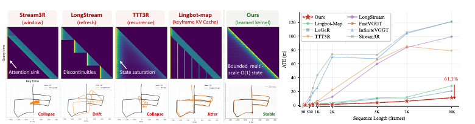

*原论文图 1。窗口、刷新、递归、历史 KV 与 HorizonStream 对历史的影响形状不同；右侧 VBR 曲线比较了序列加长时的 ATE。图中的失败标签与长序列误差趋势，构成作者提出影响核视角的动机。*

## 将历史表示为不同时间尺度的几何证据

设第 $i$ 帧的证据对时刻 $t$ 的重建产生影响，论文用 $K(t,i)$ 表示这种影响。作者将其拆成空间项与时间项：

$$
K(t,i)=K_{\mathrm{spatial}}(t,i)\,K_{\mathrm{time}}(t,i).
\tag{1}
$$

$K_{\mathrm{spatial}}$ 负责判断当前局部窗口里哪些图像内容和相对三维位置有用；$K_{\mathrm{time}}$ 控制历史证据跨窗口保留多久。这个分解把两个不同问题分开：窗口内需要找准局部对应，窗口间则要有选择地保留结构和尺度线索。论文还增加了度量读出，使递归状态里的长期信息能转换成稳定尺度和相机位姿。

作者用几种既有记忆形式说明影响模式与长序列失败之间的联系。滑动窗口的权重在边界处突然归零，形成硬截断；周期性刷新会让记忆在刷新点不连续；无门控递归使旧状态永久参与后续输出，形成不断累积的长尾；因果 softmax 将权重归一化到所有历史 token 上，当真正相关的帧数量有界时，几何相关历史得到的总权重会随序列变长而被稀释。附录的软最大注意力分析假设 query-key 分数有界、相关帧集合大小有界；在这些假设下，即便相关帧分数都理想地更高，其总注意力仍按 $O(1/t)$ 量级下降。这个结论解释的是跨窗口全历史 softmax 的稀释问题，不意味着所有局部 softmax 都会产生相同退化。

## Geometric Linear Attention 用通道门控保留长期状态

长程模块 Geometric Linear Attention（GLA）把窗口内已经提取的几何证据写入递归状态 $S_t$。对一组 key 和 value，论文把过去证据的时间权重写为保留系数的连乘：

$$
K_{\mathrm{time}}(t,i)=\prod_{j=i+1}^{t}\gamma_j.
\tag{2}
$$

若每一步都不遗忘，即 $\gamma_t=1$，历史影响不会衰减；若保留率小于 1，较旧的线索会逐步减弱。对应的线性注意力状态更新为

$$
S_t=\gamma_t S_{t-1}+\phi(k_t)\tilde v_t^{\mathsf T},\qquad o_t=q_t^{\mathsf T}S_t,
\tag{5}
$$

其中 $k_t$、$\tilde v_t$ 和 $q_t$ 分别表示当前证据的键、写入状态的值和查询；$\phi$ 将键映射到线性注意力特征空间。$S_t\in\mathbb R^{d\times d}$ 汇总了跨窗口信息，因此处理更长序列时无需把所有历史帧的每层键和值一直留在注意力缓存中。

单一 $\gamma_t$ 会给所有证据分配同样的寿命。HorizonStream 改为对状态通道学习不同保留率：

$$
\boldsymbol\gamma_t=\sigma(W_\gamma x_t+b_\gamma)\in(0,1)^d,\qquad
S_t=\operatorname{diag}(\boldsymbol\gamma_t)S_{t-1}+\phi(k_t)\tilde v_t^{\mathsf T}.
\tag{6}
$$

更新时，对状态行通道乘以各自的门控值。低保留率通道较快淡出旧关联，让短时线索能被新观测改写；高保留率通道保留更久，承载跨窗口的场景结构和尺度信息。对固定通道保留率 $\gamma^{(c)}$，其有效记忆跨度定义为

$$
\tau^{(c)}=-\frac{1}{\log\gamma^{(c)}}.
\tag{7}
$$

这条关系来自历史权重 $(\gamma^{(c)})^{t-i}=\exp(-(t-i)/\tau^{(c)})$：时间间隔达到约 $3\tau^{(c)}$ 后，单个证据的权重降到原来的约 5%。模型学习的是一组连续的保留率，而非人为指定几个短、中、长期缓存桶。附录的有界性分析还指出，在门控率统一小于 1 且每步写入有界时，递归状态范数也有上界；这是不周期清空状态仍能保持稳定的充分条件。

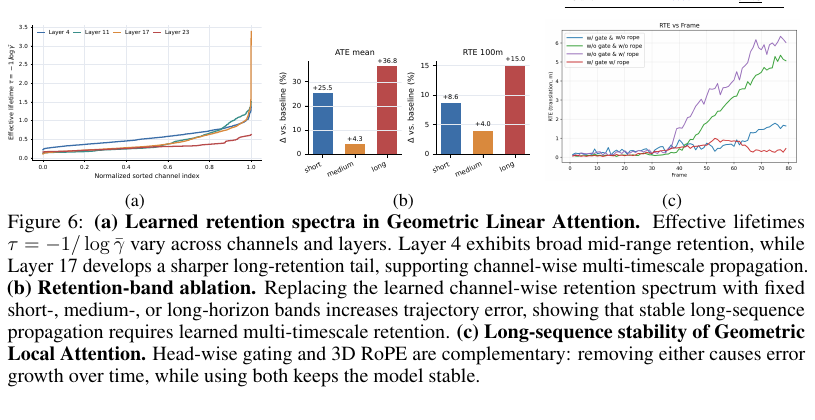

*原论文图 6。各层和各通道形成不同的有效记忆跨度；改用固定短、中或长期带会增加轨迹误差。窗口内的逐头门控与时空 RoPE 也互补，去掉任一项都会使长序列误差增长。*

论文还将 GLA 与测试时训练联系起来。它把状态更新解释为一个带遗忘的在线线性回归问题：每一步先按 $\gamma_t$ 衰减旧参数，再用当前观测更新。附录给出单步梯度更新与 GLA 形式之间的对应，因此这里的“测试时训练”指的是在线状态适配的数学视角；实际推理采用递归线性注意力更新，不需要每帧另行执行常规反向传播优化。

## Geometric Local Attention 负责窗口内的空间匹配

仅靠压缩状态传播长期信息，难以替代相邻图像间精细的局部匹配。因此模型在最近的 $W=10$ 帧内保留图像 patch、位姿和度量读出 token，并用 Geometric Local Attention（局部注意力）处理窗口内交互。窗口大小固定，短期处理成本不随整个视频长度增加。

该模块扩展 RoPE 到时间、图像高度和宽度三个方向，让注意力表示 patch 之间的相对时空位置。时间位置索引会周期性重置，避免位置值随视频无限增长；MRT 和位姿 token 使用零位置。注意力的每个 head 还根据窗口的平均特征预测一个可靠度门：

$$
g_h=\sigma(W_g\bar x+b_g),\qquad \tilde y_h=g_h y_h.
\tag{8}
$$

$y_h$ 是第 $h$ 个注意力头的输出，门控根据整个窗口的特征抑制不可靠的头。时空 RoPE 提供相对布局，逐头门控控制输出是否值得传递；论文消融显示两者都能减轻长序列中的误差增长。

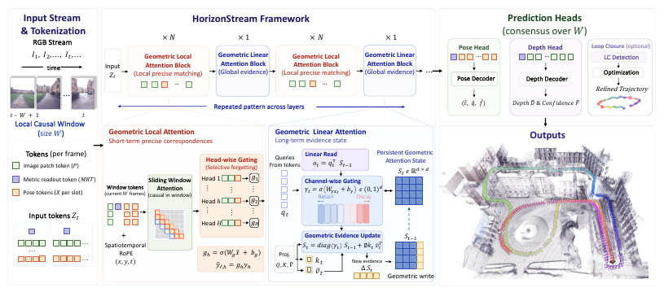

*原论文图 3。模型因果处理最近 $W$ 帧，交替运行局部注意力和跨窗口 GLA；姿态头、深度头和可选回环模块使用这些特征产生最终输出。*

## MRT 与相对位姿融合恢复尺度和轨迹

相机位姿由每帧的位姿 token 产生，深度由 DPT 式多尺度头预测。为了让尺度线索跨过局部窗口，模型在每帧加入 Metric Readout Token（MRT），让它参与 GLA 并读取高保留通道。尺度头将 MRT 输出映射为正尺度：

$$
\hat s=\exp(g(z_{\mathrm{metric}})),\qquad
\hat t=\hat s\,\hat t^{raw},\qquad
\hat D=\hat s\,\hat D^{raw}.
\tag{9}
$$

同一个预测尺度同时作用于相机平移和深度，使二者保持度量关系。相机姿态则在当前局部窗口内对多帧位姿 token 做联合注意力，输出当前帧相对于窗口上下文的共识位姿。这样可以减少逐个关键帧串联变换时误差层层传播。训练目标由位姿、深度和尺度损失加权组成；深度项使用置信度加权的 SmoothL1，尺度项只在带度量尺度的样本上计算。

模型采用 24 层 ViT-L 主干，帧内块和全局块交替；四个 GLA 层放在第 4、11、17、23 层，先更新持久状态，再执行局部注意力。递归状态维度为 $1024\times1024$，姿态共识头在窗口中进行多轮残差修正。这里的 $O(1)$ 指状态尺寸与视频帧数无关；窗口 token 和状态仍有固定但非零的显存成本。

作者还提供一个可选回环模块：从保存的早期 DINOv2 特征中检索可能重访的帧对，将候选重新送入网络估计局部几何校正，再转为回环约束并通过位姿图优化修正全局轨迹。这个分支会保留用于检索的历史特征，所以论文所称的常数内存对应核心流式模型的固定几何状态和局部窗口；不能据此把启用回环后的整个系统也描述成严格常数内存。

## 训练与评测覆盖从道路到超长序列

训练数据覆盖室内、户外、驾驶和合成场景，共 24 个数据集。视频样本使用 1–8 帧的时间间隔；无序多视图集合则沿相机图遍历，构造成伪时间序列。每个训练样本含 48 帧，按 21 帧块顺序通过网络并在块之间传递 GLA 状态；预测窗口为 10 帧。第一阶段以多样性为主，第二阶段提高度量尺度数据的比例，并加入更多长序列数据。

训练分两阶段：第一阶段在 64 张 A800 上进行 60k 次迭代，第二阶段在 64 张 H20 上进行 40k 次迭代；使用 AdamW、$2\times10^{-5}$ 学习率和余弦衰减，输入图像缩放到 $518\times518$。随机颜色扰动、裁剪和水平翻转用于训练增强。

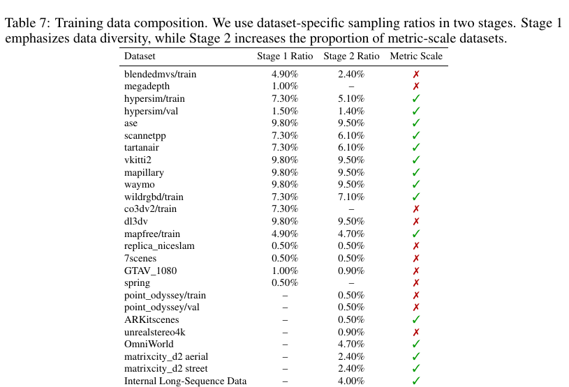

*原论文表 7。第二阶段对带度量尺度的数据提高采样比例，并新增 OmniWorld、MatrixCity 航拍与街景、PointOdyssey 等数据。表中也列出作者称为 Internal Long-Sequence Data 的数据来源。*

评测覆盖 KITTI、vKITTI2、Oxford Spires、ScanNet++、TUM RGB-D、Waymo、VBR、ETH3D 和 7-Scenes，按完整序列评估，不做帧下采样。训练集与评测集并非完全分离：vKITTI2、7-Scenes、Waymo 和 ScanNet++ 被列为训练中出现的数据；Waymo 指标使用未见过的具体路段，属于同一数据集内留出的场景评测。阅读各表时应将其理解为论文报告的跨序列泛化，而不是所有数据集都严格零样本迁移。

### 相机轨迹与长序列稳定性

KITTI 表中 HorizonStream 的平均 ATE 为 19.75 m，低于表内 LongStream 的 51.90 m 和 Lingbot-Map 的 25.29 m；加上回环优化后为 16.44 m。不同序列的结果差异很大，例如 KITTI 02 的 ATE 为 84.62 m，KITTI 04 则为 0.62 m，所以均值不代表每段路线都同样稳定。表格中的破折号表示显存溢出或重复跟踪失败。

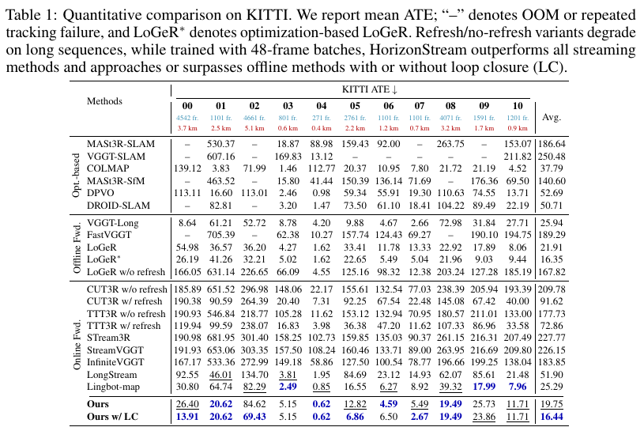

*原论文表 1。结果按 KITTI 00–10 全序列统计；HorizonStream 的总体 ATE 低于列出的在线前馈基线，回环版本进一步降低了平均误差。*

在 VBR 的七条长序列上，帧数从 8,815 到 18,846，最长路线约 5.2 km。HorizonStream 平均 ATE 为 25.30 m，低于 Lingbot-Map 的 27.53 m 与 LongStream 的 77.93 m；回环版本为 18.84 m。回环并非每条路段都降低 ATE，例如 Campus 0 从 22.46 m 变为 28.54 m，Diag 0 从 22.46 m 变为 24.05 m。表中的平均改善不应掩盖个别场景的退化。

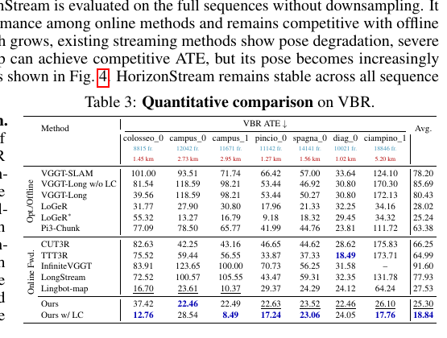

*原论文表 3。每条序列均按完整长度评测；回环优化在部分重访路线中显著改善结果，但在个别序列上会增加误差。*

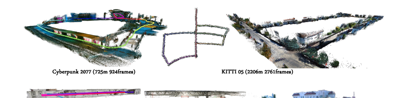

*原论文图 2。展示游戏环境、KITTI、手机室内视频、焊接工厂和 Waymo 路段的长序列重建，路线长度从数百米到数公里。*

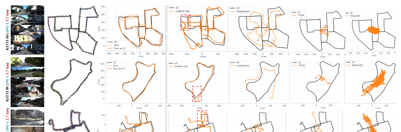

*原论文图 4。输入变长后，部分对照方法出现轨迹漂移、抖动或崩溃；HorizonStream 在图示序列中保持更接近真值的轨迹。*

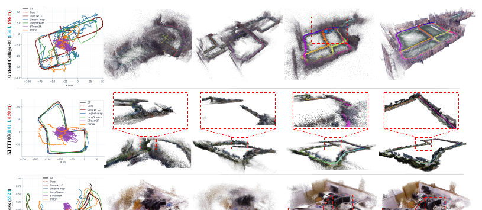

*原论文图 5。左列为相机轨迹，右列为三维重建；作者展示 HorizonStream 在 KITTI、校园和 TUM Desk 场景中的表现。*

附录中的 Oxford Spires 表覆盖 12 个长短不一的子集，HorizonStream 平均 ATE 为 9.38 m，是表中在线方法最低值。不同子集的长度和图像与真值点云的对齐难度不同，尤其短序列的定位变化不应与长路线的误差作等量解读。

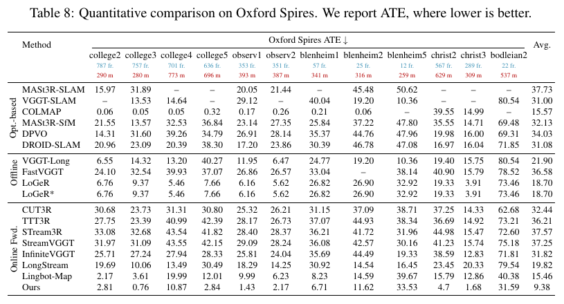

*原论文表 8。表内每个子集报告帧数、路线距离和 ATE；HorizonStream 的平均值为 9.38 m。*

### 稠密重建、深度与消融

稠密重建实验报告 ETH3D、Oxford Spires、7-Scenes 和 TUM 上的 Chamfer Distance 与 F1。HorizonStream 在多个在线方法比较项中表现较强，但不是每个分项都领先，例如 7-Scenes 的 Chamfer Distance 上 LongStream 更低。作者也指出 7-Scenes 进入训练数据，且若干基线在该数据集的 Chess、Pumpkin、RedKitchen 上有很大误差。

KITTI 视频深度实验中，HorizonStream 的 Abs Rel 为 0.057，$\delta<1.25$ 准确率为 94.8%；离线 VGGT 的 Abs Rel 为 0.061、准确率为 97.0%。因此它在这组对照中的相对误差较低，但阈值准确率没有超过 VGGT。

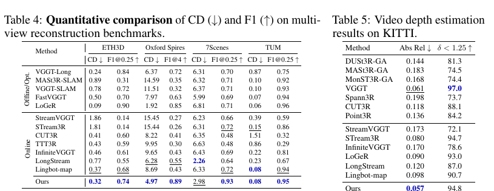

*原论文表 4–5。表 4 汇报 ETH3D、Oxford Spires、7-Scenes、TUM 的 CD/F1；表 5 报告 KITTI 深度指标。*

消融实验在 vKITTI2 上比较 80、200 和 1000 帧的 ATE。完整模型分别为 0.42、0.71、1.20 m；去掉跨窗口 GLA 后升至 0.83、2.06、5.38 m。去掉逐通道门控或改成 TTT 式快速权重也显著增加长程误差，说明有界多跨度传播在长序列中的作用。窗口内模块、MRT 和位姿聚合也各有贡献。

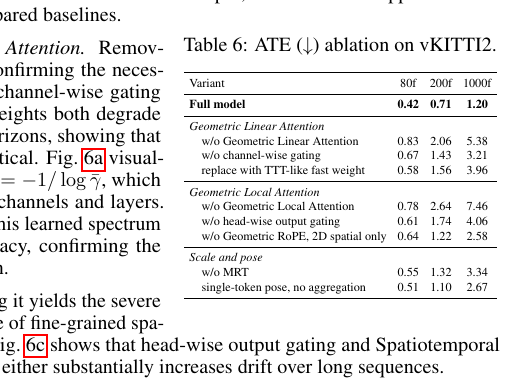

*原论文表 6。随着输入从 80 帧增至 1000 帧，移除 GLA、通道门控或 MRT 后误差均增大；完整模块在该实验中保持最低 ATE。*

### 显存、运行时间与状态探查

作者将 HorizonStream 的显存与运行时间从 200 帧比较到 10,000 帧。图中核心模型的峰值显存曲线基本持平，序列总耗时随帧数平滑增加；若启用需要保存候选特征的回环模块，资源口径还应把检索与优化阶段算进去。

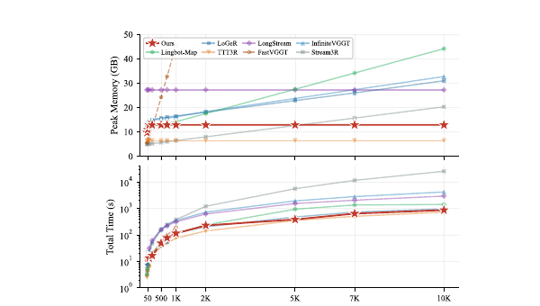

*原论文图 7。横轴延伸到 10,000 帧，HorizonStream 的峰值显存近似恒定，整体运行时间近似随序列长度平滑增长。*

训练收敛图比较不同跨窗口传播方式，带通道门控的 GLA 收敛更快、最终位姿损失更低。另一个线性探查实验从冻结的四层 GLA 状态中提取特征，在 KITTI 00 和 02 上训练岭回归器、在 05 上测试。分段尺度误差最容易从状态特征中预测，探查权重又分布于短、中、长保留通道。作者据此认为度量信息存在于递归状态的多个跨度中；线性可预测性是支持这一解释的证据，并不能单独证明状态以显式、可分离的方式编码了尺度。

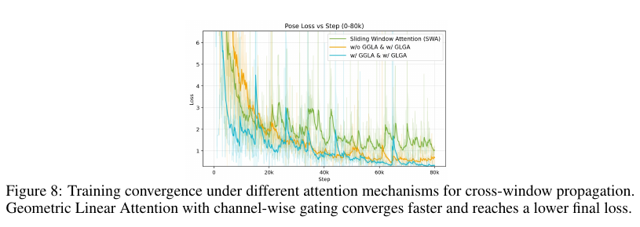

*原论文图 8。采用 GLA 与逐通道门控时，位姿损失下降更快，最终值也低于图中的对照传播方式。*

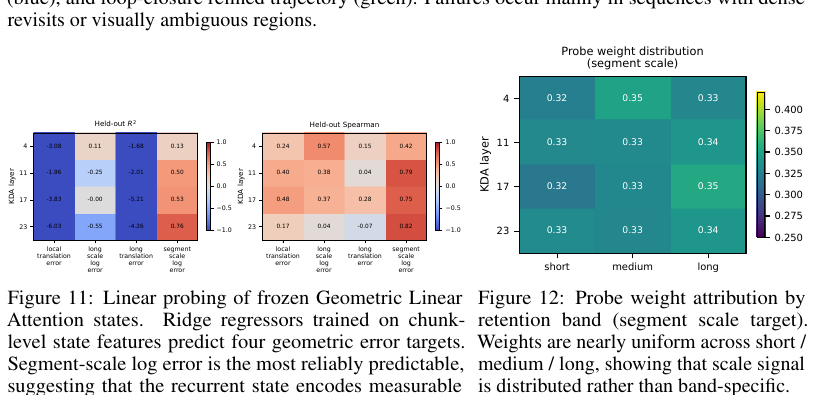

*原论文图 11–12。分段尺度误差在留出序列上最容易由状态特征预测；对应权重在不同保留跨度之间近似均匀分布。*

## 回环能修正部分漂移，但不能替代长期细节记忆

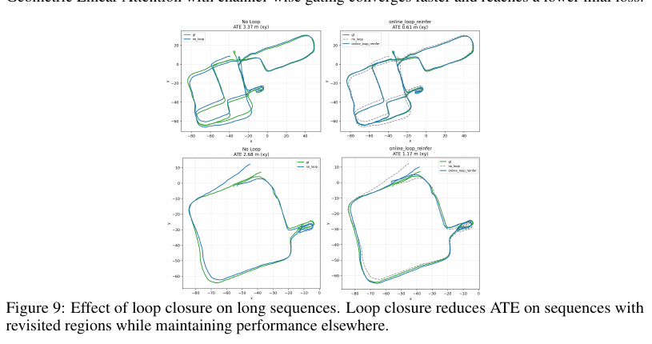

*原论文图 9。重访区域可提供额外约束，回环后的轨迹在图示序列中更接近真值。*

作者也展示了回环仍无法完全解决的长序列失败：密集重访和视觉歧义区域会让固定大小的递归状态缺少精细重定位线索；动态前景物体会污染局部几何证据。可选回环只能部分缓解这些情况，而且其优化模块单独参数化，设置仍可改进。

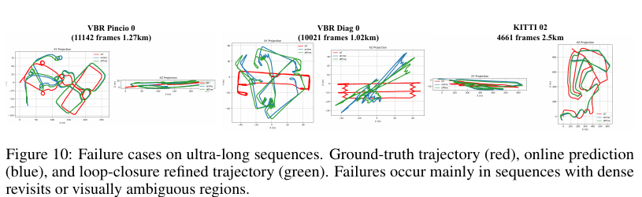

*原论文图 10。真值、在线预测和回环修正轨迹在高密度重访或外观相似区域仍会分离，显示固定状态压缩会丢失精确重定位所需的局部细节。*

这也划出了 HorizonStream 的能力边界。它把跨窗口长期状态做成与序列长度无关的矩阵，并通过不同通道学习记忆尺度；短程几何由固定窗口承担。因而模型省去了不断扩大的注意力 KV 缓存，却不能把所有历史细节都保留下来。论文结果支持它在多种完整序列上的稳定性，但长视频中的重复观测、动态物体和全局重访仍需要额外的回环与几何约束。

从更广的流式重建路线看，HorizonStream 把短期局部上下文和长期全局状态明确分成两种计算：窗口内做空间关联，窗口间做带衰减的递归传播，再用 MRT 提取度量尺度。它可以和 [StreamVGGT](../streamvggt/index.md) 的 KV 缓存、[CUT3R](../cut3r/index.md) 的递归状态、[LongStream](../longstream/index.md) 的周期性缓存刷新，以及 [LingBot-Map](../lingbot-map/index.md) 的关键帧记忆对照。HorizonStream 持续保留状态但选择性遗忘，并给核心递归状态设定固定维度；代价是显式保留高分辨率历史细节的能力有限，且可选回环另有检索存储和优化开销。
