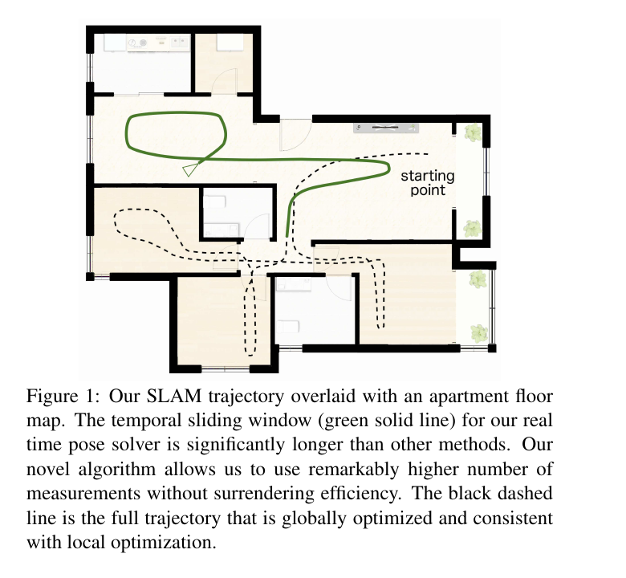
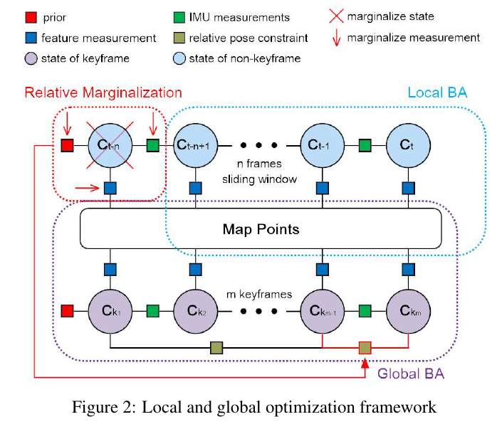
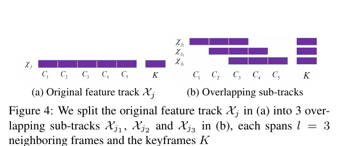
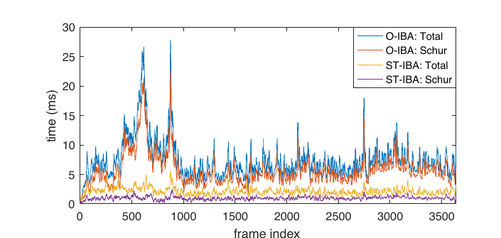
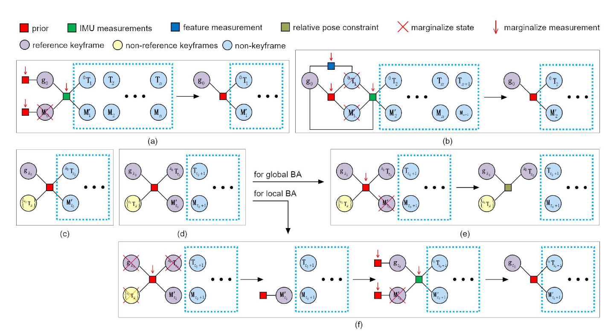
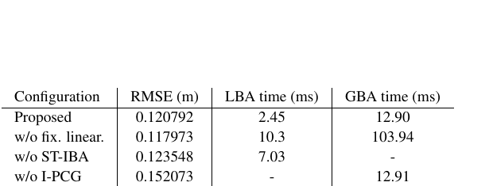
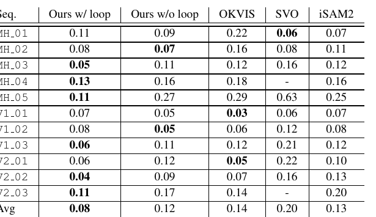
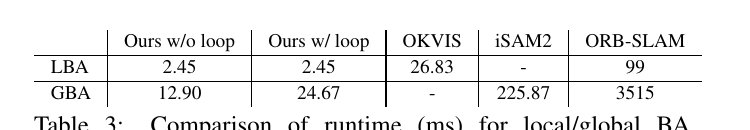
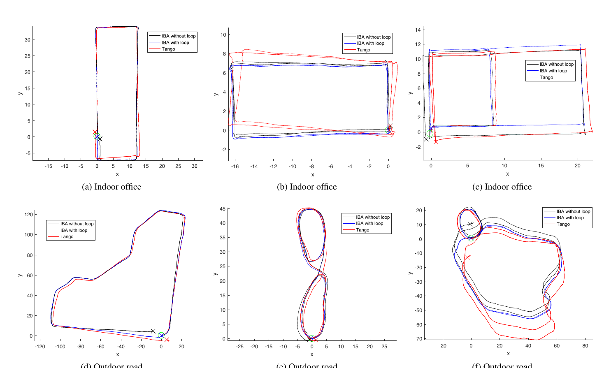

# ICE-BA 论文解读

> **论文**：*ICE-BA: Incremental, Consistent and Efficient Bundle Adjustment for Visual-Inertial SLAM* · **作者**：Haomin Liu、Mingyu Chen、Guofeng Zhang、Hujun Bao、Yingze Bao · **版本**：CVPR 2018 正式论文，pp. 1974–1982，共 9 页 · **论文页面**：[CVF Open Access](https://openaccess.thecvf.com/content_cvpr_2018/html/Liu_ICE-BA_Incremental_Consistent_CVPR_2018_paper.html) · **PDF**：[正式版 PDF](https://openaccess.thecvf.com/content_cvpr_2018/papers/Liu_ICE-BA_Incremental_Consistent_CVPR_2018_paper.pdf) · **代码**：[Baidu/ICE-BA](https://github.com/baidu/ICE-BA)

视觉惯性 SLAM（VI-SLAM）需要同时处理图像特征和 IMU 测量。局部滑窗能及时修正近期位姿，却会逐渐移除旧帧；全局地图和回环则依赖这些旧帧继续约束轨迹。ICE-BA 的核心问题是：怎样在使用较长滑窗、保留全局 BA 的同时降低重复计算，并让滑窗边缘化得到的先验不与回环后的全局地图相冲突。

论文把求解器设计分成两部分。第一部分利用 BA 的稀疏块结构增量更新线性系统，并为局部 BA 中长特征轨迹引入 ST-IBA，以降低 Schur 补的更新成本。第二部分重新表达边缘化先验：在相邻关键帧坐标系中完成边缘化，再分别向局部 BA 和全局 BA 交付先验与相对位姿约束。前者主要解决速度，后者处理局部历史与全局回环之间的一致性。

## 视觉与惯性约束

第 \(i\) 帧的相机位姿记为 \(T_i=(R_i,p_i)\)，IMU 状态记为 \(M_i=(v_i,b_i)\)，其中 \(v_i\) 是速度，\(b_i\) 是陀螺仪与加速度计的偏置。完整运动状态为 \(C_i=(T_i,M_i)\)。三维特征点 \(X_j\) 用逆深度 \(\rho_j\) 参数化，并锚定在观测它的源帧 \(s_j\) 中。这样，特征点可以由源帧的射线和一个标量逆深度表示。

第 \(i\) 帧对第 \(j\) 个特征的观测为像素坐标 \(x_{ij}\)。论文的视觉残差（式（1））是将源帧中的特征点变换到当前帧并投影到图像平面后，与观测位置相减：

\[
f^{\mathrm{vis}}_{ij}(T_i,T_{s_j},\rho_j)
=\pi\!\left(T_i\circ T_{s_j}^{-1}\circ\frac{1}{\rho_j}\bar{x}_{s_j}\right)-x_{ij}
\sim\mathcal{N}(0,\Sigma^{\mathrm{vis}}_{ij}).
\tag{1}
\]

这里 \(\bar{x}_{s_j}\) 是源像素的齐次坐标，\(\pi\) 是投影函数，\(\Sigma^{\mathrm{vis}}_{ij}\) 表示观测噪声协方差。这个因子同时连接当前相机位姿、源相机位姿和特征逆深度，因此优化相机时也会修正地图点。

两帧之间的 IMU 数据先做预积分，形成相对旋转、速度变化、位置变化和偏置约束。其残差由 \(e_r,e_v,e_p,e_b\) 四部分组成，整体协方差记为 \(\Sigma^{\mathrm{imu}}_{ij}\)（式（2））。预积分量及其协方差只依赖两帧间的 IMU 读数，可以在优化前计算；偏置变化则通过预积分雅可比进行一阶修正。视觉因子约束相机与地图，惯性因子把相邻运动状态连接起来。

局部 BA 只优化最近的 \(n\) 帧及相关地图点。若当前帧为 \(t\)，窗口起点是 \(t_0=t-n+1\)。目标函数由窗口内的视觉残差、首帧先验和相邻帧 IMU 残差构成（式（3））：

\[
\min_{\{C_i,\rho_j\}}
\sum_{i=t_0}^{t}\sum_{j\in\mathcal{V}_i}
\left\|f^{\mathrm{vis}}_{ij}(T_i,T_{s_j},\rho_j)\right\|^2_{\Sigma^{\mathrm{vis}}_{ij}}
+\left\|f^{\mathrm{prior}}_{t_0}(C_{t_0})\right\|^2_{\Sigma^{\mathrm{prior}}_{t_0}}
+\sum_{i=t_0}^{t-1}\left\|f^{\mathrm{imu}}_{i,i+1}(C_i,C_{i+1})\right\|^2_{\Sigma^{\mathrm{imu}}_{i,i+1}}.
\tag{3}
\]

式中的加权范数按对应协方差白化。论文将全局 BA 与局部 BA 并行运行，但频率较低。全局 BA 优化已从滑窗移除、且被保留为关键帧的状态和地图点，包含视觉因子、首个关键帧先验、关键帧间 IMU 因子以及回环产生的相对位姿因子（式（4））。实验中，若一帧含有超过 20 个此前其他帧未观测到的特征，就将其选为关键帧。检测到回环后，相对位姿和协方差进入全局 BA。

**图 1：** ICE-BA 将实时滑窗轨迹与全局优化轨迹放在同一平面图上展示。全局轨迹经过历史约束修正，局部窗口则继续承担实时位姿估计。原论文图 1。

**图 2：** 局部 BA 维护最新帧和地图点，全局 BA 优化已移出滑窗的关键帧；相对边缘化把局部窗口移除的状态转换为全局 BA 可用的相对约束。原论文图 2。

## 增量 BA 与 Schur 补

传统 BA 每轮都要对目标函数线性化并累加正规方程。记所有待优化变量为 \(\phi\)，Gauss–Newton 在当前估计 \(\phi^-\) 附近对第 \(k\) 个残差线性化（式（5））：

\[
f_k(\phi^-\oplus\delta\phi)\approx J_k\delta\phi+e_k,
\tag{5}
\]

其中 \(J_k\) 是雅可比矩阵，\(e_k=f_k(\phi^-)\)，\(\oplus\) 表示在位姿流形上的更新。正规方程把各因子的雅可比贡献累加起来（式（6））：

\[
A\delta\phi=b,\qquad
[A\mid b]=\sum_k[J_k^TJ_k\mid-J_k^Te_k].
\tag{6}
\]

BA 因子只连接少数变量，因而各自贡献的雅可比和正规方程块大多为零。SLAM 又是增量到达的：每次只新增少量状态和测量，且只有状态变化超过阈值的因子需要重新线性化。ICE-BA 因此保留上轮的 \([A\mid b]\)，只减去旧因子贡献、加上重线性化后的新贡献（式（7））：

\[
[A\mid b]^+=[A\mid b]^-+
\left[\sum_{k\in\mathcal{L}}\delta A_k\ \middle|\ \sum_{k\in\mathcal{L}}\delta b_k\right].
\tag{7}
\]

\(\mathcal{L}\) 是本轮需要重线性化的因子集合。阈值策略让小幅更新的变量暂时沿用旧线性化点，减少重算。论文将其称为固定线性化点；它影响线性系统更新频率，但优化目标仍由原来的视觉和 IMU 因子定义。

求解 BA 时，可先消去点变量，只留下相机变量。将正规方程按相机和点分块，写成

\[
\begin{bmatrix}U&W\\W^T&V\end{bmatrix}
\begin{bmatrix}\delta\phi_c\\\delta\phi_p\end{bmatrix}
=\begin{bmatrix}u\\v\end{bmatrix}.
\tag{8}
\]

对点变量做 Schur 消元后，得到只含相机增量的系统（式（9））：

\[
S\delta\phi_c=s,\qquad
[S\mid s]=[U-WV^{-1}W^T\mid u-WV^{-1}v].
\tag{9}
\]

稀疏 BA 中，(V) 按点分块对角，可以逐点求逆。求得相机增量后，再由原正规方程回代每个点的增量（式（12））。ICE-BA 进一步对 Schur 补块做增量更新，并用预条件共轭梯度（PCG）求解约化系统。论文强调，这种复用利用的是变量和测量的稀疏结构。

不过，稀疏全局 BA 和稠密局部 BA 的计算形态不同。全局关键帧之间通常共享较少特征，增量更新只需触及少数 Schur 块；滑窗内的许多特征却会被多数帧共同观测。窗口变长后，一个长轨迹会在大量相机对之间产生 Schur 块，更新成本重新接近完整计算。

### ST-IBA 处理滑窗内的长轨迹

论文将长特征轨迹拆成相互重叠的短子轨迹。每个子轨迹覆盖 $l$ 个相邻帧，并保留关键帧观测；原论文图 4 用 $l=3$ 展示拆分方式，实验使用 $l=5$。原特征的逆深度变量被复制到各子轨迹中。计算 Schur 补时，分别消去这些副本，使每个子轨迹只在局部帧对之间产生连接，从而把稠密相机块结构变得更稀疏。

*一条跨越多个相机的特征轨迹被拆成重叠短轨迹，限制每个临时逆深度变量关联的相机范围。论文实验的子轨迹长度为 5；图中示意长度为 3。*

ST-IBA 的拆分只用于更新 Schur 补。求出相机增量后，论文仍使用原始特征变量和原正规方程进行点回代（式（12）），没有用拆分后的子轨迹近似原目标函数。因此，ST-IBA 是线性系统组织方式的改进，并未改写 BA 的重投影误差。作者报告它相对原始增量 BA 提速约 2–10 倍，且没有明显精度损失。

*当许多局部帧共享长特征轨迹时，原始 IBA 的 Schur 补更新时间明显增加；ST-IBA 将短子轨迹的连接限制在局部，因此缓解了这一增长。*

### I-PCG 复用未变化相机的迭代量

标准 PCG 通常从零开始初始化相机增量。增量 BA 中，有些相机状态在相邻迭代之间没有变化，其新一轮最优增量往往与上一轮接近。I-PCG 对这些未变化状态沿用前一轮 PCG 的增量，只将发生变化的相机增量设为零，再继续迭代。这样减少了从零逼近相近解的工作。论文报告 I-PCG 通过改善收敛使 RMSE 约降低 20%；由于实验设置了最少迭代次数，消融表中运行时间没有明显下降。

## 相对边缘化连接局部与全局地图

当滑窗超过阈值，论文实验取 50 帧，最老帧 \(t_0\) 必须移除。边缘化会把被移除状态及其因子压缩为剩余变量上的高斯先验。若持续在全局坐标中累积先验，早期估计误差会被冻结进先验；全局 BA 后续通过回环调整关键帧时，这个先验可能仍把局部窗口拉向旧的错误位置，造成局部估计与全局地图冲突。

ICE-BA 将边缘化先验写在最近关键帧 \(k_0\) 的局部坐标系中。相机位姿和重力方向变换到该坐标系，速度则表示在相应帧自身的局部坐标系里：

\[
{}^{k_0}T_i=T_i\circ T_{k_0}^{-1},\qquad
g_{k_0}=R_{k_0}g,\qquad
{}^iv_i=R_i v_i.
\]

于是局部状态写为 \(C'_i=({}^{k_0}T_i,M'_i)\)，其中 \(M'_i=({}^iv_i,b_i)\)。视觉残差也改用这些相对位姿表达（式（15））。这意味着边缘化先验依附于一个明确的局部参考关键帧；回环调整整个地图时，不必把先验解释成对固定全局坐标的绝对约束。

直接消去相机位姿会让它观测到的所有逆深度点彼此产生相关性，破坏 BA 按点稀疏的结构。论文为每个相关逆深度复制一个变量，只保留用于构造高斯因子的那条观测，再将复制变量边缘化。式（16）和式（17）分别给出视觉与 IMU 因子在参考坐标系中的表达，借此保留稀疏求解结构。图 5 展示了从首帧先验开始，随窗口移动反复边缘化的过程。

**图 5：** 滑窗移除旧帧时，边缘化先验以参考关键帧坐标表示。成为关键帧的旧状态分别进入全局 BA 的相对约束，以及局部 BA 使用的新先验。原论文图 5。

边缘化产生的新先验约束下一帧及仍参与其中的关键帧（式（18））。局部 BA 优化时，论文再将需要的先验转换回全局状态表示（式（19））；只有全局 BA 调整关键帧位姿，因此关键帧变量不会作为冻结的绝对先验留在局部 BA 中。若移除的 \(t_0\) 是新关键帧，系统把它和相关历史关键帧之间的相对约束提交给全局 BA（式（20）），并在全局优化中转换为全局坐标表达（式（21））。

因此，“相对边缘化”并非取消边缘化或让所有历史帧回到局部窗口。它仍将旧帧压缩成先验，只是保留先验相对于关键帧的表达，并把关键帧关系交给全局优化。局部 BA 可以继续快速滑动，全局 BA 的回环结果则能通过相对约束更新地图中的关键帧关系。

## 实验结果与适用范围

作者基于该求解器搭建立体视觉惯性 SLAM：前端用 Harris 特征、光流跟踪和双目直接匹配构造观测，回环检测使用关键帧的 bag-of-words 特征。EuRoC 实验统一采用 50 帧局部窗口；作者指出更大的窗口没有继续降低误差，却会降低效率。除定量评测外，论文还将轨迹与 Google Tango Phab 2 的结果作定性比较。

表 1 对逐项移除模块的结果作了汇总。完整系统在 EuRoC 上的平均 RMSE 为 0.120792 m，局部 BA 用时 2.45 ms，全局 BA 用时 12.90 ms。取消固定线性化点后，局部和全局 BA 分别变为 10.3 ms、103.94 ms；取消 ST-IBA 后局部 BA 为 7.03 ms。取消 I-PCG 后平均 RMSE 为 0.152073 m；取消相对边缘化后为 0.179655 m。表中各消融的空白表示该项未报告，并非零耗时。

**表 1：** 固定线性化点和 ST-IBA 主要降低计算量；I-PCG 与相对边缘化主要改善收敛和定位精度。原论文表 1，保留原始数值。

表 2 给出 11 段 EuRoC 序列的平移 RMSE。ICE-BA 开启回环时平均为 0.08 m，关闭回环时为 0.12 m；对照的 OKVIS、SVO 和 iSAM2 分别为 0.14、0.20 和 0.13 m。作者说明立体算法的轨迹对齐不做尺度调整。OKVIS、SVO 是 VIO；iSAM2 使用相同特征轨迹但不加回环约束。其他方法的数字来自作者用公开代码重新运行的结果，与其各自论文中报告的数字可能略有不同。因此这些数值属于本文系统和评测协议下的对比，不宜脱离实验配置解读成普遍排名。

**表 2：** 轨迹误差以米计，按论文协议不对立体方法做尺度调整；粗体为每个序列中表内最小值。原论文表 2。

在 Intel i7 CPU、禁用多线程且不计前端时间的测试中，ICE-BA 局部 BA 为 2.45 ms，全局 BA 无回环时为 12.90 ms、有回环时为 24.67 ms。表 3 中 OKVIS 局部优化为 26.83 ms，ORB-SLAM 为 99 ms；iSAM2 全局 BA 为 225.87 ms，ORB-SLAM 为 3515 ms。论文特别指出 OKVIS 使用 5 个关键帧和 3 个 IMU 帧，而 ICE-BA 的滑窗有 50 帧；ORB-SLAM 使用更多特征以维持跟踪。因此论文报告的加速倍数受窗口和前端设置影响。ARM 测试使用 A9×4+A15×4 处理器并让求解器单线程运行在 A15 上，局部 BA 为 12.18 ms，全局 BA 无回环和有回环分别为 78.14 ms、193.72 ms。

**表 3：** 运行时间以毫秒计，不含特征检测和匹配；OKVIS 与 ICE-BA 的窗口设置不同。原论文表 3。

**图 6：** 六组轨迹比较中，黑色表示 ICE-BA 无回环，蓝色表示有回环，红色表示 Tango。图示用于定性观察轨迹闭合和形状差异；论文的定量比较见 EuRoC 表格。原论文图 6。

这些实验支持一个有边界的结论：在作者实现的立体 VI-SLAM 系统中，增量线性化、ST-IBA 和相对边缘化让 50 帧局部窗口可在较低求解时间下运行，并在 EuRoC 上取得较低的平均轨迹误差。论文中的“精确解”应理解为 ST-IBA 保留了同一个 BA 目标函数和原始点变量回代；Gauss–Newton 仍是迭代非线性优化，不代表找到了非线性问题的全局最优解。标题中的“一致”也具体指边缘化先验与回环全局地图的协调，并非给出完整 SLAM 可观测性的一致性定理。

## 方法关系

ICE-BA 的增量 BA 和相对边缘化分别作用于优化的不同层面。增量 BA 缓存并更新线性系统，降低重复线性化和 Schur 补构造的成本；ST-IBA 针对局部窗口中长轨迹共享过多相机的问题，重新组织 Schur 补更新；I-PCG 复用没有改变的相机增量，加快约化系统的迭代求解。相对边缘化则安排旧状态如何离开窗口、如何形成局部先验、以及怎样作为关键帧间相对约束进入全局 BA。

把这几部分合在一起看，ICE-BA 的效率来自利用 SLAM 测量逐步到达这一结构，定位稳定性则来自不让局部窗口的边缘化先验和全局回环各自维护互不兼容的历史。它是以明确几何因子和优化为核心的视觉惯性 SLAM 求解器；这一思路也为后来将学习式几何先验接入局部跟踪与全局优化的系统提供了传统 BA 背景。
