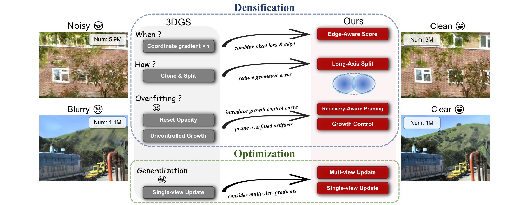
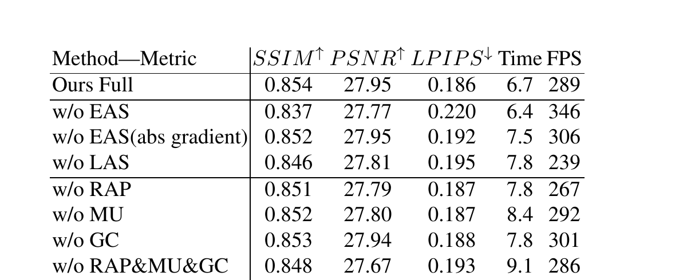
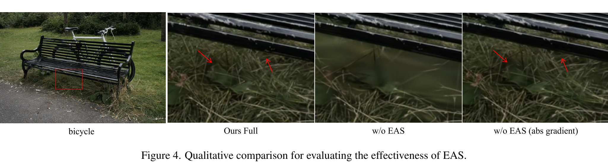
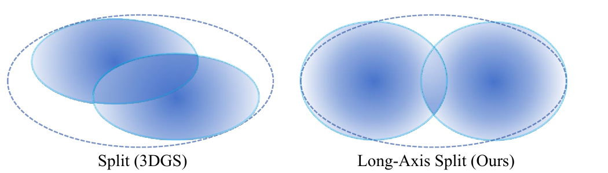
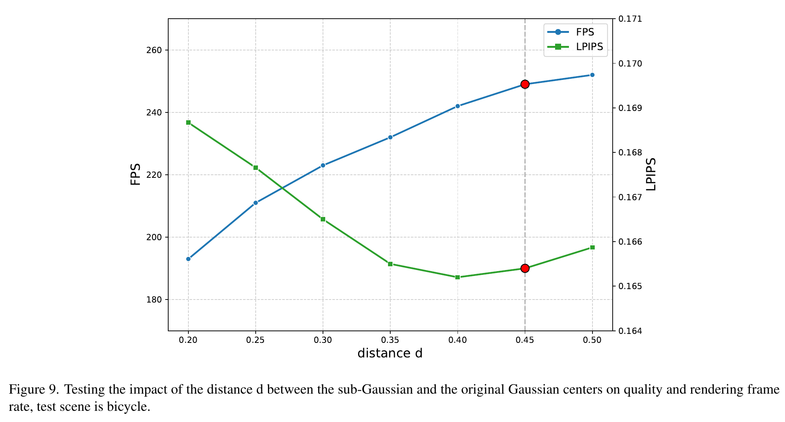
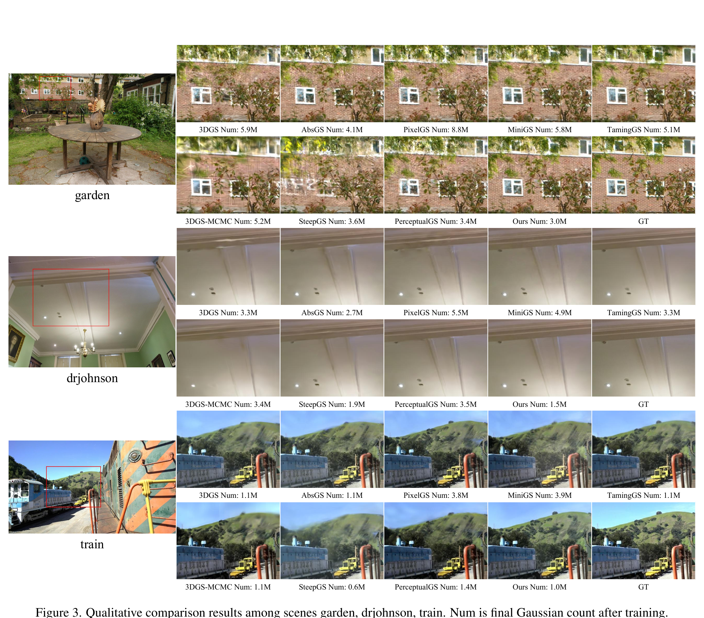
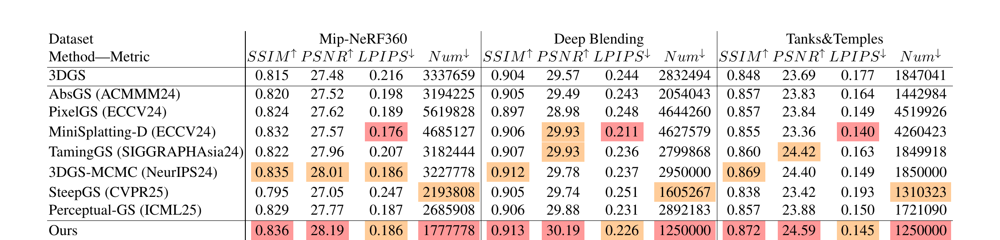
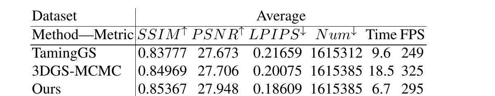

# Improving Densification in 3D Gaussian Splatting for High-Fidelity Rendering 论文解读

> Xiaobin Deng、Changyu Diao、Min Li、Ruohan Yu、Duanqing Xu，*Improving Densification in 3D Gaussian Splatting for High-Fidelity Rendering*，CVPR 2026 Findings，页码 223–232。本文依据正式版论文及补充材料。[CVF 论文页](https://openaccess.thecvf.com/content/CVPR2026F/html/Deng_Improving_Densification_in_3D_Gaussian_Splatting_for_High-Fidelity_Rendering_CVPRF_2026_paper.html) · [正式版 PDF](https://openaccess.thecvf.com/content/CVPR2026F/papers/Deng_Improving_Densification_in_3D_Gaussian_Splatting_for_High-Fidelity_Rendering_CVPRF_2026_paper.pdf) · [补充材料 PDF](https://openaccess.thecvf.com/content/CVPR2026F/supplemental/Deng_Improving_Densification_in_CVPRF_2026_supplemental.pdf) · [项目页与代码](https://xiaobin2001.github.io/improved-gs-web/)

3D Gaussian Splatting（3DGS）会在训练过程中不断增加、拆分和移除高斯。密度控制决定了模型把有限的基元放在哪里，也影响细节能否补足、浮点伪影会不会扩散，以及训练和渲染需要多少资源。ImprovedGS 把这件事拆成三个问题：该细化哪些高斯、怎样拆分才能少扰动原有表示、如何抑制过拟合造成的冗余增长。它另外调整细化结束后的参数更新节奏，以提升新视角的泛化表现。

*原论文 Figure 1。左侧为标准 3DGS 的噪声、模糊和高斯数量，右侧概括 ImprovedGS 的 Edge-Aware Score、Long-Axis Split、Recovery-Aware Pruning、Growth Control 与 Multi-view Update。*

## 从梯度阈值转向边缘引导的候选选择

标准 3DGS 会累计一个高斯在多个训练视角中的屏幕空间位置梯度，再用梯度长度是否超过阈值决定要不要细化。这个分数是向量累加：不同像素对同一高斯的梯度方向相反时会相互抵消。覆盖范围很大的高斯因此可能仍有明显模糊，却因合成梯度较小而错过细化。

ImprovedGS 的 Edge-Aware Score（EAS）同时看两个信号。第一个信号衡量一个高斯在图像边缘处的贡献。对训练视图 $j$，先对图像应用 Laplacian 算子，得到像素 $p$ 的边缘权重 $\omega_{p,j}$；再将它与高斯 $i$ 在该像素上的渲染权重 $\alpha^i_{p,j}$ 相乘并求和：

$$
S_{i,j}=\sum_{p\in P}\omega_{p,j}\alpha^i_{p,j}.
$$

在每个密度控制步骤前，方法随机抽取 $N_s$ 个训练视图，把各视图的分数取平均，得到 $\bar S_i$。这个量告诉算法：高斯在多大程度上参与了边缘区域的成像。但它本身不能说明那些区域是否重建得好，因此还要配合第二个信号。

第二个信号是逐像素位置梯度幅值的累计。标准 3DGS 先把各像素梯度相加，ImprovedGS 则先取绝对值再求和：

$$
g^i_{x,k}=\sum_{p\in P_k}\left|\frac{\partial L_{p,k}}{\partial \mu^i_x}\right|,
\qquad
g^i_{y,k}=\sum_{p\in P_k}\left|\frac{\partial L_{p,k}}{\partial \mu^i_y}\right|.
$$

其中 $L_{p,k}$ 是视图 $k$ 中像素 $p$ 的损失，$P_k$ 为该视图的像素集合，$\mu^i_x,\mu^i_y$ 是高斯中心投影到屏幕后的坐标。对各视图的梯度幅值再按训练周期累计或平均。取绝对值避免相反方向的像素梯度互相抵消，也让分数更接近该高斯覆盖区域内误差变化的总量。跨视图累计后，幅值超过阈值的高斯才进入候选集合；在候选集合中，高斯被选中拆分的概率与 $\bar S_i$ 成正比。

因此，EAS 将“这个高斯是不是参与了重要边缘”和“它所在区域是否仍有较大误差”结合起来。边缘权重负责把密度投向容易显糊的结构，绝对梯度则帮助排除已经拟合得较好的区域。Figure 4 的自行车草地对比中，完整 EAS 能保留细草边缘；只用普通累计梯度时，部分细节仍然较软。消融表显示，在相同高斯预算下，完整方法的 LPIPS 为 0.186，去掉 EAS 后为 0.220；相应 PSNR 从 27.95 dB 降到 27.77 dB。EAS 也有计算代价：这组消融的训练时间从 6.4 分钟增至 6.7 分钟，渲染帧率从 346 降至 289 FPS。

*原论文 Table 2。移除 EAS 会降低画质指标，移除 LAS、RAP、MU 或 GC 也会改变训练时间与质量；完整配置在该消融中的 PSNR、SSIM 和 LPIPS 最好。*

*原论文 Figure 4。自行车场景的草地细节显示，边缘权重与绝对梯度共同使用时，比移除 EAS 或只用绝对梯度更能保留细线结构。*

## Long-Axis Split 减少拆分瞬间的几何扰动

标准 3DGS 对大高斯进行拆分时，会沿高斯协方差采样子高斯的位置。位置带有随机性，子高斯的形状也沿用固定缩放规则。父高斯被替换后，原先覆盖的区域会突然改变；优化器需要花时间把新子高斯重新调整到合适位置和形状。

Long-Axis Split（LAS）把两个子高斯放在父高斯最长主轴上、父中心两侧的对称位置。设父高斯最长轴的半长为 $L_0$，子高斯中心离父中心的距离为 $d$。那么子高斯在该轴上的半长设为 $L_s=L_0-d$，使两端接续父高斯的端点。为保持垂直于长轴的截面也贴近父高斯，另外两条轴的半径 $R_s$ 按下式初始化：

$$
R_s=R_0\sqrt{1-\frac{d^2}{L_0^2}},
$$

其中 $R_0$ 是父高斯对应短轴的半径。这个关系让子高斯的横截面端点落在父高斯表面上。论文的消融发现，子中心越靠近父中心，几何变化越小，但两个子高斯重叠越多，像素的合成队列也会变长。实际设置取 $d=0.45L_0$，在形状连续、重叠率和速度间折中；每个子高斯的不透明度初始化为父高斯的 60%。ImprovedGS 只采用 LAS 作为密度增加操作，不再区分传统的 clone 与 split。

*原论文 Figure 2。虚线表示拆分前的父高斯轮廓；LAS 的两个子高斯沿长轴对称排列，拆分后的覆盖形状更接近原轮廓。*

补充材料把长轴垂直截面简化为圆，推导上述半径关系，并比较不同 $d$ 对 LPIPS 与 FPS 的影响。作者报告，较小的拆分间距会显著提高重叠和渲染开销；0.45 倍长轴半长是在自行车场景上选出的经验折中。这个设计直接针对拆分操作引入的瞬时表示变化，并不能保证所有场景中每个子高斯都落在真实表面上。

*原论文补充材料 Figure 9。随着子高斯中心距离 $d$ 增大，帧率上升；LPIPS 在 $d=0.4$ 左右较低，论文最终选取 $0.45$，在画质与速度之间折中。*

## 用不透明度恢复和增长曲线控制过拟合

标准 3DGS 会周期性重置不透明度，以避免单个高斯过度主导渲染。ImprovedGS 观察到，重置之后，不同高斯的不透明度恢复速度不同：稳定解释多视角内容的高斯通常持续恢复；一些只对少数训练视角有利、在其他视角造成负面影响的浮点，其不透明度恢复会更慢、波动也更明显。

Recovery-Aware Pruning（RAP）利用这段恢复期筛掉冗余项。具体做法是在前两次不透明度重置之后，各等待 300 次迭代，再按不透明度从低到高移除 20% 的高斯。等待一段时间的目的是让多个视角的梯度有机会影响不透明度，同时避免等到所有高斯都完全恢复、差异消失。作者指出 RAP 主要针对浮点和过拟合伪影；面对玻璃等透明物体时，较慢恢复未必意味着不正确，因此此类场景需要谨慎使用。

Growth Control（GC）则限制高斯数量过早达到峰值。设当前迭代为 $I$，密度增长阶段从 $I_{start}$ 到 $I_{end}$，最终预算为 $N_{max}$，方法将当前允许的预算设为：

$$
N(I)=N_{max}\sqrt{\frac{I-I_{start}}{I_{end}-I_{start}}}.
$$

平方根曲线前段增长较快，能尽早补足主要结构；随后增长逐渐放缓，让预算接近密度控制结束时才达到峰值。因而，预算不是全程固定的大上限，而是随着训练阶段逐步开放。论文指出，这样可以避免高斯数量很早冲高，降低后续训练和渲染负担，也减少过早记住训练视图噪声的机会。

## 密度控制结束后再合并多视角更新

ImprovedGS 还把训练更新分成两个阶段。密度仍在变化时，继续每次用一个视图更新参数，因为新拆分的高斯需要快速适应；如果过早降低更新频率，尚未收敛的子高斯可能再次被错误地拆分。密度控制结束后，优化速度自然下降，更新间隔可以拉长。

具体安排是：前 15,000 次迭代保持单视图更新；15,000 到 22,500 次迭代把 5 个视图的梯度合并后更新一次；之后再扩展到 20 个视图一组。这样在后期近似扩大有效批量，汇总更多视角对同一组参数的约束，减轻对单张训练图像的过拟合，同时减少参数更新次数。补充材料中，从训练初期就采用多视图间隔会明显损害质量；延后到密度增长结束附近后，这种负面影响才减小。

*原论文 Figure 3。garden、drjohnson 与 train 场景的局部放大对比显示，ImprovedGS 在砖墙、室内灯具和山坡物体细节上较清晰；各方法同时标出了训练后的高斯数量。*

## 质量、数量与速度需要一起看

论文在 Mip-NeRF 360 的 9 个场景、Tanks and Temples 的 train 和 truck 场景，以及 Deep Blending 的 drjohnson 和 playroom 场景上测试；每隔 8 张训练图像留出一张用于验证。结果以 PSNR、SSIM、LPIPS 评价，并在单张 RTX 4090D 上运行。主文表格报告三次运行中取得的最好结果；对比方法使用各自论文的默认参数。

*原论文 Table 1。ImprovedGS 在三个数据集的 PSNR 与 SSIM 上均为表中最好值，高斯数也最低；LPIPS 则在 Mip-NeRF 360 与 3DGS-MCMC 持平，在 Deep Blending 和 Tanks and Temples 上优于 MCMC，但没有全面胜过所有方法。*

以 Mip-NeRF 360 为例，ImprovedGS 的平均 PSNR/SSIM/LPIPS 为 28.19 dB / 0.836 / 0.186，最终约 1.78M 个高斯；3DGS-MCMC 为 28.01 dB / 0.835 / 0.186，约 3.23M 个高斯。Deep Blending 上，ImprovedGS 为 30.19 dB / 0.913 / 0.226、1.25M 个高斯，MCMC 为 29.78 dB / 0.912 / 0.237、2.95M 个高斯。Tanks and Temples 上，ImprovedGS 为 24.59 dB / 0.872 / 0.145、1.25M 个高斯；表中 Mini-Splatting-D 的 LPIPS 为 0.140，低于 ImprovedGS 的 0.145。整体趋势是以较少高斯取得更好的 PSNR 和 SSIM，感知指标则依数据集而异。

在高斯预算相同的对比中，所有方法平均约 1.615M 个高斯。ImprovedGS 的 PSNR/SSIM/LPIPS 为 27.948 dB / 0.85367 / 0.18609，训练 6.7 分钟；MCMC 为 27.706 dB / 0.84969 / 0.20075，训练 18.5 分钟。两者帧率分别为 295 和 325 FPS，因此论文结果并不意味着 ImprovedGS 的渲染速度总是更高。作者还说明，跨方法训练时间受 CUDA 内核实现影响，不宜不加区分地横向比较；相同实现、相同高斯预算下的消融和对比更能隔离方法本身的影响。

*原论文 Table 3。预算相同时，ImprovedGS 的平均 PSNR、SSIM、LPIPS 和训练时间优于表中的 TamingGS 与 MCMC；MCMC 的 FPS 仍高于 ImprovedGS。*

结果支持的结论是：改善密度控制可以提高细节和画面整洁度，并减少表示所需的高斯数。它没有证明密度策略能恢复准确的物理表面，也没有保证每个场景、每个指标都领先。实验覆盖 13 个场景，且主文以三次运行的最好结果报告性能；RevisingGS 因当时没有可用代码而未被纳入基线。读这些数字时，最好把“渲染质量”“表示大小”和“运行速度”作为几条相关但不同的轴。

## ImprovedGS 与后续 ImprovedGS+ 的关系

LichtFeld Studio 相关讨论中出现的 IGS+，对应 Jordi Muñoz Vicente 的 *ImprovedGS+: A High-Performance C++/CUDA Re-Implementation Strategy for 3D Gaussian Splatting*。这是一篇 2026 年 3 月发布的 arXiv 预印本，而非 CVPR 2026 Findings 的组成部分，也不能和 Deng 等人的 ImprovedGS 论文视作同一工作。[ImprovedGS+ arXiv 页面与 PDF](https://arxiv.org/abs/2603.08661) · [项目代码](https://github.com/jordizv/ImprovedGS-Plus)

ImprovedGS+ 声称以 C++/CUDA 重写 ImprovedGS 的部分密度控制，重点保留 LAS 和边缘分数，并加入基于 Sobel 的梯度、非极大值抑制（NMS）、指数尺度学习率调度和重新调整的位置学习率。论文报告在 Mip-NeRF 360 上测试，硬件为 RTX A4500，每项实验运行 6 次。其表格给出的固定 1M 预算汇总结果是：MCMC 需要 62 分 14 秒、最终 1.000M 个高斯，PSNR/SSIM 为 28.64 dB / 0.848；IGS+ 需要 45 分 33 秒、最终约 0.867M 个高斯，PSNR/SSIM 为 28.79 dB / 0.859。无固定预算的 IGS+ 汇总 PSNR 为 29.38 dB，ADC 为 28.10 dB；对应高斯数量为 1.688M 和 2.741M。

这些是预印本报告的结果，适合视为实现方案的初步证据。它只评估 Mip-NeRF 360，且逐场景数据并非每个指标都胜过 MCMC：例如 Flowers 上 IGS+ 的 1M 变体 PSNR 和 SSIM 均较低，Stump 上 PSNR 也较低。它也改了多项学习率和生长设置，不能把整体差异只归因于 C++/CUDA 重写。更稳妥的关系是：ImprovedGS 给出密度控制方法，ImprovedGS+ 是一个独立实现与训练配置改造；后者的提速和画质数字仍需更多实现、数据集和场景层面的复核。

## 方法关系

ImprovedGS 的核心是把密度控制从单一梯度阈值扩展为一套互相配合的操作：EAS 选择需要细化的区域，LAS 让替换父高斯时的几何覆盖变化更平缓，RAP 与 GC 控制过拟合伪影和高斯预算，Multi-view Update 则利用密度阶段结束后的更新余量改善泛化。它由此补上了和 [Spec-Gaussian 外观建模](../spec-gaussian/) 不同的一条质量路径：后者增强单个高斯表达方向性高光的能力，ImprovedGS 则决定高斯基元如何分布、怎样增长。二者讨论的是不同瓶颈，可以组合，但本文结果没有验证这种组合带来的收益。
