# IncVGGT 论文解读

> Keyu Fang、Changchun Zhou、Yuzhe Fu、Hai “Helen” Li、Yiran Chen，*IncVGGT: Incremental VGGT for Memory-Bounded Long-Range 3D Reconstruction*，发表于 ICLR 2026。本文依据 ICLR 正式版 PDF（15 页，含定性可视化附录）阅读全文。[ICLR 2026 论文页](https://proceedings.iclr.cc/paper_files/paper/2026/hash/0a4096f09ab230082df548f901d4f79e-Abstract-Conference.html) · [正式版 PDF](https://proceedings.iclr.cc/paper_files/paper/2026/file/0a4096f09ab230082df548f901d4f79e-Paper-Conference.pdf)

VGGT 能从多张图像前馈预测相机、点图和深度，但把整段视频一起输入会让全局注意力成本迅速增长。StreamVGGT 将处理改为因果逐帧推理，并复用历史键值；然而，只要每帧都把新的键和值留在缓存中，历史状态仍会随视频长度增长。长视频里相邻画面又常常高度相似，重复输入和重复缓存会持续消耗计算与显存。

IncVGGT 针对这两处冗余做训练自由的推理改造：先把短窗口内重叠的图像配准并融合成较少的视图，再从历史 KV 中保留高相关帧和最近帧。它使用 StreamVGGT 的预训练权重，不增加训练阶段。这个设计适合被理解为长序列视觉几何重建方法；论文实验考察相机、深度和多视图重建，但它没有实现传统 SLAM 系统中的回环检测、全局 BA 或地图重定位。

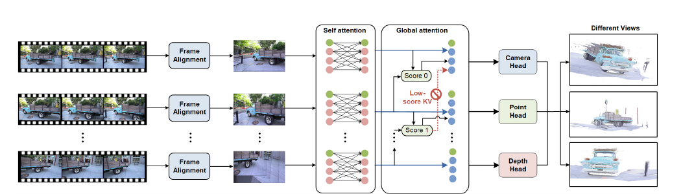

*原论文图 1。输入帧先配准到公共参考并形成紧凑视图，再经过自注意力与全局注意力；缓存裁剪后，模型由相机、点图和深度头联合输出几何结果。*

## 两个位置上的冗余

VGGT 将多帧图像的 token 放进全局注意力。若每帧含有 $p$ 个 token、共处理 $F$ 帧，注意力矩阵的规模随总 token 数 $L=Fp$ 的平方增长。StreamVGGT 只让当前帧查询历史状态，避免每次重新编码所有帧，但若 KV 缓存不断累积，当前帧仍要访问越来越长的历史。

IncVGGT 对应地把冗余削减分成两个步骤。输入端处理像素层面的重叠：如果短时间内相机运动不大，连续图像中许多区域反复出现，就将这些区域融合，减少送入 Transformer 的 token 数。历史端处理注意力层面的冗余：一些过去帧对当前预测帮助较小，可以从 KV 缓存中移除；同时保留最近帧，以维持短期连续性。

## 输入侧：配准、合并与递归切分

给定连续的 $K$ 帧，算法把第一帧 $I_0$ 选作参考，使用 ORB 或 SIFT 提取局部特征，经 kNN 匹配、比率检验和双向交叉检查得到较可靠的对应点。随后用 DLT 与 RANSAC 估计相邻帧间的单应矩阵 $H_{i\to i-1}$。将相邻变换连乘，得到每一帧到参考帧的累计变换：

$$
H_{i\to 0}=H_{1\to 0}H_{2\to 1}\cdots H_{i\to i-1},\qquad i=1,\ldots,K-1.
\tag{1}
$$

这里的矩阵乘法按从右到左依次把第 $i$ 帧映射到前一帧，再映射到参考帧；参考帧自身使用单位变换 $H_{0\to0}=I$。有了统一参考系，算法就能把短窗口中的图像放到同一个画布上比较和融合。

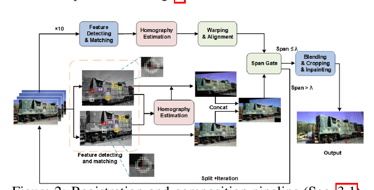

*原论文图 2。所有帧先对齐到公共参考；跨度通过阈值时融合为单个视图，否则把窗口递归切成共享中间帧的子窗口。*

单应变换可描述平面投影或小视差下的近似图像运动，但不能完整表示强三维视差。为避免远距离外推使画布无限变宽，论文把变换限制在以参考帧为中心的窄竖直带内。接下来计算所有变换后图像支持区域的水平覆盖跨度，并用参考图像宽度归一化：

$$
\operatorname{span}(\{H_{i\to0}\})=
\frac{\left|B_x\left(\bigcup_{i=0}^{K-1}S_i\right)\right|}{W_0}.
\tag{2}
$$

$S_i$ 是第 $i$ 帧变换后的有效图像区域，$B_x$ 表示覆盖这些区域的最小水平区间，$W_0$ 是参考图像宽度。因此 span 衡量融合窗口横向铺开的程度，而不是帧数。如果 span 不超过阈值 $\lambda$，算法将这组图像合成一个视图；如果超出，就把窗口分成两个共享中间帧的子窗口，分别继续判断。切分会缩短每次单应近似所需覆盖的运动范围，也让相邻结果仍有共同帧可作对齐锚点。

通过阈值的帧经变换后使用有效性掩码和距离变换权重做羽化融合。对像素位置 $x$，变换后第 $i$ 帧的图像和权重分别记为 $	ilde I_i(x)$、$W_i(x)$，融合颜色为

$$
\hat I(x)=rac{\sum_i W_i(x)	ilde I_i(x)}{\sum_i W_i(x)+\delta},\qquad \delta>0.
$$

离图像边缘越远的有效像素权重越高，降低接缝；较晚帧覆盖较早帧，使新到内容填补小空洞。之后裁掉缺少支持的边缘，并对局部严格空洞做小范围修补。可选地，输出再裁成参考帧高度，维持规则的 token 网格。

这种压缩依赖视图之间存在足够重叠。大幅视角变化、低纹理或快速运动都会让匹配和累计单应不稳定；强视差也会让平面变换无法同时对齐近处和远处。因此它适合短窗口、相邻视图相似的流，不等同于通用的三维场景融合。

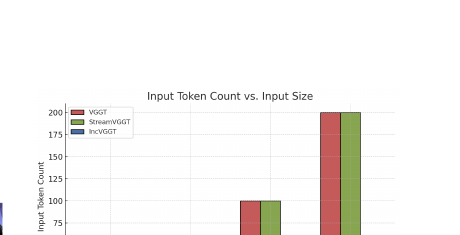

*原论文图 3。图中以一幅标准视图的 token 数 $N$ 为单位比较输入规模；合并后 IncVGGT 的 token 增长低于未合并的 VGGT 与 StreamVGGT。*

## 历史侧：保留高相关帧和最近帧

输入视图变少还不够：未裁剪的 KV 缓存会持续变长。对于新到的第 $t$ 帧，论文先让它的查询访问当前历史键：

$$
A_t=\operatorname{softmax}\left(\frac{Q_tK_{\mathrm{hist}}^\top}{\sqrt{d_h}}\right).
\tag{3}
$$

$Q_t$ 是新帧查询，$K_{\mathrm{hist}}$ 是已有历史键，$d_h$ 是单个注意力头的维度。由注意力分数得到历史键的相关性分数 $s^{(t)}$。在处理下一帧之前，系统从历史槽位中保留分数最高的 $k$ 个，再额外保留最近一个槽位：

$$
S_{t+1}=\operatorname{TopK}(s^{(t)},k)\cup\{\text{最近槽位}\}.
$$

论文没有具体说明如何把不同查询位置与注意力头的分数聚合成单个键分数，因此这里不补写未报告的归约细节。关键是这套选择同时照顾两种时间尺度：高分历史槽位提供长期相关线索，最近槽位保留当前运动附近的信息。之后新帧只对保留集合做注意力计算：

$$
O_{t+1}=\operatorname{softmax}\left(\frac{Q_{t+1}K^\top_{S_{t+1}}}{\sqrt{d_h}}\right)V_{S_{t+1}}.
\tag{4}
$$

这里 $K_{S_{t+1}}$ 和 $V_{S_{t+1}}$ 是对应保留槽位的键和值，$O_{t+1}$ 是注意力输出。文中实验取 $k=5$，另外加一个最近槽位，所以缓存历史帧数保持在常数级；相机 token 的保留策略则取 top 20，约对应 5 个邻近视图。

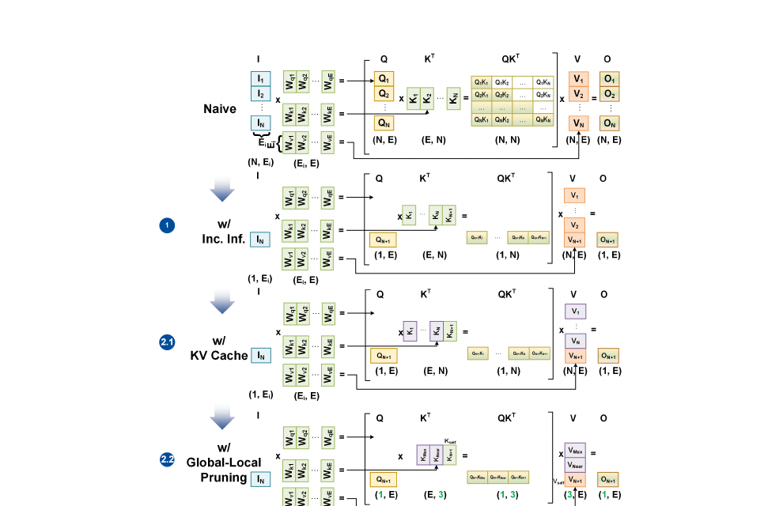

*原论文图 4。上方是每次对全部 token 重算；中间先只处理新帧再复用 KV；下方在增量 KV 上进一步保留高分历史与最近槽位。*

若每步有 $\tilde T$ 个输入 token，缓存槽位数固定为 $S=k+1$，则单步注意力成本随 $\tilde T S$ 变化，缓存 KV 的历史长度也受 $S$ 限制。输入合并降低 $\tilde T$，槽位裁剪限制 $S$；两者共同压住序列变长时的单步工作量。这个复杂度描述的是注意力主体，特征匹配、图像融合及网络其他部分仍需实际计算。

## 实验：效率收益显著，几何质量接近 StreamVGGT

效率实验使用 Tanks-and-Temples 的 train、truck 序列评估最长 300 帧的结果，较长序列使用 KITTI；输入图像高度为 518，并按原始比例缩放。作者使用一张 80GB A100。超过 20 帧时，计时包括图像合并和网络前向。论文另以滑动窗口 10 帧进行实验。以下数字均来自论文所报设置，不能直接当作移动设备上的速度或内存表现。

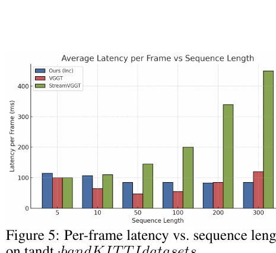

*原论文图 5。随着序列加长，StreamVGGT 每帧延迟明显上升，IncVGGT 在该实验中保持近似稳定。*

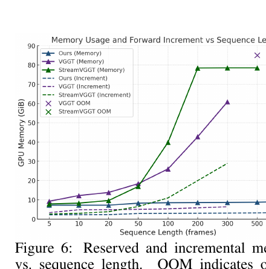

*原论文图 6。纵轴比较预留显存及增量显存；OOM 表示显存耗尽。*

下表保留作者公布的总处理时间。300 帧处正文称 IncVGGT 用时 25.54 秒、VGGT 用时 35.18 秒，但表 1 分别给出 25.50 秒和 36.32 秒，原文两处数字不一致；本文以表格为主，并保留这一差异说明。

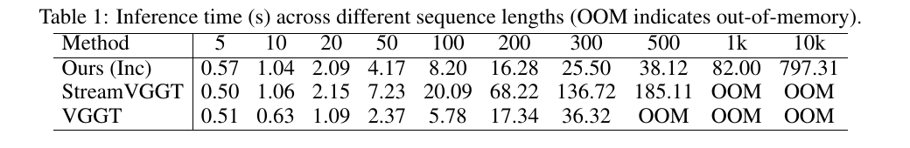

*原论文表 1。单位为秒，OOM 表示显存耗尽。*

以表格为准，300 帧时 IncVGGT 为 25.50 秒，StreamVGGT 为 136.72 秒，VGGT 为 36.32 秒；500 帧时 StreamVGGT 为 185.11 秒，IncVGGT 为 38.12 秒，而 VGGT 已 OOM。到 10,000 帧，表中 IncVGGT 为 797.31 秒。图 5 显示 IncVGGT 的每帧延迟从 10 帧时约 104 毫秒降到 300 帧时约 85 毫秒，StreamVGGT 则从约 106 毫秒升至约 455 毫秒。图 6 中 IncVGGT 的预留显存到 1,000 帧仍低于 9GB；相较之下，VGGT 在 300 帧已超过 60GB，StreamVGGT 在 500 帧超过 78GB，并在 1,000 帧 OOM。

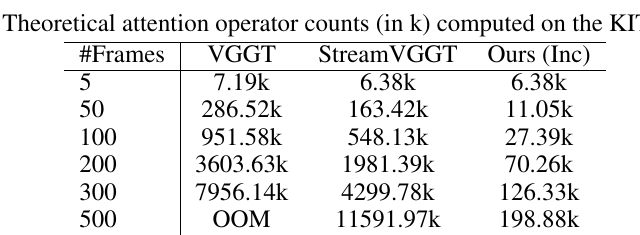

*原论文表 2。数值单位为千，按 KITTI 数据集上的矩阵规模估算。*

表 2 统计理论注意力算子数，不是 GPU 实际指令计数。300 帧时，VGGT 为 7,956.14k，StreamVGGT 为 4,299.78k，IncVGGT 为 126.33k。这个结果说明合并与缓存裁剪显著减少了注意力规模，但实际速度还受融合步骤、内存读写和硬件实现影响。

能耗表也显示长序列的能量开销差异，不过论文文字称 IncVGGT 在所有长度上都比两种基线能耗更低，与表格短序列数字并不完全相符：5 帧时 IncVGGT 是 64.7J，高于 VGGT 的 62.2J；20 帧时 IncVGGT 是 238.0J，也高于 VGGT 的 105.8J。300 帧时差距明显，IncVGGT 为 811.0J，VGGT 为 8,078.7J，StreamVGGT 为 23,516.1J。平均功率一列则为 IncVGGT 135.7W、StreamVGGT 153.8W、VGGT 178.3W。

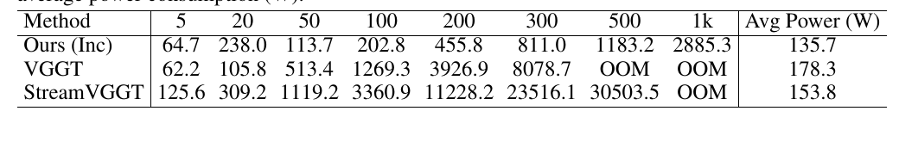

*原论文表 3。能耗单位为焦耳，最后一列平均功率单位为瓦；短序列的部分数字不支持正文“所有长度均更低”的说法。*

### 深度与多视图重建

论文的几何质量比较覆盖视频深度和多视图重建。相机与单帧估计由于共享 StreamVGGT 预训练权重，作者称两者结果几乎一致；主要验证重点是新增的效率机制是否明显损害深度与重建结果。

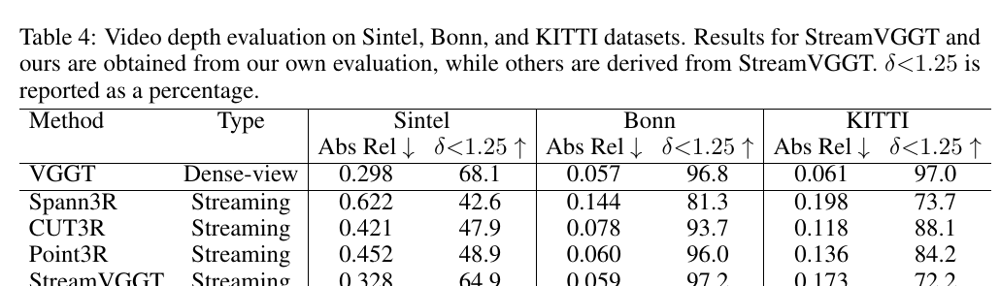

*原论文表 4。Abs Rel 越低越好，$\delta<1.25$ 越高越好；作者自行评估 IncVGGT 和 StreamVGGT，其他结果源自 StreamVGGT 论文。*

表 4 中，IncVGGT 在 Bonn 的 Abs Rel / $\delta<1.25$ 为 0.064 / 97.0，在 KITTI 为 0.176 / 71.9；StreamVGGT 分别为 0.059 / 97.2 和 0.173 / 72.2。Sintel 上 IncVGGT 的 Abs Rel 为 0.341，StreamVGGT 为 0.328。数值接近但并非完全相同；与 Spann3R、CUT3R、Point3R 的比较也显示出数据集相关的差距。

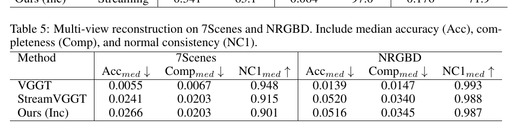

*原论文表 5。Acc 和 Comp 越低越好，NC1 越高越好，表中报告中位数。*

在 NRGBD 上，IncVGGT 与 StreamVGGT 的数值接近：Acc 为 0.0516 对 0.0520，Comp 为 0.0345 对 0.0340，NC1 为 0.987 对 0.988。7Scenes 上差异更明显：IncVGGT 的 Acc / NC1 为 0.0266 / 0.901，StreamVGGT 为 0.0241 / 0.915。论文正文称表 5 各项差异都在 0.3% 以内，但这些 7Scenes 数值不支持这种概括；因此应以表格为准，视为 IncVGGT 在此数据集上的重建质量有所下降。VGGT 的误差较低，但它不是流式方法，也无法扩展到表中相同的长序列范围。

## 附录中的定性结果

附录图 7–9 展示 KITTI 长序列上的点云重建。作者认为 IncVGGT 的几何更完整，高频结构更清楚，例如树、路灯和路边细节；并将改善归因于合并高度重复的视图，减少相互冲突的信号和缓存过载。图 9 的 VGGT-Long 可视化来自 VGGT-Long 原论文，不能视为本文重新运行得到的统一控制实验。三张图可观察到场景形状和细节差别，但定性示例本身不能替代跨场景统计。

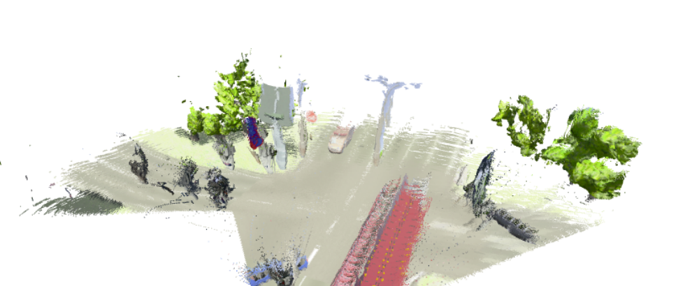

*原论文图 7。IncVGGT 在 KITTI 场景上的定性点云结果。*

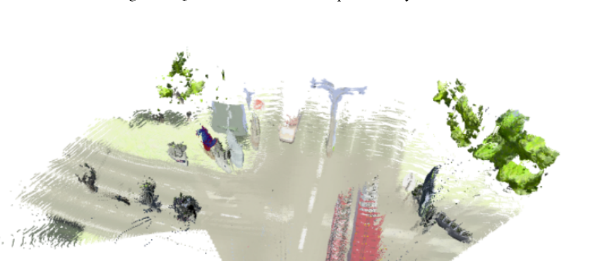

*原论文图 8。StreamVGGT 对应场景的重建结果。*

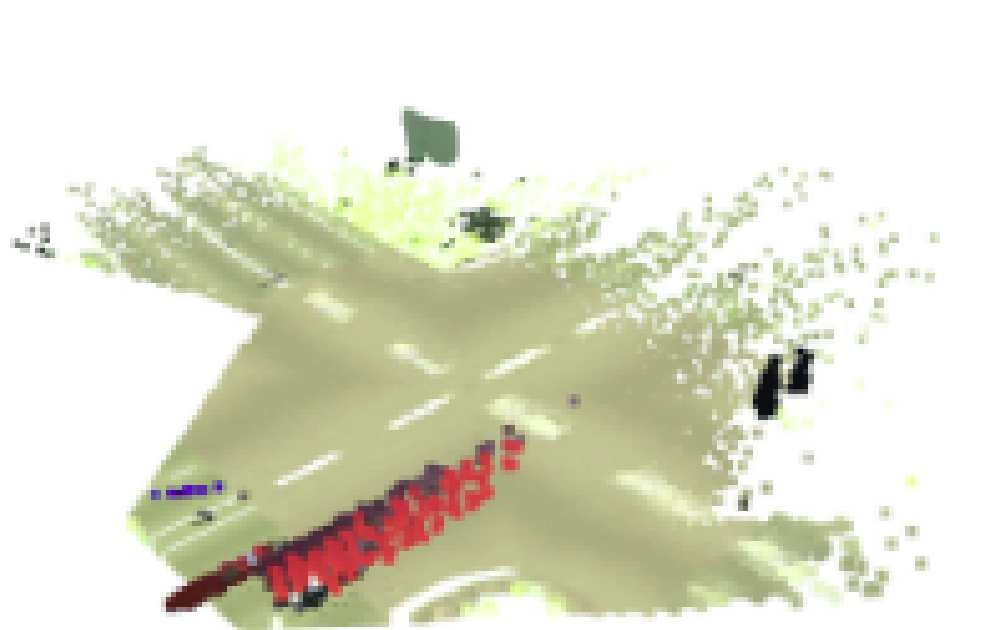

*原论文图 9。作者注明该可视化取自 VGGT-Long 原论文。*

## 方法边界与阅读结论

IncVGGT 的关键贡献在于把长序列效率问题拆成输入表示和历史状态两部分：前者通过特征匹配与单应融合消除近重复像素，后者按新帧查询相关性裁剪 KV 缓存。它不更新主网络权重，却能在长序列实验中明显减少注意力算子、推理时间和显存。

代价也与这两种简化直接相关。单应模型在强视差下失效，低纹理或快速视角变化会削弱配准；缓存排名依赖当前查询给出的注意力相关性，低分历史槽位即使对更晚的重访有用，也可能被丢弃。论文报告了 A100 上的资源结果，未提供手机或边缘设备实测，因此“适合资源受限设备”仍是潜在应用方向，而非已验证结论。

与 [StreamVGGT](../streamvggt/index.md) 相比，IncVGGT 在因果 KV 复用之上同时压缩输入和历史缓存；与 [VGGT-Long](../vggt-long/index.md) 相比，它强调在线增量处理和有界状态，而非离线重叠分块后的全局对齐；它也延续了 [CUT3R](../cut3r/index.md) 等流式重建工作对长期历史状态的关注，但选择显式缓存筛选而非单个循环隐状态。理解这些差异有助于区分“长视频几何重建”和包含回环、重定位、全局优化的完整 SLAM 系统。
