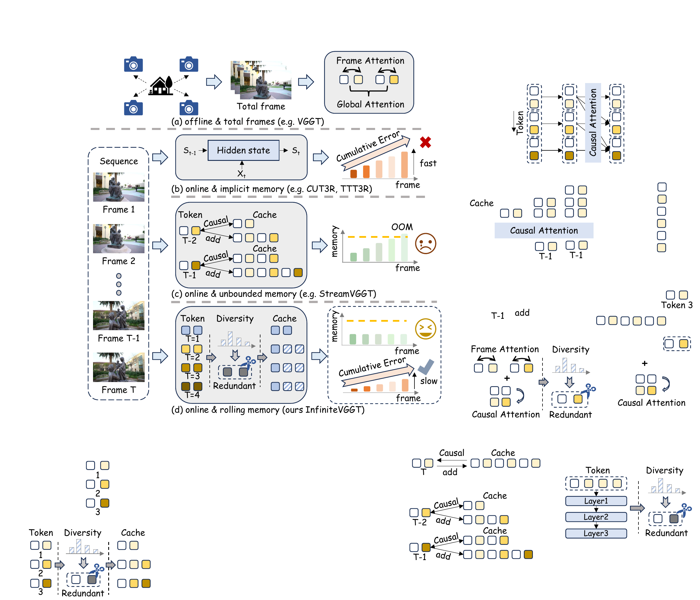
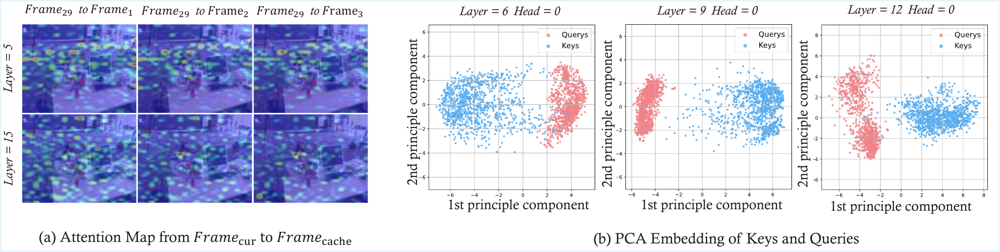
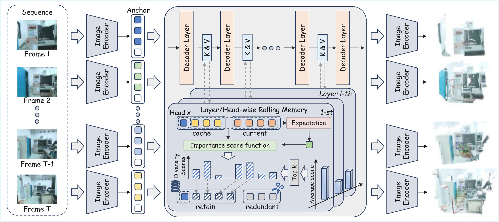
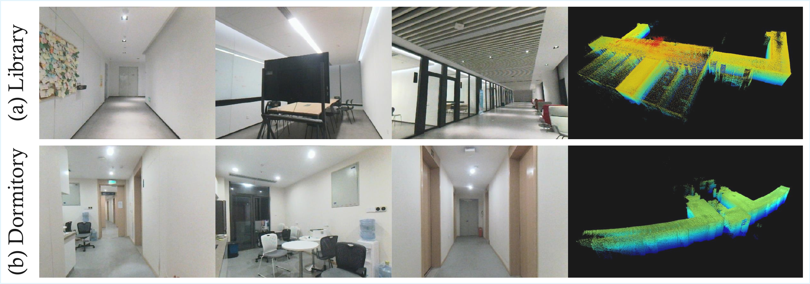
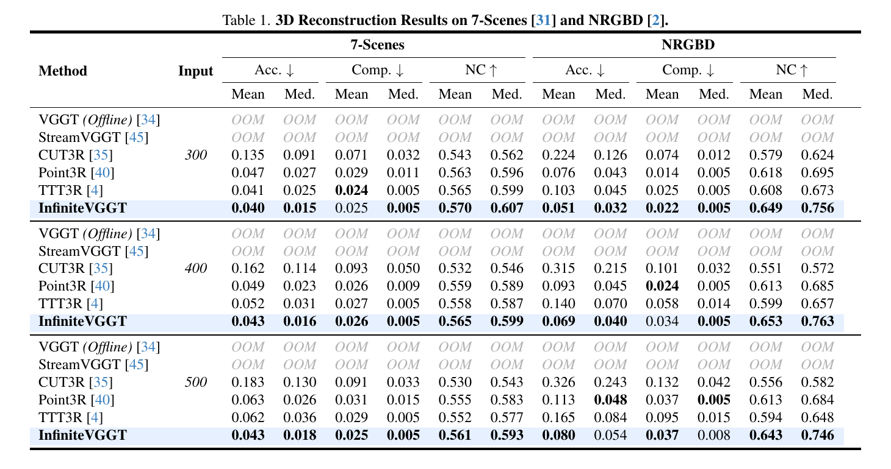
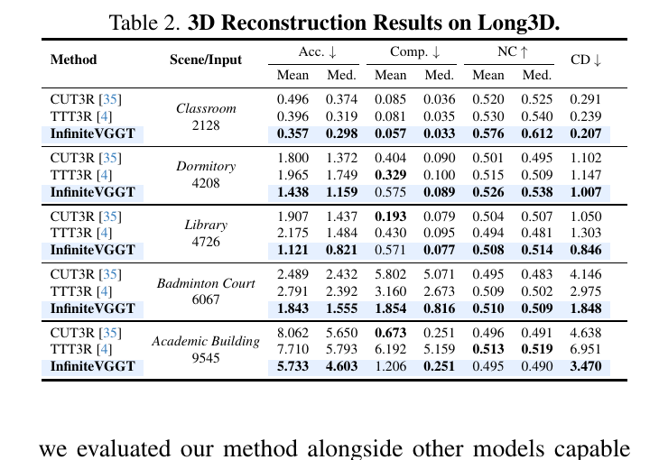
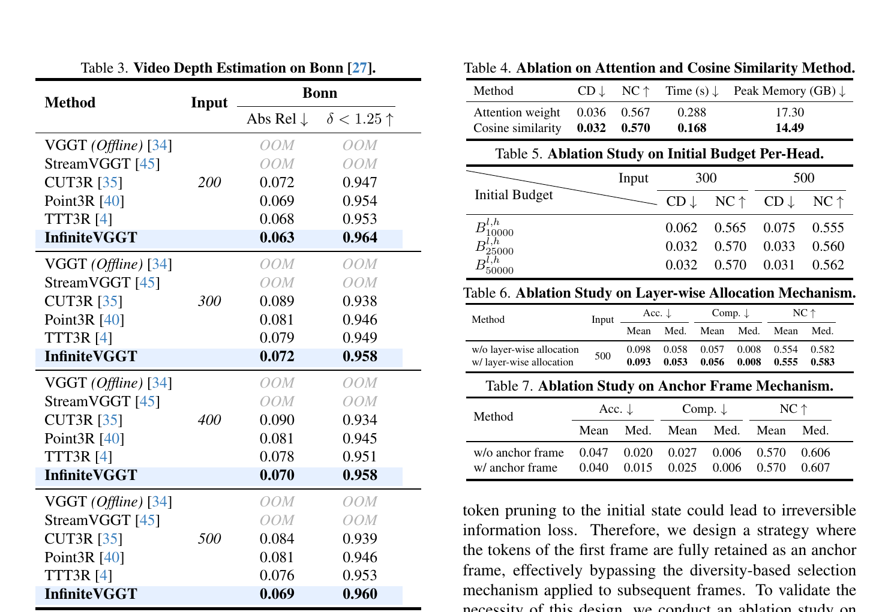
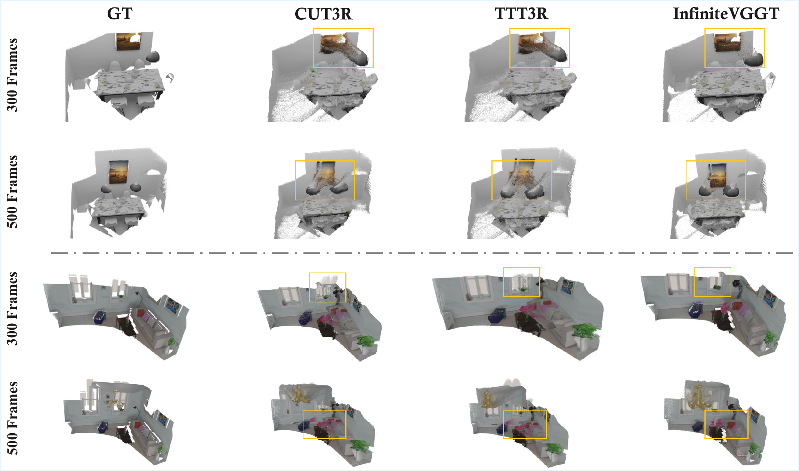
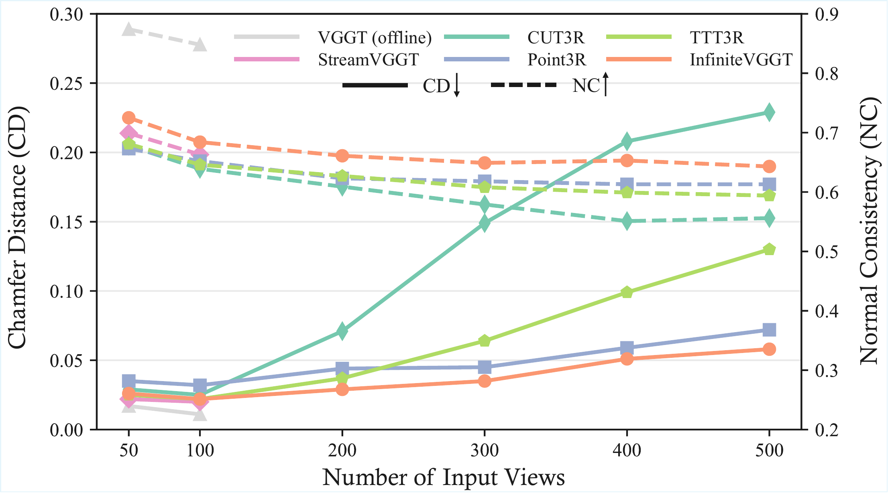

# InfiniteVGGT 论文解读

> Shuai Yuan、Yantai Yang、Xiaotian Yang、Xupeng Zhang、Zhonghao Zhao、Lingming Zhang、Zhipeng Zhang，*InfiniteVGGT: Visual Geometry Grounded Transformer for Endless Streams*，arXiv v1（2026-01-05）。本文依据该版本论文全文；论文没有另附补充材料。[论文页面](https://arxiv.org/abs/2601.02281v1) · [PDF](https://arxiv.org/pdf/2601.02281v1) · [官方代码](https://github.com/AutoLab-SAI-SJTU/InfiniteVGGT) · [Long3D 数据集](https://huggingface.co/datasets/AutoLab-SJTU/Long3D)

VGGT 能从一组图像前馈预测相机参数、深度和点图，但它需要把整组视图同时送入模型，输入增长会迅速增加显存和计算。StreamVGGT 把全局图像交互改成因果时序注意力，让图像逐帧进入，并把过去各层的 key/value（KV）追加到缓存。这样模型可以边看边预测，代价是 KV 缓存也随时间持续增长。InfiniteVGGT 沿用 StreamVGGT 的主干和逐帧推理方式，把重点放在缓存管理：固定保留第一帧作为坐标锚点，再按键向量的特征多样性筛选其余历史 token，使推理时间跨度可以继续延长，而 GPU 上的 KV 存储受预算控制。

*原论文图 1。作者对比了离线整批处理、压缩到循环隐状态、持续累积 KV，以及本文的滚动记忆。InfiniteVGGT 保留显式 KV，但会从非锚点历史中去掉冗余 token。*

## 相关路线的历史表示

论文把相关方法按信息如何跨时间保留来组织。经典 SfM 通过特征匹配、全局 BA 和后续 MVS 从整组图像恢复几何，优化约束充分，但需要先获得较完整的数据。DUSt3R、MASt3R 和 VGGT 将一部分几何估计转成前馈网络；$\pi^3$ 进一步减弱固定参考视图的影响，VGGT-Long 把长序列分成子地图，SailRecon 用少量锚图形成场景表示，FastVGGT 则利用 token 合并加快前向推理。

流式方法在存储上也有不同取舍。Spann3R 用空间记忆，Point3R 用显式空间指针；StreamVGGT 和 STream3R 采用因果注意力并缓存历史 KV。WinT3R 以滑动窗口减少历史范围，同时保留紧凑相机 token 池。CUT3R 用持续更新的循环状态，TTT3R 通过测试时训练规则调整状态。InfiniteVGGT 接续因果 KV 路线，重点不是重训一个新几何模型，而是为已训练好的 StreamVGGT 缓存增加显式、逐层的 token 保留策略。

## 从 VGGT 的全局交互到流式 KV 缓存

VGGT 在 24 层 Transformer 中交替执行帧内交互和跨帧全局交互。对每张图像，它联合预测 9 维相机参数、深度图、点图和供点跟踪使用的特征。跨帧的全局注意力使不同视图能一起约束几何，但模型处理的是给定的图像批次，不能自然地随着现场新到达的帧不断输出结果。

StreamVGGT 用因果时序注意力替换 VGGT 的全局交互。时刻 $t$，模型读取当前图像 $I_t$ 和此前的缓存 $\mathcal C_{t-1}$，为当前帧产生相机、深度、点图和跟踪特征；各层新生成的 K、V 接入缓存 $\mathcal C_t$。每帧约增加千级 token，因此缓存长度近似随帧数 $t$ 线性增长。论文指出，连续视频里这一增长很快：100 帧就可能形成 $10^5$ 量级的缓存 token。

这产生了两个相反的要求。完整保存历史有助于后续帧查看过去，却让显存和注意力成本越来越大；把历史压成少量循环状态可以限制显存，却可能丢掉回看长程场景所需的具体线索。InfiniteVGGT 希望保留 token 级的显式历史，同时只留下有限预算内的信息。

## 为什么按注意力权重删 token 不适合这里

连续相机运动通常让相邻图像有很大视野重叠。作者提取 StreamVGGT 的相邻帧 patch 特征，观察到它们的余弦相似度持续高于 0.95；查询帧对视角接近的历史帧也会产生相近的注意力分布。这说明 KV 中包含大量相似项，压缩历史有机会减少冗余。

一种直观做法是直接按 attention score 判断 token 重要程度。但高效注意力内核（如 FlashAttention）之所以减少显存和带宽开销，是因为它不会显式生成完整的注意力矩阵。若要据此给历史 token 排序，就必须把这张矩阵重新算出或物化；缓存越大，额外代价越明显。InfiniteVGGT 因而从另一个角度衡量冗余：不看某个 token 被当前查询关注了多少，而看它在 key 特征空间中是否已经有很多近似项。

*原论文图 2。左侧是当前帧到相邻缓存帧的注意力图，分布相近；右侧将若干层、注意力头的 query 与 key 投影到 PCA 平面，显示两组向量在这些示例中的聚集区域不同。PCA 可视化支持作者对冗余的观察，但它本身不是 token 重要性的证明。*

## 保留第一帧，再按 key 多样性滚动筛选

InfiniteVGGT 建立两类缓存。第一帧得到的全部 KV 被设为不可变锚点，始终保留；这与 VGGT 将整段序列对齐到首帧坐标系的设计有关。其余帧的 KV 进入可压缩候选集合。筛选分别在每一层、每个注意力头的 key 空间内进行。

先将候选 key 向量做 L2 归一化，再求其均值。若 $\hat{\mathbf k}_i$ 是归一化后的第 $i$ 个候选 key，其所在层和注意力头的候选 key 集为 $\hat{\mathcal K}_{t,\mathrm{cand}}^{(l,h)}$，则参考向量为

$$
\boldsymbol\mu^{(l,h)}=
\mathbb E_{\hat{\mathbf k}\in\hat{\mathcal K}_{t,\mathrm{cand}}^{(l,h)}}[\hat{\mathbf k}].
\tag{3}
$$

论文把单个 key 与均值方向的负余弦相似度定义为多样性分数：

$$
s_{\mathrm{div}}^{(l,h)}(\hat{\mathbf k}_i)
=-\operatorname{CosSim}(\boldsymbol\mu^{(l,h)},\hat{\mathbf k}_i).
\tag{4}
$$

与均值方向越不相似，分数越高，说明该 token 在当前候选集合中越有区分度。每个层和头都用自己的 key 空间计算分数，避免把不同层或头的表示混为一谈。由此得到的 TopK 集合和首帧锚点合在一起，构成压缩后的 KV 缓存。

缓存预算也不是平均分给所有层。论文观察到，不同层的 token 多样性不同：浅层有些层表达空间细节时多样性较高，而最初处理颜色和亮度统计的层、以及偏全局语义的深层，表现出较低多样性。令 $s^l_{\mathrm{div}}$ 表示第 $l$ 层所有候选 token 多样性分数的平均值，则该层得到的预算比例为

$$
p^l_{\mathrm{bud}}=
\frac{\exp(s^l_{\mathrm{div}}/\tau)}
{\sum_{j=1}^{L}\exp(s^j_{\mathrm{div}}/\tau)},
\qquad
B^l=p^l_{\mathrm{bud}}B_{\mathrm{total}},
\tag{5}
$$

其中 $\tau$ 是温度参数，$B_{\mathrm{total}}$ 是候选缓存的总预算。获得层级预算后，模型在对应层、头的候选中执行 TopK，再与完整首帧 KV 合并。这个机制把有限预算更多分配给 key 特征变化较丰富的层，同时避免剪掉定义全局参考的第一帧。

*原论文图 3。每帧先经图像编码器和因果 Transformer；候选缓存与新 token 在各层和注意力头内计算 key 多样性，再根据层级预算保留 TopK。首帧 anchor 不参与剪枝。*

这套处理不需要修改 StreamVGGT 的训练权重，是对其 KV 缓存的训练无关压缩。作者也强调它与 FlashAttention 兼容：筛选根据 key 向量相似度完成，不必为了取 token 权重展开完整注意力矩阵。

## Long3D 把连续长序列加入评测

InfiniteVGGT 同时提出 Long3D，针对已有评测序列偏短、7-Scenes 由多个不连续片段组成的问题。Long3D 有 5 段连续视频，长度约 2,000 到 10,000 帧，包含室内和室外场景。数据由手持空间扫描仪采集，设备结合 IMU、水平视场 360°、垂直视场 59° 的 3D LiDAR，以及分辨率 $800\times600$、10 Hz、90° 视场的 RGB 相机；每段包括未中断的 RGB 图像流与全局真值点云。点云评估先用 ICP 对齐预测和真值，再报告 Accuracy、Completion、Chamfer Distance 与 Normal Consistency。

*原论文图 4。每行展示一个场景的连续图像视角和对应的全局真值点云。Long3D 的重点是保留长时间连续输入，而不是把片段拆成互不相连的小序列。*

## 实验结果：短序列相近，长序列更能体现缓存设计

所有实验在单张 NVIDIA A100 上运行。InfiniteVGGT 是 StreamVGGT 的训练无关修改，论文先在 7-Scenes 和 NRGBD 上以步长 2 采样，每段取 300、400 或 500 张图像比较点云重建。在这些较长的输入下，表 1 中原始 VGGT 和 StreamVGGT 因显存限制 OOM；可运行的方法包括 CUT3R、Point3R、TTT3R 和 InfiniteVGGT。7-Scenes 上 InfiniteVGGT 整体保持较好表现，NRGBD 上的优势依指标和输入长度而变，不能概括成每列、每个场景都第一。

*原论文表 1。输入帧按步长 2 取样。Acc.、Comp. 越低越好，NC 越高越好；OOM 表示该设置下内存不足，不能视作数值结果。*

Long3D 的五段序列分别为 Classroom（2,128 帧）、Dormitory（4,208）、Library（4,726）、Badminton Court（6,067）和 Academic Building（9,545）。表 2 显示 InfiniteVGGT 在不同场景的表现有起伏：它在部分场景的 Accuracy 和 CD 较好，但作者指出其 Completion 的平均值落后于基线，是需要改进的一项。随着输入增长，误差仍会累积；论文的结论是滚动缓存能减缓这种传播，而不是完全消除漂移。

*原论文表 2。每个场景的输入帧数列在名称下方；指标包含 Accuracy、Completion、Normal Consistency 与 Chamfer Distance。*

在 Bonn 视频深度实验中，作者从初始 30 帧之后开始，取 200 到 500 帧的连续片段。InfiniteVGGT 在表 3 的 Abs Rel 与 $\delta<1.25$ 上优于所列可运行基线；VGGT 和 StreamVGGT 在这些长片段设置中 OOM。表 3 同页还列出缓存筛选消融：attention weight 方案的 CD/NC 为 0.036/0.567，单帧耗时 0.288 秒、峰值显存 17.30 GB；余弦相似度方案为 0.032/0.570、0.168 秒和 14.49 GB。这里比较的是消融配置，不应直接当作跨论文、跨实现的通用速度排名。

*原论文表 3–7。左侧为 Bonn 视频深度结果，右侧比较 attention weight 与 cosine similarity，并消融初始缓存预算、层间预算分配和首帧 anchor。*

消融进一步说明预算和首帧锚点的重要性。对 7-Scenes 的 300、500 帧输入，初始每头预算从 10,000 提高到 25,000 后 CD 与 NC 明显改善，增至 50,000 后收益变小。对 500 帧输入使用相同初始预算时，按层动态分配相较均匀分配将平均 Accuracy 从 0.098 降至 0.093，并小幅提升 NC。首帧 anchor 消融也显示保留首帧后，Accuracy 均值从 0.047 降到 0.040，NC 中位数从 0.606 升至 0.607。改善幅度并非各指标都很大，但它支持了“锚点完整保留，其他历史按多样性压缩”的结构选择。

*原论文图 5。图中比较真值、CUT3R、TTT3R 与 InfiniteVGGT 在两种输入长度下的点云重建。黄色框标出局部差异区域。*

论文还在 NRGBD 上比较 50 到 500 帧的短序列。作者报告当 StreamVGGT 尚未受到显存限制时，两者 CD 和 NC 差异很小，InfiniteVGGT 的 NC 略有优势。缓存压缩因此主要解决长序列资源增长问题，并未显示短序列精度会有大幅变化。

*原论文图 6。横轴为输入视图数，实线表示 CD，虚线表示 NC；较短输入时，各方法差距相对有限，曲线随长度增长呈现不同趋势。*

## 结果范围与方法边界

InfiniteVGGT 的设计针对的是视觉几何模型的显式 KV 缓存：它把首帧完整留作全局参考，再压缩之后各层、各头中的重复历史。与将状态压成少量递归 token 的 [CUT3R](../cut3r/index.md) 和 [TTT3R](../ttt3r/index.md) 不同，它保留了可供后续帧直接读取的历史 token；与持续追加 KV 的 [StreamVGGT](../streamvggt/index.md) 相比，它会按有限预算做筛选。它与 [Point3R](../point3r/index.md) 的显式空间指针记忆也不同：这里筛选对象是 Transformer 的 key/value 表示。

“无限”描述的是模型可持续处理流的目标，不表示论文已经在无限帧上验证。Long3D 最长序列为 9,545 帧；论文也承认点云 Completion 在 Long3D 的平均表现仍有不足，长期误差并未归零。此外，实验设置段称会评估三维重建、视频深度和相机位姿三类任务，但正文实际呈现的定量表格是点云重建与视频深度，未见单独的相机轨迹结果表。因此，不能仅凭该段概述就推断相机位姿估计也有同样充分的实验支持。

另一项边界来自全局坐标依赖。完整保留首帧，是为了不破坏 VGGT/StreamVGGT 的首帧参考坐标；因此这一方案压缩的是历史缓存的大部分内容，而不是移除锚点依赖。它可以降低 KV 的增长和 OOM 风险，却没有提出新的回环检测、全局位姿图优化或地图重定位机制。论文贡献主要是训练无关的缓存选择策略，以及面向连续长视频的 Long3D 评测集。

从流式重建方法谱系看，InfiniteVGGT 将问题定位在“历史信息以什么形式保留、预算如何分配”。其多样性分数是一种几何特征空间中的启发式代理：某 token 的 key 离候选均值较远，就更可能提供差异信息。实验显示它在这些数据和预算下有效，但不意味着离均值越远的 token 在所有场景、所有任务上必定更有用。这个区分也有助于理解后续缓存压缩工作：它们可以改变重要性估计、预算分配或保留粒度，而仍共享因果 Transformer 的流式输入框架。
