# Inverse Depth Parametrization for Monocular SLAM 论文解读

> Javier Civera、Andrew J. Davison 与 J. M. Martínez Montiel 的 *Inverse Depth Parametrization for Monocular SLAM* 发表于 *IEEE Transactions on Robotics* 24(5): 932–945，2008 年。下文依据正式期刊版本，讨论逆深度地图点在单目 EKF SLAM 中的表示、初始化与更新。[论文页面](https://doi.org/10.1109/TRO.2008.2003276) · [论文 PDF](https://www.doc.ic.ac.uk/~ajd/Publications/civera_etal_tro2008.pdf)

## 1. 一帧图像只确定一条射线

单目相机第一次看到一个角点时，像素坐标只确定它所在的空间射线。沿这条射线，镜头前的近点与远处墙面上的点都可能投到同一个像素。相机平移以后，这些候选位置的投影才逐渐分开，距离由视差显露出来。手持相机可能先转动一段时间；室外的树即使经历平移，也可能远到几乎看不出视差。新特征尚无可靠深度，却已经提供了一个观察方向。

在单目 EKF SLAM 中，困难还在于如何描述这种不确定性。EKF 用联合高斯分布保存相机和地图点的估计。若地图点直接采用三维坐标，一个均值和协方差只能描述一个椭球状区域；刚看到的特征却可能沿射线延伸到极远处。给它一个有限距离和过小方差，会过早排除尚不能区分的远点；简单增大三维高斯的方差，又难以同时表达已经相当明确的观察方向和很不明确的距离。

早期的延迟初始化方法会先将新特征留在主滤波状态之外，经过多帧处理，等深度可靠后再放进地图。这段时间里，新特征的方向信息也没有参与主状态更新。无延迟方法则尝试沿射线维护多个深度假设，让新特征立即参加估计；原文引言比较了多假设滤波、用高斯混合表示深度分布等做法，以及它们额外的表示与处理成本。

远处特征还涉及一个持续判断的问题。没有可测视差的特征可以充当方向参照，但不能就此永久标成无穷远。相机以后走得更远，它仍可能显露出有限深度。相对于观察方向形成横向基线后，仍看不到视差也能排除一部分近点假设：如果点真的那么近，就应该看到更大的视差。

作者因此给每个点保留首次观测的相机中心与射线方向，再用逆深度描述它沿射线的位置。新点从第一次观测起就进入联合 EKF，近点、远点和暂时无法区分有限深度的点使用同一观测模型。逆深度此前已出现在立体视觉、光流和仅有方位观测的目标跟踪中；这篇文章着重论证它相对于首次观测位置的参数化，如何进入相机运动与地图的联合高斯估计。2008 年期刊版本也扩展了作者先前的会议工作，加入表示切换分析和实时回环实验。

## 2. 相机与地图的联合状态

### 2.1 相机运动模型

记世界坐标系为 $W$，当前相机坐标系为 $C$。相机中心 $\mathbf r^{WC}$ 用世界坐标表示，四元数 $\mathbf q^{WC}$ 描述相机相对于世界的朝向。$R^{WC}$ 把相机系向量转到世界系，$R^{CW}=(R^{WC})^\top$ 做相反方向的转换。

相机状态还包含世界系线速度 $\mathbf v^W$ 和相机系角速度 $\boldsymbol\omega^C$。作者使用带随机加速度的匀速模型：一帧时间 $\Delta t$ 内，未知加速度产生速度增量 $\mathbf V^W$ 与 $\boldsymbol\Omega^C$，两者按零均值高斯过程建模，加速度协方差取对角形式。状态预测为

$$
\begin{pmatrix}
\mathbf r^{WC}_{k+1}\\[0.7em]
\mathbf q^{WC}_{k+1}\\[0.7em]
\mathbf v^W_{k+1}\\[0.7em]
\boldsymbol\omega^C_{k+1}
\end{pmatrix}
=
\begin{pmatrix}
\mathbf r^{WC}_k+(\mathbf v^W_k+\mathbf V^W_k)\Delta t\\[0.7em]
\mathbf q^{WC}_k\otimes q\big((\boldsymbol\omega^C_k+\boldsymbol\Omega^C_k)\Delta t\big)\\[0.7em]
\mathbf v^W_k+\mathbf V^W_k\\[0.7em]
\boldsymbol\omega^C_k+\boldsymbol\Omega^C_k
\end{pmatrix}. \tag{1}
$$

$q(\cdot)$ 把旋转向量转成四元数，$\otimes$ 表示四元数乘法。这些随机增量描述对手持运动的预测误差，并非 IMU 测量。预测将相机状态推进到下一帧，随后的像素观测再修正预测。

### 2.2 地图点相对于首次观察位置表示

普通地图点用三个世界坐标表示：

$$
\mathbf x_i=(X_i,Y_i,Z_i)^\top. \tag{2}
$$

逆深度状态则有六个分量：

$$
\mathbf y_i=(x_i,y_i,z_i,\theta_i,\phi_i,\rho_i)^\top. \tag{3}
$$

其中 $(x_i,y_i,z_i)$ 是首次看到该特征时的相机中心。为便于写公式，下面把这三个分量合记为 $\mathbf a_i$。角度 $\theta_i,\phi_i$ 决定世界系中的射线方向，$\rho_i$ 决定沿射线走多远：

$$
\mathbf x_i=\mathbf a_i+\frac{1}{\rho_i}\mathbf m(\theta_i,\phi_i), \tag{4}
$$

$$
\mathbf m(\theta_i,\phi_i)=
\begin{pmatrix}
\cos\phi_i\sin\theta_i\\
-\sin\phi_i\\
\cos\phi_i\cos\theta_i
\end{pmatrix}. \tag{5}
$$

$\mathbf m$ 的长度是 1，所以 $d_i=1/\rho_i$ 是从首次相机中心沿射线量起的距离。它一般不同于点在相机坐标系中的 $Z$ 分量。角度零点与正负号按式 (5) 定义；例如 $\theta_i=\phi_i=0$ 时，射线朝世界系的 $+z$ 方向。

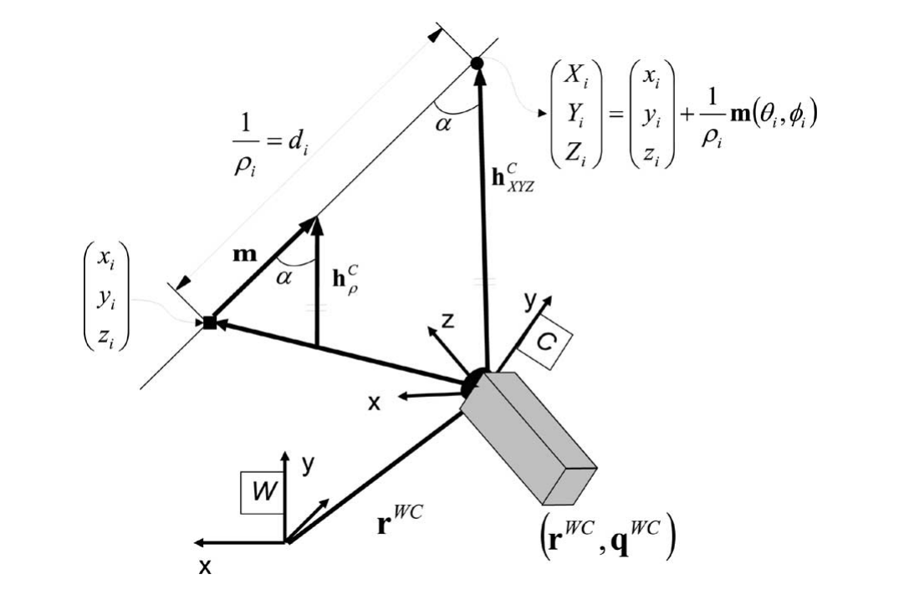

*原论文图 1。左侧的 $(x_i,y_i,z_i)$ 是首次观察位置，即正文简记的 $\mathbf a_i$；$\mathbf m$ 给出初始射线，$1/\rho_i$ 是沿射线的距离。右下是当前相机。*

六个量把射线起点、方向和距离分别保存下来。首次观测已经给出方向，距离可以继续保留较大的方差。取 $\rho_i\to0$ 时，式 (4) 的三维位置趋向无穷远，射线方向却有明确的极限，下一节会直接利用这个方向计算像素。

相机与所有地图点组成一个联合状态：

$$
\mathbf x=
\big(\mathbf x_v^\top,\mathbf y_1^\top,\ldots,\mathbf y_n^\top\big)^\top. \tag{6}
$$

场景假定为静态，所以预测时不为地图点添加运动。这里的“静态”也不表示其参数已经精确已知：首次相机中心本来就带有估计误差，新增点的起点、方向和逆深度都保存在联合分布中，之后可以被观测修正。它们与相机及其他地图点的交叉协方差同样需要保留。

## 3. 像素观测与无穷远点

当前相机在 $\mathbf r^{WC}$，朝向由 $R^{CW}$ 给出。若点以 XYZ 保存，从相机指向点的向量是

$$
\mathbf h^C_{XYZ}=R^{CW}(\mathbf x_i-\mathbf r^{WC}). \tag{7}
$$

将式 (4) 代入，可以先写成

$$
\mathbf h^C_{XYZ}
=R^{CW}\left(\mathbf a_i-\mathbf r^{WC}
+\frac{1}{\rho_i}\mathbf m\right).
$$

透视投影只取向量分量的比值。对于非零 $\rho_i$，将整条向量乘以 $\rho_i$，像素位置不变，于是得到

$$
\mathbf h^C_\rho
=R^{CW}\left[\rho_i(\mathbf a_i-\mathbf r^{WC})
+\mathbf m(\theta_i,\phi_i)\right]. \tag{8}
$$

式 (7) 是有长度的向量，式 (8) 是经过尺度变换的方向表示；实际投影相同。采用式 (8) 后，滤波器无须先算出可能极大的三维点坐标。即使 $\rho_i=0$，它仍能计算 $R^{CW}\mathbf m$。

按原文的像平面坐标约定，针孔投影为

$$
\mathbf h=
\begin{pmatrix}
u_0-\dfrac{f}{d_x}\dfrac{h_x}{h_z}\\
v_0-\dfrac{f}{d_y}\dfrac{h_y}{h_z}
\end{pmatrix}. \tag{9}
$$

$f$ 是焦距，$d_x,d_y$ 是像素的物理尺寸，$(u_0,v_0)$ 是主点。负号随这里的像平面约定而来。实际观测还有径向畸变，附录会说明由这个理想投影得到实际像素的过程。

当点很远，或者相机位移相对于点距很小时，式 (8) 中的平移项较小，投影主要取决于相机朝向和地图点的射线方向。这使尚未确定距离的点仍能参与后续图像的姿态估计。若相机发生平移并积累足够视差，观测才会进一步区分不同的 $\rho_i$。纯旋转时，射线方向随相机转动而变，距离仍无法由此确定。

这层关系也可以写到观测雅可比里。令 $J_\pi$ 是像素投影对 $\mathbf h^C_\rho$ 的导数，固定其他状态时，有

$$
\frac{\partial\mathbf h}{\partial\mathbf r^{WC}}
=-\rho_i J_\pi R^{CW},
\qquad
\frac{\partial\mathbf h}{\partial\rho_i}
=J_\pi R^{CW}(\mathbf a_i-\mathbf r^{WC}).
$$

$\rho_i\to0$ 时，对当前平移的直接敏感度趋于零；首次观察时 $\mathbf a_i=\mathbf r^{WC}$，对逆深度的敏感度也为零。这分别对应远点主要提供方向信息，以及单帧不能确定深度。

后续一帧的实际像素减去式 (9) 及畸变模型的预测，形成 EKF 创新。观测雅可比 $H$、联合协方差 $P$ 和像素噪声协方差 $R$ 决定增益 $K=PH^\top(HPH^\top+R)^{-1}$，由此修正相机与地图。即使某个观测对平移的直接导数很小，联合状态里的相关性仍可能使平移估计受到更新；后面的回环实验需要结合这一点理解。

## 4. 观测方程的线性化

### 4.1 高斯分布经过非线性函数后会改变形状

EKF 在当前均值处线性化观测函数，再用这个线性模型传播协方差。以一维随机量 $x\sim\mathcal N(\mu_x,\sigma_x^2)$ 为例，经过 $y=f(x)$ 后，一阶近似给出

$$
\mu_y\approx f(\mu_x),\qquad
\sigma_y^2\approx f'(\mu_x)\sigma_x^2f'(\mu_x). \tag{10}
$$

若 $f$ 在可能的取值范围内近似直线，这个高斯近似较合理；若区间内的斜率变化明显，均值处的一条切线就不足以代表整个分布。标准差越大，需要检查的范围也越宽。

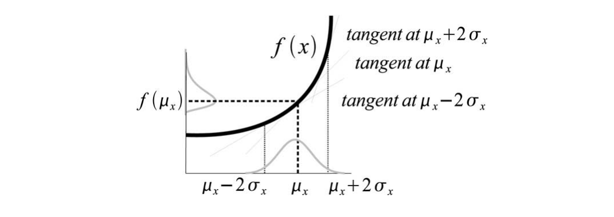

*原论文图 2。不同位置的切线斜率不同，反映了用一个雅可比传播整个不确定区间时可能产生的误差。*

作者取均值两侧各两个标准差作为约 $95\%$ 区间，并对一阶导数再作展开：

$$
f'(\mu_x+\Delta x)\approx f'(\mu_x)+f''(\mu_x)\Delta x. \tag{11}
$$

从中心走到端点，$|\Delta x|=2\sigma_x$，导数约变化 $|f''(\mu_x)2\sigma_x|$。除以中心导数的绝对值，就得到无量纲的线性度指标：

$$
L=\left|\frac{f''(\mu_x)\,2\sigma_x}{f'(\mu_x)}\right|. \tag{12}
$$

$L$ 越小，区间内斜率相对变化越小，一阶传播越合适。它使用局部导数近似区间内的变化，是原文用于比较参数化和选择切换时机的诊断量。若观测对变量完全不敏感，分母也为零，此时要先考虑可观测性，不能仅凭这个比值评价线性化。

### 4.2 以深度作为高斯随机量

图 3 将问题简化到两个相机和一条射线。两个相机都朝向点的标称位置，第一相机到标称点的距离是 $d_0$，第二相机到它的距离是 $d_1$。两条标称观察方向之间的夹角为 $\alpha$，也用作视差角的近似。

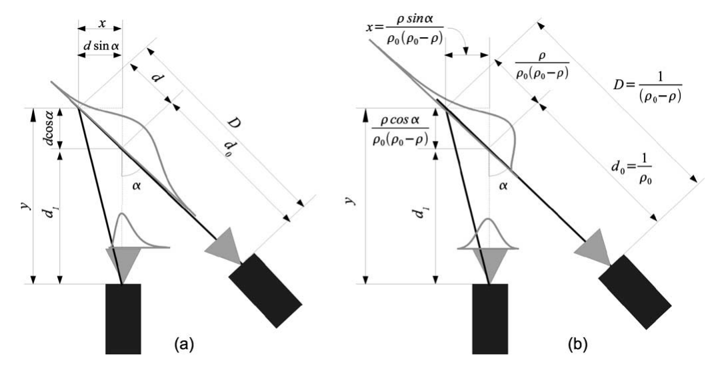

*原论文图 3。两幅图使用同一几何关系。左图在深度上设置高斯误差，右图在逆深度上设置高斯误差，比较二者传播到第二相机图像后的分布。*

设点在第一条射线上相对于标称位置偏移 $d$，总距离为

$$
D=d_0+d,\qquad d\sim\mathcal N(0,\sigma_d^2). \tag{13}
$$

在图 3 的二维局部坐标里，偏移 $d$ 对第二相机横向分量的贡献是 $d\sin\alpha$，对光轴方向的贡献是 $d\cos\alpha$。因此该相机里的归一化横坐标为

$$
u(d)=\frac{d\sin\alpha}{d_1+d\cos\alpha}. \tag{14}
$$

误差为零时，相机正对标称点，故 $u(0)=0$。误差增大时，分母也跟着改变，$u$ 对 $d$ 的响应并不保持恒定。求导可得

$$
u'(d)=\frac{d_1\sin\alpha}{(d_1+d\cos\alpha)^2},\qquad
u''(d)=\frac{-2d_1\sin\alpha\cos\alpha}{(d_1+d\cos\alpha)^3}.
$$

在均值 $d=0$ 处代入式 (12)，得到

$$
L_d=\frac{4\sigma_d}{d_1}|\cos\alpha|. \tag{15}
$$

新特征的深度误差较大，而初始视差较小、$|\cos\alpha|$ 接近 1，正是这种表示不容易线性化的情形。

### 4.3 将高斯误差放到逆深度上

这一小节的符号需要留意：原文重新用 $\rho$ 表示零均值的逆深度误差。它不同于地图状态里表示实际逆深度的 $\rho_i$；在这个局部模型中，实际逆深度是 $\rho_0-\rho$，$\rho_0=1/d_0$。因此

$$
D=\frac{1}{\rho_0-\rho},\qquad
\rho\sim\mathcal N(0,\sigma_\rho^2). \tag{16}
$$

将它换回上一节的深度偏移，有

$$
d=D-d_0
=\frac{1}{\rho_0-\rho}-\frac{1}{\rho_0}
=\frac{\rho}{\rho_0(\rho_0-\rho)}. \tag{17}
$$

把式 (17) 代入同一投影式 (14)，分子和分母同时乘以 $\rho_0(\rho_0-\rho)$，得到

$$
u(\rho)=
\frac{\rho\sin\alpha}
{\rho_0d_1(\rho_0-\rho)+\rho\cos\alpha}. \tag{18}
$$

令 $A=\rho_0^2d_1$、$B=\cos\alpha-\rho_0d_1$，分母就是 $A+B\rho$。于是

$$
u'(0)=\frac{\sin\alpha}{A},\qquad
u''(0)=-\frac{2\sin\alpha B}{A^2}.
$$

代入式 (12)，并使用 $d_0=1/\rho_0$，便有

$$
L_\rho=\frac{4\sigma_\rho}{\rho_0}
\left|1-\frac{d_0}{d_1}\cos\alpha\right|. \tag{19}
$$

刚初始化后，相机位移相对于点距较小，$d_0/d_1\approx1$，$\alpha\approx0$，所以式 (19) 绝对值里的两项接近抵消。与式 (15) 相比，这给了逆深度表示一个小因子，使它在不确定性仍很宽时也可能保持较小的线性化误差。这里讨论的是小基线、低视差下的近似；恰好零视差时，距离信息本身仍然缺失。

后续运动使视差增加，$|1-(d_0/d_1)\cos\alpha|$ 可能变大；同时，连续观测又使 $\sigma_\rho/\rho_0$ 下降。原文据此解释，逆深度在持续跟踪过程中可以从低视差阶段延续到深度较明确的阶段。它没有要求点一旦显露视差就立即改成 XYZ。

### 4.4 深度先验覆盖到哪里

深度高斯区间 $[d_0-2\sigma_d,d_0+2\sigma_d]$ 始终有有限端点。若靠不断加大标准差去容纳很远的点，区间也容易跨入接近零甚至负深度的区域。逆深度将无穷远放在有限坐标 $\rho=0$，因此能够用一个有限区间覆盖从近处到无穷远的正深度。

在逆深度区间全部为正时，倒数映射给出

$$
\left[\frac{1}{\rho_0+2\sigma_\rho},
\frac{1}{\rho_0-2\sigma_\rho}\right]. \tag{20}
$$

例如，逆深度在 $[0.02,0.2]$ 时，距离范围是 $[5,50]$；若下端靠近零，正深度的上界就趋于无穷。原文也用式 (20) 描述可延伸到无穷远的范围。若逆深度区间已经跨零，倒数在零处奇异，需要分别理解正、负两支，不能把两个端点的倒数当作一个连续的有限深度区间。

还可以直接从式 (8) 看一个特例。令首次相机中心为原点，射线沿 $z$ 轴，当前相机保持朝向、沿 $x$ 轴平移 $b$。此时 $\mathbf h^C_\rho=(-b\rho_i,0,1)^\top$，归一化横坐标为 $u_n=-b\rho_i$，对逆深度恰好线性。同一关系若写成距离 $D$，就是 $u_n=-b/D$。它说明逆深度为何适合表示由平移产生的视差；一般朝向和射线方向仍应使用式 (8) 的完整投影。

## 5. 单次观测的特征初始化

新特征第一次被检测到时，已经知道当前相机状态估计和像素测量 $\mathbf h=(u,v)^\top$。初始化要从这些量构造 $\mathbf y_i$，同时把它们的不确定性传给新状态：

$$
\hat{\mathbf y}_i
=\mathbf y(\hat{\mathbf r}^{WC},\hat{\mathbf q}^{WC},\mathbf h,\rho_0). \tag{21}
$$

射线起点直接取当前相机中心：

$$
\hat{\mathbf a}_i=\hat{\mathbf r}^{WC}. \tag{22}
$$

将像素去畸变并按式 (9) 反投影，得到归一化像平面坐标 $(\upsilon,\nu)$。它在相机系里定义方向 $(\upsilon,\nu,1)^\top$，再转到世界系：

$$
\mathbf h^W=R^{WC}(\hat{\mathbf q}^{WC})
\begin{pmatrix}\upsilon\\\nu\\1\end{pmatrix}. \tag{23}
$$

它无须事先归一化，角度由分量比例即可求出。用双参数反正切表示原文的角度计算，有

$$
\theta_i=\operatorname{atan2}(h_x^W,h_z^W),\qquad
\phi_i=\operatorname{atan2}\left(-h_y^W,
\sqrt{(h_x^W)^2+(h_z^W)^2}\right). \tag{24}
$$

这些步骤给出了前五个分量；单帧没有距离观测，所以 $\rho_i$ 另取宽的高斯先验。原文实验使用均值 $\hat\rho_0=0.1$、标准差 $\sigma_\rho=0.5$，均值加减两个标准差得到 $[-0.9,1.1]$。原文将两个端点按 $[1.1,-0.9]$ 列出，这里按升序写出。区间明显包含零，保留了点可能非常远的假设。

这个高斯近似也有负逆深度概率质量。作者在估计中保留它，甚至在均值暂为负时仍使用标准观测更新；这使表示能连续越过 $\rho=0$。负值属于这一概率表示的延拓，不能作为已确认的相机后方实体位置。随着观测积累，如果出现可测视差，逆深度分布会收紧，逐步排除不符合图像的距离。

初始化还必须保留新点与已有状态的相关性。令旧联合协方差为 $P$，像素测量协方差为 $R_i$。把旧状态、新像素和逆深度先验共同映射到扩大后的状态，其雅可比记为 $J$，则

$$
P_{\mathrm{new}}=J
\begin{pmatrix}
P&0&0\\
0&R_i&0\\
0&0&\sigma_\rho^2
\end{pmatrix}J^\top. \tag{25}
$$

旧状态原样保留，新点依赖相机状态、像素和逆深度先验，因而 $J$ 具有块形式

$$
J=\begin{pmatrix}
I&0&0\\
G_x&G_h&G_\rho
\end{pmatrix},\qquad
G_x=\frac{\partial\mathbf y_i}{\partial\mathbf x},\quad
G_h=\frac{\partial\mathbf y_i}{\partial\mathbf h},\quad
G_\rho=\frac{\partial\mathbf y_i}{\partial\rho_i}.
$$

这是原文式 (26) 所列初始化导数的块写法。将式 (25) 展开，新点与旧状态的交叉协方差是 $P_{y_i x}=G_xP$。即使新特征只直接依赖当前相机，它也会通过旧联合协方差与其他地图点建立联系。若只给六个新分量填一块独立协方差，这部分联系就会丢失。

下一帧重观测这个点时，它已经处在主滤波状态中，可以按第 3 节的像素残差更新，无须等待三角化通过门槛。低视差阶段主要积累方向约束；相机进一步平移后，同一状态再逐步确定距离。这里的先验数值也没有赋予地图真实尺度。系统可以不用已知尺寸的初始化图案运行，但轨迹和地图整体仍只确定到一个尺度因子。

## 6. 深度明确后的 XYZ 转换

### 6.1 计算可转换的时机

每个逆深度点占六个状态分量，XYZ 点只占三个。联合 EKF 需要维护随状态维度增长的稠密协方差。在地图状态占主导、每帧观测数近似固定时，协方差存储和主要更新运算约随状态维度的平方增长，原文据此指出全六维表示会带来约四倍的 EKF 开销。对已能用三维高斯近似的点，继续保留六维状态便没有必要。切换时机是在每次估计之后检查：若该点用 XYZ 表示，式 (15) 的 $L_d$ 是否已经足够小。

首先从式 (4) 算出当前点估计，再按原文式 (27) 取得各项：

$$
\begin{gathered}
\mathbf h^W_{XYZ}=\hat{\mathbf x}_i-\hat{\mathbf r}^{WC},\qquad
\sigma_\rho=\sqrt{P_{y_i y_i}(6,6)},\qquad
\sigma_d\approx\frac{\sigma_\rho}{\hat\rho_i^2},\\
d_i=\|\mathbf h^W_{XYZ}\|,\qquad
\cos\alpha=\frac{\mathbf m^\top\mathbf h^W_{XYZ}}
{\|\mathbf h^W_{XYZ}\|}. \tag{27}
\end{gathered}
$$

这里 $\sigma_d$ 的换算来自 $D=1/\rho_i$ 的一阶导数，$|\partial D/\partial\rho_i|=1/\rho_i^2$。原文在式 (27) 中用 $d_i$ 表示点到**当前**相机的距离，即简化几何里的 $d_1$；它与式 (4) 中相对首次相机中心的距离 $1/\rho_i$ 需要区分。夹角则由初始射线与当前观察方向计算。

这些值代入式 (15) 后便得到候选 XYZ 表示的线性度。逆深度接近零时，换算出的深度标准差很大，通常难以通过这个检查，点便继续保留逆深度表示。

满足阈值后，三维位置由式 (4) 得到，整个联合协方差按

$$
P_{\mathrm{new}}=JPJ^\top,\qquad
J=\operatorname{diag}\left(I,
\frac{\partial\mathbf x_i}{\partial\mathbf y_i},I\right) \tag{28}
$$

一起转换。中间的 $3\times6$ 雅可比为

$$
\frac{\partial\mathbf x_i}{\partial\mathbf y_i}
=\left[I_3,\ \frac{\mathbf m_\theta}{\rho_i},\
\frac{\mathbf m_\phi}{\rho_i},\ -\frac{\mathbf m}{\rho_i^2}\right],
$$

其中 $\mathbf m_\theta,\mathbf m_\phi$ 是式 (5) 对两个角度的导数。变换后该点少三个分量，它与相机、其他点的协方差也随之换成新坐标。只转换点位置和自身协方差，仍不足以完成联合状态的转换。

### 6.2 切换阈值的依据

在线性近似成立时，式 (14) 在 $d=0$ 处给出

$$
u\sim\mathcal N(\mu_u,\sigma_u^2),\qquad
\mu_u=0,\qquad
\sigma_u^2=\left(\frac{\sin\alpha}{d_1}\right)^2\sigma_d^2. \tag{29}
$$

作者用数值采样检查真实投影分布与这个预测是否相符。对给定的 $\alpha,d_1,\sigma_d$，从深度高斯分布采样，经过非线性式 (14) 投影，再与式 (29) 的分布做 Kolmogorov–Smirnov 检验。图 5 中每组取 1000 个样本，重复生成 1000 组，统计被拒绝的比例。检验显著性水平为 $5\%$；若线性传播确实合适，拒绝比例应接近这个基准。

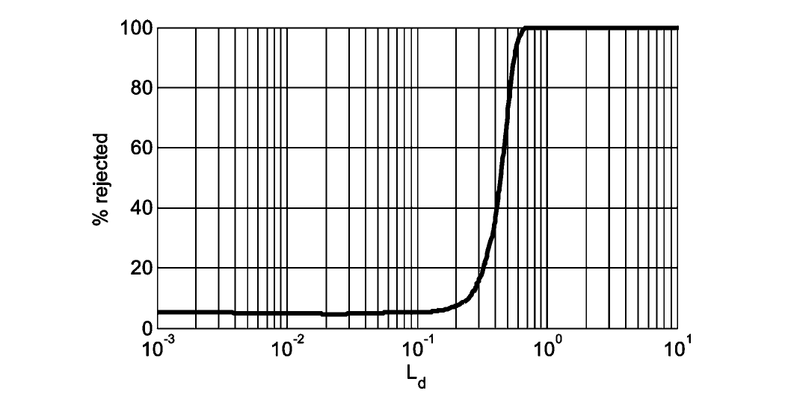

*原论文图 4。横轴是 $L_d$，采用对数刻度；纵轴是采样检验的拒绝率。拒绝率从约 $5\%$ 的基准逐渐上升。*

仿真覆盖 12 个视差角（$0.1^\circ$ 至 $70^\circ$）、8 个距离（1 至 100 m）和 8 个深度标准差（0.05 至 5 m）的组合。图 4 中，$L_d$ 超过约 $0.2$ 后，拒绝率明显偏离基准。作者因此取更保守的 $L_d<0.1$ 作为切换条件。这个指标和阈值服务于本文的观测几何与高斯近似分析；仿真结果支持这一选择，未给出一般三维联合滤波的误差上界。

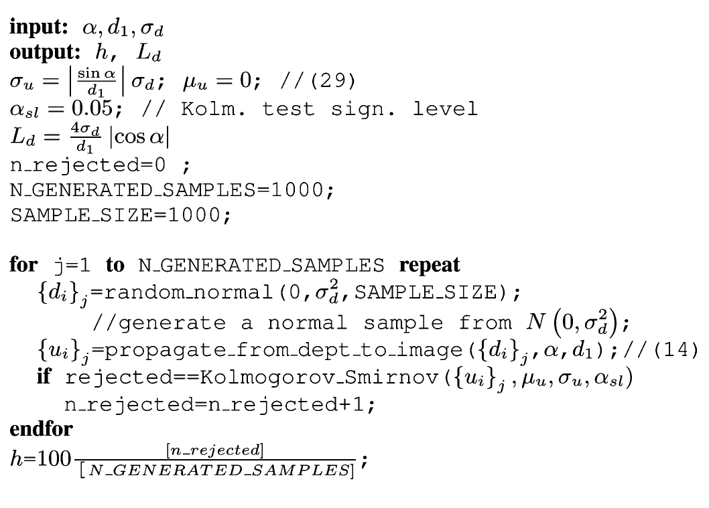

*原论文图 5。对每组几何和噪声参数，反复采样深度误差、投影到图像，再统计与线性预测高斯分布不符的比例。*

## 7. 实验结果

### 7.1 室内特征的初始化过程

真实图像由手持 Unibrain IEEE1394 相机采集，分辨率 $320\times240$，视场约 $90^\circ$，帧率 30 Hz。室内实验用 Matlab 离线处理，选取同一帧初始化、距离不同的三个特征，观察它们的不确定性怎样随视差改变。

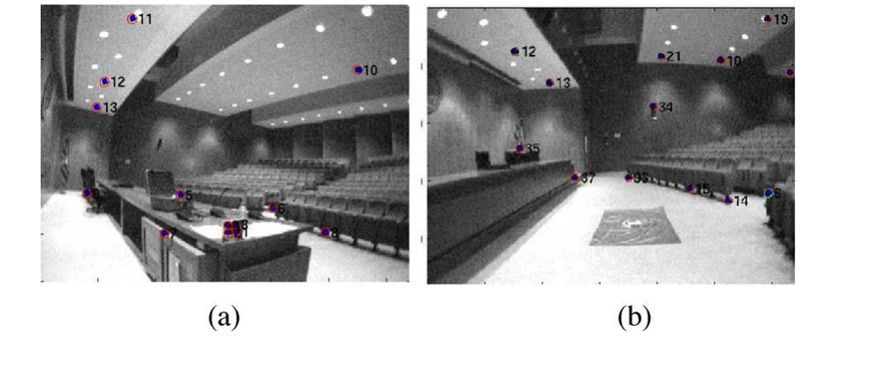

*原论文图 6。左图是特征 11、12、13 初始化时的画面，正文指出它对应序列第 18 帧；右图是序列末帧。*

图 7 把逆深度联合高斯数值传播到三维空间，红色区域由 Monte Carlo 传播得到；黑色椭圆则是用雅可比把它转换成 XYZ 高斯后的近似。最初红色区域沿射线延伸，形状与黑色椭圆差别很大。随着视差增加，两个区域逐渐接近，近处的特征 11 比远处的特征 13 更早达到这种状态。

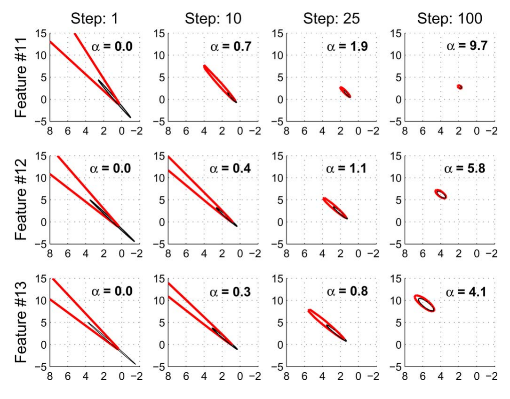

*原论文图 7。三行分别是特征 11、12、13，四列为初始化后第 1、10、25、100 帧。红色是逆深度状态传播得到的 $95\%$ 区域，黑色是 XYZ 高斯近似；各子图标出视差角 $\alpha$。*

这组图把切换条件的几何含义显示出来：只有当三维高斯已能近似原分布时，转换才不会明显改变不确定性的形状。它比较的是两种表示的置信区域，并非拿三维真值计算的定位误差。

### 7.2 室外远点可以长期保留

室外实验有 860 帧，使用 C++ 实现实时处理。图 8 在不同缩放尺度下同时显示相机轨迹、近点和远点，重点跟踪车上的特征 3 与远树上的特征 11。

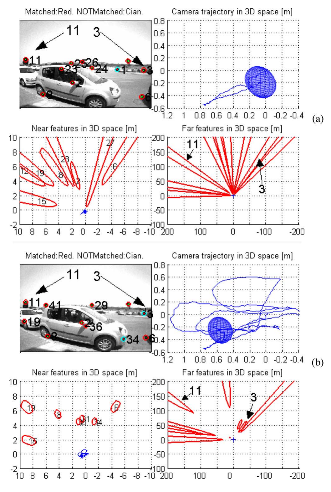

*原论文图 8。上下对应第 163、807 帧；每组显示图像、相机轨迹以及近点和远点的俯视图。*

图 9 中，车上特征 3 在前约 250 帧的逆深度区间仍包含零，随后逐渐排除无穷远与过大的距离，收紧到有限深度。树上的特征 11 始终没有足够视差，区间一直包含零，但它持续参加滤波，提供方向参照。

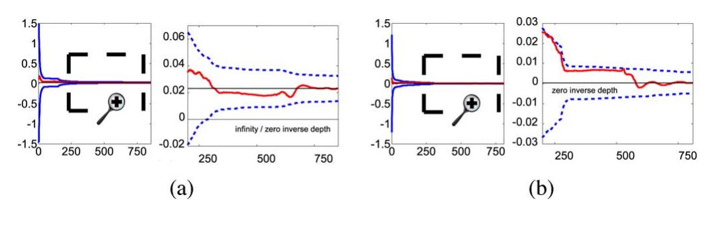

*原论文图 9。左侧 (a) 是车上的特征 3，右侧 (b) 是树上的特征 11。每个特征用两个纵轴尺度展示；粗线是逆深度均值，虚线是 $95\%$ 区间，细实线表示处理完整段序列后的估计。*

特征 11 的距离也并非完全没有获得信息。在这段具有横向基线的运动中，它仍只有很小视差，意味着过近的位置越来越不可能。其正深度下界可以提高，同时上界仍延伸到无穷远。逆深度状态容纳了这种不对称的距离知识。

### 7.3 回环时的位姿不确定性

回环序列共 737 帧，相机在实验室里走两圈。开始时，相机沿光轴方向后退，新特征视差较差，朝向不确定性下降而平移不确定性上升；约第 50 帧以后出现横向平移，视差增加，平移估计也改善。从第 240 帧起，相机作一圈 $360^\circ$ 运动，探索新区域，位姿协方差随之增长。

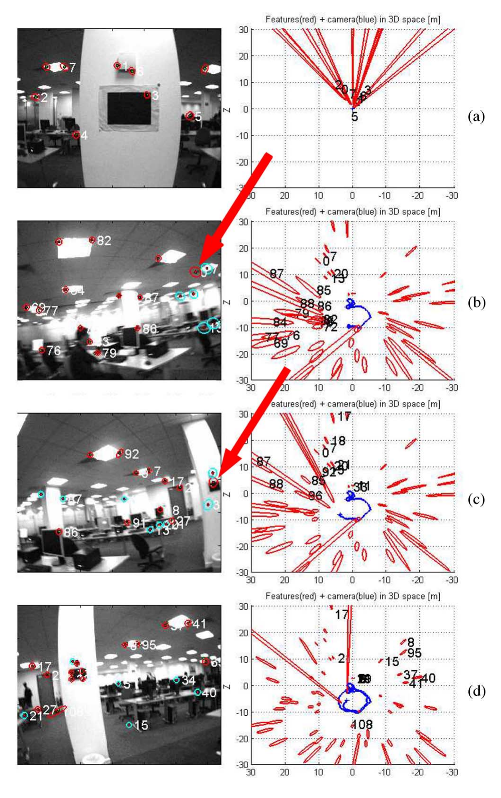

*原论文图 10。四行对应第 11、417、441、737 帧。箭头标出重新匹配的旧特征，右侧为地图和相机轨迹的俯视图，包含地图点的 $95\%$ 置信区域。*

第 417 帧先重观测到一个远点，第 441 帧再重观测到一个已通过较大视差建图的近点。图 11 中，两次匹配后位姿不确定性都明显下降。第二圈中多数地图点被重访、新点加入很少，地图的置信区域继续缩小。

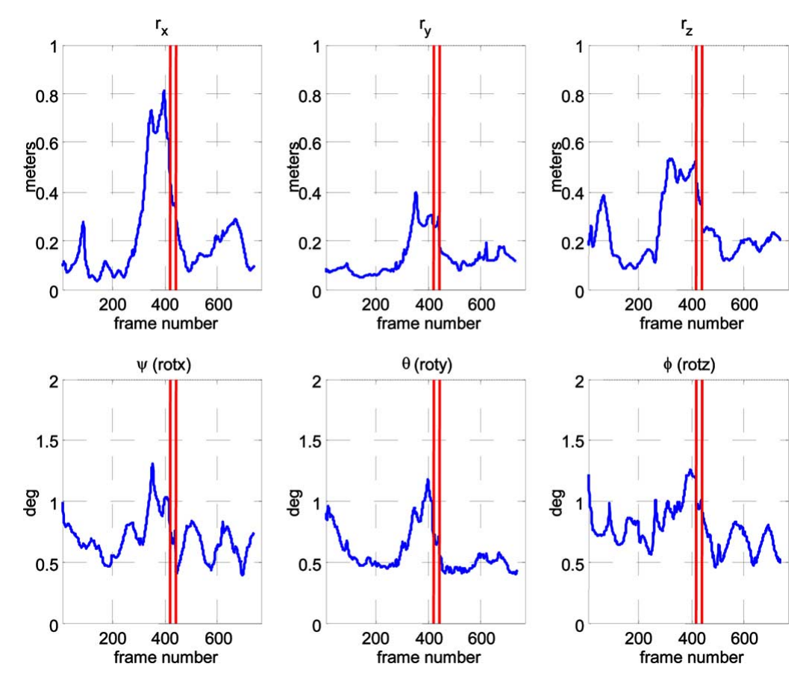

*原论文图 11。蓝线给出相机局部参考系下六自由度估计的 $95\%$ 置信区间，红色竖线标出第 417 与 441 帧的回环匹配。*

远点重访后平移协方差也下降，可以结合第 3 节的联合更新理解：朝向、平移和地图已经带有相关性，观测通过 $PH^\top$ 影响整个状态。对一个精确无穷远点，直接平移雅可比仍为零；这个图中的联合协方差下降不能解读为远点给出了独立的距离测量。

### 7.4 过早切换会损害一致性

切换仿真使用半径 3 m 的圆形相机轨迹，相机朝外走两圈，点分布在半径 4.3、10、20 m 的同心球面上。1000 帧图像中维持约 15 个可见特征，像素噪声为零均值、方差 $1\ \mathrm{pixel}^2$ 的高斯分布。各次比较使用相同场景特征。

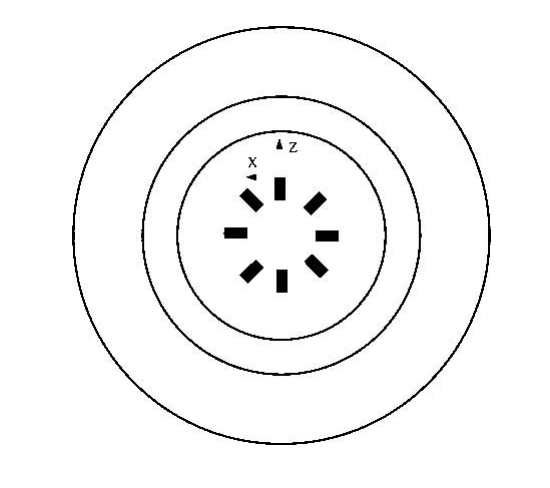

*原论文图 12。不同球面距离使同一轨迹上的点产生不同视差。*

阈值分别取 $0\%$、$10\%$、$40\%$、$60\%$，其中 $0\%$ 表示不切换。图 13 中，$10\%$ 与不切换的结果接近；提高到 $40\%$ 后，尤其是朝向估计出现退化，误差更大而协方差反而更小。这就是滤波不一致的表现：滤波器给出的置信程度已经不能反映真实误差。$60\%$ 时失去一致性并导致回环失败。

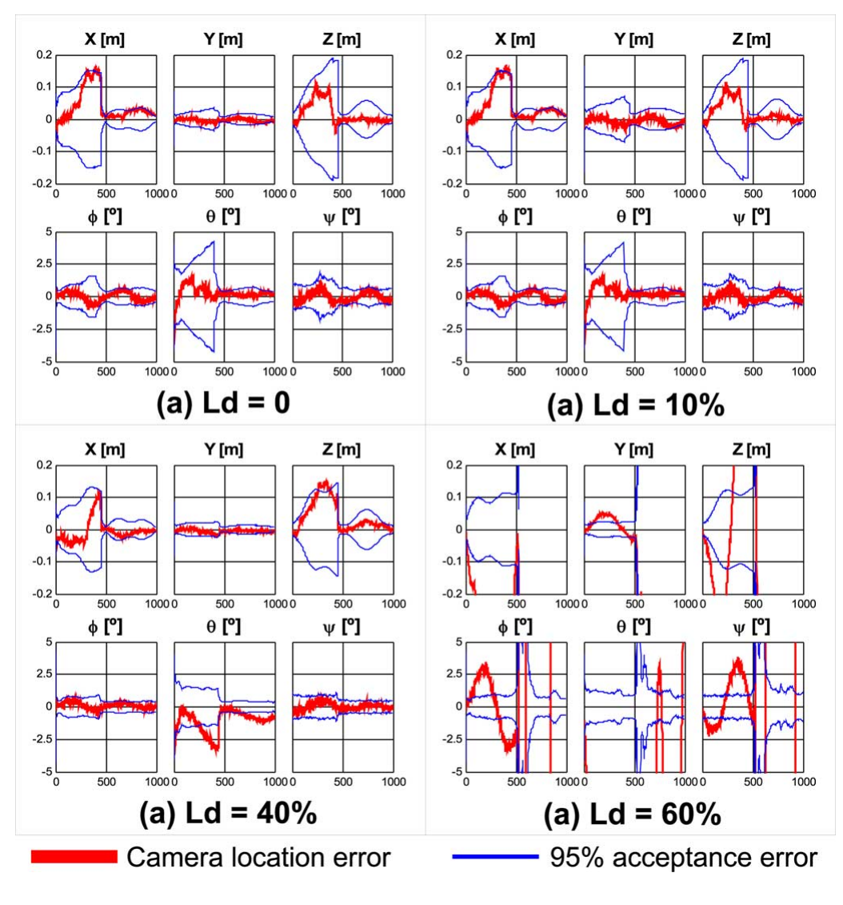

*原论文图 13。红色是位姿误差，蓝色是 $95\%$ 置信界；四组分别采用不切换、$10\%$、$40\%$、$60\%$ 阈值。*

因此，“每点从六维减成三维”要以三维高斯已适用为前提。若仅因观测了若干帧就转换，仍然很长、很不对称的深度分布会被错误压进一个 XYZ 高斯，影响的不止是这个点，也包括与它相关的相机和地图。

### 7.5 真实序列的状态规模

作者又对同一回环序列比较全程逆深度与 $L_d=10\%$ 切换，没有观察到轨迹或地图的显著变化。末帧有 34 个逆深度点和 35 个 XYZ 点，相机状态为 13 维。全逆深度时总维度为 $13+69\times6=427$，混合表示为 $13+34\times6+35\times3=322$，保留约 $75\%$ 的维度。

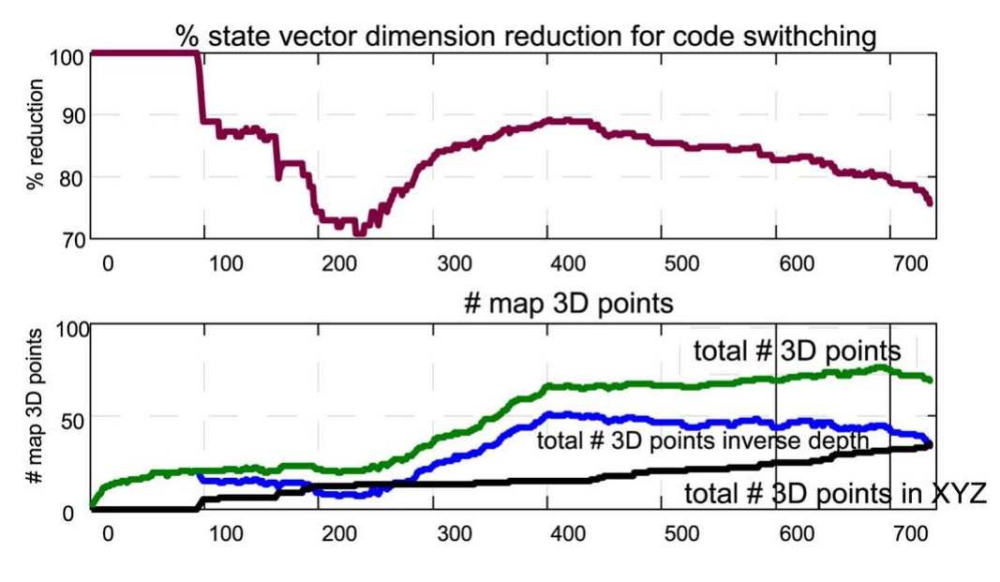

*原论文图 14。上半图按正文数据应读作混合表示相对于全逆深度的剩余维度比例；下半图显示地图总点数和两种表示的点数。原图纵轴标题使用了 reduction，但末帧由 427 降到 322，实际减少约 $25\%$，并非减少 $75\%$。*

图 15 显示，初始平移少时大部分点保持逆深度；相机运动及回环重访使不确定性收紧后，更多近点转为 XYZ。远处或仍没有足够视差的点继续保留原表示。

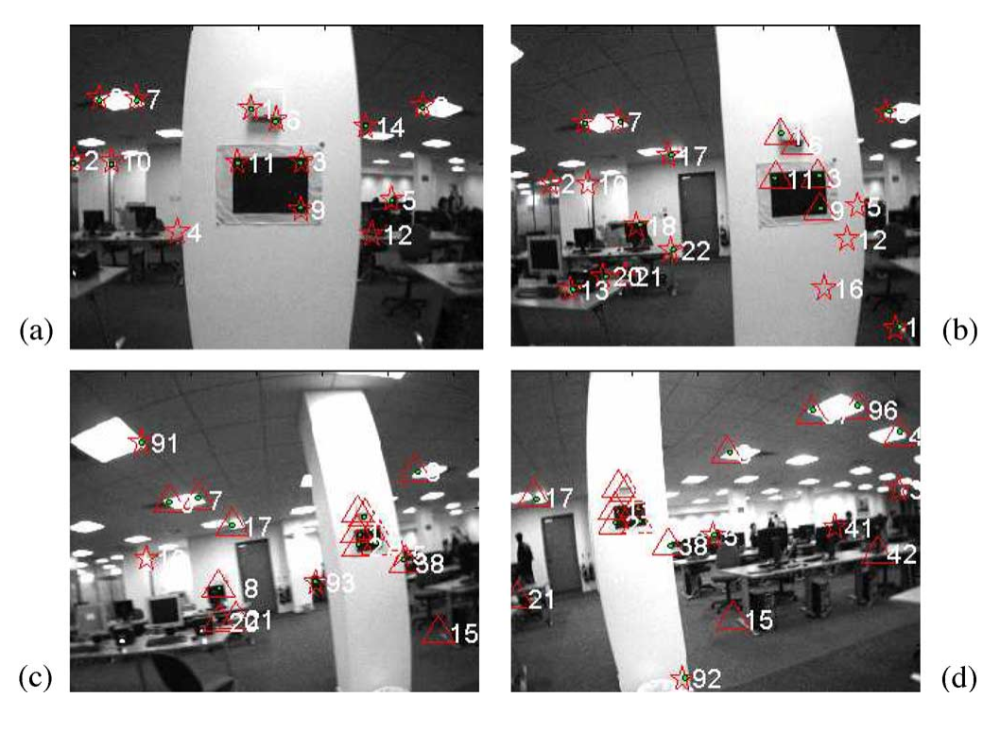

*原论文图 15。星形标出逆深度点，三角形标出 XYZ 点。四幅图展示初始、第 100 帧、第 470 帧和末帧的状态；第 470 帧位于前述回环匹配之后。*

### 7.6 处理时间

在 1.8 GHz Pentium M 笔记本上，作者报告一个典型工作负载：状态约 300 维，每帧观测 12 个特征，即 24 维像素测量。图像采集约 1 ms，EKF 预测约 2 ms，图像匹配约 1 ms，EKF 更新约 17 ms，总计约 21 ms，小于 30 Hz 对应的 33.3 ms 帧间隔。采用表示切换后，室内约 60—70 个特征的地图能够实时处理。

这些时间也说明了减小状态的用途：主要开销在联合滤波更新。地图状态占主导、每帧观测规模近似固定时，增加状态维度会显著增大协方差存储和更新成本，成熟点转换为 XYZ 因而有直接收益。

## 8. 结论

这篇论文把单目新特征的初始化和之后的跟踪接进同一个 EKF。首次观测给出射线，逆深度用有限坐标保留极远位置的可能性；以后观测产生多少视差，状态就逐渐取得多少距离信息。对一直看不出距离的远点，系统仍能使用方向；对已确定距离的近点，再以线性度判据决定是否转换为三维坐标。

这依赖相机标定、正确匹配和高斯线性化等条件。作者的推导解释了低视差下参数选择的优势，实验展示了室内外运行、远点持续跟踪与视觉回环；原文也将地图规模、数据关联、总体精度以及长期纯旋转或静止等退化运动列为仍待进一步分析的问题。逆深度使滤波器能够更合理地保存尚未确定的距离，并未消除单目尺度歧义或退化运动的可观测性限制。

## 附录 成像模型中的径向畸变

式 (9) 给出理想无畸变像素，实际相机记录的是畸变像素。原文附录的模型先定义从实际像素 $\mathbf h_d=(u_d,v_d)^\top$ 到理想像素 $\mathbf h_u=(u_u,v_u)^\top$ 的关系：

$$
\begin{pmatrix}u_u\\v_u\end{pmatrix}
=
\begin{pmatrix}
u_0+(u_d-u_0)(1+\kappa_1r_d^2+\kappa_2r_d^4)\\
v_0+(v_d-v_0)(1+\kappa_1r_d^2+\kappa_2r_d^4)
\end{pmatrix},\qquad
r_d=\sqrt{[d_x(u_d-u_0)]^2+[d_y(v_d-v_0)]^2}. \tag{30}
$$

$\kappa_1,\kappa_2$ 是径向畸变系数。初始化从测得的像素出发，可按式 (30) 去畸变，再构造式 (23) 的射线。预测观测则走相反方向：先由式 (9) 得到理想像素，再求实际图像里的预测位置。

反向计算中，理想半径 $r_u$ 已知，畸变半径 $r_d$ 满足

$$
r_u=r_d(1+\kappa_1r_d^2+\kappa_2r_d^4), \tag{32}
$$

$$
r_u=\sqrt{[d_x(u_u-u_0)]^2+[d_y(v_u-v_0)]^2}. \tag{33}
$$

原文用数值方法（例如 Newton–Raphson）由式 (32) 解 $r_d$，再将像素相对主点的偏移除以 $1+\kappa_1r_d^2+\kappa_2r_d^4$，得到原文式 (31) 的畸变坐标。附录式 (34) 给出式 (30) 的解析雅可比；反向畸变的雅可比在相应像素处取其逆：

$$
\left.\frac{\partial\mathbf h_d}{\partial\mathbf h_u}\right|_{\mathbf h_u}
=
\left[
\left.\frac{\partial\mathbf h_u}{\partial\mathbf h_d}
\right|_{\mathbf h_d(\mathbf h_u)}
\right]^{-1}. \tag{35}
$$

它与针孔投影、坐标变换的雅可比相乘，组成实际像素对联合状态的观测导数。逆深度改善的是三维状态到观察方向的表示，后面的成像模型仍要准确，尤其原文实验采用了较大视场。

## 参考文献

- Civera, J., Davison, A. J., & Martínez Montiel, J. M. (2008). *Inverse Depth Parametrization for Monocular SLAM*. IEEE Transactions on Robotics, 24(5), 932–945. [论文页面](https://doi.org/10.1109/TRO.2008.2003276) · [PDF](https://www.doc.ic.ac.uk/~ajd/Publications/civera_etal_tro2008.pdf).
