# LASER 论文解读

> Tianye Ding、Yiming Xie、Yiqing Liang 等，*LASER: Layer-wise Scale Alignment for Training-Free Streaming 4D Reconstruction*，arXiv:2512.13680v3（2026 年 3 月 28 日，CVPR 2026，正文与补充材料共 16 页）。[arXiv 论文页](https://arxiv.org/abs/2512.13680) · [v3 PDF](https://arxiv.org/pdf/2512.13680v3)

VGGT、π³ 等前馈几何模型能从一组图像直接预测相机位姿和稠密点图，但把越来越长的视频整段输入，计算与显存开销会随视图数迅速增长。LASER 采用另一种办法：冻结已有的离线模型，把视频切成相互重叠的短窗口，依次重建每个局部子图，再将子图接到全局地图上。它不重新训练几何主干。

窗口之间只用一个 Sim(3) 相似变换注册，仍可能留下前景与背景相对尺度不一致的问题。LASER 将残差修正拆到每帧的深度层上，用层间重叠关系估计尺度，再沿时间传播到窗口中没有重叠观测的帧。文章的主要贡献因此不是新的重建网络，而是用经典几何注册和层状表示，把离线预测组织成可持续输入的视频重建流程。

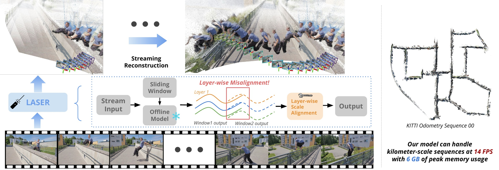

*原论文图 1。图中展示重叠窗口、层级尺度校正和长序列重建。论文报告的公里级序列速度与显存数值来自 RTX A6000 实验，不能直接外推到其他硬件。*

## 问题背景与相关方法

传统 SfM、MVS 通过显式对应关系和几何优化逐步恢复场景；前馈重建模型则直接回归点图、深度和相机参数，减少了手工匹配与逐场景优化。VGGT 与 π³ 等模型在离线多视图重建中表现突出，但整段注意力计算不适合视频帧持续到达的场景。

已有流式方法通常采用因果注意力、循环状态或显式记忆，让模型随帧更新。LASER 的出发点不同：继续使用原有离线前馈模型，只限制每次送入模型的帧数，再在窗口之间做几何对齐。它与 [VGGT-Long](../vggt-long/index.md) 同样使用滑动窗口，但论文指出，全局 Sim(3) 对齐不足以处理不同深度表面的相对尺度变化。因此 LASER 在窗口注册后又加入 Layer-wise Scale Alignment（LSA，逐层尺度对齐）。

## 方法

### 重叠窗口预测局部几何

设单目视频为 $\{I_t\}_{t=1}^{T}$，每个窗口含 $L$ 帧，相邻窗口重叠 $O$ 帧。第 $i$ 个窗口从帧索引 $a_i$ 开始：

$$
W_i=\{t\mid a_i\le t<a_i+L\},\qquad
a_{i+1}=a_i+L-O.
\tag{1}
$$

冻结的前馈重建器 $f$ 对窗口 $W_i$ 预测每帧点图 $P_t^{(i)}$、相机位姿 $T_t^{(i)}=(R_t^{(i)}\mid \mathbf t_t^{(i)})$ 和像素置信度 $C_t^{(i)}$。点图位于当前窗口的局部坐标系中；同一帧出现在两个窗口时，会得到两份独立预测。窗口内的点图先依照该窗口预测的相机位姿变换到同一子图坐标系，随后再注册到全局地图。

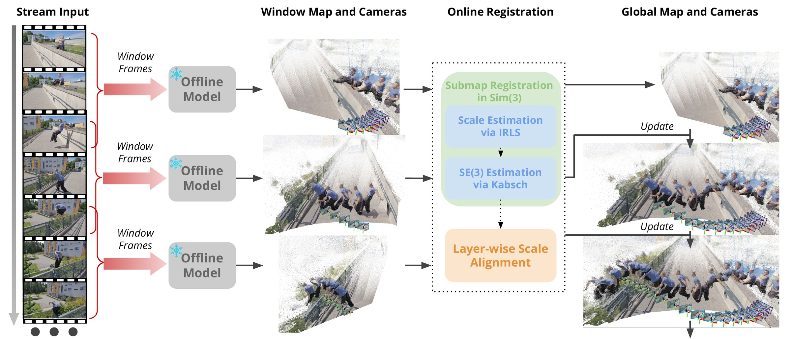

*原论文图 2。每个窗口由冻结的离线模型生成局部地图与相机位姿；窗口注册先估计整体尺度，再由相机锚点估计刚体变换，最后执行 LSA。*

### 先估计窗口间的 Sim(3) 变换

第 $i$ 个窗口与已累计的全局地图之间用相似变换 $(s_i^w,R_i^w,\mathbf t_i^w)$ 对齐。它包含一个整体尺度 $s_i^w>0$、旋转 $R_i^w\in SO(3)$ 和平移 $\mathbf t_i^w\in\mathbb R^3$。窗口局部相机位姿被变换到世界坐标系后为：

$$
T_t^w=
\left(R_i^wR_t^{(i)}\;\middle|\;
s_i^wR_i^w\mathbf t_t^{(i)}+\mathbf t_i^w\right).
\tag{2}
$$

式中，尺度乘在局部相机中心的平移上，旋转和平移再将它放入全局坐标系；相机朝向由两个旋转矩阵相乘得到。这样一来，窗口里各帧共享同一个尺度，窗口子图可以沿视频顺序并入全局地图。

点图中的空间点也使用同一外层相似变换：若 $X^{(i)}$ 是当前窗口子图坐标系中的一点，则其全局坐标为 $X^w=s_i^wR_i^wX^{(i)}+\mathbf t_i^w$。后续深度层分割正是从完成这一步后的全局点图提取 $Z$ 坐标。

论文把尺度估计和刚体注册分成两步。对重叠帧中同一像素位置 $x$，记前一窗口与当前窗口的点图预测为 $p(x)$、$q(x)$，置信度为 $c_p(x)$、$c_q(x)$。只保留两边置信度都高于各自中位数的像素对应：

$$
\mathcal C=\{(p,q)\mid c_p>g(C_t^{(i-1)}),\
c_q>g(C_t^{(i)})\},
\tag{3}
$$

其中 $g$ 是中位数函数。对这些对应点，作者以 Huber 鲁棒损失求解正尺度：

$$
s_i^w=\arg\min_{s>0}
\sum_{(p,q)\in\mathcal C}
\rho\!\left(\left\|sp-q\right\|_2\right).
\tag{4}
$$

这里 $p$ 与 $q$ 表示同一重叠图像位置在两个窗口坐标系下的三维预测。尺度 $s$ 使二者尽量接近；Huber 损失会降低大残差对应对结果的影响。论文通过 IRLS（迭代重加权最小二乘）求解这一鲁棒目标。

尺度固定后，论文没有直接用稠密点图再估旋转和平移，而是从重叠帧的相机位姿构造锚点。设相机坐标系中的向上和视线方向分别为 $\mathbf u=(0,1,0)$、$\mathbf v=(0,0,-1)$，变换到子图坐标系后记为归一化方向 $\mathbf u_t,\mathbf v_t$。每台相机贡献相机中心、沿视线方向的一个单位点，以及沿向上方向的一个单位点。前一窗口和当前窗口的锚点三元组为：

$$
x_t=\left(s_i^w\mathbf t_t^{(i)},\
s_i^w\mathbf t_t^{(i)}+\mathbf v_t^{(i)},\
s_i^w\mathbf t_t^{(i)}+\mathbf u_t^{(i)}\right),
\quad
y_t=\left(\mathbf t_t^{(i-1)},\
\mathbf t_t^{(i-1)}+\mathbf v_t^{(i-1)},\
\mathbf t_t^{(i-1)}+\mathbf u_t^{(i-1)}\right).
\tag{5}
$$

再用 Kabsch 算法解刚体变换：

$$
(R_i^w,\mathbf t_i^w)=
\arg\min_{R\in SO(3),\,\mathbf t\in\mathbb R^3}
\sum_{t\in O_i}\left\|Rx_t+\mathbf t-y_t\right\|_2^2,
\tag{6}
$$

其中 $O_i=W_{i-1}\cap W_i$ 是重叠帧集合。相机中心约束平移，视线和向上方向锚点还约束朝向。分开估计全局尺度与刚体变换，可以避免直接受点图局部形变牵引；补充材料中的注册消融显示，用缩放点图代替相机锚点会明显损害轨迹指标。

### 深度层尺度误差为何留在全局对齐之后

Sim(3) 只允许对一个窗口整体做均匀缩放。单目重建在视差不足时，深度方向的约束会弱于图像平面方向，因此不同深度表面之间的相对距离，可能在相邻窗口中预测得不一样。一个全局尺度即使能把重叠窗口的整体位置对齐，也无法同时修正前景和背景各自的比例。将这样的窗口继续拼接，误差会表现为局部表面过度膨胀或压缩，并逐步形成地图尺度漂移。

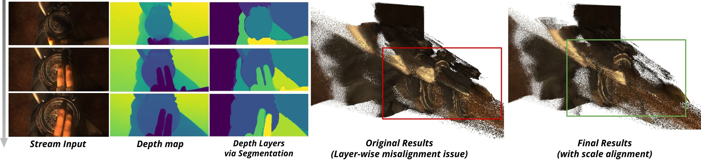

*原论文图 3。不同深度表面在窗口间可能保留不同的相对尺度误差；LSA 根据深度层关系传播校正量。*

### LSA 把尺度估计放进时空层图

首先将 Sim(3) 注册后的点图记作 $\bar P_t^{(i)}$，取其 $Z$ 坐标构造伪深度图 $\bar D_t^{(i)}$。论文用 Felzenszwalb 图像分割算法把每张伪深度图划分为空间连续、深度相近的区域，每个区域作为一个深度层 $L_{t,m}^{(i)}$。这种分层依据预测几何，不代表网络识别出的物体类别或持久物体身份。

随后为层构造有向图 $H=(V,E)$。图节点是各帧的深度层，边有两种：

- **窗口间边**连接重叠窗口中同一时间戳的两个层。若两个层掩码的 IoU 高于阈值 $\tau$，就认为它们对应同一表面。
- **窗口内时间边**连接相邻帧中 IoU 高于阈值的层，用于把重叠区估出的尺度传到窗口内其他帧。

论文默认 $\tau=0.3$。相邻窗口的重叠图像来自同一时间戳，层掩码可直接比较；窗口内的连续帧则按掩码 IoU 建立时间联系。这个图把“哪个局部层和哪个层有关”转换为后续尺度传播的路径。

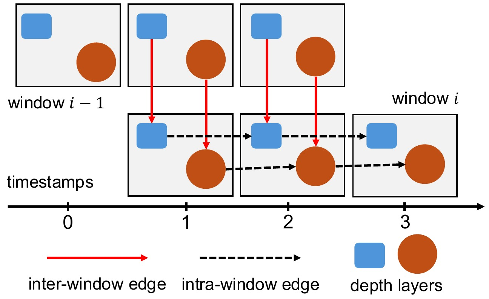

*原论文图 4。跨窗口边在重叠帧之间传递尺度，窗口内时间边继续把尺度带到后续帧；边权使用连接层的 IoU。*

在重叠帧中，假定前一窗口的某个层与当前窗口层 $L_{t,n}^{(i)}$ 有像素交集。取交集像素处两份伪深度 $d_p,d_q$，用 Huber 损失估计当前层的相对尺度：

$$
\hat s_{t,n}^{(i)}
=\arg\min_{s>0}
\sum_{(d_p,d_q)\in\mathcal C_{t,n}^{(i)}}
\rho\!\left(\left\|s\,d_p-d_q\right\|_2\right).
\tag{7}
$$

与式（4）一样，目标是找到一个正比例因子，让重叠预测的深度尽量一致。不同之处是这里的尺度只作用于某一个深度层，因而可以分别修正前景、背景等区域的相对比例。LSA 调整的是点图，不会重新估计相机位姿；相机轨迹由前面的窗口级注册产生。

每条跨窗口边先产生一个尺度估计。算法按层掩码 IoU 将多条入边的估计累加为加权和与权重，再取加权平均。得到的层尺度沿窗口内时间边继续向前传播；一层如果有多个父层贡献尺度，也按 IoU 加权融合。没有任何有效入边的层沿用尺度 1。最终，每个层的尺度应用到该层包含的点图像素上。

## 实验

### 设置与协议

论文分别评测视频深度、相机位姿和多视图点图。视频深度使用 Sintel、Bonn、KITTI，按协议只用尺度对齐预测深度。小场景位姿实验使用 Sintel、ScanNet 和 TUM RGB-D，轨迹按 Sim(3) 对齐；长序列使用 KITTI Odometry。点图重建使用 7-Scenes 和 NRGBD，以 Umeyama 粗略 Sim(3) 对齐后再用 ICP 精化。KITTI 长序列对照中，LASER 采用与 VGGT-Long 相同配置加入回环。

模型主干使用 VGGT 或 π³；长序列道路实验与 Waymo 点图实验使用 π³。默认窗口长度为 $L=20$、重叠帧数为 $O=5$、LSA 的 IoU 阈值为 $\tau=0.3$。论文在 RTX A6000 上报告速度与显存。

### 视频深度和相机位姿

在视频深度表 1 中，π³+LASER 的 Abs Rel 在 Sintel、Bonn、KITTI 上分别为 0.247、0.048、0.054；对照流式方法中，Sintel 的 STream3Rβ 为 0.264，Bonn 的 StreamVGGT 为 0.059，KITTI 的 STream3Rβ 为 0.080。数值越低越好。LASER 在三个数据集上均优于对应的最佳流式对照；它与离线 π³ 的差距则因数据集而异，不能概括成所有任务上都追平离线模型。

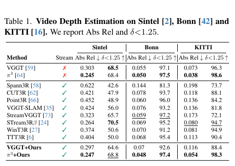

*原论文表 1。Abs Rel 越低越好，$\delta<1.25$ 越高越好。*

小场景位姿结果见表 2。π³+LASER 在 Sintel 的 ATE 为 0.061，低于表中其他方法；在 ScanNet 和 TUM 上，多项指标与离线 π³ 接近，但并非每一项都更优。相比大多数流式基线，LASER 在这些小场景上提高了轨迹精度。

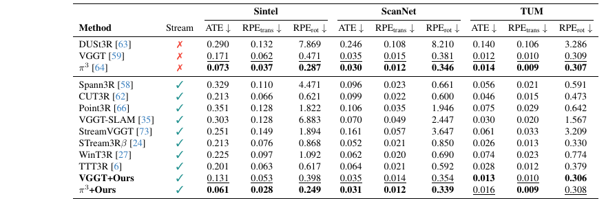

*原论文表 2。报告 ATE、平移相对位姿误差和旋转相对位姿误差，三项均越低越好。*

长序列 KITTI 的表 3 给出更贴近在线重建的对照。LASER（π³）的平均 ATE 为 24.17，排在表中较优位置；同一主干的 π³-Long 为 30.72，VGGT-Long 为 27.64。排除高速且运动模式不同的序列 01 后，Avg.* 分别是 14.42、16.45 和 18.28。离线 VGGT、π³ 等方法在该评测中显存溢出，部分流式方法也出现显存溢出或跟踪丢失。这个结果来自论文所用的 KITTI 配置，其中 LASER 同样采用了回环设置。

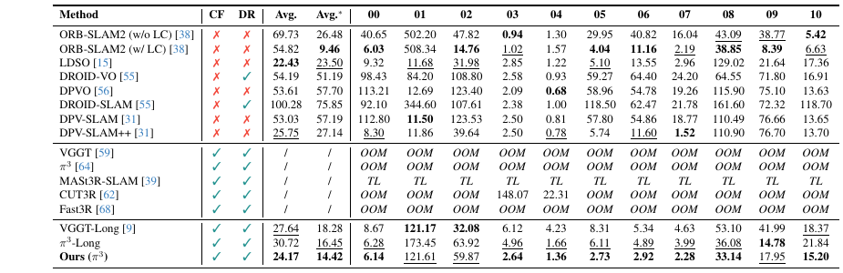

*原论文表 3。CF 表示无需相机标定，DR 表示支持稠密重建；OOM 为显存溢出，TL 为跟踪丢失。Avg.* 排除序列 01。*

### 点图重建和效率

表 4 的 7-Scenes 结果显示，π³+LASER 的平均 Accuracy、Completeness 分别为 0.013 和 0.017。相较离线 π³，Accuracy 略差于 0.011，Completeness 则优于 0.019；相较流式基线，两项几何误差整体更低。在 NRGBD 上，LASER 的 Accuracy 为 0.020，差于离线 π³ 的 0.012；Completeness 为 0.012，也高于离线 π³ 的 0.010。法向一致性方面，π³+LASER 为 0.713，低于 StreamVGGT 的 0.742 和 STream3Rβ 的 0.798。结果说明，LASER 对流式模型有明显改善，但收益依赖数据集和指标，不能概括为在所有任务上达到离线模型水平。

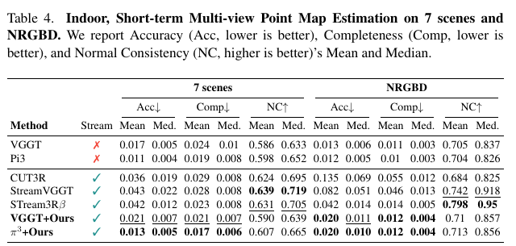

*原论文表 4。Accuracy（Acc）与 Completeness（Comp）越低越好；Normal Consistency（NC）越高越好。*

论文还在 DAVIS 与 Hike 序列上给出定性点图和轨迹对比。图 6 展示 π³、VGGT 两个主干的 LASER 结果，并与 CUT3R、StreamVGGT、VGGT-SLAM 对照；这些可视化用于观察拼接地图和轨迹形态，不能替代表格中的定量指标。

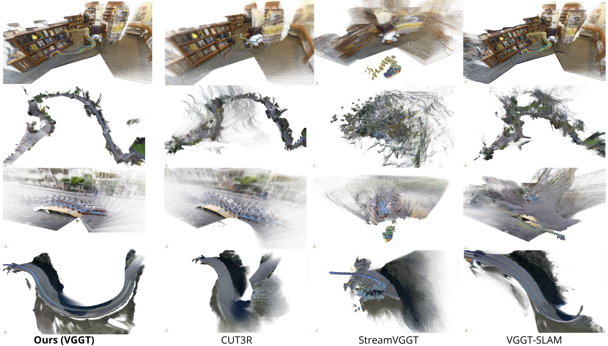

*原论文图 6。上行为 DAVIS，下行为 Hike；各列展示重建的全局点云，并叠加估计相机轨迹。*

速度与内存实验报告，π³ 作为主干时约 14.2 FPS、峰值显存 6 GB；VGGT 主干约 10.9 FPS、10 GB。补充材料说明，比较方法的输入分辨率并不完全相同：DUSt3R 系列为 512×288，Spann3R 为 224×224，VGGT 系列为 518×294，因此图 5 的速度点需要结合输入尺寸理解。

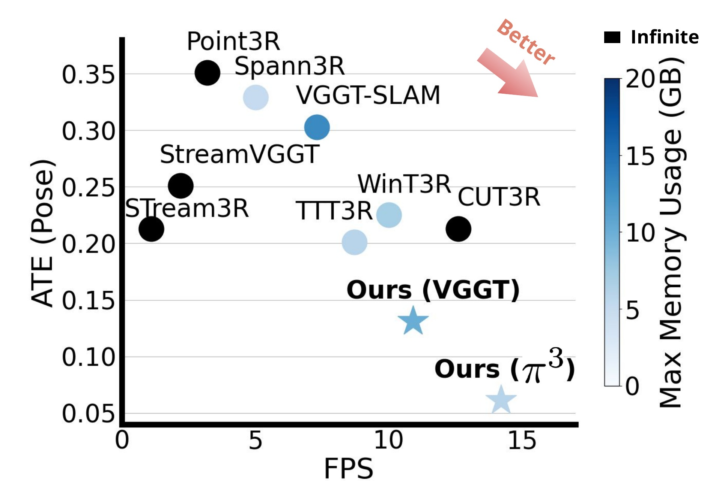

*原论文图 5。横轴是 RTX A6000 上测得的 FPS，纵轴是 ATE，颜色表示峰值显存。不同方法的比较仍受各自输入尺寸与实现影响。*

作者还给出长序列 Waymo 点图实验：相较 VGGT-Long，LASER 的平均 Chamfer 距离从 0.482 降到 0.413，Completeness 从 0.456 降到 0.266，但 Accuracy 从 0.508 变为 0.560，变差。为减轻天空和远景伪点影响，Waymo 结果对所有方法统一剔除置信度最低的 40% 点；论文将其定位为参考性对比，不主张严格的同条件优劣结论。

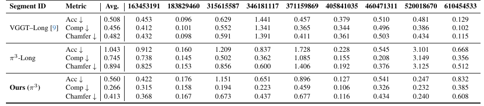

*原论文补充材料表 7。Acc、Comp、Chamfer 均越低越好；保留统一剔除低置信点的评测条件。*

### 消融与运行开销

移除 LSA 后，Sintel 上 Abs Rel 从 0.247 增到 0.328，Bonn 上从 0.048 增到 0.123。移除窗口内时间边 $E_{\mathrm{intra}}$ 后，两组深度指标也有下降，说明只在重叠窗口初始化尺度、却不沿时间传播，难以覆盖窗口的非重叠帧。替换为 SAM 2 分割后没有带来明显精度提升。IoU 阈值在 0.2 至 0.6 的区间变化较小，默认 0.3 是作者选取的精度与稳定性折中。

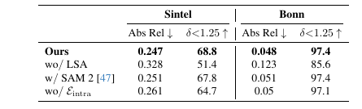

*原论文表 5。去除 LSA 或时间传播会降低深度估计表现；SAM 2 替换没有带来收益。*

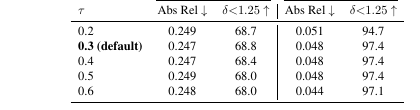

*原论文表 6。阈值变化对 Sintel、Bonn 指标影响有限。*

在窗口长度消融中，默认 $L=20$；小窗口会增加窗口数量和计算，大窗口则改变误差和推理成本之间的折中。窗口重叠的默认值为 $O=5$，补充材料报告在不同重叠值下总体表现较稳定。

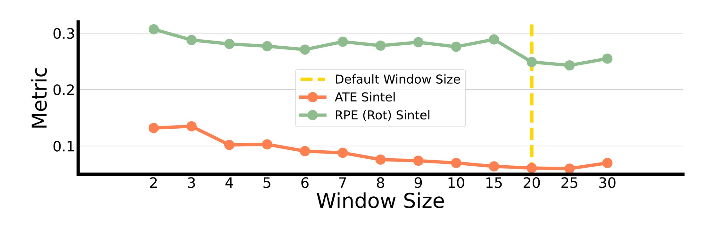

*原论文图 7。橙线为 Sintel ATE，绿线为旋转 RPE；虚线标出默认窗口长度 20。*

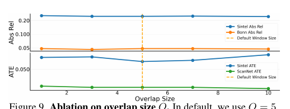

*原论文补充材料图 9。默认重叠长度 $O=5$；论文报告不同重叠设置下的深度与位姿指标整体较稳定。*

补充材料的模块计时揭示了一个实现层面的重点：窗口长度 20、重叠 5 时，π³ 单次窗口推理耗时 1.344 秒；深度层提取为 0.719 秒，图构建为 0.168 秒，Sim(3) 估计为 0.007 秒，尺度初始化为 0.041 秒，传播与聚合为 0.021 秒。论文通过多线程让窗口推理与相邻窗口注册并行。因此，LSA 的层分割本身也占用可观时间，14 FPS 是整套并行实现的实测结果，不是“几何对齐几乎没有成本”的证据。

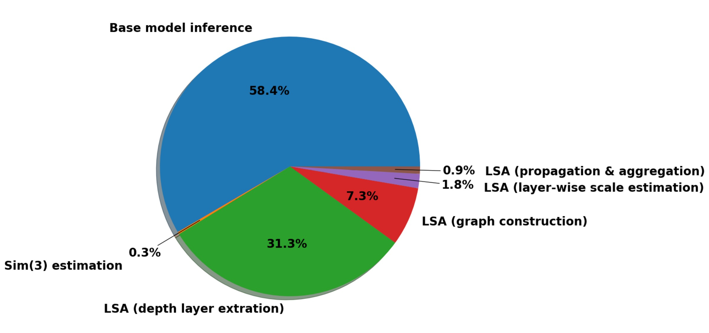

*原论文补充材料图 8。深度层提取和图构建占据主要注册开销，Sim(3) 估计所占比例很小。*

子图注册消融进一步显示，改用闭式尺度估计代替 IRLS 后，Sintel 深度 Abs Rel 从 0.247 升至 0.328、ATE 从 0.061 升至 0.107；用缩放后的点图估刚体变换，则旋转 RPE 从 0.249 升至 0.742。也就是说，稳健尺度估计与相机位姿锚点分别在尺度和轨迹稳定性上发挥作用。

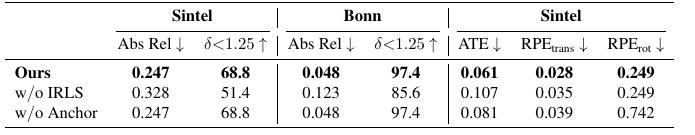

*原论文补充材料表 8。w/o IRLS 使用闭式尺度估计；w/o Anchor 使用缩放点图而非相机锚点估计刚体变换。*

## 局限与方法关系

LASER 的优势来自可复用离线模型和显式几何对齐，适合静态或近似静态环境。它的局限也直接来自这些选择。第一，层图仅由逐帧深度图和掩码 IoU 建立，没有持久物体身份；复杂场景中多个物体可能落入同一深度层，物体被完全遮挡后重新出现时也无法恢复其层对应。作者提出未来可加入原始图像外观信息改善层的时序追踪。第二，作者明确指出，若主干模型无法处理动态或非刚性场景，LASER 也会继承其失败，移动物体会使相机位姿和静态地图不可靠。第三，窗口大小、重叠率、层置信度阈值等超参数需要按室内外场景调节，降低了直接迁移的通用性。

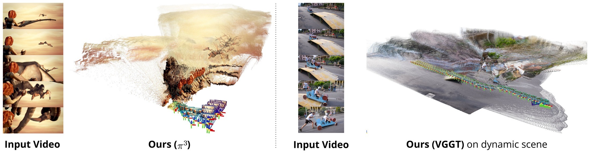

*原论文补充材料图 12。论文展示在动态场景等条件下的失败案例，并将主干重建质量列为系统适用范围的限制。*

从流式重建方法的分类看，LASER 属于“离线前馈模型 + 几何窗口注册”，和 StreamVGGT、STream3R 的因果 Transformer、CUT3R 的持久隐状态、Point3R 的空间记忆形成互补。它无需针对流式任务重新训练，但滑动窗口仍要在每个窗口运行完整离线模型，并依赖窗口重叠提供可配准观测。它也不是完整的传统 SLAM 后端：长序列 KITTI 评测按论文设置接入了回环，但核心方法并未把位姿、地图和回环统一写成持续优化的因子图。因而，LASER 更准确的定位是以几何对齐增强长序列前馈重建，而非替代所有 SLAM 系统模块。

## 核心认识

LASER 把窗口融合误差分成两个尺度层次处理：Sim(3) 先对齐相邻子图的整体尺度、旋转和平移；LSA 再根据深度层重叠关系修正单一窗口尺度无法表达的局部深度比例，并通过时间边传播到非重叠帧。它说明训练自由的流式化不一定要把离线模型改造成递归网络，亦可通过有限窗口推理与显式几何一致性约束来实现。

这套机制成立的前提也很具体：重叠窗口要提供足够可靠的点对应和相机位姿，深度分割要能形成有意义的层，层掩码之间还需有足够重叠以传播校正。它缓解了长序列中的尺度不一致，但并未消除主干错误、严重动态、遮挡造成的身份中断和超参数迁移问题。
