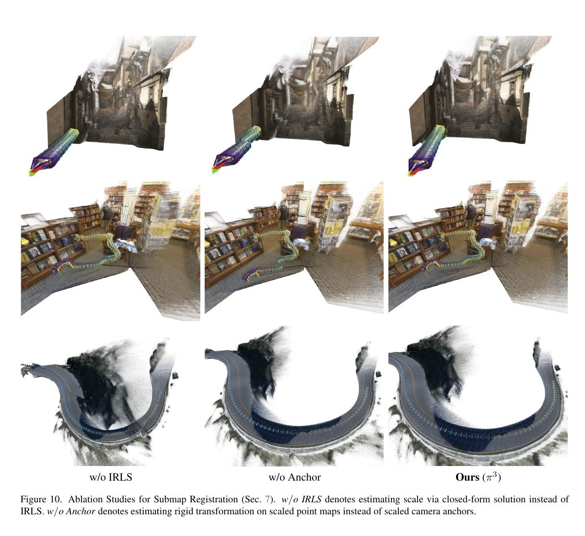

# LASER 论文解读

> Tianye Ding、Yiming Xie、Yiqing Liang 等，*LASER: Layer-wise Scale Alignment for Training-Free Streaming 4D Reconstruction*，arXiv:2512.13680v3（2026 年 3 月 28 日，CVPR 2026；正文与补充材料共 16 页）。[arXiv 论文页](https://arxiv.org/abs/2512.13680) · [v3 PDF](https://arxiv.org/pdf/2512.13680v3)

## 摘要

VGGT、π³ 等前馈几何模型能从多张图像直接预测稠密三维点图和相机位姿，但它们通常把整组图像共同送入 Transformer。视频持续变长时，注意力和中间特征占用也随之增长；新帧到来还可能要求重新处理已有帧，因此离线模型难以直接承担长视频的在线重建。

LASER 的目标是把这类离线模型转换成流式重建器，而不微调或重训主干。它把视频拆成有重叠的短窗口，每次调用冻结的离线模型得到局部点图和相机轨迹，再把当前子图注册到已经积累的全局地图。作者发现，只用一个 Sim(3) 相似变换对齐窗口仍会留下深度层之间的相对尺度错位：同一窗口的整体可以对齐，但前景和背景各自的尺度可能不同。为此，LASER 根据点图深度将场景划分为层，为重叠层估计单独的尺度，并沿窗口内部的时间联系传播尺度。

论文报告，采用 π³ 主干时，LASER 在 RTX A6000 上达到约 14.2 FPS、峰值显存约 6 GB；在 7-Scenes 上平均 Accuracy 为 0.013 m，而离线 π³ 为 0.011 m。帧率和显存是该硬件与评测配置下的实测值；论文另用公里级 KITTI 序列评估其长序列处理能力。7-Scenes 的结果也提醒读者，流式化带来的可扩展性并不意味着所有指标都超过离线重建。

*原论文图 1。冻结模型按重叠窗口处理输入，窗口经过子图注册和层尺度对齐后进入全局地图。图中公里级序列速度和显存数据来自 RTX A6000。*

## 1 引言

SfM 与 MVS 通过特征对应、三角化和几何优化恢复相机与场景；它们精度高，但对纹理、标定和工程流程有要求。近年的前馈模型直接从图像回归点图与位姿：DUSt3R 从图像对预测稠密点图，VGGT 和 π³ 将这一思路扩展到多视图输入。这些模型把大量场景先验编码在网络中，推理时不必针对每个场景从头优化。

问题在于，离线模型通常一次接收一段固定图像集合。将所有历史帧不断追加，注意力计算和显存开销会随序列增长；每来一帧都重新运行整个集合又会重复计算。流式模型因此引入持久状态、记忆或因果注意力，也有方法把离线预测切块后再对齐。但前一类方法常需额外训练或蒸馏，长时间运行还可能发生漂移；后者 VGGT-Long 则用 Sim(3) 对齐分块结果。LASER 的问题正是在这个基础上提出的：冻结强离线模型并按窗口推理之后，怎样把窗口间的几何误差控制住？

作者指出，整体 Sim(3) 只能统一缩放、旋转和平移整个子图。在视差较小的运动下，单目模型对深度方向的约束较弱，同一场景中不同深度表面的相对尺度可能在不同窗口中变化。把两个窗口的整体坐标对齐，不足以同时对齐近处前景和远处背景。LASER 因此把全局对齐与逐深度层修正分成两个层次：先用传统几何估计窗口间 Sim(3)，再用层图对每层进行尺度调整。

论文将贡献概括为三点：提出不用重训、可接入 VGGT 和 π³ 的滑窗式流式框架；识别并处理窗口间的深度层尺度错位；在位姿与点图实验中取得有竞争力的精度，同时支持公里级序列。后文的实验会分别检验深度、位姿、点图质量、运行效率和各组件的作用。

## 2 相关工作

### 学习式三维重建

学习式重建以数据驱动的特征聚合和深度估计取代部分手工对应流程。后续工作也通过循环融合或体素表示支持在线或大尺度重建；隐式场可建模表面与外观，显式表示则便于渲染和扩展，但不少方法仍需场景级优化。DUSt3R 直接回归图像对的三维点，VGGT 将多视图几何交给带相机 token 的 Transformer，π³ 以置换等变注意力统一结构与运动推理。LASER 建立在这类前馈模型上，重点是如何把有限图像集合的输出连续接成地图。

### 学习式四维重建

四维重建把三维几何扩展到随时间变化的场景；在 LASER 这里，重点是沿视频持续输出一致的几何与位姿，并不表示系统显式建模了可变形物体的运动。已有路线包括为隐式或显式场景表示加入时间条件、形变场，也包括训练前馈模型从视频对应关系中学习动态几何。π³ 将三维和四维推理纳入同一前馈框架。LASER 关注的问题更具体：让这些前馈几何 Transformer 以因果、分段方式处理流式视频，并在窗口融合时维持时间上的几何一致性。

### 流式前馈重建

现有方法使用持久状态或空间记忆、因果注意力、测试时适配，或与 SLAM 优化结合。它们的设计目标各异，可能需要针对流式数据重训、在长序列上累积尺度漂移，或受到不断增长的记忆与推理成本限制。Fast3R 可处理大量图像，但不以逐帧到达的流式输入为目标。同期的 VGGT-Long 不重训模型，而是切分输入并以 Sim(3) 拼接；LASER 与其共享训练自由的出发点，进一步处理单一整体尺度无法表达的深度层相对尺度差异。

## 3 方法

### 3.1 总体流程与窗口注册

给定单目 RGB 视频 $\{I_t\}_{t=1}^{T}$，每个窗口包含 $L$ 帧，相邻窗口重叠 $O$ 帧。第 $i$ 个窗口的起始帧为 $a_i$：

$$
W_i=\{t\mid a_i\le t<a_i+L\},\qquad a_{i+1}=a_i+L-O.
$$

重叠让同一时间戳既能在前一窗口也能在当前窗口中被预测，为估计窗口间变换提供共同观测。每次将 $W_i$ 输入冻结的前馈重建器 $f$，得到逐帧点图 $P_t^{(i)}\in\mathbb R^{H\times W\times3}$、相机位姿 $T_t^{(i)}=(R_t^{(i)}\mid\mathbf t_t^{(i)})$ 和像素置信度 $C_t^{(i)}$。点图和相机都位于该窗口自己的局部坐标系。先按窗口内相机位姿将点图合成局部子图 $S_i$，之后才将子图放进全局坐标系。

*原论文图 2。每个窗口由冻结模型预测点图和相机；注册先估尺度，再用相机锚点估旋转和平移，最后对点图执行 LSA。*

窗口到全局地图的变换是 Sim(3)，包含尺度 $s_i^w>0$、旋转 $R_i^w\in SO(3)$ 和位移 $\mathbf t_i^w$。局部相机位姿变为：

$$
T_t^w=\left(R_i^wR_t^{(i)}\;\middle|\;s_i^wR_i^w\mathbf t_t^{(i)}+\mathbf t_i^w\right).
$$

因此，尺度作用于局部相机中心，旋转将局部方向变换到全局方向，平移最后把窗口放入全局坐标系；点图中的点也应用同一个 Sim(3)。当前窗口地图并入前一窗口累积的地图后，形成递增的全局地图 $G_i$。首个窗口定义参考坐标系，$G_0$ 为空。

估计 Sim(3) 时，作者把尺度与刚体部分分开求解。对于重叠帧同一像素位置 $x$，前一窗口和当前窗口给出的三维点分别为 $p(x)$、$q(x)$，置信度分别为 $c_p(x)$、$c_q(x)$。仅保留两边置信度都高于各自中位数的对应点。尺度由 Huber 鲁棒目标确定：

$$
s_i^w=\arg\min_{s>0}\sum_{(p,q)\in\mathcal C}\rho\!\left(\|sp-q\|_2\right),
$$

其中 $\mathcal C$ 是筛选后的点对应集合，$\rho$ 为 Huber 损失。优化的含义是找一个正比例因子，使两次独立预测的同一批三维点尽量一致；Huber 损失降低少数异常对应的影响。论文使用 IRLS（迭代重加权最小二乘）求解。尺度先固定，是为了后续刚体配准在共同尺度下进行。

尺度确定后，旋转和平移由重叠相机位姿的锚点用 Kabsch 算法求出。每台相机产生三个锚点：相机中心、沿视线方向的单位点，以及沿向上方向的单位点。相机坐标系中的标准向上与视线方向分别是 $\mathbf u=(0,1,0)$、$\mathbf v=(0,0,-1)$；经当前窗口相机旋转后，记为 $\mathbf u_t^{(i)}=R_t^{(i)}\mathbf u$、$\mathbf v_t^{(i)}=R_t^{(i)}\mathbf v$。于是当前窗口的一组锚点为 $x_t=(s_i^w\mathbf t_t^{(i)},\ s_i^w\mathbf t_t^{(i)}+\mathbf v_t^{(i)},\ s_i^w\mathbf t_t^{(i)}+\mathbf u_t^{(i)})$，前一窗口的对应锚点为 $y_t=(\mathbf t_t^{(i-1)},\ \mathbf t_t^{(i-1)}+\mathbf v_t^{(i-1)},\ \mathbf t_t^{(i-1)}+\mathbf u_t^{(i-1)})$。Kabsch 求解使 $\sum_{t\in O_i}\|R x_t+\mathbf t-y_t\|_2^2$ 最小的 $R\in SO(3)$ 和平移 $\mathbf t$。相机中心约束位置，两个方向锚点也约束朝向。补充材料比较了用缩放点图而非相机锚点估刚体变换的做法，结果显示后者对轨迹稳定性很重要。

### 3.2 逐层尺度对齐

#### 整体对齐为何不够

Sim(3) 假设一个窗口中所有点都乘以同一个尺度，也就是各方向和各深度表面按同一比例变化。但在视差不足时，单目重建器对 $Z$ 方向的几何约束较弱；即使相机和窗口整体已对齐，前景表面相对背景仍可能被放大或缩小。继续拼接会让表面产生可见扭曲，并使米制尺度误差随时间积累。

*原论文图 3。全局相似变换之后，不同深度表面仍可能有各自的相对尺度误差；LSA 以层为单位估计修正量。*

#### 从伪深度提取几何层

先将窗口注册后的点图记作 $\bar P_t^{(i)}$，取其 $Z$ 坐标作为伪深度 $\bar D_t^{(i)}$。论文用高效图像分割算法（Felzenszwalb 分割）将每张伪深度图划成若干空间连续且深度相近的区域 $L_{t,m}^{(i)}$。这些层是由预测几何构成的表面片段，不是语义类别，也不表示跨遮挡仍能追踪的持久物体身份。

#### 建立跨窗口、跨帧的层图

把层作为有向图 $H=(V,E)$ 的节点。窗口间边 $E_{inter}$ 连接重叠时间戳上的层：两个掩码的 IoU 大于阈值 $\tau$ 时建立连接。窗口内时间边 $E_{intra}$ 连接相邻帧中 IoU 大于阈值的层。前一种边利用同一张图像在两个窗口中各有一份预测这一事实，后一种边表达同一窗口内相邻帧的几何连续性。默认 $\tau=0.3$，边从较早、已知尺度的层指向较晚的待校正层。

*原论文图 4。窗口重叠区提供层尺度初值，窗口内时间边把修正传播到不在重叠区的帧。*

#### 用深度对应估计每层尺度

对于跨窗口相连的层，在二者掩码交集中取像素 $x$ 的伪深度。记前一窗口深度为 $d_p$，当前窗口深度为 $d_q$，则当前层的尺度由下式求得：

$$
\hat s_{t,n}^{(i)}=\arg\min_{s>0}\sum_{(d_p,d_q)\in\mathcal C_{t,n}^{(i)}}\rho\!\left(|s d_p-d_q|\right).
$$

这和窗口级尺度估计一样使用正尺度与 Huber 损失，但对应量现在是一维深度，而且优化只针对一个层。前景层和背景层可以得到不同尺度，正是它相较整体 Sim(3) 多出的自由度。该校正应用在点图的层内像素上，不重新优化相机位姿，所以轨迹仍由上一节的窗口注册决定。

#### 沿层图传播和聚合

算法先遍历 $E_{inter}$，为当前窗口重叠区的层估计尺度 $\hat s$，并按边两端掩码的 IoU 作为权重，累加尺度加权和 $A$ 与权重和 $W$。随后按时间向前遍历 $E_{intra}$：父层已有的平均尺度 $A/W$ 会作为对子层尺度的贡献，并按时间边 IoU 加权。若一个层有多个父层，则这些贡献以加权平均融合；没有有效父层的层使用尺度 1。最终尺度乘到该层点图像素上。

这个处理顺序很关键：重叠帧的双窗口预测提供可直接比较的尺度观测，层图把这些观测传播到当前窗口未重叠的帧；只有图中连通且 IoU 足够的层能继承校正。它依赖几何分割与掩码重叠，并不解决层身份彻底中断或主干点图错误的问题。

## 4 实验

### 4.1 实验设置与比较方法

论文评估三项任务：视频深度、相机位姿和多视图点图。深度数据集为 Sintel、Bonn、KITTI；小场景位姿使用 Sintel、ScanNet、TUM RGB-D，长序列位姿使用 KITTI Odometry；短时点图使用 7-Scenes 与 NRGBD，补充材料还报告 Waymo 长序列点图。主干选择 VGGT 或 π³，KITTI 长序列与 Waymo 使用 π³。默认窗口长度 $L=20$、重叠 $O=5$、层 IoU 阈值 $\tau=0.3$。速度、显存测量在 RTX A6000 上进行。

比较对象分为四组：离线前馈模型 DUSt3R、Fast3R、VGGT、π³；流式或在线前馈模型 Spann3R、CUT3R、Point3R、VGGT-SLAM、StreamVGGT、STream3Rβ、WinT3R、TTT3R；KITTI 上的传统 SLAM/VO 系统；以及训练自由的并行工作 VGGT-Long。为控制主干差异，作者还将 VGGT-Long 流程复现到 π³ 上，称为 π³-Long。论文报告的数字应在各任务协议下理解，不能把不同数据集、主干或稀疏/稠密系统的绝对值直接横向等同。

视频深度按既有协议对预测深度做尺度对齐，报告 Abs Rel（越低越好）和 $\delta<1.25$（越高越好）。小场景位姿轨迹以 Sim(3) 对齐，报告 ATE、平移 RPE 和旋转 RPE，三项越低越好。点图先以 Umeyama 做粗 Sim(3) 对齐，再用 ICP 精化；Accuracy 和 Completeness 越低越好，Normal Consistency 越高越好。KITTI 位姿报告 ATE；序列 01 是高速且运动模式不同的序列，因此同时给出包含它的 Avg. 与排除它的 Avg.*。

### 4.2 视频深度估计

表 1 比较 Sintel、Bonn、KITTI 的尺度对齐深度。π³+LASER 的 Abs Rel 依次为 0.247、0.048、0.054；流式方法中，Sintel 的 STream3Rβ 为 0.264，Bonn 的 StreamVGGT 为 0.059，KITTI 的 STream3Rβ 为 0.080。LASER 在这三组数据上都优于对应的最佳流式对照。与离线 π³ 相比，结果并非每项都更好，说明 LSA 主要缓解窗口融合时的尺度不一致，并不能消除离线主干本身的预测误差。

*原论文表 1。Abs Rel 越低越好，$\delta<1.25$ 越高越好。*

### 4.3 相机位姿估计

小场景结果见表 2。π³+LASER 在 Sintel 上的 ATE 为 0.061，是表中最低值；在 ScanNet 上 ATE 为 0.031，略高于离线 π³ 的 0.030；TUM 上 ATE 为 0.016，也略高于离线 VGGT 的 0.012 和 π³ 的 0.014。它在不同数据集和指标上的优势并不完全相同，因此更准确的结论是：窗口化后仍能保持接近离线主干的轨迹质量，并明显改善许多流式基线，而非所有指标均取得第一。

*原论文表 2。报告 ATE、平移 RPE 和旋转 RPE，三项越低越好。*

KITTI 长序列表 3 包含 11 段序列。LASER（π³）的 Avg. ATE 为 24.17，排除序列 01 后 Avg.* 为 14.42；VGGT-Long 分别为 27.64 和 18.28，π³-Long 为 30.72 和 16.45。与 π³-Long 的同主干比较，LASER 的 Avg. 更低，但 Avg.* 低于 π³-Long。论文据此报告 LASER 相较训练自由基线的平均改善，同时也展示不同统计口径会影响比较结论。离线 VGGT、π³ 在此长序列设置下 OOM；部分方法跟踪丢失或只能处理少数序列。LASER 使用了与 VGGT-Long 相同配置的回环设置，不能将这些数字解读为纯粹的逐帧局部注册、完全不含回环的结果。

*原论文表 3。CF 表示无需相机标定，DR 表示支持稠密重建；OOM 为显存溢出，TL 为跟踪丢失；Avg.* 排除序列 01。*

### 4.4 多视图点图估计

表 4 的 7-Scenes 平均结果中，π³+LASER 的 Accuracy、Completeness 分别为 0.013、0.017；离线 π³ 为 0.011、0.019。也就是说，LASER 的 Accuracy 略差、Completeness 略好。NRGBD 上 LASER 的两项分别为 0.020、0.012，均高于离线 π³ 的 0.012、0.010（误差更大）。Normal Consistency 在 7-Scenes 为 0.713，低于 StreamVGGT 的 0.742 和 STream3Rβ 的 0.798，但高于 π³ 主干自身的 0.598；NRGBD 为 0.856，高于 π³ 的 0.826。作者指出在线融合会使表面方向更平滑，但不同数据集与指标的收益不同。

*原论文表 4。Accuracy（Acc）与 Completeness（Comp）越低越好；Normal Consistency（NC）越高越好。表中同时给出均值和中位数。*

### 4.5 定性结果

图 6 展示 DAVIS 与 Hike 序列的全局点云和估计相机轨迹，比较 LASER 的 VGGT、π³ 主干与 CUT3R、StreamVGGT、VGGT-SLAM。作者描述 LASER 的几何更清晰、轨迹更准确；这些图展示外观和轨迹形态，不能替代前几节的定量指标，也不能单独证明在所有场景都更稳健。

*原论文图 6。上行为 DAVIS、下行为 Hike；各列为不同方法的重建点云，叠加估计相机轨迹。*

### 4.6 效率分析

图 5 比较 RTX A6000 上的 FPS、峰值显存和 ATE。π³ 主干的 LASER 约 14.2 FPS、峰值显存约 6 GB；VGGT 主干约 10.9 FPS、10 GB。作者报告 π³ 版本在流式前馈基线中速度较高，同时维持其深度和位姿表现。该效率来自固定长度窗口以及论文实现中的并行流程，不能理解为每个组成模块都没有额外开销；补充材料的模块计时显示，深度层提取和图构建消耗明显，Sim(3) 求解本身反而很小。不同基线的输入分辨率不完全相同（DUSt3R 系列 512×288、Spann3R 224×224、VGGT 系列 518×294），比较 FPS 时需保留这一条件。

*原论文图 5。横轴为 RTX A6000 测得的 FPS，纵轴为 ATE，颜色表示峰值显存；各方法输入尺寸并不完全一致。*

### 4.7 消融研究

表 5 移除 LSA 后，Sintel Abs Rel 从 0.247 升至 0.328，$\delta<1.25$ 从 68.8 降至 51.4；Bonn Abs Rel 从 0.048 升至 0.123，$\delta$ 从 97.4 降至 85.6。这说明窗口 Sim(3) 后的层级校正对深度结果贡献很大。移除时间传播边 $E_{intra}$ 后，Sintel Abs Rel 为 0.261、Bonn 为 0.050，均劣于完整系统，表明只在重叠帧得到尺度而不向窗口内其他帧传播是不够的。将分割器替换为 SAM 2 后，指标没有改善；分割更复杂并不自动带来更准确的尺度传播。

*原论文表 5。w/o LSA 去除层级尺度校正，w/o $E_{intra}$ 去除窗口内时间传播，w/ SAM 2 更换深度层分割器。*

表 6 改变层间 IoU 阈值 $\tau$。在 0.2 到 0.6 的范围内，Sintel 与 Bonn 指标总体变化不大，默认 0.3 是作者选择的折中值。图 7 改变窗口长度 $L$，默认值为 20；较短窗口增加调用次数，较长窗口影响每次推理成本和误差表现。补充材料图 9 改变重叠长度 $O$，默认值 5，报告的深度与位姿指标整体较稳定。

*原论文表 6。改变 $\tau$ 对两组深度指标影响有限。*

*原论文图 7。橙线为 Sintel ATE，绿线为旋转 RPE；虚线标示默认窗口长度 $L=20$。*

## 5 结论

LASER 将离线前馈重建器变成流式系统，靠的是有限窗口推理、窗口级 Sim(3) 配准，以及窗口注册后的深度层尺度修正。前者控制输入长度，Sim(3) 把局部地图放进统一坐标系，LSA 再补上单一尺度不能表达的前景—背景相对比例变化。作者的实验表明，这个训练自由流程能处理长序列，并在多项流式深度与位姿基准上改善结果；与离线模型的差距和不同指标间的权衡仍然存在。

## 补充材料中的细节与限制

论文补充材料接在正文结论之后，进一步说明注册、实现、效率评测、长序列点图结果和未来方向。它们对理解方法的适用条件有帮助，下面沿补充材料原有顺序整理。

### 子图注册的完整步骤

补充材料第 7 节把窗口级注册写成两阶段计算。首先用重叠像素位置上两份点图的高置信对应，借助 IRLS 估计正尺度；其次对重叠帧的相机中心和方向锚点做 Kabsch 刚体配准。前一阶段解决坐标系整体尺度差异，后一阶段在固定尺度上求旋转和平移。作者也讨论与 VGGT-Long 的区别：VGGT-Long 联合优化尺度与刚体变换；LASER 先用点云对应鲁棒估计尺度，再以相机锚点估计刚体部分。作者认为这两阶段处理更稳定，且相机锚点可以避开点图伪影并保持轨迹一致性。

### 实现细节

补充材料第 8 节说明，视频深度、小场景位姿和室内点图实验均使用 VGGT 与 π³ 两种主干；KITTI 长序列位姿和 Waymo 户外点图选用几何先验更强的 π³。公里级 KITTI 实验另按 VGGT-Long 的配置加入回环，以保证比较条件一致。主文实验设置与这里的实现选择对应。

### 窗口重叠与注册策略消融

补充材料第 9 节先研究相邻窗口的重叠长度 $O$。图 9 显示，在测试范围内方法对重叠设置较稳定；默认 $O=5$ 是作者在准确性与推理复杂度间选取的平衡。该节还比较注册策略：闭式尺度、IRLS 尺度，以及相机锚点、缩放点图两种刚体配准输入。表 8 显示，去掉 IRLS 后深度和位姿变差；去掉相机锚点后深度不变，但轨迹误差增大。图 10 将这些策略的点云和相机轨迹可视化。

*原论文补充材料图 9。默认重叠长度为 $O=5$；不同设置下深度和位姿结果总体较稳定。*

补充表 8 的注册消融量化了两项选择。用闭式尺度而不是 IRLS，Sintel Abs Rel 从 0.247 升至 0.328，ATE 从 0.061 升至 0.107；用缩放点图而不是相机锚点估刚体变换，旋转 RPE 从 0.249 升至 0.742。前一对比支持鲁棒尺度估计，后一对比支持相机锚点在轨迹对齐中的作用。

*原论文补充材料表 8。w/o IRLS 使用闭式尺度估计；w/o Anchor 使用缩放点图而不是相机锚点估刚体变换。*

*原论文补充材料图 10。三列分别展示去掉 IRLS、去掉相机锚点和完整 LASER 的点云与轨迹。*

### 注册模块计时

补充材料第 10 节按模块计时：窗口长度 20、重叠 5 时，π³ 单窗口推理约 1.344 秒，深度层提取约 0.719 秒，图构建约 0.168 秒，Sim(3) 估计约 0.007 秒，尺度初始化约 0.041 秒，传播与聚合约 0.021 秒。作者使用多线程让窗口推理和相邻窗口注册并行。这组计时说明注册计算并非只有 Sim(3) 求解；层分割和图构建是需要纳入系统成本的部分。它也解释了为什么主文的整套 FPS 不应被等同于单个离线模型的纯前向速度。

*原论文补充材料图 8。深度层提取与图构建占据主要注册耗时，尺度估计和传播聚合较短。*

### 效率比较细节

补充材料第 11 节说明效率基准的计量条件和不同方法配置。主文的速度、显存数字是在 A6000 上测得；由于各基线输入分辨率不同，FPS 只在报告的运行配置中成立。论文的论据是有限窗口使处理成本不随整段历史一起增长，并行实现降低等待时间，而不是宣称不同硬件、分辨率下都有相同帧率。

### Waymo 长序列点图

补充材料第 12 节在 Waymo 城市场景上评估长时点图。为减轻天空和远景伪点，所有方法统一剔除置信度最低的 40% 点。对 VGGT-Long，LASER 的平均 Chamfer 距离由 0.482 降至 0.413，Completeness 由 0.456 降至 0.266，但 Accuracy 从 0.508 增至 0.560（更差）。因此，改善体现在完整度和 Chamfer 上，Accuracy 存在代价。作者把它作为参考性结果，而非严格同条件下的决定性排名。

*原论文补充材料表 7。Acc、Comp、Chamfer 越低越好；所有方法均剔除置信度最低的 40% 点。*

### 局限与未来方向

补充材料第 13 节及失败案例图指出，当前层图依赖深度分割和掩码 IoU。相邻帧中的多个物体可能被分到同一层；物体被遮挡后再次出现时，层图也未必能恢复身份对应。作者提出可利用图像外观线索追踪层关系。其次，LASER 继承所用重建主干的能力边界：若主干难以处理动态或非刚性场景，错误点图会影响位姿和静态地图。再次，窗口大小、重叠率及阈值等设置对场景分布有依赖，仍需进一步提升跨域适用性。

*原论文补充材料图 12。动态物体和主干重建失败会传递到层尺度传播与最终点图。*

总体来看，LASER 属于“离线前馈模型 + 几何窗口注册”路线，与 StreamVGGT、STream3R 的因果 Transformer、CUT3R 的持久隐状态、Point3R 的空间记忆各自解决流式处理的不同环节。LASER 无需针对流式任务训练新主干，但每个窗口仍要运行完整离线模型，并依赖重叠观测、可靠相机预测和可连接的层掩码。它扩展了前馈重建的输入时长，也没有把传统 SLAM 后端的所有功能统一到持续优化中；KITTI 实验另按配置使用回环。它的价值在于展示：当局部几何预测已经足够强时，显式的窗口配准和尺度一致性仍可补上长序列融合所需的结构。
