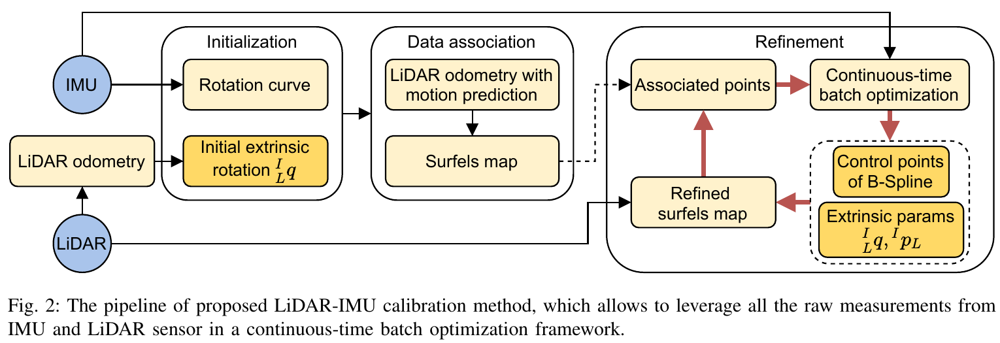
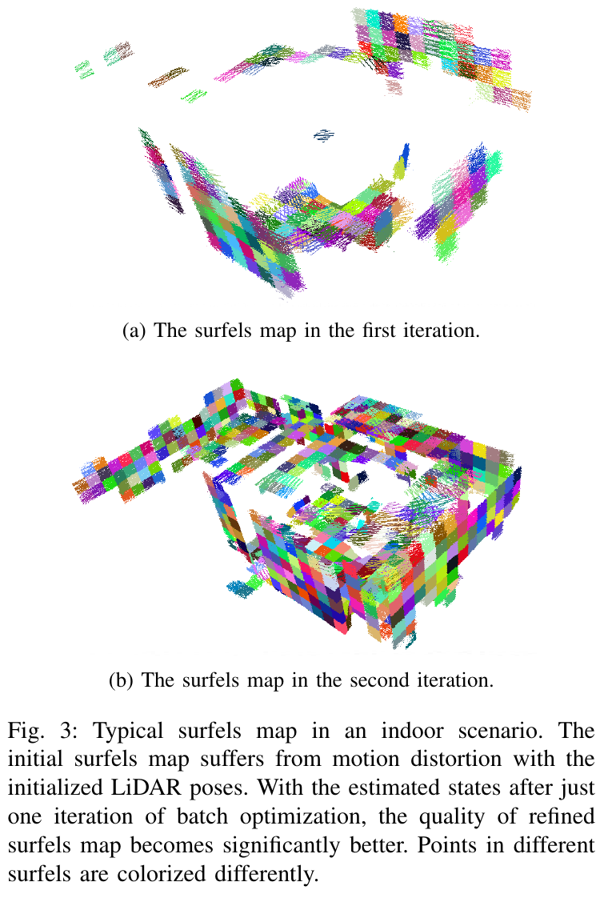
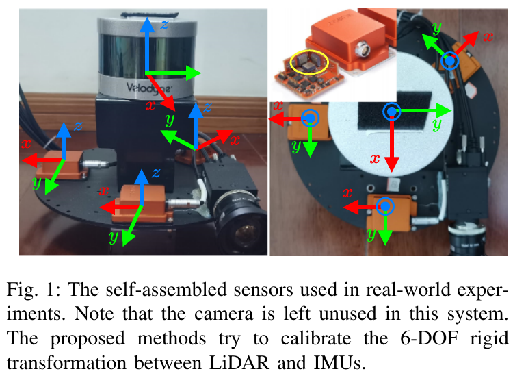
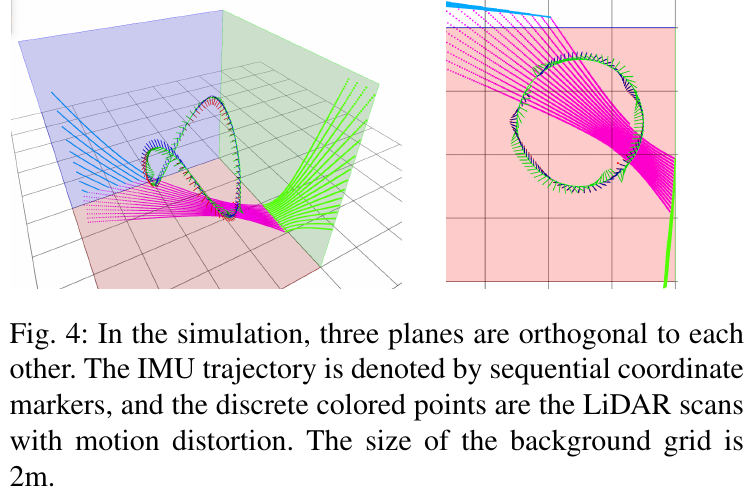
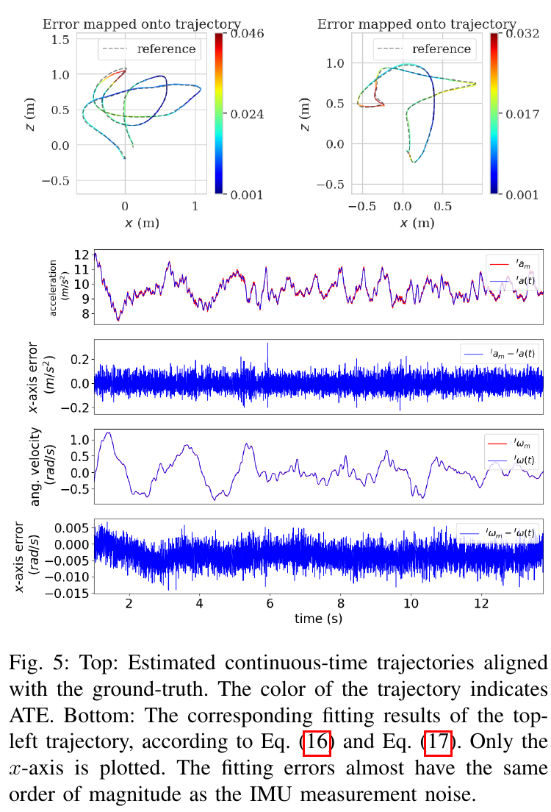
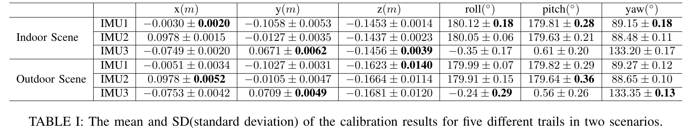
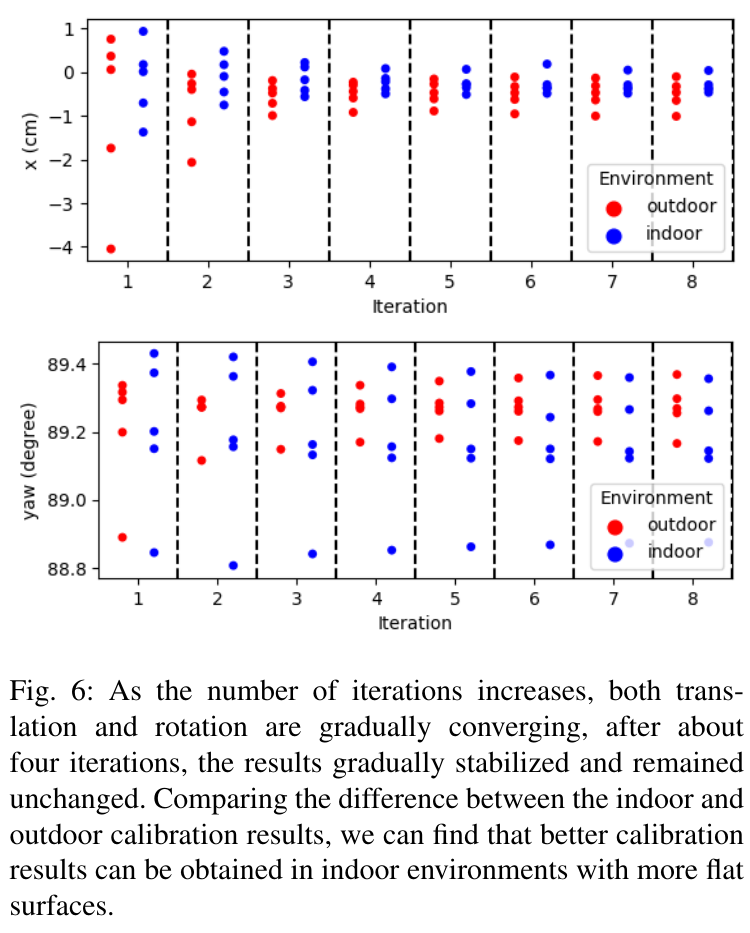
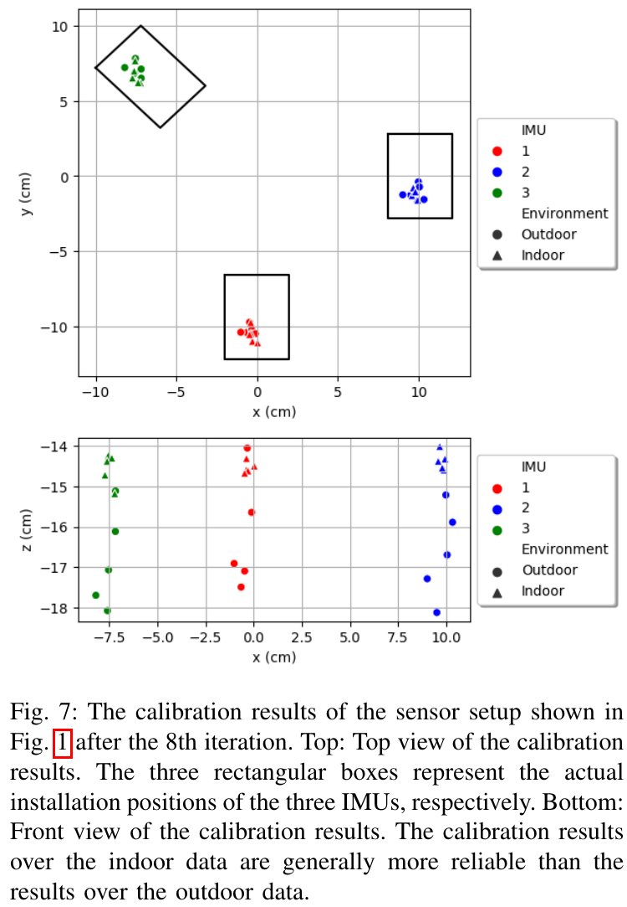
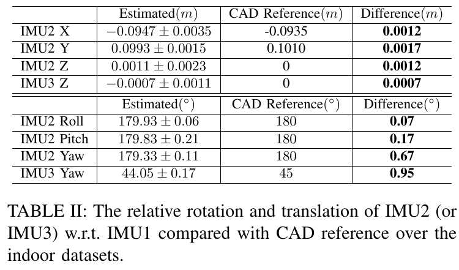
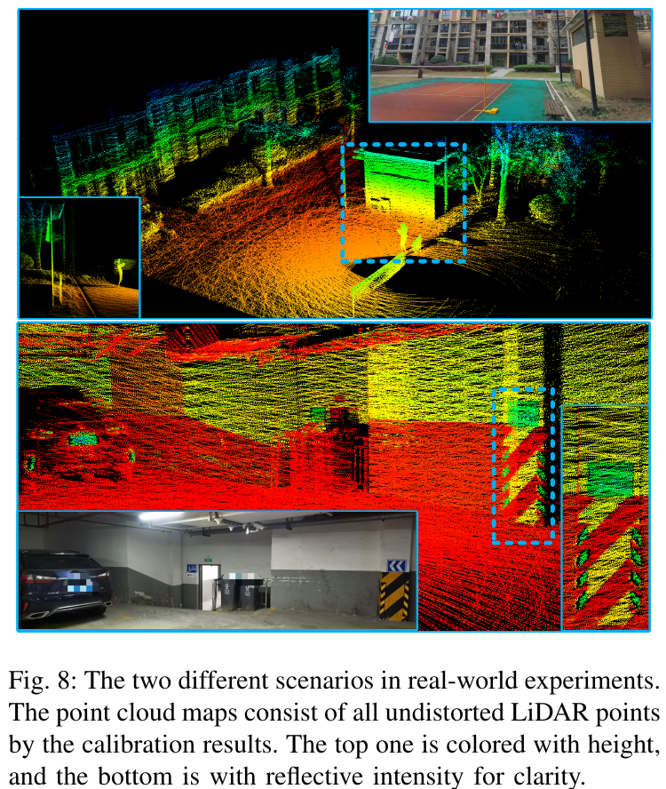

# LI-Calib 论文解读

> *Targetless Calibration of LiDAR-IMU System Based on Continuous-time Batch Estimation*，Jiajun Lv、Jinhong Xu、Kewei Hu、Yong Liu、Xingxing Zuo，IROS 2020。本文依据 arXiv v1（2020-07-29）。方法称为 LI-Calib，利用连续时间轨迹与自然场景中的局部平面估计 LiDAR–IMU 六自由度空间外参。[论文页面](https://arxiv.org/abs/2007.14759v1) · [PDF](https://arxiv.org/pdf/2007.14759v1) · [官方代码](https://github.com/APRIL-ZJU/lidar_IMU_calib)

## 1. 引言

LiDAR 与 IMU 固定在同一载体上，分别从环境几何和惯性运动获得信息。两者联合使用前，需要知道它们的坐标系怎样连接：LiDAR 测得的三维点，经过哪个旋转和平移能够表达在 IMU 系中。这份固定刚体变换就是空间外参，包含三个旋转自由度和三个平移自由度。

旋转式 LiDAR 的一帧扫描由不同时刻的点组成。载体运动时，各点对应不同的瞬时位姿，直接按同一个扫描位姿拼接便产生运动畸变。IMU 可以提供高频运动信息帮助去畸变，但将 IMU 运动转换到 LiDAR 上又依赖外参。因此，轨迹、去畸变和标定之间存在相互依赖。

LI-Calib 用一段可求导的连续时间轨迹连接这些量。任意 IMU 样本都可以在自己的时间戳与轨迹导数比较；任意激光点也可以在它的采样时刻查询位姿，变换到共同地图中，再与局部平面比较。两类残差共同调整轨迹与外参，改进后的估计又用于重建地图和更新关联。

“无靶标”指不需要棋盘格、专用标定板或额外相机。几何约束来自普通人造环境的平面区域，但仍需要可靠的初始配准、足够的场景结构和运动激励。论文实验中的 LiDAR 与 IMU 使用硬件同步，研究重点是六自由度空间外参，不能将连续时间表示本身等同于已经估计了时间偏移。

## 2. 相关工作

LiDAR–IMU 标定有两个紧密相关的困难：怎样为扫描内每个点补偿运动，以及怎样找到可靠的环境几何对应。离散时间方法通常在关键时刻估计位姿，再在中间插值。常角速度、常速度或常加速度近似在平稳运动中适用，手持随机晃动或快速机动时则可能引入明显误差。连续时间表示允许直接在每个采样时刻求轨迹，减少对简单插值运动假设的依赖；其准确性仍受轨迹模型与观测约束限制。

运动式手眼标定先分别恢复两个传感器的轨迹，再求满足刚体关系的外参。它要求两条运动序列都可靠，而消费级 IMU 独立积分的漂移会影响结果。Le Gentil 等人通过高斯过程上采样 IMU，结合预积分因子与点到面因子进行标定。LI-Calib 则将轨迹本身参数化为 B 样条，直接使用原始惯性测量构造残差；[IMU 预积分](../imu-preintegration/index.html)与这里的直接导数观测是不同的测量组织方式。

连续时间批估计此前已用于相机–IMU 标定，并扩展到时间外参、多 IMU 和激光传感器。LI-Calib 沿用时间基函数描述运动的框架，将几何观测改为自然环境中的点到曲面片约束，无需用标定板或相机作为桥梁。

## 3. 轨迹表示与记号

### 3.1 坐标系与待估计对象

记 IMU 系为 $\{I\}$，LiDAR 系为 $\{L\}$。外参旋转为 ${}^{I}_{L}\mathbf q$，对应旋转矩阵 ${}^{I}_{L}\mathbf R$；外参平移为 ${}^{I}\mathbf p_L$，即 LiDAR 原点在 IMU 系中的位置。作用于一个点时，变换为

$$
{}^I\mathbf x
={}^{I}_{L}\mathbf R\,{}^L\mathbf x+{}^I\mathbf p_L.
$$

这个方向贯穿全文：先从 LiDAR 变到 IMU。其逆变换需要旋转转置，并对平移做相应变换，不能只将平移取负。

IMU 轨迹以初始 IMU 系 $\{I_0\}$ 为参考，记为 ${}^{I_0}_{I}\mathbf R(t)$ 与 ${}^{I_0}\mathbf p(t)$。它们把时刻 $t$ 的 IMU 坐标变到初始 IMU 坐标，参考时刻的旋转为单位矩阵、位置为零。这里规定的是曲线在起点的值，不等于把首个样条控制点直接当成起始位姿。重力 ${}^{I_0}\mathbf g$ 也表达在这一参考系中。激光地图另以第一帧 LiDAR 系 $\{L_0\}$ 为参考，所有曲面片都在该地图系内。

因此，随时间改变的是 IMU 轨迹，整段数据共享的是 LiDAR 到 IMU 的固定外参。联合标定需要估计这条运动曲线，也需要估计两个传感器之间的刚性连接。

### 3.2 均匀三次平移样条

B 样条用少量控制点表示连续轨迹，并具有局部支撑：某一时刻只依赖邻近若干控制点，更新一个控制点也只影响有限时间范围。这让每条观测只连接少量轨迹变量，批估计仍可保持稀疏。

论文将旋转与平移分开表示。联合 $\mathrm{SE}(3)$ 样条会耦合旋转和平移，使平移曲线形状更难单独控制；分离的 $\mathrm{SO}(3)$ 与 $\mathbb R^3$ 样条更便于分别处理姿态导数和位置二阶导数。这是轨迹表示的选择，并不意味着测量方程中的旋转和平移也完全解耦。

对均匀节点间隔 $\Delta t$，若 $t\in[t_i,t_{i+1})$，定义局部时间

$$
u=\frac{t-t_i}{\Delta t},\qquad
\mathbf u^{\mathsf T}=[1,u,\ldots,u^d].
$$

$d$ 是样条次数。论文的矩阵形式为

$$
\mathbf p(t)
=\sum_{j=0}^{d}
\bigl(\mathbf u^{\mathsf T}\mathbf M^{(d+1)}_{(j)}\bigr)\mathbf p_{i+j}.
\tag{1}
$$

$\mathbf M_{(j)}$ 为基矩阵第 $j$ 列，括号内是作用于控制点的标量权重。均匀节点使各区间共用同一组局部多项式系数，因此矩阵只依赖次数，不作为未知参数优化。LI-Calib 取三次，即 $d=3$：

$$
\mathbf M^{(4)}=\frac16
\begin{bmatrix}
1&4&1&0\\
-3&0&3&0\\
3&-6&3&0\\
-1&3&-3&1
\end{bmatrix}.
\tag{2}
$$

例如局部第一个权重是 $\lambda_0(u)=(1-u)^3/6$，最后一个是 $\lambda_3(u)=u^3/6$；另外两项同样由对应列展开。四个权重之和为 1，但曲线通常不经过控制点。若把四个控制点排为 $\mathbf P=[\mathbf p_i,\ldots,\mathbf p_{i+3}]\in\mathbb R^{3\times4}$，矩阵乘法应为 $\mathbf p(t)=\mathbf P(\mathbf M^{(4)})^{\mathsf T}\mathbf u$，维度为 $3\times1$。

为了与旋转表示统一，可以将控制点加权改写为相邻增量的加权。令 $\lambda_j=\mathbf u^{\mathsf T}\mathbf M^{(4)}_{(j)}$，利用 $\sum_j\lambda_j=1$，有

$$
\begin{aligned}
\mathbf p(t)=\mathbf p_i
&+(\lambda_1+\lambda_2+\lambda_3)(\mathbf p_{i+1}-\mathbf p_i)\\
&+(\lambda_2+\lambda_3)(\mathbf p_{i+2}-\mathbf p_{i+1})
+\lambda_3(\mathbf p_{i+3}-\mathbf p_{i+2}).
\end{aligned}
$$

展开后，每个控制点前的系数重新回到 $\lambda_0,\ldots,\lambda_3$。这就是论文的累积形式：

$$
\mathbf p(t)=\mathbf p_i+
\sum_{j=1}^{d}
\bigl(\mathbf u^{\mathsf T}\tilde{\mathbf M}^{(d+1)}_{(j)}\bigr)
(\mathbf p_{i+j}-\mathbf p_{i+j-1}),
\tag{3}
$$

$$
\tilde{\mathbf M}^{(4)}=\frac16
\begin{bmatrix}
6&5&1&0\\
0&3&3&0\\
0&-3&3&0\\
0&1&-2&1
\end{bmatrix}.
\tag{4}
$$

求速度与加速度时，只需对局部时间多项式求导，再乘上时间归一化的比例：

$$
\frac{d\mathbf u^{\mathsf T}}{dt}
=\frac1{\Delta t}[0,1,2u,3u^2],\qquad
\frac{d^2\mathbf u^{\mathsf T}}{dt^2}
=\frac1{\Delta t^2}[0,0,2,6u].
$$

由此可在任意 IMU 时间戳获得位置二阶导数。均匀三次样条在内部简单节点处为 $C^2$ 连续，适合构造连续加速度。基函数的通用构造见[B 样条的局部平滑曲线构造与应用](../bspline-continuous-time-slam/index.html)；这里的矩阵和累积改写已经给出了后续标定所需的计算关系。

### 3.3 四元数累积旋转样条

旋转控制点为单位四元数 $\mathbf q_i$。旋转不能像位置一样直接作普通向量加权，论文采用相邻旋转增量的累积：

$$
\mathbf q(t)=\mathbf q_i\otimes
\prod_{j=1}^{3}
\exp\!\left[
\bigl(\mathbf u^{\mathsf T}\tilde{\mathbf M}^{(4)}_{(j)}\bigr)
\log(\mathbf q_{i+j-1}^{-1}\otimes\mathbf q_{i+j})
\right].
\tag{5}
$$

先由 $\mathbf q_{i+j-1}^{-1}\otimes\mathbf q_{i+j}$ 得到相邻控制旋转的差异，log 将其映到切空间，乘累积权重，再用 exp 映回单位四元数，最后按顺序连乘。exp 与 log 在这里采用互逆的四元数约定，不能直接混用未统一角度因子的旋转向量公式。

平移和旋转因此共享同一套累积权重，但分别在欧氏空间与旋转流形上组合。各权重对时间可求导，旋转曲线的时间导数也随控制四元数确定，从而可以直接预测角速度。

### 3.4 样条导数怎样预测 IMU 测量

简记 $\mathbf R(t)={}^{I_0}_{I}\mathbf R(t)$，$\mathbf p(t)={}^{I_0}\mathbf p(t)$。加速度计测量的是比力，即非重力加速度在机体轴上的表达。论文式（6）为

$$
{}^I\mathbf a(t)
=\mathbf R^{\mathsf T}(t)
\bigl(\ddot{\mathbf p}(t)-{}^{I_0}\mathbf g\bigr).
\tag{6}
$$

位置二阶导数在参考系 $I_0$ 中，先减去重力，再旋到瞬时 IMU 系。静止时 $\ddot{\mathbf p}=0$，该式仍产生 $-\mathbf R^{\mathsf T}\mathbf g$，符合加速度计静止时感受到重力支撑比力的现象。

角速度则满足刚体运动学 $\dot{\mathbf R}=\mathbf R[{}^I\boldsymbol\omega]_\times$，因此

$$
[{}^I\boldsymbol\omega(t)]_\times
=\mathbf R^{\mathsf T}(t)\dot{\mathbf R}(t),\qquad
{}^I\boldsymbol\omega(t)
=\operatorname{vee}\!\left(\mathbf R^{\mathsf T}(t)\dot{\mathbf R}(t)\right).
\tag{7}
$$

$[\omega]_\times$ 是使 $[\omega]_\times x=\omega\times x$ 成立的反对称矩阵，vee 将它恢复为三维向量。由 $\mathbf R^{\mathsf T}\mathbf R=\mathbf I$ 求导可得 $\mathbf R^{\mathsf T}\dot{\mathbf R}$ 为反对称矩阵，因此这一步成立。

> 原论文式（7）将角速度简写为 $\mathbf R^{\mathsf T}\dot{\mathbf R}$，但右侧实际是 $3\times3$ 矩阵。这里补出叉乘矩阵与 vee，后文与三维陀螺测量相减时均采用向量形式。式（6）的 $\mathbf a(t)$ 则按其公式解释为比力。

两种预测都能在原始采样时刻直接计算。批估计由此使用逐样本 IMU 残差，无需先把这些样本压缩为关键帧之间的预积分量。

## 4. 方法

*原论文图 2。陀螺先拟合旋转曲线，LiDAR 里程计提供相对旋转以初始化旋转外参；随后建立曲面片地图与关联。批估计更新轨迹和外参，结果再用于重新去畸变、建图与关联。*

整个方法先解决“如何得到可用的首轮几何”，再进行完整的联合估计。初始化只求旋转外参；首轮地图来自辅助去畸变后的 NDT 里程计。之后的外层精化重建地图，内层批估计在给定关联下优化连续轨迹与标定参数。

### 4.1 旋转外参初始化

#### 陀螺约束旋转曲线

给定原始陀螺样本 ${}^{I_k}\boldsymbol\omega_m$，论文通过拟合角速度获得四元数控制点，式（8）按原文的范数写法整理为

$$
\mathbf q_0,\ldots,\mathbf q_N
=\operatorname*{arg\,min}_{\mathbf q_0,\ldots,\mathbf q_N}
\sum_{k=0}^{M}
\left\|{}^{I_k}\boldsymbol\omega_m
-\operatorname{vee}\!\left(\mathbf R^{\mathsf T}(t_k)\dot{\mathbf R}(t_k)\right)\right\|.
\tag{8}
$$

起始曲线姿态 $\mathbf q(t_0)$ 固定为单位四元数，选定旋转参考，避免整体旋转自由度。此处拟合的是角速度，尚未在目标中单独引入陀螺零偏；零偏在后续批估计中处理。直接拟合避免先独立积分一条长姿态轨迹，但原始测量中的偏置并不会因此自动消失。

#### 用两个传感器的相对旋转求固定外参

NDT scan-to-map 配准给出相邻 LiDAR 扫描的相对旋转 ${}^{L_k}_{L_{k+1}}\mathbf q$。同一时间段的 IMU 相对旋转由曲线求得：

$$
{}^{I_k}_{I_{k+1}}\mathbf q
=\mathbf q^{-1}(t_k)\otimes\mathbf q(t_{k+1}).
$$

记固定外参为 ${}^{I}_{L}\mathbf q$，刚体连接要求

$$
{}^{I_k}_{I_{k+1}}\mathbf q\otimes{}^{I}_{L}\mathbf q
={}^{I}_{L}\mathbf q\otimes{}^{L_k}_{L_{k+1}}\mathbf q.
\tag{9}
$$

两边都是将时刻 $k+1$ 的 LiDAR 方向变到时刻 $k$ 的 IMU 系：左侧先经外参到当前 IMU，再经 IMU 相对旋转；右侧先经 LiDAR 相对旋转，再经外参。两条路径终点相同，便得到旋转手眼方程。

四元数乘法可写成左乘与右乘矩阵，满足 $a\otimes b=[a]_L b=[b]_R a$。将多个运动段堆叠，得到

$$
\mathbf Q_N\,{}^{I}_{L}\mathbf q=\mathbf0,\qquad
\mathbf Q_N=
\begin{bmatrix}
\vdots\\
\alpha_k\!\left(
[{}^{I_k}_{I_{k+1}}\mathbf q]_L
-[{}^{L_k}_{L_{k+1}}\mathbf q]_R\right)\\
\vdots
\end{bmatrix}.
\tag{10}
$$

实际有噪声时，求单位范数下使 $\|\mathbf Q_Nq\|^2$ 最小的向量。若 $\mathbf Q_N=U\Sigma V^{\mathsf T}$，这个解就是最小奇异值对应的右奇异向量。只绕同一轴旋转会缺少部分约束，因此运动段数多也不能代替旋转方向的充分变化。

权重由两侧相对转角差异确定。令 $q_w$ 为四元数实部，原论文定义

$$
r_k=\left|2\left[
\arccos({}^{I_k}_{I_{k+1}}q_w)
-\arccos({}^{L_k}_{L_{k+1}}q_w)
\right]\right|,
\tag{11}
$$

$$
\alpha_k=
\begin{cases}
1,&r_k<\mathrm{threshold},\\
\mathrm{threshold}/r_k,&\text{其他情况}.
\end{cases}
\tag{12}
$$

同一个刚体转动在不同坐标系中的旋转角应相同，因此转角差可提示不可靠配准；超过阈值的块行被降权。比较前还需统一四元数的等价符号，避免将 $q$ 与 $-q$ 的表示差异当成运动差异。这只是按转角构造的启发式筛选，转角一致并不能证明旋转轴也一定正确。

#### 平移留给后续联合估计

论文不单独初始化平移外参。原因之一是加速度与重力、姿态耦合；另一个原因是位置二阶导数丢失了常值和一次时间项。任取常向量 $\mathbf c_0,\mathbf c_1$，构造另一条轨迹

$$
\tilde{\mathbf p}(t)=\mathbf p(t)+\mathbf c_0+\mathbf c_1t,
$$

则 $\ddot{\tilde{\mathbf p}}(t)=\ddot{\mathbf p}(t)$。仅靠原始加速度，即使姿态和重力已知，也不能确定初始位置与速度。论文所说二阶导数使部分系数无法独立求解，可由这个零空间理解，并非加入激光几何后整个平移问题仍不可解。

初始化得到旋转外参后，IMU 曲线即可将旋转运动传给 LiDAR，先补偿扫描的旋转畸变，为首轮配准和地图提供更好的起点。

### 4.2 曲面片地图与数据关联

首轮用带有旋转预测的 LiDAR 里程计建立点云地图，将地图分为三维体素，并计算体素内点的局部二阶统计量。设特征值为 $\lambda_0\le\lambda_1\le\lambda_2$，论文采用平面性指标

$$
\mathcal P=2\frac{\lambda_1-\lambda_0}
{\lambda_0+\lambda_1+\lambda_2}.
\tag{13}
$$

在近似平面、两个切向分布幅度相近时，$\lambda_0$ 很小且 $\lambda_1\approx\lambda_2$，指标接近 1。近似线状时，前两个特征值都小；近似球形时，三个特征值相近，这两种情况下指标都较小。因此它同时考察离面厚度与切向展开程度，并非所有薄平面点集都会给出接近 1 的数值。

超过阈值的体素用 RANSAC 拟合局部平面

$$
\boldsymbol\pi=[\mathbf n^{\mathsf T},d]^{\mathsf T},\qquad
\mathbf n^{\mathsf T}\mathbf x+d=0.
$$

法向与平面均在地图系 $L_0$ 中。后续将扫描点与对应曲面片关联，拒绝点到面距离过大的匹配，并随机下采样原始点控制计算量。局部平面覆盖自然场景中不同方向的表面，不需要人为找到几块完整的大平面；但若环境中只有单一法向，几何约束仍可能退化。

### 4.3 连续时间批估计

#### 状态与加权最小二乘

轨迹旋转控制点记为 $\mathbf x_q$，平移控制点记为 $\mathbf x_p$。按残差所涉及的两种零偏，将原文状态整理为

$$
\mathbf x=
[({}^{I}_{L}\mathbf q)^{\mathsf T},
({}^{I}\mathbf p_L)^{\mathsf T},
\mathbf x_q^{\mathsf T},\mathbf x_p^{\mathsf T},
\mathbf b_a^{\mathsf T},\mathbf b_g^{\mathsf T}]^{\mathsf T}.
\tag{14}
$$

> 原论文式（14）末两项重复写为 $\mathbf b_a$，但随后正文及式（16）、（17）分别定义加速度计零偏和陀螺零偏，此处据此整理。正文另提到描述重力方向的两自由度旋转，却没有在式（14）中列出；阅读该状态表时还需结合式（6）的重力项，不能把印刷列表当成完整实现参数表。

在独立高斯噪声假设下，联合目标为

$$
\hat{\mathbf x}=\operatorname*{arg\,min}_{\mathbf x}
\left\{
\sum_{k\in\mathcal A}\|\mathbf r_a^k\|_{\Sigma_a}^2
+\sum_{k\in\mathcal W}\|\mathbf r_\omega^k\|_{\Sigma_\omega}^2
+\sum_{j\in\mathcal L}\|\mathbf r_L^j\|_{\Sigma_L}^2
\right\}.
\tag{15}
$$

$\mathcal A,\mathcal W$ 是加速度计与陀螺样本集合，$\mathcal L$ 是关联后的激光点集合。$\Sigma$ 为相应测量协方差；加权平方范数可理解为 $r^{\mathsf T}\Sigma^{-1}r$。它将不同单位、不同噪声水平的残差转换为可共同最小化的量。原始数据固定，求解器调整外参、轨迹控制点与零偏，使三类预测同时接近观测。

#### IMU 残差约束运动曲线

两种惯性残差为

$$
\mathbf r_a^k
={}^{I_k}\mathbf a_m-{}^I\mathbf a(t_k)-\mathbf b_a,
\tag{16}
$$

$$
\mathbf r_\omega^k
={}^{I_k}\boldsymbol\omega_m-{}^I\boldsymbol\omega(t_k)-\mathbf b_g.
\tag{17}
$$

式（6）、（7）提供预测项。陀螺主要约束旋转曲线的时间变化；加速度计约束位置二阶导数，同时依赖姿态和重力。零偏由整段数据中的观测共同估计。原文状态以每种传感器一组三维零偏表示，没有在这里展开逐时刻随机游走偏置链。

外参本身不直接出现在这两条 IMU 残差中。它们的作用是约束 IMU 运动，外参则通过下一条激光变换链与这条运动关联。因而 IMU 拟合得好，不代表已经完成 LiDAR–IMU 标定。

#### 激光点怎样进入地图坐标系

设原始激光点 ${}^{L_j}\mathbf p_i$ 在时刻 $t_j$ 采得，关联平面为 $\boldsymbol\pi_j$。它需要依次经过

$$
L_j\ \longrightarrow\ I_j\ \longrightarrow\ I_0\ \longrightarrow\ L_0.
$$

第一步由固定外参给出；第二步由时刻 $t_j$ 的 IMU 样条给出；最后一步是初始外参的逆变换。具体而言，

$$
{}^{I_0}\mathbf p_i
={}^{I_0}_{I_j}\mathbf R
\bigl({}^{I}_{L}\mathbf R\,{}^{L_j}\mathbf p_i+{}^I\mathbf p_L\bigr)
+{}^{I_0}\mathbf p_{I_j}.
$$

初始参考系中，$I_0$ 原点在 $L_0$ 的位置为 $-({}^{I}_{L}\mathbf R)^{\mathsf T}{}^I\mathbf p_L$。因此

$$
{}^{L_0}\mathbf p_i
=({}^{I}_{L}\mathbf R)^{\mathsf T}
\bigl({}^{I_0}\mathbf p_i-{}^I\mathbf p_L\bigr).
$$

代入上一式并展开，得到原论文式（18）的三部分：

$$
\begin{aligned}
{}^{L_0}\mathbf p_i
&=({}^{I}_{L}\mathbf R)^{\mathsf T}
{}^{I_0}_{I_j}\mathbf R\,{}^{I}_{L}\mathbf R\,{}^{L_j}\mathbf p_i
+{}^{L_0}\mathbf p_{L_j},\\
{}^{L_0}\mathbf p_{L_j}
&=({}^{I}_{L}\mathbf R)^{\mathsf T}
{}^{I_0}_{I_j}\mathbf R\,{}^I\mathbf p_L
+({}^{I}_{L}\mathbf R)^{\mathsf T}{}^{I_0}\mathbf p_{I_j}
-({}^{I}_{L}\mathbf R)^{\mathsf T}{}^I\mathbf p_L,\\
r_L^j
&=\begin{bmatrix}({}^{L_0}\mathbf p_i)^{\mathsf T}&1\end{bmatrix}\boldsymbol\pi_j.
\end{aligned}
\tag{18}
$$

若 $\mathbf n$ 为单位法向，最后一行就是有符号点到面距离，单位为米。原文在这段文字中先将对应平面下标写为 $i$，式（18）又写为 $j$；这里按式（18）使用 $\pi_j$，二者都指该点关联的地图平面。

这条残差同时依赖外参和采样时刻的 IMU 姿态、位置。改变轨迹会改变逐点去畸变，改变外参会改变两传感器运动与观测坐标的连接。求解时平面和对应关系来自当前地图，先固定它们优化状态，下一轮才重建地图。

还可以从展开式看出运动激励的作用。外参平移的贡献可合并为

$$
({}^{I}_{L}\mathbf R)^{\mathsf T}
\bigl({}^{I_0}_{I_j}\mathbf R-\mathbf I\bigr){}^I\mathbf p_L.
$$

若整段只有平移、没有姿态变化，这一项为零，点到面几何就无法借助该项区分传感器之间的固定杆臂。若只绕一根固定轴转动，沿该轴的杆臂分量也可能缺少响应。旋转方向变化与线加速度激励因此都重要，许多点或很低的残差并不能单独证明所有外参分量可观。

批估计使用 Levenberg–Marquardt 最小化式（15）。每个 IMU 样本和激光点只连接它所在时段附近的轨迹控制点，外参和零偏则为全段共享参数，这形成连续时间批问题的稀疏结构。

### 4.4 地图与关联的外层精化

一次优化后，用当前轨迹与外参重新补偿原始扫描的运动畸变，重建曲面片地图、重新关联，再执行批估计。地图本身由同一组数据和当前估计构造，因而外层精化是处理初始畸变与错误关联的重要环节。

*原论文图 3。上部首轮地图仍有初始运动畸变，下部使用一次批估计后的状态重建，曲面片明显更完整。不同颜色表示不同局部平面。*

NDT 里程计只在最开头初始化 LiDAR 位姿与地图，后续精化由估计出的连续轨迹支撑。论文观察到，第一轮到第二轮改进最大，约四轮后参数趋于稳定；这是该实验的经验收敛情况，不保证任意初值或错误关联都能被纠正。

这里需要区分两种“迭代”：内层 LM 在固定地图关联下更新参数；外层则改变去畸变结果、地图与关联。实验中展示的第一至第八轮，指后者的精化轮次。

## 5. 实验

### 5.1 传感器、同步与参数

*原论文图 1。实验装置为 VLP-16 与三台 Xsens IMU，图中相机未参与该标定方法。*

仿真和实测使用相应的传感器配置。论文说明 LiDAR 与 IMU 硬件同步，连续时间批估计基于 Kontiki 实现。该文实验验证的是空间标定，没有将未知时间偏移作为实验中的联合评价目标。

真实数据分别在室内、室外各采集五条 25–30 秒序列。全部序列的平均绝对角速度约为 $47.39^\circ/\mathrm{s}$，平均绝对加速度约为 $0.628\,\mathrm{m/s^2}$。另在 Vicon 场地采集十条约 15 秒序列，用于检查轨迹估计与样条拟合能力。

室内体素边长为 0.5 米，室外为 1.0 米；首轮平面性阈值为 0.6，完成第一次批估计并去畸变后升至 0.7。样条节点间隔为 0.02 秒，以表达数据中的快速运动。更小间隔增加轨迹自由度和参数数量，是否合适仍取决于运动频率、观测约束与噪声，不能视为普遍默认值。

### 5.2 仿真中的外参准确度

*原论文图 4。三块平面互相正交，坐标标记为 IMU 轨迹，彩色离散点为带运动畸变的激光扫描，背景网格边长为 2 米。*

仿真 IMU 为 400 Hz，LiDAR 为 10 Hz，水平视场角 $360^\circ$、垂直 $\pm15^\circ$。IMU 沿正弦轨迹运动，传感器噪声按真实设备特性生成。作者构造十条不同的 10 秒标定序列进行 Monte Carlo 实验。

相对于已知外参真值，平移误差报告为 $0.0043\pm0.0006$ 米，即 $4.3\pm0.6$ 毫米；旋转误差为 $0.0224\pm0.0026$ 度。这里能够直接评价标定准确度，因为仿真中有真值。结果依赖三正交平面、运动激励和所用噪声设置，不能直接作为所有真实装置的精度承诺。

### 5.3 真实轨迹与测量拟合

*原论文图 5。上部为对齐后的估计轨迹与真值，颜色表示 ATE；下部展示一条序列的 IMU $x$ 轴测量拟合及误差。*

十条 Vicon 序列的平均 ATE 为 0.0183 米。图中样条导数也能较好拟合陀螺和加速度数据，拟合误差与测量噪声处于相近量级。这验证了所选曲线在这些运动下的表达能力和轨迹估计效果。

ATE 检查的是轨迹，不是 LiDAR–IMU 外参的直接真值误差。惯性残差较小同样只说明曲线与测量相容；还需结合不同序列的外参重复性和独立装配参照判断标定结果。

### 5.4 多次标定的重复性

*原论文表 I。八轮精化后，各场景五条序列的均值与标准差。这里报告的是 IMU 到 LiDAR 的变换，方向与正文定义的 LiDAR 到 IMU 外参相反；平移单位为米，欧拉角单位为度。*

室内 IMU1 的平移三个方向标准差分别为 2.0、5.3、1.4 毫米，旋转三个欧拉角的标准差为 $0.18^\circ$、$0.28^\circ$、$0.18^\circ$。室外对应的平移 $z$ 方向标准差达到 14.0 毫米，IMU2、IMU3 的该方向也为 11.4、12.0 毫米。作者将室外较差的平移重复性与更复杂、不平整的平面区域联系起来。

标准差衡量多次估计的离散程度，不能代替相对于真实外参的准确度。室内外均值也存在差异，例如 IMU1 的 $z$ 从约 $-0.1453$ 米变为 $-0.1623$ 米；因此“每组内部重复性较好”与“跨场景完全一致”是不同结论。

*原论文图 6。以一个平移分量和 yaw 展示不同轮次的估计，红色为室外，蓝色为室内。主要改进发生在第一轮之后，约四轮趋于稳定。*

收敛曲线支持重建地图与更新关联的必要性，也说明首轮粗地图会明显影响参数。参数不再变化只表示该流程在此已稳定，并不自动证明到达真实外参或全局最优。

### 5.5 CAD 相对位姿对照

*原论文图 7。八轮后的俯视与正视结果，矩形表示装配位置，圆点为室外结果，三角为室内结果。*

真实装置缺少独立测量的 LiDAR–IMU 外参真值，论文用 CAD 装配图中的 IMU 间相对位姿作参照。设从两台 IMU 到 LiDAR 的估计为 $T_{L\leftarrow I_1}$、$T_{L\leftarrow I_2}$，则

$$
T_{I_1\leftarrow I_2}
=T_{L\leftarrow I_1}^{-1}T_{L\leftarrow I_2}.
$$

它先由 IMU2 变到 LiDAR，再由 LiDAR 变到 IMU1，从而消去共同 LiDAR 参考系，可与装配图对比。

*原论文表 II。使用室内数据，以 IMU1 为参考，对照 IMU2、IMU3 的部分相对平移与旋转分量。*

表中平移差值约 0.7–1.7 毫米，旋转分量差值为 $0.07^\circ$–$0.95^\circ$。这提供了装配几何的一致性证据，但 CAD 仍是设计参照，且表格只列出部分分量，并非完整 LiDAR–IMU 外参的直接真值检验。表中 IMU2 的 $z$ 均值为 0.0011 米、CAD 为 0，而 Difference 列写为 0.0012 米，存在显示数值上的小差别；这里保留原表，不据此反推更高精度结果。

*原论文图 8。由校正后的完整扫描构成地图，上图按高度着色，下图按反射强度着色，展示常见人造场景中的表面结构。*

综合这些实验，仿真提供直接的外参真值对照，Vicon 检查连续轨迹，多序列统计检查重复性，CAD 检查传感器间相对装配关系。它们评价的对象互补，应分别保留各自的含义。

## 6. 结论与后续工作

LI-Calib 用连续运动曲线连接原始惯性测量与逐点激光。样条导数预测角速度与比力，逐点位姿与外参将激光观测变到地图系，局部平面提供环境几何约束。联合估计更新运动与标定参数，外层再更新去畸变、地图和关联，形成无靶标标定的完整迭代过程。

其明确瓶颈是首轮依赖 NDT 里程计。若初始轨迹很差，就难以得到足够可靠的点到曲面片对应，后续精化也可能无法恢复。结构不足、运动方向单一或同步误差还会影响约束质量；连续时间求值的便利并不能代替这些观测条件。

论文提出改进 LiDAR 前端作为后续方向。该工作的贡献集中在离线空间标定：在一段有足够激励、包含适当平面结构且时间同步的数据上，用共享轨迹和几何残差估计传感器连接。它与部署后持续运行的 LIO 系统承担不同任务。

## 参考文献

- Jiajun Lv, Jinhong Xu, Kewei Hu, Yong Liu, Xingxing Zuo. *Targetless Calibration of LiDAR-IMU System Based on Continuous-time Batch Estimation*. IROS 2020. [arXiv:2007.14759v1](https://arxiv.org/abs/2007.14759v1) · [PDF](https://arxiv.org/pdf/2007.14759v1)。本文公式编号、原图与实验依据该版本。
- [LI-Calib 官方实现](https://github.com/APRIL-ZJU/lidar_IMU_calib)。本文以原论文的空间标定模型为主，工具后续功能需按相应代码版本区分。
- Paul Furgale, Timothy Barfoot, Gabe Sibley. *Continuous-time batch estimation using temporal basis functions*. ICRA 2012。
- Cédric Le Gentil, Teresa Vidal-Calleja, Shoudong Huang. *3D Lidar-IMU Calibration based on Upsampled Preintegrated Measurements for Motion Distortion Correction*. ICRA 2018。
- Christiane Sommer 等。*Efficient Derivative Computation for Cumulative B-Splines on Lie Groups*. CVPR 2020。
