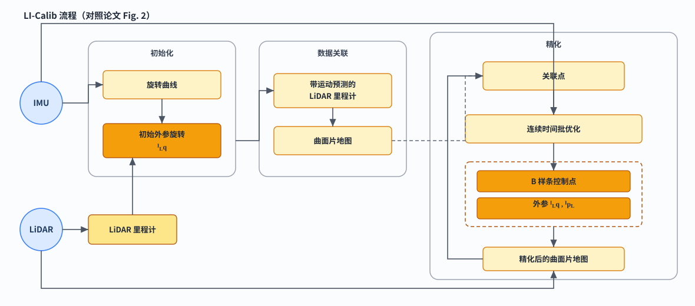
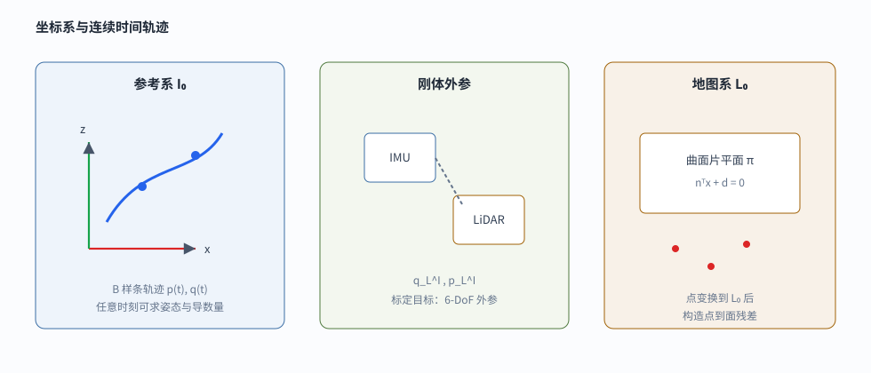

# LI-Calib 无靶标 LiDAR-IMU 标定中的连续时间批估计

> 本文介绍 Jiajun Lv 等人在 IROS 2020 的工作 *Targetless Calibration of LiDAR-IMU System Based on Continuous-time Batch Estimation*，开源实现通常称为 LI-Calib。文章沿着“为什么离散外参标定不够用 → 连续时间轨迹怎样把 IMU 与逐点激光接到同一条曲线上 → 点到曲面片残差怎样约束外参”展开，并对关键公式做逐步推导。

**系列位置：** 本文承接 [B 样条的局部平滑曲线构造与应用](../bspline-continuous-time-slam/index.html)（尤其是累积形式、旋转轨迹和连续时间 SLAM 部分）、[IMU 预积分详解](../imu-preintegration/index.html)、[带 IMU 的视觉、LiDAR 与视觉激光 SLAM 框架演化](../imu-visual-lidar-slam-framework/index.html)。样条专文给出均匀三次 B 样条、累积旋转和轨迹导数的通用写法；前序里程计文章处理“已知外参时怎样把 IMU 放进系统”；本文处理更上游的问题——**外参本身怎样在无靶标场景下被估计出来**。

## 先把核心想法说清楚

LiDAR–IMU 外参标定要估计的是一个刚体变换：激光坐标系 $\{L\}$ 相对惯性坐标系 $\{I\}$ 的旋转与平移。记号上写成

$$
{}^{I}_{L}\mathbf R\in SO(3),\qquad
{}^{I}\mathbf p_{L}\in\mathbb{R}^{3},
$$

或等价的四元数 ${}^{I}_{L}\mathbf q$。一旦外参已知，任意时刻的 IMU 位姿都可以把同一时刻（或带时间偏移）的激光点变换到统一坐标系；反过来，若外参未知，激光点云的去畸变、局部建图和外参估计会缠在一起。

LI-Calib 的回答可以先压缩成一句话：

> **用均匀三次 B 样条把 IMU 的六自由度轨迹写成连续时间函数；陀螺与加速度提供对样条导数的直接观测；激光点在各自采样时刻被变换到首帧激光地图坐标系，并与局部平面（曲面片）构造点到面残差；两类残差在一次批优化里同时约束外参、样条控制点与 IMU 零偏。**

它不依赖棋盘格、标定板或额外相机。约束来自常见人造环境中的局部平面结构，以及 IMU 在充分激励下对运动曲线的稠密观测。

上图按论文 Fig. 2 重绘：左侧 IMU / LiDAR 输入，经初始化与数据关联进入右侧精化闭环；虚线表示首轮由曲面片地图建立关联，实线回路表示用优化后的轨迹与外参重建地图并反复关联。

**关键词：** LiDAR–IMU 外参；无靶标标定；连续时间批估计；B 样条；点到曲面片；零偏；运动畸变

---

## 1. 问题设定与难点

### 1.1 输入、输出与坐标系

标定过程中使用三个坐标系：

- $\{I\}$：IMU 坐标系，轨迹在连续时间下被参数化；
- $\{L\}$：LiDAR 坐标系，与 $\{I\}$ 刚体连接；
- $\{M\}=\{L_0\}$：地图坐标系，取标定起始段的第一帧激光坐标系。

论文把 IMU 轨迹的参考帧取为起始时刻的 IMU 坐标系 $\{I_0\}$。重力 ${}^{I_0}\mathbf g$ 也定义在该参考系中。激光地图与曲面片平面都表达在 $\{L_0\}$。

一帧机械式激光扫描并不是“同一时刻的一张快照”。扫描内的每个点都有自己的时间戳。载体运动时，这些点相当于在不同瞬时位姿下采样，合在一起就会出现类似 rolling shutter 的运动畸变。IMU 的高频角速度与比力正是用来补这段瞬时位姿的。

### 1.2 为什么离散关键帧外参标定会吃力

若只在若干关键时刻估计位姿，中间每个激光点的位姿只能靠线性插值或常速度/常加速度假设补出来。低速平滑运动下这还能用；手持晃动或机载机动时，插值误差会直接进入点云几何，再进入外参残差。

另一条常见路线是手眼标定：分别估计激光里程计轨迹与 IMU 轨迹，再解相对刚体变换。消费级 IMU 单独积分漂移大，两条轨迹的质量往往不对称，外参解会被较差的那条轨迹拖垮。

连续时间方法把整段轨迹写成时间基函数的线性（或李群上的累积）组合。任意 $t$ 都可以解析求姿态、位置及其导数。陀螺观测对应角速度，加速度观测对应比力；激光点则在自己的采样时刻精确取值。高速率与异步传感器天然落在同一条曲线上。

### 1.3 无靶标意味着什么

有靶标方法通常让观测主动落到已知几何上。无靶标方法必须从自然场景里构造足够多、足够可靠的几何约束。LI-Calib 的选择是：把点云地图切成体素，在局部统计量满足平面性时拟合小平面（surfels / tiny planes），再用点到面距离做残差。小平面比“整面大墙”更碎、更密，能覆盖走廊、桌面、地面等多种结构，也更适合把标定问题在一般人造环境里变得可观。

---

## 2. 连续时间轨迹表示

### 2.1 为什么拆成旋转样条与平移样条

刚体轨迹可以在 $SE(3)$ 上用一条样条表示，也可以拆成 $SO(3)$ 上的旋转样条与 $\mathbb{R}^3$ 上的平移样条。LI-Calib 采用后者。原因是：联合 $SE(3)$ 样条里平移与旋转耦合，平移曲线形状不易单独控制；标定问题里外参旋转与平移本身也需要更清晰的可观性结构。拆分表示后，旋转可由陀螺主导初始化，平移与重力、加速度残差更直接相关。

### 2.2 均匀节点下 B 样条何以写成矩阵

本节只保留 LI-Calib 需要的矩阵和累积形式。关于 B 样条如何从 box 卷积构造基函数、如何通过局部支撑得到速度与加速度，以及旋转轨迹如何在 $SO(3)$ 上累积，可参阅 [B 样条的局部平滑曲线构造与应用](../bspline-continuous-time-slam/index.html)。

论文与实现里频繁出现

$$
\mathbf p(t)=\mathbf u^{\top}\mathbf M\,\mathbf P,
$$

这类写法。它不是另起炉灶的“矩阵样条”，而是 **Cox–de Boor B 样条在均匀节点、固定次数下的等价代数形式**。把前因后果摊开，后面的三次矩阵与累积矩阵就不会显得凭空出现。

**起点是控制点与基函数的线性组合。** 次数为 $d$ 的 B 样条曲线本来定义为

$$
\mathbf p(t)=\sum_{i}\mathbf p_i\,N_{i,d}(t),
$$

其中 $\mathbf p_i$ 是控制点，$N_{i,d}(t)$ 是第 $i$ 个 $d$ 次 B 样条基函数。曲线对控制点始终线性；非线性只可能来自基函数随时间的变化。因此，只要在某个时间局部把各 $N_{i,d}(t)$ 写成关于时间的多项式，整段曲线就可以收成“多项式行向量 × 常系数矩阵 × 控制点”的乘积。

**基函数由 Cox–de Boor 递推生成。** 零次基是节点区间上的指示函数：

$$
N_{i,0}(t)=
\begin{cases}
1,& t_i\le t<t_{i+1},\\
0,& \text{otherwise.}
\end{cases}
$$

更高次由低一次线性拼出：

$$
N_{i,d}(t)
=
\frac{t-t_i}{t_{i+d}-t_i}N_{i,d-1}(t)
+
\frac{t_{i+d+1}-t}{t_{i+d+1}-t_{i+1}}N_{i+1,d-1}(t).
$$

递推带来两个对状态估计至关重要的性质。第一是**局部支撑**：次数 $d$ 的基函数只在 $d+1$ 个节点区间上非零，因而任意时刻 $t$ 只有 $d+1$ 个控制点进入 $\mathbf p(t)$；改动一个控制点也只影响有限时间窗，优化 Hessian 保持稀疏。第二是**分段多项式**：在每个开区间 $(t_k,t_{k+1})$ 上，$N_{i,d}(t)$ 是次数不超过 $d$ 的多项式，整条曲线在节点处保持 $C^{d-1}$ 连续。

**均匀节点把“形状”从绝对时间里抽离出来。** 若节点等间距，记步长为 $\Delta t=t_{i+1}-t_i$，并引入局部归一化坐标

$$
u=\frac{t-t_i}{\Delta t}\in[0,1),\qquad t\in[t_i,t_{i+1}),
$$

则每个区间上活跃的那 $d+1$ 个基函数，作为 $u$ 的函数彼此只差一个整数平移，形状与区间下标无关。换言之，均匀 B 样条的局部几何完全由次数 $d$ 决定，不再依赖具体的 $t_i$ 数值。这正是连续时间轨迹实现里可以预先存一张常值基矩阵、运行时只算 $u$ 的原因。

**分段多项式空间有标准单项式基底。** 在单个区间上，任意次数 $\le d$ 的多项式都能唯一写成

$$
f(u)=\sum_{k=0}^{d}c_k u^k
=
\mathbf u^{\top}\mathbf c,
\qquad
\mathbf u^{\top}=\begin{bmatrix}1&u&\dots&u^{d}\end{bmatrix}.
$$

对当前区间里第 $j$ 个活跃基函数 $N_{i+j,d}(t)$，把它在 $u$ 下展开，系数向量记为 $\mathbf M_{(j)}$，便有

$$
N_{i+j,d}(t)=\mathbf u^{\top}\mathbf M_{(j)}.
$$

把 $j=0,\ldots,d$ 的系数向量按列排成矩阵 $\mathbf M^{(d+1)}\in\mathbb{R}^{(d+1)\times(d+1)}$，再把对应控制点按列排成

$$
\mathbf P=\begin{bmatrix}\mathbf p_i&\mathbf p_{i+1}&\dots&\mathbf p_{i+d}\end{bmatrix}\in\mathbb{R}^{3\times(d+1)},
$$

就得到紧凑写法

$$
\mathbf p(t)
=\sum_{j=0}^{d}N_{i+j,d}(t)\,\mathbf p_{i+j}
=\sum_{j=0}^{d}\bigl(\mathbf u^{\top}\mathbf M^{(d+1)}_{(j)}\bigr)\mathbf p_{i+j}
=\mathbf P\,\mathbf M^{(d+1)\top}\mathbf u.
$$

论文中的按列求和与此同一回事：$\mathbf M^{(d+1)}_{(j)}$ 是 $\mathbf M^{(d+1)}$ 的第 $j$ 列，$\mathbf u^{\top}\mathbf M^{(d+1)}_{(j)}$ 是作用在 $\mathbf p_{i+j}$ 上的标量权重。矩阵里的数字来自把 Cox–de Boor 递推在均匀节点上展开并收集 $u^k$ 的系数；它们是基函数的固有系数，**不是**额外估计的参数。

**对三次样条，展开结果就是文中那张 $4\times4$ 矩阵。** 取 $d=3$，活跃控制点恰为四个，单项式向量为 $\mathbf u^{\top}=[1,u,u^{2},u^{3}]$。把递推展开后得到经典的均匀三次基矩阵

$$
\mathbf M^{(4)}=\frac16
\begin{bmatrix}
1&4&1&0\\
-3&0&3&0\\
3&-6&3&0\\
-1&3&-3&1
\end{bmatrix}.
$$

例如第一列对应 $N_{i,3}$ 在当前区间上的多项式 $\frac16(1-3u+3u^{2}-u^{3})=\frac16(1-u)^{3}$，其余列同理。于是

$$
\mathbf p(t)=\sum_{j=0}^{3}\mathbf u^{\top}\mathbf M^{(4)}_{(j)}\,\mathbf p_{i+j}.
$$

这一步把“查表递推基函数”变成了“算 $u$，再做一次小规模矩阵–向量乘法”，求导也对 $\mathbf u$ 的各次幂逐项进行，便于把角速度、线加速度写成对控制点的解析函数。

**累积矩阵是同一组基的改写，不是另一套曲线。** 利用基函数之和为 $1$，可以把“对控制点加权”改写成“从左侧控制点出发，再叠加相邻控制点差分”：

$$
\mathbf p(t)=\mathbf p_i+\sum_{j=1}^{d}\tilde\lambda_j(u)\bigl(\mathbf p_{i+j}-\mathbf p_{i+j-1}\bigr),
$$

其中权重 $\tilde\lambda_j(u)$ 仍是 $u$ 的多项式，收集系数后得到累积基矩阵 $\tilde{\mathbf M}^{(d+1)}$。三次情形下

$$
\tilde{\mathbf M}^{(4)}=\frac16
\begin{bmatrix}
6&5&1&0\\
0&3&3&0\\
0&-3&3&0\\
0&1&-2&1
\end{bmatrix}.
$$

对欧氏空间中的平移，两种形式数值等价。对 $SO(3)$ 或单位四元数，控制点不能做普通向量加法，累积形式把“差分”解释成相对旋转 $\mathbf q_{i+j-1}^{-1}\otimes\mathbf q_{i+j}$，再经 $\log/\exp$ 回到流形，因此旋转样条几乎总是写累积型。

小结这条因果链：

$$
\text{Cox–de Boor 递推}
\;\Rightarrow\;
\text{分段多项式 + 局部支撑}
\;\Rightarrow\;
\text{均匀节点下局部只依赖 }u
\;\Rightarrow\;
\text{基函数 = }\mathbf u^{\top}\text{的列向量}
\;\Rightarrow\;
\text{曲线 = }\mathbf u^{\top}\mathbf M\mathbf P.
$$

矩阵表示节省的是实现与求导成本；曲线族与原始 B 样条相同。LI-Calib 选用均匀三次，是在轨迹表达能力、局部支撑宽度与 IMU 高频求导需求之间取的折中。

### 2.3 均匀三次平移样条在轨迹中的用法

设节点均匀，样条次数 $d=3$。对 $t\in[t_i,t_{i+1})$，

$$
u=\frac{t-t_i}{t_{i+1}-t_i}\in[0,1),
\qquad
\mathbf u^{\top}=\begin{bmatrix}1&u&u^{2}&u^{3}\end{bmatrix},
$$

平移由四个控制点 $\mathbf p_i,\mathbf p_{i+1},\mathbf p_{i+2},\mathbf p_{i+3}$ 按上一节的 $\mathbf M^{(4)}$ 组合得到。任意时刻位置是邻近控制点的仿射组合；局部支撑保证单个控制点只影响有限时间段，批优化因此保持稀疏。

等价的累积形式

$$
\mathbf p(t)=\mathbf p_i+\sum_{j=1}^{3}\mathbf u^{\top}\tilde{\mathbf M}^{(4)}_{(j)}\bigl(\mathbf p_{i+j}-\mathbf p_{i+j-1}\bigr)
$$

为下一节的旋转样条提供同一套权重结构。

### 2.4 单位四元数上的累积旋转样条

旋转控制点取单位四元数 $\mathbf q_i$。累积 B 样条写为

$$
\mathbf q(t)=\mathbf q_i\otimes\prod_{j=1}^{3}
\exp\Bigl(
\mathbf u^{\top}\tilde{\mathbf M}^{(4)}_{(j)}\,
\log\bigl(\mathbf q_{i+j-1}^{-1}\otimes\mathbf q_{i+j}\bigr)
\Bigr).
$$

这里 $\otimes$ 是四元数乘法；$\log$ 把相对四元数映到切空间（李代数元素），$\exp$ 再映回单位四元数流形。直观上：先取相邻控制点的相对旋转，用与平移样条相同的累积基权重做加权，再把加权后的切向量指数映射回去，最后从左基准 $\mathbf q_i$ 连乘起来。

对 $\mathbf q(t)$ 与 $\mathbf p(t)$ 求时间导数，就能得到机体角速度与加速度——这正是把原始 IMU 测量接进优化的入口。矩阵形式在这里的具体作用是：权重 $\mathbf u^{\top}\tilde{\mathbf M}^{(4)}_{(j)}$ 对 $u$ 可微，从而 $\dot{\mathbf q}$、$\ddot{\mathbf p}$ 都可以解析落到控制点上。

### 2.5 由样条导数得到 IMU 预测

把第一帧 IMU 坐标系 $\{I_0\}$ 作为轨迹参考系。记 ${}_{I}^{I_0}\mathbf R(t)$ 为 $\mathbf q(t)$ 对应的旋转矩阵，${}^{I_0}\mathbf p(t)$ 为平移样条。机体坐标系下的角速度与比力预测为

$$
{}^{I}\boldsymbol\omega(t)
={}_{I}^{I_0}\mathbf R^{\top}(t)\,{}_{I}^{I_0}\dot{\mathbf R}(t),
$$

$$
{}^{I}\mathbf a(t)
={}_{I}^{I_0}\mathbf R^{\top}(t)
\Bigl({}^{I_0}\ddot{\mathbf p}(t)-{}^{I_0}\mathbf g\Bigr).
$$

第一式来自刚体姿态运动学：$\dot{\mathbf R}=\mathbf R[\boldsymbol\omega]_{\times}$，左乘 $\mathbf R^{\top}$ 即得机体角速度。第二式来自比力定义：加速度计测量的是非重力加速度在机体轴上的投影；世界系加速度减去重力后再旋到机体系，便得到比力预测。

这两式说明连续时间表示的一个直接好处：**IMU 残差不需要先做预积分压缩**；每个 IMU 样本都可以在自己的时间戳上，对样条导数提出约束。

---

## 3. 旋转外参初始化

平移外参与重力、加速度耦合，又受二阶导数对样条可控性的影响，论文选择先不初始化平移，只初始化旋转外参 ${}^{I}_{L}\mathbf q$。

### 3.1 用陀螺拟合旋转样条

给定陀螺测量 $\{{}^{I_k}\boldsymbol\omega_m\}_{k=0}^{M}$，先单独拟合旋转样条控制点：

$$
\mathbf q_0,\ldots,\mathbf q_N
=\arg\min\sum_{k=0}^{M}
\Bigl\|
{}^{I_k}\boldsymbol\omega_m
-{}_{I}^{I_0}\mathbf R^{\top}(t_k)\,{}_{I}^{I_0}\dot{\mathbf R}(t_k)
\Bigr\|.
$$

优化时固定起点姿态为单位四元数，避免整体姿态的可观测性退化。这里拟合的是**原始角速度**，而不是积分后的相对姿态。积分会把零偏与噪声积累进相对旋转；直接拟合角速度，等价于让样条导数贴近测量，后续零偏仍可在批优化中估计。

### 3.2 激光相对旋转与手眼方程

对激光序列做基于 NDT 的 scan-to-map 配准，得到相邻扫描相对旋转 ${}^{L_k}_{L_{k+1}}\mathbf q$。同一时间间隔上，旋转样条给出 IMU 相对旋转

$$
{}^{I_k}_{I_{k+1}}\mathbf q
={}_{I}^{I_0}\mathbf q^{-1}(t_k)\otimes{}_{I}^{I_0}\mathbf q(t_{k+1}).
$$

若外参旋转为 ${}^{I}_{L}\mathbf q$，刚体连接要求相对运动共轭一致：

$$
{}^{I_k}_{I_{k+1}}\mathbf q\otimes{}^{I}_{L}\mathbf q
={}^{I}_{L}\mathbf q\otimes{}^{L_k}_{L_{k+1}}\mathbf q.
$$

这就是经典的旋转手眼关系：IMU 侧相对旋转“左乘外参”，应等于“外参再左乘”激光侧相对旋转。

### 3.3 写成齐次线性方程并求 SVD

把四元数乘法写成左右乘矩阵。对任意四元数 $\mathbf q$，存在矩阵 $[\mathbf q]_{L}$、 $[\mathbf q]_{R}$，使得

$$
\mathbf a\otimes\mathbf b=[\mathbf a]_{L}\mathbf b=[\mathbf b]_{R}\mathbf a.
$$

于是手眼方程化为

$$
\Bigl(
\bigl[{}^{I_k}_{I_{k+1}}\mathbf q\bigr]_{L}
-
\bigl[{}^{L_k}_{L_{k+1}}\mathbf q\bigr]_{R}
\Bigr)
{}^{I}_{L}\mathbf q
=\mathbf 0.
$$

堆叠多个时间段，得到

$$
\mathbf Q_N\,{}^{I}_{L}\mathbf q=\mathbf 0.
$$

解是 $\mathbf Q_N$ 最小奇异值对应的右奇异向量，再归一化为单位四元数。

为抑制外点，论文用相对转角差异构造 Huber 式权重。令 $q_w$ 为四元数实部，定义

$$
r_k=\Bigl\|
2\bigl(
\arccos({}^{I_k}_{I_{k+1}}q_w)
-
\arccos({}^{L_k}_{L_{k+1}}q_w)
\bigr)
\Bigr\|,
$$

$$
\alpha_k=
\begin{cases}
1,& r_k<\tau,\\
\tau/r_k,& \text{otherwise.}
\end{cases}
$$

把 $\alpha_k$ 乘到对应块行上，再做 SVD。实现里对相对转角差超过约 $1^\circ$ 的样本降权，并要求足够多的有效相对运动段，奇异值结构也需满足一定可观性检查。

旋转外参初始化完成后，IMU 旋转样条就能为激光去畸变与 NDT 里程计提供更好的旋转先验，从而改善首轮地图质量。

---

## 4. 曲面片地图与数据关联

### 4.1 体素内的平面性系数

把激光点云地图离散成三维体素。对体素内点集计算协方差（二阶矩）并做特征值分解，设

$$
\lambda_0\le\lambda_1\le\lambda_2.
$$

平面性系数取

$$
\mathcal P=2\frac{\lambda_1-\lambda_0}{\lambda_0+\lambda_1+\lambda_2}.
$$

若点云近似落在平面上，最小特征值 $\lambda_0$ 远小于另外两个，$\mathcal P$ 接近 $1$；若呈球形散布，三个特征值接近，$\mathcal P$ 变小。超过阈值后，体素内再用 RANSAC 拟合平面

$$
\boldsymbol\pi=\begin{bmatrix}\mathbf n^{\top}&d\end{bmatrix}^{\top},
\qquad
\mathbf n^{\top}\mathbf x+d=0.
$$

平面与地图都表达在 $\{L_0\}$。室内常用 $0.5\,\mathrm{m}$ 体素，室外常用 $1.0\,\mathrm{m}$；首轮 $\mathcal P$ 阈值约 $0.6$，去畸变后的精化轮次可提到约 $0.7$。

### 4.2 点到曲面片关联

对原始扫描中的点，在对应时刻位姿下变换到地图系，寻找落入某曲面片包围盒且点面距离足够小的对应。距离过大的对应被拒绝；扫描内点也可随机下采样以控制计算量。

这里的“曲面片”强调的是**局部小平面**，而不是场景中的全局大平面。局部平面数量多、法向分布更丰富，有利于把外参的各自由度都约束起来；大平面过少时，某些平移或旋转分量容易退化。

---

## 5. 连续时间批优化

### 5.1 状态变量

批优化状态可写为

$$
\mathbf x=
\bigl[
{}^{I}_{L}\mathbf q^{\top},\;
{}^{I}\mathbf p_{L}^{\top},\;
\mathbf x_q^{\top},\;
\mathbf x_p^{\top},\;
\mathbf b_g^{\top},\;
\mathbf b_a^{\top}
\bigr]^{\top},
$$

其中 $\mathbf x_q$、$\mathbf x_p$ 分别是旋转与平移样条的全部控制点，$\mathbf b_g$、$\mathbf b_a$ 为陀螺与加速度零偏。重力方向常通过把 $\{I_0\}$ 的 $z$ 轴与重力对齐的低维参数来表示；开源实现里时间偏移也可作为可选项进入状态。论文实验主线聚焦空间外参，时间同步由硬件完成。

### 5.2 最大似然到加权最小二乘

在测量噪声独立高斯的假设下，

$$
p(\mathbf x\mid\mathcal L,\mathcal A,\mathcal W)
$$

的最大似然估计等价于

$$
\hat{\mathbf x}
=\arg\min
\Bigg\{
\sum_{k\in\mathcal A}\bigl\|\mathbf r_a^{k}\bigr\|_{\boldsymbol\Sigma_a}^{2}
+
\sum_{k\in\mathcal W}\bigl\|\mathbf r_\omega^{k}\bigr\|_{\boldsymbol\Sigma_\omega}^{2}
+
\sum_{j\in\mathcal L}\bigl\|\mathbf r_{\mathcal L}^{j}\bigr\|_{\boldsymbol\Sigma_{\mathcal L}}^{2}
\Bigg\}.
$$

三类残差分别来自加速度计、陀螺与激光点到面约束。求解采用 Levenberg–Marquardt。

### 5.3 IMU 残差

对时刻 $t_k$ 的原始测量 ${}^{I_k}\mathbf a_m$、${}^{I_k}\boldsymbol\omega_m$，定义

$$
\mathbf r_a^{k}
={}^{I_k}\mathbf a_m-{}^{I}\mathbf a(t_k)-\mathbf b_a,
$$

$$
\mathbf r_\omega^{k}
={}^{I_k}\boldsymbol\omega_m-{}^{I}\boldsymbol\omega(t_k)-\mathbf b_g.
$$

其中 ${}^{I}\mathbf a(t_k)$、${}^{I}\boldsymbol\omega(t_k)$ 由第二节的样条导数给出。

这两条残差的系统含义很直接：

- 陀螺残差主要拉动旋转控制点，并吸收常值陀螺零偏；
- 加速度残差拉动平移控制点，同时与重力、姿态耦合；加速度零偏与重力在短数据段上需要足够线加速度激励才能分开。

由于每个 IMU 样本都进入代价，样条必须有足够的时间分辨率。论文在高动态数据上取节点间隔约 $0.02\,\mathrm{s}$，使曲线跟得上快速姿态变化。

### 5.4 点到曲面片残差的坐标变换推导

设激光点 ${}^{L_j}\mathbf p_i$ 在时刻 $t_j$ 被测得，并关联到地图平面 $\boldsymbol\pi_j$。需要先把它变到 $\{L_0\}$，再算点面距离。

外参约定为：激光系中的点变换到 IMU 系，

$$
{}^{I}\mathbf p
={}^{I}_{L}\mathbf R\,{}^{L}\mathbf p+{}^{I}\mathbf p_{L}.
$$

于是 $t_j$ 时刻该点在 $\{I_0\}$ 中为

$$
{}^{I_0}\mathbf p_i
={}_{I_j}^{I_0}\mathbf R
\bigl({}^{I}_{L}\mathbf R\,{}^{L_j}\mathbf p_i+{}^{I}\mathbf p_{L}\bigr)
+{}^{I_0}\mathbf p_{I_j}.
$$

地图系是 $\{L_0\}$。起始时刻外参把 $\{I_0\}$ 与 $\{L_0\}$ 联系起来：

$$
{}^{L_0}_{I_0}\mathbf R={}^{I}_{L}\mathbf R^{\top},
\qquad
{}^{L_0}\mathbf p_{I_0}=-{}^{I}_{L}\mathbf R^{\top}\,{}^{I}\mathbf p_{L}.
$$

第二式的来源是：IMU 原点在激光系中的坐标，等于把“激光原点在 IMU 系中的坐标”反变换，

$$
\mathbf 0={}^{I}_{L}\mathbf R\,{}^{L}\mathbf p_{I}+{}^{I}\mathbf p_{L}
\;\Rightarrow\;
{}^{L}\mathbf p_{I}=-{}^{I}_{L}\mathbf R^{\top}\,{}^{I}\mathbf p_{L}.
$$

因此点在地图系中的坐标为

\begin{align}
{}^{L_0}\mathbf p_i
&=
{}^{I}_{L}\mathbf R^{\top}\,{}^{I_0}\mathbf p_i
+{}^{L_0}\mathbf p_{I_0}\\
&=
{}^{I}_{L}\mathbf R^{\top}\,{}_{I_j}^{I_0}\mathbf R\,{}^{I}_{L}\mathbf R\,{}^{L_j}\mathbf p_i
+
{}^{L_0}\mathbf p_{L_j},
\end{align}

其中激光原点在 $t_j$ 的地图坐标

$$
{}^{L_0}\mathbf p_{L_j}
=
{}^{I}_{L}\mathbf R^{\top}\,{}_{I_j}^{I_0}\mathbf R\,{}^{I}\mathbf p_{L}
+
{}^{I}_{L}\mathbf R^{\top}\,{}^{I_0}\mathbf p_{I_j}
-
{}^{I}_{L}\mathbf R^{\top}\,{}^{I}\mathbf p_{L}.
$$

把齐次点与平面系数相乘，得到标量残差

$$
\mathbf r_{\mathcal L}^{j}
=
\begin{bmatrix}{}^{L_0}\mathbf p_i^{\top}&1\end{bmatrix}\boldsymbol\pi_j.
$$

若 $\boldsymbol\pi=[\mathbf n^{\top},d]^{\top}$ 且 $\mathbf n$ 为单位法向，该残差就是点到平面的有符号距离。

这条残差同时依赖：

- 外参旋转与平移；
- 时刻 $t_j$ 的 IMU 姿态与位置（因而依赖样条控制点）；
- 平面参数（在关联阶段固定，精化时随地图更新）。

因此，**激光残差是把外参嵌进几何一致性里的主要通道**；IMU 残差则保证整条运动曲线与惯性测量相容，并为去畸变提供时间上的稠密姿态。

### 5.5 两类残差如何互补

只有 IMU 时，轨迹可在短时间拟合得很好，但缺少把坐标系“钉”到外部环境的绝对几何；外参平移尤其容易与重力、零偏纠缠。只有激光点到面时，可以约束传感器相对地图的几何，但扫描内每个点的时刻位姿若不准，残差会被运动畸变污染。

联合代价把两者放在同一组状态上：惯性项塑造连续运动，激光项用环境平面校正外参与轨迹。充分的角加速度与线加速度激励，是让旋转外参、平移外参、零偏同时可观的实验条件。

---

## 6. 精化迭代

首轮优化结束后，用当前最优状态对原始扫描去畸变，重建曲面片地图，更新点到面关联，再进入下一轮批优化。NDT 激光里程计主要出现在最开头，用于给出初始位姿与初始地图；后续轮次改由连续时间轨迹支撑去畸变与关联。

论文观察到：第一轮到第二轮的地图质量提升通常最明显，因为初始地图仍带着未校正畸变与粗糙外参；大约四轮后外参趋于稳定。室内平面更干净时，重复性通常优于室外。

开源工具链里的操作顺序与上述逻辑一致：初始化 → 数据关联 → 批优化 → 多次精化；也可选择打开时间偏移估计。后端连续时间因子图由 Kontiki 一类工具实现，激光侧常见依赖 NDT 实现做前端与体素统计。

---

## 7. 方法关系与适用边界

### 7.1 和预积分因子图标定的关系

Gentil 等人用高斯过程上采样 IMU，再结合预积分因子与点到面因子做标定。LI-Calib 走的是另一条连续时间路线：轨迹本身由 B 样条参数化，IMU 以原始测量残差进入优化，而不是先压缩成关键帧预积分。对标定这种“需要任意时刻精确位姿”的问题，样条直接求值往往更贴切；对在线滑窗里程计，预积分仍更常见。

### 7.2 和 Kalibr 式连续时间标定的关系

Furgale、Rehder 等在相机–IMU 与激光扩展上建立了连续时间批标定传统，通常依赖标定板或相机桥接。LI-Calib 把对象收窄到 3D LiDAR–IMU，并把外部几何约束换成无靶标曲面片，使流程在一般结构化环境中可运行。

### 7.3 局限

论文自己指出的主要瓶颈是：首轮依赖 NDT 激光里程计。若初始里程计很差，点到面关联不足，标定会失败或偏差增大。场景缺乏平面、运动激励不足、时间同步很差时，可观性也会变弱。官方实现早期以 VLP-16 为主，扩展到其他激光需要在点云解析与时间戳字段上做适配；工具链也支持估计时间偏移，但论文实验主体是硬件同步下的空间外参。

关于精度，应以论文实验与读者自己的数据为准。论文在仿真中报告了毫米级平移与亚角度级旋转误差量级，并在真实多 IMU 装置上用 CAD 相对位姿与多序列重复性做验证；这些数字是该文实验条件下的结果，不自动外推到任意传感器与场景。

---

## 8. 核心认识

1. **标定的几何本质**是：把异步、高速率的 IMU 与逐点激光，接到同一条可求导的连续轨迹上，再用环境平面把外参从运动中分离出来。
2. **B 样条**把轨迹写成控制点与基函数的线性组合；在均匀节点下，局部基函数化为关于 $u$ 的多项式，从而收成常值矩阵 $\mathbf M$ 与 $\mathbf u^{\top}$ 的乘积。任意时刻位姿与解析导数由此可直接计算，陀螺与加速度成为对 $\boldsymbol\omega(t)$、$\mathbf a(t)$ 的稠密观测。
3. **旋转外参**可先由“陀螺拟合样条 + 激光相对旋转手眼方程”初始化；平移外参更适合留在联合批优化里，与重力、加速度残差一起解。
4. **点到曲面片残差**通过刚体外参链条把激光点变到 $\{L_0\}$，其推导的关键步骤是 $L_j\to I_j\to I_0\to L_0$。
5. **精化闭环**用更好的外参与轨迹改善去畸变与地图，再用更好的关联反哺外参，使无靶标约束逐步变硬。

若把本文放回更大的 LIO 图谱中：FAST-LIO2、LIO-SAM 一类系统通常假设外参已知或仅在线微调；LI-Calib 处理的是部署前把这条刚体链条标定出来的问题。连续时间批估计在这里服务于离线标定：在一段充分激励的数据上，把外参估准，而把实时里程计留给后续 LIO 系统。

---

## 参考文献

1. Jiajun Lv, Jinhong Xu, Kewei Hu, Yong Liu, Xingxing Zuo. *Targetless Calibration of LiDAR-IMU System Based on Continuous-time Batch Estimation*. IROS 2020. [arXiv:2007.14759](https://arxiv.org/abs/2007.14759)
2. 开源实现：[APRIL-ZJU/lidar_IMU_calib](https://github.com/APRIL-ZJU/lidar_IMU_calib)
3. Paul Furgale, Timothy Barfoot, Gabe Sibley. *Continuous-time batch estimation using temporal basis functions*. ICRA 2012.
4. Joern Rehder et al. *Spatio-temporal laser to visual/inertial calibration*. IROS 2014.
5. Cedric Le Gentil, Teresa Vidal-Calleja, Shoudong Huang. *3D Lidar-IMU Calibration based on Upsampled Preintegrated Measurements*. ICRA 2018.
6. Myoung-Jun Kim, Myung-Soo Kim, Sung Yong Shin. *A general construction scheme for unit quaternion curves with simple high order derivatives*. SIGGRAPH 1995.
7. Christiane Sommer et al. *Efficient Derivative Computation for Cumulative B-Splines on Lie Groups*. CVPR 2020.
8. Joan Solà. *Quaternion kinematics for the error-state Kalman filter*. arXiv:1711.02508, 2017.
