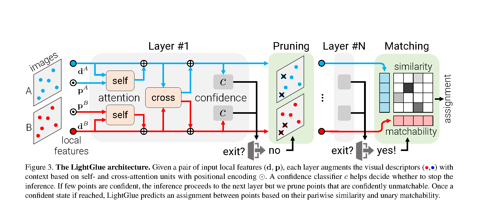
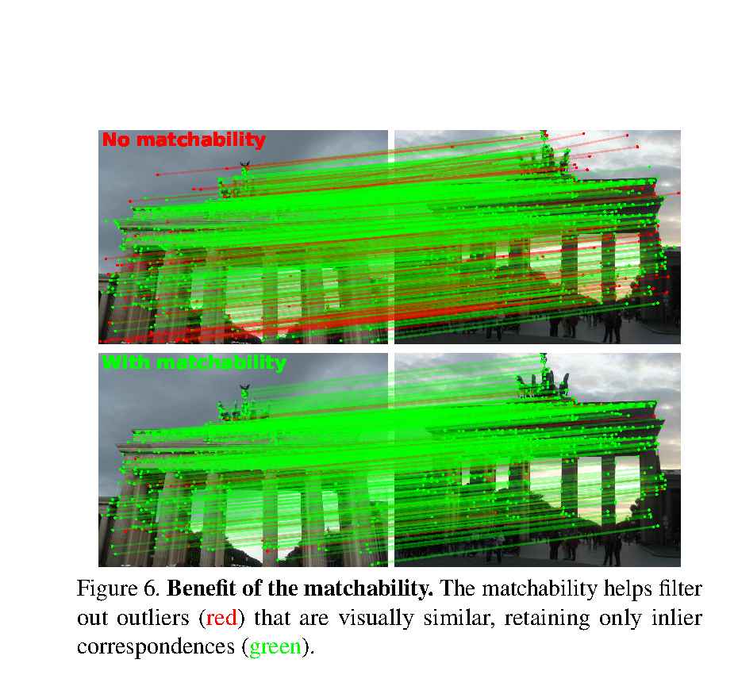
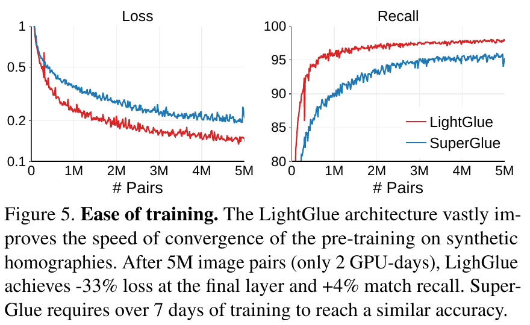
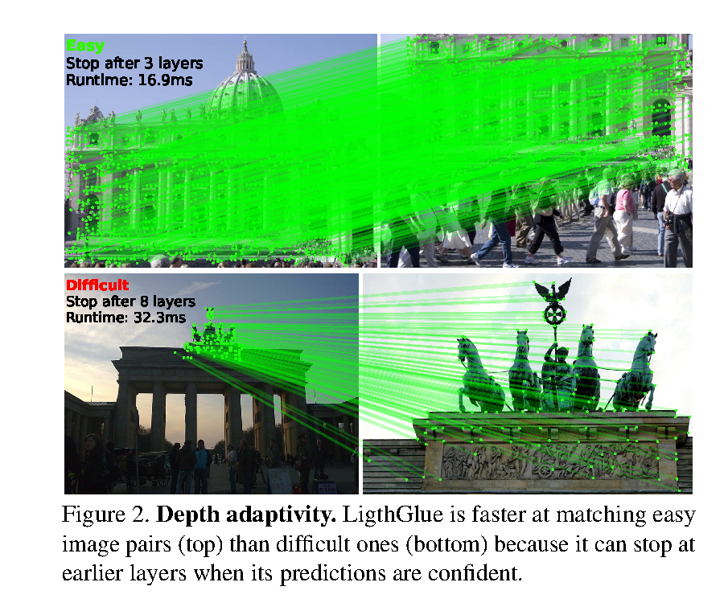
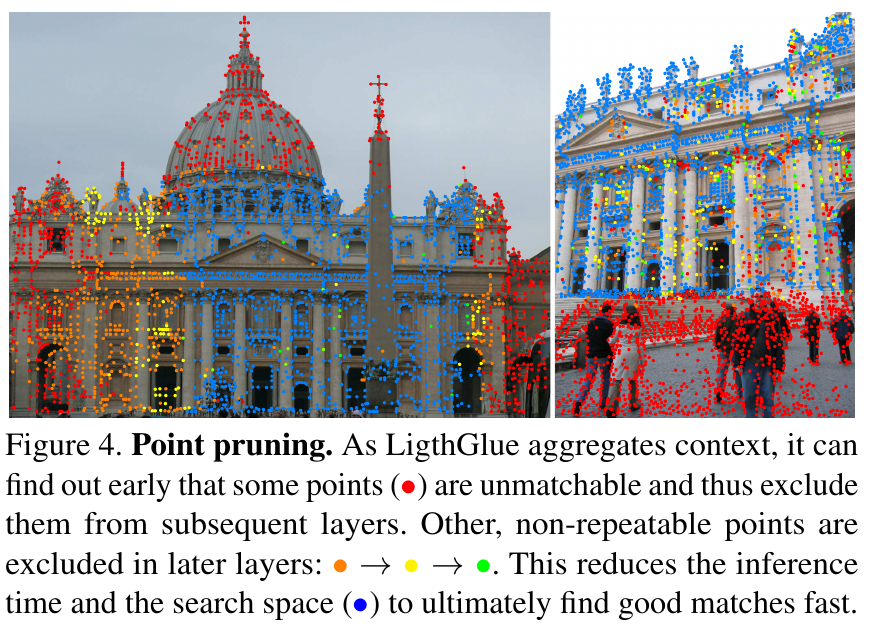
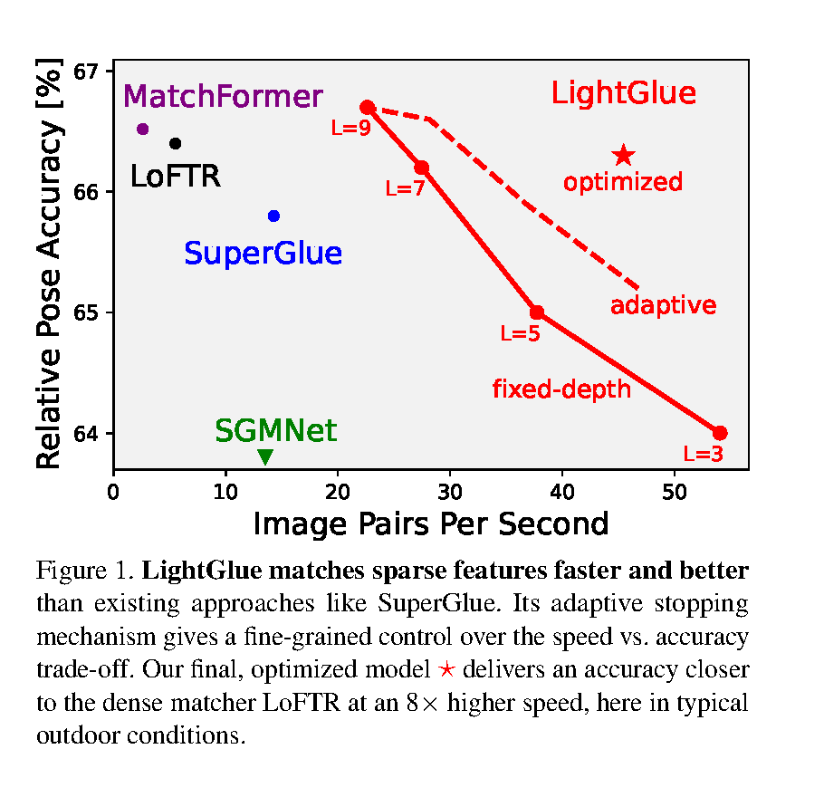

# LightGlue 论文解读

> *LightGlue: Local Feature Matching at Light Speed*（Philipp Lindenberger、Paul-Edouard Sarlin、Marc Pollefeys，ICCV 2023）用相对位置编码、双向注意力分数复用和轻量匹配头处理局部对应，再按预测稳定程度减少推理层数与关键点数。[论文页面](https://openaccess.thecvf.com/content/ICCV2023/html/Lindenberger_LightGlue_Local_Feature_Matching_at_Light_Speed_ICCV_2023_paper.html) · [ICCV 2023 PDF](https://openaccess.thecvf.com/content/ICCV2023/papers/Lindenberger_LightGlue_Local_Feature_Matching_at_Light_Speed_ICCV_2023_paper.pdf)

在特征匹配领域，经常会遇到这样的情况：两幅图里有许多外观相似的局部区域，例如一排窗户上的多个窗角，仅凭局部外观很难判断哪些点彼此对应；同时，也有只在一幅图中出现、根本没有对应点的区域。不同图像对的难度也不一样：有些需要反复利用周围信息才能消除歧义，有些则很快就能确定大部分对应。如果所有图像对都运行相同层数，并让所有关键点一直参与计算，容易的图像对和无匹配点也会耗费不必要的计算。

[上一篇 SuperGlue 文章](../superglue/index.html)介绍了一种解决方法：让两幅图中的关键点通过图神经网络交换上下文，再用最优传输形成允许无匹配点存在的部分对应。不过，SuperGlue 的网络按固定层数运行，每层都处理完整的关键点集合；最优传输还需要通过 Sinkhorn 迭代求解。因此，容易的图像对仍会运行后续层，已确定无对应的点也会继续参与计算。

LightGlue 主要改进点间信息交互、匹配预测和推理过程：它用相对位置编码与复用双向分数的跨图注意力处理点间信息，并以轻量匹配头构造部分对应，让每层都能产出预测，而不必逐层承担最优传输迭代的开销；推理时再根据预测置信度决定是否继续计算。其核心思想是让计算量随匹配难度变化——整对图像的结果足够稳定时提前结束，对稳定判为无匹配的点则提前剪枝，同时让仍有歧义的点继续利用上下文。LightGlue 仍位于特征提取与几何估计之间，输入是关键点及描述符，输出是跨图对应；相机位姿由后续几何方法估计。

## 网络状态与单层更新

图像进入 LightGlue 之前，SuperPoint、SIFT 等前端已在各自图像上检测关键点，并为每个点提取描述其邻域外观的向量。LightGlue 不重新检测点，也不直接处理整幅图像。设图像 $A$、$B$ 分别有 $M$、$N$ 个关键点。每个点有归一化图像位置 $p_i\in[0,1]^2$ 和局部外观描述符 $d_i\in\mathbb R^d$。输出是两组点之间的一组**部分对应**：一个点至多与另一幅图中的一个点配对，也允许没有对应。用一个局部例子说明部分对应：$A$ 中有窗角 $A_1$ 和画面边缘的 $A_2$，$B$ 中有同一窗角 $B_1$ 和另一个外观相似的窗角 $B_2$。理想结果只保留 $(A_1,B_1)$，把 $A_2$、$B_2$ 留空；后续用这一组假设点说明计算。

点在网络中的状态起初就是描述符 $x_i^{(0)}=d_i$。一层先做图内自注意力，再做跨图注意力：前者让 $A_1$ 读取本图其他点，借周围布局辨别自己属于哪个窗角；后者让它读取 $B_1$、$B_2$ 等另一幅图的点，判断对面有哪些可能的对应。跨图单元读取的是这一层图内单元更新后的状态；一层结束得到的状态，再作为下一层的输入。两幅图在同一个单元中的消息都由进入该单元时的状态计算，因而可以并行更新。

无论信息来自哪幅图，注意力单元都先按分数 $a_{ij}^{IS}$ 对来源点 $j$ 加权，再用收到的消息更新目标点 $i$：

$$
m_i^{I\leftarrow S}
=\sum_{j\in S}\operatorname{Softmax}_{j}(a_{ij}^{IS})W x_j^S,
\qquad
x_i^I\leftarrow x_i^I+
\operatorname{MLP}([x_i^I\mid m_i^{I\leftarrow S}]).
$$

$I$ 是目标点所在图像，$S$ 是消息来源，$W$ 把来源点的状态投影成可汇总的消息。对固定的目标点 $i$，softmax 把它与所有来源点的分数变成非负且总和为 $1$ 的权重；分数越高，该来源点对 $m_i$ 的贡献通常越大。MLP 把旧状态与汇总消息接在一起计算增量，公式中的加号保留旧状态。$a_{ij}^{IS}$ 只决定**这一层从 $j$ 读取多少信息**，还不是最终认定 $i$ 与 $j$ 匹配的分数。网络实际使用多头注意力：$d=256$ 维状态分成四组并行打分，再合并消息。每层更新后的状态都可以交给匹配头产生一次对应预测；网络再决定使用当前结果，或继续下一层。

*原论文图 3。蓝、红两组点先分别进行图内注意力，再跨图交换信息；灰色的置信度分支决定是否继续，绿色区域移除确定无匹配的点；右侧匹配头根据相似度和可匹配度形成对应。图中的位置编码符号只接在图内注意力上。*

接下来最值得细看的是图内注意力的位置编码。它说明 LightGlue 怎样让网络反复看见关键点之间的布局，而不用把每个点的位置永久加进初始描述符。

## 旋转位置编码与相对布局

只看外观，一排窗角可能几乎相同；某个窗角相对门框、屋檐的方位却有辨识力。LightGlue 在图内注意力的分数中使用

$$
a_{ij}=q_i^{\mathsf T}R(p_j-p_i)k_j.
$$

$q_i$、$k_j$ 是从当前点状态投影出的 query 和 key，都是 $d$ 维向量。$p_i$、$p_j$ 才是二维坐标。因此，$p_j-p_i$ 是二维位移，而 $R(p_j-p_i)$ 必须是一个 $d\times d$ 矩阵，才能放在 $q_i^{\mathsf T}$ 与 $k_j$ 之间。论文给出的矩阵是

$$
\widehat R(\theta)=
\begin{pmatrix}
\cos\theta&-\sin\theta\\
\sin\theta&\cos\theta
\end{pmatrix},
\qquad
R(p)=
\begin{pmatrix}
\widehat R(b_1^{\mathsf T}p)&0&\cdots&0\\
0&\widehat R(b_2^{\mathsf T}p)&\ddots&\vdots\\
\vdots&\ddots&\ddots&0\\
0&\cdots&0&\widehat R(b_{d/2}^{\mathsf T}p)
\end{pmatrix}
\in\mathbb R^{d\times d}.
$$

这个大矩阵的非零部分是 $d/2$ 个 $2\times2$ 小块。第 $r$ 块只作用于特征向量的第 $2r-1$、$2r$ 个分量。每个 $b_r=(b_{r,u},b_{r,v})\in\mathbb R^2$ 是训练学到的参数；给它一个二维位移 $\delta=(\Delta u,\Delta v)$，先做内积，得到这一块的旋转角 $\theta_r=b_r^{\mathsf T}\delta=b_{r,u}\Delta u+b_{r,v}\Delta v$，再把 $\theta_r$ 代入 $\widehat R$。所以二维向量没有直接“变成一个角”：**每组特征通道各用自己学到的 $b_r$，从同一个位移算出一个角**。这个角描述特征空间中的旋转，不是相机转角，也不是位移向量的朝向角。

把维度缩到 $d=4$，就能把整步计算写出来。以下参数和向量只为演算而设：取 $\delta=(1/2,1/4)$、$b_1=(\pi,0)$、$b_2=(0,\pi)$，于是 $\theta_1=\pi/2$、$\theta_2=\pi/4$。两个旋转块拼成

$$
R(\delta)=
\begin{pmatrix}
0&-1&0&0\\
1&0&0&0\\
0&0&\frac{\sqrt2}{2}&-\frac{\sqrt2}{2}\\
0&0&\frac{\sqrt2}{2}&\frac{\sqrt2}{2}
\end{pmatrix}.
$$

若此时 $q_i=k_j=(1,0,1,0)^{\mathsf T}$，矩阵先把 $k_j$ 变成 $(0,1,\sqrt2/2,\sqrt2/2)^{\mathsf T}$，再与 $q_i$ 点乘，得到 $a_{ij}=\sqrt2/2$。同样的 $q_i$ 和 $k_j$，若两点位移为零，则 $R(0)=I$，分数是 $2$。这展示了位置究竟进入了哪里：它改变特征向量参与点积时的方向，从而改变注意力分数；$R$ 没有移动图像中的点。这些数值只是演算，不表示论文给某一对窗角算出了这样的分数。

为什么最终式子里出现的是 $p_j-p_i$？实现时可以先按各自的位置旋转两端的特征：$\widetilde q_i=R(p_i)q_i$，$\widetilde k_j=R(p_j)k_j$。对上面矩阵中的任意一块，两个角的差正好是 $b_r^{\mathsf T}p_j-b_r^{\mathsf T}p_i=b_r^{\mathsf T}(p_j-p_i)$，因此

$$
\widehat R(b_r^{\mathsf T}p_i)^{\mathsf T}
\widehat R(b_r^{\mathsf T}p_j)
=\widehat R\!\left(b_r^{\mathsf T}(p_j-p_i)\right),
\qquad
R(p_i)^{\mathsf T}R(p_j)=R(p_j-p_i),
$$

进而

$$
\widetilde q_i^{\mathsf T}\widetilde k_j
=q_i^{\mathsf T}R(p_j-p_i)k_j.
$$

这就是 rotary encoding 的关键：**分别对每个点做一次位置旋转，点积中自然留下两点的相对位移**。无需为每一对点单独生成一份位置编码。位置在每层图内注意力中都会参与打分；点的位置不变，旋转角可预先计算并复用，而本层学到的 query、key 仍会随点状态更新。value 没有施加这项旋转，因此位置只影响本层“读谁”，不会被直接写入聚合的消息。

若两个点在图像中同时平移相同的二维量，位置编码里的 $p_j-p_i$ 不变。论文用同一近似平行于成像平面的场景结构解释这种相对表达的动机；一般透视变化下，二维相对距离并不保证不变。论文的问题表述把位置写在 $[0,1]^2$，实现附录则将坐标映射到保留图像长宽比的 $[-1,1]$ 范围；上述旋转关系在两种归一化约定下都成立。

## 跨图注意力与双向分数复用

图内注意力更新完每幅图的点，接下来每个点要从另一幅图的所有点读取信息。这里最耗计算的是两组点之间的两两打分：$A$ 有 $M$ 个点、$B$ 有 $N$ 个点，一个方向就要计算 $MN$ 个分数。常规的双向 cross attention 分别计算

$$
Q_AK_B^{\mathsf T}\in\mathbb R^{M\times N},
\qquad
Q_BK_A^{\mathsf T}\in\mathbb R^{N\times M}.
$$

$Q_A,K_A$ 是 $A$ 中各点的 query、key 排成的矩阵，$Q_B,K_B$ 同理。因为 query 与 key 是不同投影，这两张分数矩阵一般不互为转置，两个方向都得各算一遍点对内积。**LightGlue 为了省掉第二遍计算，在跨图注意力中为每个点计算 key，不计算 query。**于是它只需形成一次矩阵 $K_AK_B^{\mathsf T}$；对具体点对，论文的打分式为

$$
a_{ij}^{AB}=(k_i^A)^{\mathsf T}k_j^B
=a_{ji}^{BA}.
$$

反方向直接使用同一矩阵的转置，原本两次 $O(MNd)$ 的点对打分变成一次。这一步仍是 **cross attention**：对 $A_i$，沿所有 $B_j$ 对分数做 softmax，按权重汇总 $B$ 的 value；对 $B_j$，沿所有 $A_i$ 归一化，汇总 $A$ 的 value。两边读取的是另一幅图的信息，归一化方向与收到的消息各不相同。省下的是**相似度矩阵的重复计算**，不是省掉反方向的消息传递。论文附录的模块计时显示跨图注意力因此快约 $33\%$；两方向的 softmax 仍须计算，所以总耗时不会减半。论文称这种写法为双向注意力。图内注意力仍用带 $R$ 的 $qk$；跨图不加相对位置旋转，因为两幅图的二维坐标之差没有同图位移的含义。

经过图内、图间注意力，一点的状态既带有本图布局线索，也受到另一幅图候选的影响。直到这里，网络仍只是在更新特征；哪些点最终配成对，要由下面的匹配头决定。

## 相似度、可匹配度与部分分配

匹配头用两幅图更新后的点状态计算点对相似度：

$$
S_{ij}=\operatorname{Linear}(x_i^A)^{\mathsf T}
        \operatorname{Linear}(x_j^B).
$$

$S_{ij}$ 与上一节的注意力分数 $a_{ij}^{AB}$ 作用不同：$a$ 控制某一层如何交换信息，$S$ 是匹配头在这一层对候选点对的评分。用于计算 $S$ 的线性投影不跨层共享；各层以相同的计算形式、用各自更新后的状态形成分配。仅有 $S$ 仍不够。一个只出现在图像 $A$ 中的窗角，也会在 $B$ 的所有候选里找到“最像”的点；排第一不意味着它真的有对应。LightGlue 因而为每个点另预测一个可匹配度：

$$
\sigma_i=\operatorname{Sigmoid}(\operatorname{Linear}(x_i))\in[0,1].
$$

$\sigma_i$ 估计该点在另一幅图中能否找到对应。LightGlue 用两端的可匹配度和点对分数构造软分配：

$$
P_{ij}=\sigma_i^A\sigma_j^B
\frac{\exp(S_{ij})}{\sum_{k=1}^{M}\exp(S_{kj})}
\frac{\exp(S_{ij})}{\sum_{t=1}^{N}\exp(S_{it})}.
$$

第一个分式把 $A_i$ 与其他 $A$ 点比较，看谁更像 $B_j$；第二个分式把 $B_j$ 与其他 $B$ 点比较，看谁更像 $A_i$。若 $A_i$ 被判为难以匹配，即使它碰巧在某一列排名第一，前面的 $\sigma_i^A$ 仍会压低这一行的分配值。由两个 softmax 的取值范围还可直接得到 $\sum_jP_{ij}\leq\sigma_i^A\leq1$，列方向同理。行、列总量不必等于 $1$，因而允许点没有对应。推理时再保留超过阈值、且在行列互为最大值的点对。

用前面的四个点做一遍讲解用的数值计算。令 $S=\bigl(\begin{smallmatrix}3&0\\0&2\end{smallmatrix}\bigr)$，行依次为 $A_1,A_2$，列依次为 $B_1,B_2$；再令 $(\sigma_{A_1},\sigma_{A_2})=(0.9,0.05)$、$(\sigma_{B_1},\sigma_{B_2})=(0.8,0.9)$。两个对角线元素在各自行列都是最大的，然而 $P_{11}\approx0.65$，$P_{22}\approx0.035$：后一对虽然在候选中互为最像，$A_2$ 的低可匹配度仍把它压了下去。论文实现还要求 $P_{ij}>\tau$，其中 $\tau=0.1$；在这个例子里，最终只留下 $(A_1,B_1)$。这些假设分数用于说明匹配头的计算。

为什么不继续用 SuperGlue 的最优传输？它要给无匹配点设置 dustbin，再用 Sinkhorn 多轮交替归一化求分配；每轮都操作点对矩阵，增加计算和显存开销。如果还想在每个网络层之后预测一次对应，这笔开销就要逐层支付，因而难以监督中间层。论文还指出，dustbin 将所有点的相似度耦合在一起，使训练动态不理想。

LightGlue 的目的正是做一个**能逐层运行的轻量匹配头**。它把“点对像不像”交给 $S_{ij}$，把“单点是否有对应”交给 $\sigma_i$，通过上面的两次 softmax 直接构造 $P$，无需 Sinkhorn 迭代。它求得的不是同一个最优传输解；最终的一对一离散对应由行列互检筛出。这样每层都能负担一次预测和监督，浅层结果逐渐可用，推理时才可能在任意层提前退出。论文认为相似度与可匹配度分开预测也带来了更清晰的训练梯度。

*原论文图 6。只用点对相似度时，一些外观相近的错误连线仍被保留；加入单点可匹配度后，部分无可靠对应的点被整体拒绝。*

## 逐层监督与匹配训练

提前退出要求中间层本身能给出匹配，而非只在最后一层得到监督。LightGlue 在每一层都计算上一节的分配矩阵 $P^{(\ell)}$ 和单点可匹配度 $\sigma^{(\ell)}$。训练标签来自已知的两视图几何：用单应矩阵，或逐像素深度加相机相对位姿，把一幅图的点投到另一幅图，并反向检查。两个方向的重投影误差都小、深度也一致的点对组成真值集合 $\mathcal M$；对所有候选都明显不符的点，分别记入无匹配集合 $\bar A$、$\bar B$。沿用讲解用例，若几何验证确认 $A_1$ 与 $B_1$ 对应，而 $A_2$、$B_2$ 都无对应，那么 $(A_1,B_1)\in\mathcal M$，$A_2\in\bar A$，$B_2\in\bar B$。这些标签由训练数据的几何关系给出，推理时并不提供给网络。

论文对每一层使用同一个形式的损失，并在层间取平均：

$$
\begin{aligned}
\mathcal L_{\mathrm{match}}=-\frac1L\sum_{\ell=1}^{L}\bigg[&
\frac1{|\mathcal M|}\sum_{(i,j)\in\mathcal M}\log P_{ij}^{(\ell)}\\
&+\frac1{2|\bar A|}\sum_{i\in\bar A}\log\bigl(1-\sigma_i^{A,(\ell)}\bigr)\\
&+\frac1{2|\bar B|}\sum_{j\in\bar B}\log\bigl(1-\sigma_j^{B,(\ell)}\bigr)
\bigg].
\end{aligned}
$$

第一项要求真实点对的分配值 $P_{ij}$ 高；后两项要求已知无匹配点的 $\sigma_i$ 低。对讲解用例，前者推动 $P_{11}$ 上升，后者推动 $\sigma_{A_2}$、$\sigma_{B_2}$ 下降。各项按正负样本数归一化，避免数量差异淹没一类监督。每一层都收到这些梯度，浅层才会形成可直接使用的预测；论文在合成单应性实验中报告，第 5 层已达到超过 $90\%$ 的召回率，后续层继续改善精度。轻量匹配头使逐层预测与逐层监督在计算上可行。

训练先从合成数据开始，再转到真实数据。作者对真实照片施加合成单应变换和强光度扰动，获得几何关系明确、标签较完整的图像对用于预训练；再用 MegaDepth 中的相机位姿和深度图微调，以适应真实视角与外观变化。附录给出的 MegaDepth 标注规则包括：互为最近且重投影误差不超过 3 像素的点对标为匹配，最近候选误差超过 5 像素的点标为无匹配；深度缺失时，还借助极线误差补充无匹配标签。微调时每图最多取 2048 个点；作者用混合精度和梯度检查点，在 24 GB 显存的单卡上容纳每批 32 对图像。

匹配网络训练好以后，作者才单独训练判断“是否还值得算下一层”的置信度头。记点 $i$ 在第 $\ell$ 层的离散结果为 $m_i^{(\ell)}$，它可以是匹配到的点，也可以是“无对应”。分类器输出 $c_i^{(\ell)}=\operatorname{Sigmoid}(\operatorname{MLP}(x_i^{(\ell)}))$，二元监督标签为

$$
y_i^{(\ell)}=\mathbf1\!\left[m_i^{(\ell)}=m_i^{(L)}\right],
\qquad \ell=1,\ldots,L-1.
$$

也就是说，它用二元交叉熵学习中间层判断是否与最终层一致。例如，某层的 $A_1$ 已配给 $B_1$，最终层也如此，该层的标签就是 $1$；若某层暂时给 $A_2$ 配了点，最终层却拒绝它，标签就是 $0$。即使某层与最终层都判 $A_2$ 无对应，它的标签仍是 $1$。训练这一头时，梯度不传回点状态，以免影响已经学好的最终层匹配。于是 $\sigma_i$ 回答**这个点有没有对应**，$c_i$ 回答**当前判断是否已经稳定**；稳定的结果可以是匹配，也可以是无匹配。训练顺序正是后面两种自适应机制能够使用这些预测的前提。

*原论文图 5。横轴为已训练的图像对数量；红线是 LightGlue，蓝线是 SuperGlue。约 500 万对样本后，论文报告 LightGlue 最终层损失低 $33\%$、匹配召回率高约 $4\%$；这组曲线比较的是合成单应性预训练阶段。*

## 提前退出与点剪枝

论文将避免无谓推理拆成两项：**根据图像对的难度减少运行层数**，以及**尽早剪掉已被可靠拒配的点**。模型最多运行 $L=9$ 层。每层结束后，它已经有这一层的匹配结果、可匹配度 $\sigma_i^{(\ell)}$ 和上节训练出的稳定性预测 $c_i^{(\ell)}$，因此可以决定是直接输出，还是带着更少的点继续计算。

先决定是否让整对图像提前退出。论文把 $c_i^{(\ell)}>\lambda_\ell$ 的点视为已稳定；它将两幅图中稳定点的比例写为下式。若比例超过 $\alpha$，就采用当前层的对应并停止：

$$
\frac{1}{M+N}\sum_{I\in\{A,B\}}\sum_{i\in I}
\mathbf1\!\left[c_i^{(\ell)}>\lambda_\ell\right]
>\alpha.
$$

论文实验用 $\alpha=0.95$，附录将阈值设为 $\lambda_\ell=0.8+0.1e^{-4\ell/L}$：早期层要更高的置信度，较深层逐渐放宽。例如一对图像共有 $2000$ 个点，若其中超过 $1900$ 个点的 $c_i^{(\ell)}$ 高于本层阈值，就在这一层输出；这里用整数只是解释判据，并非论文的一组样本。$c_i$ 学的是“是否与最终层一致”，最终层本身也可能出错，因此提前退出不是对真实对应正确性的保证。$\alpha$ 越低，越容易提前停止，速度与精度随之取舍。图 2 的简单图像对在第 3 层结束，较难的一对走到第 8 层；图中的 16.9 ms 与 32.3 ms 是两个样例的耗时。

*原论文图 2。重叠较大的上方图像对较早停止；下方图像对继续利用后续层。*

如果整对图像还不能停止，才检查哪些点可以退出后续层。一个点要同时满足稳定和无匹配两个条件：

$$
c_i^{(\ell)}>\lambda_\ell,
\qquad
\sigma_i^{(\ell)}<\beta,
\qquad \beta=0.01.
$$

只看 $\sigma_i$，可能过早丢掉尚未获得足够上下文的点；只看 $c_i$，又可能丢掉稳定的好匹配。沿用讲解用例，$A_2$ 只有在当前层的 $\sigma_{A_2}<0.01$、且 $c_{A_2}>\lambda_\ell$ 时，才从下一层的输入中移除；$A_1$ 即便很稳定，也要留在网络里供其他点读取。剪枝是一项由预测驱动的取舍，误判时也可能删掉后来本可匹配的点。移除后，下一层图内与跨图注意力面对的点集都会缩小，减少点对比较；整理变长点集也有开销，因此收益随输入规模与实现变化。

*原论文图 4。红点最早被判为无匹配并移除；橙、黄、绿点在后续层依次退出，蓝点构成最后仍需搜索的点集。颜色展示点在何时被剪枝，不是最终的匹配连线。*

提前退出减少的是**层数**，点剪枝减少的是**后续层的点数**。论文按重叠程度分组统计：容易的一组平均停在第 4.7 层，较固定深度提速 1.86 倍；困难的一组平均走到第 6.9 层，但可移除的点更多，占 27.9%，总提速为 1.16 倍。难图像仍会运行更多层，模型节省的是已经没有必要执行的计算。

## 实验与消融

作者先在 HPatches 平面图像对上检查匹配质量。各稀疏方法使用每幅图 1024 个 SuperPoint 特征，以 3 像素重投影误差判断匹配是否正确。**召回率**表示几何真值中有多少对应被找回，**精度**表示输出对应中有多少正确。论文表 1 的列序是“召回率、精度”：LightGlue 分别为 $94.3\%$、$88.9\%$，SuperGlue 为 $94.9\%$、$87.4\%$。因此 LightGlue 的召回略低，精度略高。用匹配结果估计单应矩阵时，5 像素角点误差阈值下的加权 DLT AUC 从 $76.7$ 提高到 $78.6$。这里的 AUC 衡量估计单应矩阵把图像四角投影到真值位置的误差分布，越高越好；这组数字支持其在该下游任务中的收益，不能推出所有指标都更好。

MegaDepth-1500 进一步测试室外相对位姿。每幅图最多提取 2048 个 SuperPoint 特征；表中耗时只计匹配过程，不含特征提取或位姿求解。位姿误差取旋转角与平移方向角误差的较大值，AUC@20° 越高越好。

| 匹配器 | RANSAC AUC@20° | LO-RANSAC AUC@20° | 匹配时间（ms） |
|---|---:|---:|---:|
| SuperGlue | 80.6 | 87.5 | 70.0 |
| LightGlue | 80.1 | 87.9 | 44.2 |
| LightGlue 自适应 | 80.1 | 87.9 | 31.4 |

固定深度的 LightGlue 已比 SuperGlue 快；自适应版在表中保持相同的 AUC@20°，将时间进一步降至 31.4 ms。普通 RANSAC 下它的位姿 AUC 略低，LO-RANSAC 下略高。论文针对每种方法分别调节了 RANSAC 内点阈值；这些结论适用于这一评估设置。图 1 将不同固定层数、自适应设置和其他匹配器画在同一张速度—精度图中。

*原论文图 1。横轴为每秒处理的图像对，纵轴为相对位姿精度；固定层数形成一组取舍点，自适应推理在同一模型上移动到更快的区域。*

消融实验能更直接地对应前面的机制。下表来自论文表 4，使用合成单应性测试和每幅图 512 个 SuperPoint 点；论文为这些变体分别训练了模型，表中精度与召回率都以百分数表示。它们是在相同测试设置下改变设计的对照，差值不应直接套到真实定位场景。

| 设计 | 精度（%） | 召回率（%） | 时间（ms） |
|---|---:|---:|---:|
| 完整 LightGlue | 86.8 | 96.3 | 19.4 |
| 去掉可匹配度 | 67.4 | 97.0 | 18.9 |
| 改用绝对位置编码 | 84.2 | 94.7 | 18.7 |
| 改用普通双向跨图注意力 | 86.6 | 96.1 | 22.8 |
| 仅运行至第 5 层 | 78.1 | 92.7 | 11.9 |

去掉可匹配度，召回率几乎不变而精度明显下降，说明它主要帮助拒绝错误候选。换回绝对位置编码，精度和召回都下降，支持在每层使用相对位置旋转的设计。普通双向跨图注意力的质量接近，但耗时更高；第 5 层已有可用结果，后续层继续提高精度。

在 Aachen Day-Night 定位任务中，各方法使用每幅图最多 4096 个 SuperPoint 特征。系统先从参考图像建立稀疏三维点，再为查询图检索候选参考图，利用匹配建立二维到三维的关联，最后通过 PnP 和 RANSAC 求位姿。定位召回率表示查询图的位姿误差同时落在指定平移、旋转阈值内的比例。LightGlue 与 SuperGlue 的日间、夜间定位召回接近，普通实现将**匹配步骤**的吞吐量从每秒 6.5 对提高到 17.2 对，优化实现达到 26.1 对。这个实验说明更快的匹配器放进完整定位流程后仍可维持相近精度；这些吞吐量并非整套定位系统每秒处理的查询图数量，且依赖论文的图像尺寸、硬件及实现。

附录把评估扩展到 Image Matching Challenge 的三维重建任务。使用相同的 SuperPoint 前端，在 2020 年验证场景中，LightGlue 的双视图位姿 AUC@5° 为 $59.03$，SuperGlue 为 $58.64$，匹配吞吐量分别为每秒 $43.4$ 与 $16.2$ 对；2023 年竞赛的公开和私有榜单上，SuperPoint 加 LightGlue 的分数分别比 SuperPoint 加 SuperGlue 高 $2.3$ 个百分点。这些结果补充了不同流程中的证据，但数据、管线和计时范围各异，不能与前述 MegaDepth 表格直接合并比较。

## 方法关系与适用范围

LightGlue 接收的是检测器已经给出的稀疏点。两幅图中若没有可重复检测的点，注意力无法凭空生成对应；严重重复纹理仍可能让网络选错对象，论文附录中的 InLoc 结果和失败案例也显示了这一点：两种匹配器总体接近，少数图像会把重复物体上的点错配。图内相对位置编码帮助网络利用布局，却没有显式求相机位姿或极线约束，输出对应仍需几何后端检验。

整条方法链围绕着减少计算：图内注意力用旋转编码读取相对布局，跨图注意力用 $kk$ 让双向消息共用一张点对分数矩阵；轻量匹配头在每层预测对应，逐层监督改善训练收敛，也让早期结果可用；置信度再决定整对图像是否停止，以及哪些无匹配点退出后续层。这样既保留处理困难匹配的上下文推理，也减少容易图像对实际执行的计算。

## 参考资料

- Philipp Lindenberger, Paul-Edouard Sarlin, and Marc Pollefeys. [*LightGlue: Local Feature Matching at Light Speed*](https://arxiv.org/html/2306.13643)（[论文 PDF](https://openaccess.thecvf.com/content/ICCV2023/papers/Lindenberger_LightGlue_Local_Feature_Matching_at_Light_Speed_ICCV_2023_paper.pdf)，[CVF 页面](https://openaccess.thecvf.com/content/ICCV2023/html/Lindenberger_LightGlue_Local_Feature_Matching_at_Light_Speed_ICCV_2023_paper.html)）. ICCV, 2023, pp. 17627–17638.
- 作者公开的实现与模型：[cvg/LightGlue](https://github.com/cvg/LightGlue)。
