# LingBot-Map 论文解读

> *LingBot-Map: Geometric Context Transformer for Streaming 3D Reconstruction*，Lin-Zhuo Chen、Jian Gao、Shangzhan Zhang 等。本文依据 arXiv v3（2026-09-08）。论文以三类几何上下文组织历史注意力，从单目视频持续预测相机位姿与深度。[论文页面](https://arxiv.org/abs/2604.14141v3) · [PDF](https://arxiv.org/pdf/2604.14141v3) · [官方项目](https://technology.robbyant.com/lingbot-map)

## 1. 引言

流式三维重建根据连续到达的图像估计相机运动和场景几何。模型处理当前帧时，过去的画面提供两类帮助：相近视角有利于判断局部几何，更早的观测则帮助维持整段重建的坐标与尺度一致性。随着相机持续移动，历史会越来越长，完整保存和反复读取全部图像特征的代价也会增长。

不同历史管理方式各有取舍。固定大小的递归状态可以控制内存，但必须持续将新信息融合进有限的表示，可能遗忘旧场景。保存所有历史的因果注意力可以直接读取旧特征，却让计算与缓存不断增长。仅保留最近窗口可以限制读取量，但相机离开早期区域后，窗口中便不再有长期参照。

LingBot-Map 将历史分成三类。开头若干帧作为**锚上下文**，保留完整特征，提供共同参照；最近若干帧组成**局部位姿参考窗口**，保留稠密图像特征；位于两者之间的旧帧进入**轨迹记忆**，每帧只留下六个上下文向量。三类信息通过同一套注意力参与当前预测，称为 Geometric Context Attention（GCA）。采用这种注意力的整体网络称为 Geometric Context Transformer（GCT）。

这里的选择规则有明确结构：按帧在序列中的位置决定保留完整表示还是紧凑表示。网络学习的是每个向量携带什么信息，以及读取时赋予多大权重。因此，结构化缓存规则和端到端学习在方法中承担不同职责。

论文还通过渐进增加训练帧数、局部相对位姿监督和长轨迹数据，让模型学会使用这些历史。长序列结果需要同时结合这些训练条件与推理模式理解；三类缓存的设计本身并不保证任意长视频上的几何一致性。

## 2. 相关工作

传统 SfM、SLAM 和 MVS 分别侧重从多视图恢复运动与结构、在线定位建图，以及在已知相机条件下恢复稠密几何。SfM 与 SLAM 通常围绕特征关联、关键帧和束调整组织计算，地图与优化结果会反过来约束后续估计。DROID-SLAM 等学习方法将部分过程改为神经网络，但仍保留几何优化的更新方式。

前馈三维模型改变了几何信息的获取方式。[DUSt3R](../dust3r/index.html) 直接从图像对预测点图，多对结果再通过优化对齐；[VGGT](../vggt/index.html) 等模型通过跨视图注意力联合处理更多图像，输出相机与场景几何。这些模型主要面向完整输入集合，后来的视图可以参与较早视图的表示更新，适合离线重建。

流式方法需要重新设计这种跨视图关系。CUT3R 维护递归状态；TTT3R 利用测试时更新机制缓解遗忘；StreamVGGT、STream3R 和 WinT3R 使用因果注意力、缓存或窗口。另一类方法将三维基础模型与传统 SLAM 后端结合，通过关键帧和位姿图管理历史。LoGeR、Scal3R 等长序列方法还探索了分块与混合记忆，但论文将它们与在线单次前馈区分，原因涉及离线处理及测试时参数更新。

LingBot-Map 的目标是在前馈计算内部保留不同用途的几何上下文。它借鉴传统系统中参考系、局部窗口与全局历史的分工，但历史内容由学习特征承载，当前网络预测不执行显式 BA 或闭环优化。

## 3. 方法

### 3.1 输入、输出与整体流程

设输入视频为 $I_1,I_2,\ldots$。模型输出第 $t$ 帧的相机位姿 $\hat P_t$ 和深度图 $\hat D_t$。位姿使用 camera-to-world 约定：若 $P_t=(R_t,t_t)$，则相机坐标中的点通过

$$
X_w=R_tX_t+t_t
$$

变到共同场景坐标系。这里的“绝对位姿”指相对于这套共同坐标系，并非外部地理坐标。

位姿与深度共同确定各帧表面在场景中的位置。以针孔模型、光轴深度为例，像素齐次坐标为 $\tilde u$、内参为 $K_t$ 时，有

$$
X_t=D_t(u)K_t^{-1}\tilde u,\qquad
X_w=R_t\bigl(D_t(u)K_t^{-1}\tilde u\bigr)+t_t.
$$

这个关系用于说明输出如何形成点云：深度确定相机系中的表面，位姿将它放到共同参考系。网络内部预测的是几何量与学习特征，论文没有在 GCA 中定义一套逐点匹配和三角化流程。

运行开始时，前 $n$ 帧先联合初始化；收齐这批图像后，模型在其中使用全注意力。之后每到一帧，只使用初始化帧与已经到达的观测，逐帧输出结果。因而因果约束适用于初始化后的流式阶段，初始化本身需要一小段启动观测，不能理解成从第一张图开始就零等待地完成全部预测。

*原论文图 4。每帧经图像编码与帧内注意力后，读取锚上下文、局部位姿参考窗口和轨迹记忆。相机头从相机 token 预测位姿，深度头从图像 token 预测深度，右上展示重建结果。*

每帧图像首先编码为图像块特征，再附加少量承担特定角色的 token。一个 token 是向量，并非一个已经确定的三维点。网络交替进行帧内特征更新与跨帧读取，最后由任务头将向量解码为位姿和深度。GCA 改变的核心是跨帧读取的来源范围。

### 3.2 Geometric Context Attention

#### 锚上下文提供共同参照

单目投影存在尺度自由度。若场景点、相机平移和深度同时乘以正数 $s$，投影到像素的方向可以保持不变。因此，只凭单目几何关系，不能唯一确定物理尺度；重建首先需要选择一套内部一致的尺度和坐标参照。

离线模型可以根据完整输入的点云规范化尺度。流式推理尚未见到未来场景，不能让后来的画面参与启动阶段的规范化。LingBot-Map 因此用前 $n$ 帧构成锚上下文：这些帧联合交换信息，随后保留完整特征，供所有后续帧读取。

每帧包含一个可学习的 anchor token，初始化帧和后续流式帧使用不同的初始值，使网络能够区分它们的角色。“锚上下文”则包含初始化帧所携带的全部相关特征，并不只指这个单独的 anchor token。

训练时，作者利用锚帧的真值点云 $\bar X^{\mathrm{anchor}}$ 计算规范尺度：

$$
s=\frac{1}{|\bar X^{\mathrm{anchor}}|}
\sum_{x\in\bar X^{\mathrm{anchor}}}\|x\|_2.
$$

随后将整段训练样本的真值深度与相机平移除以 $s$，旋转保持不变。这样，后续帧的监督也使用由开头观测决定的同一尺度。若只对每帧分别规范化，序列中的深度与平移就可能失去统一比例，无法监督一致轨迹。

推理时没有这份真值点云，也不计算真值尺度 $s$。网络学习的是根据初始化观测建立并沿用规范尺度。论文中的尺度固定应在这个意义下理解，不能据此认定无外部参照的单目模型已经获得可验证的米制测距。

#### 局部窗口保留稠密视觉联系

相机移动较远后，当前画面与锚帧可能没有共同视野。最近的观测通常更有重叠，有助于判断当前相机相对已有轨迹的位置，以及表面的局部深度。

GCA 为最近 $k$ 帧保留完整图像 token，称为局部位姿参考窗口。当前图像可通过跨帧注意力读取这些稠密特征。窗口提供的是学习到的几何线索，网络没有在此显式检测匹配点或运行局部 BA；训练中的相对位姿损失则进一步约束窗口内各帧的运动关系。

论文图 4 将当前时刻 $i$ 的历史局部窗口记为 $[T_{i-k},T_i)$，即当前帧之前的 $k$ 帧。当前帧本身也参与当前的特征计算，和历史缓存的角色有所区别。

#### 轨迹记忆保留中间历史

锚帧与局部窗口之间还可能隔着很长一段观测。如果全部删除这段历史，当前估计就只能依赖固定开头和最近画面；如果全部保留，又恢复了完整因果注意力的成本。

LingBot-Map 对退出局部窗口、又不属于锚集合的帧，只保留相机 token、anchor token 和四个 register token，共六个上下文 token，删除占主要数量的图像 token。register token 参与注意力中的信息交换，但不单独由输出头解码。

这些 token 从该帧进入网络时就存在，在各层与图像特征及过去上下文共同更新。退出窗口时发生的是**选择性保留既有 token 对应的键值**，无需另外启动一个压缩网络。训练使这些少量向量学会携带有用的历史信息，但论文没有给每个向量指定一个三维地标、优化约束或轨迹片段。

轨迹记忆还使用视频时间位置编码 Video RoPE。旋转位置编码通过与位置有关的旋转作用于注意力的 Query 和 Key，使比较结果能够反映相对时间位置。这样，两个外观相近的旧特征还可由其出现次序区分。时间编码提供顺序线索，具体怎样使用仍由任务训练决定。

#### 三类来源组成注意力掩码

*原论文图 3。列方向为 Key 来源，行方向为 Query。每个大块代表一帧，块内前部是少量上下文 token，其余是图像 token。GCA 图以 $n=2,k=2$ 示意：左侧锚帧保留完整块，近对角线保留局部窗口，中间旧帧只保留窄条上下文。*

全局注意力允许任意帧互读，因此可以使用未来；完整因果注意力只读过去，却保留所有历史特征；滑动窗口只读近邻，删除窗口以外的历史。GCA 在读取范围中同时保留固定锚、局部窗口和中间帧的紧凑表示。

这一规则可以用一个局部例子展开。设锚帧为第 1、2 帧，历史窗口暂取两帧。第 6 帧到来时，读取第 1、2 帧的完整锚特征、第 4、5 帧的完整局部特征，以及第 3 帧留下的六个上下文 token。进入下一步后，第 4 帧退出局部窗口，只留下它的六个上下文 token，第 5、6 帧成为最近窗口。这里沿用图 3 的小参数说明淘汰规则，论文默认设置另见实验部分。

在某一层内，当前 token 用 Query 与允许来源的 Key 计算权重，再汇总来源的 Value。$q_i$ 来自当前目标 token，$k_j,v_j$ 来自可读取的来源 token。用 $\mathcal S_t$ 表示该层允许读取的集合，它包含三类历史以及当前帧自身，单头聚合的核心形式为

$$
m_i=\sum_{j\in\mathcal S_t}
\frac{\exp(q_i^{\mathsf T}k_j/\sqrt{d})}
{\sum_{r\in\mathcal S_t}\exp(q_i^{\mathsf T}k_r/\sqrt{d})}\,v_j.
$$

$d$ 是每头投影维数。掩码确定 $\mathcal S_t$，学习到的投影和特征确定来源权重；这两者共同决定当前状态获得什么信息。完整网络还包含多头与特征更新，上式仅展开读取动作。

历史帧已经完成的各层状态不会因未来帧到来而重新计算。当前帧读取旧键值后更新自己的表示，再将自身键值加入缓存，供后来帧读取。轨迹记忆因此可以影响后续预测，但不会自动把过去已经输出的轨迹改写成一个全局优化解。

#### 缓存规模与计算增长

沿论文的计数方式，设上下文中共有 $T$ 帧，其中 $n$ 个锚帧、$k$ 个局部帧保留完整表示，其余帧只留六个上下文 token，每帧图像 token 数为 $M$。在锚与局部窗口不重叠时，数量为

$$
\begin{aligned}
N_{\mathrm{GCA}}
&=n(M+6)+k(M+6)+(T-n-k)6\\
&=(n+k)M+6T.
\end{aligned}
$$

前两项保留少量帧的完整图像信息；消去同类项后，只有 $6T$ 随历史帧数增长。完整因果缓存则为

$$
N_{\mathrm{causal}}=T(M+6)=MT+6T.
$$

论文用 $M\approx500,n=3,k=16,T=10{,}000$ 举例：完整缓存约 506 万 token，GCA 约 6.95 万。这个例子的总上下文数量相差约 73 倍；每新增一帧的增长量则分别为 $M+6$ 与 6，对应约 84 倍。正文的约 70 倍与结论的约 80 倍应作为近似量级阅读，并与实测运行速度区分。这里的 $M=500$ 是复杂度例子的取值，实际数量随输入分辨率变化。

这些式子也保留了方法的边界。固定 $n,k$ 后，Direct 模式的缓存仍有 $6T$ 项；每个新帧对全部保留记忆的读取量仍随 $T$ 增长，各层键值还需乘上层数和特征维数。论文称“近乎恒定开销”，描述的是稠密图像特征淘汰后的较小增长率，并非严格的无限长 $O(1)$ 状态保证。

### 3.3 网络结构与目标函数

#### 特征怎样变为位姿和深度

图像主干是 DINOv2-Large，patch 大小为 14。每帧产生 $M$ 个图像 token，再附加相机 token $c\in\mathbb R^C$、四个 register token $r_j\in\mathbb R^C$ 和 anchor token $a\in\mathbb R^C$。此处 $C$ 表示特征维数。

后续结构交替执行 Frame Attention 和 GCA。前者在单帧内部更新表示，后者按三类上下文跨帧汇总信息。相机头读取更新后的相机 token，输出 $\hat P_t$；深度头读取图像 token，输出 $\hat D_t$。因此，紧凑上下文承载对相机与场景关系有用的信息，当前帧的稠密图像表示仍负责像素级输出。

训练时还不能只要求单帧深度看起来合理。不同帧需要共享尺度与参考系，相邻预测的运动关系也需要一致。论文用三种监督连接这三个目标：

$$
\mathcal L
=\lambda_{\mathrm{depth}}\mathcal L_{\mathrm{depth}}
+\lambda_{\mathrm{abs\text{-}pose}}\mathcal L_{\mathrm{abs\text{-}pose}}
+\lambda_{\mathrm{rel\text{-}pose}}\mathcal L_{\mathrm{rel\text{-}pose}}.
\tag{1}
$$

#### 深度与绝对位姿监督

深度和绝对位姿损失沿用 VGGT 的定义，位姿监督方向则换为 camera-to-world。原文将两项写为

$$
\begin{aligned}
\mathcal L_{\mathrm{depth}}
=\sum_{i=1}^{N}\Bigl[&
\big\|\Sigma_i^D\odot(\hat D_i-D_i)\big\|
+\big\|\Sigma_i^D\odot(\nabla\hat D_i-\nabla D_i)\big\|
-\alpha\log\Sigma_i^D\Bigr],\\
\mathcal L_{\mathrm{abs\text{-}pose}}
&=\sum_{i=1}^{N}\|\hat P_i-P_i\|_{\epsilon}.
\end{aligned}
$$

这里 $N$ 为训练视图数，$\odot$ 表示逐元素乘法，$\nabla$ 表示图像上的深度梯度。深度值项监督表面距离，梯度项监督空间变化，帮助保留边缘和局部结构。$\|\cdot\|_{\epsilon}$ 沿用原文的鲁棒位姿误差记号；这不是将所有 $4\times4$ 位姿矩阵元素一律等权相减的几何定义。

> 原文将 $\Sigma_i^D$ 称为 uncertainty map，但它在这里乘到误差上，并带有 $-\alpha\log\Sigma_i^D$ 项。按正权重的形式看，它发挥置信权重的作用：令 $w>0,\alpha>0$，对固定正残差 $e$，标量目标 $we-\alpha\log w$ 的极小点为 $w=\alpha/e$，误差越大，适宜权重越小。不能按“数值越大表示越不确定”的字面含义解释该公式。原式的像素归约与具体鲁棒误差细节由其引用的 VGGT 定义承接。

camera-to-world 的平移直接表示相机中心在共同坐标系中的位置。若 $X_w=RX_c+t$，逆变换为

$$
X_c=R^{\mathsf T}X_w-R^{\mathsf T}t.
$$

因此，world-to-camera 参数中的平移为 $-R^{\mathsf T}t$，旋转误差会直接影响这份平移参数，离原点越远时这种耦合可能越明显。作者据此选择 camera-to-world 监督以改善长序列训练；这种参数化并不消除几何估计中旋转和平移的全部关联。

#### 局部相对位姿监督

绝对位姿项约束每帧在共同坐标系中的输出，相对项则直接约束窗口内两帧的运动关系。论文式（2）为

$$
\mathcal L_{\mathrm{rel\text{-}pose}}
=\frac{1}{k(k-1)}
\sum_{\substack{i,j\in\{1,\ldots,k\}\\i\ne j}}
\left(\mathcal L_{\mathrm{rot}}(i,j)
+\lambda_{\mathrm{trans}}\mathcal L_{\mathrm{trans}}(i,j)\right).
\tag{2}
$$

窗口中的 $k$ 帧形成 $k(k-1)$ 个有序不同帧对，分母将这些配对误差取平均。旋转项使用测地误差，平移项使用 $\ell_1$ 误差。

在 camera-to-world 约定下，相对变换由 $P_i^{-1}P_j$ 得到。若 $P_i=(R_i,t_i)$、$P_j=(R_j,t_j)$，展开为

$$
R_{i\leftarrow j}=R_i^{\mathsf T}R_j,\qquad
 t_{i\leftarrow j}=R_i^{\mathsf T}(t_j-t_i).
$$

它先取两相机中心在共同系中的位移，再将其转到第 $i$ 帧相机系。预测位姿也构成同样的相对变换，然后与真值比较。按文中测地旋转误差与平移误差的定义，可展开为

$$
\begin{aligned}
\Delta R_{ij}&=\hat R_{i\leftarrow j}^{\mathsf T}R_{i\leftarrow j},\\
\mathcal L_{\mathrm{rot}}(i,j)
&=\arccos\!\left(\operatorname{clip}\!\left(
\frac{\operatorname{tr}(\Delta R_{ij})-1}{2},-1,1\right)\right),\\
\mathcal L_{\mathrm{trans}}(i,j)
&=\|\hat t_{i\leftarrow j}-t_{i\leftarrow j}\|_1.
\end{aligned}
$$

旋转项是预测与真值相对旋转之间的夹角，clip 防止浮点误差使反余弦输入超出范围。这个损失直接依赖两帧的联合关系，给局部运动额外的监督通路，而非只将各帧的绝对误差重复相加。

训练窗口只包含该次预测已经观察到的帧，因而无需借助未来观测。推理时没有真值，也不运行这套损失来优化位姿，输出仍来自网络前向计算。

### 3.4 流式缓存实现

因果注意力允许复用各历史帧在各层中的 Key、Value，避免每来一帧就重新编码和更新全部旧图像。GCA 还需要追加当前帧、淘汰旧图像 token，并保留对应上下文 token。若将所有缓存组织为一段连续内存，这些操作可能触发反复分配和搬移。

论文采用分页 KV 缓存，通过页组织缓存条目，避免每次更新都搬动整段历史。实现基于 FlashInfer，使用其分页与稀疏键值布局支持。在 $518\times378$ 输入、最长 1000 帧、局部窗口 64 的测试下，该实现约为 20 FPS；同一模型采用连续缓存更新的 PyTorch 对照约为 10.5 FPS。

这组比较说明缓存管理和注意力内核会显著影响实际速度。它比较的是同一模型的两种实现，不等于仅改变注意力掩码就获得同样加速。更长输入还可只让每隔 $m$ 帧选出的关键帧留在缓存中，具体推理模式见下一节。

## 4. 训练与推理

### 4.1 基础模型训练

第一阶段先训练能够处理短多视图输入的离线基础模型。DINOv2-Large 初始化图像主干，后接 24 个交替的帧内与跨帧注意力块。跨帧部分采用全局注意力，每个样本随机取 2–24 张图像；数据可以是无序多视图，也可以是视频，不强制使用时间顺序。这一步先建立位姿与深度的几何表示。

优化使用 AdamW，基础学习率 $2\times10^{-4}$，权重衰减 0.05，总计 160K 次迭代。前 5% 迭代从 $10^{-8}$ 线性预热到基础学习率，之后余弦衰减回 $10^{-8}$。FSDP、梯度检查点与 BF16 用于管理训练内存，64 卡约训练两周，报告成本约 21,500 GPU 小时。

图像最长边缩放到 518。外观增强包含以 0.9 概率施加颜色扰动，亮度、对比度和饱和度幅度为 $\pm0.5$，色调为 $\pm0.1$，另有高斯模糊和以 0.05 概率转灰度。空间尺度在 0.8–1.2 倍变化，宽高比从 0.33–1.0 采样。以 0.3 概率对同场景所有帧施加相同颜色变换，其余采用逐帧独立变换，兼顾场景内整体外观变化与帧间外观差异。

### 4.2 流式模型训练

第二阶段继承基础模型权重，将全局跨帧注意力换成 GCA。Query、Key、Value 投影的参数形式没有改变，因此这些权重可以直接迁移。变化的重点是读取范围与输入组织，不需要从随机参数重新学习全部几何表示。

训练继续运行 160K 次迭代，AdamW 基础学习率降为 $5\times10^{-5}$，预热与衰减安排相同。视图数从 24 线性增加到 320，使模型先维持短程几何，再逐步处理更长上下文。局部窗口 $k$ 在 16–64 中随机采样，以适应推理时不同的读取范围。

320 帧上限来自训练显存预算。作者采用 16 路 Ulysses 上下文并行，将不同视图分到不同 GPU，再通过 all-to-all 通信完成注意力计算，实现基于 TorchTitan 与 Magi Attention。该阶段使用 64 卡约训练一周。模型结构并不要求推理长度必须等于 320，但更长输入的准确性仍需实验检验。

### 4.3 数据组成与时间采样

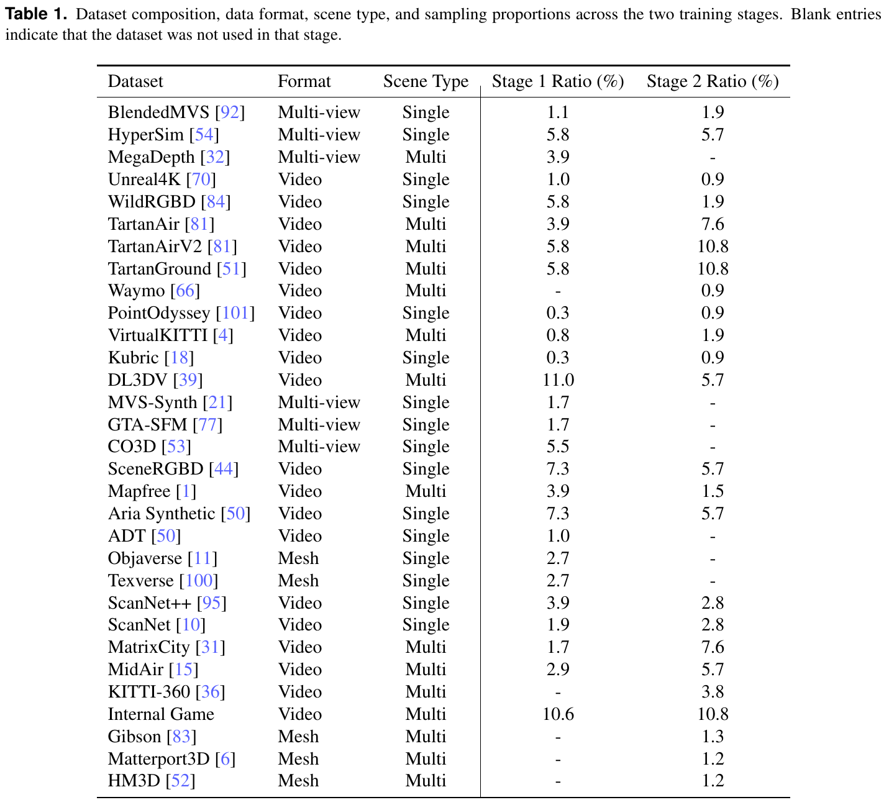

*原论文表 1。列出 31 个数据条目、源格式、场景类别与两阶段采样比例；空缺表示该阶段未使用。Single/Multi 是原表的场景类型分类。数据比例描述训练分布，不是每个来源对最终结果的独立贡献。*

第一阶段使用其中 26 个条目，覆盖物体、室内、室外、真实和合成场景。多视图集合、视频及网格渲染都可参与。采样先随机选择参考帧，再从附近空间范围取其他视图，不强制时间排序；动态批量采样器使每卡最多容纳 48 张图像。

第二阶段加大长轨迹视频的权重，例如 TartanAir、TartanGround、MidAir、MatrixCity、ScanNet 系列与游戏数据，并使用 Waymo、KITTI-360，以及从 Gibson、Matterport3D、HM3D 渲染的跨房间轨迹。部分缺少时间结构的多视图集合被降低权重或移除。

视频采用 foldback 采样：随机起点、随机步长，走到序列边界后反向并重新选择不同步长。这样可从有限视频中构造连续子序列，覆盖不同有效帧率和正反运动方向。反向播放仍按新的序列顺序施加因果读取，不意味着推理可以访问尚未到来的图像。

长程能力因而同时依赖上下文结构和训练材料。跨房间、跨街道的连续数据让模型在训练中见到局部重叠逐步消失、场景发生转换的情况。附录的数据处理细节在文末继续展开。

### 4.4 Direct 与 VO 推理模式

两种模式共用固定步长关键帧规则：长输入可以每隔 $m$ 帧在 KV 缓存中保留一帧，减少持久历史。当前帧仍进行预测，缓存的采样密度与输出帧率是不同概念。

**Direct Output** 连续维护同一锚上下文与缓存，不重置状态，各帧直接输出在共同坐标系中的位姿与深度。作者报告，配合关键帧选择后，该模式在约 3000 帧内通常稳定，之后逐渐退化。这个长度是经验范围，并非结构上的硬截断。

**VO 模式**面向数万帧等更长输入。视频分为有重叠的局部段，每段先联合初始化一批帧，再因果处理其余帧；段结束后重置状态。相邻段的重叠区域用于估计 $\mathrm{Sim}(3)$ 对齐，将局部重建接到同一轨迹。

相似变换同时包含尺度、旋转和平移。若某段中的点为 $x$，到前一段参考系的转换形式为

$$
x'=sRx+t.
$$

这里的 $s$ 调整两段独立初始化的尺度。相应地，局部相机中心也要经过同一尺度与刚体变换。$\mathrm{Sim}(3)$ 对齐解决段间坐标连接，却会引入额外估计误差，反复连接后仍可能积累漂移。

Direct 避免了段间对齐误差，在有效长度内通常更准确；VO 通过局部段重置控制活动状态，用边界对齐的代价处理极长视频。论文的大规模演示采用 VO 模式，不能将超过万帧的展示解释成一个从不重置的缓存始终维持相同质量。

除非另行说明，论文定量实验使用 Direct、$k=64,m=1$、$518\times378$ 输入与 BF16，后面的参数研究给出默认锚数量 $n=8$。$m=1$ 表示每帧都作为缓存关键帧。因而稠密基准的好结果应按其默认设置阅读，不能全部归因于稀疏选帧。

## 5. 评价基准

### 5.1 数据集设置

评价包含七个基准。Oxford Spires 覆盖牛津校园中的室内外转换、重访与大尺度变化，真值轨迹来自高精度激光惯性 SLAM。论文选取十个有真值的场景、使用相机 0，分别评估每隔 12 帧取样的 320 帧稀疏输入，以及同段的 3840 帧稠密输入。两者主要改变观测密度和输入帧数，不能直接说实际行走路程也增加了十二倍。

ETH3D 兼有室内外场景与激光真值，沿 DA3 的设置使用全部可用帧。7-Scenes 是含模糊、弱纹理和重复结构的室内 RGB-D 数据，按步长 5 采样。Tanks and Temples 使用 Barn、Caterpillar、Church、Ignatius、Meetingroom 和 Truck 六个场景的全部图像。NRGBD 用于室内稠密重建，按步长 5 采样。Sintel 检查动态画面下的轨迹，KITTI odometry 检查城市驾驶轨迹。

### 5.2 指标与对齐条件

位姿 AUC 衡量相对位姿角误差在指定阈值范围内的累计表现，越大越好。论文表 2 使用 AUC@15 与 AUC@30，其他表还使用 AUC@3。原文第 5.2 节只概括列出 $3^\circ$ 与 $30^\circ$，因此解读具体结果时以对应表头为准。

ATE 是轨迹经过整体 $\mathrm{Sim}(3)$ 对齐后的绝对位置误差，单位为米；RPE-trans 与 RPE-rot 则评价局部相对运动。ATE 允许统一尺度对齐，不能单凭其数值认定模型恢复了原始米制尺度，也不能用较低 ATE 推出每一项局部误差必然更低。

点云先用 Umeyama 对齐，再用 ICP 细化，原文给出的 ICP 阈值为 0.1。Accuracy 衡量预测点到真值的距离，Completeness 衡量真值到预测的距离，均越低越好；F1 在给定距离阈值下综合精确率与覆盖率，越高越好。

ETH3D 的 F1 阈值为 0.25 米，体素大小为 0.039 米；7-Scenes 和 NRGBD 先以 $4.0/512$ 米体素下采样，再采用 0.05 米 F1 阈值。不同数据集的阈值不同，F1 不宜直接跨数据集相减。对齐后的点云结果主要检验形状、相对几何与一致性，而不是原始外部坐标是否准确。

## 6. 实验

### 6.1 对照方法

离线前馈对照包括 VGGT、DA3、Fast3R、FastVGGT 与 $\pi^3$，它们同时读取完整输入，能够使用未来观测。优化式对照包括 DROID-SLAM、MegaSAM 与 VIPE；其中 DROID-SLAM 的内参按 VGGT-SLAM 的方式生成。在线对照包括 StreamVGGT、SLAM3R、InfiniteVGGT、Spann3R、STream3R、CUT3R、TTT3R 与 WinT3R。

论文要求流式方法在每条测试序列中不重置内部状态，LingBot-Map 的定量结果也默认采用 Direct。完整输入相同，并不意味着三类方法的时间信息和计算条件相同；与在线方法的比较最接近其运行设定。

### 6.2 相机位姿估计

#### Oxford Spires 的稀疏与稠密轨迹

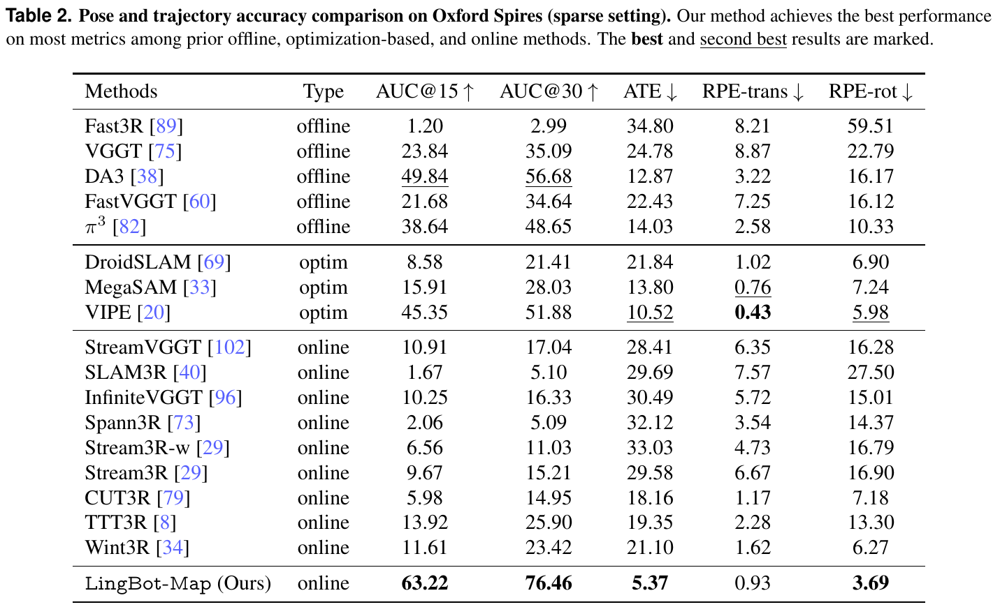

*原论文表 2。320 帧、步长 12，比较离线、优化式与在线方法。AUC 越高越好，ATE 与 RPE 越低越好。*

LingBot-Map 的 AUC@15 为 63.22，ATE 为 5.37 米；DA3 为 49.84 与 12.87 米，优化式 VIPE 为 45.35 与 10.52 米。在线 CUT3R 的 ATE 为 18.16 米，WinT3R 为 21.10 米。该设置支持模型在复杂场景转换中的轨迹优势，但不是所有指标都最优：VIPE 的 RPE-trans 为 0.43，低于 LingBot-Map 的 0.93。

作者将离线模型在此的退化与短视图训练、跨区域变化联系起来，将部分在线方法的退化与历史遗忘联系起来。这些是论文对结果的解释；不同模型也改变了架构、训练数据与预算，主结果表无法单独证明某个因素是全部差距的来源。

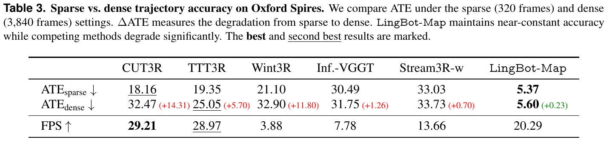

*原论文表 3。相同场景的 320 帧与 3840 帧输入，括号为 ATE 增量，另列在线方法的 FPS。*

稠密设置中，LingBot-Map 的 ATE 从 5.37 变为 5.60 米；CUT3R 从 18.16 变为 32.47 米，WinT3R 从 21.10 变为 32.90 米。这个比较说明模型在该组更长输入上退化较小。帧数增加与采样变密同时发生，且场景路程没有按帧数同比增加，结论应限定在这一评价协议。

3840 帧超过前文约 3000 帧的经验有效范围，仍得到较好结果，说明 3000 不是统一失效阈值。模型实际退化程度还取决于场景、运动与输入采样。

#### 不同场景与动态画面

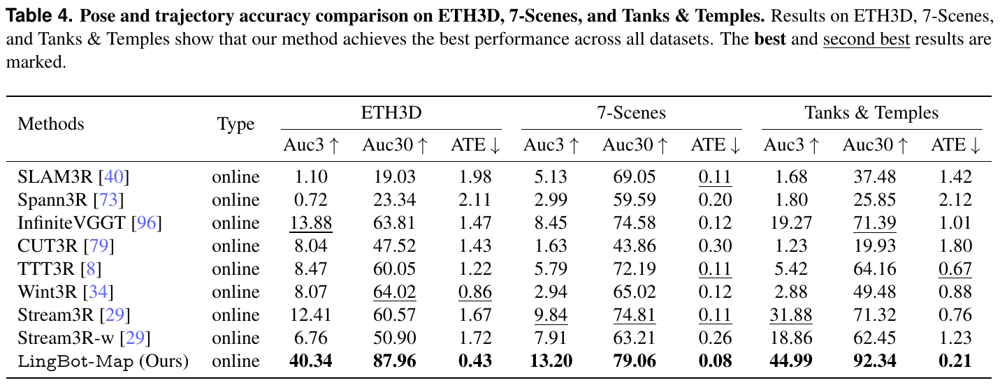

*原论文表 4。比较在线方法在三类场景中的 AUC 与 ATE。*

三个数据集的 ATE 分别为 0.43、0.08、0.21 米，均低于表中在线对照。Tanks and Temples 的 AUC@30 为 92.34，ETH3D 为 87.96，7-Scenes 为 79.06。结果覆盖室内局部、室外结构与不同运动条件，支持模型在这些测试分布上的泛化能力。

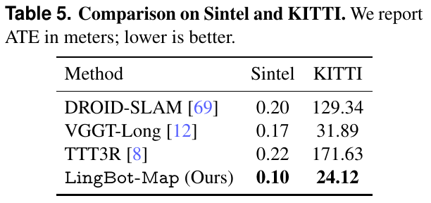

*原论文表 5。报告 ATE，单位为米，越低越好。*

Sintel 与 KITTI 的 ATE 分别为 0.10 与 24.12 米，在表中对照里最低。Sintel 的结果说明相机轨迹估计能够应对测试中的动态干扰，并不表示模型已经将运动物体与静态背景完整分解；动态场景建模仍列在后续方向中。

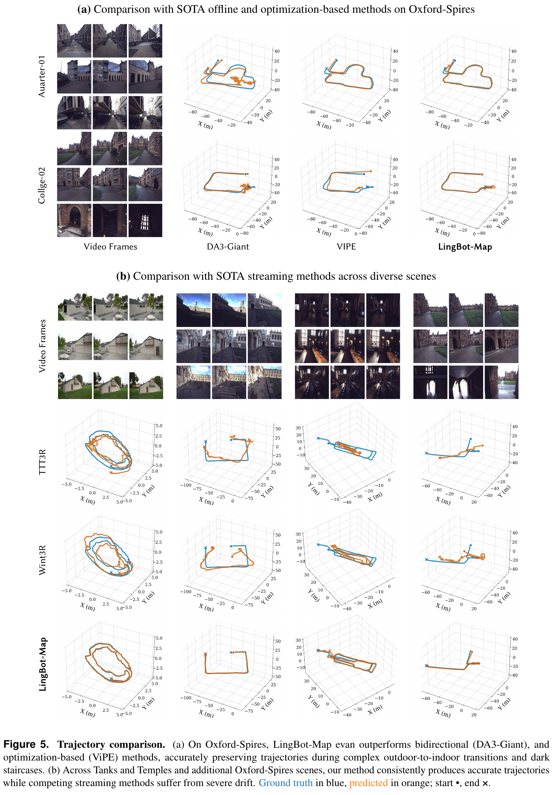

*原论文图 5。上部比较 Oxford Spires 上的离线与优化式方法，下部比较在线方法。蓝色为真值，橙色为预测，圆点和叉号分别标记起点与终点。示例展示场景切换及累计漂移，整体判断以各基准统计为准。*

### 6.3 三维重建

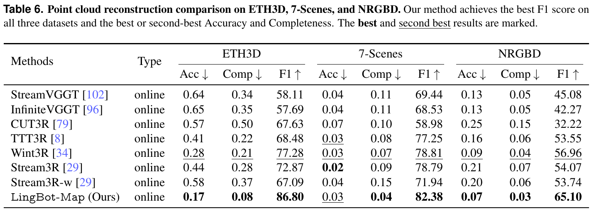

*原论文表 6。ETH3D、7-Scenes 和 NRGBD 的 Accuracy、Completeness 与 F1；对齐、体素和阈值条件见第 5 节。*

LingBot-Map 的 F1 分别为 86.80、82.38、65.10，均为表中最高。ETH3D 的 Accuracy 与 Completeness 为 0.17 和 0.08，WinT3R 为 0.28 和 0.21。7-Scenes 上，LingBot-Map 的 Accuracy 为 0.03，并非低于 STream3R 的 0.02，但 Completeness 与 F1 更好。重建质量需要同时看精度与覆盖，不能只挑一个数字。

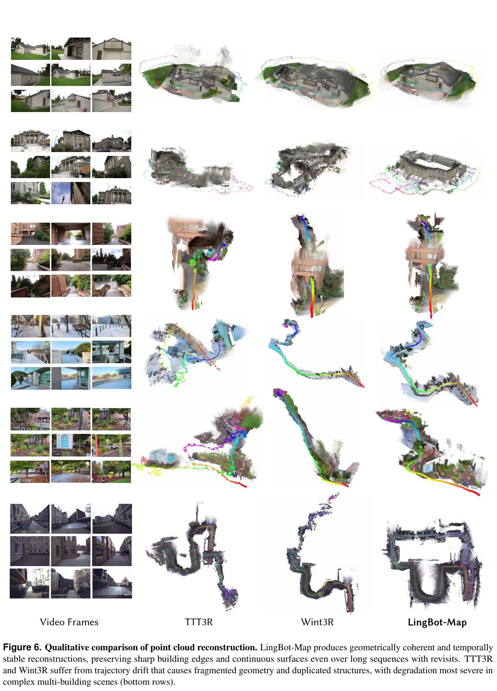

*原论文图 6。依次展示输入、TTT3R、WinT3R 与 LingBot-Map。例子中，轨迹偏差会让同一结构投到不同位置，形成重影、断裂或重复表面；LingBot-Map 的结构更连贯。*

位姿与深度共同决定反投影点的位置，因此重建提升可能来自两者及其一致性。图中结构更完整支持最终系统的几何质量，却不能仅凭点云 F1 将收益全部归因于轨迹记忆一个部件。

### 6.4 消融实验

消融从第一阶段检查点出发，在 TartanAir 与 TartanGround 上单独微调，在 TartanGround 验证集上测试。每段取 320 帧、步长 8，覆盖约 2560 帧的原始时间跨度，使用相同的渐进视图安排；每个实验约需 3840 GPU 小时。它与主实验的数据和预算不同。

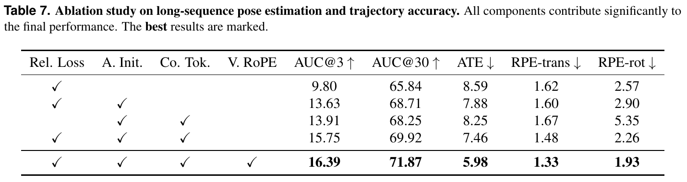

*原论文表 7。Rel. Loss、A. Init.、Co. Tok.、V. RoPE 分别为相对位姿损失、锚初始化、上下文 token 和视频 RoPE。配对行只改变对应因素。*

在保留相对位姿损失的条件下，增加锚初始化使 ATE 从 8.59 降到 7.88，AUC@3 从 9.80 升到 13.63。继续加入紧凑上下文 token，ATE 从 7.88 降到 7.46。前者支持稳定参考的作用，后者支持在锚与局部窗口之间保留中间历史。

比较第 3、4 行可以单独观察相对位姿损失：加入该项后，ATE 从 8.25 降至 7.46，旋转 RPE 从 5.35 降至 2.26。局部配对监督对旋转尤其明显，说明它提供了绝对位姿项之外的有效约束。

加入 Video RoPE 后，ATE 进一步从 7.46 降到 5.98。作者据此强调，紧凑历史需要时间顺序才能充分用于长程估计。这个结论适用于该模型与受控训练设置，不能直接推广到所有流式网络；例如其他结构可能已通过不同机制组织时间。

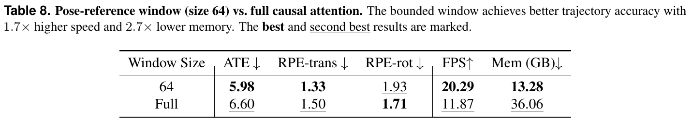

*原论文表 8。窗口 64 保留 GCA 的紧凑旧帧，Full 则保留全部历史图像特征。速度与显存比较需沿用表中的测试条件。*

完整保留时，ATE 为 6.60，速度为 11.87 FPS，显存为 36.06 GB；窗口 64 时分别为 5.98、20.29 FPS、13.28 GB。淘汰旧图像 token 在这里同时改善了整体轨迹与成本。作者将其解释为减少远处冗余信息对注意力的干扰，但旋转 RPE 仍是 Full 略好：1.71 对 1.93。因此，更多稠密历史并非完全无用，只是在总体取舍上不如紧凑结构。

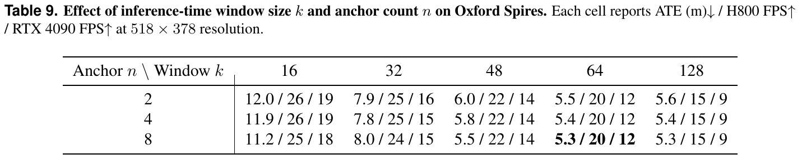

*原论文表 9。Oxford Spires、$518\times378$ 输入。每格依次为 ATE（米）、H800 FPS、RTX 4090 FPS。*

窗口从 16 增加到 48，ATE 改善明显；继续增大到 64、128 后趋于饱和，速度则继续下降。锚数量在 2、4、8 的测试范围内影响较小。默认 $n=8,k=64$ 对应表中约 5.3 米 ATE、H800 20 FPS、RTX 4090 12 FPS。

因此，“约 20 FPS”应连同硬件、分辨率、窗口与缓存实现阅读。表 7、8 的 5.98 和表 9 的约 5.3 还来自不同评价设置，不能直接拼接成同一次实验。关于长序列速度，也需区分 Direct 的紧凑增长、关键帧采样和 VO 的定期重置。

## 7. 结论与讨论

LingBot-Map 将历史保留规则落实到注意力中。完整锚特征提供共同参照，最近帧的完整图像特征支持局部几何，中间帧的六个上下文 token 保留较低成本的轨迹信息。当前帧读取三类来源，经过交替更新，再输出位姿与深度。训练则用开头观测规范尺度，用局部相对位姿约束运动关系，并逐步拉长视图数量与训练轨迹。

实验支持这一组合在所测场景中的长输入鲁棒性，同时也显示它与经典 SLAM 的职责有区别。轨迹记忆没有显式闭环检测，历史输出没有经过全局 BA；Direct 继续运行会增加缓存并可能退化，VO 通过重置限制状态，却增加段间对齐漂移。

论文提出的后续方向包括将类似 BA 的细化与闭环融入注意力、支持畸变相机、处理运动物体，以及引入 LiDAR 或 IMU。当前结果展示了结构化学习记忆的有效性，但可验证的外部尺度、闭环后全局一致性与严格有界状态仍需结合相应机制讨论。

## 附录 A 数据处理与长轨迹构造

### A.1 统一已有数据

多来源训练首先需要统一监督含义。附录将相机位姿转为 camera-to-world，并对不一致的轴约定施加额外变换；深度统一为米与 float32。例如毫米深度除以 1000，厘米深度除以 100。这个步骤统一物理单位，随后才按锚点云进行样本级规范化，两种处理不能混为一项。

数据清洗检查图像、深度和位姿数量是否一致，排除有效帧过少的序列，将 NaN、Inf、过远或异常深度标为无效，并利用天空掩码和几何离群掩码过滤部分数据。统一元数据包含文件路径、内参、帧索引与 $4\times4$ 位姿，缓存后可在多个来源之间共同采样。

### A.2 物体渲染

Objaverse 与 Texverse 资产先规范到 $[-0.9,0.9]^3$，再使用 Blender Cycles 渲染。相机在包围球的不同高度采样并朝向场景中心，水平视场角从 $40^\circ$–$70^\circ$ 采样，输出 $512\times512$ RGB 与度量深度，结合 HDR 环境照明与色调映射。这类短多视图材料主要服务基础几何训练。

### A.3 游戏数据

游戏数据提供长时间、连续运动的相机观测与准确几何标签。采集包含室内外自由行走、返回起点、进出建筑、跨区域转换、动态观景与绕物体运动；覆盖前向、侧向、上下观察及视场角变化，并排除 UI、过场动画和非游戏帧。它扩展了长轨迹与外观分布，但论文没有通过单独数据消融量化其独立收益。

### A.4 将 MatrixCity 组织为连续轨迹

MatrixCity 原有视图按空间覆盖存储，存储次序不一定是连续相机运动。航拍图按网格逐行排列，在行末到下一行起点可能突然跳远。附录将网格看作八邻接图，以随机游走选择相邻视图，并排除刚刚访问的位置以减少立即折返。

原文式（S1）、（S2）分别描述索引转换：

$$
r=\lfloor i/W\rfloor,\qquad c=i\bmod W,
\tag{S1}
$$

$$
\mathrm{idx}=lN_{\mathrm{loop}}+rW+c.
\tag{S2}
$$

$W$ 是网格宽度，$l$ 是完整网格采样轮次，$N_{\mathrm{loop}}$ 是每轮帧数。先在邻接网格上移动，再转换为原始图像索引，即可保留原图和位姿而改变序列顺序。原论文[图 S1 与算法 1](https://arxiv.org/pdf/2604.14141v3#page=27)给出了拓扑与流程。

街景数据按街道和视角分组，直接串接也会造成位置或朝向跳变。作者先利用相机位置重复识别街道边界，再把街道简化为平面线段，检测交点，构建道路连接图。随机游走接近路口时以 0.5 概率换街道，死路反向；切换时选与当前前向方向最接近的视角：

$$
v^*=\operatorname*{arg\,max}_{v\in\{0,\ldots,4\}}
 f_{\mathrm{curr}}\cdot f_v.
\tag{S3}
$$

$f$ 为相机前向单位向量。这个选择尽量保持视线连续，使跨街道序列能够训练逐步扩展的观察，而非无规律跳图。街道识别和路径转换见原论文[图 S2 与算法 2](https://arxiv.org/pdf/2604.14141v3#page=28)。

### A.5 渲染跨房间行走

已有室内 RGB-D 视频多限于一间房或局部区域，无法充分提供穿过走廊、进入下一房间的训练信号。作者使用 Habitat-Sim，从 Gibson、Matterport3D 与 HM3D 的建筑重建中生成跨区域路径。

先计算可行走导航网格，采样相邻测地距离至少 2 米的路径点，再以网格上的最短路径连接，使路径经过门口和走廊。路径段数采用混合分布：40% 取 5–8 段，45% 取 8–12 段，15% 取 12–16 段，分别覆盖不同规模的探索。插值、平滑与投影回导航网格保持连续性和可行走性。

运动控制进一步限制平移变化，朝向提前约十帧的路径目标，并加入过滤后的手持抖动与随机侧视、上下看。视场角在 $40^\circ$–$100^\circ$、相机高度在 1.35–1.80 米、速度在 0.3–1.8 米/秒之间变化。输出为 $640\times480$、30 FPS 的 RGB、米制深度、相机位姿与内参。

附录报告约 2800 条序列、14.4 TB 数据，并在[图 S3](https://arxiv.org/pdf/2604.14141v3#page=30)展示路径和点云。轨迹生成段落称单条通常约 500–3000 帧，最终输出统计又称每条 1000–5000 帧；两处口径未进一步统一。这里保留这一差别，不据此推算精确总帧数。

## 参考资料

- Lin-Zhuo Chen, Jian Gao, Shangzhan Zhang, Yihang Chen, Ka Leong Cheng, Yipengjing Sun 等。*LingBot-Map: Geometric Context Transformer for Streaming 3D Reconstruction*. arXiv:2604.14141v3, 2026。[论文页](https://arxiv.org/abs/2604.14141v3) · [PDF](https://arxiv.org/pdf/2604.14141v3)。正文方法、训练、图表与数据整理依据这一版本。
- [LingBot-Map 官方仓库](https://github.com/robbyant/lingbot-map)。相关工作和损失引用的原始条目见论文参考文献。
