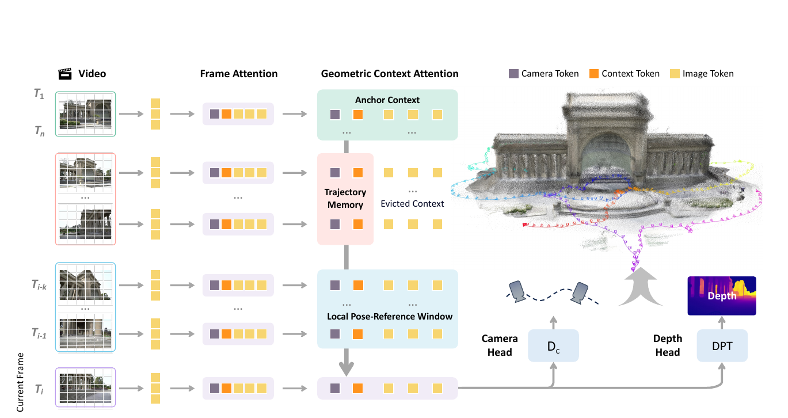
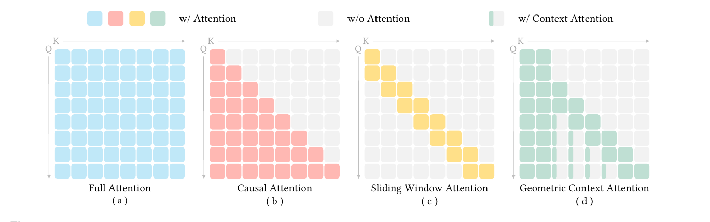

# LingBot-Map：流式三维重建怎样记住一条长轨迹

> 本文解读 Lin-Zhuo Chen 等人的 *LingBot-Map: Geometric Context Transformer for Streaming 3D Reconstruction*（arXiv v3，2026）。它研究的是视频一帧帧到来时，如何持续预测相机位姿与深度，同时保留足够的历史，又不让所有旧图像特征挤满显存。我们从一条短轨迹走过三种几何上下文，接着看网络、监督、两种推理模式与实验。附录的数据制作只讨论它对长轨迹训练的作用。[论文](https://arxiv.org/abs/2604.14141) · [PDF](https://arxiv.org/pdf/2604.14141v3) · [项目](https://github.com/Robbyant/lingbot-map)

相机从广场走进楼里，经过几段走廊后又回到广场。若要边走边建图，新帧到来时只能用过去的画面；刚出门的画面也许还决定着整条轨迹的坐标系，但与当前画面直接重叠的，很可能只是上一两秒拍到的墙角。把每一帧的完整特征永久留下，注意力的计算和缓存会随视频变长；只记住最近几帧，又会丢掉早先建立的参考。

LingBot-Map 的选择是给历史分工。开头少量帧保留完整特征，充当坐标参考；最近一段帧也保留完整特征，用来寻找局部几何联系；更早的中间帧只留下少数压缩后的 token，记录轨迹经过了哪里。这套跨帧读取规则叫 **Geometric Context Attention**（GCA）。它嵌在一个逐帧预测相机位姿和深度的 Transformer 里，论文把整个模型称为 **Geometric Context Transformer**（GCT）。

若你读过站内的 [StreamRig](../streamrig/index.md)，两篇文章都面对流式模型怎样使用历史的问题。StreamRig 的输入是**同一时刻的一组已标定相机**，重点是组内几何和跨组运动；LingBot-Map 从单路连续图像出发，重点是如何为位姿与稠密深度保留不同粒度的历史。两者的“锚”也不能直接当成同一个实现。

## 一帧进来，究竟要交出什么

设视频为 $I_1,I_2,\ldots$。第 $t$ 帧到来时，模型只能读取 $I_1$ 到 $I_t$，输出该帧的相机位姿 $\hat P_t$ 和深度图 $\hat D_t$。论文用 **camera-to-world** 位姿表示 $P_t$：它把相机坐标系里的点变换到同一场景坐标系。深度给出像素所见表面的距离，位姿决定这些局部表面在共同坐标系里的位置。若 $D_t(u)$ 表示相机光轴方向的深度、$K$ 是内参，通常的反投影关系是 $X_w=R_t\bigl(D_t(u)K^{-1}\tilde u\bigr)+t_t$，其中 $R_t,t_t$ 是 $P_t$ 的旋转和平移，$\tilde u$ 是像素齐次坐标。这个式子说明位姿与深度怎样用于构建点云；论文网络直接预测的是位姿和深度，没有另设可微的点云融合后端。

这里的“流式”有严格的时间含义：预测 $t$ 时不能看 $t+1$。离线模型可以同时读完整段视频，借后来的画面修正前面的判断，因而两者的运行条件不同。传统 SLAM 通常保留关键帧、地图与优化问题；纯前馈流式模型则希望一次向前计算就给出当前预测。困难不在于能否做因果掩码，而在于**因果状态里到底该存什么**。

看一个用于讲解的小例子：用第 1、2 帧初始化，局部窗口大小暂设为 2；现在第 6 帧到来。它可读取第 1、2 帧的完整特征，也可读取第 4、5 帧的完整特征。第 3 帧已经离开局部窗口，却仍在第 6 帧与锚之间；模型把它留下的少数 token 作为轨迹记忆。第 7 帧到来时，第 4 帧也变成紧凑记忆，第 5、6 帧成为新的局部窗口。下面所有模块都沿这条时间线解释。这里的 $n=2,k=2$ 只为讲清缓存迁移，不是论文默认设置。

先看原论文图 4。左侧每行是一帧，颜色区分相机 token、上下文 token 和图像 token；横向是“编码图像 → 帧内注意力 → 按三种历史读跨帧上下文 → 位姿与深度输出”。图中浅绿色、粉色、浅蓝色区域分别对应锚、被压缩的旧帧、最近窗口。先抓住这条路径，右侧点云是输出的可视化效果。

*图 1　裁自原论文图 4。当前帧读取三种历史信息，位姿头读取相机 token，深度头读取图像 token。图里“Evicted Context”的图像 token 被丢弃，只保留紧凑上下文。*

## 三种历史各留下什么

### 开头几帧：给整条轨迹一个共同参照

单目视频存在尺度不确定性：只从投影关系出发，把场景距离和相机平移同时放大相同比例，图像仍可相同。因此模型先联合处理前 $n$ 帧，让它们彼此充分交换信息，再将这批帧作为后续预测一直能读到的**锚上下文**。锚帧的图像 token 与上下文 token 都留在缓存中。每帧还带一个可学习的锚 token；初始化帧与后续流式帧使用不同的锚 token 初值，告诉模型各自处于什么角色。

锚决定的是**本次重建内部一致的尺度与坐标参照**，并不凭单目图像凭空恢复了物理世界的米制尺度。训练时，作者取锚帧对应真值点云 $\bar X_{\rm anchor}$ 到坐标原点的平均距离

$$
s=\frac{1}{|\bar X_{\rm anchor}|}\sum_{x\in\bar X_{\rm anchor}}\|x\|_2,
$$

再用 $s$ 除真值深度和相机平移。这样每条训练序列的监督都落在由开头观测确定的规范尺度附近。推理时没有真值点云可算这个 $s$；模型是在训练中学会沿用初始化帧建立的尺度。这个区分很要紧：论文说“固定尺度”，指重建过程内部的尺度一致性，而非无外部信息的绝对测距。

### 最近的帧：保留能对齐细节的稠密线索

第 6 帧与第 1 帧可能已经看不到同一片墙。锚能够提供全局参照，却未必能直接支持当前帧的精细配准；第 4、5 帧通常更有视野重叠。于是模型让最近 $k$ 帧保留**全部图像 token**，称为**局部位姿参考窗口**。新帧可以在跨帧注意力里读取这些稠密特征，用于估计相邻视角间的几何关系和当前深度。

窗口里的帧以学习特征的形式供当前帧注意力读取。论文没有在这里运行传统 BA、显式匹配或三角化；训练时另以窗口内的相对位姿监督局部运动一致性。因此它既是近距离视觉线索，也是位姿预测的局部参考。

### 中间的旧帧：只留下六个 token

第 3 帧离第 6 帧不近，完整图像 token 在当前局部几何估计中未必划算；完全删除它，又让锚与局部窗口之间断了历史。LingBot-Map 对每个退出窗口的旧帧留下 **1 个相机 token、1 个锚 token、4 个 register token**，合计 6 个，丢弃该帧约 $M\simeq500$ 个图像 token。register token 是随注意力层流动的共享工作空间，不由输出头单独解码。留在缓存中的这些 token 是网络从那一帧及其过去上下文中学到的紧凑表示；论文没有把它们定义为显式三维点、闭环约束或已优化的位姿图。

保留下来的 token 加上视频时间位置编码，使模型知道旧信息出现在轨迹的什么先后位置。这些信息可以帮助减小漂移；模型并没有检测重访地点并施加显式闭环约束，因而不能保证漂移消失。

原论文图 3 的横轴是可被读取的 key，纵轴是发起读取的 query。最右图里，左侧两列的锚始终可见，临近对角线的完整色块是局部窗口，中间细窄的绿色条则表示旧帧只留下上下文 token。理解“细条为什么还在”比记住 GCA 缩写更重要。

*图 2　裁自原论文图 3。自左至右：全局、因果、滑动窗口、GCA。GCA 让旧帧退出稠密窗口后留下窄条，而不继续保存整块图像特征。*

## 第 6 帧在网络里走一遍

每帧先由 DINOv2-Large 图像主干提取 $M$ 个图像 token，再附加相机 token、四个 register token 和锚 token。随后网络交替执行两类注意力：**帧内注意力**只处理当前帧内部，整理局部视觉特征；**GCA**依照图 2 的掩码跨帧读取锚、旧帧的紧凑记忆和最近窗口。相机头从相机 token 预测位姿；深度头从图像 token 预测稠密深度。基础模型使用 24 个交替注意力块，流式阶段把其中的跨帧全局注意力换成 GCA。

回到第 6 帧：图像编码器产生它自己的 token。跨帧层里，它从第 1、2 帧读取稳定参照，从第 4、5 帧读取仍有局部重叠的稠密内容，也能从第 3 帧留下的六个 token 读取较早的轨迹线索。不同层的 token 会反复被更新：第 6 帧这一层读取的是过去已经形成的 key/value 状态；不能把“读历史”误解成能回头重算所有旧帧、再用未来帧修订它们。预测完成后，第 6 帧自己的状态进入缓存，等第 7 帧到来时供其读取。窗口继续移动，第 4 帧的图像 token 被逐出，只留下六个上下文 token。

这种取舍可用 token 数算清。设已经处理 $T$ 帧，每帧有 $M$ 个图像 token 和 6 个上下文 token；$n$ 个锚帧、$k$ 个窗口帧保留完整表示，其余旧帧只留 6 个。那么一次新帧能读到的历史规模约为

$$
\underbrace{(n+k)(M+6)}_{\text{锚与窗口}}
+\underbrace{(T-n-k)6}_{\text{轨迹记忆}}
=(n+k)M+6T.
$$

若保留所有历史帧的完整特征，则是 $T(M+6)$。以论文举的 $M\approx500,n=3,k=16,T=10{,}000$ 为例，完整因果缓存约 $506$ 万 token，GCA 约 $6.95$ 万 token。**省掉的是每个旧帧的大块图像 token；六个轨迹 token 仍随帧数线性增加。**因此论文所称的“近乎恒定每帧开销”是一种实用量级描述，并非严格 $O(1)$：若不再选帧或重置，长期上下文、缓存占用和读取成本仍随 $T$ 增长，只是斜率从约 $M+6$ 降到 6。论文正文与结论分别用约 70 倍、80 倍概括增长率；按 $M\approx500$ 直接相除约为 84 倍，取决于实际 token 数和统计口径，不能当成某台 GPU 的实测加速倍数。

计算少了历史冗余，缓存更新却仍有工程成本：窗口移动时要追加当前帧、逐出旧图像 token。论文用分页 KV 缓存避免连续内存布局频繁搬动。在 $518\times378$、最长 1000 帧、窗口 64 帧的设置下，FlashInfer 实现约 20 FPS；对照的连续缓存 PyTorch 实现约 10.5 FPS。这里比较的是**相同模型的缓存实现**，不能把它直接解释成 GCA 相对另一种算法的全部速度收益。

## 两阶段训练怎样让“短片段几何”变成长轨迹能力

如果一上来就训练几百帧，早期位姿错一点，后续相对关系和绝对位置都会被牵连，优化很难稳定。作者先训练一个能处理短多视图输入的基础模型：DINOv2-Large 初始化图像主干，后接 24 个交替的帧内与全局跨帧注意力块；一次取 2 到 24 张图像，使用全局注意力，不要求这些视图有时间先后。这个阶段既见无序多视图，也见视频，目标是学会常见场景的位姿与深度几何。论文报告 160K 次迭代、64 卡约两周，约 21,500 GPU 小时。

第二阶段从该基础模型的权重出发，将跨帧全局注意力替换为 GCA。两者的 query/key/value 投影参数形式相同，因此已学会的投影可以直接迁移。训练视图数从 24 逐步增加到 320，窗口大小在 16 到 64 间采样；长序列注意力用 16 路上下文并行分布到多卡。这一阶段也是 160K 次迭代，论文报告 64 卡约一周。训练上限 320 帧是资源约束和课程安排，不是模型推理时只能看 320 帧。

监督如何接到第 6 帧？训练样本有真值相机位姿和深度。第 6 帧的预测深度要与该帧真值深度比较，预测的 camera-to-world 位姿要与规范尺度下的真值位姿比较；第 4、5、6 帧若同在受监督的局部窗口，模型还要使它们之间的相对运动合理。论文把总损失写成

$$
\mathcal L=\lambda_D\mathcal L_D+\lambda_A\mathcal L_A+\lambda_R\mathcal L_R.
$$

深度项沿用 VGGT 的逐像素深度和深度梯度误差，并引入预测的不确定性；绝对位姿项约束各帧输出；新增的相对位姿项对窗口内有序帧对取平均：

$$
\mathcal L_R=\frac{1}{k(k-1)}
\sum_{\substack{i,j\in\mathcal W\\i\ne j}}
\left[\mathcal L_{\rm rot}(i,j)+\lambda_{\rm trans}\mathcal L_{\rm trans}(i,j)\right].
$$

$\mathcal W$ 是这次训练的 $k$ 帧局部窗口，分母就是其中有序不同帧对的数目。$\mathcal L_{\rm rot}$ 是相对旋转的测地误差，$\mathcal L_{\rm trans}$ 是相对平移的 $\ell_1$ 误差。用 camera-to-world 约定，$P_i^{-1}P_j$ 表示把第 $j$ 帧相机坐标转到第 $i$ 帧相机坐标；这只是为了看清“相对位姿”由哪两个绝对位姿组成。若只要求每帧靠近各自真值，模型仍可能在相邻帧之间产生较大的运动抖动；相对项给局部运动一条直接的监督。它约束的是训练中的预测，推理时没有真值，也不会运行这个损失。

训练材料也服务于这个目标。第一阶段广泛使用无序多视图、短视频和物体数据；第二阶段加重 TartanAir、TartanGround、MatrixCity、ScanNet 等长轨迹视频的采样，还从 Gibson、Matterport3D、HM3D 的建筑场景渲染跨房间行走序列。附录详细说明了如何统一坐标与深度单位、把 MatrixCity 的网格或分街道视角重新组织成连续路径，以及如何沿可行走区域生成跨房间轨迹。可见长程能力不只来自注意力掩码，训练时有没有真正走出一个房间、穿过街口的序列同样重要。论文没有公开足以让我们逐项归因的数据消融，不能把所有提升都算到某一种训练材料上。

## 视频超过训练长度以后怎么办

论文把推理分成 **Direct** 和 **VO** 两种模式。Direct 连续使用同一组锚和同一个缓存，逐帧输出在共同坐标系里的位姿与深度。序列超过训练时的 320 帧后，可以按固定间隔只让部分帧成为缓存中的关键帧，控制上下文增长；非关键帧仍可得到逐帧预测。作者报告这种方式在约 3000 帧内仍较稳定，之后质量逐渐下降。这里的“关键帧”按固定步长选择，不是依据信息增益或回环检测自适应选取。

更长的视频采用 VO 模式：把输入分成相互重叠的局部段，每段先用一小批帧建立自己的尺度与坐标系，后续帧按 GCA 因果推理；段结束就重置状态。相邻段的共同区域提供对应关系，再估计一个 Sim(3) 相似变换，把两个局部轨迹的尺度、旋转和平移接起来。Sim(3) 多出的尺度自由度正好处理不同段独立初始化的尺度差异。它能让缓存大小有界地处理数万帧，但每跨过一个段边界，就多一次对齐误差；论文明确指出 Direct 通常更准，VO 为超长序列付出额外漂移。官网展示的超过一万帧的结果应按这种长序列工作方式理解，不能推断单个不重置的锚和缓存独立覆盖了全部一万帧。

“纯前馈”描述的是**段内网络预测无需测试时梯度更新或 BA**。VO 模式的段间 Sim(3) 是额外的几何对齐，给总轨迹带来另一种误差来源。

## 实验真正支持了哪些判断

先说明指标。论文的 AUC@角度阈值衡量相对位姿误差在阈值范围内的整体表现，越大越好；ATE 衡量整条预测轨迹与真值在 Sim(3) 对齐后的偏差，单位是米，越小越好；RPE 更偏向局部相邻运动。点云 F1 则在一定空间距离阈值下综合精确率与完整率。**ATE 做过 Sim(3) 对齐**，所以它检验的是轨迹形状和一致性，不能单凭该数字证明模型恢复了无外部参照的米制尺度。点云比较也先做了 Umeyama 对齐，再做 ICP；不同数据集使用不同的 F1 距离阈值，因此跨数据集的 F1 数字不宜直接相减比较。

在 Oxford Spires 的 320 帧稀疏设置里，论文表 2 给出 LingBot-Map 的 AUC@15 为 63.22、ATE 为 5.37 m；同表 DA3 为 49.84 和 12.87 m，在线方法 Wint3R 为 11.61 和 21.10 m。该表混合了离线、优化式和在线方法：数字说明它在这组评估协议下表现很强，但离线方法能读未来帧，运行条件并不相同。

论文表 3 将同一数据集从抽样 320 帧换成完整 3840 帧。下表只摘录 ATE，便于观察轨迹变长、采样变密后的变化。

| 在线方法 | 320 帧 ATE（m）↓ | 3840 帧 ATE（m）↓ |
| --- | ---: | ---: |
| CUT3R | 18.16 | 32.47 |
| Wint3R | 21.10 | 32.90 |
| LingBot-Map | 5.37 | 5.60 |

两种设置同时改变了帧数和采样密度，不能把差别归因于单一变量；但在这组更长、更密的轨迹上，LingBot-Map 没有出现同等幅度的退化。

其它场景给出不同尺度的检验。论文表 4 中，ETH3D、7-Scenes、Tanks and Temples 的 ATE 分别为 0.43、0.08、0.21 m，均低于同表在线对照；表 5 的动态 Sintel 与 KITTI 分别为 0.10、24.12 m。点云表 6 中，ETH3D、7-Scenes、NRGBD 的 F1 分别为 86.80、82.38、65.10，均是该表最高。这里的点云成绩同时受位姿和深度影响，不能仅凭表 6 把提升归因到“记忆机制”一个因素。

消融给出了分辨组件作用的证据。表 7 在 TartanAir/TartanGround 的单独微调与验证设置下，逐步加入锚初始化、六个上下文 token、相对位姿损失和视频时间位置编码。加入锚后 ATE 从 8.59 降至 7.88；在有锚和相对损失的设置上再加入上下文 token，从 7.88 降至 7.46；再加视频时间编码降至 5.98。去掉相对损失时，旋转 RPE 从 2.26 升到 5.35。这些结果支持各组件在该受控设置下有贡献。最终模型的 5.98 与 Oxford Spires 表 2 中的 5.37 来自不同的数据和训练协议，不能直接并列比较。

表 8 比较局部窗口 64 与保存全部旧图像 token 的因果注意力：窗口方案 ATE 为 5.98，全部保留为 6.60；速度为 20.29 对 11.87 FPS，显存为 13.28 对 36.06 GB。全部保留方案在旋转 RPE 上反而略好（1.71 对 1.93），说明“删掉旧图像 token”不是每个局部指标都获益。表 9 进一步显示，窗口从 16 增至 48 时 ATE 改善明显，继续增大到 64 或 128 后趋于平缓，速度仍继续下降；锚帧数量在测试范围内影响较小。论文据此采用 $k=64,n=8$ 的默认选择，在 H800 上约 20 FPS，在 RTX 4090 上约 12 FPS（$518\times378$）。速度必须连同硬件、分辨率、窗口和实现一起看。

## 这项工作的边界

LingBot-Map 把历史拆成三种用途，并把分工落实为注意力可见范围和缓存淘汰规则。锚帧提供共同参照；近邻的完整特征支持局部几何；中间帧的少量 token 延续轨迹信息。训练再用锚规范化、绝对位姿与窗口内相对位姿监督，以及逐步拉长的真实或合成轨迹，让模型学会使用这三种信息。在论文的长序列基准上，这样的设计取得了有竞争力的位姿和点云结果。

边界也清楚：没有显式闭环检测，没有测试时 BA；压缩成六个 token 的旧帧不可能保留其全部视觉细节；Direct 超过有效长度会逐渐退化，VO 分段对齐又会累积边界误差。动态场景和相机畸变也没有作为完整建模问题解决。若应用要求可验证的米制尺度、闭环后全局一致的地图，或在极长视频上严格有界且不重置的状态，还需要额外机制。论文展示的是一条有效的取舍路径，而不是把传统几何系统的所有职责都交给一次前向传播。

## 参考资料

- Lin-Zhuo Chen 等，*LingBot-Map: Geometric Context Transformer for Streaming 3D Reconstruction*，arXiv:2604.14141v3，2026。[论文页](https://arxiv.org/abs/2604.14141) · [PDF](https://arxiv.org/pdf/2604.14141v3)。本文方法、训练、实验数字和图均据该版本核对。
- [LingBot-Map 官方项目](https://github.com/Robbyant/lingbot-map)：推理模式和长视频演示的实现说明。
