# LoFTR 论文解读

> Jiaming Sun、Zehong Shen、Yuang Wang、Hujun Bao 与 Xiaowei Zhou，*LoFTR: Detector-Free Local Feature Matching with Transformers*，CVPR 2021，页码 8922–8931，10 页。[论文页面](https://openaccess.thecvf.com/content/CVPR2021/html/Sun_LoFTR_Detector-Free_Local_Feature_Matching_With_Transformers_CVPR_2021_paper.html) · [论文 PDF](https://openaccess.thecvf.com/content/CVPR2021/papers/Sun_LoFTR_Detector-Free_Local_Feature_Matching_With_Transformers_CVPR_2021_paper.pdf) · [补充材料 PDF](https://zju3dv.github.io/loftr/files/LoFTR-suppmat.pdf) · [项目页](https://zju3dv.github.io/loftr/)

## 1 引言

局部特征匹配要在两幅图像中找出同一场景位置的对应点。SfM、SLAM、相机位姿估计和视觉定位都会用到这一步。经典流程先在每幅图里检测角点等显著位置，再计算局部描述子，最后跨图搜索描述子相似的点。检测器减少了待匹配点数，通常能提供足够的稀疏对应；但低纹理墙面、重复图案、模糊或明显视角变化都可能让检测器在两幅图中找不到可重复的点。

LoFTR 针对的正是“没有稳定关键点可供匹配”的情况。它不先挑出少量兴趣点，而是让卷积网络在图像网格上提取稠密局部特征，在较粗分辨率上建立候选对应，再把可信候选细化到更高分辨率。论文称其为 detector-free，即不依赖一个独立的关键点检测器来决定哪些位置有资格参与匹配。

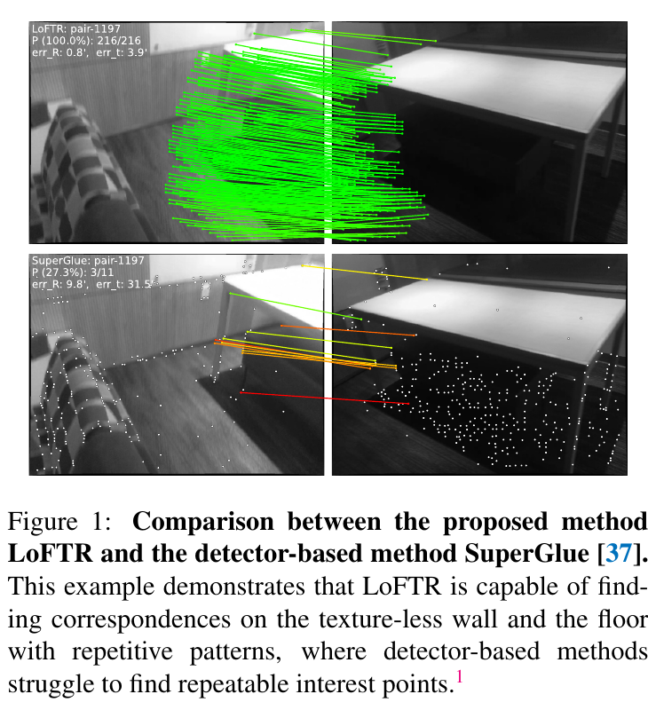

*原论文图 1。上方为 LoFTR，下方为依赖 SuperPoint 检测点的 SuperGlue。图中绿色线是经过 RANSAC 后保留的内点匹配；LoFTR 在墙面和重复纹理地面上找到了较多对应。*

> 检测器的工作是先回答“哪些位置足够显著，值得拿来匹配”。白墙上缺少角点时，这一步就可能没有可用位置；即使后面的描述子非常准确，也无法找回从未被选出来的点。LoFTR 把参与匹配的位置铺到特征网格上，再让特征从图像整体上下文中获得辨别力，因此能尝试在显著性较弱的区域建立对应。

这里的“稠密”指模型在特征网格上考虑大量位置，并不意味着最终输出每个像素的对应。LoFTR 会依据置信度和互为最近邻条件筛选粗匹配，再对这些匹配做局部细化；作者因此也把它称为 semi-dense matching。最后得到的是一组较密集的点对，几何估计仍可用 RANSAC 等方法完成。

论文的关键想法是把 Transformer 的全局信息交互用于两幅图的特征匹配。卷积特征擅长描述邻近图像结构，但仅靠局部窗口，白墙上的一个位置很难单独说明自己对应哪里。自注意力让同一幅图的特征查看其他位置，交叉注意力让一幅图的特征读取另一幅图的信息；加入位置编码后，特征既带有外观上下文，也保留所在位置。全局交互先帮助模型形成粗对应，局部相关性再负责把位置校准得更精确。

## 2 相关工作

论文将已有局部匹配方法概括为两类。检测器方法先从图像中选点，再匹配点描述子；SuperGlue 在 SuperPoint 等检测点之上，用图神经网络和注意力学习点间匹配关系。它可以有效利用已检测特征之间的上下文，但匹配范围仍受检测器输出限制。

不依赖检测器的方法直接在稠密特征或特征网格上建立对应。NCNet 一类方法构造四维代价体，表达两幅图位置组合的匹配分数，再用卷积聚合邻域一致性。LoFTR 同样使用稠密对应，但把关键上下文建模交给 Transformer：自注意力和交叉注意力能在全局范围传递信息，而不必只依赖局部代价体中的邻域。

## 3 方法

### 3.1 局部特征提取

输入是一对图像 $I^A$、$I^B$。两幅图经过共享权重的卷积特征网络与特征金字塔网络（FPN），分别得到两种分辨率的特征：粗层特征 $\tilde F^A,\tilde F^B$ 的空间分辨率约为原图的 $1/8$，细层特征 $\hat F^A,\hat F^B$ 约为原图的 $1/2$。粗层供全局匹配使用，细层保留更多空间细节，留待后续定位修正。

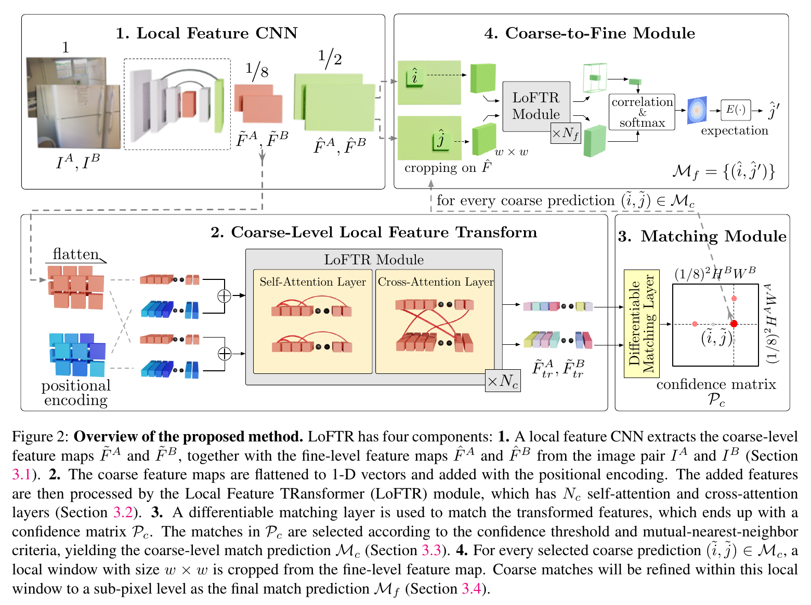

*原论文图 2。图像先生成 $1/8$ 与 $1/2$ 两级特征；粗层经过位置编码、LoFTR Transformer 和匹配层，筛出粗匹配；细层围绕每个粗匹配裁出局部窗口，经局部特征变换与相关性计算，得到最终点对。*

### 3.2 局部特征 Transformer

粗层特征图先展平成序列，再加上二维正弦位置编码。加位置编码的原因是：若两个位置的局部纹理都很弱，仅看外观特征难以区分；位置编码让特征知道自己在图像中的坐标。Transformer 处理后，特征由局部描述变成依赖图像上下文和位置的表示。

注意力的计算可以写成

$$
\operatorname{Attention}(Q,K,V)=\operatorname{softmax}(QK^\mathsf T)V.
$$

其中 $Q$（query）表示当前特征想查询什么，$K$（key）用于计算各位置与查询的相关程度，$V$（value）是可被汇总的信息。$QK^\mathsf T$ 得到查询位置与所有候选位置的相似分数；softmax 把分数变成权重，再用这些权重对 $V$ 加权求和。于是，输出特征可以吸收与自己相关的位置的信息。

在**自注意力**层中，$Q,K,V$ 都来自同一幅图。每个位置可以汇总本图其他位置的上下文，例如墙面位置可以结合它相对于门框、桌沿等结构的位置来形成更有辨别力的表示。在**交叉注意力**层中，查询来自一幅图，而键和值来自另一幅图；它让两幅图的特征直接交换信息，形成针对当前图像对的描述。论文将自注意力与交叉注意力交替堆叠，粗层使用 $N_c=4$ 层。

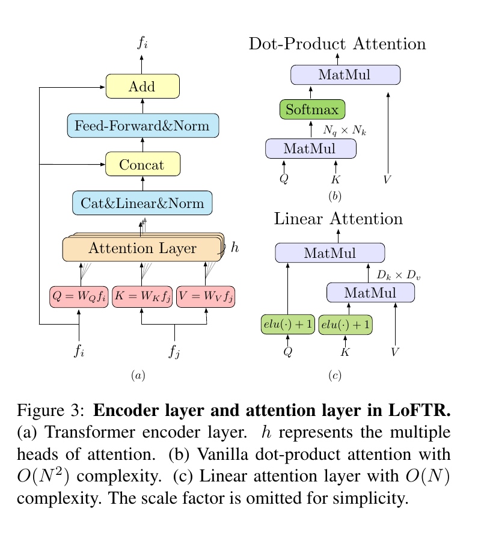

*原论文图 3。左图是 LoFTR 编码层，包含注意力、前馈网络与残差连接；中图为标准点积注意力；右图为将计算复杂度降至线性量级的注意力形式。*

标准点积注意力需要计算所有 $N$ 个查询与 $N$ 个键之间的分数，计算量随序列长度按 $O(N^2)$ 增长。粗层网格已经比原始像素少，但两张图合起来仍有较多位置。LoFTR 使用线性注意力形式，将相似度核写为 $\phi(Q)\phi(K)^\mathsf T$，其中 $\phi(x)=\operatorname{elu}(x)+1$。利用矩阵乘法结合律，可以先计算 $\phi(K)^\mathsf T V$，再与 $\phi(Q)$ 相乘；在特征维度远小于序列长度时，这样避免显式构造完整的 $N\times N$ 注意力矩阵，把关于序列长度的计算量降为线性级别。

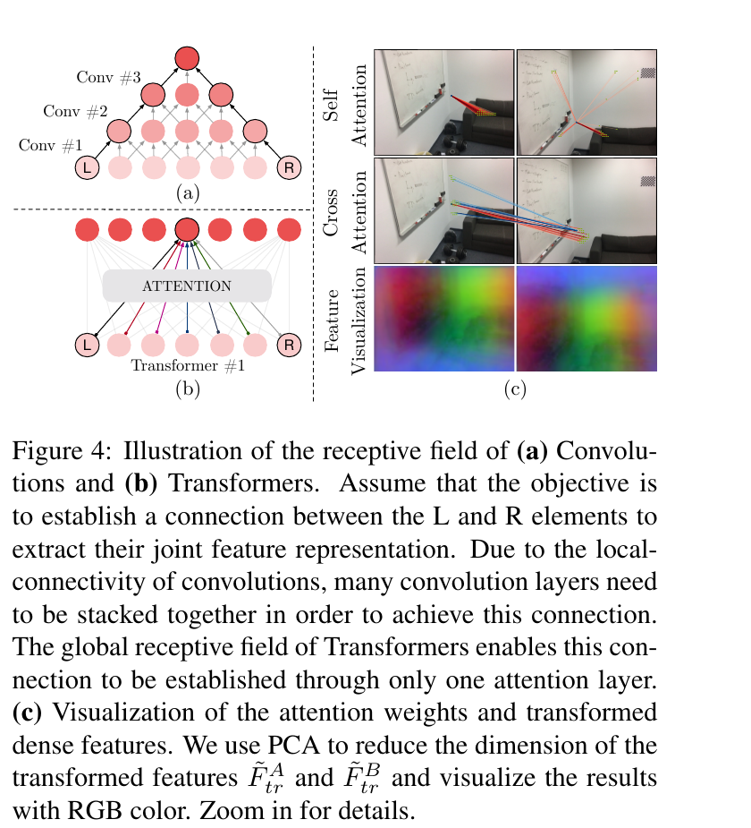

*原论文图 4。卷积需要逐层扩大感受野，Transformer 的一次注意力运算即可连接远距离位置；右侧的注意力可视化显示低纹理查询能聚合周边结构信息，PCA 特征图则呈现位置相关的特征变化。*

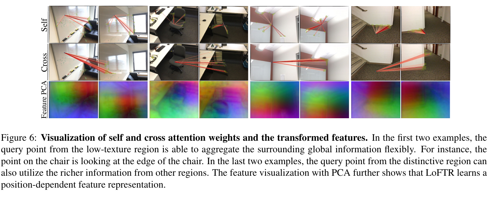

*原论文图 6。上两行显示模型在图像中的查询位置如何通过自注意力、交叉注意力读取周边结构；底行是特征经 PCA 降到 RGB 后的可视化。论文指出，低纹理位置的查询可以聚合邻近的显著结构信息。*

> 低纹理位置的“特征不够显著”可以理解为：单独观察它周围的小块区域，可能看不出它与另一幅图哪个位置对应。LoFTR 先让这个位置参考同图中更有区分度的区域，再通过交叉注意力读取另一幅图的上下文。注意力不是把一个物理点沿着图像移动，而是在更新特征表示时聚合相关位置的信息；最后的匹配层才把表示转换为坐标对应。

### 3.3 建立粗层匹配

经过 Transformer 后，$\tilde F^A_{tr}$ 与 $\tilde F^B_{tr}$ 是带有上下文的粗层特征。模型计算跨图特征的相似度矩阵：

$$
S(i,j)=\frac{1}{\tau}\left\langle \tilde F^A_{tr}(i),\tilde F^B_{tr}(j)\right\rangle,
$$

其中 $i$、$j$ 分别是两幅图的网格位置，$\tau$ 是温度参数。$S(i,j)$ 越大，代表这两个网格的特征越相似。论文考察了两种可微匹配方式：最优传输（OT）和双向 softmax（dual-softmax）。以双向 softmax 为例，先分别沿行和列归一化：

$$
P_c(i,j)=\operatorname{softmax}(S(i,\cdot))_j\;\operatorname{softmax}(S(\cdot,j))_i.
$$

第一项衡量 $j$ 对 $i$ 来说有多合适，第二项衡量 $i$ 对 $j$ 来说有多合适。两项相乘会偏好彼此都选择对方的配对。随后模型保留置信度不低于阈值 $\theta_c$ 的互为最近邻，形成粗匹配集合 $M_c$。因此，粗层不是简单地把每个网格都强行配给一个目标点；没有足够把握或存在更好竞争候选的位置可以被筛掉。

OT 与 dual-softmax 是粗匹配层可替换的两种选择，不是先后执行的两个步骤。OT 通过部分分配处理整体匹配关系，dual-softmax 则通过行列双向归一化表达软互为最近邻。论文报告两者在室内表现相近，dual-softmax 在 MegaDepth 室外位姿评估上更好一些。

### 3.4 从粗匹配细化到亚像素位置

粗层每个网格代表原图上一片区域，所以粗匹配的坐标还不够精确。对每个 $(\tilde i,\tilde j)\in M_c$，LoFTR 在两幅图的细层特征中找到对应中心位置，并各自裁出大小为 $w\times w$ 的局部窗口。论文实现中 $w=5$。实现会先把变换后的粗层特征上采样，并与细层特征拼接；然后围绕粗匹配裁出局部窗口，送入一个较小的 LoFTR 模块（细层使用 $N_f=1$ 层）。模块更新窗口特征后，模型计算 A 图中心特征与 B 图窗口内各位置特征的相关性。

相关性经过 softmax 后成为局部概率热图。若只取热图最大值，最终坐标仍落在离散特征格点上；LoFTR 对热图中的坐标按概率加权求期望，得到 B 图中的亚像素位置。由此，一个候选粗对应被修正为更精细的点对，所有保留候选组成最终半稠密匹配 $M_f$。

> 粗层和细层分工不同：粗层在整幅图范围内寻找可能对应，解决“大概在哪”；细层只在每个候选附近的小窗口里比较，解决“准确落在哪个位置”。如果一开始就在原图所有像素之间做全局搜索，候选规模会很大；若只在粗网格停止，位置又不够精确。由全局粗找、局部细调衔接起来，LoFTR 既能利用远处上下文，也能恢复亚像素坐标。

### 3.5 监督与实现

总损失由粗匹配损失和细化损失组成：$\mathcal L=\mathcal L_c+\mathcal L_f$。训练时，作者利用相机位姿和深度图把一幅图的网格中心投影到另一幅图，构造粗层真值互为最近邻。粗层对真值对应的置信度使用负对数似然监督；细层则用投影得到的真值位置监督局部预测。

细层损失按热图的总方差加权：

$$
\mathcal L_f=\frac{1}{|M_f|}\sum_{(\hat i,\hat j')\in M_f}
\frac{\|\hat j'-\hat j'_{gt}\|_2^2}{\sigma^2(\hat i)}.
$$

$\hat j'$ 是细化后的预测位置，$\hat j'_{gt}$ 是由相机位姿和深度投影出的真值，$\sigma^2(\hat i)$ 是局部热图的总方差。热图越分散，方差越大，损失对该预测误差的权重越小；位置越确定，误差监督越强。投影位置落在细层局部窗口之外的样本不用于这项损失。

论文分别在 ScanNet 和 MegaDepth 上训练室内、室外模型。两者都提供图像对以及相机位姿、深度等几何信息，用来构造训练监督。主干是改造版 ResNet-18 与 FPN，网络端到端训练；补充材料给出的粗层和细层特征维度分别为 256 与 128，注意力头数为 8，粗匹配置信度阈值 $\theta_c=0.2$。对 640×480 图像对，作者在 RTX 2080Ti 上报告 dual-softmax 版本约 116 ms、OT 版本约 130 ms；补充材料给出的整模型平均值略有不同（dual-softmax 116 ms、OT 121 ms），补充材料说明实际耗时会随待细化匹配数量变化，但没有解释两处 OT 总耗时数值的差异。

## 4 实验

论文从单应矩阵估计、相对位姿估计和视觉定位三个方面评估 LoFTR。HPatches 上，LoFTR-DS 的单应角点误差 AUC 在 3、5、10 像素阈值下分别为 65.9、75.6、84.6；SuperPoint+SuperGlue 的结果为 53.9、68.3、81.7，DISK+NN 为 52.3、64.9、78.9；LoFTR-DS 在三个阈值下均高于这两种检测器路线。该结果支持它在该基准上的匹配与几何估计表现。

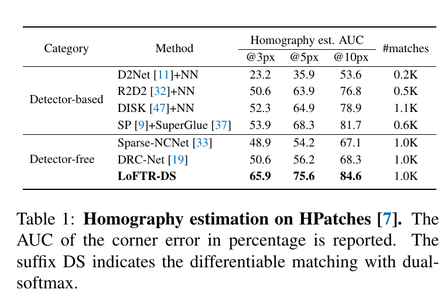

*原论文表 1。HPatches 的单应估计结果；AUC 是累计角点误差曲线在相应像素阈值范围内的面积。*

相对位姿实验在 ScanNet 室内图像对和 MegaDepth 室外图像对上进行。模型匹配后，论文用 RANSAC 估计本质矩阵，再按旋转和位移的最大角误差计算 AUC。在 ScanNet 上，LoFTR-DS 的 AUC@5°、@10°、@20° 为 22.06、40.8、57.62；SuperPoint+SuperGlue 对应为 16.16、33.81、51.84。LoFTR-OT 的三项结果分别为 21.51、40.39、57.96。室外 MegaDepth 上，LoFTR-DS 为 52.8、69.19、81.18，SuperPoint+SuperGlue 为 42.18、61.16、75.96。两种可微匹配层在不同数据上的相对表现并不完全相同。

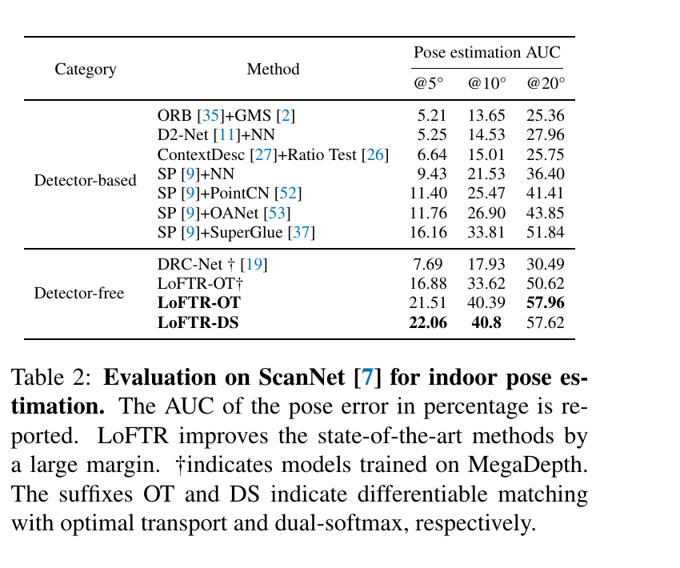

*原论文表 2。ScanNet 上的位姿 AUC；$\dagger$ 表示在 MegaDepth 上训练的模型。*

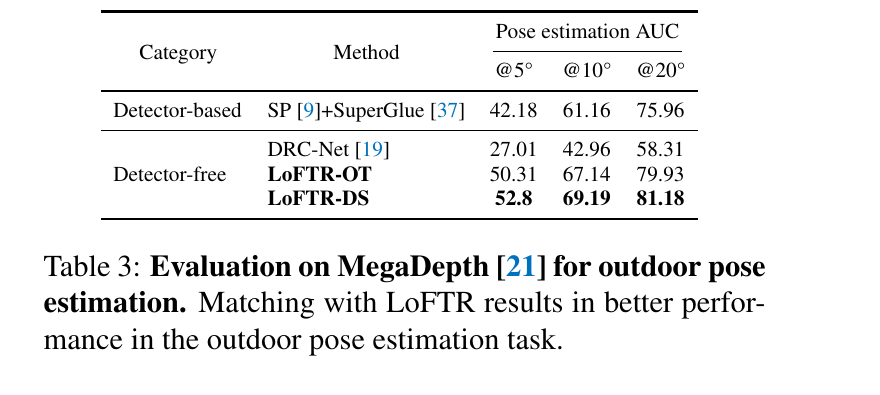

*原论文表 3。MegaDepth 上的位姿 AUC，LoFTR-DS 在表列的三个角误差阈值下均高于所列基线。*

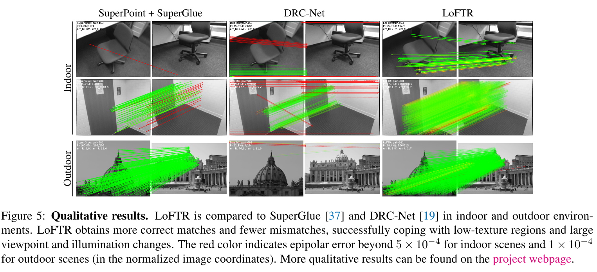

*原论文图 5。分别比较 SuperPoint+SuperGlue、DRC-Net 与 LoFTR 在室内和室外图像对上的匹配；红线表示极线误差超过论文为两类场景设定的阈值。*

视觉定位结果需要结合表中的具体数据理解。Aachen Day-Night 的夜间局部特征赛道中，LoFTR-DS 的定位率为 72.8/88.5/99.0%，SuperPoint+SuperGlue 为 73.3/88.0/98.4%；完整定位赛道中，LoFTR-OT 白天为 88.7/95.6/99.0%，夜间为 78.5/90.6/99.0%。InLoc 上，LoFTR-OT 在 DUC1 的三个阈值下为 47.5/72.2/84.8%，在 DUC2 为 54.2/74.8/85.5%。这些结果显示 LoFTR 在若干长期和室内定位条件下有竞争力；单个数据集或阈值上并非每项都超过 SuperPoint+SuperGlue。

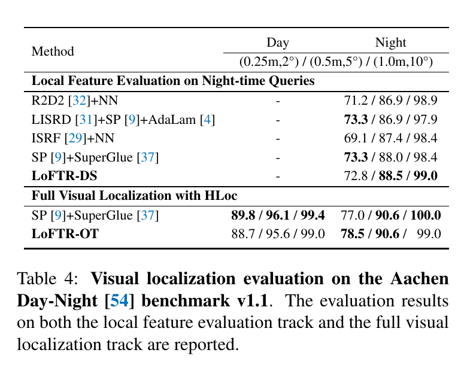

*原论文表 4。Aachen Day-Night v1.1 的夜间局部特征评估和完整视觉定位结果。*

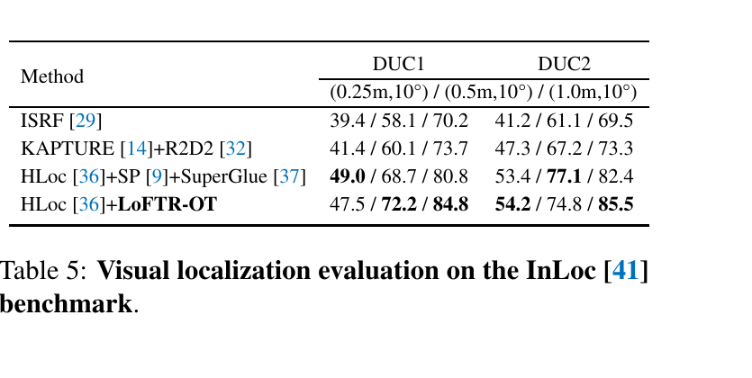

*原论文表 5。InLoc 的定位率，分别列出 DUC1 和 DUC2 两个区域。*

消融实验进一步检验结构选择。在 ScanNet 上，把 LoFTR Transformer 换成参数量相近的卷积模块，AUC@10° 从完整模型的 40.8 降到 32.04；把粗、细分辨率降低到 $1/16$ 和 $1/4$ 后，@10° 为 34.82。把位置编码改成每层加入的 DETR 风格后，@10° 为 35.64；将粗、细层数加倍，结果为 40.23，与完整模型相近。由此看，实验支持全局 Transformer 和原有多尺度配置的作用，但单纯增加层数没有带来明显提升。

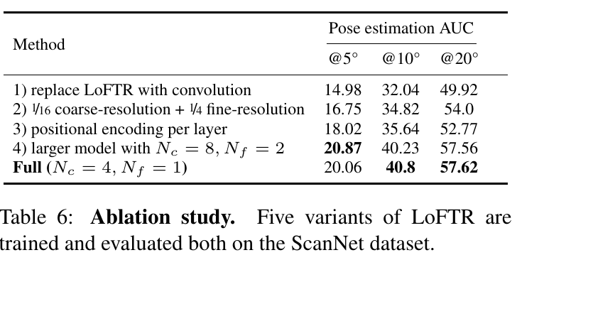

*原论文表 6。ScanNet 上不同结构设置的相对位姿 AUC。完整模型为 $N_c=4,N_f=1$。*

## 5 核心认识

LoFTR 把局部特征匹配从“先检测少量点，再为这些点找对应”改成“先在稠密特征网格上建立全局上下文，再筛选可信匹配”。Transformer 的自注意力让每幅图内部的特征利用远处结构，交叉注意力让两幅图直接交换匹配线索；位置编码使这些上下文特征仍然知道位置。线性注意力则让对较长特征序列做全局交互在计算上可行。

关键的计算链条是：FPN 产生粗、细两级特征；粗层 Transformer 更新特征；跨图相似度和 OT 或 dual-softmax 给出粗匹配；置信度与互为最近邻条件筛选候选；细层局部窗口再通过相关性热图和期望坐标把匹配修正到亚像素位置。检测器被去掉之后，位置选择与上下文判断由稠密特征和匹配层共同承担。

从方法类型上看，LoFTR 输出一组经过筛选的半稠密点对应，适合接到相对位姿估计、定位等几何流程；它本身不直接输出相机位姿，也不为每个像素都保证存在有效匹配。之后的 DKM 与 RoMa 将研究重点进一步放到稠密 warp 场和逐尺度 warp 细化上，输出形态与 LoFTR 的半稠密点对有所不同。可以参见 [DKM 论文解读](../dkm/index.md) 与 [RoMa 论文解读](../roma/index.md)。
