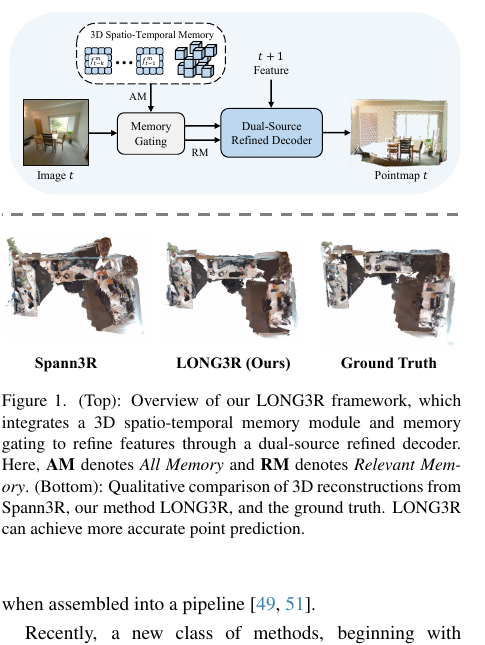
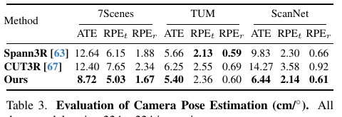
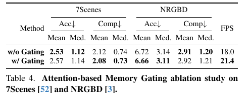

# LONG3R 论文解读

> Zhuoguang Chen、Minghui Qin、Tianyuan Yuan、Zhe Liu、Hang Zhao，*LONG3R: Long Sequence Streaming 3D Reconstruction*，ICCV 2025，页码 5273–5284。本文依据 ICCV 正式版全文（12 页）；正式页面没有单独补充材料。[论文页面](https://openaccess.thecvf.com/content/ICCV2025/html/Chen_LONG3R_Long_Sequence_Streaming_3D_Reconstruction_ICCV_2025_paper.html) · [正式版 PDF](https://openaccess.thecvf.com/content/ICCV2025/papers/Chen_LONG3R_Long_Sequence_Streaming_3D_Reconstruction_ICCV_2025_paper.pdf) · [arXiv 预印本](https://arxiv.org/abs/2507.18255) · [项目页](https://zgchen33.github.io/LONG3R/) · [代码仓库](https://github.com/zgchen33/LONG3R)

## 摘要

论文关注视频帧流中的多视图三维重建：离线优化方法需要等待更多图像，在线方法则常受到短序列设计的限制。LONG3R 采用循环式处理，每次新观测到来时读取并更新记忆。它先用记忆门控筛出相关历史，再让当前观察和相关记忆进入双源精化解码器；同时使用动态三维时空记忆剪除空间冗余，并按场景调整体素分辨率。训练阶段逐步增加序列长度。作者报告该方法在更长序列上优于所比较的流式方法，并保持实时推理。

## 1. 引言

从图像序列恢复稠密几何可用于机器人、自动驾驶及室内外场景重建。传统系统会组合 SfM、关键点、Bundle Adjustment、SLAM 和 MVS 等模块，虽有成熟成果，但依赖手工规则和较多系统工程。DUSt3R、MASt3R 等端到端网络改为从图像对直接回归点图，为学习式重建提供了更简单、泛化性较强的路径。Spann3R 将这类方法扩展到流式输入，用循环记忆逐帧处理。

作者认为 Spann3R 在长输入下有三项困难：每轮只注意一次记忆，历史信息难以重复利用；随着图像累积，记忆中的空间特征变得冗余；训练策略也没有针对长序列适配。论文将“长序列重建”定义为实时处理数十到数百帧，同时尽量维持近似恒定的记忆规模。LONG3R 围绕这一定义提出三项设计：记忆门控与双源解码、三维时空记忆、两阶段课程训练。

*原论文图 1 上半部分展示三维时空记忆、记忆门控和双源精化解码；AM 是全部记忆，RM 是相关记忆。下半部分比较 Spann3R、LONG3R 和真值点云。*

## 2. 相关工作

**传统三维重建。** SfM 与 SLAM 通过几何约束和优化估计场景与相机，NeRF 和 3D Gaussian Splatting 使用可渲染的场景表示。论文指出，传统几何优化在观测稀疏或序列长时容易受到欠约束、重复计算和缺少学习先验等因素影响；LONG3R 则直接回归点图，目标是减少迭代求解成本。

**学习式三维重建。** 学习式方法从深度估计、点图预测和端到端系统优化发展而来。DUSt3R 进行不依赖预先标定的点图预测，MASt3R 以粗到细特征匹配改善度量尺度点图；SLAM3R、Reloc3r 将前馈网络用于建图或定位，MV-DUSt3R 以多视图解码块交换跨视图信息。MonST3R 与 CUT3R 面向非受限单目视频中的时序一致三维表示。

**流式重建。** 成对图像匹配式流方法在长序列上会累积尺度漂移和位姿误差。传统单目 SLAM 用跟踪、光流约束的 BA 和回环缓解漂移，但依赖相机内参，重建质量也受深度精度影响。Spann3R 通过混合记忆特征库与注意力交互逐帧细化点图；CUT3R 使用持久状态 token 和循环 Transformer 更新状态，但长序列中可能受视角外推能力和漂移累积影响。LONG3R 在训练和推理中使用时空上下文，试图降低缺少回环和后端优化造成的累计误差。

## 3. 方法

总体流程见图 2：连续图像先经粗解码器形成当前帧粗特征；记忆门控从三维时空记忆中取出相关项；双源精化解码器结合这些记忆与下一帧特征，输出当前帧点图。

*原论文图 2。当前帧精化会读取下一帧的粗特征，所以输出存在一帧前视：处理帧 $t$ 的最终点图需要等待帧 $t+1$ 到达。*

### 3.1 特征编码与粗解码

输入图像 $I_t$ 经 ViT 编码器划分成图像 patch，并投影成视觉 token：

$$
F_t^I=\operatorname{Encoder}(I_t).\tag{1}
$$

粗解码器是由 $B$ 个 PairwiseBlock 组成的 Transformer。每个块包含自注意力、交叉注意力和 MLP；第 $i$ 个粗解码块将当前帧当前层特征与上一帧相应精化层特征交互：

$$
F_{t,i}^{c}=\operatorname{PairwiseBlock}_{i}^{c}(F_{t,i-1}^{c},F_{t-1,i-1}^{r}),\qquad i=1,\ldots,B,\quad F_{t,0}^{c}=F_t^I.\tag{2}
$$

$F_{t-1,i-1}^{r}$ 是上一帧精化解码器对应块的输出。粗解码因此先利用相邻时间步的信息形成当前帧粗表示，为后续记忆读取和精化提供基础。

### 3.2 基于注意力的记忆门控

门控有两个作用：先从全部记忆中聚合与当前帧有关的信息，再筛除无关 token，减少精化解码器要处理的记忆量。令最后一个粗解码块输出为 $F_t^c$，记忆键和值分别为 $F_{\mathrm{mem}}^K$ 和 $F_{\mathrm{mem}}^V$。交叉注意力权重及融合特征为：

$$
W_t=\operatorname{Softmax}\!\left(\frac{F_t^c(F_{\mathrm{mem}}^K)^\top}{\sqrt C}\right),\tag{3}
$$

$$
F_t^{\mathrm{fuse}}=W_tF_{\mathrm{mem}}^V.\tag{4}
$$

$W_t\in\mathbb R^{P\times S}$，其中 $P$ 是当前帧 token 数、$S$ 是记忆 token 数，$C$ 是特征维度。论文设阈值 $\tau=5\times10^{-4}$。如果至少有一个当前 token 对记忆索引 $s$ 的注意力权重大于阈值，就保留该记忆位置：

$$
\delta(s)=\begin{cases}1,&\max_p W_t(p,s)>\tau,\\0,&\text{otherwise},\end{cases}\tag{5}
$$

$$
F_{\mathrm{r\_mem}}=\{F_{\mathrm{mem}}(s)\mid\delta(s)=1\}.\tag{6}
$$

相同筛选作用于记忆键和值。这样，相关记忆会继续参加精化解码，不相关部分则不进入后续模块。图 2(b) 展示了全部记忆经交叉注意力和权重筛选得到相关记忆的过程。

### 3.3 双源精化解码器

精化解码器交替使用两种块：奇数层 PairwiseBlock 让当前帧与下一帧粗特征交互；偶数层 MemoryBlock 让当前帧读取门控后的相关记忆。令 $F_{t,i}^r$ 为第 $i$ 个精化块输出，初始特征为 $F_{t,0}^r=F_t^{\mathrm{fuse}}$，则：

$$
F_{t,i}^{r}=\begin{cases}
\operatorname{PairwiseBlock}(F_{t,i-1}^{r},F_{t+1,i-1}^{c}),&i\text{ 为奇数},\\
\operatorname{MemoryBlock}(F_{t,i-1}^{r},F_{\mathrm{r\_mem}}),&i\text{ 为偶数}.
\end{cases}\tag{7}
$$

交替跨注意力逐步协调下一帧特征与记忆特征的表示，再由 DPT 头生成显式三维重建点图。图 2(c) 展示该结构。论文实验部分还用图 7 比较这种交替结构与先拼接两个来源的解码器。

### 3.4 三维时空记忆

LONG3R 同时保留短期时间记忆和长期三维空间记忆，存储由双源精化解码器产生的历史 token。短期记忆保存时间窗口 $[t-K,t-1]$ 内的键和值，形状均为 $(K\cdot P)\times C$；实现中 $K=10$。长期空间记忆覆盖较早帧 $[1,t-K]$，并把 token 数限制在 3000。每个体素只保留一个 token，以场景空间覆盖替代逐帧保留的重复信息。

每帧的点图先为每个图像 patch 估计三维位置 $P_i$。对 patch $i$，计算其在图像平面八邻域中的平均三维距离：

$$
d_i=\frac{1}{8}\sum_{j\in\mathcal N(i)}\lVert P_i-P_j\rVert_2.
$$

图像级体素边长取本帧 $d_i$ 的最小值，场景级边长则对历史帧的图像级尺度求平均：

$$
v_{\mathrm{img}}=\min_i d_i,\qquad v_{\mathrm{scene}}=\frac{1}{t-1}\sum_{j=1}^{t-1}v_{\mathrm{img},j}.\tag{8}
$$

尺度自适应是因为不同场景的物理尺度不同，而模型训练采用尺度不变的点图监督，不能用固定物理体素边长。完成体素分组后，模型跟踪 token 的累计注意力权重，每个体素只留下权重最高的 token。图 3 用二维网格示意三维空间分组和冗余 token 剪除。

*原论文图 3。空间位置相近的记忆 token 分到同一体素，每个体素保留累计注意力权重最高的项；图中用二维网格简化表示。*

### 3.5 训练

**损失函数。** 训练使用置信度感知的三维回归损失 $\mathcal L_{\mathrm{conf}}$ 和尺度损失 $\mathcal L_{\mathrm{scale}}$。尺度项鼓励预测点云的平均距离小于真值点云的平均距离。论文只说明两项的作用，未在正文展开它们的代数形式；总损失写作：

$$
\mathcal L=\mathcal L_{\mathrm{conf}}+\mathcal L_{\mathrm{scale}}.\tag{9}
$$

**两阶段课程训练。** 第一阶段每个视频随机采 5 帧训练，使模型先学习基本表征；第二阶段冻结 ViT 编码器，只微调其他模块，先用 10 帧、再用 32 帧逐渐增加时间上下文。课程训练使模型适应更长的记忆交互，而无需一开始就在长序列上训练。

## 4. 实验

### 4.1 实验设置

**训练集。** 使用 Habitat、ARKitScenes、BlendedMVS、ScanNet++、Co3D-v2 和 ScanNet 六个数据集，包含真实与合成数据，以及度量尺度和归一化尺度样本。

**对比方法。** 在线流式基线为 Spann3R、CUT3R；另比较需要后处理的 DUSt3R、MASt3R，以及离线多视图方法 MV-DUSt3R、MV-DUSt3R+。所有测试在单张 24 GB RTX 3090 上进行，输入缩放至 $224\times224$。

**实现与训练。** 编码器采用从 DUSt3R 初始化的 ViT-Large。训练图片同样为 $224\times224$；实验设置使用 10 帧短期记忆与 3000 token 长期记忆。第一阶段使用 AdamW、每 GPU 批量 10、学习率 $1.12\times10^{-4}$，训练 120 个 epoch；第二阶段以 $10^{-5}$ 学习率，在 10 帧和 32 帧序列上各微调 12 个 epoch。第一阶段在 16 张 A100 上训练 28 小时，第二阶段约 20 小时。

### 4.2 三维重建

在未见过的 7Scenes、NRGBD 和 Replica 上评估场景重建，指标为准确度 Acc、完整度 Comp 和法线一致性 NC；Acc、Comp 以厘米计，越低越好，NC 越高越好。Replica 使用连续顺序观测，分别取 100 帧和 200 帧，称为 Replica100、Replica200。

表 1 中 LONG3R 在 7Scenes 的平均 Acc/Comp 为 2.57/2.08 cm，在 NRGBD 为 6.66/3.11 cm。在线基线 Spann3R 对应值分别为 3.42/2.41 和 6.91/2.91 cm，LONG3R 在 NRGBD 的完整度略差。离线 MV-DUSt3R+ 在 NRGBD 的 Acc/Comp 为 3.47/3.69 cm，几何误差更低，但表中速度约 3 FPS；LONG3R 约 22 FPS。论文的结论是在线方法在这两组数据上兼顾较强的重建精度和实时速度，结果并不意味着每个指标都领先。

图 4 对比 7Scenes 的 Office-06、Office-09 场景，作者认为 LONG3R 相较 Spann3R、CUT3R 保持了更好的空间一致性。该图展示特定场景的点云，不能代替表 1 的量化结果。

Replica 结果见表 2。200 帧时 LONG3R 平均 Acc/Comp 为 11.93/2.73 cm；Spann3R 为 16.29/4.02 cm，CUT3R 为 28.30/6.61 cm。LONG3R 约 21 FPS，与两种在线基线接近；离线全局对齐方法的几何误差更低，但速度约 1–7 FPS。连续输入的实验用于检验序列变长时误差是否退化，LONG3R 在所比较在线方法中保持得更好。

图 5 展示 Replica Office-0 的 100 帧和 200 帧点云。论文指出，随着观测序列增加，Spann3R、CUT3R 的几何歧义和电视表面误差变明显；LONG3R 的场景结构较稳定。这是定性例子，适用范围仍限于图中场景。

### 4.3 相机位姿估计

作者在 7Scenes、TUM 和 ScanNet 上评估相机位姿，报告绝对平移误差 ATE、相对平移误差 $\mathrm{RPE}_t$ 和相对旋转误差 $\mathrm{RPE}_r$，表中单位为厘米和度。LONG3R 的 ATE 在三个数据集上分别为 8.72、5.40、6.44，低于表中 Spann3R 和 CUT3R；RPE 各项则需逐列比较，例如 TUM 的平移与旋转误差略高于 Spann3R。位姿指标说明网络输出的相机估计质量，不代表系统包含传统 SLAM 的回环识别或后端图优化。

### 4.4 消融与分析

**注意力记忆门控。** 表 4 比较有无门控。7Scenes 上启用门控后平均 Acc/Comp 从 2.53/2.12 变为 2.57/2.08 cm，NRGBD 从 6.72/2.91 变为 6.66/2.92 cm；误差变化不完全同向。作者报告在 7Scenes 门控筛除了约 27% 的记忆 token，同时吞吐从 18.0 提高到 21.4 FPS，约提升 20%。图 6 进一步显示全部记忆与相关记忆的 token 数。

**双源精化解码器。** 图 7 对比逐层交替的解码方式与先将下一帧特征、相关记忆拼接后再处理的方式。由于拼接方案显存较高，表 5 的第二阶段训练序列长度从常规 32 帧改为 24 帧。Replica100 上交替结构平均 Acc/Comp 为 12.06/3.68 cm，拼接结构为 14.83/4.59 cm；Replica200 上分别为 13.34/3.15 cm 与 29.52/8.88 cm。论文将差距归因于交替跨注意力逐步缓解记忆特征与下一帧粗特征之间的表示错位。

**三维时空记忆。** 表 6 对比仅保留时间记忆、替换成 Spann3R 记忆和完整 LONG3R 记忆。移除长期三维空间记忆后，Replica200 平均 Acc/Comp 从 11.93/2.74 cm 增至 65.75/13.24 cm；替换为 Spann3R 记忆时为 12.41/3.07 cm。结果支持长期空间去冗余有助于该长序列设置下的场景重建，但并不说明体素记忆等同于可优化的显式地图。

## 5. 结论

LONG3R 将相关性筛选、当前帧与下一帧/历史记忆的交替交互，以及短期时间记忆和长期三维空间记忆组合起来，并以两阶段课程训练适应长序列。论文在多组场景重建、相机位姿和消融实验中报告了有竞争力的在线表现。作者列出的限制是：点图相对第一帧定义，视角偏离过大时可能模糊；由于训练数据缺少动态场景，模型对大幅运动物体处理较弱。未来方向是扩展到更复杂环境。该方法可视为在线稠密重建网络，而不是带有回环检测、重定位和后端位姿图优化的完整 SLAM 系统。
