# LONG3R 论文解读

> Zhuoguang Chen、Minghui Qin、Tianyuan Yuan、Zhe Liu、Hang Zhao，*LONG3R: Long Sequence Streaming 3D Reconstruction*，发表于 ICCV 2025。本文依据 ICCV 正式版全文，共 12 页；CVF 正式页面未提供独立补充材料。[论文页面](https://openaccess.thecvf.com/content/ICCV2025/html/Chen_LONG3R_Long_Sequence_Streaming_3D_Reconstruction_ICCV_2025_paper.html) · [正式版 PDF](https://openaccess.thecvf.com/content/ICCV2025/papers/Chen_LONG3R_Long_Sequence_Streaming_3D_Reconstruction_ICCV_2025_paper.pdf) · [项目页](https://zgchen33.github.io/LONG3R/) · [代码仓库](https://github.com/zgchen33/LONG3R)

流式点图模型可以一边接收视频，一边把逐帧几何放进同一场景坐标。但序列变长后，旧视图的空间特征会重复占用记忆；如果只留近期视图，又可能丢掉长期场景结构。LONG3R 将问题归结为如何让当前帧从历史中取到相关信息、压掉重复的空间记录，同时维持实时推理。

它建立在 DUSt3R/MASt3R 一类点图回归方法和 Spann3R 等流式记忆模型之上，主要有三项设计：以当前帧为查询筛选历史记忆；让当前帧在解码中交替与下一帧特征和相关记忆交互；将长期记忆按场景空间位置聚合到自适应体素。与 [CUT3R](../cut3r/) 的固定长度递归状态、[StreamVGGT](../streamvggt/) 和 [STream3R](../stream3r/) 的历史注意力缓存相比，LONG3R 保留一段短时 token 历史，同时用稀疏三维记忆保留较久远的空间证据。

## 当前帧怎样同时读取短期和长期历史

图像 $I_t$ 经 ViT 编码成 patch 特征 $F_t^I$。一个粗解码器先与上一帧对应的特征交互，生成当前帧的粗特征 $F_t^c$。随后，记忆门控模块用 $F_t^c$ 作为查询，对全部记忆键 $F_{mathrm{mem}}^K$ 做交叉注意力，取得融合特征并计算每个记忆 token 的相关权重：

$$
W_t=\operatorname{Softmax}\!\left(\frac{F_t^c(F_{\mathrm{mem}}^K)^\top}{\sqrt C}\right),\qquad
F_t^{\mathrm{fuse}}=W_tF_{\mathrm{mem}}^V.
\tag{3–4}
$$

$C$ 是特征维数，$W_t$ 的每一行对应一个当前图像 token 对所有记忆 token 的注意力分布。作者用阈值 $\tau=5\times10^{-4}$ 做稀疏筛选：只要有一个当前 token 对记忆位置 $s$ 的权重大于阈值，就保留该位置的键和值，否则从后续精化解码中剔除。换句话说，门控将“全部历史记忆”压成“对这帧至少有一处足够相关的记忆”，减少后续注意力处理的 token 数。

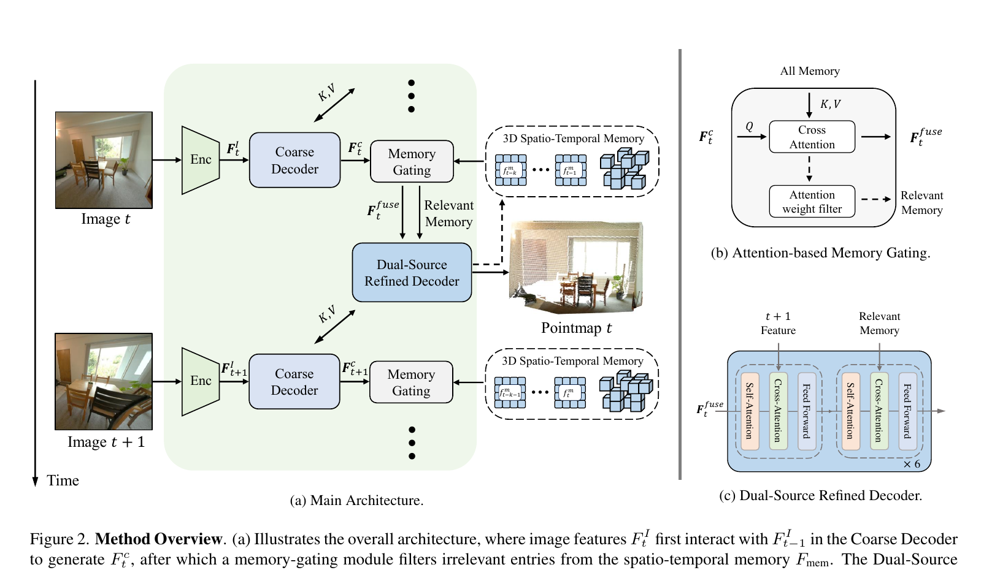

*原论文图 2。当前图像先与前一帧特征形成粗表示，再由记忆门控选取相关记忆，最后进入双源精化解码器。图中第 $t$ 帧的输出还使用第 $t+1$ 帧特征，因此该结构含有一帧前视：需要下一帧到达后，才能完成对当前帧的精化。*

双源精化解码器由两种模块交替组成。奇数层是 PairwiseBlock，让当前帧特征与下一帧的粗特征交互；偶数层是 MemoryBlock，让当前特征读取门控保留下来的记忆。如此重复六次后，由 DPT 头输出点图。交替解码让当前表示先和相邻帧对齐，再重新读取长期记忆；如果把两种来源简单拼接，后续注意力需要同时处理可能未对齐的特征。

用 $F_{t,i}^r$ 表示第 $i$ 个精化模块后的当前特征，解码的交替关系可写为：

$$
F_{t,i}^r=
\begin{cases}
\operatorname{PairwiseBlock}(F_{t,i-1}^r,F_{t+1,i-1}^c), & i\ \text{为奇数},\\
\operatorname{MemoryBlock}(F_{t,i-1}^r,F_{\mathrm{mem}}^r), & i\ \text{为偶数}.
\end{cases}
\tag{7}
$$

$F_{\mathrm{mem}}^r$ 是门控输出的相关记忆。PairwiseBlock 在当前帧与下一帧之间交换局部时序信息；MemoryBlock 再把已经更新的当前表示与长期历史融合。论文的消融将这种交错结构与先拼接记忆、再执行同类注意力的结构比较，结果显示前者在 Replica 长序列上误差更低。

## 体素化的三维时空记忆

LONG3R 同时维护两类记忆。短期记忆保留最近 $K$ 帧的历史键和值；实现中 $K=10$。较早帧的特征进入长期三维空间记忆，存放范围为 $[1,t-K]$。长期记忆容量固定为 3000 个 token，避免历史帧越多，空间记录就无限增长。

空间记忆以预测点图给每个图像 patch 估计三维位置，再将位置相近的 token 分到同一体素。为了让不同物理尺度的场景都能使用，体素边长不预先指定：先对每个 token 计算它与图像平面八邻居的平均三维距离 $d_i$，取本帧中最小值作为图像尺度的体素边长；再对历史帧的图像体素边长取平均，得到场景级边长：

$$
d_i=\frac{1}{8}\sum_{j\in\mathcal N(i)}\|P_i-P_j\|_2,\qquad
v_{\mathrm{img}}=\min_i d_i,\qquad
v_{\mathrm{scene}}=\frac{1}{t-1}\sum_{j=1}^{t-1}v_{\mathrm{img},j}.
\tag{8}
$$

$P_i$ 是第 $i$ 个 patch 的三维位置，$\mathcal N(i)$ 是其八邻居。体素化后，落入同一体素的 token 只保留累计注意力权重最高的一个。这样，长期记忆保留场景空间覆盖，同时减少相邻视图重复记录同一表面的情况。

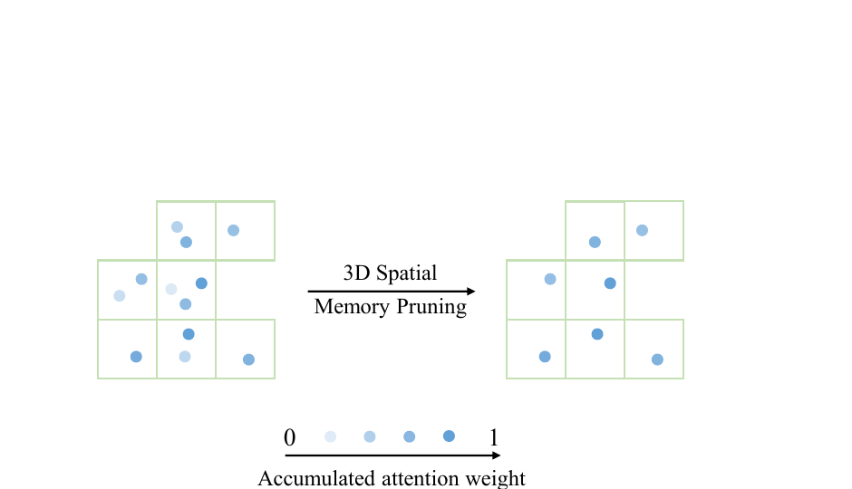

*原论文图 3。三维位置相近的记忆 token 被分到同一体素，只留下累计注意力权重最高的 token。图中以二维网格简化表示空间分组。*

短期记忆捕捉相邻帧之间的时间变化，长期记忆则按几何位置整理场景内容。前者保持局部连续性，后者使远处的历史视图能够通过空间邻近关系被重新检索。记忆门控对两类记忆统一计算相关性，但不会把长期三维记忆变成传统 SLAM 的显式地图优化结构。

## 置信度回归与逐步增加序列长度的训练

训练使用置信度感知的点图回归损失 $\mathcal L_{\mathrm{conf}}$，再加尺度损失 $\mathcal L_{\mathrm{scale}}$，总目标为：

$$
\mathcal L=\mathcal L_{\mathrm{conf}}+\mathcal L_{\mathrm{scale}}.
\tag{9}
$$

前一项依照 DUSt3R/Spann3R 的点图监督方式，用预测置信度调节点图几何误差；后一项约束预测点云的平均距离尺度不超过真值点云。论文正文只给出两项损失的名称与作用，并未展开代数形式，因此这里按作者描述概括，不补写未给出的公式。

LONG3R 用两阶段课程逐步增加训练上下文。第一阶段从每条视频随机抽 5 帧训练模型；第二阶段冻结 ViT 编码器并继续训练其余部分，先用 10 帧序列，再用 32 帧序列。训练集由 Habitat、ARKitScenes、BlendedMVS、ScanNet++、Co3Dv2 和 ScanNet 六个数据集构成，包含真实及合成、度量尺度及归一化尺度样本。模型使用 DUSt3R 预训练的 ViT-Large 编码器，输入统一缩放到 $224\times224$。第一阶段用 AdamW、每张 GPU 批量大小 10、学习率 $1.12\times10^{-4}$ 训练 120 个 epoch；第二阶段用 $10^{-5}$ 学习率，对 10 帧和 32 帧各训练 12 个 epoch。训练耗时报告为：16 张 A100 上第一阶段 28 小时，第二阶段微调约 20 小时。

## 百帧重建与相机位姿结果

评测输入为 $224\times224$，全部方法在单张 RTX 3090、24 GB 显存上测试。场景重建报告准确度（Acc）、完整度（Comp）和法线一致性（NC），其中 Acc、Comp 以厘米报告，前两项越低越好，NC 越高越好。7Scenes 与 NRGBD 上，LONG3R 的在线重建具有竞争力：7Scenes 的平均 Acc/Comp 为 2.57/2.08 cm，优于 Spann3R 的 3.42/2.41 cm；NRGBD 上 LONG3R 的 Acc/Comp 为 6.66/3.11 cm，Spann3R 为 6.91/2.91 cm，优势并非每项都成立。对离线 MV-DUSt3R+，NRGBD 的 Acc/Comp 是 3.47/3.69 cm，几何误差更低，但该方法速度约 3 FPS，LONG3R 约 22 FPS。因而这里体现的是在线速度和误差的权衡，不能笼统说 LONG3R 在所有数据集、指标上都胜过离线法。

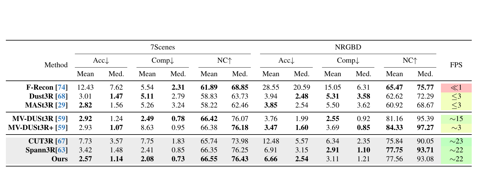

*原论文表 1。数值列出 7Scenes 与 NRGBD 的均值、中位数、Acc、Comp、NC 以及 FPS。它同时显示 LONG3R 的在线结果和更慢的离线多视图方法。*

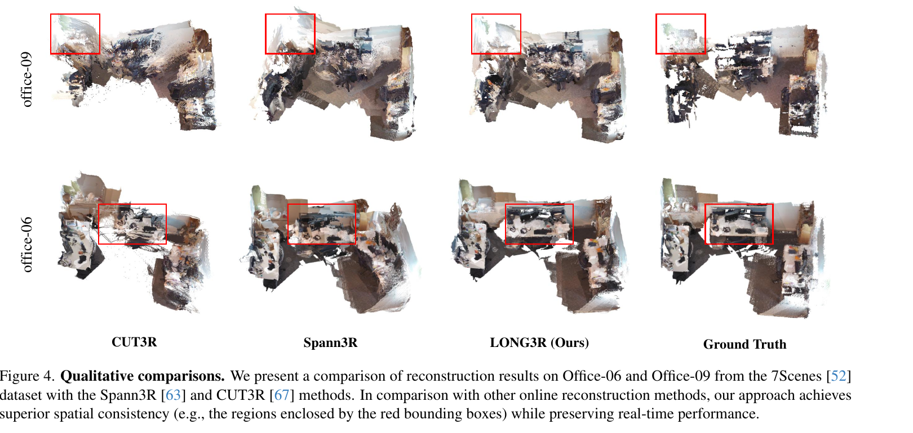

*原论文图 4。比较 CUT3R、Spann3R、LONG3R 和真值在 Office-06、Office-09 场景中的点云。红框区域展示论文关注的空间一致性差异；这是可视化证据，不能取代表格中的定量结果。*

为了单独观察长序列误差，论文在 Replica 中按序列顺序取 100 帧和 200 帧，分别称 Replica100、Replica200。200 帧时，LONG3R 平均 Acc/Comp 为 11.93/2.73 cm，Spann3R 为 16.29/4.02 cm，CUT3R 为 28.30/6.61 cm；法线一致性也略高于 Spann3R。其速度约 21 FPS，与 Spann3R 约 21 FPS、CUT3R 约 23 FPS 接近。离线全局对齐方法仍可获得更低的几何误差，但速度约 1–7 FPS。作者由此强调 LONG3R 避免了在线方法在这组 200 帧测试中出现的显著退化。

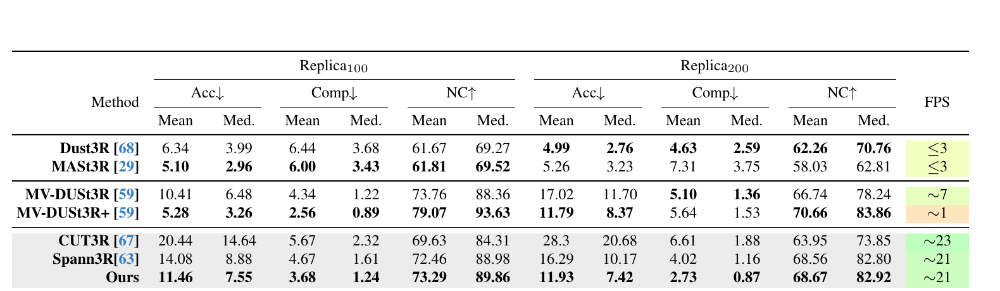

*原论文表 2。Replica100/200 使用同一场景分别采样 100/200 帧，报告 Acc、Comp、NC 和推理速度；LONG3R 在在线基线中对 200 帧序列的准确度和完整度误差较低。*

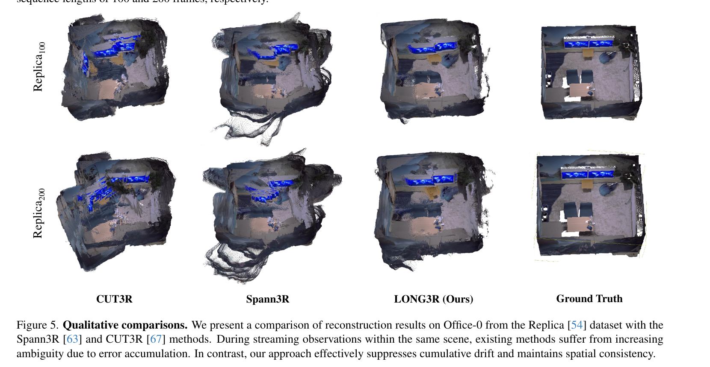

*原论文图 5。Office-0 场景的 100 帧与 200 帧重建结果。LONG3R 的电视区域和场景空间结构更稳定；图中呈现的是特定场景的定性例子。*

位姿评估覆盖 7Scenes、TUM 和 ScanNet，报告 ATE、相对平移误差和相对旋转误差；平移单位为厘米，旋转单位为度。LONG3R 的 ATE 分别为 8.72、5.40 和 6.44，均低于表中 Spann3R 和 CUT3R 的对应值。这支持其长时空记忆也有助于相机轨迹估计，但轨迹评价并不意味着系统具有传统 SLAM 的回环识别或后端优化。

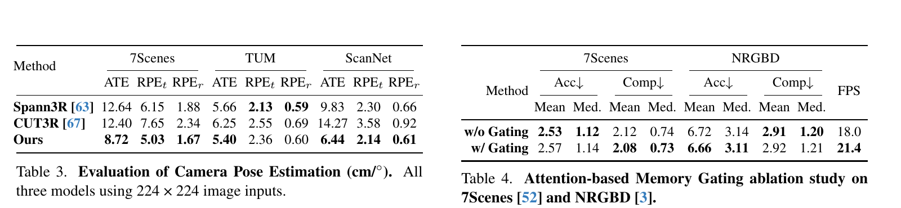

*原论文表 3、表 4。左侧比较三个在线方法的 ATE、相对平移和旋转误差；右侧比较门控开关下的 7Scenes、NRGBD 误差和帧率。门控将 7Scenes 记忆 token 数减少约 27%，速度由 18.0 提高到 21.4 FPS；重建质量变化较小，且不同数据集、指标方向不完全一致。*

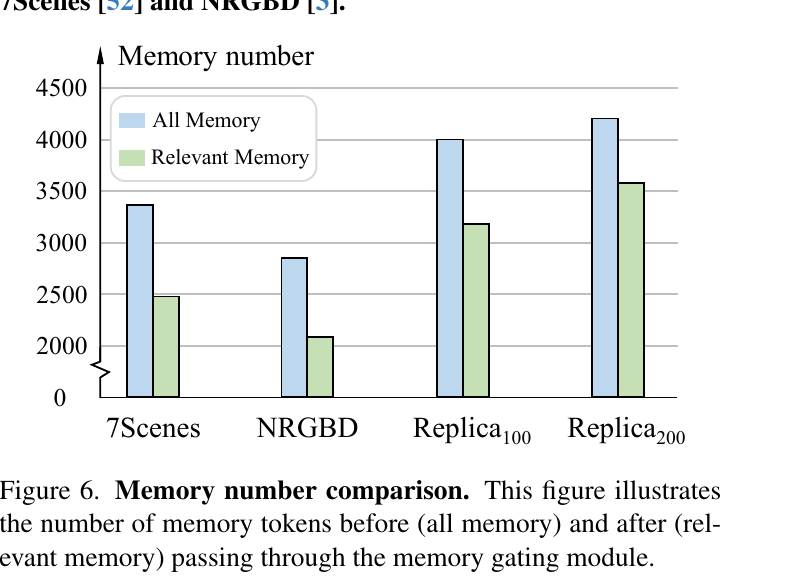

*原论文图 6。门控前的全部记忆与门控后的相关记忆数量对比；序列越长，筛除空间冗余 token 对后续解码计算越有意义。*

## 结构消融与 SLAM 边界

双源解码器消融将交替注意力与直接拼接两种记忆来源的方式比较。Replica100 上，交错版平均 Acc/Comp 为 12.06/3.68 cm，拼接版为 14.83/4.59 cm；Replica200 上分别为 13.34/3.15 cm 与 29.52/8.88 cm。作者认为逐层交替跨注意力有助于减少当前帧特征、下一帧特征和记忆特征之间的表示失配。这个实验的第二阶段改用 24 帧，而非标准设置的 32 帧，以适应拼接方案的显存需求。

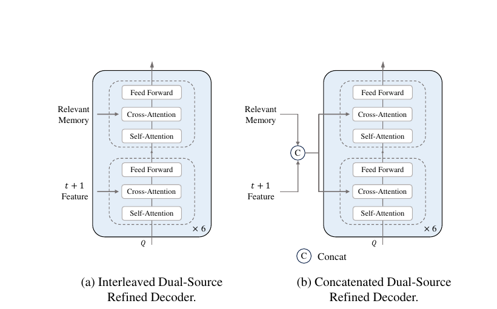

*原论文图 7。左侧在六组模块中交替处理下一帧与相关记忆；右侧先将两个来源拼接，再进入相同结构。表 5 报告相应 Replica 长序列结果。*

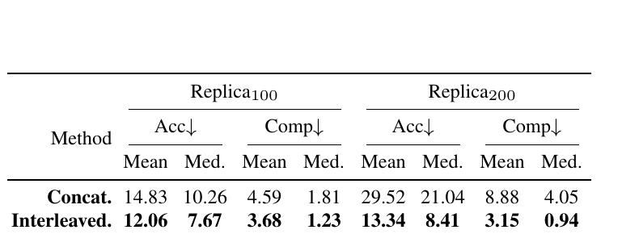

*原论文表 5。交错结构在 Replica100 和 Replica200 的准确度、完整度上都低于拼接结构的几何误差。*

移除长期三维空间记忆后，7Scenes 平均 Acc/Comp 从 2.57/2.08 cm 增至 5.76/3.30 cm；Replica200 从 11.93/2.73 cm 增至 65.75/13.24 cm。替换为 Spann3R 记忆后结果接近 LONG3R，但两组数据上仍略差。这说明稀疏空间记忆对模型在该长序列协议下保持几何是关键组件。

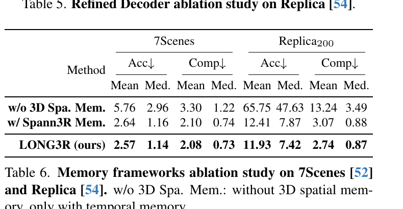

*原论文表 6。比较没有长期空间记忆、使用 Spann3R 记忆以及 LONG3R 的空间时序记忆；无长期空间记忆时 Replica200 误差显著增加。*

从 SLAM 系统角度看，LONG3R 是由学习先验驱动的在线稠密重建前端：它逐帧估计几何和位姿，并借助长短期记忆降低历史冗余。论文将长序列问题定义为数十到数百帧、近似恒定记忆下的实时处理，不等同于任意时长的全局一致 SLAM。系统没有显式回环检测和后端位姿图优化；作者也指出，以首帧为参考的点图在视角偏离过大时会变模糊，训练中缺少动态数据也使大幅运动物体难以处理。加上双源解码器使用下一帧特征，它的逐帧输出带有一帧前视的缓冲需求。

LONG3R 的贡献是把记忆筛选、记忆整理和记忆交互一起设计：先通过注意力门控筛除无关 token，再按三维占据压缩远期空间记录，最后在当前帧、下一帧和历史记忆间交替传递信息。实验表明这套方案在 100–200 帧基准上维持了在线速度，并比同表中的流式基线更稳定；它仍未解决全局重定位、回环优化、超长序列漂移和复杂动态物体等完整 SLAM 问题。
