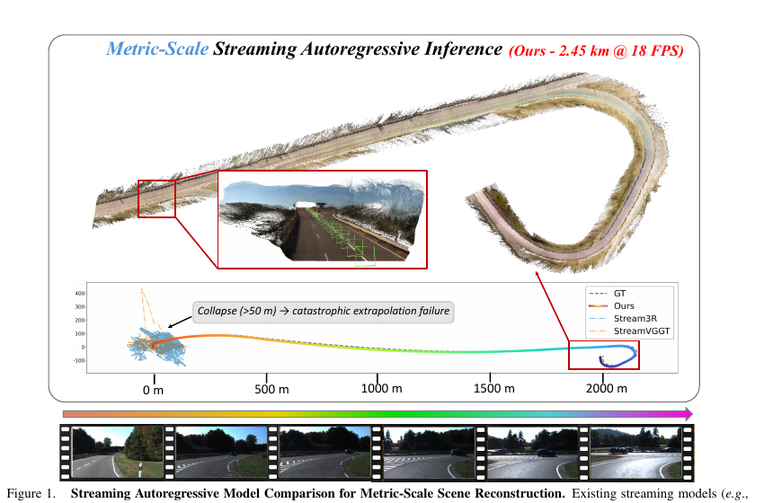
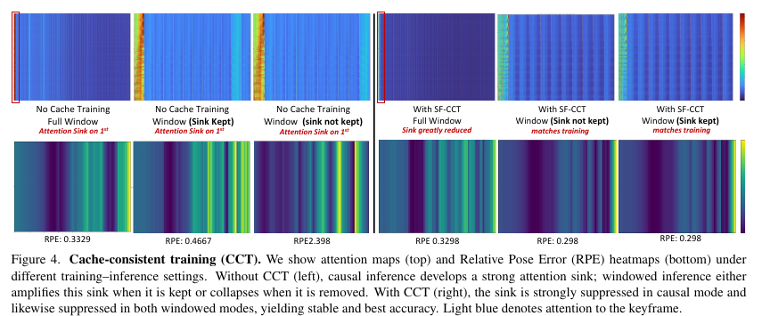
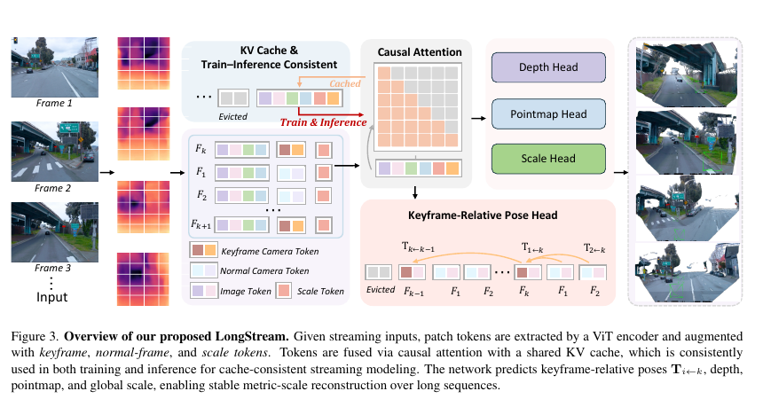
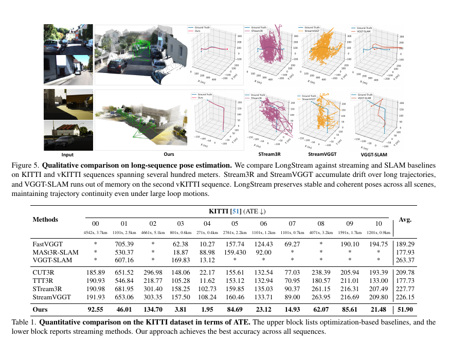
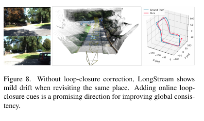

# LongStream 论文解读

> Chong Cheng、Xianda Chen、Tao Xie、Wei Yin、Weiqiang Ren、Qian Zhang、Xiaoyang Guo、Hao Wang，*LongStream: Long-Sequence Streaming Autoregressive Visual Geometry*，CVPR 2026，页码 272–283。本文依据 CVPR 正式版论文及 3 页补充材料。 [CVPR 论文页](https://openaccess.thecvf.com/content/CVPR2026/html/Cheng_LongStream_Long-Sequence_Streaming_Autoregressive_Visual_Geometry_CVPR_2026_paper.html) · [正式版 PDF](https://openaccess.thecvf.com/content/CVPR2026/papers/Cheng_LongStream_Long-Sequence_Streaming_Autoregressive_Visual_Geometry_CVPR_2026_paper.pdf) · [补充材料](https://openaccess.thecvf.com/content/CVPR2026/supplemental/Cheng_LongStream_Long-Sequence_Streaming_CVPR_2026_supplemental.zip) · [项目页](https://3dagentworld.github.io/longstream/) · [代码](https://github.com/3DAgentWorld/LongStream)

流式三维重建逐帧接收视频，持续预测相机运动和场景几何。它看起来像视觉里程计，但前馈重建模型通常还要输出稠密深度或点图，并且未必具有传统 SLAM 的回环检测、重定位和全局优化。LongStream 关注其中一个很具体的失效：模型能在短片段工作，序列变长后却逐渐失稳。

作者把问题归因于两种耦合。第一，位姿始终相对第一帧表达，训练时只见到短索引，推理却要外推到很远的坐标范围。第二，因果 Transformer 的 KV cache 会积累历史特征，并可能过度依赖最早的 attention sink。LongStream 对应地改了位姿与尺度目标，并让训练时显式经历和推理相同的缓存过程。

*原论文图 1。论文展示一段约 2.45 km 的重建和 18 FPS 结果，并将 Stream3R、StreamVGGT 的轨迹失效作为对比。该图是作者的定性示例，不代表所有数据集或场景都能达到同样距离。*

## 先把坐标参考从首帧换成活动关键帧

很多流式几何模型把每帧相机位姿预测在首帧坐标系中。相机走得越远，模型要回归的平移量越大，也越容易碰到训练阶段没有覆盖的坐标范围。LongStream 每隔固定帧数设一个关键帧 $k$，当前帧 $i$ 只预测相对于它的变换：

$$
T_{i\leftarrow k}=T_iT_k^{-1}.
\tag{1}
$$

其中 $T_i,T_k$ 是论文采用的 world-to-camera 绝对位姿。若世界坐标整体改用 $G$ 变换，则每个 world-to-camera 位姿右乘 $G^{-1}$；在相对位姿中这项会相消。因此监督目标不依赖任意选择的全局坐标系。模型每帧预测相对平移、单位四元数旋转和焦距偏移。相对位姿头也参考 RAFT 的迭代更新方式，逐步细化这些量。

这并不意味着系统从此没有全局坐标系。实现仍要把连续的关键帧相对变换组合起来，形成整段轨迹；变化的是每个局部预测目标不再直接绑定首帧。固定间隔关键帧把长距离外推拆成有界跨度的小段，减轻训练与推理之间的索引差异。

## 几何形状和度量尺度分开学习

仅改位姿参考还不能解决单目尺度漂移。LongStream 为尺度单独设置 Scale Token 和尺度头，预测正的全局尺度 $s=\exp(w^\top h_{scale})$。点图和深度由尺度作用后得到米制输出；旋转和焦距不受这个尺度因子影响。

几何分支在归一化空间监督点图。若原始点图为 $\hat X_{raw}$，论文先将其除以某个对点云尺度齐次的归一化算子：

$$
\tilde X_{pred}=\frac{\hat X_{raw}}{\operatorname{Norm}(\hat X_{raw})},\qquad
\mathcal L_{geom}=\|\tilde X_{pred}-\tilde X_{gt}\|_1.
\tag{2}
$$

归一化会消去统一缩放，因此几何损失主要教网络形状；单独的尺度损失在对数域比较预测尺度与真值：

$$
\mathcal L_{scale}=|\log\hat s-\log s_{gt}|.
\tag{3}
$$

相对位姿损失则监督相对旋转、归一化平移及焦距偏移。总目标由几何与深度、相对位姿和尺度项组成。尺度真值只在有度量标定的训练数据上监督；不具备米制真值的数据仍可参与几何与深度训练。这种分工降低了形状分支和尺度分支互相补偿的空间，但论文所称的“正交解耦”针对的是其定义的归一化目标，不等于现实数据中尺度估计与形状误差完全无关。

## 缓存训练要长得像缓存推理

LongStream 从 VGGT 初始化，保留 24 层、约 1.3B 参数主干。图像经 DINOv2 编码后加入相机、寄存器和尺度 token，再由因果 Transformer 聚合。输出包括相对关键帧位姿、深度、点图和尺度。训练与推理共用同一 KV 缓存布局。

作者指出，传统训练常把一个较短片段独立送入模型，而推理时却把过去的 KV 状态带入下一帧。模型因而可能学会依赖首帧 attention sink；若推理时把首帧滑出窗口，注意力分布就和训练时不一样。Cache-Consistent Training（CCT）把一段序列切成多个块，显式将上一块缓存传给下一块，并按窗口大小裁剪，使训练中的可见历史匹配在线推理。

*原论文图 4。无 CCT 时，窗口内保留或移除 sink 都会导致注意力偏置或误差上升；CCT 训练后，因果全窗口和滑窗配置的注意力分布更接近。*

长流还会让 KV 缓存逐渐饱和。LongStream 每经过 $N=10$ 个关键帧就刷新一次缓存，并把当前关键帧作为新的局部参考，丢弃过期的 KV 状态。作者将这种做法类比为 SLAM 中边缘化旧状态：它保留已组合的几何连续性，同时移除老化特征。补充材料显示，在 vKITTI 的一组超参数实验中，关键帧间隔取 10、缓存窗口取 10 的误差低于测试的其他取值；这支持其设计选择，但不能证明它对所有数据都最优。

*原论文图 3。关键帧相机 token、普通帧 token 和尺度 token 经过因果注意力与共享 KV cache；各任务头分别输出几何、尺度和相对位姿。*

## 实验结果怎么读

论文在 KITTI、vKITTI、TUM-RGBD、Oxford Spires、Waymo、7Scenes 和 ETH3D 等数据上比较流式方法、前馈模型和优化式系统。训练分两阶段：第一阶段使用批大小 22，训练 50k 次迭代，报告在 32 张 A100 上耗时三天；第二阶段进行缓存一致训练，采样 10 至 80 帧的序列长度，缓存窗口设为 10。模型使用多个室内外合成及真实数据集。论文报告单 GPU 推理速度为 18 FPS，输入图像长边最多缩放到 518 像素。

在 KITTI 的长轨迹 ATE 表中，LongStream 报告平均 51.90 m，低于该表中列出的 FastVGGT、MASt3R-SLAM、VGGT-SLAM、CUT3R、TTT3R、STream3R 和 StreamVGGT。这个平均数覆盖不同长度的序列，不能单独用来衡量每公里漂移；从表中逐项看，LongStream 并非每个序列都同等占优。论文还给出 Waymo、Oxford Spires 和 TUM 的在线 ATE，以及 7Scenes/TUM 的点云 Chamfer Distance 与 F1。不同数据集的规模和指标不同，应分开看，而不是将各项数值直接横向比较。

*原论文图 5、表 1。定性图展示长轨迹上的轨迹形态；表中 ATE 以米计。星号代表该方法在对应序列没有可报告的数值，不应将其当作零误差。*

组件消融中，从首帧绝对位姿回归换为关键帧相对位姿后，vKITTI 单序列 ATE 从 8.043 降至 2.819；加入尺度头、CCT 和缓存刷新后，报告值进一步降至 0.115。补充表格中长序列长度增加时，完整 LongStream 在 Waymo 135 m 与 KITTI 561 m 例子上的 ATE 分别从短截段的 0.151 m 增到 0.343 m 和 0.164 m；去掉滑窗/缓存刷新变体在最长截段明显更差。这里是有限序列案例，不能据此推断任意长度都稳定。

## 论文的贡献与边界

LongStream 的重点不是简单把 KV cache 做得更大，而是重新组织局部坐标参考、尺度监督和缓存训练，使模型面对长流时仍在训练覆盖的局部问题上工作。它将相对位姿、尺度头、CCT 和周期性刷新组合成一个流式几何模型，并用长轨迹实验展示了相较若干基线更好的稳定性。

但它仍不是完整 SLAM 系统：论文没有显式回环检测、重定位或全局位姿图优化。它依赖启发式关键帧间隔，假设场景大体静态；作者也承认很长序列上的点图一致性仍会退化。补充材料专门给出重访区域的轻微漂移示例，并将在线回环线索列为后续方向。

*补充材料图 8。它提醒读者：长距离轨迹看起来连续，不等于全局地图已被回环约束校正。*

因此，LongStream 更适合归入“长序列、在线、度量尺度前馈几何重建”，而不是与带图优化的 SLAM 不加区分。和 StreamVGGT、STream3R 相比，它把重点放在坐标与尺度规范化以及训练/推理缓存对齐；和 VGGT-SLAM、MASt3R-SLAM 相比，它省去显式全局优化，换取固定的在线处理流程。对于“流式模型如何长期维护历史”的综述，LongStream 提供了一个重要视角：稳定性可能来自正确选择局部参照和训练时的可见状态，而不只是无限增加记忆容量。
