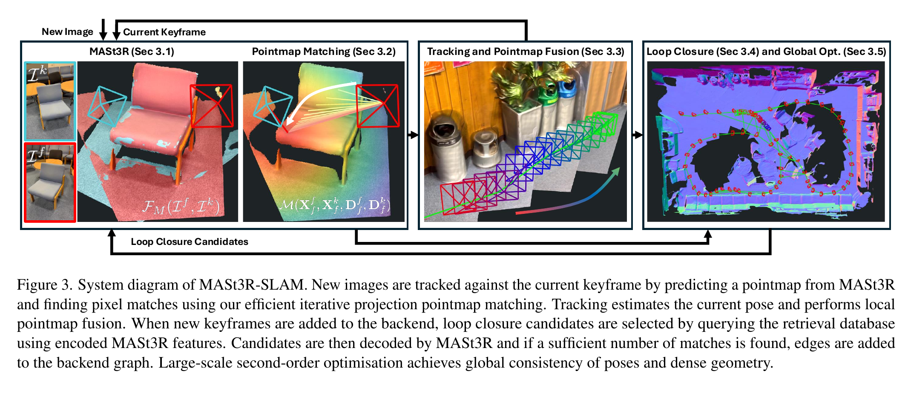
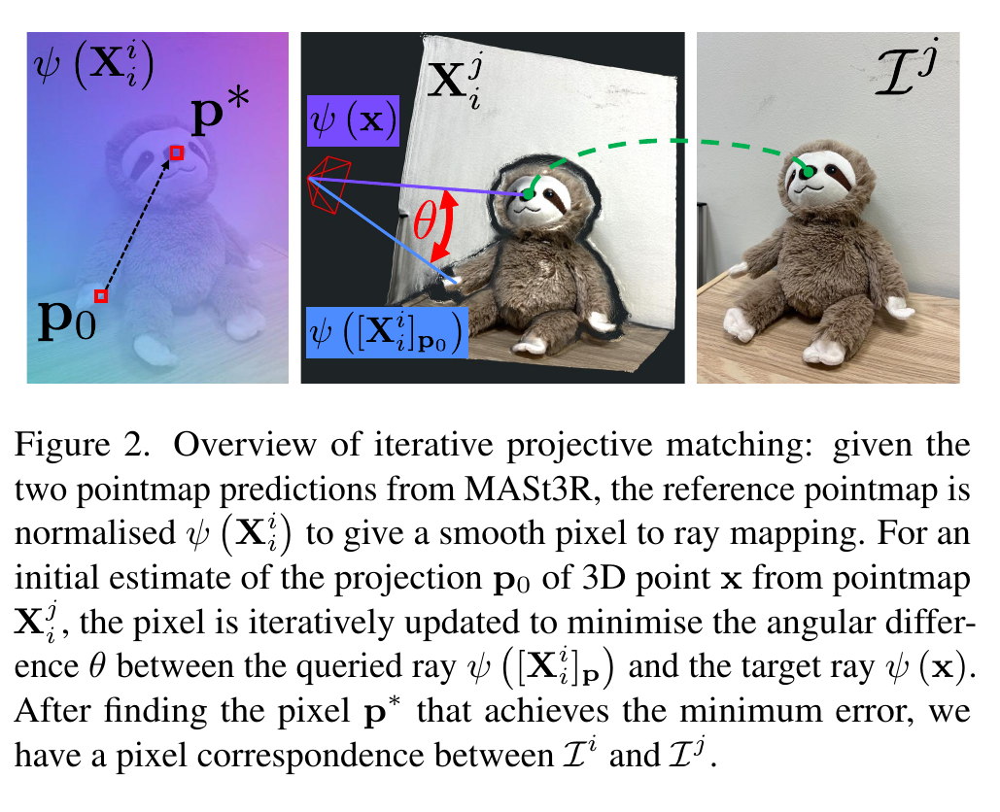
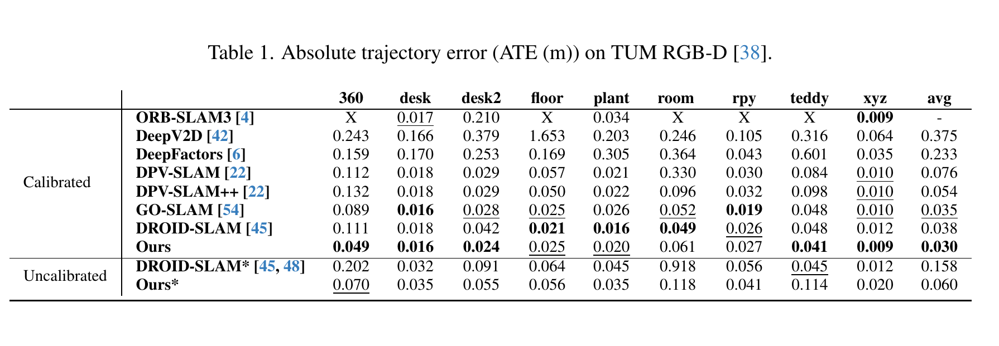
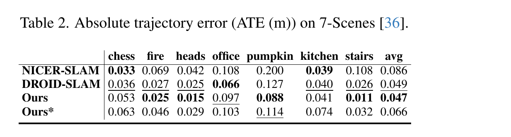
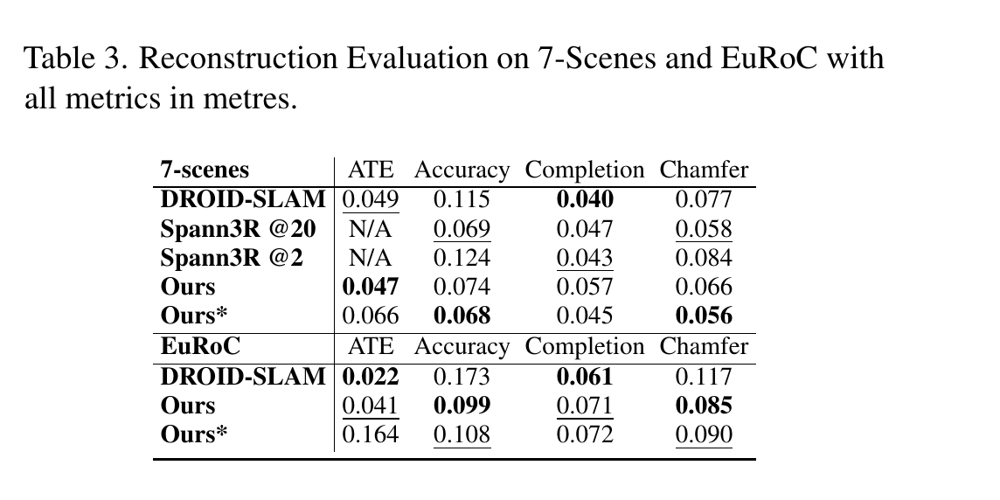
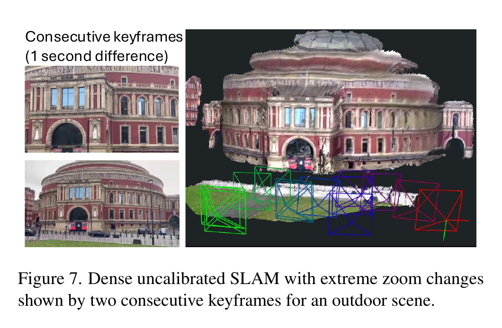
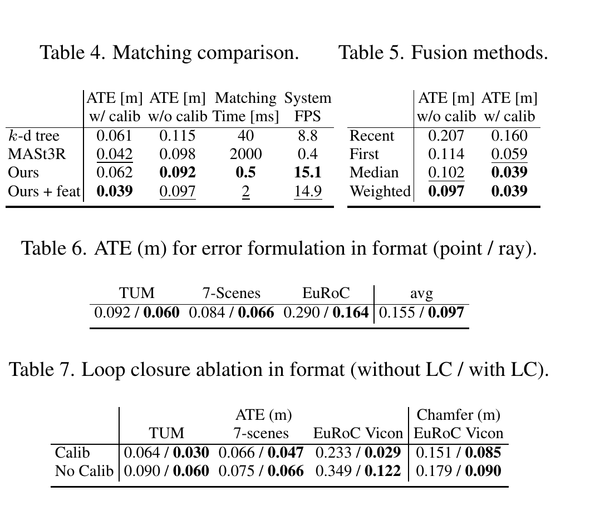
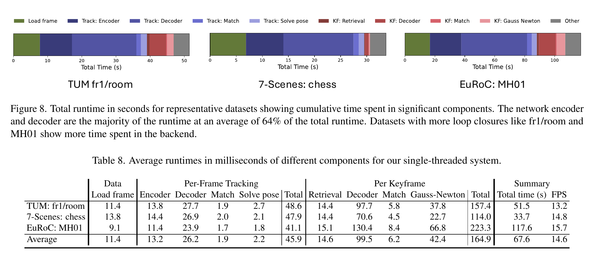

# MASt3R-SLAM 论文解读

> Riku Murai、Eric Dexheimer、Andrew J. Davison，*MASt3R-SLAM: Real-Time Dense SLAM with 3D Reconstruction Priors*，CVPR 2025。本文对应 CVPR 正式版。[论文页面](https://openaccess.thecvf.com/content/CVPR2025/html/Murai_MASt3R-SLAM_Real-Time_Dense_SLAM_with_3D_Reconstruction_Priors_CVPR_2025.html) · [论文 PDF](https://openaccess.thecvf.com/content/CVPR2025/papers/Murai_MASt3R-SLAM_Real-Time_Dense_SLAM_with_3D_Reconstruction_Priors_CVPR_2025_paper.pdf) · [补充材料](https://openaccess.thecvf.com/content/CVPR2025/supplemental/Murai_MASt3R-SLAM_Real-Time_Dense_CVPR_2025_supplemental.pdf) · [官方代码](https://github.com/rmurai0610/MASt3R-SLAM)

[MASt3R](../must3r/index.md) 能从两张图像直接预测同一坐标系下的稠密点图，还会为像素预测匹配特征。MASt3R-SLAM 将它作为前端几何先验，再接上跟踪、局部地图融合、回环和全局位姿优化，形成一个完整的单目稠密 SLAM 系统。它的关键取舍是：前端用点图给出的三维射线建立不依赖固定内参的对应关系，后端则用稀疏关键帧图控制长期漂移。作者报告系统在 RTX 4090 上约以 15 FPS 运行；有相机标定时，也能切换到标准像素重投影误差以提高精度。

*原论文图 3。新图像先与当前关键帧匹配并估计位姿，再更新局部点图；选为关键帧后进入图优化，检索到的回环候选经 MASt3R 验证后也加入后端。*

## 相关工作

稀疏单目 SLAM 通过少量三维地标和位姿图实现高效跟踪，但地图不够稠密，难以直接用于场景几何推理。稠密 SLAM 把深度或外观表示纳入优化；神经场和 Gaussian 方法能形成可渲染地图，却常受运行速度、深度先验或相机运动条件限制。用单目深度或法线作为先验也难以保证不同视图间的几何一致。

DUSt3R 与 MASt3R 将双视图关系直接编码为共同坐标系下的点图，MASt3R 还提供稠密匹配特征；但多视图一致性仍需额外融合或全局优化。MASt3R-SLAM 将这类点图视为前端的稠密伪测量，再用稀疏关键帧图和回环处理长期一致性。其相机假设也比固定针孔模型宽：只要求相机为中心投影，使每条像素射线都经过同一相机中心。

## 两视图点图如何成为 SLAM 先验

给定图像 $I^i$ 和 $I^j$，MASt3R 输出两张点图以及每像素的置信度和匹配描述子。记 $X_j^i$ 为图像 $j$ 的点图在相机 $i$ 坐标系中的表示；上标表示坐标参考系，下标表示对应图像。描述子帮助寻找跨图像像素对应，置信度则用于筛选和加权。网络一次预测出的两张点图已经把外观匹配、相对相机关系与三维结构联系起来，后端不必从二维光流单独推断这些量。

不过，预测点图并非没有误差。不同图像对可能有尺度偏差，深度也会出现不一致；若直接累计各对预测，地图会逐渐漂移。论文把相机状态建模为相似变换 $T\in\mathrm{Sim}(3)$，同时估计旋转、平移和尺度。这个 7 自由度状态允许优化器吸收不同点图预测之间的尺度差异。

$$
T=\begin{bmatrix}sR&t\\0&1\end{bmatrix},
\qquad T\leftarrow\tau\oplus T\triangleq\operatorname{Exp}(\tau)\circ T.
\tag{1}
$$

其中 $R\in\mathrm{SO}(3)$、$t\in\mathbb R^3$、$s\in\mathbb R$，$\tau\in\mathfrak{sim}(3)$ 是李代数中的 7 维增量。

相机模型也通过点图本身表达。对参考图像 $i$ 的点图逐像素归一化，定义

$$
\psi(X^i_i)_p=\frac{(X^i_i)_p}{\|(X^i_i)_p\|},
$$

得到每个像素方向上的单位射线。只要相机是中心相机，也就是所有视线经过同一个相机中心，这张射线图就提供了从像素到射线的映射，不必先假定针孔、鱼眼等某种固定的参数模型。系统依赖的是这个中心相机假设，并不覆盖没有单一投影中心的一般非中心相机。

## 用射线场进行稠密匹配

两个点图已经给出粗略三维关系，但 MASt3R 点图有深度误差，直接在三维空间找最近邻容易产生错配。MASt3R-SLAM 因此把“在图像中寻找对应像素”改写成局部数值优化：对另一张点图中的三维点 $x$，在参考图像 $i$ 的射线场中寻找方向最接近它的像素 $p$：

$$
p^*=\arg\min_p\left\|\psi\!\left([X^i_i]_p\right)-\psi(x)\right\|^2.
\tag{2}
$$

两边都是单位向量。若夹角为 $\theta$，平方距离为 $2(1-\cos\theta)$，因此最小化这个误差等价于寻找角度最接近的射线。论文用 Levenberg–Marquardt 迭代更新像素位置；射线图在图像上较平滑，几乎所有有效像素可在 10 次迭代内收敛。连续跟踪时，上一帧对应像素可作初值；首次匹配则从恒等像素映射开始。系统再用局部窗口内的描述子相似度细化位置，并剔除三维距离异常的遮挡点和离群点。

单位射线 $\psi_1,\psi_2$ 的关系为

$$
\|\psi_1-\psi_2\|^2=2(1-\cos\theta),
\qquad \cos\theta=\psi_1^\mathsf{T}\psi_2.
\tag{3}
$$

*原论文图 2。目标点 $x$ 的射线与参考射线图中的像素射线比较，迭代移动初始位置 $p_0$，直到找到方向误差较小的 $p^*$。这一步用方向而不是深度大小建立对应。*

这种局部投影匹配避开了所有像素两两比较的二次复杂度，也不需要 MASt3R 原有的全图粗到细搜索。两种匹配实现和整机速度不能混为一谈：消融表中，仅投影匹配耗时 0.5 ms，加入特征细化后为 2 ms；直接对全像素运行 MASt3R 匹配约需 2 秒。后两者都不是整个 SLAM 系统的帧耗时。

## 前端跟踪和局部点图融合

系统以关键帧为地图节点。新帧 $f$ 与当前关键帧 $k$ 运行一次 MASt3R，得到新帧的点图，再用上节的匹配关系估计相对变换 $T_{kf}$。一个直接的做法是最小化匹配点的三维距离，但错误深度会把位姿估计拉偏。作者改用射线误差：把变换后点和参考点都归一化，再最小化对应单位方向之间的差异。由于单位射线间的角距离有界，该误差对离群匹配和不可靠深度较稳健。匹配置信度参与加权，低于阈值的对应不进入优化；残差使用 Huber 鲁棒范数。

纯旋转时，方向几乎不变，单靠射线误差无法约束尺度和平移变化。系统因此另加一个权重较小的相机中心距离一致项，避免这种退化，同时不让深度误差主导位姿。把残差、雅可比和权重分别记为 $r,J,W$，一次高斯–牛顿迭代求解

$$
(J^\mathsf{T}WJ)\tau=-J^\mathsf{T}Wr,
\qquad T_{kf}\leftarrow\tau\oplus T_{kf}.
\tag{7}
$$

这里 $\tau$ 是相似变换的李代数增量，左乘更新在式（1）中定义。前端使用迭代重加权最小二乘来更新鲁棒权重。

相对位姿确定后，新预测点图先变换到关键帧坐标，再融合到该关键帧的规范点图。对每个像素，旧点图及其累计置信度记为 $\tilde X^k_k,\tilde C^k_k$，当前观测记为 $X^f_k,C^k_f$，更新为

$$
\tilde X^k_k\leftarrow
\frac{\tilde C^k_k\tilde X^k_k+C^k_f(T_{kf}X^f_k)}
{\tilde C^k_k+C^k_f},
\qquad
\tilde C^k_k\leftarrow\tilde C^k_k+C^k_f.
\tag{8}
$$

因此，点图不是只由最近一帧覆盖，也不会在前端对所有历史像素做完整联合优化，而是通过置信度加权的增量平均，融合多个视角的观测。关键帧的点图和位姿随后送入后端。

## 关键帧图、回环和全局优化

当当前帧与关键帧的有效匹配数或独立覆盖像素数低于阈值 $\omega_k$ 时，系统插入新关键帧，并与前一个关键帧建立双向边。时间相邻边能约束短程运动，但无法消除绕场景行走后的累积漂移。为寻找长短回环，系统使用 MASt3R-SfM 中的 ASMK 图像检索方法构建增量数据库：新关键帧编码后查询 Top-$K$ 候选；候选达到检索分数阈值 $\omega_r$ 后，再运行 MASt3R 解码和射线匹配，只有匹配数超过 $\omega_l$ 才加入图中。跟踪丢失时也查询该数据库，满足更严格的匹配条件后以新关键帧重定位。

后端联合优化所有关键帧位姿。对图中每条边 $(i,j)$，位姿相对变换为 $T_{ij}=T_{WC_i}^{-1}T_{WC_j}$，匹配点对提供两条应当一致的规范射线。全局目标是对所有边上的加权射线残差求和：

$$
E_g=\sum_{i,j\in\mathcal E}\sum_{m,n\in m_{i,j}}
\left\|
\frac{\psi(\tilde X^i_{i,m})-\psi(T_{ij}\tilde X^j_{j,n})}
{w(q_{m,n},\sigma_r^2)}
\right\|_\rho.
\tag{9}
$$

首个 Sim(3) 位姿固定为规范参考，以消除整体平移、旋转和尺度带来的 7 自由度规范不确定性。每条边只连接两个关键帧，因此高斯–牛顿法形成稀疏 Hessian；作者用解析雅可比、CUDA 并行累加和稀疏 Cholesky 求解，每次新增关键帧最多迭代 10 次并在收敛时提前停止。射线目标还配有较小的距离一致项，以免纯旋转退化。

若相机标定已知，系统会把点约束到标定相机的射线上，并将跟踪与后端残差换成像素重投影误差。像素误差更符合标准针孔相机下的测量噪声模型，也能用已有内参约束深度与几何；在未知标定或可能变化的相机模型下，射线误差则保留通用性。补充材料还给出了这些目标的解析雅可比、相对位姿到世界位姿的链式导数，以及初始化和逐组件运行时间。

## 实验结果和适用范围

实验在 Intel Core i9-12900K 与单张 NVIDIA RTX 4090 上运行；网络输入最大边缩放到 512 像素。论文为模拟实时输入，在多个基准上每隔一帧取样。轨迹 ATE 先做单目尺度对齐，报告均方根误差。TUM RGB-D 上，标定模式的平均 ATE 为 0.030 m，低于 DROID-SLAM 的 0.038 m；未标定模式为 0.060 m。7-Scenes 上，标定模式平均 ATE 为 0.047 m，略优于 DROID-SLAM 的 0.049 m；未标定模式为 0.066 m。ETH3D-SLAM 的未下采样快速运动序列中，作者报告系统在完成序列数与 ATE 曲线面积上均优于表中比较方法，体现其对跟踪失败的鲁棒性。

*原论文表 1。标定与未标定结果分开报告；“Ours*”代表没有输入相机标定。表中的 X 表示该方法未在对应序列给出结果。*

*原论文表 2。标定的 Ours 平均 ATE 为 0.047 m，未标定 Ours* 为 0.066 m。7-Scenes 提供的出厂内参较准确，作者指出这也有助于其未标定结果。*

稠密几何评估在 7-Scenes 和 EuRoC Vicon 房间序列上进行，采用 Accuracy、Completion 和 Chamfer Distance，单位为米，均为越低越好。在 7-Scenes，未标定 Ours* 的 Accuracy / Completion / Chamfer 为 0.068 / 0.045 / 0.056，DROID-SLAM 为 0.115 / 0.040 / 0.077。它的 Accuracy 和 Chamfer 较好，但 Completion 略差。EuRoC 上，Ours 的轨迹 ATE 为 0.041 m，高于 DROID-SLAM 的 0.022 m；但 Ours 的 Accuracy 与 Chamfer 更好（0.099 / 0.085，对照 0.173 / 0.117），Completion 则略差（0.071 对 0.061）。未标定 Ours* 在 EuRoC 的 ATE 为 0.164 m。作者说明该数据集有快速运动、大尺度轨迹和曝光变化，且 MASt3R 尚未针对这类畸变训练；他们先对图像去畸变，但没有把内参提供给其余流程。因此，结果支持“几何先验能产生较连贯的稠密地图”，并不意味着它在每个基准上都取得最低轨迹误差或所有几何指标最佳。

*原论文表 3。ATE 是轨迹误差，Accuracy、Completion 与 Chamfer 衡量点云几何；两个任务的指标需分别解释。*

组件消融揭示了几项设计各自解决的问题。密集 MASt3R 匹配耗时约 2 秒；本文的投影匹配加特征细化约 2 ms，论文称整机约快 40 倍。置信度加权平均融合优于只取最新或首个点图；未标定数据上平均 ATE 从最新点图的 0.207 m 降到 0.097 m。将三维点残差换为射线残差后，TUM、7-Scenes、EuRoC 的平均 ATE 分别从 0.092 / 0.084 / 0.290 m 降到 0.060 / 0.066 / 0.164 m。加入回环后，标定模式下 TUM ATE 从 0.064 降到 0.030 m、EuRoC Vicon ATE 从 0.233 降到 0.029 m；较长序列的收益尤其明显。

*原论文图 7。两张相邻关键帧有很大的变焦差异，系统仍由各自点图导出的射线关系进行匹配，并在共同地图中重建场景。*

*原论文表 4–7。匹配速度、融合方式、三维点误差与射线误差、以及回环的作用分别列在各表中。*

补充材料显示，三个代表序列的整机速度为 13.2–15.7 FPS，平均 14.6 FPS；单帧跟踪均值 45.9 ms，关键帧处理均值 164.9 ms。编码器和解码器约占总运行时间的 64%，更多回环会增加后端耗时，低延迟瓶颈主要在网络计算。这个速度是在上述桌面 GPU 和缩放输入条件下测得，不能直接外推到移动设备。

*补充材料图 8、表 8。前端每帧都执行跟踪，关键帧检索、解码和全局优化则按关键帧触发。*

## 方法关系与限制

MASt3R-SLAM 与 [VGGT-SLAM](../vggt-slam/index.md) 都把前馈三维几何作为 SLAM 的组成部分，但它围绕两视图点图建立一个关键帧优化系统：匹配、相机模型、地图和回环都显式进入图结构。与 [Spann3R](../spann3r/index.md) 直接预测流式全局点图不同，这里依靠显式回环和全局位姿优化处理长期一致性；也与 [DROID-SLAM](../droid-slam/index.md) 通过学习式匹配更新和稠密 BA 联合估计位姿、深度的路径不同。它展现了一种模块化系统路线：强几何预测器提供局部观测，传统 SLAM 的关键帧、鲁棒估计与稀疏图优化再负责跨时间整合。

这一组合也留下边界。第一，虽然前端持续融合规范点图，后端目前主要优化相机位姿，并未联合精化所有三维点，因此整个地图仍可能保留几何不一致。第二，MASt3R 训练图像以针孔相机为主，畸变增大时点图预测会退化；不显式假设针孔模型不等于网络预测对任意相机都准确。第三，完整分辨率解码是系统主要耗时来源，回环多时后端也会增加计算。作者将实时全局几何一致性、面向多种相机模型训练先验和提升网络吞吐量列为后续方向。
