# MASt3R-SfM 论文解读

> 这篇论文提出 MASt3R-SfM：把 MASt3R 的成对稠密几何与匹配能力组织成一个面向无序图像集合的 SfM 系统。作者用图像检索筛选要做精细推理的图像对，再以三维匹配完成全局初始化，最后通过带伪轨迹的二维重投影优化同时细化相机和深度。本文对应论文 arXiv v1（2024-09-27，18 页）：Bardienus Duisterhof、Lojze Zust、Philippe Weinzaepfel、Vincent Leroy、Yohann Cabon、Jérôme Revaud， [论文页面](https://arxiv.org/abs/2409.19152) · [PDF](https://arxiv.org/pdf/2409.19152v1)。

## 1. 引言

传统 SfM 依赖跨图像特征匹配建立三维点轨迹，再联合优化相机和三维点。这个流程在图像多、相邻帧重叠充分时很有效，但图像很少、视角跳变大或相机几乎没有平移时，匹配、三角化和 Bundle Adjustment（BA）都容易失败。逐步注册图像还会把早期误差传到后续步骤，因而工程系统通常需要 RANSAC 等鲁棒估计器和许多人工设计的策略。

DUSt3R 把两张图像的局部三维重建和所有点图的全局对齐分开处理；MASt3R 在此基础上增强了稠密几何与图像间匹配。但逐对运行模型需要处理约 $N^2$ 个图像对，图像集合变大时难以扩展。MASt3R-SfM 的核心做法是先用冻结编码器做近似检索，把完整匹配问题缩成稀疏场景图；再只在图边上运行 MASt3R 解码器，最后优化共享的相机与几何变量。全流程使用公开的 MASt3R 检查点，不需要为 SfM 任务再训练模型，也不使用 RANSAC。

图 1 展示论文要处理的两类困难：输入视图数量很少，以及各视图共享同一光心、没有平移基线的纯旋转情形。前者考验稀疏观测下的姿态恢复，后者会让传统三角化退化。

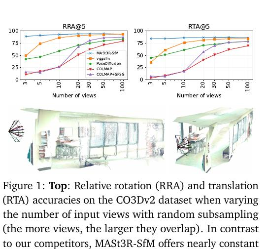

## 2. 相关工作

传统 SfM 以匹配和 BA 为中心：匹配结果给出重投影误差，BA 联合调整相机和三维点。由于错误匹配会让非线性最小二乘落入较差的局部解，实际管线会用 RANSAC 估计相对位姿、构造轨迹并过滤离群点。增量式注册能逐步扩大场景，但也可能传播前面阶段的错误。

近期方法尝试简化或重构 SfM。FlowMap 和 ACE-Zero 在测试时优化网络，分别预测深度图和稠密场景坐标，但它们依赖相邻图像视角与外观足够连续的输入；遇到无序图像时，信息难以逐张传播。VGGSfM、DF-SfM 和 DUSt3R 等使用冻结的神经网络组件，但仍面临少视图、低重叠或依赖传统求解步骤的问题。MASt3R-SfM 的定位是把 MASt3R 的成对预测直接构成一个可扩展的全局重建系统。

SfM 中的图像检索先用廉价表示估计图像相似度，再只对可能重叠的图像对执行昂贵匹配。本文将 MASt3R 编码器的局部 token 特征与 ASMK 检索结合，避免另接一个独立的图像描述子模型。

## 3. 预备知识

给定图像 $I^n$ 和 $I^m$，MASt3R 可写成 $f(I^n,I^m)=\mathrm{Dec}(\mathrm{Enc}(I^n),\mathrm{Enc}(I^m))$。共享的 Siamese ViT 编码器把一幅图像编码成特征张量 $F\in\mathbb R^{h\times w\times d}$；两个解码器从特征中预测像素级点图 $X$、局部匹配特征 $D$ 及其置信度。点图把每个像素映射到三维点，因此可以恢复相机内参和深度；局部特征经 FastNN 搜索得到互为近邻的稀疏像素对应。

记图像对 $I^n,I^m$ 的对应集合为

\[
\mathcal M^{n,m}=\{y_c^n\leftrightarrow y_c^m\}_{c=1}^{|\mathcal M^{n,m}|},
\]

其中 $y_c^n,y_c^m\in\mathbb N^2$ 是两张图上的像素坐标。后续的粗对齐会比较这些对应像素各自预测的三维点，精化阶段再把一个视图的三维点投影到另一个视图，检查是否回到对应像素。

图 2 概括完整数据流：编码器特征用于稀疏图构建，图边送进 MASt3R 解码器形成点图和匹配，随后依次进行三维匹配损失优化与二维重投影优化。

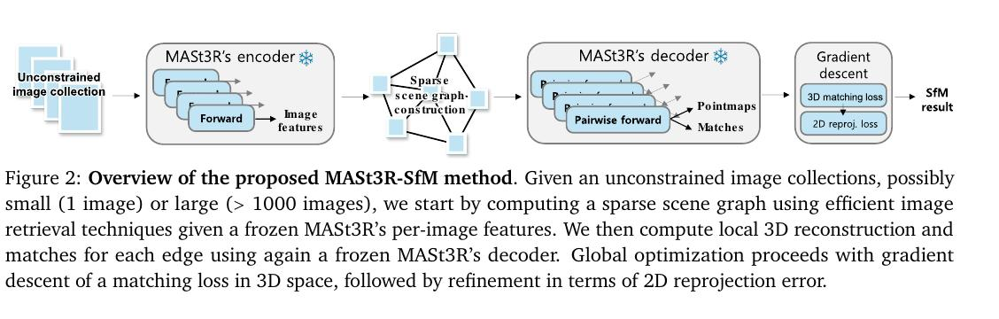

## 4. 方法

输入是同一静态场景的无序图像集合 $V=\{I^n\}_{n=1}^N$。每张图像有内参 $K_n$ 和外参 $P_n$，系统要恢复相机参数和对应场景点图。论文把方法分成场景图构建、局部重建、粗对齐与精化四步。

### 4.1 场景图

若对所有 $N$ 张图像都运行 MASt3R，图像对数会随 $N^2$ 增长。作者先为每张图像缓存编码器 token，再把 token 当作局部特征：经过白化和码本量化后，以 ASMK 聚合各码本残差并二值化，得到稀疏图像表示。两个表示的相似度 $S_{nm}\in[0,1]$ 用于估计它们可能共享的视野。ASMK 的白化矩阵和码本可预先从代表性特征计算，因此该检索步骤不需要额外训练。

设 $N_a$ 是锚点图像数，$k$ 是每张非锚点图像连接的近邻数。作者在相似度矩阵上使用最远点采样选出 $N_a$ 个锚点，将锚点彼此连成稠密核心；其余每张图像连接到最相似的锚点和 $k$ 个非锚点近邻。由此场景图保持连通，边数为 $O(N_a^2+(k+1)N)$。当 $N_a,k$ 固定时，这部分是关于图像数的线性边数，而全对检索在理论上仍需 $N^2$ 个相似度；论文将其称作准线性，是基于该编码器检索在实践中很快这一观察，不是严格的总计算复杂度保证。默认 $N_a=20,k=10$。

### 4.2 局部重建

对每条场景图边，MASt3R 的推理具有输入顺序依赖性，因此作者对 $(I^n,I^m)$ 和反向的 $(I^m,I^n)$ 都运行一次模型，并合并两个方向的匹配。每次推理为两幅图各给出一个在本图坐标中的点图估计。例如图像 $I^n$ 在若干邻接图像对中会得到多份 $X^{n,e}$ 与对应置信度 $C^{n,e}$。为减小成对预测噪声，作者对每个像素做置信度加权平均，得到规范点图：

\[
\widetilde X_{i,j}^{n}=\frac{\sum_{e\in E_n}C_{i,j}^{n,e}X_{i,j}^{n,e}}{\sum_{e\in E_n}C_{i,j}^{n,e}}. \tag{1}
\]

这里 $E_n$ 是与图像 $I^n$ 相连的边集合。置信度高的点图预测对均值贡献更大；聚合结果的第三个坐标分量作为规范深度 \(\widetilde Z^n\)。

规范焦距由 Weiszfeld 算法估计。假设主点位于图像中心、像素为正方形，针孔相机下横纵方向由焦距 $f$ 解释的比例应相同，因此通过最小化像素中心坐标与点图投影坐标之间的二维欧氏距离和来求 $f_n^*$：

\[
f_n^*=\arg\min_f\sum_{i,j}\left\|\begin{bmatrix}i-W/2\\j-H/2\end{bmatrix}-f\begin{bmatrix}\widetilde X^n_{i,j,1}/\widetilde X^n_{i,j,3}\\\widetilde X^n_{i,j,2}/\widetilde X^n_{i,j,3}\end{bmatrix}\right\|. \tag{2}
\]

其中 $W,H$ 为图像宽高，点图的前两维是相机坐标下的横纵坐标，第三维是深度。最小化后得到规范内参 \(\widetilde K_n\)。该设置采用无畸变针孔相机；作者指出方法可以扩展到其他相机模型，但本文实验没有这样做。

### 4.3 粗对齐

每张图的规范点图仍在各自坐标系中，需通过相机变换放入同一世界坐标系。令投影函数为

\[
\pi_n(x)=K_nP_n\sigma_nx,
\]

其中 $P_n$ 是由旋转和平移构成的刚体变换，\(\sigma_n>0\) 是每台相机的尺度。因为每幅图的规范深度只确定到尺度，使用带尺度的刚体变换才能在全局对齐中处理这个自由度。

相机内参和深度先固定在规范预测值上。对于图边上第 $c$ 个匹配，\(\chi_c^n,\chi_c^m\) 表示将两张图中对应像素反投影得到的三维点，\(q_c\) 是 MASt3R 给出的匹配置信度。粗对齐求一组全局尺度与外参，使成对三维点尽可能重合：

\[
(\sigma^*,P^*)=\arg\min_{\sigma,P}\sum_{(n,m)\in E}\sum_{c\in\mathcal M^{n,m}}q_c\left\|\chi_c^n-\chi_c^m\right\|^{\lambda_1}. \tag{3}
\]

指数 \(\lambda_1\) 控制误差对大残差的敏感程度，实验采用 1.5。尺度整体存在规范自由度，因此每次迭代把尺度重参数化为 \(\sigma_n=\sigma'_n/\min_j\sigma'_j\)，固定最小尺度为 1。优化器使用 Adam，执行固定迭代次数。这个阶段只调整各点图的整体相对变换，速度较快，并为后面的非凸精化提供初始化。

### 4.4 精化

规范点图存在局部深度误差，粗对齐也无法改变其内部形状。作者接着优化每幅图的深度、内参、外参和尺度，使跨视图投影后的像素位置贴近观测到的匹配位置。点图由相机参数和深度约束生成：

\[
\chi^n_{i,j}=\pi_n^{-1}(\sigma_n,K_n,P_n,Z^n_{i,j})=\frac{1}{\sigma_n}P_n^{-1}K_n^{-1}Z^n_{i,j}[i,j,1]^\top.
\]

此处先把像素齐次坐标 \([i,j,1]^\top\) 乘深度，再用逆内参得到相机坐标，最后经逆外参和尺度换算到共同坐标系。定义对称重投影目标：

\[
\begin{aligned}
(Z^*,K^*,P^*,\sigma^*)&=\arg\min_{Z,K,P,\sigma}L_2,\\
L_2&=\sum_{(n,m)\in E}\sum_{c\in\mathcal M^{n,m}}q_c\Big[\rho(y_c^n-\pi_n(\chi_c^m))+\rho(y_c^m-\pi_m(\chi_c^n))\Big], \tag{4}
\end{aligned}
\]

\(\pi_n(\chi_c^m)\) 是把图像 $m$ 的匹配点变换并投影到图像 $n$ 后得到的位置，因此两项分别计算两个方向的像素重投影误差。鲁棒函数通常取 \(\rho(x)=\|x\|^{\lambda_2}\)，其中 $0<\lambda_2\le1$，实验用 \(\lambda_2=0.5\)，降低潜在离群匹配的影响。式（4）只有稀疏匹配，来自不同图像对的坐标通常不会精确落在中间图像的同一个像素上；若每个对应各自优化深度，它们可能被拉到相距很远的位置。

为共享这些几何约束，作者构造伪轨迹：在每幅图上按间隔 \(\delta\) 放置锚点，锚点像素坐标为

\[
\widehat y_{u,v}=\left(u\delta+\frac{\delta}{2},v\delta+\frac{\delta}{2}\right). \tag{5}
\]

对任意像素 $(i,j)$，令 \((u,v)=(\lfloor i/\delta\rfloor,\lfloor j/\delta\rfloor)\)，把它的深度绑定到最近锚点的可优化深度 \(\widehat Z^n_{u,v}\)：

\[
Z^n_{i,j}=o_{i,j}\widehat Z^n_{u,v},\qquad o_{i,j}=\frac{\widetilde Z^n_{i,j}}{\widetilde Z^n_{u,v}}.
\]

比例 $o_{i,j}$ 在初始化时由规范深度图计算并固定，保留局部相对深度形状；邻近像素则共享一个锚点的可优化深度。\(\delta=8\) 时，每张图的深度自由变量约减少到原来的 $1/64$。作者假设规范深度在局部足够准确，于是只需调整较稀疏的锚点深度。

图 3 展示优化变量之间的关系：焦距构成内参，四元数和平移构成外参，锚点深度生成深度图；三者经针孔反投影形成受约束点图，式（3）、（4）的损失都作用于这些点图。

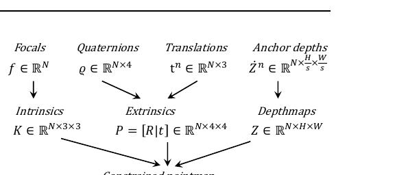

## 5. 实验结果

### 5.1 实验设置

除非特别说明，实验使用公开 MASt3R 检查点且不微调。默认 $N_a=20,k=10,\delta=8$，FastNN 匹配也使用 8 像素网格。粗阶段 Adam 学习率为 0.07、迭代 300 次、\(\lambda_1=1.5\)；精化阶段学习率为 0.014、迭代 300 次、\(\lambda_2=0.5\)。二者均采用余弦学习率调度且无权重衰减。默认所有视图共享内参，优化一个场景级焦距。

数据覆盖 Tanks&Temples（T&T）、ETH3D、CO3Dv2、RealEstate10K、Mip-NeRF 360 和 LLFF，分别包含高重叠视频帧、无序照片、物体中心视图和新视角合成场景。T&T 没有官方位姿真值，作者用全量帧经 COLMAP 得到伪真值。ATE 将估计相机中心通过 Procrustes 对齐到真值并报告平均归一化误差；未注册相机被排除，这会有利于拒绝困难图像的方法，而 MASt3R-SfM 按设计始终输出所有相机。RTA@\(\tau\)、RRA@\(\tau\) 是图像对级的平移与旋转准确率；mAA@\(\tau\) 根据两者角误差的较小值计算阈值范围内的曲线面积；Reg 表示成功注册比例。不同数据集的指标不可脱离这些协议直接横向解释。

### 5.2 与现有方法比较

**T&T 视图数量变化。** 作者从原始序列均匀抽取 25、50、100、200 张以及全量图像。表 1 左侧的 MASt3R-SfM 在五种设置中注册率都是 100%，ATE 从 0.0336 随输入增多降至 0.0106。COLMAP 在少视图时注册率较低，ACE-Zero、FlowMap 和 VGGSfM 的误差下降更明显；FlowMap 与 VGGSfM 在大集合实验中还出现显存不足或未收敛。这里的真值来自全量高重叠序列，因此结果说明该方法在这一基准协议下较稳健，不等同于独立测得绝对真实精度。

**FlowMap 划分。** 表 1 右侧使用 FlowMap 论文选出的连续帧子集和场景。MASt3R-SfM 在 Mip-360、LLFF、T&T、CO3Dv2 上的 ATE 分别为 0.00079、0.00098、0.00215、0.00538。论文报告其整体与 FlowMap 接近，略低于只面向视频设置的 DROID-SLAM；同一论文还指出，FlowMap 的结果会随具体抽帧设置变化，因此这一表格不能单独证明对所有输入采样都占优。

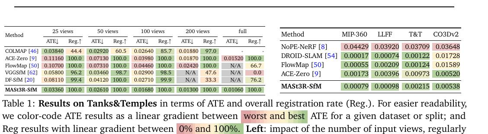

**多视图位姿估计。** 表 2 对 CO3Dv2 和 RealEstate10K 各输入 10 张随机图像。MASt3R-SfM 在 CO3Dv2 上的 RRA@15、RTA@15、mAA@30 分别为 96.0、93.1、88.0；RealEstate10K 的 mAA@30 为 86.8。比较中含有多视图方法，也含逐对方法；括号数值有些来自 8 张输入而不是 10 张，作者在表注中专门标明。因此不能把所有行都理解为完全相同输入数下的公平对比。此任务只评价相机位姿，不评价重建几何。

**无序照片集合。** ETH3D 的 13 个场景包含最多 76 张图像，图像间重叠低于视频序列。表 3 给出逐场景 RRA@5、RTA@5；MASt3R-SfM 平均分别为 81.2 和 79.7，在整体均值上超过列出的对比方法，但并非每个场景、每个指标均最好，例如 courtyard 的 RTA@5 低于 DF-SfM，meadow 也不是最高值。按场景展开比单一平均数更能呈现方法对不同图像集合的敏感性。

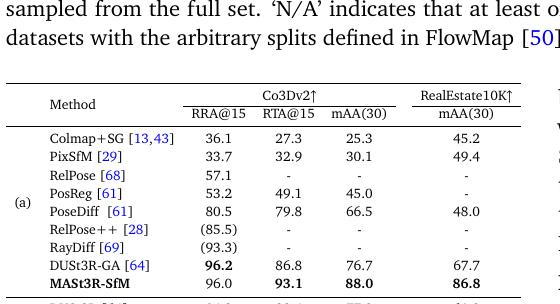

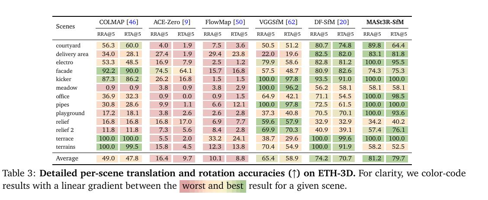

**场景图消融。** 表 4 对比完整图、局部窗口、随机配对和检索配对。T&T-200 上完整图有 39,800 条边，ATE 0.01256，RTA@5 75.9，RRA@5 74.8，显存 29.9 GB，时间 2.2 小时。局部窗口和随机图约 2,700 条边、运行约 14 分钟，但精度较弱；检索图有 2,758 条边，ATE 0.01243，运行 14.3 分钟，RTA@5 70.9、RRA@5 67.6。完整图精度稍高但代价约高一个数量级；检索图在资源与精度间折中。作者同时强调没有对完整图报告尺度实验，因此不能直接从单一集合推导更大规模的时间规律。

**检索特征与定位。** 表 6 以 Aachen Day-Night、InLoc 等视觉定位数据比较 MASt3R-ASMK、全局池化和训练投影特征检索。ASMK 基于局部 token 的方法总体有竞争力；学习投影虽改善独立检索验证集上的 mAP，在视觉定位中没有显著收益，所以主系统保留无需训练的 ASMK。具体定位数值和参照系统见原表。

**优化层级和共享内参。** 表 5 显示只用 kNN 或只连锚点都弱于两者结合；只做粗优化 ATE 为 0.01504，加入精化后为 0.01243；固定深度的精化为 0.01315。粗对齐提供精化所需的合理初始化，精化进一步利用二维重投影约束。共享场景焦距为 0.01243，独立内参为 0.01329，说明该设置下共享焦距略好，但差异较小。

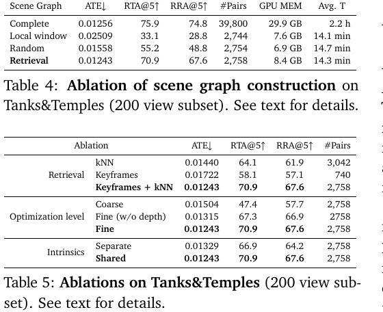

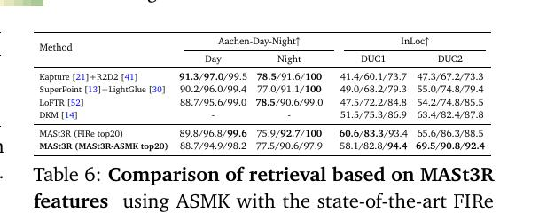

### 5.3 消融实验

图 4 改变粗对齐与精化的迭代次数，绘制 T&T-200 上的 RTA@5 和 RRA@5。精化无法从完全随机的相机位姿中恢复出可靠结果；粗阶段约 250 次迭代后，位姿通常达到足以开始精化的质量，之后精化能持续改善。作者还观察到冻结规范深度后，精度下降相对有限，侧面说明 MASt3R 的初始深度已较有质量。

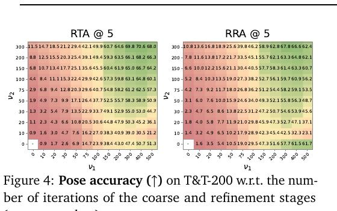

## 6. 结论

MASt3R-SfM 将成对基础模型的局部三维预测转化为可处理无序图像集合的全局 SfM 管线。它通过检索图控制精细匹配的边数，以置信度加权的规范点图聚合降低局部噪声，再用三维对齐初始化非凸的二维重投影精化。锚点伪轨迹把邻近像素深度绑在一起，减少自由变量并让不同图像对的匹配约束更容易共享。

论文在少量视图、低重叠照片集和纯旋转案例中展示了优势，但证据仍有边界：T&T 的真值是 COLMAP 伪真值，且排除未注册相机会影响比较；若干基准来自视频帧；纯旋转实验仍有失败案例；方法质量依赖 MASt3R 的局部几何和匹配先验。论文因此呈现的是一条训练时冻结、推理时全局优化的 SfM 路线，而非免于匹配歧义或退化条件的通用保证。

## 附录 A：定性重建结果

图 5 展示 T&T 与 ETH3D 的场景重建。附录说明这些是未经后续精化的原始输出：尽管优化用稀疏对应，反投影函数仍可为图像中每个像素生成三维点；输入图像最长边缩放至 512 像素，因此每幅图大约得到 20 万个点。这里的稠密性来自预测深度图，而不是稀疏匹配数本身。

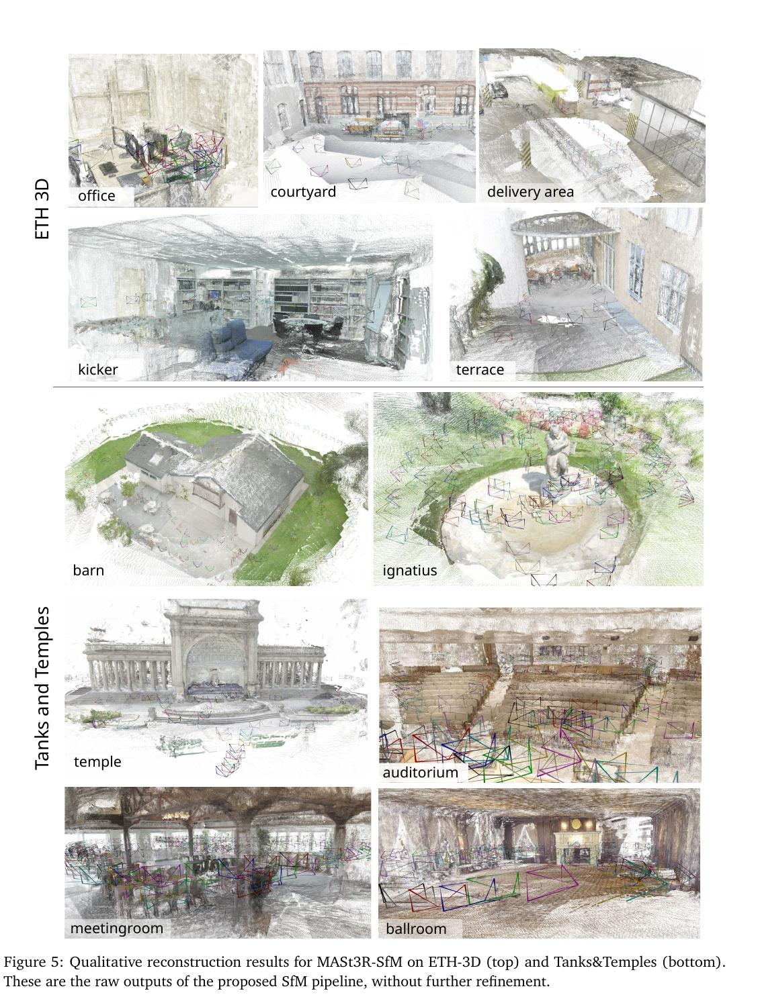

## 附录 B：MASt3R 特征的其他检索方式

表 7 比较 ASMK 局部特征、全局平均池化加 PCA 白化，以及在冻结特征上训练投影后再使用 ASMK。全局平均池化略优于最大池化，但定位结果仍弱于 ASMK。训练投影使用 MASt3R 训练数据的三维点重叠构造正负对，在验证集检索 mAP 上有所提升，实际定位增益却不显著，所以作者选择不训练投影的配置。这个实验支持“MASt3R 编码特征可用于检索”，但不能证明所有数据域下 ASMK 都优于学习描述子。

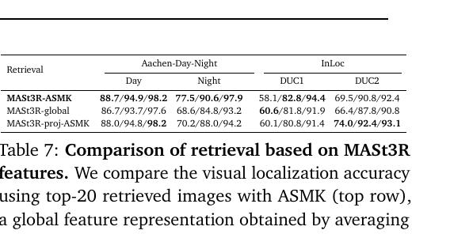

## 附录 C：纯旋转鲁棒性与失败案例

作者从 InLoc 全景图生成同一光心下的透视裁切，每个序列有 36 张、视场角 60° 的图像，俯仰角每 30° 采样；从 DUC1、DUC2 选出 20 组测试旋转估计。传统三角化在没有平移基线时缺少深度约束，COLMAP、VGGSfM 等方法表现很差；MASt3R-SfM 在部分场景可达到 100% RRA@5，但也有失败。固定锚点深度略微改善该实验。

表 8 汇报各方法在纯旋转序列上的结果；图 6 展示失败样例。作者将失败归因于外观相似结构之间的错误匹配：即使几何验证也可能留下这类困难离群点，有些误匹配从单张图像上很难被人察觉。因此去掉 RANSAC 并不意味着系统无需面对匹配歧义，其鲁棒性主要来自 MASt3R 的预测和全局目标。

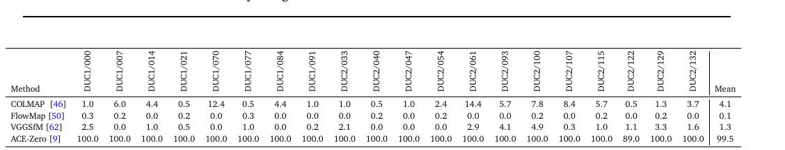

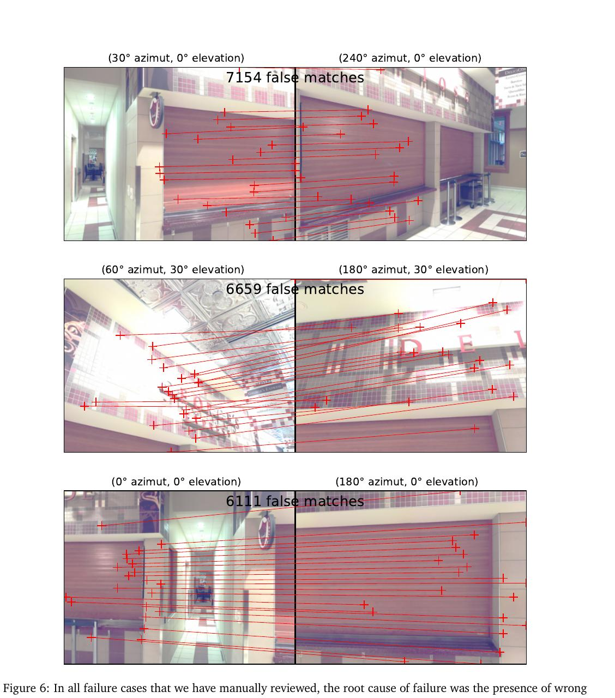

## 附录 D：更多实验结果

表 9 扩展 CO3Dv2 和 RealEstate10K 的输入数量，报告 3、5、10 张随机图像下与多视图和逐对位姿估计基线的比较。作者报告 MASt3R-SfM 仅次于 DUSt3R 的若干最好结果，且未在 RealEstate10K 上训练；有些对比方法表中括号结果使用 RealEstate10K 训练数据，实验条件并不完全一致。

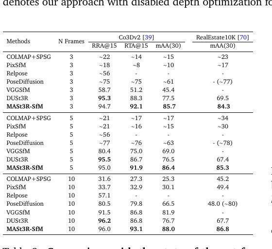

表 10 展开 T&T 每个场景的 ATE、RTA@5、RRA@5 与注册率。数据说明总平均掩盖了场景差异：方法对不同纹理、重叠与场景结构仍表现不一；表中的缺项可能表示未收敛、运行错误或缺少真值，不能当成零误差。

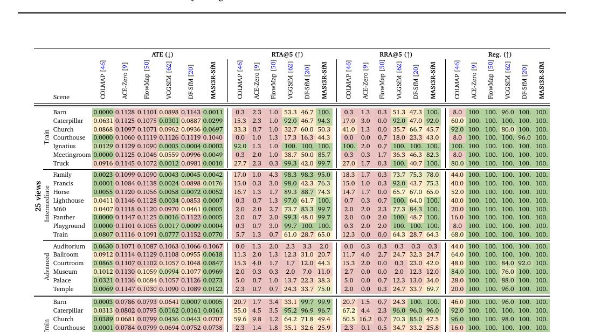

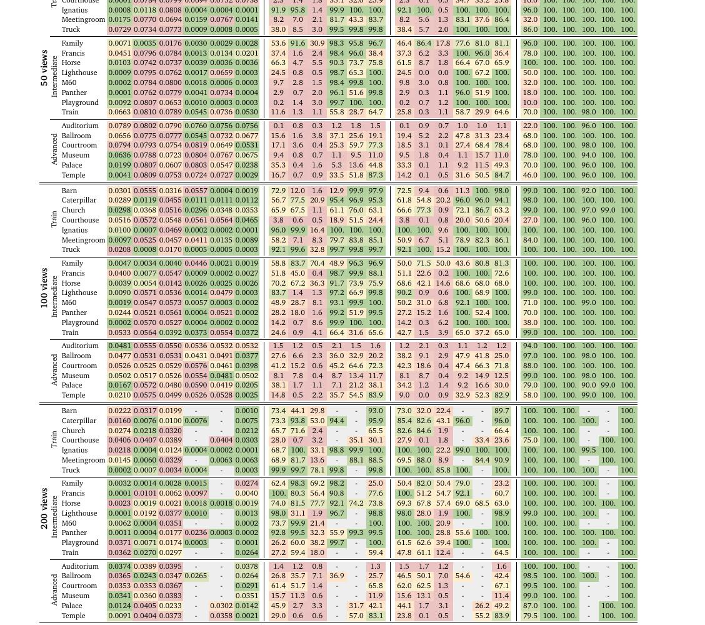

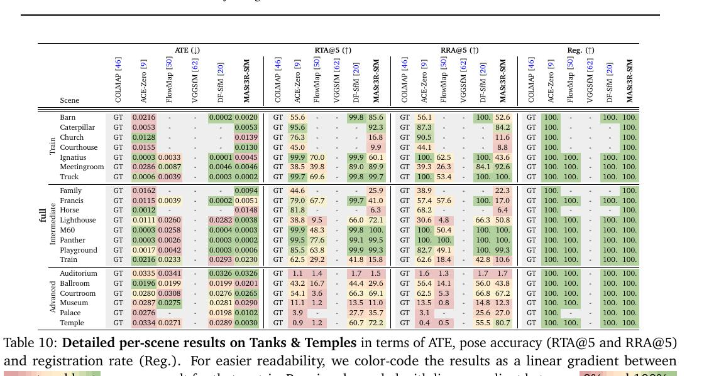

## 附录 E：更多消融实验

图 7 改变锚点数 \(N_a\) 与近邻数 \(k\)，分别观察平移和旋转准确率。增加任一参数通常能提升精度，收益在 \(N_a\ge20\) 或 \(k\ge10\) 后趋于饱和。这为默认场景图稀疏度提供了实验依据；它不意味着其他数据集或不同算力预算下同一阈值必然最优。

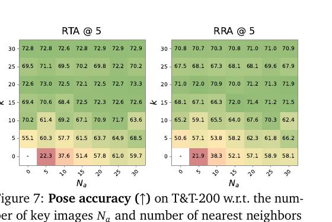

## 附录 F：相机参数化

经典相机参数化下，旋转的微小变化会按点深度放大成较大的三维点位移，使优化变量之间耦合。作者将相机旋转中心从光心移至沿相机 \(z\) 轴、位于点云中位深度平面的点。针孔相机内参与刚体外参分别写成

\[
K_n=\begin{bmatrix}f_n&0&c_x\\0&f_n&c_y\\0&0&1\end{bmatrix},\quad(c_x,c_y)=(W/2,H/2), \tag{6}
\]

\[
P_n=\begin{bmatrix}R_n&t_n\\0&1\end{bmatrix}, \tag{7}
\]

其中旋转 \(R_n\) 内部用四元数表示，平移为 \(t_n\)。定义沿 \(z\) 轴移动的矩阵

\[
\widetilde T_n=\begin{bmatrix}1&0&0&0\\0&1&0&0\\0&0&1&\widetilde m_{nz}\\0&0&0&1\end{bmatrix},\qquad P_n=\widetilde T_nP'_n, \tag{8}
\]

其中 \(\widetilde m_{nz}=\operatorname{median}(\widetilde Z_n)f_n/\widetilde f_n\)，即规范深度中位数乘以当前焦距和规范焦距之比。参数更新以中位深度附近的点为参考，减小相机轻微扰动对三维点位置的影响。

第二个问题是重叠视图的相机参数会相互耦合。作者把相机组织成有根运动学树 $T=(V,D)$，边 (n\to m) 存储相对位姿，沿树递推全局位姿：

\[
P_m=P_{n\to m}P_n,\qquad (n\to m)\in D. \tag{9}
\]

根相机和树边的相对位姿是待优化量，参数总数与独立相机参数化相同，但更新通过相对关系传播。作者比较星形树、最大生成树，以及基于检索相似度或实际对应数量的层次聚类树。表 11 中“按对应数量层次聚类”最好：ATE 0.01243、RTA@5 70.9、RRA@5 67.6；无相机重参数化为 0.01445、56.0、52.5。检索相似度聚类和最大生成树也优于星形树，说明优化变量的组织方式会影响收敛。

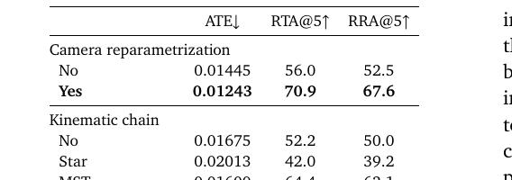

需要区分场景图 (G) 与运动学树 (T)：前者决定哪些图像对执行 MASt3R 局部推理，后者决定全局优化时如何参数化相机位姿；论文明确指出两者只共享图像节点，没有其他结构关系。

## 参考资料

- Duisterhof et al., “MASt3R-SfM: a Fully-Integrated Solution for Unconstrained Structure-from-Motion,” arXiv:2409.19152v1, 2024. [论文页面](https://arxiv.org/abs/2409.19152) · [PDF](https://arxiv.org/pdf/2409.19152v1) · [官方代码](https://github.com/naver/mast3r/)。
