# Mem3R 论文解读

> Changkun Liu、Jiezhi Yang、Zeman Li、Yuan Deng、Jiancong Guo、Binbin Xu、Luca Ballan，*Mem3R: Streaming 3D Reconstruction with Hybrid Memory*，已被 WACV 2027 接收。本文以作者项目页发布的会议版 PDF 为主要依据；结构细节另对照 arXiv v1 的补充材料。[作者项目页](https://lck666666.github.io/Mem3R/) · [WACV 2027 版 PDF](https://lck666666.github.io/Mem3R/Mem3R_WACV_2027.pdf) · [arXiv v1 论文页](https://arxiv.org/abs/2604.07279v1) · [arXiv v1 PDF](https://arxiv.org/pdf/2604.07279v1) · [代码仓库](https://github.com/lck666666/Mem3R)

长视频重建既要跟踪相机运动，也要把新看到的几何写入场景。CUT3R 将这两项工作放进同一个循环状态中，状态大小固定，显存不随序列增长，但位姿和地图线索会争用有限容量。Mem3R 的核心选择是拆开这两类记忆：用测试时更新的 MLP 快速权重保存相机跟踪线索；用固定数量的显式状态 token 继续累积场景几何。新帧仍通过 Transformer 解码器与几何状态交互，解码器给出的候选状态再由逐通道门控融合。

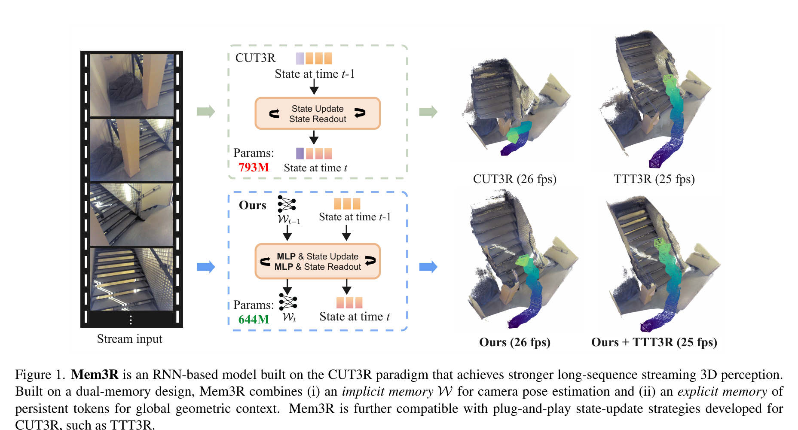

*原论文图 1。上半部将 CUT3R 的位姿状态 token 与几何状态合用的结构，同 Mem3R 的隐式位姿记忆和显式几何状态作比较；右侧展示 CUT3R、TTT3R、Mem3R 和 Mem3R + TTT3R 的重建及帧率。图中参数量从 793M 降至 644M。*

## 相关工作

离线前馈重建模型从 DUSt3R 的双视图点图发展到 VGGT 等多视图 Transformer，能联合预测相机与几何，但全局注意力需要同时处理整段输入。流式方法改为逐帧更新：因果缓存保留每帧的 KV，存储随时间增长；CUT3R 一类循环模型将历史压进定长状态，显存稳定，却可能在长序列中遗忘早期观测。

TTT3R 与 TTSA3R 为 CUT3R 的状态写入加入免训练门控，Point3R 则把历史特征关联到显式三维点以便回看。Mem3R 沿循环状态路线改造记忆分工：位姿线索由测试时更新的快速权重保存，场景几何仍留在显式状态 token 中。它再通过独立的通道门控制几何写入，因此与前两类门控方法可以组合。

## 两类历史信息由不同记忆承担

在 CUT3R 中，图像编码器从当前帧 $I_t$ 提取图像 token $F_t$，再与可学习的位姿 token $z_t$ 拼接为 $X_t=[z_t,F_t]$。解码器读取上一步的显式状态 $S_{t-1}$，同时输出当前帧特征和更新后的状态：

$$
X'_t,\ \bar S_t=\operatorname{Decoders}(X_t,S_{t-1}).
\tag{1}
$$

$\bar S_t$ 直接成为递归状态，位姿 token 则与图像特征一起承担当前相机预测。这样做结构统一，但位姿相关信息和场景几何信息需要由同一套状态读写模块处理。Mem3R 保留显式状态用于几何，把 CUT3R 中负责位姿线索的 pose token 记忆及其局部 Transformer 读写模块替换为快速权重 MLP。

对当前帧，编码器仍输出 $F_t$。模型从当前视觉 token 形成经 L2 归一化的查询特征 $\kappa_t$，再用上一步快速权重 $W_{t-1}$ 读出位姿 token 先验 $\hat p_t$：

$$
\hat p_t=f_{W_{t-1}}(\kappa_t).
\tag{3}
$$

这里的 $\hat p_t$ 是供解码器进一步修正的特征 token，并非已经解码成平移和旋转的相机位姿。解码器把该 token、当前图像 token 和显式几何状态放在一起处理：

$$
X'_t,S'_t=\operatorname{Decoders}([\hat p_t,F_t],S_{t-1}),\qquad
X'_t=[p_t,F'_t].
\tag{4}
$$

$p_t$ 是融合当前图像和已有几何上下文后的位姿后验 token，$F'_t$ 是状态增强的图像特征，$S'_t$ 是解码器提出的候选几何状态。之后，位姿头根据 $p_t$ 输出六自由度相机位姿；局部点图头使用 $F'_t$，世界点图头使用 $(p_t,F'_t)$，两者分别预测点图和置信度。快速权重从先验—后验关系更新，显式几何状态则经过独立的门控更新。两条更新路径因此共享当前帧的 Transformer 解码，但历史状态并不混为一组 token。WACV 版消融表将 CUT3R 被替换的位姿 LocalMemory 标为 152M 参数；混合结构把这部分位姿记忆压到更小的 MLP 快速权重中。

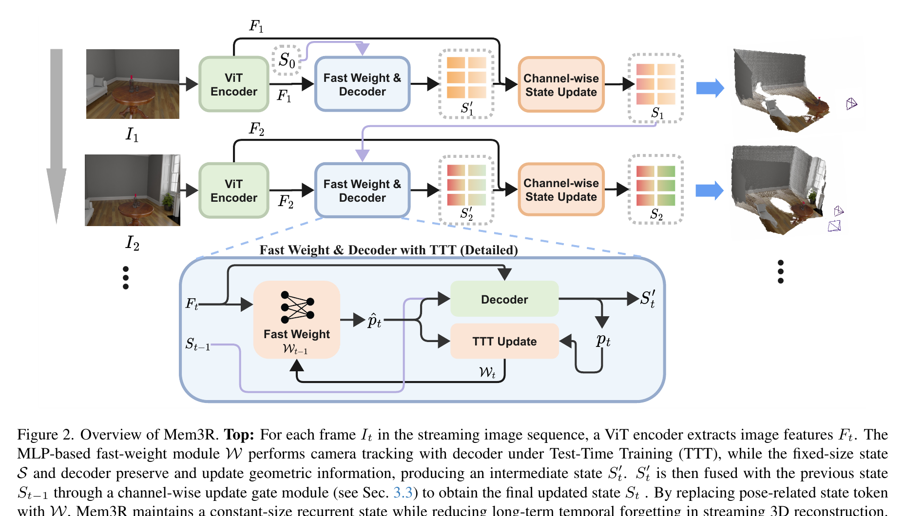

*原论文图 2。每帧视觉特征同时进入快速权重位姿分支和显式几何状态分支。位姿先验与解码器得到的后验用于快速权重更新；候选几何状态则通过逐通道门控与旧状态融合。*

## 快速权重为相机跟踪保留历史

Mem3R 将位姿分支实现为 SwiGLU MLP。对输入特征 $x$，其基本映射写成

$$
f_W(x)=W_2\bigl(\operatorname{SiLU}(W_1x)\odot(W_3x)\bigr),
\tag{2}
$$

其中 $W_1,W_2,W_3$ 是测试时会变化的快速权重。普通神经网络的参数在输入序列间保持不变；这里的 $W_t$ 则作为紧凑的隐式记忆，在每帧读出位姿先验后，依据解码器给出的后验在线调整。先验向量表达快速权重从以往观测中读出的运动线索，后验向量则已经结合了本帧图像和显式几何状态。

作者将在线适配写为先验和后验之间的内积目标：

$$
\mathcal L_{\mathrm{ttt}}(\hat p_t,p_t)=\langle\hat p_t,p_t\rangle.
\tag{5}
$$

学习率和遗忘因子都由当前图像特征预测。对每层快速权重，学习率和保留因子写在同一个公式中：

$$
\begin{aligned}
\eta_t&=\operatorname{Softplus}\!\left(W_\eta F_t+
\operatorname{Softplus}^{-1}(\eta_{\mathrm{base}})\right),\\
\eta_{\mathrm{base}}&=0.001,\\
\alpha_t&=1-\gamma\,\sigma(W_\alpha F_t),\\
\gamma&=0.01.
\end{aligned}
\tag{6}
$$

随后按论文给出的规则更新：

$$
W_t=\alpha_t W_{t-1}+
\eta_t\odot\nabla_W\mathcal L_{\mathrm{ttt}}.
\tag{7}
$$

$\alpha_t$ 控制保留多少旧的快速权重，$\eta_t$ 控制当前帧对不同层的更新幅度。推理时，更新的是这组场景内的快速权重；图像编码器、解码器和预测头并不会在每帧重新训练。训练阶段则以 CUT3R 预训练权重初始化编码器、解码器和预测头，冻结编码器并微调其余模块。

式 (5) 是待最大化的先验—后验内积目标，因此式 (7) 沿正梯度更新快速权重，以增加两者对齐程度。论文把它称作 $\mathcal L_{\mathrm{ttt}}$，读者容易联想到最小化损失；理解式 (7) 时应按更新方向把它看作相似度最大化，而不把正号改成常见梯度下降中的负号。

arXiv v1 的补充材料给出这部分的实现规模：快速权重约 1.56M 参数，视觉特征投影到 768 维、分成 12 个头，每头 64 维；学习率头输出 36 个数，遗忘因子头输出 12 个逐头系数。读出后还经过 RMSNorm 和线性投影。该附录还说明快速权重内部的三个矩阵采用逐头结构。此处尺寸和参数量来自 arXiv v1 附录，会议版主文没有列出这些细节。

## 逐通道门控控制几何写入

显式几何状态记为 $S_t\in\mathbb R^{N_s\times C}$，含 $N_s$ 个 token，每个 token 有 $C$ 个通道。解码器输出 $S'_t$ 只是候选更新；Mem3R 再根据当前图像特征 $F_t$ 和旧状态 $S_{t-1}$ 预测逐 token、逐通道的门 $\zeta_t$：

$$
\zeta_t=\sigma\!\left(f_\zeta(F_t,S_{t-1})\right).
\tag{8}
$$

再用门值融合候选状态与历史状态：

$$
S_t=\zeta_t\odot S'_t+(1-\zeta_t)\odot S_{t-1}.
\tag{9}
$$

arXiv v1 补充材料给出的实现含 768 个几何状态 token，每个 token 为 768 维。门值较大时，新候选状态在对应通道上的占比更高；门值较小时，旧状态保留得更多。相比直接覆盖解码器输出，这种逐通道插值提供了更细的写入控制。它作用于场景几何的显式记忆，和式 (7) 中更新位姿 MLP 快速权重是两个不同操作。

若再接入 TTT3R 或 TTSA3R，论文会将它们为每个状态 token 产生的门 $G_t$ 与 $\zeta_t$ 相乘：

$$
S_t=(G_t\odot\zeta_t)\odot S'_t+
\left(1-G_t\odot\zeta_t\right)\odot S_{t-1}.
\tag{10}
$$

$G_t$ 沿通道广播，表达 token 级写入强度；$\zeta_t$ 则控制各通道的更新。需要区分名称相近的两处“TTT”：Mem3R 的快速权重本身通过测试时训练更新；“Mem3R + TTT3R”表示额外对显式几何状态应用 TTT3R 的无训练 token 门控。官方项目页和代码说明也将 pose memory 与 state update 列为两个独立配置项。

## 训练目标和实验设置

Mem3R 沿用 CUT3R 的预测头与监督。局部点图和世界点图都使用置信度加权三维回归损失。

$$
\mathcal L_{3D}=\mathcal L_{\mathrm{conf}}(\hat Z^{\mathrm{self}},Z^{\mathrm{self}},C^{\mathrm{self}})+
\mathcal L_{\mathrm{conf}}(\hat Z^{\mathrm{world}},Z^{\mathrm{world}},C^{\mathrm{world}}).
\tag{11}
$$

对归一化后的预测点 $\hat z$、真值点 $z$ 与置信度 $c$，单个置信度加权回归项为

$$
\mathcal L_{\mathrm{conf}}(\hat Z,Z,C)=
\sum_{(\hat z,z,c)}\left(c\left\|\frac{\hat z}{\hat s}-\frac{z}{s}\right\|_2-\beta\log c\right),
\qquad \beta=0.2,
\tag{12}
$$

其中 $\hat s$ 和 $s$ 分别归一化预测与真值点图；$c$ 对应像素置信度，$-\beta\log c$ 项避免模型只降低置信度来减小加权误差。整体三维项是局部和世界点图两种损失之和。位姿项监督预测四元数和平移：

$$
\mathcal L_{\mathrm{pose}}=\sum_{t=1}^{N}\left(
\|\hat q_t-q_t\|_2+
\left\|\frac{\hat\tau_t}{\hat s}-\frac{\tau_t}{s}\right\|_2\right).
\tag{13}
$$

若输入为 raymap，再加 RGB 重建项 $\mathcal L_{\mathrm{rgb}}=\|\hat I_r-I_r\|_2^2$；总目标为 $\mathcal L=\mathcal L_{3D}+\mathcal L_{\mathrm{pose}}+\mathbf 1_{\mathrm{raymap}}\mathcal L_{\mathrm{rgb}}$。

训练使用 26 个多视图数据集的混合，输入序列长 4 到 64 帧，从预训练的 512-DPT CUT3R 权重初始化；除图像编码器外的模块参与微调，使用 AdamW、初始学习率 $10^{-6}$。论文报告训练约需 32 张 NVIDIA H100，每卡 batch size 为 8，耗时约 10 小时。置信度损失的 $\beta$ 取值及具体数据集组成见 arXiv v1 补充材料。

位姿实验使用 TUM Dynamics 和 ScanNet，从 50 帧延伸到 1000 帧；ATE 在估计轨迹与真值之间进行 Sim(3) 对齐后计算。深度实验在 KITTI 和 Bonn 上使用 300–500 帧序列，分别报告度量深度和按尺度对齐的深度。多视图重建在 7-Scenes 上评估 50–400 帧序列，用 Chamfer Distance（准确度与完整度两项距离的均值）和 Normal Consistency 衡量几何。准确度实验在 NVIDIA A100 40GB 上运行；定性图和效率实验则使用单张 NVIDIA RTX PRO 6000 Blackwell Max-Q，输入图像为 $512\times384$。

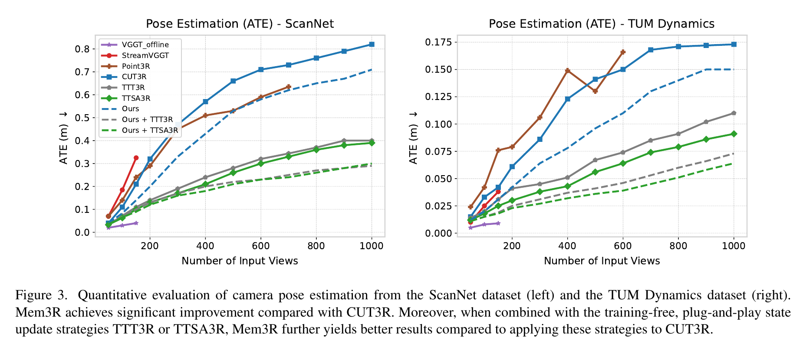

*原论文图 3。横轴为输入帧数，纵轴为 Sim(3) 对齐后的 ATE。Mem3R 的误差低于 CUT3R；与 TTT3R 或 TTSA3R 组合时，在长序列上还能进一步降低误差。*

作者指出，在 TUM Dynamics 的 500 帧测试中，Mem3R + TTT3R 相比 TTT3R 的 ATE 相对下降 39%。arXiv v1 补充表 5 的对应结果也给出相同结论（0.067 m 降至 0.041 m）；本文仍以会议版图 3 为主结果来源。图 4 给出 TUM Dynamics 和 ScanNet 的轨迹示例：在相同状态更新策略下，加入 Mem3R 后的轨迹整体更接近真值。定性轨迹只能展示示例序列的形状，数值比较仍以 ATE 表现为准。

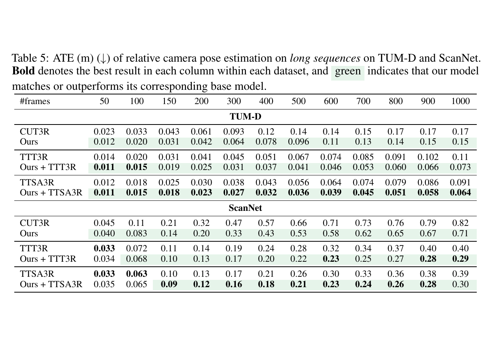

*原论文 arXiv v1 附录表 5。表中列出 50–1000 帧的 ATE。TUM Dynamics 上 500 帧的 TTT3R 为 0.067 m，Mem3R + TTT3R 为 0.041 m；ScanNet 上 1000 帧时两者分别为 0.40 m 和 0.29 m。*

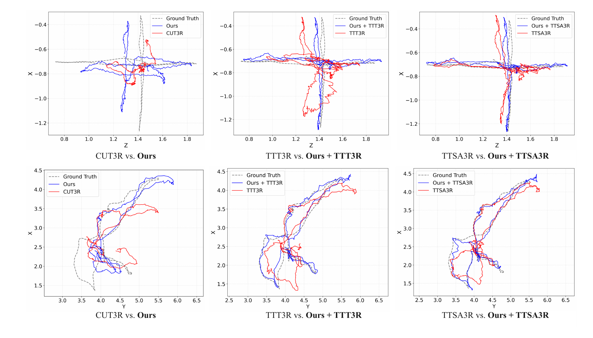

*原论文图 4。上排为 TUM Dynamics、下排为 ScanNet；每列比较相同更新策略下的 CUT3R 与 Mem3R。图中蓝色为 Mem3R 系列，红色为对应基线，灰色虚线为真值。*

## 深度和几何结果

KITTI 长序列深度评估同时给出度量尺度和尺度不变结果。500 帧时，单独的 Mem3R 在度量深度上的 Abs Rel 为 0.132、$\delta_{1.25}$ 为 86.0%；CUT3R 为 0.152 和 80.4%。结合 TTT3R 后，Abs Rel 降至 0.125，阈值准确率为 87.5%。尺度不变评估中，Mem3R 为 0.113 和 89.1%，Mem3R + TTT3R 为 0.110 和 89.9%。TTSA3R 组合并非每项都超过其他变体，所以这些结果表明不同状态门控对深度的增益取决于数据和评价协议。

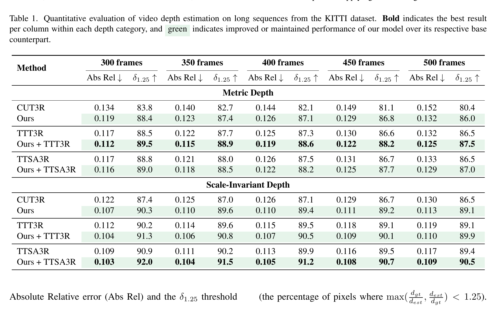

*原论文表 1。分别比较 300–500 帧的度量深度和尺度不变深度。$\delta_{1.25}$ 表示预测深度与真值深度之比落在阈值范围内的像素比例；Abs Rel 越低越好，$\delta_{1.25}$ 越高越好。*

Bonn 的结果也随深度尺度协议而变化。500 帧尺度不变深度上，Mem3R + TTSA3R 的 Abs Rel 为 0.073，而单独 Mem3R 为 0.083；度量深度上的领先组合也为 Mem3R + TTSA3R。相较之下，KITTI 的度量深度最好项是 Mem3R + TTT3R。论文由此支持“混合记忆改进整体长序列表现”，但不能推出某一种附加门控在所有深度数据上始终最好。

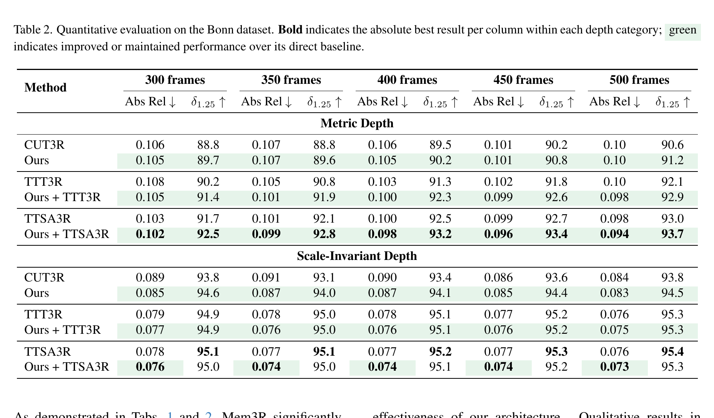

*原论文表 2。Bonn 的度量深度与尺度不变深度分别统计；组合方法的最优项随度量和数据设置改变。*

7-Scenes 的重建曲线显示，CUT3R 的 Chamfer Distance 会随序列变长而明显上升，Mem3R 的增长较缓；Normal Consistency 下降也较慢。离线 VGGT 和因果缓存模型 StreamVGGT 在该图的一些较长输入设置下因显存不足而无法给出结果。结合 TTT3R 或 TTSA3R 后，Chamfer Distance 在多数长度下继续下降。作者还展示了室内长序列的点云对比，指出 Mem3R 减轻了部分区域的结构错位。

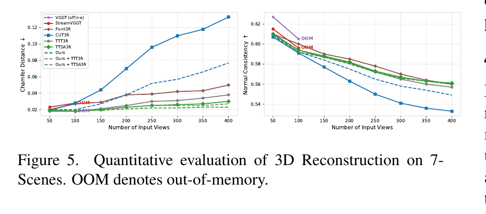

*原论文图 5。左图为 Chamfer Distance，越低越好；右图为 Normal Consistency，越高越好。图中 OOM 表示该方法在对应设置下显存不足。*

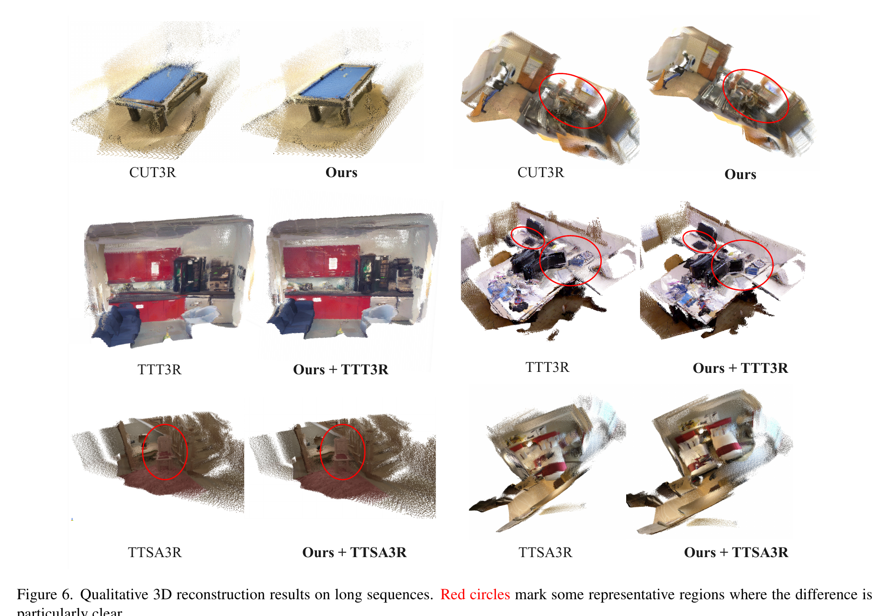

*原论文图 6。展示 CUT3R、Mem3R 及其与 TTT3R、TTSA3R 组合后的点云对比，红圈标出作者认为差异较明显的局部。点云示例用于说明几何外观，不能替代定量指标。*

## 状态门控消融和运行开销

WACV 版表 4 在 TTT3R 基础上分别移除 Mem3R 的逐通道门控和快速权重。位姿实验中，1000 帧 TUM Dynamics 的 ATE 从 TTT3R 的 0.110 m，降至“去掉门控”的 0.100 m、“去掉快速权重”的 0.078 m；完整 Mem3R + TTT3R 达到 0.073 m。KITTI 深度也整体支持两部分共同作用，但表内数值经过四舍五入，差异较小。该消融比较的是分别重新训练后的变体，不是对同一已训练模型简单关闭一个推理开关。

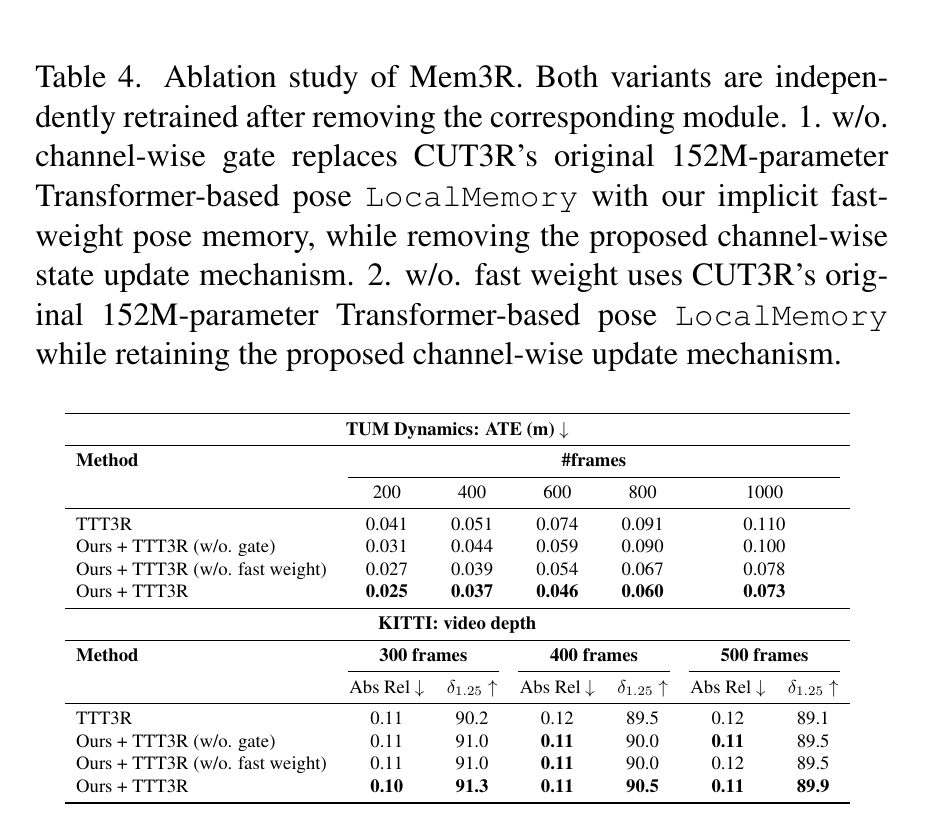

*原论文表 4。两个消融变体均在移除对应模块后独立重新训练；“w/o. gate”还去掉逐通道状态门，“w/o. fast weight”改回 CUT3R 的位姿 LocalMemory。*

效率表显示，CUT3R 与 Mem3R 均为 26 FPS，测得 GPU 显存分别为 7930 MiB 和 7340 MiB，参数量分别为 793M 和 644M。加上 TTT3R 后两者分别为 25 FPS、8364/7774 MiB；加上 TTSA3R 后为 25 FPS、8786/8208 MiB。因而参数量减少约 19%，在这台工作站的实测显存降低约 7%，吞吐保持接近。固定状态结构意味着模型状态存储不会随视频长度线性增长，但这组效率数据并非手机或嵌入式平台的实测，也不意味着总耗时与帧数无关：每帧仍需执行编码和解码计算。

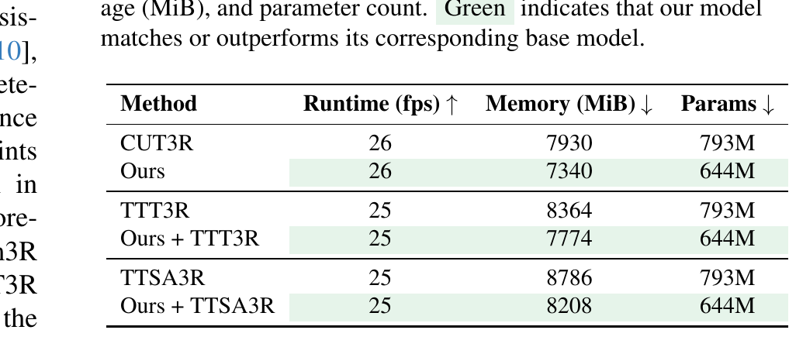

*原论文表 3。所有效率对比在单张 RTX PRO 6000 Blackwell Max-Q、$512\times384$ 图像上测量。Mem3R 及两个组合变体保留对应更新方法的近似帧率，同时减少参数量和测得显存。*

arXiv v1 补充材料还给出逐通道门控模块约 0.98M 参数，快速权重和门控合计约 2.54M 参数。这些模块增量解释了参数下降的来源：Mem3R 用较小的隐式位姿记忆替换 CUT3R 中较大的位姿相关 Transformer LocalMemory，同时保留显式几何状态。上述子模块规模来自 arXiv v1 补充材料，不应与会议版表 4 的总体参数统计混淆。

## 附录补充结果

arXiv v1 附录还报告了较短输入和 NRGBD 的结果。Sintel 50 帧位姿测试中，Mem3R 的在线 ATE 为 0.180，在表内在线模型中最低；加入 TTT3R 或 TTSA3R 后，ATE 分别约为 0.20，没有进一步改善。相同表中的离线 $\pi^3$ ATE 为 0.073，说明短序列位姿上在线和离线系统的比较仍有明显差距。相对地，Mem3R 加入 TTT3R 或 TTSA3R 后，Sintel 度量深度阈值准确率从单独 Mem3R 的 24.6% 升至 25.2% 和 25.8%。

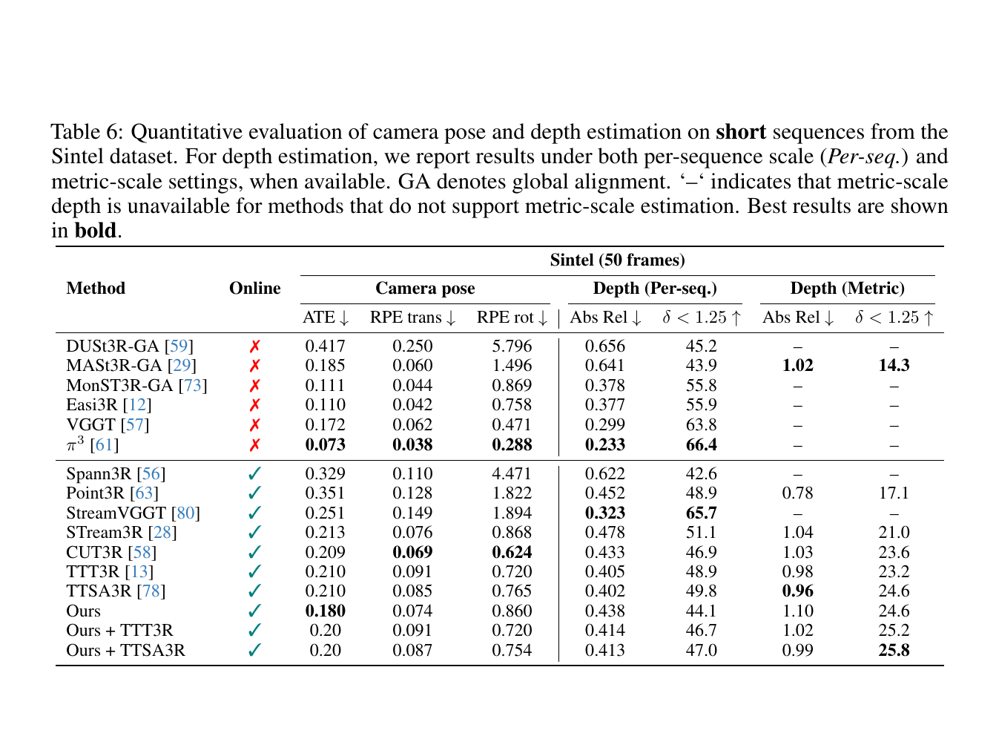

*原论文 arXiv v1 附录表 6。Sintel 50 帧同时比较相机 ATE、相对平移/旋转误差、按序列尺度对齐的深度和度量深度。Mem3R 单独模型取得较低在线 ATE，附加状态门控在该短序列设置中的收益并不一致。*

KITTI 与 Bonn 的 110 帧尺度不变深度结果也显示组合门控的效果依赖数据集：Mem3R + TTSA3R 在 KITTI 的 Abs Rel 为 0.109、$\delta_{1.25}$ 为 91.0%；Bonn 上 Mem3R + TTT3R 为 0.067 和 95.6%。Bonn 表中 StreamVGGT 的 Abs Rel 为 0.059，仍低于 Mem3R 系列。短序列深度上的表现与长序列改进相互补充，不能只用一个长度或数据集概括。

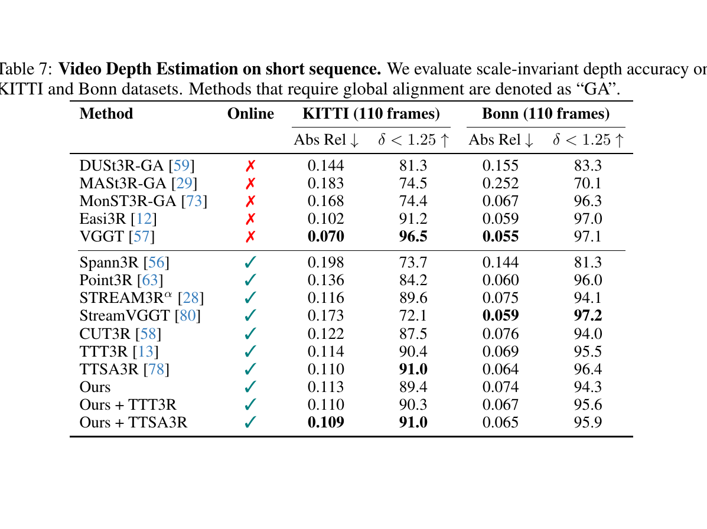

*原论文 arXiv v1 附录表 7。KITTI 和 Bonn 均使用 110 帧序列并报告尺度不变深度；表中还标出需要全局对齐的离线方法。*

在 7-Scenes 和 NRGBD 多视图重建中，附录把输入长度延伸到 400 帧。以 NRGBD 的 400 帧结果为例，CUT3R 的 Chamfer Distance / Normal Consistency 为 0.220 / 0.552，Mem3R 为 0.135 / 0.577；Mem3R + TTT3R 和 Mem3R + TTSA3R 分别为 0.064 / 0.608 和 0.061 / 0.612。7-Scenes 也显示 Mem3R 比 CUT3R 的几何质量更稳定。各门控组合之间有胜负交替，附录没有证明某一组合在所有帧数上始终领先。

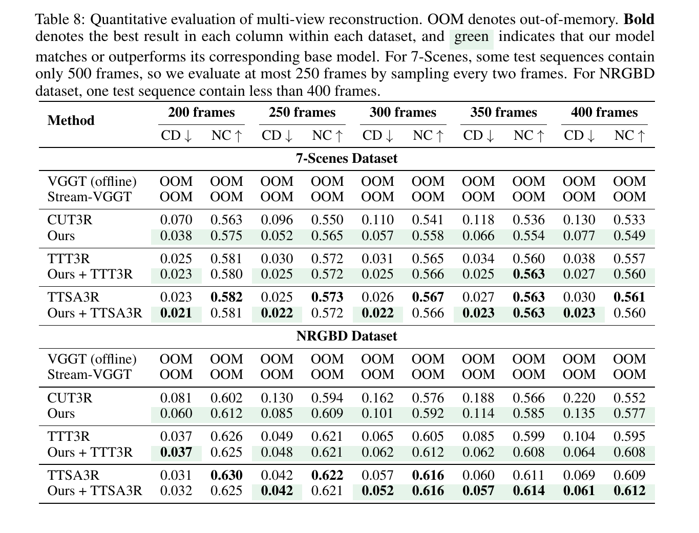

*原论文 arXiv v1 附录表 8。表中比较 7-Scenes 和 NRGBD 在 200–400 帧下的 CD 与 NC；VGGT 与 StreamVGGT 在这些序列长度上出现 OOM。*

补充图还展示了办公室和室内场景的长序列点云，以及相机轨迹的定性比较。图 7、图 8 展示 Mem3R 在原 CUT3R、TTT3R 和 TTSA3R 基础上得到的点云差异；图 9 对比 TUM Dynamics 与 ScanNet 的示例轨迹。它们补充了主文图 4、图 6 的视觉观察，结论仍受具体序列和视角影响。

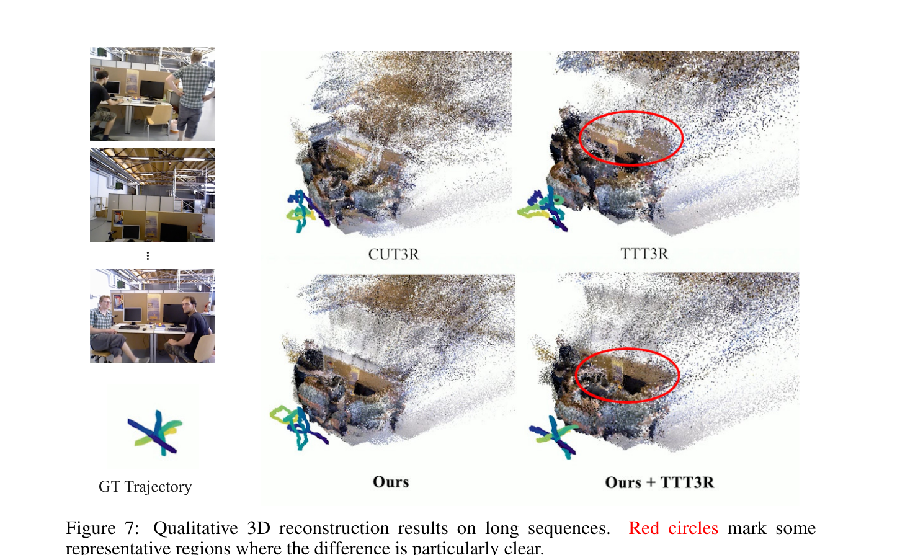

*原论文 arXiv v1 附录图 7。上方序列比较 CUT3R、TTT3R、Mem3R 与 Mem3R + TTT3R，红圈标出作者展示的局部差异。*

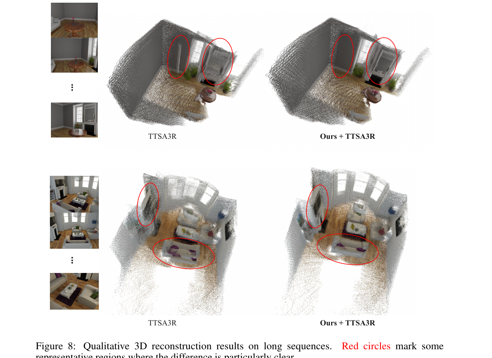

*原论文 arXiv v1 附录图 8。展示 TTSA3R 与 Mem3R + TTSA3R 的两个长序列重建对照。*

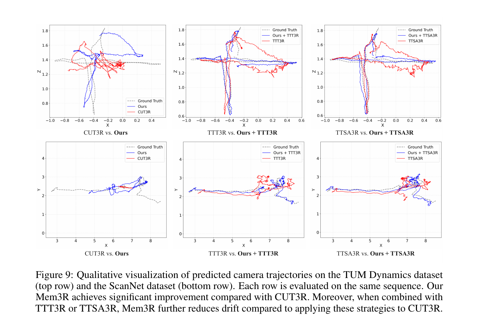

*原论文 arXiv v1 附录图 9。上排为 TUM Dynamics、下排为 ScanNet，比较 CUT3R、TTT3R、TTSA3R 与对应 Mem3R 组合的相机轨迹。*

## 方法关系与适用边界

Mem3R 继承了 [CUT3R](../cut3r/index.md) 的递归几何状态与逐帧解码框架，重新划分了位姿和几何的历史表示。相较于 [TTT3R](../ttt3r/index.md)，它不只是给原有状态更新增加写入步长：Mem3R 改动了位姿记忆结构，并在显式几何状态上另加逐通道门控；TTT3R 或 TTSA3R 可以再作为几何状态更新策略接入。

这条路线的实验依据主要是长序列位姿、深度和点云重建结果，报告了与 CUT3R 相近的帧率、更少参数以及更低的长序列误差。它仍是递归式流式重建模型，显式保留的是定长隐状态和几何 token，并没有在论文系统中加入传统 SLAM 的回环候选检索、几何验证或全局位姿图优化。内存恒定并不自动保证全局一致性；相机线索被压进快速权重、几何被压进有限状态，场景重访能否稳定恢复仍依赖这些表示及其训练分布。

版本也需要分开看。作者的项目页将工作列为 WACV 2027，并发布了会议版 PDF；arXiv 存档仍是 2026 年 4 月提交的 v1，标题多了 “via Test-Time Training”，作者列表也尚未更新。两版主文的核心结果一致，会议版图表报告的数值精度更高；本文实验部分统一引用会议版，模块内部尺寸和补充实验说明则明确来自 arXiv v1 附录。项目 GitHub 在 2026 年 10 月开放的代码说明其属于复现实现，尚未完成全面实验验证，因此不以该代码替代论文结果。
