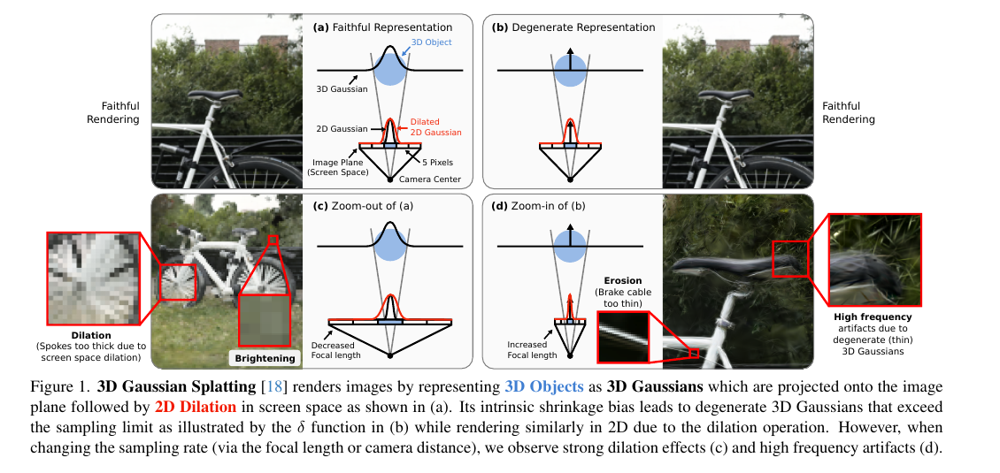
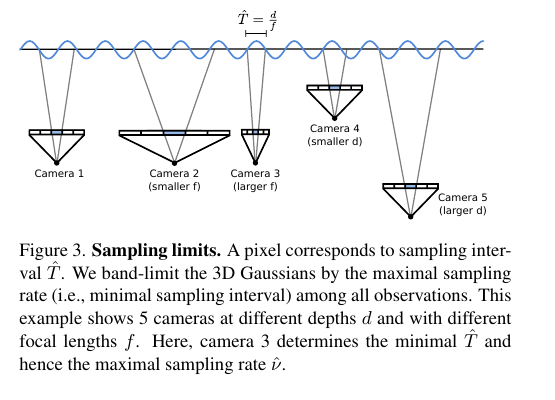
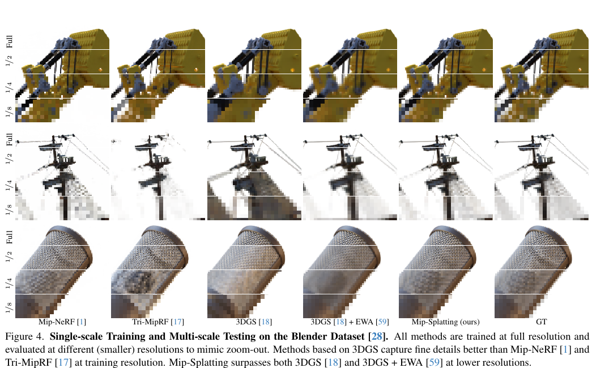
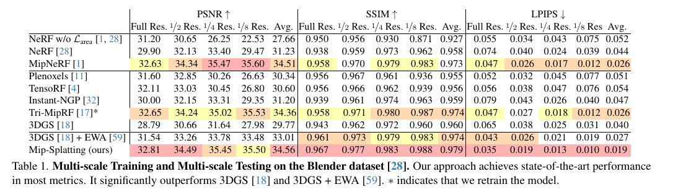
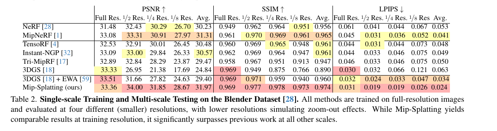
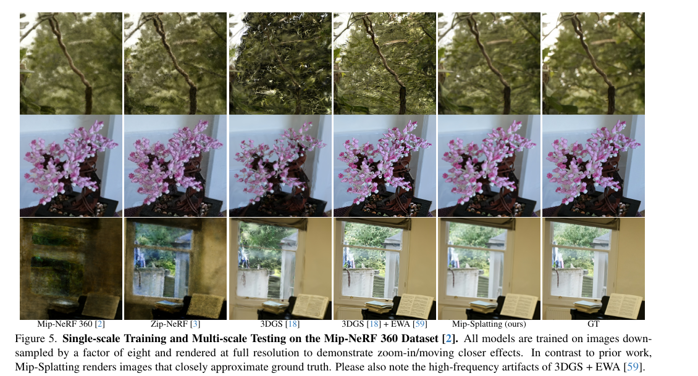
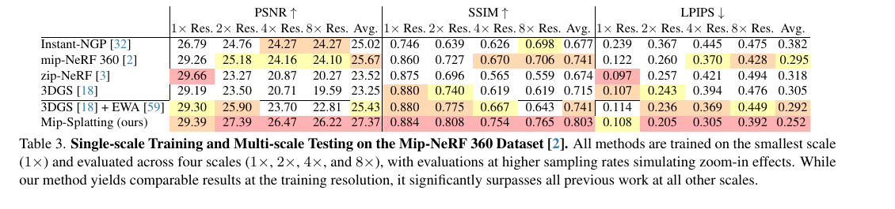
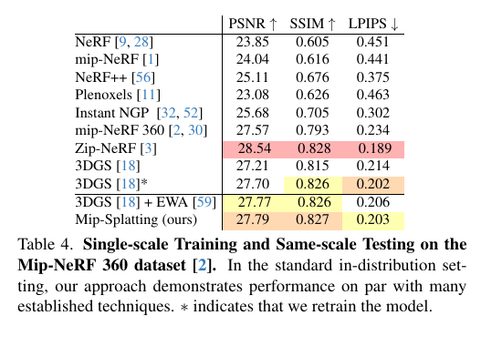
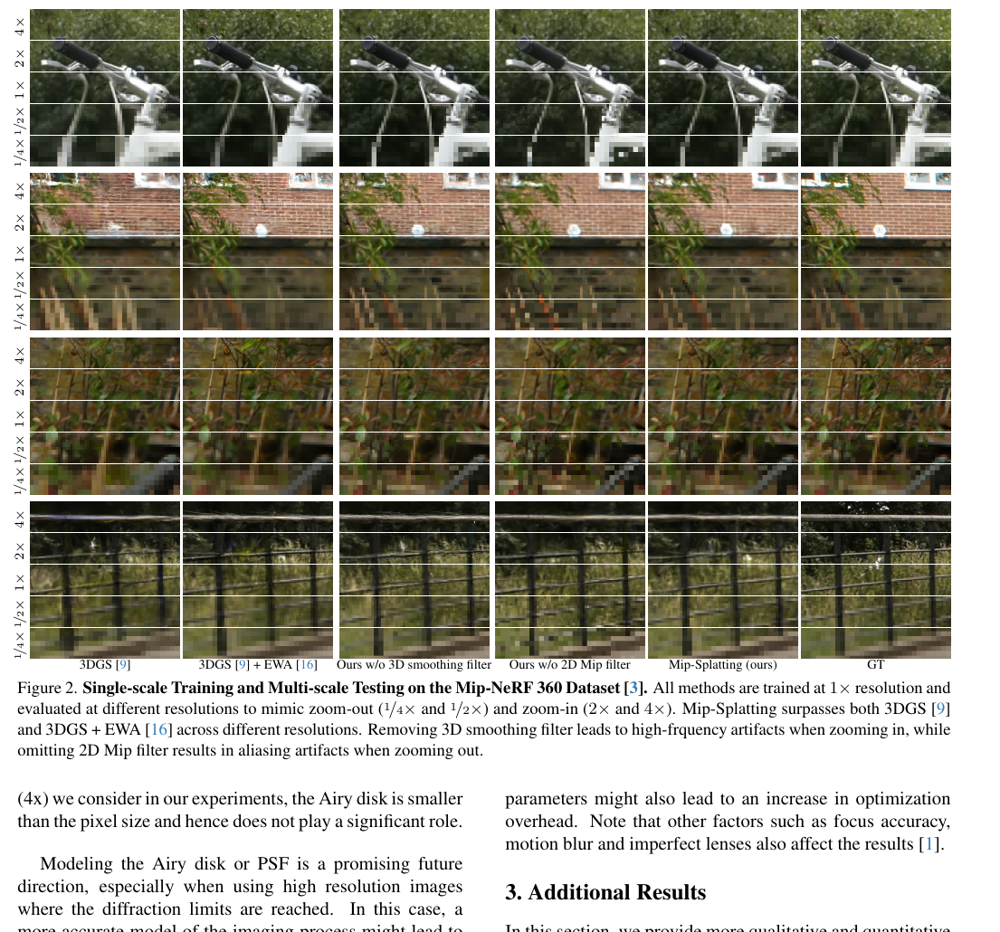

# Mip-Splatting 论文解读

> Zehao Yu、Anpei Chen、Binbin Huang、Torsten Sattler、Andreas Geiger，*Mip-Splatting: Alias-free 3D Gaussian Splatting*，CVPR 2024，页码 19447–19456。本文依据 CVPR 正式版全文及补充材料。[CVF 论文页](https://openaccess.thecvf.com/content/CVPR2024/html/Yu_Mip-Splatting_Alias-free_3D_Gaussian_Splatting_CVPR_2024_paper.html) · [论文 PDF](https://openaccess.thecvf.com/content/CVPR2024/papers/Yu_Mip-Splatting_Alias-free_3D_Gaussian_Splatting_CVPR_2024_paper.pdf) · [补充材料 PDF](https://openaccess.thecvf.com/content/CVPR2024/supplemental/Yu_Mip-Splatting_Alias-free_3D_CVPR_2024_supplemental.pdf) · [项目页](https://niujinshuchong.github.io/mip-splatting/)

3D Gaussian Splatting（3DGS）在训练视角附近通常能渲染出很细的纹理，但相机一旦明显靠近或远离，画面就可能出现细线断裂、细节膨胀或混叠。Mip-Splatting 追查到两个不同位置的问题：训练得到的三维高斯可能比输入图像实际支持的采样尺度还要细；渲染时的二维膨胀又没有随像素覆盖范围正确变化。论文分别用三维平滑滤波和二维 Mip 滤波处理这两处问题，因此重点改善的是跨视角、跨分辨率的画质稳定性。

*原论文 Figure 1。训练分辨率下，过细的三维高斯可以借助二维膨胀得到看似正常的图像；改变采样率后，同一补偿会表现为缩放膨胀、亮度变化或细结构侵蚀。*

## 训练分辨率下的拟合会掩盖三维尺度问题

3DGS 把场景表示为具有中心、协方差、颜色和不透明度的三维高斯。每个高斯投影到图像平面后成为二维椭圆高斯，再按深度排序进行 alpha 混合。为了避免投影到很小区域的高斯在像素采样时消失，原始 3DGS 会在屏幕空间给二维协方差加上一个固定项：

$$
\Sigma'_{2D}=\Sigma_{2D}+sI.
$$

这里 $\Sigma_{2D}$ 是投影得到的二维协方差，$sI$ 是屏幕空间膨胀。它让小高斯在训练分辨率下仍能贡献颜色，但高斯本身的三维尺度可以继续缩小，二维膨胀则替它补回投影范围。优化因而有机会找到一种退化组合：三维表示越来越细，渲染时再依靠二维膨胀恢复训练图像。

这个组合在训练相机附近可以拟合得很好，却没有给新采样率下的投影留下可靠约束。相机靠近时，原本隐藏在膨胀里的极细结构会被放大，表现为高频伪影、线条侵蚀或断裂；相机远离时，投影高斯已经变小，固定大小的膨胀却仍然存在，容易把辐射扩散到不该覆盖的像素，产生细节变粗、发亮和走样。Figure 1 把两种变化放在同一套三维表示上：二维膨胀解决了局部栅格化问题，却不能保证三维表示在其他采样尺度下仍然合理。

## 用训练图像给三维高斯设定采样上限

要限制高斯的最小可表示尺度，论文从训练图像的像素间距出发。针孔相机焦距 $f$ 以像素为单位，在距离相机深度 $d$ 处，一个像素反投影到场景中的长度为：

$$
\hat T=\frac{1}{\hat\nu}=\frac{d}{f}.
\tag{6}
$$

$\hat T$ 是三维空间中的采样间隔，$\hat\nu$ 是对应的采样率。相机越近或焦距越长，$d/f$ 越小，图像能观察到的三维细节就越细。根据 Nyquist 采样定理，可从采样中恢复的最高频率受采样率的一半限制；论文据此指出，尺度小于约 $2\hat T$ 的基元可能在泼溅时产生混叠。

同一个高斯通常会被多张训练图像看到，不同相机对它的采样能力也不同。作者以高斯中心 $p_k$ 近似其深度，并忽略遮挡对采样间隔估计的影响。记 $f_n$ 和 $d_n$ 分别为第 $n$ 个视图的焦距与该高斯中心的深度，$\mathbb{1}_n(p_k)$ 表示高斯中心是否位于视锥内，那么这个高斯的训练采样率上限取所有可见视图中的最大值：

$$
\hat\nu_k=\max_{n=1,\ldots,N}\left(\mathbb{1}_n(p_k)\frac{f_n}{d_n}\right).
\tag{7}
$$

取最大值意味着用“看得最细”的那张训练图像作为约束：至少有一个相机能够支持该高斯所表示的频率。这个上限随后转成每个高斯自己的低通滤波尺度。论文每隔 100 次训练迭代重算采样率，因为高斯中心在优化过程中会移动。

*原论文 Figure 3。每张图像都对应一组由相机距离和焦距决定的三维采样间隔；图中相机 3 的采样间隔最小，因此决定示例场景的最大采样率。*

## 三维平滑滤波约束表示频率

三维滤波器 $G_{low}$ 与原高斯卷积后，仍然是一个高斯。高斯卷积的协方差相加，因此论文将每个高斯的协方差扩大为 $\Sigma_k + (s/\hat\nu_k^2)I$。其中 $s$ 控制滤波强度，除以采样率平方则让滤波尺度随训练视图采样能力改变：采样率低的区域使用更强平滑。

$$
G_{k,reg}(x)=(G_k\otimes G_{low})(x).
\tag{8}
$$

两个高斯卷积后协方差相加，因此滤波后的三维高斯可以直接写成：

$$
G_{k,reg}(x)=\sqrt{\frac{|\Sigma_k|}{|\Sigma_k+\frac{s}{\hat\nu_k^2}I|}}
\exp\left[-\frac{1}{2}(x-p_k)^T\left(\Sigma_k+\frac{s}{\hat\nu_k^2}I\right)^{-1}(x-p_k)\right].
\tag{9}
$$

行列式前因子用于抵消协方差扩大导致的积分变化：高斯的积分与协方差行列式的平方根成正比；把协方差从 $\Sigma_k$ 扩大到滤波后的矩阵，会让积分按行列式比值增大，因此要乘上 $\sqrt{|\Sigma_k|/|\Sigma_k+(s/\hat\nu_k^2)I|}$。这样滤波改变了高斯的空间分布，却保持其积分能量。更直观地说，三维滤波不是在最终图像上盖一层模糊，而是把采样视图无法支撑的极细空间变化从场景表示中压掉。滤波尺度在训练后仍固定地属于三维表示，因此渲染新视角时，这个频率约束也跟着高斯一起变化。

## 二维 Mip 滤波模拟像素覆盖

三维低通滤波限制了场景中能出现的高频，但相机缩小场景或输出分辨率降低时，屏幕像素代表的视野范围仍然会变大。若直接用一个投影点采样，像素覆盖区域里的亮暗变化就可能被漏掉，于是出现混叠。成像传感器的单个像素实际会累计落入其面积内的光线，理想化地看相当于在二维图像上做一个方框滤波。

Mip-Splatting 用二维高斯近似这个像素方框滤波。把投影高斯与滤波核卷积，同样是给二维协方差加上 $sI$；归一化系数则按面积比例降低峰值，避免把固定膨胀区域误当成新增能量：

$$
G^{2D}_{k,\mathrm{mip}}(x)=\sqrt{\frac{|\Sigma^{2D}_k|}{|\Sigma^{2D}_k+sI|}}
\exp\left[-\frac{1}{2}(x-p_k)^T(\Sigma^{2D}_k+sI)^{-1}(x-p_k)\right].
\tag{10}
$$

这与原始 3DGS 的屏幕空间膨胀有关键区别：原方法扩大二维高斯后仍保留原来的峰值不透明度，投影积分会变大；Mip 滤波在扩大协方差时同步调整振幅，近似像素面积内的积分。它与 EWA 同样使用低通滤波，但目标不同：EWA 主要限制图像频带，滤波范围通常按经验设置；Mip 滤波试图对应成像过程中单个像素的面积。

*原论文 Figure 4。各方法用 Blender 全分辨率图像训练，再以较低分辨率渲染模拟缩小视图。Mip-Splatting 在训练尺度下仍保留细节，并在较低分辨率下比 3DGS 与 EWA 更接近参考图像。*

## 跨采样率实验集中体现画质收益

论文尽量沿用 3DGS 的训练设置：每个场景训练 30,000 次迭代，使用相同损失、密度控制策略和训练超参数。实验中二维 Mip 滤波方差设为 0.1，近似覆盖单个像素；三维平滑方差设为 0.2，合计 0.3，以便与 3DGS 和 3DGS+EWA 采用相近的滤波强度。

Blender 上还有一组多尺度训练、多尺度测试的实验：训练时混合使用多个分辨率，测试也覆盖不同尺度。Mip-Splatting 的平均 PSNR 为 34.56 dB，优于 3DGS 的 29.77 dB 和 3DGS+EWA 的 33.01 dB。论文在这组设定中同样报告了 SSIM 与 LPIPS 的优势。

*原论文 Table 1。训练和测试都包含多个分辨率；平均指标汇总四个尺度。*

另一组更能隔离跨尺度泛化的实验采用单尺度训练：模型用全分辨率图像训练，测试分辨率依次降为 $1$、$1/2$、$1/4$ 和 $1/8$，模拟缩小视图。全分辨率下，Mip-Splatting 与 3DGS 的 PSNR 几乎相同，分别为 33.36 和 33.33 dB；平均四个尺度后，Mip-Splatting 达到 31.97 dB，3DGS 为 24.84 dB，3DGS+EWA 为 29.40 dB。这个结果说明，提升主要来自训练尺度以外的渲染稳定性，而不是让原训练分辨率上的指标突然提高。

*原论文 Table 2。Full Res. 为训练分辨率；其余列为逐级降低的测试分辨率。表中指标按论文报告，PSNR 和 SSIM 越高越好，LPIPS 越低越好。*

Mip-NeRF 360 的缩放实验反过来考察放大视图：模型只用最小尺度图像训练，再在 $1$、$2$、$4$、$8$ 倍采样率下测试。Mip-Splatting 在训练尺度上的 PSNR 为 29.39 dB，3DGS 为 29.19 dB；平均四个测试尺度后分别为 27.37 和 23.25 dB，3DGS+EWA 为 25.43 dB。图像对照中，3DGS 的细结构在放大后出现侵蚀和高频伪影，Mip-Splatting 保留了更接近参考图像的结构。

*原论文 Figure 5。所有方法只用降采样 8 倍的图像训练，再渲染全分辨率图像模拟靠近场景；Mip-Splatting 的细节更接近 GT，3DGS+EWA 则出现明显高频伪影。*

*原论文 Table 3。训练尺度为 1×，测试尺度逐步升至 8×。随着采样率提高，3DGS 的指标明显下降；Mip-Splatting 的平均 PSNR、SSIM 和 LPIPS 均优于表中基线。*

在常规的训练、测试同尺度设置下，差距则很小。Mip-NeRF 360 上 Mip-Splatting 的 PSNR/SSIM/LPIPS 为 27.79/0.827/0.203，重训的 3DGS 为 27.70/0.826/0.202，3DGS+EWA 为 27.77/0.826/0.206。论文实验支持的核心结论因此比较具体：Mip-Splatting 主要增强对采样率变化、缩放和视角偏移的泛化，不能据此说它在所有常规新视角指标上都大幅领先。

*原论文 Table 4。标准同分布测试下，Mip-Splatting 与 3DGS、3DGS+EWA 的结果接近。*

## 消融和适用边界

补充材料把两种滤波的作用分开验证：移除三维平滑后，放大场景会出现高频伪影；移除二维 Mip 滤波后，缩小场景时的走样明显增加。若两者都移除，论文报告密度控制会生成过多小高斯，训练甚至在 40 GB A100 上发生显存不足。联合缩小与放大的补充实验也显示，两种滤波针对的是互补的采样变化。

*原论文补充材料 Figure 2。每列对应完整方法、单项消融或基线；移除三维平滑会破坏放大时的高频细节，移除二维 Mip 滤波则会在缩小时引入混叠。*

二维高斯只是像素方框滤波的近似。论文指出，当屏幕空间高斯很小时，该近似会产生误差，缩放倍率进一步增加时误差也更明显。采样率每 100 次迭代重算会增加训练开销；作者目前用 PyTorch 计算，并将更高效的 CUDA 实现和采样率数据结构留作后续工作。三维平滑可以并入高斯表示，论文称其不会增加额外渲染开销。补充材料还讨论了镜头衍射形成的 Airy disk：在实验采用的 4 倍分辨率范围内，它小于像素尺寸，因此影响不显著；更高分辨率下，更精确地建模点扩散函数可能有价值。

## 方法关系

Mip-Splatting 把抗走样问题拆到场景表示和图像采样两个位置。三维平滑用训练图像确定每个高斯能表达的最高空间频率，降低缩放放大时暴露出退化细节的风险；二维 Mip 滤波近似像素面积积分，减少缩小和低分辨率渲染时的能量扩散与混叠。二者配合后，方法在训练尺度之外更稳定，而同尺度表现与原始 3DGS 大体持平。对关注画质的 3DGS 使用者来说，这篇工作的主要价值是让渲染质量随采样率变化得更可控，而非改写 3DGS 的整体表达或训练框架。
