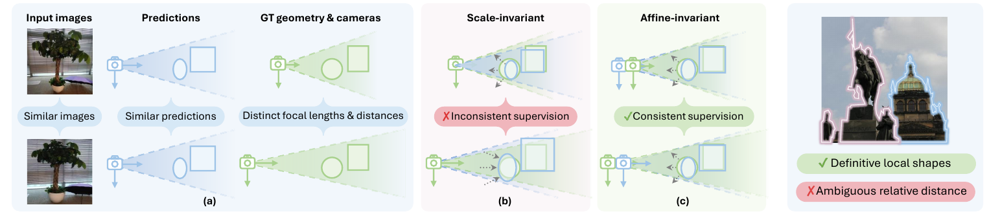
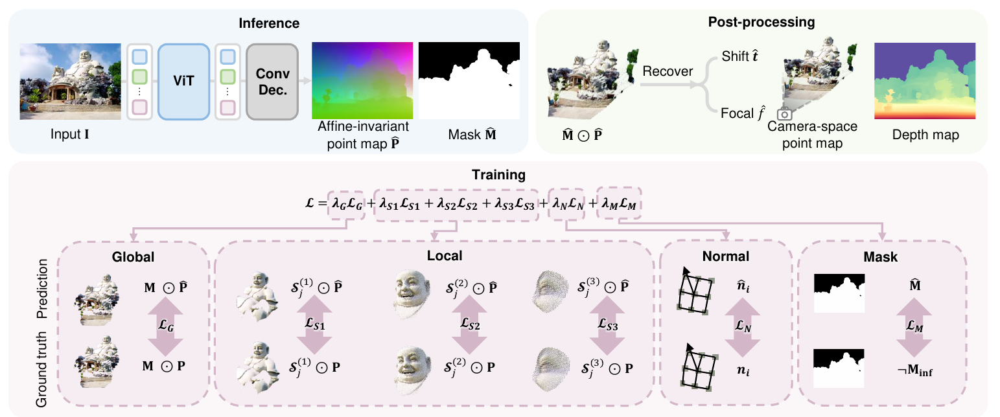

# MoGe 论文解读

> Ruicheng Wang、Sicheng Xu、Cassie Dai 等的 *MoGe: Unlocking Accurate Monocular Geometry Estimation for Open-Domain Images with Optimal Training Supervision* 发表于 CVPR 2025。作者分别来自中国科学技术大学、微软研究院、哈佛大学和清华大学，部分工作在微软研究院实习期间完成。本文依据 [arXiv v3（2025-04-15）](https://arxiv.org/abs/2410.19115v3) 的[论文及补充材料](https://arxiv.org/pdf/2410.19115v3)解读原版 MoGe；[官方项目](https://wangrc.site/MoGePage/)提供模型与演示。

## 1. 引言：一张图像里的三维几何

从单张图片恢复三维场景，本来就缺少多视角提供的视差约束。常见做法是先估计每个像素的深度，再结合相机内参把像素反投影为三维点。这样一来，几何结果同时依赖深度和焦距：即使深度图正确，焦距误差也会改变点云在横向的展开程度，造成形状变形。

另一种做法是直接给每个像素预测三维坐标，即**点图**。MoGe 采用这条路线，输入一张图像，输出与图像网格对应的三维点图和有效区域掩码。点图可以进一步用于恢复焦距、深度与相机坐标系中的点。它与 [DUSt3R](../dust3r/index.html) 都使用点图，但 MoGe 明确面向单张图片，并重新设计了点图的等价关系与训练监督。

论文认为，网络能力之外，**哪些几何差异应当被监督、哪些无法从单图辨认的差异应当在对齐时消去**，决定了训练是否给模型稳定的信号。它的两个主要技术点是仿射不变点图表示，以及配套的全局与局部几何损失。

## 2. 相关方法与问题定义

单目深度模型可输出米制深度、仅差一个尺度的深度，或允许尺度和平移共同变化的相对深度。它们回答的是沿相机视线“多远”的问题；恢复完整三维点还需要像素射线，即相机内参。联合预测深度和射线是一种办法，但两个输出的误差会在反投影时耦合。

MoGe 把输出直接定义为 $H\times W\times 3$ 的点图 $\hat P$：像素 $i$ 对应预测点 $\hat p_i=(\hat x_i,\hat y_i,\hat z_i)$。坐标轴的 $X$、$Y$ 方向分别与图像的水平、垂直方向一致。网络不预先强制每个点严格落在某个已知焦距的相机射线上；这种几何一致性可在输出后通过焦距和位移恢复来检查、利用。

论文还预测有效区域掩码 $\hat M$。天空等无穷远区域、仅展示物体的图像背景可能没有合适的有限三维真值。把它们与普通物体表面混在一起监督，会迫使点图学习没有定义的值。

## 3. 仿射不变点图：消去单图难以辨认的差异

### 3.1 焦距—距离歧义

单张图像的投影满足近似针孔关系 $u=fx/z$、$v=fy/z$。在视野中，改变焦距，同时改变相机到物体的距离，可能得到十分相似的图像。对模型而言，两张外观近似的图片可能对应不同的真实焦距和拍摄距离。

如果训练时仅允许把预测点图乘以一个全局尺度，那么预测点与真值之间的整体深度位移仍被计入误差。于是相近输入可能要求网络输出不同的点图：如原论文图 4，变化的主要是相机相对物体的距离，而物体局部形状本身可以相近。仅用尺度对齐会把这种难以由图片判断的差异强行交给网络学习。

*原论文图 4（左）和图 5（右）。图 4 比较仅尺度对齐与增加平移对齐后的监督；图 5 指出不同物体间的相对距离也可能难以从单张图判断。*

MoGe 因而把整体尺度 $s$ 和整体平移 $t$ 视为点图的自由度。若两份点图满足

$$
P' = sP+t,
$$

它们在训练中可以被对齐后比较，而不要求网络恢复图片本身无法唯一给出的全局尺度与偏移。论文称之为**仿射不变点图**。这里的“仿射”具体指共同尺度和共同平移，并不允许任意三维仿射矩阵对形状拉伸、剪切；点之间的相对形状仍然要保留。

在后续相机模型中，作者假设主点位于图像中心、像素为方形，进而将实际使用的平移简化为光轴方向的 $t_z$，即 $t_x=t_y=0$。这个约定贯穿焦距恢复和主要训练对齐。论文补充材料另讨论一般三维平移情形，它与主方法中的一维平移不能混同。

### 3.2 点图如何转为焦距和深度

把图像中心作为二维坐标原点，给定预测点 $(x_i,y_i,z_i)$ 和对应像素 $(u_i,v_i)$，希望找到焦距 $f$ 与深度方向的位移 $t'_z$，使平移后的点尽可能投影回原像素：

$$
\min_{f,t'_z}\sum_{i\in M}
\left(\frac{fx_i}{z_i+t'_z}-u_i\right)^2+
\left(\frac{fy_i}{z_i+t'_z}-v_i\right)^2.
\tag{1}
$$

这里 $M$ 排除了无效几何像素，$t'_z=t_z/s$ 是在点图尺度下的位移。固定 $t'_z$ 时，上式对 $f$ 是一个一元二次最小二乘问题，可以先求出 $f$ 的闭式解；再对剩余的 $t'_z$ 做数值优化。补充材料写明使用 Levenberg–Marquardt，并把点图缩到 $64\times64$ 求解；报告的典型求解时间约 3 毫秒、迭代通常少于 10 次。这些是作者的实现条件下的测量，不是任意设备的推理耗时。

求得 $t'_z$ 后，将它加到预测点的 $z$ 坐标，可以获得与相机射线关系更一致的深度和相机坐标点图；由焦距可进一步计算视场角。这个步骤**没有确定米制尺度**：从单图恢复的仍是一个带尺度自由度的几何结果。原版 MoGe 的“焦距预测”也并非一个独立的直接回归头，而是从点图与像素对应关系中拟合出来。

### 3.3 网络输出和整体流程

论文使用经 DINOv2 预训练的视觉 Transformer 作为编码器，再用较轻的卷积上采样解码器输出稠密点图及有效区域掩码。训练时把预测点图与真值点图比较，推理时利用掩码筛选有效点，并在需要深度和视场角时执行上面的几何后处理。

*原论文图 3。上半部分是单图点图与掩码预测，再由点图恢复焦距、位移和深度；下半部分依次展示全局、三个尺度的局部、法线和掩码监督。*

图 3 的重点不是网络模块堆叠，而是**表示和损失之间的分工**：点图直接承担三维形状预测；全局对齐看整体形状；局部对齐强调局部结构；法线损失约束表面方向；掩码头处理无有限几何的区域。

## 4. 训练监督：让对齐真正服务于几何学习

### 4.1 全局点图损失

设真值点为 $p_i$，其深度为 $z_i$，有标签的像素集合为 $M$。在预测点图上先求全局尺度和平移，再计算加权 $L_1$ 残差：

$$
\begin{aligned}
(s^*,t^*)&=\arg\min_{s,t}\sum_{i\in M}\frac{1}{z_i}\lVert s\hat p_i+t-p_i\rVert_1,\\
\mathcal L_G&=\sum_{i\in M}\frac{1}{z_i}\lVert s^*\hat p_i+t^*-p_i\rVert_1.
\end{aligned}
\tag{2}
$$

$1/z_i$ 使远近差异很大的场景中，不同深度的点都能影响监督，而不会仅由绝对距离较大的区域主导。这里的 $s^*,t^*$ 是**为当前样本对齐预测与真值**而求的参数；它们不是网络在推理时获得的真实场景尺度，也不能直接解释为单图识别出了米制距离。

只做中位数居中或范围归一化，计算简单，却未必最小化实际使用的点图损失。MoGe 设计 ROE（Robust, Optimal, Efficient）对齐求解器，使训练时的监督尽量来自当前损失下的好对齐，而不是某个粗糙替代准则。

### 4.2 ROE 为何能有效求解

先考虑只含尺度的简化问题 $\min_s\sum_i w_i|s\hat x_i-x_i|$。每个绝对值项在 $s=x_i/\hat x_i$ 处改变斜率，整体目标是一条分段线性曲线。把这些断点排序，利用累积和计算断点左右的斜率，就能找到目标由下降转为上升的位置。这说明“最优对齐”不是一句抽象口号，它可以由损失函数本身的断点结构计算出来。

带光轴平移时，补充材料证明最优解可选在某个点的深度残差恰好为零的位置：$s\hat z_k+t_z=z_k$。于是枚举这个锚点 $k$，代入 $t_z=z_k-s\hat z_k$，把二维参数问题化为一组一维的尺度子问题，并选目标值最小者。论文给出的复杂度为 $O(N^2\log N)$，各锚点子问题可以并行；实际对齐先把点图缩到至多 $64\times64$，控制有效点数。

单纯 $L_1$ 仍可能受少量大错点影响。作者进一步把每个加权绝对残差截断到阈值 $\tau$，补充材料设置 $\tau=1$。截断让目标不再凸，但求解器仍利用分段线性结构列举候选极值并比较目标值。论文的“稳健”主要针对这类大残差；它不意味着错误标签或遮挡边界完全不影响结果。

还有一个必要的限定：上述全局最优构造针对**只允许 $z$ 方向平移**的主要对齐问题。补充材料也给出任意三维平移的算法，但为了避免很高的枚举代价，假设三个坐标方向可以共用同一个锚点，从而得到近似最优解。文章后面讨论的训练结果对应论文主方法，不能把三维平移扩展版也直接称为无条件精确最优。

### 4.3 为什么还需要局部几何损失

即便全局形状在最佳对齐后接近真值，两个相距较远的物体之间仍可能存在单图难以判别的相对距离差。若全局损失同时惩罚这种布局差异，网络对一个物体内部的曲面学习可能受到干扰。原论文图 5 用两个物体的例子表达这一点：各自的局部形状可以明确，物体之间的距离却不一定能从图片判断。

作者以真值点 $p_j$ 为中心，在三维空间截取球形区域

$$
S_j=\{i\in M:\lVert p_i-p_j\rVert\le r_j\},\qquad
r_j=\alpha z_j\frac{\sqrt{W^2+H^2}}{2f}.
\tag{3}
$$

半径与锚点深度成正比，与焦距成反比，使不同深度处的区域在图像中大致对应相近的投影范围。对每个球形区域，重新独立求尺度和平移，再计算局部点图误差。这样，一处表面的弯曲、边缘和物体形状可以接受更集中的监督，不必让远处物体之间的相对位置主导本区域的对齐。

论文使用 $\alpha=1/4,1/16,1/64$ 三个尺度。较大的球覆盖更多整体结构，较小的球关注更细的几何。它们仍来自同一张图像和同一份点图，**训练时的独立局部对齐**不会在推理时产生多个相互独立的局部坐标系；最终输出依然是一张连续的点图。

### 4.4 法线、有效掩码与数据质量

点图的相邻网格边可叉乘得到表面法线，论文用预测法线与真值法线的夹角作为 $\mathcal L_N$，约束局部表面方向。有效区域掩码的损失 $\mathcal L_M$ 则让模型区别有限几何与天空等区域。合成数据能直接给出无穷远掩码；真实室外图像使用 SegFormer 生成天空掩码。推理时，掩码以 0.5 阈值二值化，焦距和位移求解只使用有效点。

训练混合了 21 个公开数据集，约 900 万帧，覆盖室内、驾驶、物体及合成场景。不同来源的真值密度与精度不同：合成数据可施加更细的局部与法线监督，噪声更大的真实数据则选择较保守的损失组合。论文还对真实标签去掉像素损失最大的 5%，并以 DINOv2 特征和 OpenImagesV7 近邻统计平衡数据集采样权重。这些处理也是结果的一部分，不能把性能变化全部归结为点图表示本身。

## 5. 实验：比较的是什么

### 5.1 零样本点图与深度评估

论文在八个未参与训练的评测数据集上比较：NYUv2、KITTI、ETH3D、iBims-1、GSO、Sintel、DDAD 和 DIODE。评测前针对数据本身做了必要处理，例如裁切与遮挡区域排除；预测也按各任务协议进行逐图尺度或尺度加平移对齐。因此，表中的误差主要测**对齐后的相对几何质量**，不直接测原始输出的绝对尺度准确性。

点图评测包含仅尺度对齐与尺度加平移对齐；还按物体区域单独对齐，考察局部形状。表 1 中，仿射不变点图的平均相对点误差由 DUSt3R 的 11.4%、UniDepth 的 9.43% 降至 MoGe 的 6.07%；局部区域指标由这些比较方法中最好的 7.97% 降至 5.50%。这些是表中指定数据集、有效像素和对齐规则下的结果。

深度评测分别使用仅尺度对齐的深度、允许平移的深度，以及允许仿射变换的视差。MoGe 的点图 $z$ 分量对应仿射不变深度；加入后处理得到的 $t'_z$ 可形成仅尺度不变的深度，再取倒数参与视差评测。表 2 及补充表 6 显示它在作者比较的多种深度协议上有很强的平均成绩。不过，比较方法的表示和评测前允许的对齐自由度不完全相同，读具体数据集的结论时应先看所用协议。

### 5.2 焦距与视场角

论文在主点居中、图像已去畸变，且垂直视场角至少 45° 的部分数据上评测视场角。为扩展测试范围，还对输入做随机中心裁切。表 3 给出三个数据集上的平均视场角误差均值：MoGe 为 2.91°，DUSt3R 为 4.06°，WildCam 为 7.00°。这支持点图后处理能估计相机视场角，但不意味着同样的数值可直接用于主点偏移、非方形像素或强畸变相机。

### 5.3 消融实验和可视化

表 4 使用较小的 ViT-Base 编码器，逐项比较表示、对齐方法、截断与局部损失。改为尺度不变点图、或改用深度加射线的表示，多个点图指标下降。ROE 对齐相对最小二乘及中位数近似有明显优势；去掉截断或多尺度局部损失后，尤其局部点图指标变差。由于这些行用的是 ViT-Base，不能直接拿消融表的绝对误差与主实验的大模型数字比较。

图 6 展示去掉局部损失和法线损失时的表面噪声，以及不给天空单独预测掩码时的问题。图 7 对比了室内、道路和开放图像中的点图；对没有相机内参预测的深度方法，作者在有真值时用真值内参反投影，在开放图像中则用 MoGe 自己估计的内参。这让可视化能够比较形状，但也提醒读者：图中的三维结果不全由每个基线模型独立产出。

## 6. 方法边界

原版 MoGe 的输出是单张图像的仿射不变几何。它可以给出可用于下游任务的点图、相对深度和焦距估计；图片本身没有消除场景整体尺度歧义，模型也不承诺米制距离。若需要米制尺度，那是后续 [MoGe-2](https://arxiv.org/abs/2507.02546) 明确处理的新问题。

补充材料列出的失败例是细窄结构：例如栅栏可能被预测为扁平表面。作者把这与模型容量及真实训练数据中的噪声联系起来。单帧网络也不会天然维持视频中的跨帧时间一致性；即使逐帧预测看起来都合理，轨迹尺度和表面仍可能随时间漂移，需要另行引入时序约束或全局优化。

从方法关系看，MoGe 最有价值的洞见是把不可观测的自由度纳入**监督设计**：先让网络专注于图像能较稳定提供的三维形状，再通过几何后处理恢复与相机模型一致的量。全局 ROE 对齐避免粗糙归一化扭曲监督，局部独立对齐使局部曲面不会完全受远距离布局歧义牵制。实验同时表明，这套设计的结果还依赖大量混合数据、标签筛选和相机假设。

## 参考文献

- Wang, R., Xu, S., Dai, C., et al. [*MoGe: Unlocking Accurate Monocular Geometry Estimation for Open-Domain Images with Optimal Training Supervision*](https://arxiv.org/abs/2410.19115v3). CVPR 2025；本文使用 arXiv v3 正文及补充材料。
- Wang, R., Xu, S., Dong, Y., et al. [*MoGe-2: Accurate Monocular Geometry with Metric Scale and Sharp Details*](https://arxiv.org/abs/2507.02546). 作为原版方法边界的后续工作。
