# MoRe 论文解读

> **论文**：*MoRe: Motion-aware Feed-forward 4D Reconstruction Transformer*
>
> **作者**：Juntong Fang、Zequn Chen、Weiqi Zhang、Donglin Di、Xuancheng Zhang、Chengmin Yang、Yu-Shen Liu
>
> **版本**：arXiv:2603.05078v2，2026-03-06；论文页面注明已被 CVPR 2026 接收
>
> [论文页面](https://arxiv.org/abs/2603.05078v2) · [PDF](https://arxiv.org/pdf/2603.05078v2) · [项目页](https://hellexf.github.io/MoRe/)

MoRe 是面向动态单目视频的前馈式 4D 重建模型。它逐帧预测相机参数、深度、动态点图和运动掩码；训练时用运动掩码监督相机 token 的注意力，使几何估计减少受移动物体干扰；推理时通过分组因果注意力复用历史 KV 缓存，再对全序列的缓存特征做一次相机 token 聚合，以修正逐帧因果估计的漂移。

这项工作把训练和推理中的两种约束分开处理。训练阶段通过 motion-aligned attention 影响模型如何学习静态结构与动态运动的表示；推理阶段不需要人工运动掩码，而使用同帧 token 双向可见、跨帧只看历史的注意力掩码，实现流式输入。全序列聚合被作者类比为 BA 式全局精化，但它实际执行的是额外的注意力推理，并非传统的显式几何优化。论文还指出，MoRe 依赖训练掩码质量，对长时依赖、极快或非刚性运动、运动模糊和遮挡仍有限制。

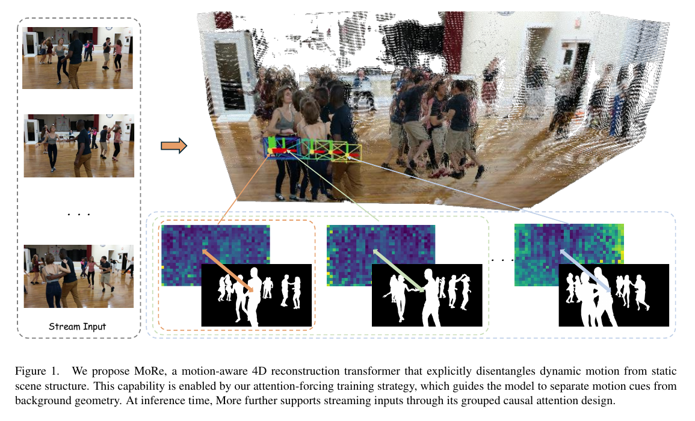

*原论文图 1。连续图像输入经过 motion-aware 重建后，得到包含静态背景和运动目标的三维表示；图注概括了注意力强制训练与分组因果流式推理。*

## 1. 引言

三维场景随时间变化时，重建系统需要同时估计相机运动、静态背景和移动物体。经典 SfM、MVS 和 SLAM 通常假设场景大致静止；当物体变形、移动或相机运动复杂时，静态场景假设会破坏位姿和几何估计。

学习式重建大体分为两类。前馈模型直接从图像序列预测相机位姿、深度或点云，推理快，但多数训练数据以静态场景为主，移动物体会污染相机运动估计。混合优化方法会加入光流、深度估计或运动分割，并反复迭代更新；它们对动态场景更稳健，却计算开销大，也难处理长序列实时输入。

MoRe 在一个静态重建主干上进行大规模动态与静态数据微调，通过 attention-forcing 训练策略让网络学会区分动态线索与背景几何；在推理时用分组因果注意力支持逐帧输入，再以 BA-like token aggregation 交换全局信息。作者的目标是将运动感知与在线推理纳入同一个前馈模型，而不在推理时增加运动先验输入或额外分割计算。

论文的主要主张有三点：MoRe 联合估计相机、深度、点图和运动掩码；训练时用显式注意力监督与几何任务监督帮助解耦运动和静态结构；推理时把因果 KV 缓存和全局相机 token 聚合结合，在动态场景质量与流式速度之间折中。它在公开动态评测集上取得较强结果，但不同数据集、全注意力与流式设置之间的表现并不相同，后文按表格逐项说明。

## 2. 相关工作

### 2.1 四维重建

四维重建要恢复随时间变化的三维结构，通常需联合估计相机姿态和深度。基于优化的方法借助光流、掩码等辅助信息细化几何和运动，但长序列计算量大；近期的模块化方案使用视觉基础模型，仍保留多阶段流程。另一类方法回归时间对齐点图，但作者认为它们往往没有显式分离动态物体和静态背景，并依赖稠密的四维监督。MoRe 希望通过训练中的注意力约束学到这种区分，而不要求推理时输入运动先验。

### 2.2 基于学习的重建

DUSt3R 将多视图几何写成点图回归；MASt3R 改善匹配能力，Fast3R 提升多视图扩展性，VGGT 则用大规模 Transformer 从多帧估计相机和深度。论文指出，这类 Transformer 一方面会随输入帧数增加计算量，另一方面通常缺少针对动态物体的显式建模，因此相机运动和场景运动可能互相干扰。

### 2.3 流式重建

动态流式重建与 SLAM 一样需要持续维护轨迹和地图，但许多 SLAM 系统依赖静态环境假设。CUT3R 等方法用持久隐状态在线更新几何；Stream3R、StreamVGGT、Wint3R 等近期方法进一步采用因果注意力与 KV 缓存处理长序列（相关解读见 [CUT3R](../cut3r/index.md)、[Stream3R](../stream3r/index.md)、[StreamVGGT](../streamvggt/index.md)）。

将文本模型的因果注意力直接用于图像 token 有一个结构性问题：它把一帧内的图像 token 也按序列顺序遮挡，导致同帧位置之间不再相互可见；另一方面，逐帧单向预测让后续帧无法回看未来上下文，长序列会积累误差。MoRe 的分组因果注意力保留帧内全连接关系，同时只限制跨帧的信息流；其全局相机 token 聚合则在序列结束后回看所有帧特征。

## 3. 方法

图 2 展示 MoRe 的主干：每帧图像先经 ViT 编码，再由聚合 Transformer 和 motion-aligned attention 处理，输出相机参数、深度图、点图与运动掩码。流式模式会把全局注意力替换为帧级因果注意力。

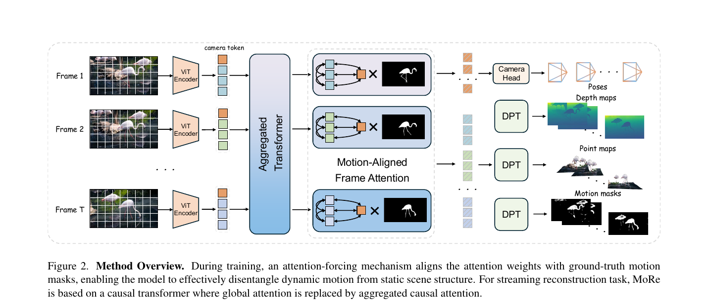

*原论文图 2。训练时，注意力权重受真实运动掩码监督；流式推理则用聚合因果注意力替代全局注意力。*

### 3.1 问题定义

输入是单目视频帧序列 \(\{I_t\}_{t=1}^T\)。模型为每帧预测深度 \(D_t\)、相机参数 \(g_t\in\mathbb R^9\) 和动态点图 \(P_t\in\mathbb R^{3\times H\times W}\)。模型还预测运动掩码 \(M_t\)，但训练时使用其真值作为监督，推理时不把真值掩码作为输入：
\[
\{D_t,g_t,P_t\}_{t=1}^{T}
=f_\theta(\{C_t\}_{t=1}^{T},I_{T-1}). \tag{1}
\]
这里 \(C_t\) 表示第 \(t\) 帧可复用的缓存信息。为明确运动监督后增加掩码预测：
\[
\{D_t,g_t,P_t,M_t\}_{t=1}^{T}
=f_\theta(\{C_t\}_{t=1}^{T},I_{T-1}). \tag{2}
\]
论文写法把在线目标表述为当前帧与先前缓存的函数；实际输入流中每次新图像进入解码循环，输出对应帧的预测。运动掩码作为辅助输出帮助训练表征，不是推理时依赖的外部传感器或人工提示。

论文在该节只说明相机参数是 9 维向量，没有在正文交代其具体参数化；后续相机损失则通过相对旋转和平移监督这些参数。因而这里能确定网络输出的维数和监督对象，不能仅凭该段复原 9 个分量的编码。

### 3.2 Motion-aligned attention

作者观察到，预训练的 VGGT 相机 token 有时会把注意力集中在静态背景，有时则近乎均匀地分散到图像各处；后一种情况常伴随动态物体干扰位姿估计。图 3 展示两个例子，说明相机 token 的注意区域会随场景变化。

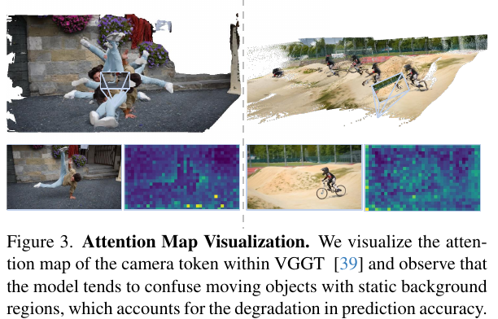

*原论文图 3。作者以注意力热图说明：动态物体出现时，相机 token 可能无法稳定地区分运动区域和静态背景。*

训练时把真值运动掩码 \(M_t\) 划分成与图像 token 对应的 \(s\times s\) patch。每个 patch 的掩码均值记为 \(m_i\)，再定义 token 的静态先验分数：
\[
a_i=1-\frac{1}{s^2}\sum_{(u,v)\in m_i}m_i(u,v). \tag{3}
\]
依照论文对 \(M_t\) 的定义，掩码值 1 表示动态像素，因此 \(a_i\) 越大，patch 中静态像素比例越高。作者将相机 token 对各图像 token 的注意力 \(\alpha_i\) 看作一组权重，并用 \(a_i\) 调节注意力训练；作者的文字说明是让相机 token 更关注静态背景、减少动态区域对全局表示的影响。

这里原文存在一处影响方法理解的符号冲突：按主文式 (3)，动态掩码取值为 1，故静态比例越高，\(a_i\) 越大；但式 (8) 对 \(a_i>C\) 的 token 惩罚其注意力 \(\alpha_i\)，按字面会压低静态 token 的注意力，与主文“关注静态区域”的解释相反。补充材料第 9.3 节又把高 \(a_i\) 称作高运动分数，并说静态内容的 \(a_i\) 约为零；这与式 (8) 的方向一致，却和式 (3) 的 \(1-\) 定义相反。综合主文解释与补充材料，作者意图看起来是惩罚动态区域的注意力，式 (3) 的符号可能有误；但论文没有正式勘误，故这里保留各处原式和原说法，不把推测写成已确认的实现。

### 3.3 分组因果注意力

普通因果注意力沿 token 顺序遮挡未来位置。若图像 token 被展平成一长串，后出现的 patch 看不到同帧前面的 patch，破坏同一张图像内的空间信息交换。MoRe 改为帧级分组：同一帧的所有 token 可以互相注意；第 \(t\) 帧只能注意更早帧以及本帧。

第一对输入帧初始化 KV 缓存；每来一帧，当前查询读取历史键值和当前帧键值，并把新键值追加到缓存：
\[
F_t=\operatorname{Attn}\!\left(Q_t,[K_{1:t-1},K_t],[V_{1:t-1},V_t]\right),\qquad
KV_{1:t}\leftarrow[KV_{1:t-1};(K_t,V_t)]. \tag{4}
\]
\(Q_t,K_t,V_t\) 分别是当前帧查询、键和值，\(F_t\) 是当前帧的特征。缓存令旧帧不必在每个时刻重新编码；帧内双向可见性则让空间 token 的信息能够在本帧内部交换。图 4 的注意力矩阵示意同帧成块开放、跨帧只沿时间向前可见。

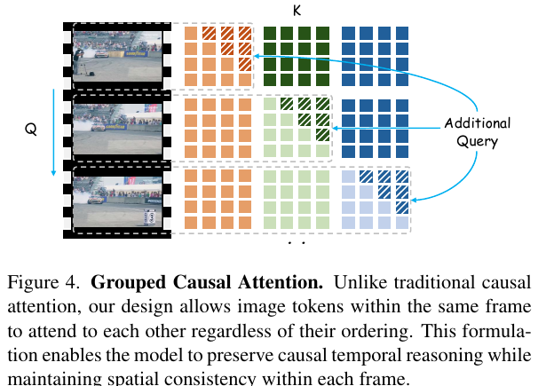

*原论文图 4。同帧 token 可双向交互，跨帧信息保持因果方向，从而兼顾帧内空间一致性和逐帧输入。*

#### 全局相机 token 聚合

严格因果的相机 token 只能读取当前和过去帧，因而无法在整个序列上重新协调相机估计。MoRe 在序列处理完后，保留每帧相机查询 \(Q_t^{cam}\) 和所有图像特征的键值缓存，让每个相机查询再读取全序列的缓存：
\[
C_t^{opt}=\operatorname{Attn}\!\left(Q_t^{cam},[K_{1:T}],[V_{1:T}]\right). \tag{5}
\]
这次额外注意力会为相机头提供跨全序列的信息，作者将其类比为 BA 式全局优化，用于缓解单向因果相机估计的长期漂移。图 5 展示逐帧 KV 缓存与重复相机 token 的后处理路径。

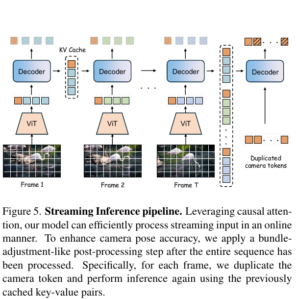

*原论文图 5。每帧先走因果缓存路径；序列结束后，复制的相机 token 再读取全序列缓存，生成全局精化相机估计。*

需要区分类比与实际计算：式 (5) 是一次注意力聚合，并没有建立显式重投影残差、正规方程或 BA 迭代。因此“BA-like”说明其全局协调用途，不代表运行了传统束调整。

### 3.4 训练目标

MoRe 用多任务损失训练深度、点图、相机参数和运动掩码。深度与点图采用置信度加权回归：
\[
\mathcal L_{conf}=\sum_{i=1}^{N}
\left(\hat c_i\|\hat y_i-y_i\|_2^2-\lambda\log\hat c_i\right). \tag{6}
\]
\(\hat y_i\) 与 \(y_i\) 是预测值和真值，\(\hat c_i\in[1,\infty)\) 是预测置信度。第一项让高置信度位置对误差承担更大权重，第二项抑制模型将置信度无限增大。作者将该置信度目标用于深度和点图回归。

运动掩码预测使用逐像素二元交叉熵：
\[
\mathcal L_{motion}=-\frac1N\sum_{i=1}^{N}
\left[M_i\log\hat M_i+(1-M_i)\log(1-\hat M_i)\right]. \tag{7}
\]
\(M_i\) 是动态区域真值，\(\hat M_i\) 是预测概率。

注意力监督用主文定义的静态先验分数 \(a_i\) 及常数阈值 \(C\) 构造：
\[
\mathcal L_{attn}=\frac1M\sum_{i=1}^{M}\max(0,a_i-C)\cdot\alpha_i. \tag{8}
\]
\(M\) 是图像 token 数量。该损失只在 \(a_i>C\) 时惩罚对应注意力权重。若按式 (3) 的静态先验定义，它惩罚静态 token；若按补充材料对运动分数的解释，它则会惩罚动态 token。论文没有消解这两种定义之间的矛盾，因此“具体实现压制动态区域”来自作者的文字说明和补充材料，而不是主文式 (3)、式 (8) 同时能够推出的结论。

相机监督对每一对帧的相对旋转和平移计算误差：
\[
\mathcal L_{cam}=\frac{1}{T(T-1)}
\sum_{i\ne j}\left(
\theta_{\hat R_{i\to j},R_{i\to j}}+
\|\hat t_{i\to j}-t_{i\to j}\|
\right). \tag{9}
\]
这里 \(R_{i\to j},t_{i\to j}\) 是真值相对旋转和平移，带帽量是预测值，\(\theta\) 表示旋转差。这个成对损失让相机头学习帧间关系，而不仅是独立回归每帧参数。对于原始流式相机 token，较早帧的梯度会在计算早到晚相对变换时截断，避免反向传播穿过整条时间链；重复相机 token 的全局聚合分支则保留所有时间关系的梯度。

方法中，运动掩码在训练时提供静动态差异监督；帧级因果注意力用缓存逐帧生成几何；全局相机 token 则在序列结束后额外聚合信息以修正相机估计。运动掩码本身由网络预测，真值不进入推理。这一设计以额外的全序列相机推理换取全局上下文，同时保留在线逐帧预测路径。

## 4. 实验

训练集包含 Dynamic Replica、PointOdyssey、Spring、Virtual KITTI、TartanAir、Co3Dv2、ScanNet、BlendedMVS、Hypersim、ARKitScenes、Waymo 和 OmniWorld-Game，覆盖室内外、静态与动态场景。样本较少的数据集会按比例重复采样。Sintel、TUM-dynamics 和 Bonn 是未出现在训练中的动态评测集；ScanNet 是静态场景评测，同时也列在训练数据中，因此该项不能视为完全未见场景评估。

相机姿态在 Sintel、TUM-dynamics、Bonn 和 ScanNet 上测试，使用 Sim(3) 对齐后计算 ATE、相对平移误差和相对旋转误差。深度在 Sintel、Bonn、TUM-dynamics 和 KITTI 上评价，使用 Abs-Rel 和 \(\delta<1.25\)，并在算指标前对预测深度做仅尺度对齐。结果表明，论文同时评价全注意力模型 MoRe(FA) 与流式 MoRe；两者不能混作同一设置。

ATE 比较对齐后整条估计轨迹与真值轨迹的偏差；相对平移和相对旋转误差比较帧间运动增量的平移、旋转部分。因此 ATE 反映全局轨迹偏差，RPE 更直接反映局部运动估计。论文按表 1 报告这些指标，但没有在表注中给出单位换算或完整计算细节。

### 4.1 相机位姿估计

表 1 将 MoRe 与全注意力模型和流式模型分别比较。流式 MoRe 在 Sintel 的 ATE 为 0.1474，低于 Stream3R 的 0.2144；Bonn 为 0.0211，低于 Stream3R 的 0.0235；但在 TUM-dynamics 上为 0.0260，略高于 Stream3R 的 0.0240，在 ScanNet 上为 0.0605，也高于 Stream3R 的 0.0521。作者将总体结果概括为优于现有流式方法，但逐项数据说明这种优势依赖数据集和具体指标，并非每一列都领先。全注意力 MoRe(FA) 在 Sintel ATE 上达到 0.0877，优于表中的 VGGT 0.1715；在 Bonn 也略优于 VGGT，但在 TUM-dynamics 和 ScanNet 的 ATE 则略差于 VGGT。

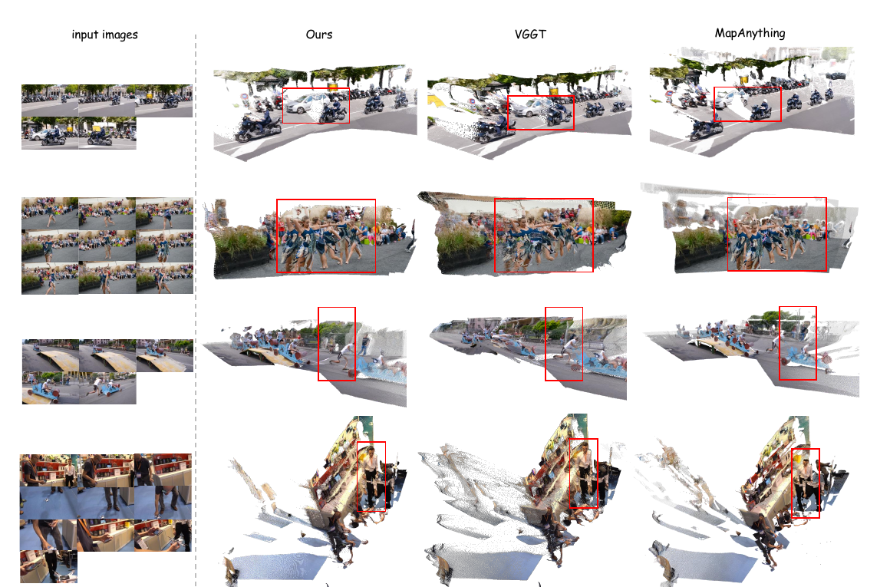

*原论文图 6。示例对比 MoRe(FA)、VGGT 和 MapAnything 的场景点云；红框标出移动目标附近的区域。*

原论文图 7 转向流式设置，将 MoRe 与 Stream3R、CUT3R 的重建结果并列展示。图中不同方法的点云有局部形变和尺度差异；作者用这些示例说明 MoRe 在动态物体附近保留几何的能力。它提供定性补充，数值比较仍以相机误差表为准。

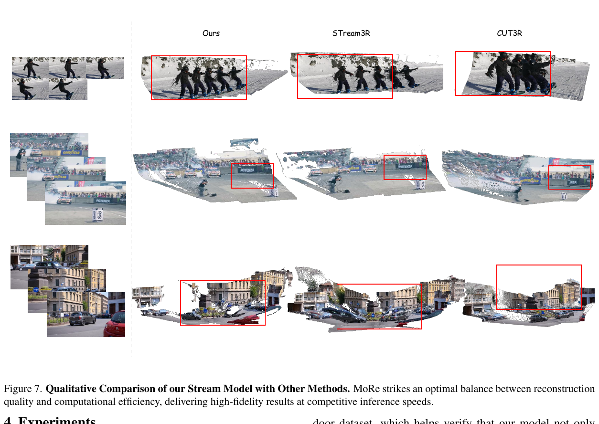

*原论文图 7。三个序列中对比 MoRe、Stream3R 和 CUT3R 的重建结果，红框标出运动目标附近的局部差异。*

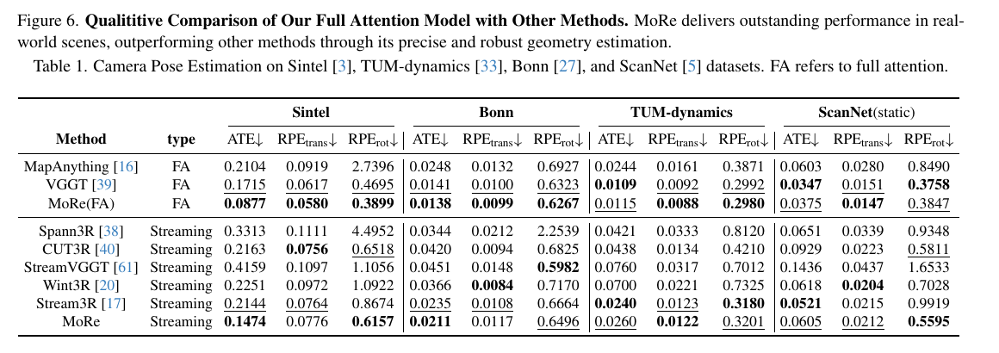

*原论文表 1。FA 表示全注意力设置；ATE、相对平移和相对旋转误差分别列出，粗体和下划线对应表内最佳与次佳值。*

### 4.2 视频深度估计

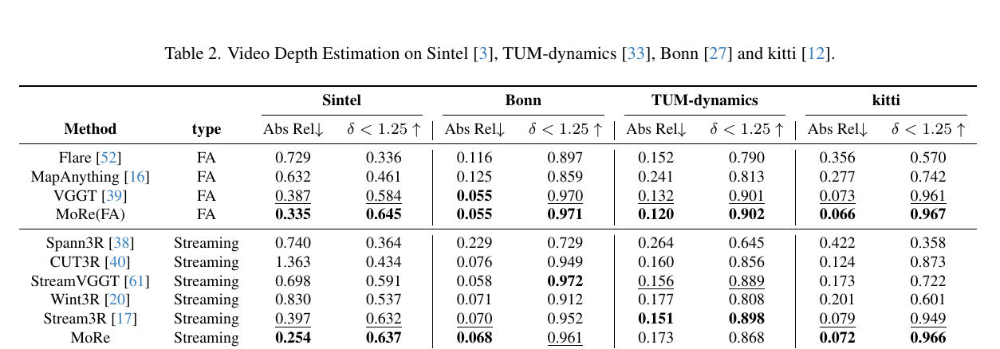

*原论文表 2。报告 Abs-Rel（越低越好）与 \(\delta<1.25\)（越高越好），所有深度先对齐尺度。*

流式 MoRe 在 Sintel 的 Abs-Rel 为 0.254，优于表中的其他流式基线；在 Bonn 为 0.068，略优于 Stream3R 的 0.070；在 KITTI 为 0.072，优于 Stream3R 的 0.079。TUM-dynamics 上则是 0.173，落后于 Stream3R 的 0.151，且 \(\delta<1.25\) 为 0.868，也低于 Stream3R 的 0.898。全注意力 MoRe(FA) 在四个数据集的 Abs-Rel 上都较强，但这不代表流式推理时也有相同误差水平。

### 4.3 消融实验

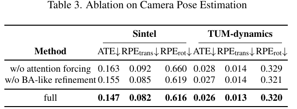

*原论文表 3。移除 attention forcing 或全局相机 token 精化后，Sintel 与 TUM-dynamics 的位姿指标均有所退化。*

在 Sintel 上，去掉 attention forcing 后 ATE 从完整模型的 0.147 增至 0.163，去掉 BA-like refinement 后为 0.155；TUM-dynamics 上分别从 0.026 增至 0.028 和 0.027。该结果支持注意力监督与全序列相机聚合都能改善报告的位姿指标，但增益幅度因组件而异。

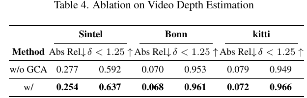

*原论文表 4。相较标准因果注意力，GCA 在 Sintel、Bonn、KITTI 的深度误差均更低。*

用标准因果注意力替代 grouped causal attention 后，Sintel Abs-Rel 从 0.254 上升到 0.277，Bonn 从 0.068 上升到 0.070，KITTI 从 0.072 上升到 0.079；相应的 \(\delta<1.25\) 也都下降。该消融与分组掩码的设计理由相符：放开同帧 token 互相读取，有助于保留空间上下文。

## 5. 结论

MoRe 用前馈网络从单目视频联合预测相机姿态、深度、点图和运动掩码。其 motion-aligned attention 旨在训练出静态场景与动态运动的分离表示；grouped causal attention 令图像 token 在帧内保持双向交互，同时以 KV 缓存支持逐帧推理；全序列相机 token 聚合再为相机估计提供跨时间上下文。

这些模块带来的效果不能简单归为“动态场景下始终领先”。论文表格显示了不同评测集之间的差异；而作者对注意力监督的公式和文字说明还存在静动态方向不一致的符号歧义。MoRe 的贡献在于给出一套统一的训练与流式推理机制，并用消融展示各组件对若干指标的影响；其实现对真实运动掩码监督、场景运动规律和视觉质量仍有依赖。

## 补充材料

论文 PDF 中的补充材料给出训练设置、运动掩码生成、流式速度与静态场景补充评测，并进一步分析注意力监督。下列内容按补充材料第 6–10 节顺序整理。

### 6. 训练细节

模型使用 AdamW 训练 100K 次迭代，学习率经过预热后最高为 \(10^{-6}\)。每次随机从一个序列取 2–24 帧，帧间隔随机为 1–5；图像长边缩放到 518 像素，短边再以 0.8–1.2 倍随机缩放。训练使用 64 张 NVIDIA A800，约两天完成，并采用 bfloat16 与梯度检查点节省显存。

### 7. 运动掩码提取

#### 7.1 数据准备

多数视频数据集缺少可靠的运动掩码。作者先用 SAM2 生成语义区域 \(S_k\)，再由真值相机姿态和内参计算相机自运动产生的 ego flow \(F^{ego}\)，并用 SEA-RAFT 预测实际光流 \(F^{pred}\)。对每个语义区域，取两种光流的平均差异：
\[
d_k=\frac{1}{|S_k|}\sum_{(i,j)\in S_k}
\left\|F^{pred}(i,j)-F^{ego}(i,j)\right\|_2. \tag{10}
\]
若某区域相对相机自运动的流差异高于全体区域均值加两倍标准差，就判作动态：
\[
d_k>\mu_d+2\sigma_d. \tag{11}
\]
最终掩码为
\[
M(u,v)=
\begin{cases}
1,&(u,v)\in S_k\text{ 且 }d_k>\mu_d+2\sigma_d,\\
0,&\text{其他情况}.
\end{cases} \tag{12}
\]
这个标签生成流程依赖真值相机位姿、SAM2 的语义分割和 SEA-RAFT 光流；它是训练监督构造方式，不是 MoRe 推理时的额外输入。

#### 7.2 定性结果

作者在 DAVIS 上展示运动掩码提取，并同时比较网络原始输出和经过 SAM2 图像级预测器细化的结果。图 8 中，运动 logits 经细化后能较准确覆盖大象、骑行者和汽车等目标；这说明网络输出有作为动态区域掩码使用的潜力，但细化结果也使用了 SAM2 后处理。

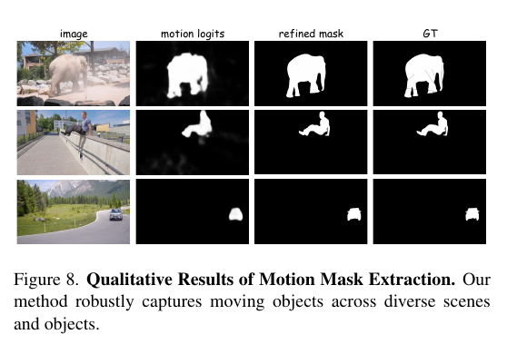

*原论文图 8。从左到右为图像、MoRe 运动 logits、SAM2 细化掩码和真值掩码。*

### 8. 流式推理

#### 8.1 实现细节

作者把输入 streamer 与输出 streamer 分开：前者连续接收图像，后者及时返回当前帧预测。每帧的隐状态与缓存键值拼接后通过 \(N\) 层 Transformer，再立即送出预测。为避免缓存无限增长，系统可以采用滑动窗口；这意味着有限窗口下保留的是局部历史，上下文覆盖会受窗口大小约束。

逐帧预测支持在线输出，但 BA-like 相机聚合需要整段序列处理完才运行。因此，论文提出的是“流式帧输出 + 序列结束后的全局相机精化”两阶段流程，而不是所有最终相机结果都在每帧到达时已经完成全局修正。

#### 8.2 速度测试

推理速度在 KITTI、输入分辨率 \(512\times144\)、NVIDIA A800 上测量。MoRe 达到 30.09 FPS；作为对照，VGGT 为 7.32 FPS、CUT3R 为 16.58 FPS，Stream3R 的滑动窗口 5 帧变体达到 32.93 FPS。除 Spann3R 使用 \(224\times224\) 输入外，论文沿用 Stream3R 报告的其余基线速度。结果表明 MoRe 位于最快一档，但并非该表中速度最高者。

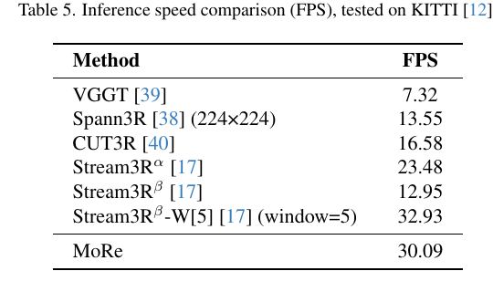

*原论文表 5。MoRe 为 30.09 FPS；Stream3R 的五帧窗口设置为 32.93 FPS。*

#### 8.3 定性结果

补充图 9 展示多种动态视频中的三维重建对比，包括运动人物、车辆和孔雀等场景。MoRe 的点图试图同时保留背景结构与动态目标形状；不同方法点云尺度不一致，因此图中部分视角会有轻微偏差。该图提供的是定性比较，不能替代表 1–4 的定量指标。

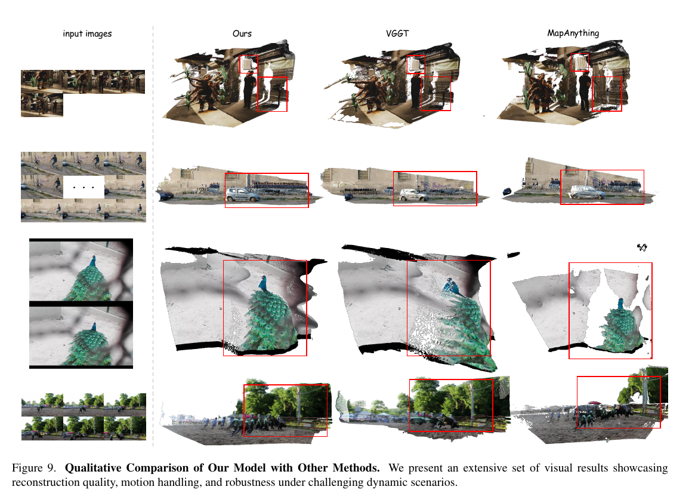

*原论文图 9。MoRe 与 VGGT、MapAnything 等方法在多类运动场景下的点云比较。*

### 9. Motion-aligned attention 补充分析

#### 9.1 Co3Dv2 静态场景结果

为检查运动感知设计是否损害静态场景能力，作者在 Co3Dv2 上报告相机姿态指标。全注意力 MoRe 在 RRA@30、RTA@30 和 AUC@30 上分别为 99.49、98.11、91.42；表中次高的 \(\pi^3\) 为 99.05、97.33、88.41。其他比较方法为 Fast3R、CUT3R、FLARE 和 VGGT。这些结果说明在该静态场景评测上，训练时加入运动注意力机制没有削弱全注意力模型的相机结果。

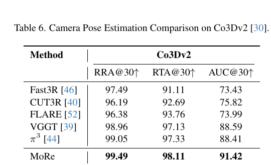

*原论文表 6。三项指标均为越高越好，MoRe 报告值分别为 99.49、98.11 和 91.42。*

#### 9.2 注意力可视化

图 10 对比训练前后相机 token 注意力，并展示运动掩码。作者在最后一层对所有注意力头求平均，观察到训练后动态目标获得的相机 token 注意力减弱，静态区域的注意力更集中。该图支持作者对模型学到静动态区分的解释；结合前文公式歧义，这种可视化不等于消除了损失符号方向上的文本矛盾。

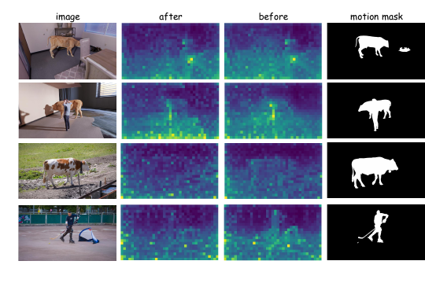

*原论文图 10。after 与 before 分别为运动对齐训练后和训练前的注意力热图，右侧为运动掩码。*

#### 9.3 损失设计

作者也尝试 KL 散度，让注意力分布匹配运动分数分布。补充材料指出，KL 会把注意力强行归一化成概率分布；静态场景中注意力本应较自由，所有 token 被强制参与归一化可能造成不必要的约束。作者设计的阈值损失引入常数 \(C\)，让静态分数接近零的 token 得到较弱梯度，而高运动分数 token 承受惩罚。这个补充说明支持“损失意在限制动态区域注意力”的理解，但它使用的分数定义与主文式 (3) 相反；由于论文没有解释这一差异，仍不能确认应以哪处符号为准。表 7 中，KL 变体在 Sintel 的 ATE、RPE 平移、RPE 旋转分别为 0.185、0.084、0.707，在 TUM-dynamics 上为 0.029、0.015、0.350；作者损失对应为 0.147、0.082、0.616 和 0.026、0.013、0.320，六项都更低。

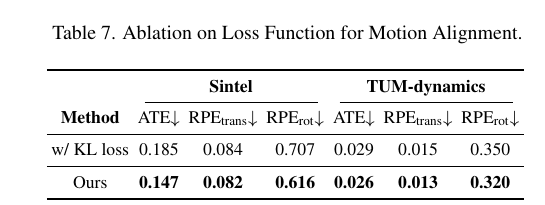

*原论文表 7。本文损失在 Sintel 与 TUM-dynamics 的 ATE、相对平移和相对旋转误差上均优于 KL 变体。*

### 10. 局限性

作者指出，MoRe 的训练效果依赖运动掩码准确度；标签噪声或不一致会传入表示学习，现实中高质量动态掩码也不容易获得。模型还可能难以捕捉窗口之外的超长时依赖和复杂动态交互；极快或非刚性运动会让运动模式更难区分。快速相机或物体运动造成的运动模糊会削弱图像线索、使注意力对齐不可靠，从而导致深度不准、位姿不稳或几何变形。方法目前也没有显式处理遮挡和显著外观变化，可能产生时序伪影。

这些限制与方法设计相互关联：掩码监督依赖光流和相机真值的质量；因果缓存扩大实时性，却仍受缓存窗口和误差累积影响；而全局相机聚合只在序列处理后提供一次额外信息交换，并不能显式建模物体遮挡或非刚性运动。
