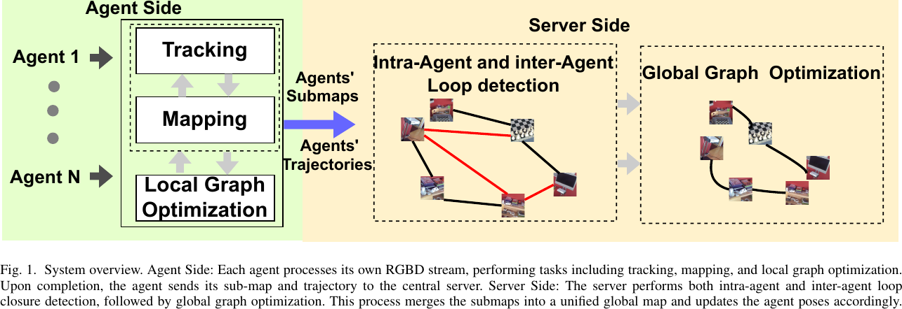
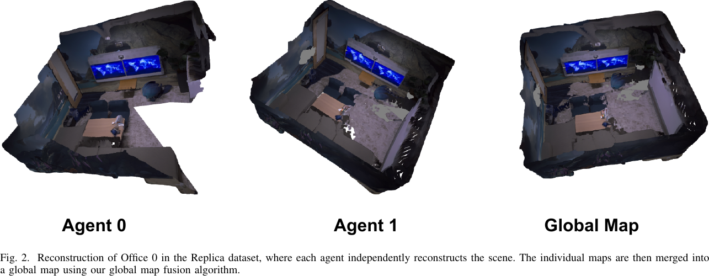
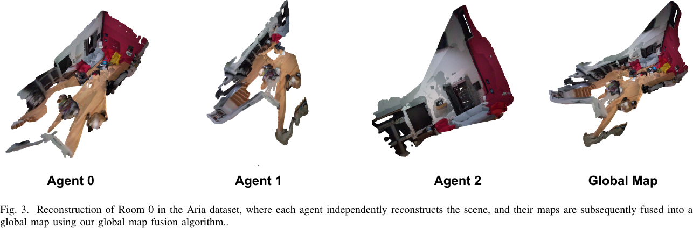
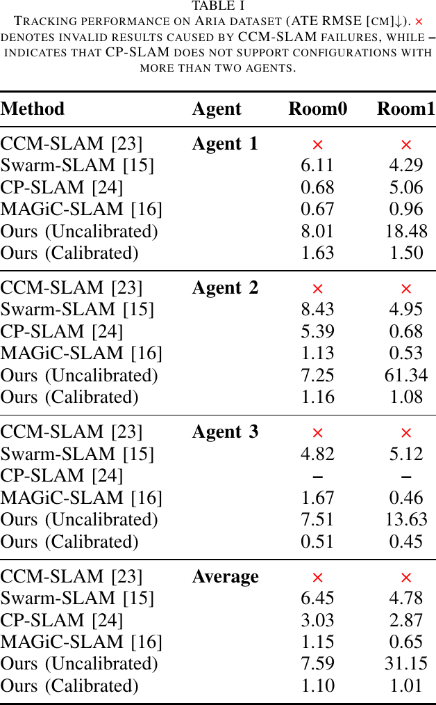
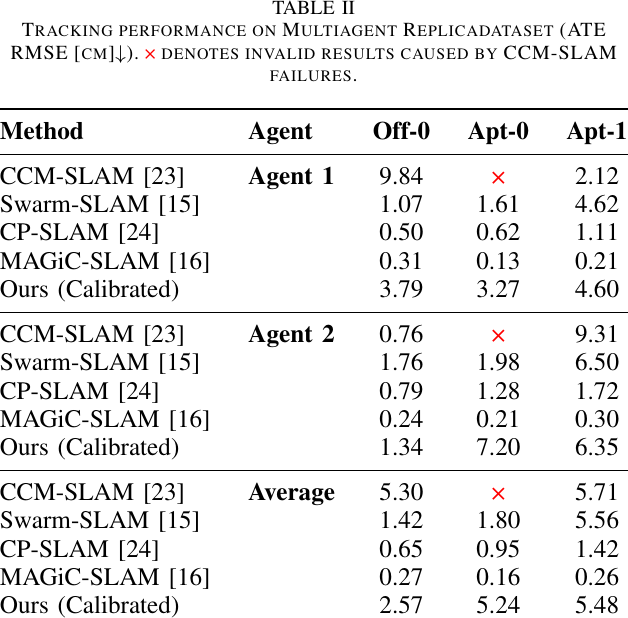
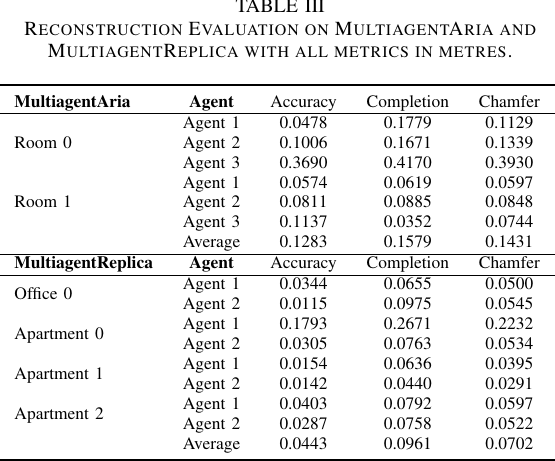

# Multi-Agent Monocular Dense SLAM 论文解读

> Yuchen Zhou、Haihang Wu，*Multi-Agent Monocular Dense SLAM With 3D Reconstruction Priors*，2026 29th International Conference on Computer Supported Cooperative Work in Design（CSCWD），pp. 1062–1067，DOI: [10.1109/CSCWD68734.2026.11582087](https://doi.org/10.1109/CSCWD68734.2026.11582087)。下文依据 [arXiv v2（2025-11-26）](https://arxiv.org/abs/2511.19031) 及其 [6 页 PDF](https://arxiv.org/pdf/2511.19031) 解读；未发现独立补充材料。

[MASt3R-SLAM](../mast3r-slam/index.md) 用两帧重建先验预测点图，再在局部跟踪、地图融合和回环图中维持单台相机的稠密 SLAM。论文将它扩展到多机器人：每个机器人用自己的 GPU 和 CPU 独立处理 RGB 流，完成本地跟踪、建图和局部回环后，把关键帧子图与轨迹发送给中心服务器；服务器再检测机器人内部和机器人之间的回环，统一优化全部关键帧位姿并合并地图。

*原论文图 1。机器人端包含跟踪、建图与局部图优化；各机器人完成本地处理后发送子图和轨迹，服务器执行跨机器人和机器人内部的回环检测，再进行全局图优化。*

这个系统采用集中式的后处理融合，而非机器人在运行期间交换图像、点图或位姿。论文图 1 的图注把输入写作 RGBD stream，但方法章节、摘要和实验描述都将该方法定义为单目 RGB 输入；这里按方法正文理解为 RGB。RGB-D 深度出现在部分基线和稠密重建评测的真值生成过程中。

## MASt3R 如何从两帧得到对应关系

MASt3R 对图像对 $I^i,I^j$ 输出两帧的稠密点图、置信度、匹配特征和特征置信度。点图把图像像素映射到三维点；这组双视图输出中的两个点图都表示在第 $i$ 帧相机坐标系，因此可在同一三维参考系中比较。由于直接逐像素搜索代价较高，论文复用 MASt3R-SLAM 的射线匹配：先把点图中的三维向量归一化为单位方向 $\psi(X)$，再为第二帧的点 $x$，在参考帧中寻找单位射线最接近的像素 $p$：

$$
p^*=\arg\min_p\left\|\psi([X^{ii}]_p)-\psi(x)\right\|^2.
\tag{2}
$$

若 $\psi_1,\psi_2$ 是两个单位向量，则

$$
\lVert\psi_1-\psi_2\rVert^2=2(1-\cos\theta),
\qquad \cos\theta=\psi_1^\mathsf T\psi_2.
\tag{3}
$$

所以最小化单位射线的平方距离等价于缩小两条射线夹角 $\theta$。论文先用 Levenberg–Marquardt 求出初始对应，再利用两帧的稠密特征做由粗到细的图像平面搜索，得到像素对应集合 $m_{i,j}$。这些对应随后既用于相机位姿估计，也用于本地和全局回环的几何约束。

相机之间的变换采用 $\mathrm{Sim}(3)$：

$$
T=\begin{bmatrix}sR&t\\0&1\end{bmatrix},
\qquad R\in\mathrm{SO}(3),\ t\in\mathbb R^3,
\tag{4}
$$

其中 $R$ 是旋转，$t$ 是平移，$s$ 是尺度。保留尺度自由度符合单目重建的尺度不确定性；若输入相机内参已知，论文也评测了标定版本。

## 机器人端的跟踪、融合与局部图

初始化时，每台机器人用预训练 MASt3R 为第一帧估计点图和置信度，并把它保存为初始关键帧。之后，新帧 $I_f$ 和最近关键帧 $I_k$ 一起输入 MASt3R，得到当前帧点图 $X^f_f$ 和与关键帧的像素对应。设 $\tilde X^k_k$ 是以关键帧坐标系为规范坐标系的融合点图，$T_{kf}$ 把当前帧点变换到该坐标系。当前位姿通过对应点归一化射线之间的鲁棒残差估计：

$$
E_r=\sum_{(m,n)\in m_{f,k}}
\left\|
\frac{\psi(\tilde X^k_{k,n})-\psi(T_{kf}X^f_{f,m})}
{w(q_{m,n},\sigma_r^2)}
\right\|_\rho.
\tag{5}
$$

$m,n$ 是两个图像中匹配像素的索引，$q_{m,n}$ 表示对应置信度，$w$ 是由置信度和方差参数 $\sigma_r^2$ 决定的逐匹配权重。公式将射线残差先按 $w$ 归一化，再交给 Huber 鲁棒范数 $\lVert\cdot\rVert_\rho$；Huber 范数降低大残差对位姿估计的影响。正文沿用 MASt3R-SLAM 的 $w$ 定义，没有在此重复展开其具体形式。位姿用 Gauss–Newton 的 IRLS 过程迭代更新，论文以 $\tau$ 表示作用在当前估计上的小 $\mathrm{sim}(3)$ 扰动：

$$
T_{kf}\leftarrow\tau\oplus T_{kf}.
\tag{6}
$$

位姿更新后，系统把当前点图变换到关键帧坐标系，并按置信度逐像素更新规范点图：

$$
\tilde X^k_k\leftarrow
\frac{\tilde C^k_k\tilde X^k_k+C^k_f(T_{kf}X^f_f)}
{\tilde C^k_k+C^k_f},
\qquad
\tilde C^k_k\leftarrow\tilde C^k_k+C^k_f.
\tag{7}
$$

$C^k_f$ 和 $\tilde C^k_k$ 是逐像素置信度。每次新观测都与现有点图做加权平均并累计置信度，因此地图保留融合后的点图状态，无须保存每一次 MASt3R 的完整预测。

当有效匹配比例或与上一关键帧匹配的像素数低于阈值时，当前帧成为新关键帧。论文没有在正文给出这两个阈值的具体数值。机器人端局部图先把新关键帧连接到前一关键帧，保证时间连续；再用当前帧编码特征查询历史关键帧，检索到的候选形成回环边。Gauss–Newton 在这些射线残差上优化相关关键帧位姿，以减轻连续局部估计造成的漂移。

## 中心服务器融合多台机器人的地图

各机器人完成本地处理后，服务器把所有关键帧放入统一缓冲区。检索数据库同时寻找同一机器人内部的历史相似帧和不同机器人之间的相似帧，分别产生 intra-agent 与 inter-agent 回环候选。每个关键帧还与它的直接前驱相连，因此时间连续边和回环边共同构成全局因子图。

服务器以关键帧间的相对变换 $T_{ij}$ 把点图 $\tilde X^j_j$ 变换到关键帧 $i$ 的坐标中，再与 $i$ 中的对应点射线比较。全局目标是所有图边对应射线残差的 Huber 加权和：

$$
E_g=\sum_{(i,j)\in\mathcal E}\sum_{(m,n)\in m_{i,j}}
\left\|
\frac{\psi(\tilde X^i_{i,m})-\psi(T_{ij}\tilde X^j_{j,n})}
{w(q_{m,n},\sigma_r^2)}
\right\|_\rho.
\tag{8}
$$

这里 $\mathcal E$ 是全局图边集合。最小化该目标会共同调整各关键帧位姿，使局部连续边、同一机器人回环和跨机器人回环的几何关系尽量一致。优化后，服务器按新位姿融合各机器人的子图，形成统一地图。由于全局阶段只描述了对关键帧位姿的图优化，点图在这一步作为射线残差的几何载体；正文没有给出联合优化每个稠密地图点的变量。

## 数据集、位姿结果与比较条件

论文在真实的 Aria 数据和合成的 Multiagent Replica 数据上评估。Aria 选取两个房间中三段以静态场景为主的长序列，每段连续 500 帧，包含最多三个机器人。Replica 使用 Office-0、Apartment-0 和 Apartment-1 三段双机器人序列，其中两段各 2500 帧、Office-0 为 1500 帧。位姿指标为 ATE RMSE，单位是厘米。

*原论文图 2。两台机器人各自建立 Office-0 点云子图，服务器将它们合并成同一全局地图。*

*原论文图 3。Aria Room-0 展示三台机器人局部重建与服务器融合结果；各局部地图视角不同，融合后统一到一个全局坐标系。*

*原论文表 I。Aria 上分别列出每个机器人在 Room0、Room1 的 ATE RMSE；$\times$ 表示 CCM-SLAM 失败，短横线表示 CP-SLAM 不支持超过两个机器人的配置。*

在 Aria 上，标定版方法的平均误差为 Room0 1.10 cm、Room1 1.01 cm；MAGiC-SLAM 分别为 1.15 cm 和 0.65 cm。也就是说，第一间房的平均值接近，第二间房的结果高于 MAGiC-SLAM。这个基线使用 RGB-D，并用真值深度跟踪；该方法按 RGB 输入运行。标定条件也会明显影响它的结果：未标定版 Room1 的平均误差为 31.15 cm，而标定版为 1.01 cm。因此，“与 RGB-D 方法相当”只适用于特定数据和标定设置，不能概括成所有机器人、所有房间都一样准确。

*原论文表 II。Replica 结果只列出该方法的标定版；三个序列分别为 Office-0、Apartment-0 和 Apartment-1。*

在 Replica 三段序列上，该方法的平均误差依次为 2.57、5.24、5.48 cm；RGB-D 基线 MAGiC-SLAM 为 0.27、0.16、0.26 cm。作者指出，该方法结果低于 RGB-D 系统；其分析认为，MASt3R 默认输入为 $512\times512$，Replica 原图 $1200\times680$ 缩放到固定输入会丢失细节并可能引入形变。RGB 方法 CCM-SLAM 在表中也存在失败项，而 CP-SLAM 只支持最多两个机器人。比较时需把这些输入模态和系统支持范围与误差一并看待。

## 稠密地图与运行速度

论文没有把该方法的稠密点云与采用深度或 3D Gaussian 表示的系统做直接重建精度排名，因为输入传感器和地图表示不同。它先用数据集真值深度与相机位姿反投影得到参考点云，再用 ICP 对齐估计点云和参考点云。Accuracy 是估计点到最近真值点的 RMSE；Completion 是真值点到最近估计点的距离；两者均在 0.5 m 阈值内计算，Chamfer Distance 取 Accuracy 与 Completion 的平均。

*原论文表 III。表中同时列出每个机器人和场景的 Accuracy、Completion、Chamfer；两套数据的平均 Chamfer 分别为 0.1431 m 和 0.0702 m。*

Aria 的平均 Chamfer 为 0.1431 m，Replica 为 0.0702 m。论文将这些值与 MASt3R-SLAM 在 7-Scenes 和 EuRoC 上报告的 0.056 m、0.09 m 作背景比较；数据集不同，因此它们不能视为同一协议下的直接胜负比较。该实验更直接地表明，多机器人地图融合后仍能得到连贯的稠密点云。

速度测试在 NVIDIA A100 上进行，只报告 Multiagent Replica 的 Office-0 场景：该系统为 11.81 FPS，MAGiC-SLAM 略高于 2 FPS。作者把差距归因于 MASt3R 直接预测几何、减少了场景表示从头迭代收敛的开销。这个结果是特定序列和 A100 上的测量，不代表通信、机器人数量增长或其他硬件条件下的总系统吞吐。

## 适用范围与证据边界

这篇工作的系统贡献是把单机器人重建先验 SLAM 拆成独立前端与集中式融合：各机器人无需实时互通，完成本地处理后，服务器利用跨机器人回环把地图放到共同图中。相较要求机器人在运行中协同建图的分布式系统，这种设计减少了前端通信依赖，也把全局一致性维护集中到服务器。

代价是论文的方法流程要等机器人完成本地处理并上传后才做全局融合；正文没有展示在机器人仍运行时服务器持续回传校正位姿的在线协同协议。论文结论称系统可支持任意数量的机器人，但实验最多评估三台机器人，未给出更多机器人下的通信量、服务器耗时或内存增长曲线。实验结果也显示标定先验、RGB 输入分辨率和场景都会明显影响位姿误差；RGB-D 对比、稠密重建跨数据集对比和单场景 A100 速度测试，各自支持的结论范围不同。

此外，论文的 “Ablation Study” 只比较 Office-0 上的运行速度，没有逐项移除局部图、跨机器人回环或全局优化来衡量各组件的独立贡献。因而，现有证据说明该集中式框架可以把多台机器人的 MASt3R-SLAM 地图融合起来，并在所测硬件和数据上达到报告的位姿、重建与速度结果；它尚未完整量化机器人规模扩展、在线协同延迟和各融合组件对精度的单独作用。
