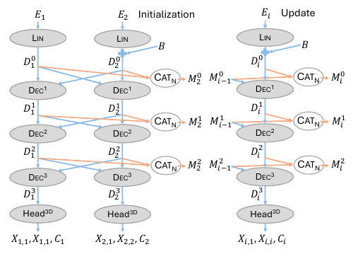
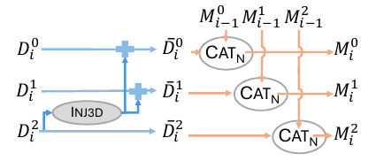
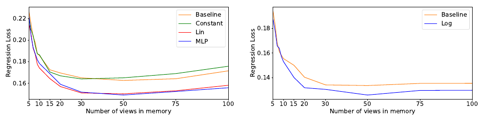

# MUSt3R 论文解读

> MUSt3R 利用共享的多视图解码器与逐层记忆，在公共坐标系中预测稠密三维点图，支持未标定照片集与连续视频的重建。论文为 Yohann Cabon 等人的 *MUSt3R: Multi-view Network for Stereo 3D Reconstruction*，以下依据 2025 年 3 月 3 日的 arXiv v1。[论文页面](https://arxiv.org/abs/2503.01661) · [论文 PDF](https://arxiv.org/pdf/2503.01661v1)

多张图像各自预测出三维表面后，还需要统一坐标参考，才能组成一个场景。MUSt3R 在预测阶段直接延续首相机坐标系，并缓存历史图像的解码特征。新图像读取这些特征得到几何；离线处理时，早期图像还可以重新读取完整记忆，利用后续观测更新点图。

## 摘要

MUSt3R 针对 DUSt3R 扩展到多图像时的两个相连问题：双视图网络产出的局部几何需要全局对齐，而较密集的成对计算又随图像数量快速增加。其改动分别落在结构和计算复用上。共享的多视图解码结构负责预测公共参考系中的点图，逐层记忆负责让新图像利用旧特征继续推理。

论文用同一网络处理无序照片集和连续视频，并分别评价未标定视觉里程计、相对位姿、稠密重建和多视图深度。理解这些结果时，需要区分网络直接预测的点图、点图之后的相机求解，以及可选的完整记忆重预测。

## 1 引言

### 点图方法的多视图扩展问题

DUSt3R 将双视图三维估计写成逐像素的三维坐标回归。点图保留图像像素布局，每个像素对应一个被观测表面点的三维坐标。它既可承载形状，又包含恢复相机与图像对应关系所需的信息，因此深度、焦距、位姿和稠密结构可以围绕同一种输出组织。

多视图扩展的困难来自坐标参考。一对照片的点图以该对第一台相机为参考；不同配对通常具有不同参考。增加照片后，即使每一对都能给出合理局部结构，也仍需协调这些结构的位姿与尺度。GA 因而成为整个计算流程的一部分。

论文选择直接改变网络，使多张图在预测时就采用同一参考，并保存历史潜在特征。其主要设计分别是共享多视图结构、可迭代记忆，以及通过米制监督学习带尺度的点图。离线照片集和在线视频由不同的记忆管理方式连接到这一网络。

完整图的无向边数是 $N(N-1)/2$，这是成对推理可能出现二次增长的来源。实际系统可用检索和稀疏图减少配对，因而不能将完整图成本当作任何 DUSt3R 管线的必然成本。MUSt3R 的研究问题更具体：能否直接延续一个共同的几何参考，并复用已有解码状态，减少协调大量独立成对结果的工作？

## 2 相关工作

### 直接由 RGB 预测三维

本节将点图回归放在传统 SfM 和学习式 RGB-to-3D 方法之间比较。传统流程依靠图像对应关系恢复相机与结构；学习方法还可借助物体或场景先验，直接输出几何。DUSt3R 及其后续方法的共同表示是点图，而成对输出的对齐仍是多视图处理中的重要环节。

与 MUSt3R 最直接的记忆方法对照是 Spann3R。它保留双视图结构，利用空间记忆连接连续预测，减少全局对齐需求。论文描述的流程包含前后两次处理：先取得带位置信息的特征并查询记忆，再更新记忆和输出点图；中间帧通常连续经过网络两次。MUSt3R 则将各层历史特征直接作为解码器可读取的上下文。

ACE-0 提供另一种联系：它以场景坐标预测连接图像与场景，将场景隐式表示在网络参数中。MUSt3R 的几何输出是显式点图，跨图关系则通过读取潜在记忆的注意力建立。

### 已标定视觉里程计

论文在这一部分聚焦视觉里程计（Visual Odometry，VO）。许多 VO 方法结合投影几何、状态优化和人工设计的管理策略，即使引入学习到的光流、深度或正则项，仍常以已知相机标定为条件。MUSt3R 希望在不输入相机标定时同时恢复几何与相机。

### 未标定情形

多传感器可以增加标定约束，例如相机与 IMU 或 LiDAR 的组合；只使用 RGB 时，标定恢复更依赖图像几何和训练先验。MUSt3R 延续 DUSt3R 的未标定输入设置，并通过局部点图提供焦距和深度信息。

这里的“未标定”表示调用模型时不提供内参，训练数据仍包含几何监督。论文也限定了与训练所用相机模型的关系。镜头畸变、投影模型或场景分布发生较大变化时，不能仅根据“无需输入标定”推导出误差保证。下游实验采用何种相机求解，也须和网络本身分开看。

## 3 方法

### 3.1 DUSt3R 的双视图结构

论文先定义双视图点图 $\mathbf X_{i,1}\in\mathbb R^{H\times W\times3}$，$i\in\{1,2\}$。像素来自第 $i$ 张图，三维坐标都位于第一台相机系中。

输入图像先按 patch 转成 token，经共享 ViT 编码器得到 $\mathbf E_i$，再线性投影为 $\mathbf D_i^0=\operatorname{Lin}(\mathbf E_i)$。两个具有不同参数的解码分支逐层通过交叉注意力交换信息。其深度为 $L$，最终输出点图与置信度：

$$
\mathbf X_{i,1},\mathbf C_i
=\operatorname{Head}^{\mathrm{3D}}_i
(\mathbf E_i,\mathbf D_i^L).
\tag{1}
$$

这里保留了编码特征 $\mathbf E_i$ 作为可选输入，因为 DPT 类型预测头会使用它。不能据此把所有版本的头都简化成仅接收末层特征。

回归目标写为

$$
\ell_{\mathrm{regr}}(i,j)
=\sum_{p\in I_i}
\left\|
\frac{1}{z}\mathbf X_{i,j}[p]
-\frac{1}{\hat z}\widehat{\mathbf X}_{i,j}[p]
\right\|.
\tag{2}
$$

求和限于存在有效三维真值的像素。$j=1$ 表示以首相机为参考；预测与真值分别用 $z,\hat z$ 归一化，这两个量是有效三维点到原点距离的平均值。MUSt3R 沿用 MASt3R 的米制监督处理：真值有物理尺度时令 $z:=\hat z$。论文还说明，回归误差外使用 DUSt3R 的置信度感知损失 $\mathcal L_{\mathrm{conf}}$。

$\mathbf X_{i,j}[p]$ 的第一个下标确定像素属于哪张图，第二个确定坐标属于哪台相机。因此，两张图里同一个桌角的像素位置可以不同，但它们在相同参考系中的三维坐标应当接近。

若预测是正确形状的两倍，单独计算预测尺度也会得到两倍的 $z$，于是独立归一化可消除这类整体尺度差。令 $z=\hat z$ 后，两边共用真值尺度，预测放大造成的误差会保留。这里的 $z$ 是归一化标量，不是某个像素的深度。

米制标签为网络提供了学习物理尺度的依据。单目图像的投影本身仍具有整体尺度歧义，因此米制预测还利用了训练分布中的先验；共用首相机系只固定参考原点与朝向，并不独自提供真实长度的观测。

### 3.2 MUSt3R 的多视图结构

#### 结构简化与参考图标记

MUSt3R 让所有视图共用同一组解码层和预测头，使分支数变化时不必增加一套对应参数。双视图设置下，这使解码器的可训练参数约减半。各层之间仍有各自的参数，共享发生在视图之间。

共用分支之后，参考图的角色需要显式标记。论文在第二张图初始解码特征上加入可学习嵌入 $\mathbf B$：

$$
\mathbf D_2^0=\operatorname{Lin}(\mathbf E_2)+\mathbf B.
\tag{3}
$$

第一张图不加该嵌入；扩展到多视图时，其余非参考图采用这一角色标记。模型还移除了交叉注意力中的 RoPE，相关双视图消融见附录 A.1。

一个无角色区别的共享结构，在交换输入图时本应相应交换输出。但“所有点都写在第一台相机系中”又要求第一张承担特殊角色。$\mathbf B$ 提供的正是这一差别。它既不是相机位姿，也不是给每张图一个不同的相机编号。

#### 多视图交叉注意力

每个解码块由帧内自注意力、跨视图交叉注意力和 MLP 组成，并使用残差连接。令

$$
\mathbf M_n^l=\operatorname{Cat}_{\mathrm N}
(\mathbf D_1^l,\ldots,\mathbf D_n^l),
$$

其中 $\operatorname{Cat}_{\mathrm N}$ 沿 token 序列维拼接；$\mathbf M_{n,-i}^l$ 表示去掉第 $i$ 张图后的拼接。于是各层更新为

$$
\mathbf D_i^l
=\operatorname{Dec}^l
(\mathbf D_i^{l-1},\mathbf M_{n,-i}^{l-1}).
\tag{4}
$$

若每图有 $T$ 个 token、通道维为 $d$，本图输入约为 $T\times d$，另一组输入为 $(n-1)T\times d$。本图先在自注意力中结合自身信息，再作为查询读取其他图的上下文。公式（4）对所有视图都读取上一层 $l-1$ 的状态，因此可以并行计算本层，不要求某个视图先产出本层结果。

例如三图联合计算时，第三张在第一层读取前两张的第零层特征，在第二层读取它们的第一层特征。来自其他图像的信息随层数逐步融合，而不是把一个匹配点在网络里按物理轨迹显式传递。

#### 双点图与快速位姿恢复

MUSt3R 的预测头为每张图额外输出自身相机系中的点图：

$$
(\mathbf X_{i,1},\mathbf X_{i,i},\mathbf C_i)
=\operatorname{Head}^{\mathrm{3D}}(\mathbf D_i^L),
\qquad i\in\{1,\ldots,n\}.
\tag{5}
$$

全局与局部点图共享像素索引。局部点图可恢复该视图的焦距，而两份点图之间的变换可通过 Procrustes 分析恢复相对位姿。这避免了为取得第二台相机的局部点图，再交换双视图顺序运行一次网络。

定义 $R_i,\mathbf t_i$ 将第 $i$ 相机系中的点变换到首相机系。令 $\mathbf a_p=\mathbf X_{i,i}[p]$、$\mathbf b_p=\mathbf X_{i,1}[p]$，则理想关系是 $\mathbf b_p=R_i\mathbf a_p+\mathbf t_i$。同一像素已经提供两组点的对应关系，可据此最小化

$$
\sum_p\|\mathbf b_p-R_i\mathbf a_p-\mathbf t_i\|_2^2,
\qquad R_i\in SO(3).
$$

这是一种说明 Procrustes 几何意义的刚体拟合形式，具体实现还可选择有效点与权重。令两组点质心为 $\bar{\mathbf a},\bar{\mathbf b}$，求平移的一阶条件得到

$$
\mathbf t_i=\bar{\mathbf b}-R_i\bar{\mathbf a}.
$$

定义去中心坐标的互协方差矩阵

$$
H=\sum_p(\mathbf a_p-\bar{\mathbf a})
(\mathbf b_p-\bar{\mathbf b})^\mathsf T
$$

代回平移解后，目标变成去中心点之间的误差。展开平方项时，两组点的平方范数与旋转无关，因为旋转保长度；剩下的优化等价于最大化

$$
\sum_p(\mathbf b_p-\bar{\mathbf b})^\mathsf T
R_i(\mathbf a_p-\bar{\mathbf a})
=\operatorname{tr}(R_iH).
$$

对 $H$ 做 $H=U\Sigma V^\mathsf T$，可得旋转解

$$
R_i=V\operatorname{diag}
\bigl(1,1,\det(VU^\mathsf T)\bigr)U^\mathsf T.
$$

最后一个对角项排除反射。这里 $\mathbf t_i$ 也是当前相机中心在首相机系中的坐标。网络直接预测的两份点图可能并不严格刚性一致，拟合解决的是近似对齐，误差仍会传到位姿中。

对局部坐标 $(x,y,z)$，深度为第三分量。若采用主点为 $(c_x,c_y)$ 的单焦距针孔模型，则像素满足

$$
u-c_x=f\frac{x}{z},\qquad v-c_y=f\frac{y}{z}.
$$

给定局部点图与像素位置，可以拟合 $f$。这是对可用约束的解释，不指定论文辅助函数的完整估计器。Procrustes 的刚体关系不含 $f$，因而在这一求解路径中位姿恢复不必等待焦距估计；PnP 则需要相应内参条件。

### 3.3 为 MUSt3R 引入因果性

#### 可迭代的逐层记忆

多视图联合读取的 token 随图像数增长，且在线任务的未来图像尚未到达。MUSt3R 保存之前计算出的各层拼接特征，使新图像读取已有记忆：

$$
\mathbf D_{n+1}^l
=\operatorname{Dec}^l
(\mathbf D_{n+1}^{l-1},\mathbf M_n^{l-1}).
\tag{6}
$$

新图完成后，其特征可沿序列维追加到相应的记忆层。旧图的特征不会因新图到来而重新解码。这与因果 Transformer 复用历史状态的思想相近，不过论文这里定义的缓存对象是逐层图像特征。

*原论文图 3。左侧两图共同初始化，右侧新图在每个解码块读取相应历史层，输出公共坐标与局部坐标两份点图。图中 $L=3$，为说明基本路径省略了三维反馈。*

为说明逐帧机制，先联合处理 $I_1,I_2$。记忆保存 $\mathbf M_2^0,\ldots,\mathbf M_2^{L-1}$；第三张到来时，只计算第三张的编码与解码。第一解码块读取 $\mathbf M_2^0$，第二块读取 $\mathbf M_2^1$，以此类推。最后 $\mathbf D_3^L$ 进入预测头。

如果第三张被选入历史，则将其第零到第 $L-1$ 层特征分别追加到对应记忆。第 $L$ 层送入预测头；供各解码块读取的历史，则停在第 $L-1$ 层。前两张在联合初始化时彼此可见，随后的逐帧过程只依赖已到达图像。论文训练采用两图初始化，在线 VO 的描述则从首张图初始化，这两种设置需分别保留。

#### 固定记忆上的 rendering

读记忆和写记忆可以分开。模型允许处理图像并输出点图，同时不向记忆追加 token；论文称这一操作为 rendering。视频结束后，早期图像可重新读取包含后续观测的记忆，得到新的点图。查询图像可以逐张或成批处理。

这里的 rendering 可以理解为读取记忆后的几何重预测：查询由真实图像提供，输出仍是点图。若第三张提供了前两张没有的上下文，重新查询第一张就能使用这份信息。查询分支重新计算，既有记忆仍保持固定；此操作不等于重新联合优化全部历史状态。

缓存本身也没有令无限序列具有固定成本。设记忆保留 $K$ 张图，每图有 $T$ 个 token，忽略通道相关常数时，新图一层跨视图注意力的成对 token 工作量约为 $O(KT^2)$，各层缓存约占 $O(LKTd)$。若所有帧都写入，$K$ 仍会增长。固定关键帧预算下，对全部 $N$ 张图重预测的这部分工作才近似随 $N$ 线性增长。该量级分析解释了第 3.4 节仍需要管理记忆的原因。

#### 全局三维反馈

初始缓存 $\mathbf M_n^0$ 只包含单图编码的线性投影。较深层已经融合跨图上下文，早期缓存却没有直接使用这份信息。论文让历史帧的末端记忆特征反馈到较浅层。令 $\mathcal P$ 表示过去图像，$\mathcal N$ 表示当前新图像，采用

$$
\overline{\mathbf D}_i^l=
\begin{cases}
\mathbf D_i^l+\operatorname{Inj}^{\mathrm{3D}}
(\mathbf D_i^{L-1}),
&\forall l<L-1\ \text{且}\ i\in\mathcal P,\\
\mathbf D_i^l,
&l=L-1\ \text{或}\ i\in\mathcal N.
\end{cases}
\tag{7}
$$

$\operatorname{Inj}^{\mathrm{3D}}$ 为 LayerNorm 加两层 MLP，记忆改为拼接增强后的特征。

*原论文图 4。$L=3$ 时，由 $D_i^2$ 生成反馈并加到 $D_i^0,D_i^1$，第 2 层自身保持不变，随后分别写入各层记忆。*

在第三张到来时，过去集合可取 $\mathcal P=\{1,2\}$，当前集合为 $\mathcal N=\{3\}$。前两张已完成解码，其 $L-1$ 层可用于增强供第三张读取的早期记忆。第三张尚未完成计算，其当前浅层不能读取自己的未来末端状态，因此公式对 $i\in\mathcal N$ 保持原特征。

新图完成并成为历史后，才具备构造反馈缓存的条件。这里是对写入历史的特征进行增强，不能理解成每来一帧，就把同一个反馈不断累加到所有旧缓存上。增强对象是潜在特征，公式也未执行 XYZ 坐标的显式反投影。

> 原文在此处将增强记忆写成 $\operatorname{Cat}_{\mathrm N}(\overline{\mathbf D}_0^l,\ldots,\overline{\mathbf D}_n^l)$，而前面多视图定义从 1 开始。两处索引起点不一致。拼接范围应按已经处理的图像集合理解，不能据此增加一张“第零图”。反馈来源始终为 $L-1$ 层，不能静默改成预测头前的第 $L$ 层。

### 3.4 记忆管理

#### 在线处理

在线策略同时维护潜在记忆和预测场景的空间索引。每帧先读取记忆产生点图，再根据它对当前场景的空间发现率决定是否写入。即使没有写入，当前帧仍有几何与相机输出。

空间索引按观察方向划分。作者将方向球面划为八分区，为相应方向维护 KDTree。新点按其观察方向选择树，查询该分区中的最近点距离，再除以自身预测深度。整帧发现率取这些归一化距离的指定百分位；超过阈值时，才同时追加帧特征与场景点。

沿用前面的局部到全局位姿约定，像素全局点为 $\mathbf x_p=\mathbf X_{i,1}[p]$、相机中心为 $\mathbf t_i$，其方向为

$$
\mathbf r_p=\frac{\mathbf x_p-\mathbf t_i}
{\|\mathbf x_p-\mathbf t_i\|_2}.
$$

令相应 KDTree 返回最近距离 $d_p$，局部深度为 $z_p$，则 VO 实验的选择规则可表达为

$$
\operatorname{Percentile}_{85}
\left(\left\{d_p/z_p\right\}_p\right)>0.05.
$$

距离和深度具有相同长度单位，比值没有量纲；按深度归一化使阈值能够用于不同距离的表面。观察方向参与分树，使空间接近但视角变化明显的观测仍可能提供新信息。85 指百分位位置，不表示要求 85% 的像素都是新点。

例如深度 2 米、最近距离 0.12 米的像素给出比值 0.06。帧级决策还要计算全部有效查询值的百分位。该策略依赖预测几何，几何漂移可能影响后续记忆选择；发现率本身不提供外部校正。

#### 离线处理

离线输入不具有可信的时间顺序。作者复用编码特征建立 ASMK 检索表示，再以最远点采样选出固定数量的关键帧。选择关注覆盖，处理顺序则关注重叠：先取与其他关键帧联系最强的一张，然后贪心加入与当前集合最相似的图。

关键帧按该顺序建立场景记忆，全部照片再读取固定记忆得到点图。这样未入选关键帧的图像仍可获得输出。若改为反复让所有图像参与构建，解码次数会增加，因此论文选择先构建再查询的组织方式。

覆盖不足时，记忆可能缺少某片区域；相邻处理图像缺乏重叠时，公共参考又难以稳定延续。最远点采样与后续重排分别处理这两个需求。固定预算控制了计算，但不能保证保留全部细节，也不能修复本来就断开的图像集合。

## 4 训练

### 双视图预训练与对数空间回归

MUSt3R 先训练简化后的共享双视图结构。为处理相对参考原点较远的三维点，回归比较采用径向对数变换：

$$
f:x\longmapsto\frac{x}{\|x\|}\log(1+\|x\|).
\tag{8}
$$

$$
\mathbf X'_{i,j}[p]
=f\left(\frac{1}{z}\mathbf X_{i,j}[p]\right),
\qquad
\widehat{\mathbf X}'_{i,j}[p]
=f\left(\frac{1}{\hat z}\widehat{\mathbf X}_{i,j}[p]\right).
\tag{9}
$$

$$
\ell_{\mathrm{regr}}(i,j)
=\sum_{p\in I_i}
\left\|\mathbf X'_{i,j}[p]
-\widehat{\mathbf X}'_{i,j}[p]\right\|.
\tag{10}
$$

原文公式（8）用 $x$ 表示三维向量。式（9）先按式（2）的约定归一化，再进行变换；式（10）比较变换后的点。

写 $x=r\mathbf u$，其中 $\|\mathbf u\|=1$，可得 $f(x)=\mathbf u\log(1+r)$。径向导数为 $1/(1+r)$，因此同方向上较小的径向误差 $\Delta r$，在变换后的局部变化约为 $\Delta r/(1+r)$。这压低远点绝对距离误差的贡献，方向变化仍会进入向量差。

归一化半径从 100 变为 110，变换后径向差约为 $\log111-\log101=0.094$；半径从 1 变为 1.1，差约为 $\log2.1-\log2=0.049$。这是对损失的局部说明，最终网络输出仍表示三维点。原点处可取连续延拓 $f(0)=0$。

训练以 CroCo v2 初始化，使用线性头和深度 $L=12$ 的解码器，先学习 224 分辨率，再微调至 512 分辨率与变化宽高比。双视图阶段的数据来源共 14 个：Habitat、ARKitScenes、Blended MVS、MegaDepth、Static Scenes 3D、ScanNet++、CO3D-v2、Map-free、WildRGB-D、Virtual KITTI、Unreal4K、DL3DV、TartanAir 和内部数据集。

### 多视图训练与记忆查询

多视图阶段继承上述参数，每个样本含 $N=10$ 张图，冻结编码器，并用 xformers 实现注意力计算。训练集合去掉 Virtual KITTI 与 Static Scenes 3D，保留 12 个来源。物体中心数据随机选图，其他数据从重叠图像对起步，新增图必须至少与已选图之一重叠。

每个样本随机选择 $2\le n\le N$。前两张图共同初始化，随后逐张处理至第 $n$ 张，建立记忆并取得这 $n$ 张图的预测。再让全部 $N$ 张图读取该记忆，包括已经参加记忆构建的图，共得到 $n+N$ 份预测。原文目标为

$$
\mathcal L=\sum_{i\in1}^{n+N}
\ell_{\mathrm{regr}}(i,1)+\ell_{\mathrm{regr}}(i,i).
\tag{11}
$$

> 式（11）沿用原文略不规范的求和下标，语义是对上述 $n+N$ 份预测的两种点图误差求和。这里的 $i$ 在重预测阶段会重复指向某张输入，不能当成 $n+N$ 台不同相机。若以 $a$ 为预测记录、$i(a)$ 为原图索引，可明确写为

$$
\sum_{a=1}^{n+N}
\left[\ell_{\mathrm{regr}}^{(a)}(i(a),1)
+\ell_{\mathrm{regr}}^{(a)}(i(a),i(a))\right].
$$

论文第 3.1 节说明沿用置信度感知损失，式（11）只展开回归部分。其基本作用可以用逐像素形式 $C_p e_p-\alpha\log C_p$ 说明：$e_p$ 是该像素的几何误差，高置信度的错误预测代价更大；负对数项则惩罚无条件压低置信度。这是对所沿用损失的机制解释，v1 没有在式（11）中完整重写该包装及其超参数。

从具有标定、位姿和深度的数据可以构造局部三维标签；再用真值相机变换写到首相机系，得到全局标签。每次预测分别与这两种标签比较，有效像素掩码排除缺失标签的位置。构建记忆时的监督要求早期预测可用，重预测监督则要求这份记忆能服务其他查询。

例如取一个缩小的三图样本、令 $n=2$，先得到两份构建阶段预测，再得到三份查询预测，总计五份。相同输入可在两个阶段各受一次监督，但可见上下文不同。真实训练采用十图样本，这个计数例子只解释式（11）的索引。

为增加对记忆缺失的适应，训练还随机丢弃历史 token。同一 token 的丢弃在所有层一致，首图 token 受保护。224 与 512 设置分别使用 0.05 与 0.15 的概率。跨层一致性避免一份观测在某层消失、在另一层仍被完整保留；首图保护则与公共参考的特殊角色一致。

## 5 实验验证

本节按论文次序区分 VO、相对位姿、稠密重建与深度。各任务的处理图数、后处理和计时范围不同，下述 FPS 不组成一条可以直接横比的排名。实验数据取自原文表 1—8，完整单序列结果见附录表 11—12。

### 5.1 未标定视觉里程计

VO 使用 TUM RGB-D 和 ETH3D SLAM 的 RGB 图像。MUSt3R 与 Spann3R 不接收相机标定；论文没有在 Replica 上进行这一测试，因为它出现在训练数据中。所有数据集共用发现率参数 $\tau_d=5\%$、$p_d=85\%$。

MUSt3R-C 指不做完整记忆重预测的因果版本；普通 MUSt3R 还包含重预测及轻量 Laplacian 平滑。作者运行 Spann3R 代码，并用其预测与首图焦距估计通过 PnP 恢复位姿。传统 SLAM 方法采用 VO 设置，比较中关闭全局 BA；相关方法关闭回环的条件见原表注。

轨迹质量以对齐真值后的 ATE RMSE 衡量，数值越低越好；此外还报告每秒帧数、垂直视场角绝对误差及尺度误差。表 1 的 11 条常用 TUM 序列上，Spann3R 为 47.9 厘米、4.8 FPS，MUSt3R-C 为 7.1 厘米、11.1 FPS，普通 MUSt3R 为 5.5 厘米、8.4 FPS。该组计时使用 NVIDIA V100。

扩展至论文表 2 的六类 TUM 场景后，误差明显上升：其 Avg 栏中，Spann3R、MUSt3R-C、MUSt3R 的数值分别为 64.8（48.7）、20.8（11.4）、14.4（7.4）厘米，括号为表中对应的中位数统计。类别覆盖测试、手持、机器人、结构与纹理、动态物体及三维物体识别。

表 3 中平均垂直 FoV 误差由 Spann3R 的 $12.06^\circ$ 降到 MUSt3R 的 $4.32^\circ$。表 4 的尺度误差中位数对因果与重预测版本分别为 5.5% 和 4.6%，均值分别为 14.7% 和 13.9%。ETH3D 表 5 的八条选定序列上，三个版本的轨迹误差依次为 16.8、11.2、10.0 厘米，速度为 6.1、11.8、8.7 FPS。

MUSt3R-C 与普通版本之间同时改变了重预测和平滑，不能把全部改善单归于未来信息。对齐后的轨迹误差也不能代替尺度评估；表 4 中 fr1 rpy 的普通 MUSt3R 尺度误差达到 86.3%，说明典型序列之外仍有较大尾部错误。

> 正文称完整 TUM 有 46 条测试场景，但常用 11 条加附录表 11 标明的其余 34 条合计为 45。正文讨论 FoV 时还称八条轨迹，而表 3 列有 11 条。正文和表格的计数未完全一致，缺失序列无法据此确定；表 3 的均值也不能作为八条样本的统计。

### 5.2 相对位姿估计

相对位姿比较采用 CO3Dv2 与 RealEstate10K；这些数据的相机标签来自 COLMAP，或由完整序列上的 SLAM 与 BA 获得。原文沿用既有方法的约 1,800 个测试视频片段设置，每个片段含十帧，评价其中全部 45 对相机关系。

RRA@15 是旋转误差小于 $15^\circ$ 的比例，RTA@15 是平移方向误差小于 $15^\circ$ 的比例。mAA@30 在 $1^\circ$ 至 $30^\circ$ 的阈值范围综合 $\min(\mathrm{RRA},\mathrm{RTA})$，越高越好。该平移指标不比较平移长度。

表 7 默认先估计焦距，再通过 PnP 求位姿；标为 Pro 的版本采用 Procrustes。其 FPS 在 A100 上同时包括网络推理和位姿恢复。MUSt3R-512 使用 PnP 时，CO3Dv2 的 RRA@15、RTA@15、mAA@30 分别为 97.0、92.7、84.1，RealEstate10K 的 mAA 为 75.1，速度 4.1 FPS。Pro 版本对应为 95.5、88.9、78.3、65.5，速度 32.9 FPS。

在相同表中，MUSt3R-224 的两个 mAA 为 80.7 和 74.7，速度 11.7 FPS；Spann3R 为 70.4 和 60.8，速度 7.4 FPS。DUSt3R-512 为 77.2 和 61.2、3.2 FPS，加入 GA 后为 76.7 和 67.7、0.1 FPS。分辨率是这里的重要比较条件。

> 作者将 Procrustes 的精度描述为接近 PnP，并强调其接近一个数量级的速度收益。表中速度比约为 $32.9/4.1\approx8$，但 RealEstate10K 的 mAA 下降 9.6，CO3Dv2 下降 5.8。可以确认速度收益，也应保留精度损失，不能把 PnP 的最高精度与 Pro 的最高速度组合成同一配置。

### 5.3 三维重建

该实验沿用 Spann3R 协议，在 7-Scenes、Neural RGBD 和 DTU 上将预测点图与真值深度反投影所得的点比较，并排除无效点及适用情况下的背景。MUSt3R 在这里用全部图像更新记忆，再重预测最终点图。

Accuracy（Acc）反映预测点偏离真值表面的程度，completeness（Comp）反映真值表面未被充分覆盖的程度，均越低越好；normal consistency（NC）反映局部法线方向的一致性，越高越好。表中距离数值沿用相应数据集协议，不能直接跨数据集比较量级。

表 6 的 A100 实验中，DUSt3R-224 为 0.74 FPS、38.1 GB，Spann3R 为 27.38 FPS、5.0 GB，MUSt3R-224 为 40.41 FPS、4.1 GB，MUSt3R-512 为 12.10 FPS、8.1 GB。DUSt3R 使用完整图，MUSt3R 的重预测批量上限在 224 与 512 设置下分别为 10 和 5。原表括号中的部分速度来自 Spann3R 原报告，不能与作者重跑结果混合。

几何精度体现出不同取舍。7-Scenes 上，MUSt3R-224 的平均 Acc/Comp 为 0.028/0.027，DUSt3R-224 为 0.029/0.028；DTU 上两者平均 Acc 为 3.256 与 2.296，MUSt3R 的该项误差更大。512 模型在 Neural RGBD 上平均 Acc/Comp 为 0.048/0.020，但其 NC 为 0.768，未超过 DUSt3R-224 的 0.802。

完整配对图包含大量双视图推理与对齐工作，表 6 支持这套测试配置中的整体速度差异，不给出对所有稀疏 DUSt3R 管线都适用的加速倍率。论文还报告 MUSt3R-224 使用普通注意力时为 5.2 GB，改为 xformers 后为 4.1 GB；这与 Spann3R 的 5.0 GB 接近。因此显存差异的一部分来自注意力实现。

### 5.4 多视图深度评价

深度取自局部点图 $\mathbf X_{i,i}$ 的 $z$ 分量。评价数据包括 KITTI、ScanNet、ETH3D、DTU、Tanks and Temples，指标为 absolute relative error（rel）和阈值 1.03 的 inlier ratio。各方法不使用真值相机参数与位姿，预测通过中位数归一化与真值对齐。

表 8 对各方法使用一至十个比较视图中的近优设置。224 分辨率下，DUSt3R、Spann3R、MUSt3R 的平均 rel 分别为 5.3、5.0、4.7，平均 inlier ratio 分别为 57.4、57.1、59.8，平均耗时为 0.10、0.32、0.19 秒。512 分辨率下，DUSt3R 与 MUSt3R 的平均 rel 均为 3.7，inlier ratio 分别为 68.2 和 66.2，耗时为 0.19 和 0.29 秒。这里沿用表中的百分数数值表达。

令 $d$ 为预测深度、$\hat d$ 为真值深度。对有效像素，常用相对误差写作 $\operatorname{mean}(|d-\hat d|/\hat d)$，衡量平均偏离程度。阈值内比例则检查 $\max(d/\hat d,\hat d/d)<1.03$，只计数足够接近的像素。平均误差相同而阈值内比例不同是可能的，两者描述不同误差分布。

由于评估先对齐尺度，这组结果主要反映相对深度形状，不能代替第 5.1 节的米制尺度实验。原表还用括号标出训练见过同域数据的项目；输入视图数也并非严格统一，因而不能将全部差异视为单一架构因素。

### 5.5 局限性

论文指出，当后续观察与首图相距过远时，MUSt3R 会出现性能限制。

后续图像始终需在首相机系中回归点。沿途几何关系和尺度若持续偏差，公共坐标虽然形式上统一，实际结构仍可能漂移。读取记忆可以利用历史，固定历史也意味着它不会自动根据新观测被全局修正。若要利用重访观测整体校正历史，还需要回环与全局状态优化等机制。

## 6 结论

论文展示了一种以公共坐标点图为输出、以逐层记忆为上下文的多视图网络。它可在不同记忆策略下服务离线照片集和在线视频，并通过不同下游任务评价几何与相机恢复能力。

共享解码器解决多视图参数组织，角色标记指定参考系，记忆复用历史计算，反馈把较深层上下文提前引入新帧读取。双点图则分别承载公共几何与局部几何，给位姿、焦距和深度恢复提供接口。整体实验显示这种组织方式具有计算优势，但精度、尺度与长序列稳定性须沿各自评价条件理解。

## 附录 A 消融研究

### A.1 简化 DUSt3R

双视图消融使用 Habitat 与 MegaDepth 子集，共约 200 万个 $224\times224$ 图像对，以验证集平均点图回归误差评价结构变动。表 9 报告：原始非对称基线 0.193，去交叉注意力 RoPE 后 0.191；共享分支但无角色嵌入时为 0.560，加入嵌入后为 0.192。

这组受控比较分别支持两个选择：该设置下移除跨图 RoPE 没有损失，而共享结构需要参考角色的区分。实验并未去掉所有位置编码，也不是在全部下游数据上逐项验证共享结构。

### A.2 MUSt3R 的结构与损失

多视图消融在 ScanNet++ 上以约 200 万组十图样本训练，在来自 50 个场景的 300 组百图样本上验证。所有设置都重预测 100 张图，改变记忆保留的图数，并直接比较首相机系下的米制点误差，评价前不额外对齐预测与真值。

*原论文图 8。左侧比较反馈变换，右侧比较损失。横轴为记忆图数，纵轴为场景回归误差的中位数，越小越好。两幅图各有自己的基线，不能串接为一个连续消融序列。*

#### 三维反馈

MLP 反馈比无反馈基线更好。线性反馈也有效，但随记忆扩大与 MLP 出现差异；常量偏置则不能替代依赖历史末端特征的反馈。实际 MLP 的隐藏维数是输入的四倍。

作者还测试从第 $L$ 层反馈，结果明显退化，因而采用末端记忆层 $L-1$。关于最终层受到预测头过强约束的说明，是作者提出的解释，实验本身验证的是性能变化。

常量偏置能改变特征均值，却不随当前场景变化。依赖 $\mathbf D_i^{L-1}$ 的变换包含观测相关内容，两者的差异支持历史上下文在反馈中发挥作用。它并不要求每个潜在通道都对应可解释的物理三维量。

#### 对数空间损失

两组模型按相同方案训练，分别使用默认米制回归和对数空间回归。超过十张记忆图后，对数损失的优势更明显。原文举例：记忆为 50 张图时，基线误差约 13.4 厘米，对数损失约 12.6 厘米。作者据此将损失设计与较大场景坐标的预测联系起来。

这一组百图验证把训练范围外的记忆规模作为检验条件。反馈让浅层读取包含较深上下文，对数损失改变远点误差的权重；它们都作用于增量公共坐标预测，但解决的环节不同。

### A.3 推理时使用更多视图

表 10 改变记忆上限 $n$ 和每次更新的图像数 $s$。这里 $n$ 是记忆预算，和训练时随机构建长度的符号复用；$s=1$ 设置仍以两图初始化，随后单图更新。

验证曲线显示，在该数据与协议中，训练仅见过最多十张图的模型能继续利用约 50 张记忆图，之后收益饱和。MUSt3R-224 的十图记忆设置为 86.31 FPS、2.5 GB，全部记忆为 40.41 FPS、4.1 GB；7-Scenes 平均 Acc 相应为 0.037 和 0.028，反映速度与几何误差之间的取舍。

原协议中 DTU 只有十张图、Neural RGBD 为 10—42 张、7-Scenes 为 25—50 张。因此 DTU 的十图预算已经覆盖全部输入，不能由其指标不变推出记忆压缩普遍无损。

同时增大更新批量也会改变速度。224 全部记忆设置中，$s=10$ 达到 72.59 FPS、4.8 GB，$s=1$ 为 40.41 FPS、4.1 GB，部分精度指标发生变化。512 的相同变化只把速度从 12.10 提到 12.79 FPS，显存由 8.1 增至 10.5 GB。

表 10 的 $s$ 决定一次有多少新图像共同更新历史；表 6 的重预测批量决定固定记忆同时服务多少查询。前者还改变记忆构建的可见范围与更新顺序，后者主要组织查询计算。论文在这里展示的是可在推理阶段调整的计算配置，而非同一固定管线的无条件加速。

## 附录 B 定性示例

原文图 5、6、7 分别给出 Cambridge Landmarks、MIP-360 和多种室内场景的重建，其中图 7 包括不同焦距的 ScanNet++、RealEstate10K 及 TUM 序列。相机位姿用 Procrustes 获得，可视化只保留高置信度点。这些图见 [PDF 第 10—12 页](https://arxiv.org/pdf/2503.01661v1#page=10)。

多种场景与焦距展示了模型输出的适应性，但可视化经过置信度筛选，并不直接表示完整输入的误差分布。各帧内参可以不同，也不意味着所有投影模型、畸变和动态场景都已获得相同程度的验证。

## 附录 C 记忆管理

原文图 9 用伪代码串起在线流程：查询当前帧，取得全局与局部点图；从局部几何恢复深度与焦距；对齐双点图取得位姿；以相机中心构造观察方向；在方向相关的场景索引中查询距离；最后按归一化距离百分位决定是否同时写入 token 和三维点。无论是否写入，都返回当前帧预测。

> 图 9 将焦距估计写为 `get_focal(depth)`，正文未说明该函数取得像素射线或局部横向坐标的具体方式。仅给任意一张深度图通常不足以由投影约束唯一确定焦距，第 3.2 节的局部点图与像素关系提供了可用约束，但这个辅助函数的完整实现仍需另外核对。使用代码补足这一细节时，还需确认实现版本与 v1 的对应关系。

作者把这种组织看作简化 VO 流程的方向。对此应按网络输入输出理解：端到端点图预测承担了原来由多个几何步骤组合完成的功能，不能据此认定网络内部实际执行了显式关键点检测、匹配或三角化。

## 附录 D 完整视觉里程计结果

### D.1 TUM RGB-D

表 11 补充表 1 之外的 34 条 TUM 序列，同时报告 ATE、垂直 FoV 与尺度指标，并与运行在 VO 模式的 GlORIE-SLAM 比较。仅这组补充序列的平均 ATE，Spann3R 为 68.9 厘米，MUSt3R-224-C 为 27.5 厘米，MUSt3R-224 为 19.1 厘米；不能把它们当作表 2 全部场景的相同统计。

> 附录文字称 MUSt3R 在所有序列上优于 Spann3R，但表 11 也有反例，例如 `ns_tex_loop` 上普通 MUSt3R 为 30.9 厘米、Spann3R 为 26.0 厘米。更稳妥的读法是整体表现改善，单序列仍有退化。表 11 的尺度部分也与正文表 4 的百分数表达不同，比较前需按表内标记确认，两表数值应按各自单位和统计对象分别理解。

### D.2 ETH3D

表 12 补充表 5 之外的 32 条轨迹，两个 MUSt3R 版本均以 224 分辨率与 Spann3R 比较。该补充集的平均 ATE 分别为 0.99、0.77、0.70 米，对应 Spann3R、MUSt3R-C 和 MUSt3R。与正文八条选定轨迹的厘米级均值相比，这里误差明显更大。

补充表包括较大场景和困难序列。总体均值改善并不消除个别长序列的数米误差；例如普通 MUSt3R 的 `sfmbe` 为 5.96 米，而 Spann3R 为 5.93 米。完整结果同时说明方法的相对收益与尚未解决的尺度、长程一致性问题，和正文第 5.5 节的限制相呼应。

## 参考资料

- Yohann Cabon 等，*MUSt3R: Multi-view Network for Stereo 3D Reconstruction*，[论文页面](https://arxiv.org/abs/2503.01661)、[v1 PDF](https://arxiv.org/pdf/2503.01661v1)。文中公式编号、图表编号与实验数据均对应此版本；三幅插图分别为原图 3、4、8。
- [MUSt3R 官方代码仓库](https://github.com/naver/must3r)。

站内 [VGGT](../vggt/index.md) 讨论整组多视图联合推理，可与 MUSt3R 的历史复用方式对照；[LingBot-Map](../lingbot-map/index.md) 进一步讨论流式重建中的记忆管理。
