# OVGGT 论文解读

> Si-Yu Lu、Po-Ting Chen、Hui-Che Hsu、Sin-Ye Jhong、Wen-Huang Cheng、Yung-Yao Chen，*OVGGT: O(1) Constant-Cost Streaming Visual Geometry Transformer*，arXiv:2603.05959v3（2026 年 4 月 29 日修订；项目页标注已被 ECCV 2026 接收）。本文依据 arXiv v3 正式 PDF（15 页，包含补充材料）阅读全文。[arXiv 论文页](https://arxiv.org/abs/2603.05959) · [v3 PDF](https://arxiv.org/pdf/2603.05959v3) · [项目页](https://vaisr.github.io/OVGGT/) · [代码](https://github.com/VAISR/OVGGT)

长视频三维重建需要模型持续处理新图像，同时控制显存与每帧计算量。VGGT 通过跨视图全局注意力联合预测相机、深度和点图，但每次处理都要考虑所有输入帧。StreamVGGT 改为因果逐帧推理并复用 KV 缓存，避免反复编码旧帧；缓存却会随着视频增长，当前帧也要访问越来越多的历史 token。

OVGGT 不重新训练网络，而是在预训练因果模型推理时管理缓存。它先依据当前 token 的 FFN 残差估计几何重要性，再结合历史键向量的多样性分数，从每层固定预算中选择要保留的 token。与此同时，它保护首帧的坐标锚点，并在视角覆盖不足时登记少量历史锚点，以减少反复裁剪缓存造成的坐标漂移。

论文的 $O(1)$ 指在图像分辨率、每层缓存预算和活动锚点数固定时，**单帧计算与缓存占用不随已处理帧数增长**。它不意味着可以无限增加输入分辨率或缓存预算，也不保证长时间单向推理没有误差累积。论文把 OVGGT 作为流式三维几何重建模型评测，并未实现回环校正或全局束调整等完整 SLAM 后端。

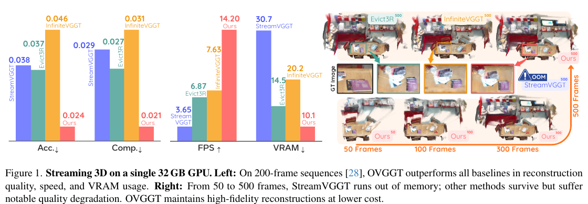

*原论文图 1。左侧比较单张 32GB GPU 上 200 帧序列的 Acc、Comp、FPS 和 VRAM；右侧对比 50 至 500 帧重建，StreamVGGT 在 200 帧左右受显存限制。*

## 相关工作

传统 SfM/MVS 通过显式匹配和优化恢复场景，几何解释直接，但通常需要后端迭代。DUSt3R、MASt3R 与 VGGT 等几何基础模型把对应、相机和点图预测整合到前馈网络中；多视图全局注意力提升了联合推理能力，也使整段序列的计算和显存随输入变长。流式工作用因果注意力和 KV 缓存逐帧处理，但完整保留历史仍会让缓存持续增长。

缓存压缩可以限制开销，然而按时间淘汰或按通用显著性选取 token，可能破坏几何重建需要的局部空间上下文和坐标参考。OVGGT 基于已有因果 VGGT，在推理阶段用 FFN 残差衡量新 token 的激活强度，再用 key 多样性衡量历史覆盖，并以空间平滑和动态锚点保护连续区域及全局参照。这个设计针对的是流式模型的缓存管理，不另训几何主干，也不增加 SLAM 后端优化。

## 从因果推理走向固定缓存

OVGGT 以 StreamVGGT 为基础。每帧经冻结的 DINOv2 编码器得到 patch token，并附加一个相机 token 和四个 register token。若图像高宽为 $H,W$，patch 尺寸为 $p$，patch 数为

$$
N_p=\left\lfloor\frac{H}{p}\right\rfloor\left\lfloor\frac{W}{p}\right\rfloor,
$$

则单帧 token 数 $M=1+4+N_p$。论文采用 24 个交替注意力块：每块先在一帧内部做空间自注意力，再用时间因果注意力读取历史 KV。相机头、深度头和点云头从最终 token 预测当前帧相机参数 $g_t$、深度图 $D_t$ 和三维点图 $P_t$：

$$
(g_t,D_t,P_t)=\Phi\left(\left[\mathrm{CA}^{(l)}(\mathrm{SA}^{(l)}(\cdot),C_t^{(l)})\right]_{l=0}^{L-1}\right).
\tag{1}
$$

$C_t^{(l)}$ 是第 $l$ 层在第 $t$ 帧处理时可读取的缓存，$\Phi$ 表示三个预测头。因果注意力让新帧只查询过去状态，推理不必重算旧帧；但每一帧的新键和值会继续追加：

$$
C_t^{(l)}=\left[C_{t-1}^{(l)};(K_t^{(l)},V_t^{(l)})\right],\qquad l=0,\ldots,L-1.
\tag{2}
$$

因此，处理 $T$ 帧后，缓存张量的标量元素数与 $2LTMN_hd$ 成正比，其中 $N_h$ 是注意力头数、$d$ 是每头维度；转换成字节还要乘以数值类型的字节数。论文在 $518\times392$ 输入、$M=1{,}041$ 时报告，100 帧约需 10GB 显存。若每层只保留固定预算 $B$ 个历史 token，当前 $M$ 个 token 的查询与历史做注意力，主要交互规模约为 $O(MB)$。固定输入分辨率、层数和预算后，这部分单帧成本不再随已处理帧数 $T$ 增长；全缓存时，历史长度仍随 $T$ 线性增加。

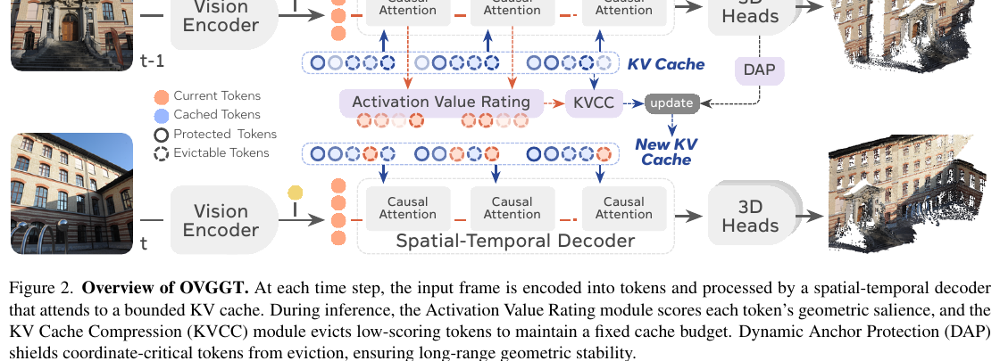

*原论文图 2。Activation Value Rating 给 token 打分，KVCC 在预算内淘汰低优先级缓存项；DAP 保护首帧与历史锚点。补充材料说明，相机预测头也需要独立的缓存管理。*

## 用 FFN 残差估计几何重要性

基于注意力权重的缓存选择看起来直接，但 FlashAttention 不会显式存下完整注意力矩阵；若为了打分而物化矩阵，会抵消高效注意力带来的内存优势。OVGGT 转而使用 Transformer 前向本来就会计算的 FFN 残差。

论文使用 Pre-LN 块。先对上一层表示做 LayerNorm 和多头注意力，再将 FFN 输出乘 LayerScale 系数后加回去：

$$
h^{(l)}=x^{(l-1)}+\mathrm{MHA}(\mathrm{LN}(x^{(l-1)})),
\tag{3}
$$

$$
x^{(l)}=h^{(l)}+\lambda_2^{(l)}\cdot\mathrm{FFN}(\mathrm{LN}(h^{(l)})).
\tag{4}
$$

同一层内，FFN 对每个 token 独立做非线性变换。作者把 FFN 残差向量的二范数作为该 token 在该层的激活分数：

$$
s_i^{(l)}=\left\|\lambda_2^{(l)}\cdot\mathrm{FFN}(\mathrm{LN}(h_i^{(l)}))\right\|_2.
\tag{5}
$$

这个分数衡量 FFN 对 token 表示造成的变化幅度，而不是注意力权重或预测置信度。作者的可视化显示，浅层分数偏向高频纹理，中层突出几何结构，深层则集中于语义边界；因此，残差幅度可作为几何显著性的经验代理。打分复用已有 FFN 输出，不需要额外网络模块，也兼容 FlashAttention。

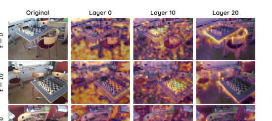

*原论文图 3。列分别展示输入图像及第 0、10、20 层的分数分布；随层数加深，显著区域由纹理细节转向结构和语义边界。*

### 空间平滑保留连续的局部上下文

直接按原始分数选 token，可能在图像网格上留下零散位置。深度和点云预测头依赖邻近 patch 的连续上下文，过于碎片化的保留区域会破坏局部几何。因此，作者先把 patch 分数排回二维网格，再用高斯核做平滑：

$$
\tilde S=\alpha(G*S)+(1-\alpha)S.
\tag{6}
$$

$G$ 是高斯核，$*$ 表示卷积，$\alpha$ 控制平滑强度。局部邻近 patch 的高分会互相带动，提升成片区域被保留的机会；相机和 register 等辅助 token 不在二维 patch 网格中，因此不做平滑，沿用原始分数。平滑不是在重建图像上滤波，而是在缓存选择前处理 token 重要性图。

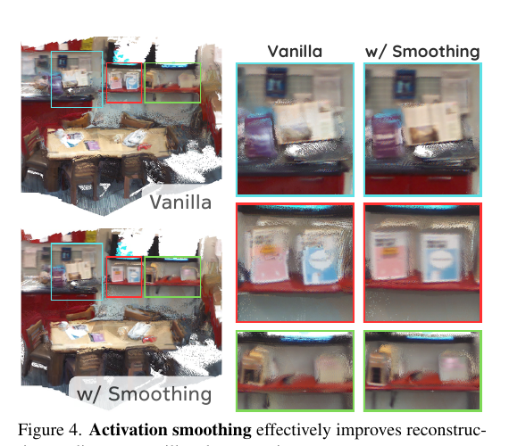

*原论文图 4。下排使用平滑分数进行保留，重建局部结构比直接按原始分数选 token 更清楚。*

## 混合评分与逐层 KV 缓存压缩

每一层分别管理自己的缓存。已在历史中的 token 不会再经过当前帧的 FFN，因而没有最新的激活分数；OVGGT 为它们另算键向量多样性。令 $k_i$ 为历史 token 的键向量，$\bar k$ 为历史键向量质心，分数定义为

$$
d_i=1-\cos(k_i,\bar k).
$$

与质心越不相似的键，分数越高，代表它为缓存提供了更多分布覆盖。当前帧 token 使用式 (5) 的激活分数。两类分数分别做 min-max 归一化到 $[0,1]$，再由 $\beta$ 平衡：

$$
r_i=\begin{cases}
(1-\beta)\hat d_i,&i\in\mathcal U_{\mathrm{hist}},\\
\beta\hat s_i,&i\in\mathcal U_{\mathrm{new}}.
\end{cases}
\tag{7}
$$

$\mathcal U_{\mathrm{hist}}$ 和 $\mathcal U_{\mathrm{new}}$ 分别是可淘汰的历史 token 与当前 token。较大的 $\beta$ 给新帧更多优先级，较小的 $\beta$ 更看重历史多样性。每层预算 $B^{(l)}$ 中，先扣除受保护集合 $\mathcal P$，其余名额从可淘汰集合 $\mathcal U$ 里按分数取最高项：

$$
\tilde C_t=\mathcal P\cup\operatorname{TopK}\left(\mathcal U,B^{(l)}-|\mathcal P|\right).
\tag{8}
$$

各层预算根据该层 token 多样性比例分配，使内容多样的层有较多空间，表示较同质的层压缩得更多。式 (7) 的历史多样性和当前激活分数作用于不同来源的 token，经过归一化后才由 $\beta$ 折中。实验将总预算设为 $B=200\mathrm K$，$\alpha=0.5$、$\beta=0.5$；作者称默认缓存约占 10GB，消融实验显示 200K 后准确度收益趋于平缓。

## 动态锚点让缓存裁剪保留坐标参照

仅保留高分 token 仍可能破坏长序列几何。缓存不断换入换出，当前相机离旧视区越来越远时，局部高分内容不一定保留足够的共同坐标参照。动态锚点保护（Dynamic Anchor Protection，DAP）把不能被逐出的一组 token 分成两类：

- **全局初始锚点**：首帧定义坐标原点。所有首帧 token 都永久加入保护集合 $\mathcal P_{\mathrm{init}}$，让后续预测始终可以访问初始参照。
- **历史锚点**：首帧可能与远处当前视角没有重叠，作者会在轨迹行进时登记少量历史参考帧，并保护这些帧中置信度较高的 patch token。

登记历史锚点时，取最近锚点帧 $a$ 的三维点 $P_a$ 和位姿 $T_a$，用相对变换 $T_t^{-1}T_a$ 将点投影到当前视图。覆盖率 $\rho_t$ 是投影点落在当前图像边界内的比例。当 $\rho_t<\tau$ 且距上次登记至少 100 帧时，登记当前帧为新锚点。对锚点帧的点云置信度 $c_j$ 排序，只保护最高的 $\eta$ 比例 patch；实验取 $\tau=0.2$、$\eta=0.05$。活动历史锚点最多 $K_{\max}=3$ 个，超限时按先进先出规则把最早锚点降回可淘汰集合。该机制以有限数量的历史参照覆盖较长轨迹，避免把锚点本身变成不断增长的缓存。

论文给出的保护集合上界为

$$
|\mathcal P|\le M+K_{\max}\lceil\eta\cdot N_p\rceil.
\tag{9}
$$

首帧项包含该帧全部 $M$ 个 token，第二项约束活动历史锚点的 patch token 数。保护项必须从每层固定预算中扣除，因此锚点越多，可供普通缓存选择的空间越少。补充材料的消融也显示，增加锚点到 5 或 10 个并不会继续带来稳定收益。

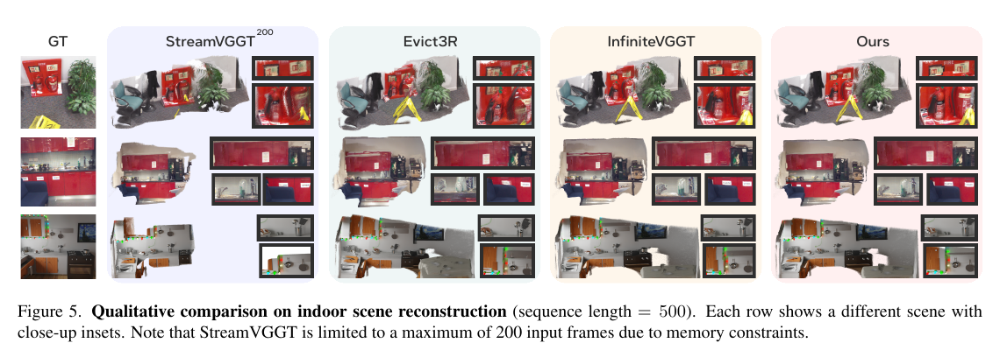

*原论文图 5。每行是一个场景及其局部细节；StreamVGGT 一栏最多使用 200 帧，其他列比较 500 帧结果。*

### 相机预测头也要有界

补充材料指出，StreamVGGT 的相机预测头还保存独立 KV 状态，尽管每帧只增加一个相机 token，长度仍会线性增长。为使端到端流程的缓存成本也受限，OVGGT 给相机头单独分配预算，并使用相同的缓存选择和锚点保护；当前帧只有一个相机 token，所以不适用二维空间平滑。聚合器登记或降级锚点时，对应的相机 token 同步保护或释放。若只裁剪主干缓存而忽略相机头，这个长序列开销仍会遗留。

## 重建、视频深度与推理效率

所有主要实验在一张 32GB NVIDIA RTX 5090 上完成。跨层总缓存预算为 200K token，各层按 token 多样性分配子预算，动态锚点参数如上。室内 7-Scenes 和 NRGBD 测试 100 至 500 帧序列，通常每隔一帧采样；另对 7-Scenes 使用相邻帧的完整输入作压力测试。户外 ETH3D 和超长 Long3D 使用完整序列，不下采样帧；Long3D 最长为 10,000 帧。对这两类较复杂序列，作者还测试 400K token 预算，显存比默认配置约多 1GB。

### 室内、户外和超长序列重建

7-Scenes、NRGBD、ETH3D 和 Long3D 报告准确度 Acc、完整度 Comp、法线一致性 NC 的均值与中位数；Acc 和 Comp 越低越好，NC 越高越好。表 1 中，7-Scenes 200 帧时 OVGGT 在各指标表现突出；500 帧时中位 Acc 为 0.011、Comp 为 0.003，NC 为 0.593。NRGBD 500 帧行中，OVGGT 的中位 Acc / Comp / NC 为 0.032 / 0.006 / 0.732。序列更长时结果并非所有数据集和指标都占优：在 NRGBD 对应的 500 帧行，OVGGT 的 NC 低于 InfiniteVGGT 的 0.743；因此作者概括的整体优势不应理解成每个分项的最佳值。

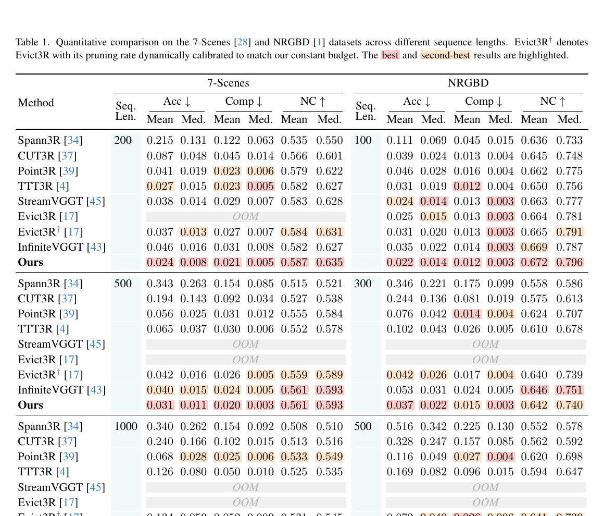

*原论文表 1。Acc、Comp 越低越好，NC 越高越好；$\dagger$ 表示按 OVGGT 固定预算动态校准剪枝率的 Evict3R。OOM 表示显存耗尽。*

ETH3D 与 Long3D 评测把整段序列作为输入。Long3D 点云极大，作者先下采样并做统计离群点剔除，再以自适应 DBSCAN 分簇，随后用基于特征的 RANSAC 粗配准和两阶段 ICP 精配准，再计算重建指标。这些配准步骤属于评测协议，不是 OVGGT 在线推理时增加的 SLAM 后端。

在 ETH3D 上，默认 200K 的 OVGGT 有较好的完整度，400K 则降低了 Acc（均值 0.535、中位 0.317），但并非每一项都最好。在 Long3D 上，OVGGT 两种预算都能处理最长 10,000 帧；400K 的 Acc 均值 / 中位为 2.449 / 1.675，而 200K 的 Comp 均值 / 中位为 0.390 / 0.060，说明更大预算会改变误差与完整度的取舍。

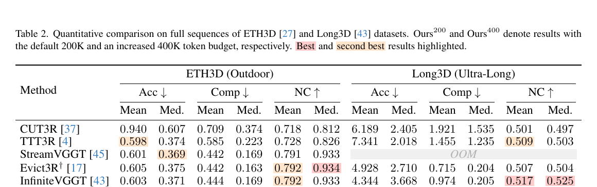

*原论文表 2。$\mathrm{Ours}_{200}$ 与 $\mathrm{Ours}_{400}$ 分别使用 200K 和 400K token 预算；Long3D 的点云配准使用论文附录所述的多阶段流程。*

### 视频深度估计

视频深度在 Bonn 和 KITTI 上按 100、300、500 帧评估，指标为 Abs Rel 和 $\delta<1.25$。OVGGT 在 KITTI 三种长度下的 Abs Rel 为 0.128、0.133、0.135，$\delta$ 为 0.839、0.844、0.839；StreamVGGT 只报告 100 帧，分别为 0.166 和 0.740。Bonn 上 OVGGT 的 Abs Rel 随长度增加为 0.055、0.071、0.067，数值较稳定，但 100 帧的 $\delta$ 略低于 InfiniteVGGT，不能据此称所有数据集和指标都领先。

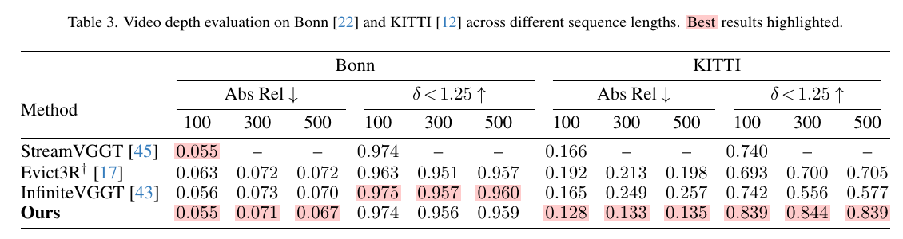

*原论文表 3。Abs Rel 越低越好，$\delta<1.25$ 越高越好；各方法可报告的最大序列长度不同。*

### 吞吐率与显存

图 6 在 7-Scenes 配置下对比 FPS、已分配显存和预留显存。OVGGT 的 FPS 在序列加长后维持约 14 左右，缓存预算固定；StreamVGGT 在约 200 帧耗尽 32GB。Evict3R 的预留显存低于 InfiniteVGGT，但作者指出 Evict3R 为了提取注意力权重需物化注意力矩阵，因此不能使用 FlashAttention；它的预留显存仍高于 OVGGT。图中显存曲线需区分 allocated（实际分配）和 reserved（框架预留），不能把两者当作同一指标。

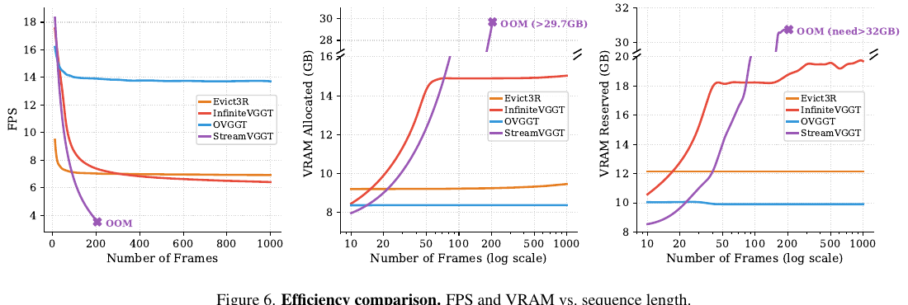

*原论文图 6。左图为 FPS，中、右图分别为已分配和预留 VRAM；StreamVGGT 曲线在约 200 帧处 OOM。*

## 消融实验解释预算和锚点的选择

缓存预算实验在 7-Scenes、NRGBD 的 300 帧序列上比较 100K 至 1M token。预算从 100K 增至 200K 时，多项指标改善；更大的预算总体收益较小，部分指标还轻微波动。因此 200K 是论文选择的性能—资源折中点，不是所有数据规模都保证最优的理论值。

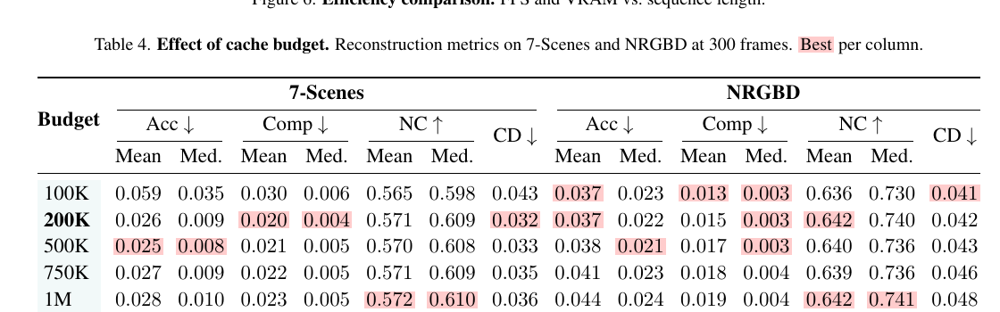

*原论文表 4。较小预算会压缩可用几何上下文，预算超过 200K 后边际提升有限。*

表 5 改变平滑系数 $\alpha$，表 6 改变混合分数系数 $\beta$。平滑有助于保持邻近 patch 的连续保留；过强的平滑会带来过度平均。$\beta=0.5$ 在历史多样性和当前帧显著性之间取得均衡，表中 7-Scenes 的 Acc 与 Chamfer Distance 较好；$\beta=0.9$ 的法线一致性略高，展示出指标间的折中。

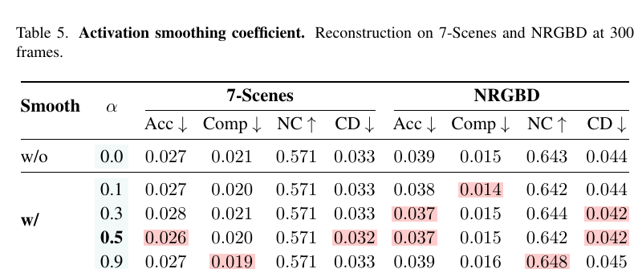

*原论文表 5。对比不同 $\alpha$ 在 7-Scenes 和 NRGBD 上的 Acc、Comp、NC、Chamfer Distance。*

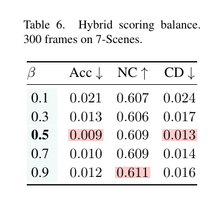

*原论文表 6。$\beta=0.5$ 的 Acc 与 Chamfer Distance 表现较好，$\beta=0.9$ 的 NC 略高。*

表 7 在 KITTI 500 帧深度估计中分近、远距离考察锚点贡献。只保留全局首帧锚点，近景 $F_1\%$、$F_5\%$、$\delta_{1.05}$ 分别提升 3.51%、2.81%、2.86%；再加入历史锚点，远景对应提升 10.15%、7.23%、7.23%，近景提升 5.35%、4.69%、4.76%。这些数字是相对无锚点基线的提升百分比。

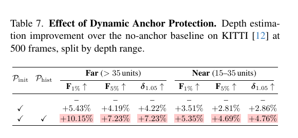

*原论文表 7。第一行为无锚点基线，第二行只开启全局初始锚点，第三行同时开启初始与历史锚点；指标是在 KITTI 500 帧上相对无锚点基线的提升。*

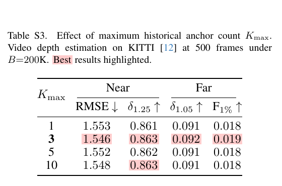

*原论文表 S3。$K_{\max}=3$ 在近、远距离指标上表现稳定；继续加到 5 或 10 的收益很小。*

## 补充材料：缓存选择、位姿和失败情况

### 全量缓存与随机淘汰的比较

补充图 S1 在 7-Scenes 的 25 至 200 帧比较全量缓存 StreamVGGT、随机淘汰和 OVGGT。随机淘汰与全量缓存在序列变长时误差上升；OVGGT 指标则相对稳定。这说明固定缓存容量本身不足以保证质量，挑选保留项的策略也很重要。这个证据来自 200 帧以内，长到 10,000 帧的结果来自主文 Long3D 评测，两者的范围应分开理解。

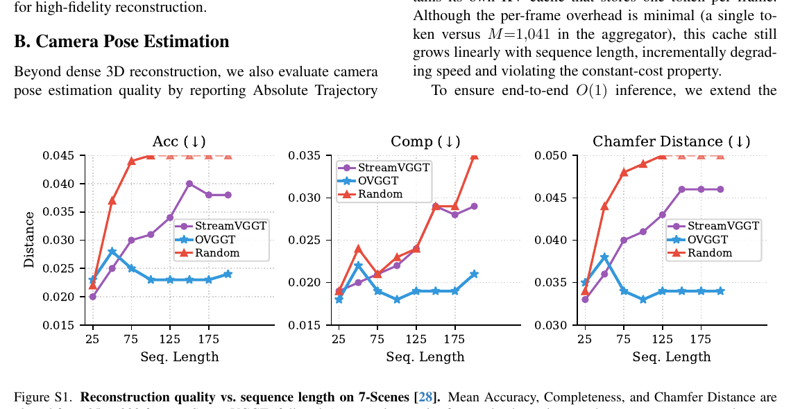

*原论文图 S1。Acc、Comp、Chamfer Distance 均为越低越好；随机淘汰在相同 200K 预算下很快退化。*

### 相机轨迹评估与缓存选择探测

补充表 S1 报告 TUM-Dynamic、ScanNet 的绝对轨迹误差 ATE。OVGGT 在 TUM-Dynamic 的 100 至 1,000 帧各长度都优于表中对照；1,000 帧 ATE 为 0.058，Evict3R$^\dagger$ 为 0.083。ScanNet 上 OVGGT 在 100 帧与 InfiniteVGGT 同为 0.056，300 帧 Evict3R$^\dagger$ 更低（0.184 对 0.198）；在 500 帧及更长序列，OVGGT 的 ATE 较低。这更支持其长序列稳定性优势，而不是每个长度都拿第一。

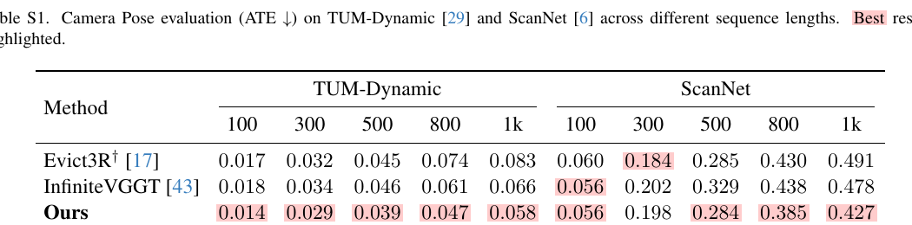

*原论文表 S1。ATE 越低越好；OVGGT 在 ScanNet 的 300 帧结果不是最佳。*

表 S2 在关闭 DAP、保持 200K 缓存预算时，对比三种逐 token 重要性信号。注意力权重方式需物化完整注意力矩阵，不能用 FlashAttention；$QK$ 点积与 FFN 残差则兼容。100 帧时 FFN 残差的 Acc、Comp、CD 优于另外两种；300 帧时注意力权重在 Acc 和 NC 略好，但 FFN 残差在 Comp 与 CD 占优。这个实验验证的是缓存评分，不包含 DAP 的锚点收益。

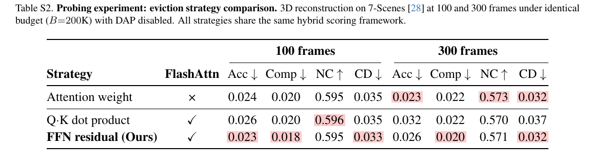

*原论文表 S2。所有方法使用相同混合评分框架且关闭 DAP；只有注意力权重方案不兼容 FlashAttention。*

补充图 S2 对比 OVGGT 在 100 帧、500 帧和真值下的室内重建。到 500 帧，结构边界与细节出现明显累积漂移。原因在于单向处理只让新帧读取有限历史，过去预测不会被重新访问或全局修正。作者提出后续可研究分阶段推理：小批次联合预测，或定期做轻量全局优化；这是未来方向，不属于 OVGGT 已实现的模块。

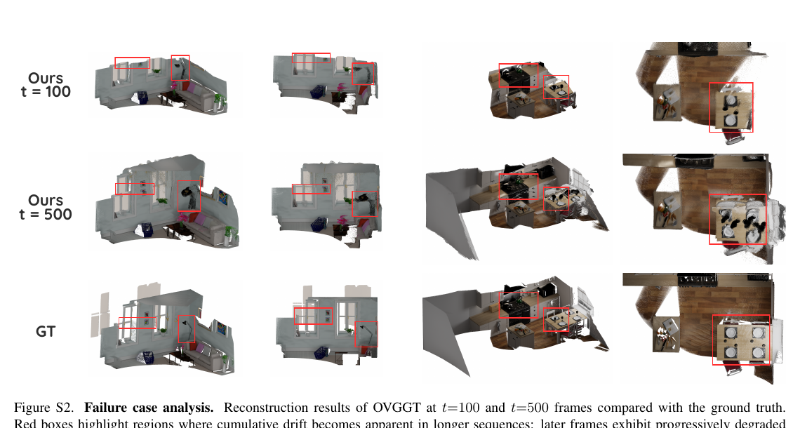

*原论文图 S2。红框标出长序列中误差逐渐显现的区域。*

### 基线评测适配与结果边界

论文为长序列比较调整了部分基线的数据加载方式：Spann3R 保留原有逐对前向；CUT3R 逐帧编码、解码；Point3R 每 10 帧分块编码后解码。作者说明这些调整保留模型权重和推理逻辑，改变的是数据加载和批处理方式，所有方法都把图像留在 CPU 并按需传到 GPU。阅读显存数据时应连同这些评测实现说明一起看。

整体上，OVGGT 在固定缓存预算下把因果流式模型的单帧成本限制在常数级，并通过 FFN 残差、空间平滑、历史多样性和锚点保护维持几何参考。它的优势是经过实验验证的长序列三维重建、深度与轨迹表现；主要边界也由论文明确展示：严格前向的信息流仍会积累漂移，模型没有回看和纠正早期预测的全局机制。与 [StreamVGGT](../streamvggt/index.md) 相比，OVGGT 在缓存上增加显式评分与动态锚点；与 [IncVGGT](../incvggt/index.md) 相比，OVGGT 不在输入端通过单应合并视图，而是控制因果模型的 token 状态；与 [TTT3R](../ttt3r/index.md)、[Point3R](../point3r/index.md) 等方法对照时，关键区别在它如何在固定历史预算里维持可读的几何参照。
